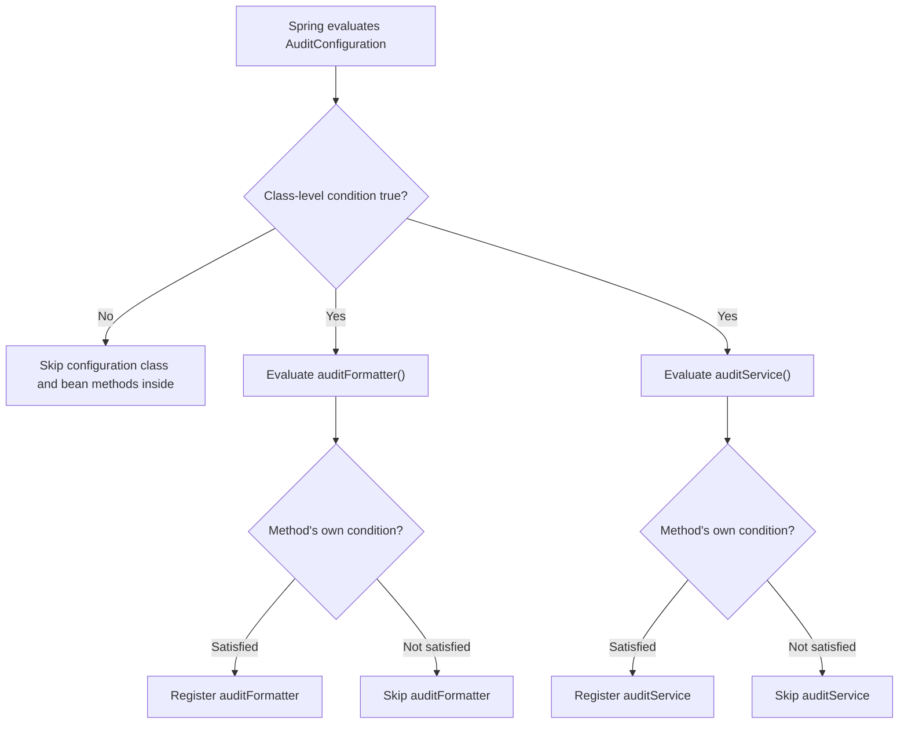

# Conditions on Classes, on `@Bean` Methods, and Their Combination

> **Spring Boot Fundamentals · Conditional Configuration**  
> Spring Boot can register beans depending on the classpath, properties, web environment, or beans already present in the `ApplicationContext`. Conditions can be placed **on an entire configuration class** or **on individual `@Bean` methods**. Where you place the condition determines the scope of impact: skipping an entire configuration group or skipping only a single bean. When conditions are placed at both levels, Spring must satisfy the relevant conditions before registering the bean.

## 1. What Problem Does Conditional Configuration Solve?

An application may run across multiple environments or be used by different kinds of applications. For example:

- Email-sending integration is enabled only when SMTP configuration is present.
- An adapter can only be initialized when the vendor's library appears on the classpath.
- The application needs a default implementation if no custom implementation exists yet.
- A bean is only appropriate for web applications, while batch applications do not need it.
- A feature is created only when its corresponding property is turned on.

If all beans are declared unconditionally, Spring may try to instantiate components the current environment does not support. The result can be missing classes, missing configuration, connection errors, or unnecessary beans appearing in the context.

Spring Framework provides the `@Conditional` mechanism; Spring Boot builds many common conditional annotations on top of that mechanism, for example:

| Annotation | Typical condition |
| --- | --- |
| `@ConditionalOnClass` | One or more classes are on the classpath |
| `@ConditionalOnMissingClass` | One or more classes are not on the classpath |
| `@ConditionalOnProperty` | Property is present or has a matching value |
| `@ConditionalOnBean` | A matching bean has already been registered |
| `@ConditionalOnMissingBean` | No matching bean exists yet |
| `@ConditionalOnResource` | Resource can be found |
| `@ConditionalOnWebApplication` | Application is of the specified web type |
| `@ConditionalOnNotWebApplication` | Application is not a web application |
| `@ConditionalOnJava` | Java version meets the condition |
| `@ConditionalOnExpression` | SpEL expression evaluates to a matching result |

These annotations belong to the `org.springframework.boot.autoconfigure.condition` package in corresponding Spring Boot versions. Attribute details may vary by version; examples in this lesson follow the API style familiar in Spring Boot 3.x.

## 2. Two Levels: Class-Level Conditions and Method-Level Conditions

The core takeaway of this lesson is distinguishing **the scope of a condition**.

### 2.1. Placing a Condition on a Configuration Class

Example:

```java
@Configuration(proxyBeanMethods = false)
@ConditionalOnProperty(
        prefix = "features.audit",
        name = "enabled",
        havingValue = "true"
)
public class AuditConfiguration {

    @Bean
    AuditFormatter auditFormatter() {
        return new AuditFormatter();
    }

    @Bean
    AuditService auditService(AuditFormatter formatter) {
        return new AuditService(formatter);
    }
}
```

When `features.audit.enabled` has the value `true`, the `AuditConfiguration` class qualifies to be processed and its inner bean methods can be registered according to their own conditions.

When the property does not satisfy the condition, Spring skips this configuration. Neither `auditFormatter` nor `auditService` is registered from that configuration class.

This approach is suitable when **an entire group of beans belongs to one feature** and makes no sense if only part of the group is created.

### 2.2. Placing a Condition on a `@Bean` Method

Example:

```java
@Configuration(proxyBeanMethods = false)
public class NotificationConfiguration {

    @Bean
    @ConditionalOnProperty(
            prefix = "features.notification",
            name = "email-enabled",
            havingValue = "true"
    )
    EmailSender emailSender() {
        return new EmailSender();
    }

    @Bean
    NotificationStatus notificationStatus() {
        return new NotificationStatus();
    }
}
```

Here the condition applies only to `emailSender`:

- When the property is satisfied, the `EmailSender` bean can be registered.
- When the property is not satisfied, the `emailSender` bean is not registered.
- The `notificationStatus` bean is still registered if the configuration class is loaded and no other condition prevents it.

This approach is suitable when **a configuration contains multiple beans, yet only some beans depend on a separate condition**.

### 2.3. Visualizing the Scope of Impact



The diagram illustrates the rule: **a class condition is the gate for the entire configuration; a method condition is the individual gate for the bean declared by that method**.

## 3. Condition on a Configuration Class: Audit Feature Example

Suppose an application has a group of audit components used only when a property is enabled.

File `application.yml`:

```yaml
features:
  audit:
    enabled: true
```

Configuration class:

```java
package com.example.orders.config;

import org.springframework.boot.autoconfigure.condition.ConditionalOnProperty;
import org.springframework.context.annotation.Bean;
import org.springframework.context.annotation.Configuration;

@Configuration(proxyBeanMethods = false)
@ConditionalOnProperty(
        prefix = "features.audit",
        name = "enabled",
        havingValue = "true"
)
public class AuditConfiguration {

    @Bean
    AuditFormatter auditFormatter() {
        return new AuditFormatter();
    }

    @Bean
    AuditSink auditSink(AuditFormatter formatter) {
        return new LoggingAuditSink(formatter);
    }
}
```

`AuditFormatter`, `AuditSink`, and `LoggingAuditSink` are application-defined types in the example.

### 3.1. When the Property Is Enabled

With:

```yaml
features:
  audit:
    enabled: true
```

the class-level condition is satisfied. Spring processes the bean methods inside `AuditConfiguration`, resolves dependencies, and registers the qualifying beans.

### 3.2. When the Property Is Disabled

With:

```yaml
features:
  audit:
    enabled: false
```

the configuration class is not applied. `AuditFormatter` and `AuditSink` beans are not created from this class.

This **does not automatically remove** audit beans if another configuration or component scan registers the same bean types. Conditions only control the configuration source to which the annotation is attached.

### 3.3. When the Property Does Not Exist

`@ConditionalOnProperty` has `matchIfMissing = false` by default. If the property is absent, the condition usually does not match unless you actively set `matchIfMissing = true`.

Example disabling the feature by default if unconfigured:

```java
@ConditionalOnProperty(
        prefix = "features.audit",
        name = "enabled",
        havingValue = "true",
        matchIfMissing = false
)
```

This is typically suitable for optional integration features: if unconfigured, do not initialize them.

## 4. Condition on a `@Bean` Method: Multiple Implementations Example

One configuration class can provide multiple different implementations for the same role.

Suppose there is an interface:

```java
package com.example.orders.notification;

public interface NotificationSender {
    void send(String recipient, String message);
}
```

Configuration:

```java
@Configuration(proxyBeanMethods = false)
public class NotificationConfiguration {

    @Bean
    @ConditionalOnProperty(
            prefix = "notification",
            name = "provider",
            havingValue = "console"
    )
    NotificationSender consoleSender() {
        return new ConsoleNotificationSender();
    }

    @Bean
    @ConditionalOnProperty(
            prefix = "notification",
            name = "provider",
            havingValue = "email"
    )
    NotificationSender emailSender() {
        return new EmailNotificationSender();
    }
}
```

Both methods live in the same configuration class without a class-level condition. Each method has its own condition:

| `notification.provider` value | `consoleSender` | `emailSender` |
| --- | --- | --- |
| `console` | Registered | Skipped |
| `email` | Skipped | Registered |
| `sms` | Skipped | Skipped |
| Property missing | Skipped | Skipped |

If a consumer injects a required `NotificationSender`, having no valid provider causes Spring to fail to find a bean and report an error. This can be the desired behavior: invalid properties should be caught at startup.

If having no sender is valid, the consumer can use `Optional<NotificationSender>` or a no-op implementation by design. However, if the property is declared with an unsupported value, consider validating configuration to fail clearly instead of silently skipping.

### 4.1. A Method Condition Does Not Remove Other Beans

Suppose you add a bean that does not depend on the provider:

```java
@Bean
NotificationHealthIndicator notificationHealthIndicator() {
    return new NotificationHealthIndicator();
}
```

This bean can still be registered even when `notification.provider` is neither `console` nor `email`, because the conditions are only attached to the first two factory methods.

This is a major difference from placing the same condition on the `NotificationConfiguration` class: if placed on the class, every bean method inside sits behind that condition gate.

## 5. Combining Class-Level and Method-Level Conditions

You can place conditions at both levels when you want to restrict a configuration group and then apply additional per-bean rules.

Example:

```java
@Configuration(proxyBeanMethods = false)
@ConditionalOnClass(name = "com.vendor.audit.AuditClient")
@ConditionalOnProperty(
        prefix = "features.audit",
        name = "enabled",
        havingValue = "true"
)
public class VendorAuditConfiguration {

    @Bean
    @ConditionalOnProperty(
            prefix = "features.audit",
            name = "mode",
            havingValue = "remote"
    )
    AuditClient remoteAuditClient(AuditProperties properties) {
        return new AuditClient(properties.endpoint());
    }

    @Bean
    @ConditionalOnProperty(
            prefix = "features.audit",
            name = "mode",
            havingValue = "local"
    )
    AuditSink localAuditSink() {
        return new LocalAuditSink();
    }
}
```

This configuration has three decision layers:

1. **Class condition:** class `com.vendor.audit.AuditClient` must be on the classpath.
2. **Class property condition:** `features.audit.enabled` must be `true`.
3. **Method condition:** each bean is registered only when `features.audit.mode` matches its specific value.

Both the class-level conditions and the method-level condition must be satisfied for the bean method to be applied.

### 5.1. Combined Results

| Vendor class | `features.audit.enabled` | `features.audit.mode` | Result |
| --- | --- | --- | --- |
| Absent | `true` | `remote` | Skip entire configuration class |
| Present | `false` | `remote` | Skip entire configuration class |
| Present | `true` | `remote` | Can register `remoteAuditClient` |
| Present | `true` | `local` | Can register `localAuditSink` |
| Present | `true` | `unknown` | Class is processed, yet both bean methods are skipped |

In the table, "can register" also depends on other conditions, valid dependencies, and having no errors during bean creation.

### 5.2. Conditions Combine Using AND Logic

When an element carries multiple conditions, all of those conditions must be satisfied together. Example:

```java
@Bean
@ConditionalOnClass(name = "com.vendor.audit.AuditClient")
@ConditionalOnProperty(
        prefix = "features.audit",
        name = "enabled",
        havingValue = "true"
)
AuditClient auditClient(AuditProperties properties) {
    return new AuditClient(properties.endpoint());
}
```

The bean is registered only if the class is present **and** the property has the right value.

When a bean method resides inside a conditional configuration class, the overall logic is:

```text
Class-level conditions all match
                 AND
Method-level conditions all match
                 AND
Other relevant Spring conditions match
                 ↓
Bean definition can be registered
```

Class conditions do not replace method conditions; nor can a method condition bring an excluded configuration class back into processing.

### 5.3. Any Non-Matching Condition Stops Its Respective Branch

If a class condition fails, Spring does not need to inspect the bean methods inside that class to register beans from that configuration. If the class condition succeeds yet a method condition fails, only the bean declared by that method is skipped.

This scope separation keeps configurations both concise and flexible.

## 6. Understanding `@ConditionalOnProperty`

`@ConditionalOnProperty` is one of the most frequently used annotations to toggle features.

Syntax:

```java
@ConditionalOnProperty(
        prefix = "features.cache",
        name = "enabled",
        havingValue = "true",
        matchIfMissing = false
)
```

Meaning:

- `prefix`: prefix portion of the property.
- `name`: property name to check.
- `havingValue`: expected value.
- `matchIfMissing`: whether the condition matches if the property does not exist.

With the example above, the full property is `features.cache.enabled`.

### 6.1. When `havingValue` Is Not Specified

If `havingValue` is omitted, a property that is present and has a value other than `false` (case-insensitive per Boot's rules) is generally considered a match.

Example:

```java
@ConditionalOnProperty(
        prefix = "features.cache",
        name = "enabled"
)
```

Values such as `true`, `yes`, or `on` can be treated as values other than `false` under the annotation's comparison rules; however, for clear configuration, standardize on explicit `true`/`false` booleans.

### 6.2. Checking Multiple Properties

Example:

```java
@ConditionalOnProperty(
        prefix = "partner",
        name = {"enabled", "endpoint"}
)
```

When multiple names are declared in the same annotation, properties are checked so that **all must satisfy the condition**. Do not treat the list of names as OR logic.

If feature-enabling logic is more complex (for example, valid endpoint, credentials present, and another mode), consider `@ConfigurationProperties` combined with validation or a custom condition rather than cramming every expression into one property annotation.

### 6.3. Collection Properties Have Limitations

`@ConditionalOnProperty` is not a reliable tool for checking a specific key inside an indexed collection property, such as `my.values[0]`. For list or map structures, bind them with `@ConfigurationProperties` and validate data via validation or an appropriate mechanism.

### 6.4. Use Class-Level or Method-Level Conditions for Properties?

- If the whole configuration only makes sense when `features.audit.enabled=true`, place the condition on the class.
- If the class has some beans that are always needed, yet one bean is enabled only by `features.audit.remote-enabled`, place a separate condition on the method.
- If the entire audit group turns on only when the vendor class exists, yet inside the group only the remote client needs a mode property, combine class-level and method-level as in section 5.

Choose placement based on **the scope of components being toggled**, not merely which annotation placement looks shorter.

## 7. Classpath Conditions: `@ConditionalOnClass` and `@ConditionalOnMissingClass`

A starter or integration module may need an optional library. If the class is absent, the corresponding configuration should not be applied.

Example class-level condition:

```java
@Configuration(proxyBeanMethods = false)
@ConditionalOnClass(name = "com.vendor.payment.PaymentClient")
public class VendorPaymentConfiguration {

    @Bean
    PaymentAdapter paymentAdapter(
            PaymentClient paymentClient) {
        return new PaymentAdapter(paymentClient);
    }
}
```

This example is illustrative: only when the vendor class is present is the configuration class processed. A `PaymentClient` bean and appropriate dependencies are still required for the factory method to succeed.

Using `name` as a fully qualified class name string is helpful when you want to avoid referencing the optional class directly in the configuration module's source code.

### 7.1. `@ConditionalOnMissingClass`

Example:

```java
@Configuration(proxyBeanMethods = false)
@ConditionalOnMissingClass("com.vendor.payment.PaymentClient")
public class FallbackPaymentConfiguration {

    @Bean
    PaymentAdapter fallbackPaymentAdapter() {
        return new OfflinePaymentAdapter();
    }
}
```

The fallback configuration class is only applied when the vendor class is not on the classpath. This is how you express a fallback branch based on library presence.

### 7.2. Be Careful with `@Bean` Return Types

An important point when using `@ConditionalOnClass` on a method: if the `@Bean` method has a return type directly referencing the optional class, the JVM or framework may need to process that type while inspecting the method before the method-level condition is evaluated as expected.

Risky example:

```java
@Configuration(proxyBeanMethods = false)
public class OptionalVendorConfiguration {

    @Bean
    @ConditionalOnClass(name = "com.vendor.payment.PaymentClient")
    com.vendor.payment.PaymentClient paymentClient() {
        return new com.vendor.payment.PaymentClient();
    }
}
```

If the vendor class is genuinely absent, referencing it in the method signature can trigger a class-loading error. A method-level condition does not always protect a signature containing an absent class.

A safer approach is to **separate the configuration depending on the optional library into its own configuration class**, then place `@ConditionalOnClass` at the class level:

```java
@Configuration(proxyBeanMethods = false)
public class PaymentAutoConfiguration {

    @Configuration(proxyBeanMethods = false)
    @ConditionalOnClass(name = "com.vendor.payment.PaymentClient")
    static class VendorPaymentConfiguration {

        @Bean
        com.vendor.payment.PaymentClient paymentClient() {
            return new com.vendor.payment.PaymentClient();
        }
    }
}
```

This is a conceptual structure assuming configurations are loaded properly; when writing a real starter, check configuration registration/importing and metadata for your Spring Boot version. Splitting classes allows Spring to evaluate the class condition before processing the configuration that depends on the vendor API.

## 8. Bean Conditions: `@ConditionalOnBean` and `@ConditionalOnMissingBean`

These conditions check bean definitions already present in the context.

### 8.1. `@ConditionalOnBean`

Create a bean only when another bean already exists:

```java
@Bean
@ConditionalOnBean(DataSource.class)
JdbcHealthReporter jdbcHealthReporter(DataSource dataSource) {
    return new JdbcHealthReporter(dataSource);
}
```

If a matching `DataSource` exists, the reporter bean can be created. Otherwise, the method is skipped.

### 8.2. `@ConditionalOnMissingBean`

Create a default implementation when no bean for the same role exists yet:

```java
@Bean
@ConditionalOnMissingBean(NotificationSender.class)
NotificationSender defaultNotificationSender() {
    return new LoggingNotificationSender();
}
```

This is a common pattern in auto-configuration: provide a default while giving the application the right to declare another implementation itself.

For example, the application can declare:

```java
@Bean
NotificationSender customNotificationSender() {
    return new CustomNotificationSender();
}
```

When the custom bean is already recognized before the condition evaluates, the default bean backs off.

### 8.3. Place Bean Conditions on a Class or Method?

On a method:

```java
@Configuration(proxyBeanMethods = false)
class ReportingConfiguration {

    @Bean
    @ConditionalOnBean(DataSource.class)
    JdbcHealthReporter jdbcHealthReporter(DataSource dataSource) {
        return new JdbcHealthReporter(dataSource);
    }

    @Bean
    ReportFormatter reportFormatter() {
        return new ReportFormatter();
    }
}
```

Only `jdbcHealthReporter` depends on `DataSource` presence; `reportFormatter` can still be created.

On a class:

```java
@Configuration(proxyBeanMethods = false)
@ConditionalOnBean(DataSource.class)
class JdbcReportingConfiguration {

    @Bean
    JdbcHealthReporter jdbcHealthReporter(DataSource dataSource) {
        return new JdbcHealthReporter(dataSource);
    }

    @Bean
    JdbcReportRepository jdbcReportRepository(DataSource dataSource) {
        return new JdbcReportRepository(dataSource);
    }
}
```

The entire JDBC configuration group is processed only when the class-level bean condition passes.

### 8.4. Processing Order Affects Bean Conditions

`@ConditionalOnBean` and `@ConditionalOnMissingBean` evaluate based on bean definitions that the `ApplicationContext` has processed at the time the condition is checked. Thus, the result can depend on configuration registration order.

That is why Spring Boot recommends using these bean conditions primarily in **auto-configuration**, where configuration order can be controlled through ordering mechanisms such as `@AutoConfiguration(after = ...)` or corresponding ordering annotations.

If an auto-configuration needs to know about a bean provided by another auto-configuration, ensure proper before/after ordering. Do not arbitrarily use `@ConditionalOnMissingBean` across multiple independent application configurations and assume Spring always sees all future beans.

### 8.5. Bean Conditions Are Not the Same as Dependency Injection

The following two differ:

```java
@Bean
@ConditionalOnBean(DataSource.class)
JdbcHealthReporter reporter(DataSource dataSource) {
    return new JdbcHealthReporter(dataSource);
}
```

and:

```java
@Bean
JdbcHealthReporter reporter(DataSource dataSource) {
    return new JdbcHealthReporter(dataSource);
}
```

The first has a condition before the bean definition is registered. The second declares a mandatory dependency; without `DataSource`, Spring cannot create the reporter and normally fails with an error.

When you want a bean to exist only if a dependency is present, a condition expresses intent better. When a bean strictly requires the dependency, mandatory injection and failing fast are appropriate.

## 9. Combining Multiple Condition Types on the Same Class and Method

A configuration can simultaneously use classpath, property, and bean conditions.

Example:

```java
@Configuration(proxyBeanMethods = false)
@ConditionalOnClass(name = "com.vendor.search.SearchClient")
@ConditionalOnProperty(
        prefix = "search",
        name = "enabled",
        havingValue = "true"
)
public class SearchConfiguration {

    @Bean
    @ConditionalOnBean(SearchCredentials.class)
    SearchClient searchClient(SearchCredentials credentials) {
        return new SearchClient(credentials.token());
    }

    @Bean
    @ConditionalOnMissingBean(SearchIndexer.class)
    SearchIndexer defaultSearchIndexer(SearchClient searchClient) {
        return new SearchIndexer(searchClient);
    }
}
```

Meaning:

- If the search library is absent, the entire configuration is skipped.
- If `search.enabled` is not `true`, the entire configuration is skipped.
- If both class conditions pass, individual bean methods are evaluated.
- `searchClient` is registered only if `SearchCredentials` exists.
- `defaultSearchIndexer` is registered only if no matching `SearchIndexer` exists yet and its `SearchClient` dependency can be resolved.

Note that `defaultSearchIndexer` does not automatically carry a "SearchClient exists" condition in its metadata. It has a mandatory dependency on `SearchClient`. If `searchClient` is skipped due to missing credentials, the indexer's factory method may still be considered and fail with a missing dependency when instantiated. If the indexer should also exist only when the client is present, add an explicit condition:

```java
@Bean
@ConditionalOnBean(SearchClient.class)
@ConditionalOnMissingBean(SearchIndexer.class)
SearchIndexer defaultSearchIndexer(SearchClient searchClient) {
    return new SearchIndexer(searchClient);
}
```

This is an important example showing that **dependency parameters and conditions are two separate layers**. Adding `@ConditionalOnBean` prevents registering the bean definition when the dependency does not exist instead of waiting until bean creation to discover it is missing.

## 10. `@Profile` Is Also a Condition

`@Profile` is a familiar way to enable configurations by environment:

```java
@Configuration(proxyBeanMethods = false)
@Profile("dev")
public class DevelopmentConfiguration {

    @Bean
    NotificationSender consoleNotificationSender() {
        return new ConsoleNotificationSender();
    }
}
```

The configuration is only applied when the `dev` profile is active.

`@Profile` can be placed on a `@Bean` method:

```java
@Bean
@Profile("prod")
NotificationSender productionNotificationSender() {
    return new ProductionNotificationSender();
}
```

And combined with other conditions:

```java
@Configuration(proxyBeanMethods = false)
@Profile("prod")
@ConditionalOnProperty(
        prefix = "notification",
        name = "enabled",
        havingValue = "true"
)
class ProductionNotificationConfiguration {

    @Bean
    NotificationSender productionNotificationSender() {
        return new ProductionNotificationSender();
    }
}
```

Both the profile and the property must be satisfied for the configuration to be applied. Use profiles to distinguish environment groups (`dev`/`test`/`prod`), while properties are typically suited for feature toggles or operational options. Both can work together, though avoid overlapping them if a single simple condition suffices.

## 11. Conditions on Components and Imported Configurations

`@Conditional` is not limited to `@Bean` methods. It can be attached to components/configurations processed by Spring.

Example:

```java
@Component
@ConditionalOnProperty(
        prefix = "features",
        name = "recommendation",
        havingValue = "true"
)
public class RecommendationEngine {
}
```

When component scanning discovers the class, the condition decides whether the component is registered.

For imported configurations:

```java
@Configuration(proxyBeanMethods = false)
@Import(RecommendationConfiguration.class)
class ApplicationFeatureConfiguration {
}
```

If the imported class has a failing condition, it is not processed as an active configuration. A condition attached to the right metadata controls registration under the corresponding Spring mechanism.

Do not confuse class conditions with component scan filters: `@Conditional` evaluates a condition to register an element; component scan filters filter candidates by type/name/annotation/assignable type.

## 12. Writing Custom Conditions When Built-in Annotations Are Not Enough

Built-in Spring Boot annotations cover most needs. When logic depends on a specialized rule, you can create a class implementing `Condition` and use `@Conditional`.

Example:

```java
import org.springframework.context.annotation.Condition;
import org.springframework.context.annotation.ConditionContext;
import org.springframework.core.type.AnnotatedTypeMetadata;

public class RegionEnabledCondition implements Condition {

    @Override
    public boolean matches(
            ConditionContext context,
            AnnotatedTypeMetadata metadata) {

        String region = context.getEnvironment()
                .getProperty("app.region");

        return "apac".equalsIgnoreCase(region);
    }
}
```

Using it on a configuration:

```java
@Configuration(proxyBeanMethods = false)
@Conditional(RegionEnabledCondition.class)
public class ApacConfiguration {

    @Bean
    RegionAwareService regionAwareService() {
        return new RegionAwareService();
    }
}
```

The condition receives `ConditionContext` and `AnnotatedTypeMetadata` to inspect the environment, classloader, registry/resource loader, and metadata of the element being evaluated.

### 12.1. Conditions Must Run Early and Remain Deterministic

Conditions are usually evaluated during configuration processing, before all singleton beans are created. Therefore:

- Do not call `context.getBean()` to retrieve application beans inside a condition.
- Do not initialize clients/databases or perform network I/O just to decide a condition.
- Do not depend on runtime state that changes after startup.
- Rely on environment, classpath, metadata, or appropriate registry information.
- Keep condition logic easy to test and deterministic.

If a condition needs complex configuration info, consider binding `@ConfigurationProperties` and validating at the proper stage rather than writing a heavy condition that performs a lot of work.

### 12.2. When Should You Use Built-in Annotations?

If the requirement is "class present," "bean present," "property enabled," "resource exists," or "web application," prefer Spring Boot's built-in annotations. Custom conditions should appear only when logic truly cannot be expressed clearly with standard conditions.

## 13. Diagnosing Why a Configuration or Bean Was Not Registered

A bean may be absent from the context for several reasons:

- Class-level condition did not match.
- Method-level condition did not match.
- Profile is not active.
- Optional class is not on the classpath.
- Bean condition was evaluated before the required candidate was registered.
- Configuration was not component-scanned/imported.
- A required dependency was missing when creating the bean.
- The factory method threw an exception.

### 13.1. Enabling the Condition Evaluation Report

Run the application with `--debug`:

```bash
java -jar catalog-service.jar --debug
```

Or Maven:

```bash
./mvnw spring-boot:run -Dspring-boot.run.arguments=--debug
```

Or Gradle:

```bash
./gradlew bootRun --args='--debug'
```

Spring Boot can print the Condition Evaluation Report, showing which auto-configurations matched, did not match, or were excluded, along with the corresponding reasons.

This report is especially useful for Boot's auto-configurations. For custom application configurations, condition logs and context tests may still be needed for finer visibility.

### 13.2. Actuator `conditions` Endpoint

If the application includes Actuator and the `conditions` endpoint is enabled/exposed appropriately, evaluated conditions can be viewed through that endpoint.

This endpoint can reveal classes, properties, and internal configurations. Do not expose it publicly just for debugging convenience; protect the endpoint with proper administration/security controls.

### 13.3. Distinguishing "Condition Failed" from "Bean Initialization Failed"

| Symptom | Meaning |
| --- | --- |
| Bean is missing and condition did not match | Configuration intentionally skipped the bean |
| Bean definition exists, yet factory method throws an exception | Bean was selected, yet object creation failed |
| Bean is missing because configuration was not imported/scanned | Condition may never have been evaluated |
| Missing dependency error when creating consumer | Consumer bean was registered, yet required dependency could not be resolved |
| Multiple beans of the same type exist | Conditions may have passed, yet autowiring cannot pick a single candidate |

Reading the exact error category prevents adding conditions in the wrong place. If a factory method throws an exception because an endpoint is blank, changing a classpath condition will not fix the configuration data.

## 14. Testing Conditions with `ApplicationContextRunner`

Spring Boot provides `ApplicationContextRunner` to test conditional configurations without starting the entire web application.

Example configuration:

```java
package com.example.orders.config;

import com.example.orders.AuditSink;
import com.example.orders.LoggingAuditSink;

import org.springframework.boot.autoconfigure.condition.ConditionalOnMissingBean;
import org.springframework.boot.autoconfigure.condition.ConditionalOnProperty;
import org.springframework.context.annotation.Bean;
import org.springframework.context.annotation.Configuration;

@Configuration(proxyBeanMethods = false)
@ConditionalOnProperty(
        prefix = "features.audit",
        name = "enabled",
        havingValue = "true"
)
public class AuditConfiguration {

    @Bean
    @ConditionalOnMissingBean(AuditSink.class)
    AuditSink auditSink() {
        return new LoggingAuditSink();
    }
}
```

Test:

```java
package com.example.orders.config;

import static org.assertj.core.api.Assertions.assertThat;

import com.example.orders.AuditSink;
import org.junit.jupiter.api.Test;
import org.springframework.boot.test.context.runner.ApplicationContextRunner;

class AuditConfigurationTest {

    private final ApplicationContextRunner contextRunner =
            new ApplicationContextRunner()
                    .withUserConfiguration(AuditConfiguration.class);

    @Test
    void doesNotCreateAuditBeanWhenFeatureIsDisabled() {
        contextRunner
                .withPropertyValues("features.audit.enabled=false")
                .run(context -> assertThat(context)
                        .doesNotHaveBean(AuditSink.class));
    }

    @Test
    void createsDefaultAuditBeanWhenFeatureIsEnabled() {
        contextRunner
                .withPropertyValues("features.audit.enabled=true")
                .run(context -> assertThat(context)
                        .hasSingleBean(AuditSink.class));
    }
}
```

The example uses JUnit Jupiter, AssertJ, and Spring Boot test support. `ApplicationContextRunner` spins up a small context with the specified configuration and properties, then closes the context after the callback.

### 14.1. Testing Each Condition Independently

When a bean depends on multiple conditions, tests should separate each case:

| Classpath | Property | Bean dependency | Expected outcome |
| --- | --- | --- | --- |
| Present | Enabled | Present | Bean can be created |
| Present | Disabled | Present | Configuration/bean skipped by condition |
| Absent | Enabled | Present | Class-dependent configuration skipped |
| Present | Enabled | Absent | Bean-conditioned bean method skipped |
| Present | Enabled | Custom bean present | Default bean backs off if `@ConditionalOnMissingBean` sees custom bean |

Tests should check both **the presence** and **the absence** of beans. Testing only the feature-enabled case does not prove the disabled condition works properly.

### 14.2. Testing Ordering of Bean Conditions

If using `@ConditionalOnBean` or `@ConditionalOnMissingBean` in auto-configuration, tests need to simulate real import/auto-configuration ordering and custom beans. A passing result in a simple setup does not guarantee every registration order behaves identically.

Use appropriate ordering metadata in auto-configuration and write tests with user-provided configurations to confirm the default bean truly backs off when the user provides their own bean.

## 15. Common Pitfalls When Combining Conditions

| Symptom | Cause | Resolution |
| --- | --- | --- |
| Disabling one property unexpectedly removes multiple beans | Condition placed at class level when only one bean should be disabled | Move the condition down to the corresponding method |
| Property enabled, yet no beans in the group exist | Class-level classpath or profile condition failed | Check all class-level conditions |
| Class is applied, yet one bean does not appear | Method-level condition failed | Check the method's property/bean/resource condition |
| Vendor class present, yet client is not created | Property, dependency, or another condition did not match | Read the condition report and dependency graph |
| `NoClassDefFoundError` despite `@ConditionalOnClass` on method | Method signature references optional class before protective condition is applied | Extract nested/standalone configuration and place condition at class level |
| `@ConditionalOnMissingBean` still creates default despite app custom bean | Custom bean not processed yet when condition evaluated | Check ordering; prefer bean conditions in properly ordered auto-configuration |
| Bean condition does not match in application configuration | Candidate registered later or lives in another context | Check processing timing and `ApplicationContext` boundaries |
| Feature disabled, yet consumer fails with missing bean | Consumer injects mandatory dependency even though bean is skipped | Use a valid fallback/optional or condition the consumer |
| Multiple implementations registered together | Method conditions both match or property uncontrolled | Define mutually exclusive properties and validate values |
| No beans because configuration is not loaded | Wrong scan package, missing `@Import`, or missing auto-configuration metadata | Check how the configuration class is registered |
| Condition always matches despite missing property | `matchIfMissing=true` or `havingValue` omitted unintentionally | Clarify behavior when property is missing |
| Custom condition slows down startup | Condition performs I/O or instantiates services | Check only metadata/environment/classpath; move runtime work to beans |

### 15.1. Method Conditions Do Not Automatically Protect Consumers

Example:

```java
@Configuration(proxyBeanMethods = false)
class SearchConfiguration {

    @Bean
    @ConditionalOnProperty(
            prefix = "search",
            name = "enabled",
            havingValue = "true"
    )
    SearchClient searchClient() {
        return new SearchClient();
    }

    @Bean
    SearchService searchService(SearchClient searchClient) {
        return new SearchService(searchClient);
    }
}
```

If `search.enabled=false`, `searchClient` is skipped, yet `searchService` is still considered and has a mandatory dependency. When Spring creates the service, it cannot find `SearchClient`.

If `SearchService` also only makes sense when search is enabled, add the corresponding condition:

```java
@Bean
@ConditionalOnProperty(
        prefix = "search",
        name = "enabled",
        havingValue = "true"
)
SearchService searchService(SearchClient searchClient) {
    return new SearchService(searchClient);
}
```

Or place the condition on the class if the entire search group toggles together. This is a direct example of why understanding **condition scope** matters.

### 15.2. Avoid Meaningless Duplicate Conditions

If a configuration class already requires `search.enabled=true`, placing the exact same condition on every `@Bean` method inside can be redundant. Method conditions should only add requirements specific to a bean or when splitting configurations clarifies responsibilities.

Keeping conditions where they express the right scope saves readers from tracing repeated annotations.

## 16. Rules for Designing Conditional Configuration

1. **Place conditions at the class level when an entire group of beans shares the same feature lifecycle.** For instance, an entire vendor integration only makes sense when both the library and feature flag are ready.
2. **Place conditions at the method level when only one bean depends on the condition.** Remaining beans in the configuration still need to be created.
3. **Combine class and method conditions when two scopes differ.** Class conditions gate the group; method conditions select individual beans inside.
4. **Understand AND logic.** Relevant conditions must all match; a method condition cannot override a failing class condition.
5. **Use explicit properties with intentional defaults.** Pay close attention to `matchIfMissing` and `havingValue`.
6. **Use `@ConditionalOnMissingBean` to provide replaceable defaults.** In auto-configuration, control ordering so custom beans are recognized at the right time.
7. **Isolate configurations depending on optional classes.** Avoid letting `@Bean` signatures cause absent classes to be loaded before conditions are evaluated.
8. **Do not confuse conditions with dependency injection.** Conditions decide whether a bean definition is registered; parameters declare dependencies required to create the bean.
9. **Do not make conditions perform runtime work.** Conditions should evaluate metadata and environment, not call external services.
10. **Test both matching and non-matching cases.** Every feature toggle needs tests for both branches.
11. **Diagnose with the condition report.** Do not add new annotations before understanding why the current bean was not created.
12. **Keep fallbacks meaningful for business logic.** If a bean is absent, consumers must have valid behavior or the application must fail fast.

## 17. Practice Exercise: Toggling an Entire Feature vs. an Individual Bean

### Step 1 — Create an Audit Configuration Group

Create `AuditConfiguration` with a class-level condition:

```java
@Configuration(proxyBeanMethods = false)
@ConditionalOnProperty(
        prefix = "features.audit",
        name = "enabled",
        havingValue = "true"
)
class AuditConfiguration {

    @Bean
    AuditFormatter auditFormatter() {
        return new AuditFormatter();
    }

    @Bean
    AuditSink auditSink(AuditFormatter formatter) {
        return new LoggingAuditSink(formatter);
    }
}
```

### Step 2 — Run with the Feature Disabled

```yaml
features:
  audit:
    enabled: false
```

Verify the context has neither `AuditFormatter` nor `AuditSink` created from this configuration.

### Step 3 — Run with the Feature Enabled

Change the property to `true`. Verify both beans appear and `AuditFormatter` is passed into `AuditSink`.

### Step 4 — Add a Method Condition

Inside `AuditConfiguration`, add a metrics bean created only when `features.audit.metrics-enabled=true`. Keep audit enabled while metrics is disabled; verify the main audit beans exist while metrics does not.

### Step 5 — Add a Default Bean

Create a `@Bean` with `@ConditionalOnMissingBean(AuditSink.class)`. Try providing a custom implementation in a test configuration and confirm the default bean backs off under proper ordering.

### Step 6 — Try a Classpath Condition

Create a separate configuration using `@ConditionalOnClass(name = "...")`. Test the configuration with the class present and absent on the test classpath; observe the condition report. For an optional vendor class, keep references to that class inside a separate configuration class guarded at the class level.

### Step 7 — Read the Report

Run the application with `--debug`. Record which condition did not match and why. Distinguish when a class is skipped from when only a single bean method is skipped.

### Self-Check Questions

1. Which bean methods inside a `@Configuration` class are affected by a condition on the class?
2. Does a condition on one `@Bean` method affect other beans in the same class?
3. When conditions are placed on both the class and a method, which conditions must be satisfied?
4. Under what logical operator are multiple conditions attached to the same element combined?
5. How does `@ConditionalOnProperty` handle a missing property by default?
6. What is the difference between `@ConditionalOnBean` and a mandatory dependency parameter?
7. Why is `@ConditionalOnMissingBean` commonly used in auto-configuration?
8. Why does configuration processing order matter for bean conditions?
9. Why might a condition on a `@Bean` method referencing an optional class in its return type not be safe enough?
10. When should you extract a nested configuration with `@ConditionalOnClass`?
11. Can `@Profile` be combined with `@ConditionalOnProperty`?
12. Why shouldn't a condition call a database or HTTP service inside `matches()`?
13. If a bean method is skipped while a consumer still injects that type unconditionally, what happens?
14. What tool is used to inspect why an auto-configuration matched or did not match?

## 18. Quick Reference Table

| Goal | Condition placement to consider |
| --- | --- |
| Entire integration group exists only when vendor library is present | On `@Configuration` class using `@ConditionalOnClass` |
| Entire feature group enabled only by a feature flag | On configuration class using `@ConditionalOnProperty` |
| Only one remote client needs an endpoint property | On the `@Bean` method creating the client |
| Create reporter only when `DataSource` exists | On the reporter method using `@ConditionalOnBean` |
| Provide default implementation if app has not declared one | On the default method using `@ConditionalOnMissingBean` |
| Select a bean for `dev`/`prod` profile | `@Profile` on class or method |
| Whole group needs classpath and property, individual beans need extra rules | Combine class-level and method-level |
| Custom rule without built-in annotation | Custom `Condition` via `@Conditional` |
| Find why a bean does not appear | Condition Evaluation Report, logs, and context tests |

**Most important takeaway:** class-level conditions control applying an entire configuration group; method-level conditions control the bean declared by that method. When combining both levels, a bean is registered only if class conditions, method conditions, and other relevant conditions all match. Understanding scope and evaluation timing keeps Spring Boot configuration flexible without accidentally leaving consumers with missing dependencies or skipping beans that are still needed.
