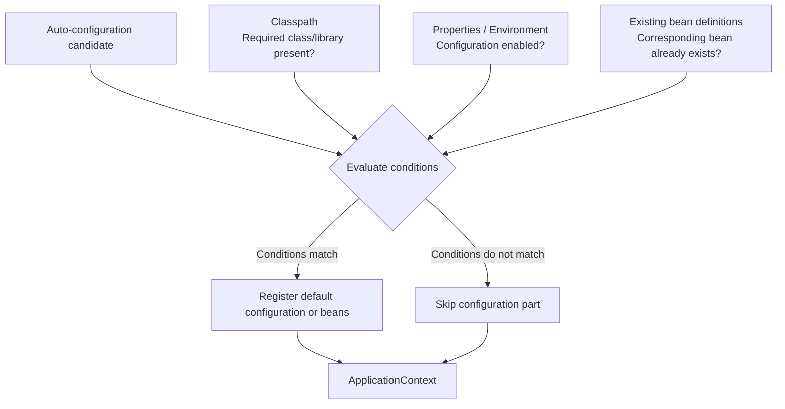
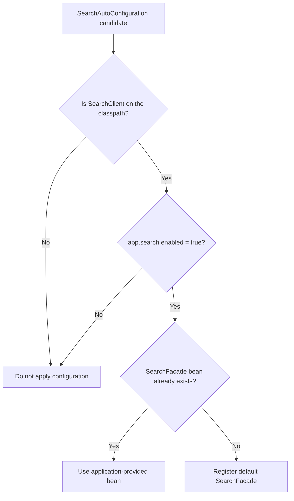
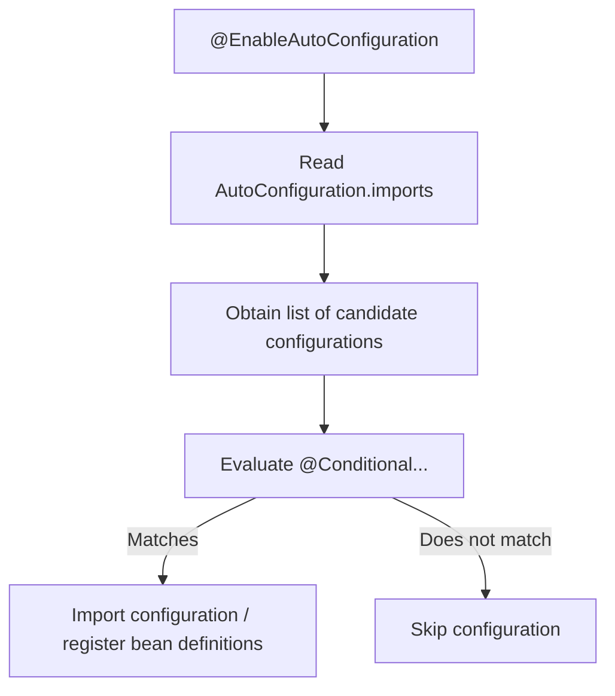
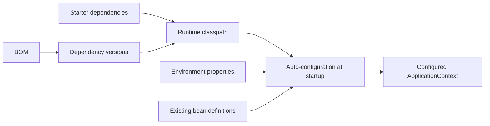

# Auto-configuration takes input from the classpath, properties, and existing beans

Spring Boot can automatically configure many components of an application when you add a starter or declare a few properties. For example, when an application has the Spring MVC library on the classpath, Boot can prepare the appropriate web infrastructure; when a JDBC driver and datasource configuration are present, Boot can create a data connection; when the application already provides its own bean, the corresponding default configuration can back off.

These behaviors are not a set of defaults turned on unconditionally. **Auto-configuration is a collection of conditional configurations**, brought into processing by Spring Boot and applied only when the appropriate conditions match. Three important inputs typically determine the result:

1. **Classpath:** which libraries and classes are present in the application.
2. **Properties:** which configuration values are present in the Spring `Environment`.
3. **Existing beans:** which matching bean definitions have already been registered in the application context at the time the condition is evaluated.

This lesson belongs to the **Auto-configuration** chapter of *Spring Boot Fundamentals*. We will trace how these three inputs affect configuration decisions, write an illustrative auto-configuration, see how default configuration backs off when the application provides its own bean, and learn how to read the condition evaluation report to find out why a configuration was applied or skipped.

The examples use Java 21 and Spring Boot 3.x. Specific class names in the examples are illustrative code to explain the mechanism; actual auto-configurations and detailed conditions may vary across Boot versions.

## 1. Auto-configuration is not a single default switch

A Spring Boot application typically has a main class:

```java
package com.example.demo;

import org.springframework.boot.SpringApplication;
import org.springframework.boot.autoconfigure.SpringBootApplication;

@SpringBootApplication
public class DemoApplication {
    public static void main(String[] args) {
        SpringApplication.run(DemoApplication.class, args);
    }
}
```

`@SpringBootApplication` combines three key capabilities:

- `@SpringBootConfiguration` marks the root configuration of the application.
- `@ComponentScan` discovers application components within the package scope.
- `@EnableAutoConfiguration` enables the mechanism that brings Boot's auto-configuration candidates into the processing pipeline.

Auto-configuration is activated via `@EnableAutoConfiguration`, but activating it does not mean every configuration in Spring Boot is applied. Boot inspects the candidates, and then conditions decide which configuration classes or `@Bean` methods are used.

For example, an application without web libraries does not need servlet web configuration. If the application has Spring MVC and is running in a servlet web environment, the relevant conditions can match so that Boot provides default web infrastructure beans.

### 1.1. The three-input picture



An auto-configuration can check multiple conditions at the same time. For example:

- A library class must be present on the classpath.
- A property must have the value `true`.
- The application must be a servlet web application.
- No bean has been provided yet by the application or another configuration.

Only when all relevant conditions are satisfied is the corresponding configuration applied.

## 2. First input: classpath

The **classpath** is the set of classes and libraries accessible to the application at compile time or runtime. In Spring Boot, dependencies declared in Maven/Gradle affect the runtime classpath. Auto-configuration can inspect the presence of classes or libraries to decide whether to provide configuration.

For example, Spring Boot provides these conditions:

| Annotation | Condition |
|---|---|
| `@ConditionalOnClass` | One or more required classes are present on the classpath. |
| `@ConditionalOnMissingClass` | One or more specified classes are not on the classpath. |

### 2.1. Adding a starter changes the classpath

A starter such as `spring-boot-starter-web` is a dependency that bundles libraries for web applications. When you add the starter, the dependency graph can include Spring MVC, Jackson, and an embedded servlet container according to the dependency set of the Boot version in use.

A starter **brings libraries into the dependency graph**. Auto-configuration **inspects those libraries** and decides which configurations are appropriate. The two mechanisms cooperate, but they are not the same thing.

For example:

```groovy
dependencies {
    implementation 'org.springframework.boot:spring-boot-starter-web'
}
```

This is the dependency section of a Gradle project that already has the Spring Boot plugin and appropriate dependency management. When web classes appear on the classpath, configurations with `@ConditionalOnClass` requiring the corresponding classes can become matching candidates.

If you remove the web starter from the project, the related web classes may no longer be on the runtime classpath. Configurations that depend on them will usually not match their conditions, and Boot will not apply that configuration.

### 2.2. Example of a classpath-conditional configuration

Here is an illustrative example for an optional library:

```java
package com.example.demo.autoconfigure;

import com.example.optional.SearchClient;
import org.springframework.boot.autoconfigure.AutoConfiguration;
import org.springframework.boot.autoconfigure.condition.ConditionalOnClass;
import org.springframework.context.annotation.Bean;

@AutoConfiguration
@ConditionalOnClass(SearchClient.class)
public class SearchClientAutoConfiguration {

    @Bean
    SearchFacade searchFacade(SearchClient client) {
        return new SearchFacade(client);
    }
}
```

Meaning:

1. Boot examines `SearchClientAutoConfiguration` as a registered auto-configuration candidate.
2. `@ConditionalOnClass(SearchClient.class)` checks whether the `SearchClient` class can be found on the classpath.
3. If the class is present and other conditions match, Spring processes the configuration and the `@Bean` method.
4. If the library is absent, this configuration is not applied.

`SearchClient` and `SearchFacade` here are illustrative types; when writing auto-configuration for a real library, you need to declare dependencies/optional dependencies and configure class-loading appropriately so that applications without the optional library can still start.

### 2.3. Classpath is not component scan

These two mechanisms are easy to confuse:

- **Component scan** searches for component classes within the application's scanned packages.
- **Classpath conditions** check whether a class exists in the libraries/classpath.

A class can be on the classpath without being inside a component-scanned package. Conversely, a class inside the application's source package that is missing a required dependency may still fail to compile or fail a configuration's classpath condition.

Boot's auto-configurations are registered through a dedicated mechanism and do not require scanning every library package like application component scanning does.

## 3. Second input: properties in the Environment

Spring Boot reads configuration from multiple sources and places them into the `Environment`. For example:

- `application.properties` or `application.yml`.
- Profile-specific configuration files such as `application-dev.yml`.
- Operating system environment variables.
- Java system properties.
- Command-line arguments.
- Other property sources added through configuration mechanisms.

Auto-configuration can inspect these values using `@ConditionalOnProperty` or use them to bind into a `@ConfigurationProperties` object.

### 3.1. `@ConditionalOnProperty`

This annotation lets you enable/disable a piece of configuration based on a property:

```java
@AutoConfiguration
@ConditionalOnProperty(
        prefix = "app.audit",
        name = "enabled",
        havingValue = "true",
        matchIfMissing = false
)
public class AuditAutoConfiguration {
    // Audit beans are registered only when the condition matches.
}
```

With the configuration above:

| Property value | Result |
|---|---|
| `app.audit.enabled=true` | Condition matches. |
| `app.audit.enabled=false` | Condition does not match. |
| Property does not exist | Does not match because `matchIfMissing=false`. |
| Property has a value other than `true` | Does not match `havingValue="true"`. |

Example `application.yml`:

```yaml
app:
  audit:
    enabled: true
```

When the property has the value `true`, the audit configuration satisfies this condition. That still does not guarantee every bean inside will definitely be created: other conditions on the class or methods must also match.

### 3.2. `matchIfMissing` determines the default when the property is absent

`matchIfMissing` is especially important when designing a library:

- `matchIfMissing = false`: if the property is not configured, the configuration is not enabled.
- `matchIfMissing = true`: an absent property is still considered matching; the default behavior is to allow the configuration to apply.

For example:

```java
@ConditionalOnProperty(
        prefix = "app.metrics",
        name = "enabled",
        havingValue = "true",
        matchIfMissing = true
)
```

This is an "enabled by default if the property is absent" choice. Choose based on the feature's goal: libraries requiring explicit opt-in usually default to disabled; a useful and safe default configuration can choose to be enabled by default.

### 3.3. Property conditions differ from configuration properties binding

The two mechanisms are often used together, but they serve different purposes:

| Mechanism | Question it answers |
|---|---|
| `@ConditionalOnProperty` | Should this configuration/bean be registered? |
| `@ConfigurationProperties` | Which configuration values should be bound into an object for beans to use? |

Example of a properties class:

```java
package com.example.demo.audit;

import org.springframework.boot.context.properties.ConfigurationProperties;

@ConfigurationProperties(prefix = "app.audit")
public record AuditProperties(
        boolean enabled,
        String destination
) {
}
```

Auto-configuration can toggle based on a property and then use the properties object:

```java
@AutoConfiguration
@EnableConfigurationProperties(AuditProperties.class)
@ConditionalOnProperty(
        prefix = "app.audit",
        name = "enabled",
        havingValue = "true"
)
public class AuditAutoConfiguration {

    @Bean
    AuditPublisher auditPublisher(AuditProperties properties) {
        return new AuditPublisher(properties.destination());
    }
}
```

Here, the condition decides whether the audit configuration is active; configuration properties supply `destination` to the bean. Without `app.audit.enabled=true`, the configuration is skipped according to the annotation's default behavior.

### 3.4. Property sources have precedence order

If the same property is set in multiple sources, Spring Boot applies property source precedence rules. For instance, command-line arguments can usually override values in a configuration file. This means the same binary can start with different auto-configuration decisions depending on the environment.

Example file:

```yaml
app:
  audit:
    enabled: false
```

Run:

```bash
./gradlew bootRun --args='--app.audit.enabled=true'
```

The command-line value can override the property in the file, causing the condition to see `true`. On Windows PowerShell, you can use:

```powershell
.\gradlew.bat bootRun --args="--app.audit.enabled=true"
```

When investigating a mismatched condition, check the **effective value in the Environment**, not just a single `application.yml` file.

## 4. Third input: existing beans in the ApplicationContext

Auto-configuration often needs to provide default beans so the application can run quickly without manual configuration. However, when the application already has its own bean, Boot should usually yield control to the application.

Key conditions:

| Annotation | Meaning |
|---|---|
| `@ConditionalOnBean` | Applies only when a matching bean already exists. |
| `@ConditionalOnMissingBean` | Applies only when no matching bean exists yet. |
| `@ConditionalOnSingleCandidate` | Applies only when there is a single selectable candidate according to the matching rules. |

### 4.1. `@ConditionalOnMissingBean` and the back-off mechanism

Suppose a library wants to provide a default formatter:

```java
package com.example.demo.greeting;

public interface GreetingFormatter {
    String format(String name);
}
```

Auto-configuration:

```java
package com.example.demo.autoconfigure;

import com.example.demo.greeting.GreetingFormatter;
import org.springframework.boot.autoconfigure.AutoConfiguration;
import org.springframework.boot.autoconfigure.condition.ConditionalOnMissingBean;
import org.springframework.context.annotation.Bean;

@AutoConfiguration
public class GreetingAutoConfiguration {

    @Bean
    @ConditionalOnMissingBean(GreetingFormatter.class)
    GreetingFormatter greetingFormatter() {
        return name -> "Hello, " + name + "!";
    }
}
```

If the application does not yet have a `GreetingFormatter` bean, Boot provides the default. If the application defines its own bean:

```java
package com.example.demo.config;

import com.example.demo.greeting.GreetingFormatter;
import org.springframework.context.annotation.Bean;
import org.springframework.context.annotation.Configuration;

@Configuration(proxyBeanMethods = false)
public class GreetingConfiguration {

    @Bean
    GreetingFormatter vietnameseGreetingFormatter() {
        return name -> "Xin chào, " + name + "!";
    }
}
```

then the default's `@ConditionalOnMissingBean(GreetingFormatter.class)` condition will no longer match. The application-provided bean is used, and the default auto-configuration **backs off**.

`@ConditionalOnMissingBean` does not delete existing beans and does not alter the classpath. It only decides whether that configuration's default bean should be registered.

### 4.2. `@ConditionalOnBean`: configure only when a dependency already exists

For example, an integration that is only useful when a `DataSource` bean exists:

```java
@AutoConfiguration
@ConditionalOnBean(javax.sql.DataSource.class)
public class DatabaseMetricsAutoConfiguration {

    @Bean
    DatabaseMetrics databaseMetrics(javax.sql.DataSource dataSource) {
        return new DatabaseMetrics(dataSource);
    }
}
```

If the context does not yet have a matching `DataSource` bean, this configuration is not applied. When a datasource is registered from another configuration or an earlier auto-configuration, the condition can match and the metrics bean is provided.

This is useful when a configuration depends on infrastructure created elsewhere. Instead of attempting to initialize with a missing dependency, auto-configuration can wait for the matching bean condition.

### 4.3. `@ConditionalOnSingleCandidate`

Some configurations require exactly one selectable candidate for a dependency. `@ConditionalOnSingleCandidate` is useful when multiple beans of the same type exist, yet the container can determine a single candidate, such as through the appropriate primary rules.

Illustrative example:

```java
@AutoConfiguration
@ConditionalOnSingleCandidate(javax.sql.DataSource.class)
public class JdbcClientAutoConfiguration {

    @Bean
    JdbcClientFacade jdbcClientFacade(javax.sql.DataSource dataSource) {
        return new JdbcClientFacade(dataSource);
    }
}
```

If there is no datasource, or if there are multiple datasources with no single determinable candidate, the condition does not match. A configuration that depends on a single-valued datasource should not arbitrarily pick one on its own.

## 5. The three inputs working together in the same auto-configuration

A real-world auto-configuration can check classpath, property, and bean conditions simultaneously:

```java
@AutoConfiguration
@ConditionalOnClass(com.example.optional.SearchClient.class)
@ConditionalOnProperty(
        prefix = "app.search",
        name = "enabled",
        havingValue = "true"
)
public class SearchAutoConfiguration {

    @Bean
    @ConditionalOnMissingBean(SearchFacade.class)
    SearchFacade searchFacade(
            com.example.optional.SearchClient client) {
        return new SearchFacade(client);
    }
}
```

Reading the rules:

1. The library containing `SearchClient` must be on the classpath.
2. The property `app.search.enabled` must be `true`.
3. If the application does not yet have a `SearchFacade`, the method creating the default facade is used.
4. If any condition does not match, the corresponding configuration or bean is skipped.

This can be represented as:



This is the common auto-configuration pattern: **environment conditions satisfied, feature enabled by property, and no application customization present**.

## 6. When are existing beans evaluated?

Bean-based conditions are not a continuous query that runs every time the application calls a method. Spring evaluates conditions during configuration processing and bean definition registration.

That leads to an important rule when writing auto-configuration: **the order of configuration processing can affect whether a condition sees a bean definition yet**.

For example, if an auto-configuration needs to back off when the application provides a `GreetingFormatter` bean, the application configuration needs to be processed in the right place so that bean definition is already registered when the missing-bean condition is evaluated. Spring Boot has rules and ordering mechanisms for auto-configuration to manage these relationships.

### 6.1. Auto-configuration ordering

Some annotations used to declare ordering relationships:

- `@AutoConfigureBefore`: the current configuration needs to be processed before another auto-configuration.
- `@AutoConfigureAfter`: the current configuration needs to be processed after another auto-configuration.
- `@AutoConfigureOrder`: specifies a general order for the auto-configuration.

For example:

```java
@AutoConfiguration
@AutoConfigureAfter(DataSourceAutoConfiguration.class)
public class DatabaseExtensionAutoConfiguration {
    // ...
}
```

Here, the extension wants to be processed after the datasource configuration. You should not use ordering arbitrarily to force all beans into an unnecessary order; declare relationships only when a configuration genuinely depends on another auto-configuration.

### 6.2. `@ConditionalOnMissingBean` fits best in auto-configuration

This annotation is typically used on `@Bean` methods of auto-configurations to provide customizable defaults. If placed in user configuration that is processed too early or out of order, the condition might evaluate against an incomplete set of bean definitions relative to what was intended.

In Spring Boot, normal application configuration is processed before auto-configurations imported via Boot's mechanism, giving auto-configuration the opportunity to recognize beans declared by the application. When writing your own auto-configuration library, follow Boot's patterns and ordering conventions instead of creating unpredictable configuration dependency cycles.

### 6.3. Conditions are not a dynamic bean-update mechanism

If a bean is registered after an auto-configuration has already been processed, Spring does not automatically re-run all conditions to add or remove bean definitions like a reactive system. Auto-configuration is a context configuration process during startup. Changing beans at runtime through special operations does not mean Boot re-evaluates all conditions.

## 7. How is an auto-configuration discovered?

Before conditions even have a chance to be evaluated, Boot first needs to know which auto-configuration classes are candidates.

In Spring Boot 3.x, an auto-configuration library typically registers classes in the resource:

```text
META-INF/spring/org.springframework.boot.autoconfigure.AutoConfiguration.imports
```

Example resource content:

```text
com.example.search.autoconfigure.SearchAutoConfiguration
com.example.audit.autoconfigure.AuditAutoConfiguration
```

A configuration class can be declared as:

```java
@AutoConfiguration
public class SearchAutoConfiguration {
    // Conditional bean definitions.
}
```

The application's `@EnableAutoConfiguration` causes Boot to read and process the matching candidate list. Only after that do classpath, property, bean, and other conditions decide whether the configuration is applied.

**Registering candidates and applying configuration are two separate steps.**



A class not listed in the appropriate registration resource may never become an auto-configuration candidate, even if its class file is on the classpath. Conversely, a class registered in the resource can still be skipped if its conditions are not satisfied.

## 8. Starters and auto-configuration: related but not identical

A starter typically lets users add a group of dependencies with a single line. A starter library may pull in the corresponding auto-configuration library, but the two artifacts still have distinct responsibilities:

| Component | Role |
|---|---|
| Starter | Bundles dependencies so users can easily choose a set of capabilities. |
| Implementation library | Provides actual classes and functionality, such as a client or framework. |
| Auto-configuration module | Registers candidate configurations and provides beans conditionally. |

An ecosystem may package a starter and auto-configuration together or separate them into multiple modules. When debugging, do not just ask "is the starter in build.gradle?"; inspect both the runtime classpath and the list of registered auto-configurations.

For example:

```groovy
dependencies {
    implementation 'org.springframework.boot:spring-boot-starter-data-jpa'
}
```

This starter brings the required JPA dependencies into the application. Boot can then consider auto-configurations for datasource, JPA repositories, and Hibernate. Whether they are actually applied still depends on the driver, properties, existing beans, application type, and other conditions.

## 9. Hands-on example: creating a default bean that the application can replace

We will build an illustrative library with a default formatter. The goal is to clearly see all three inputs:

- The classpath has the module containing the auto-configuration and required types.
- A property decides whether to enable/disable the feature.
- A bean declared by the application decides whether the default configuration backs off.

### 9.1. Product contract

```java
package com.example.greeting;

public interface GreetingFormatter {
    String format(String name);
}
```

### 9.2. Properties

```java
package com.example.greeting.autoconfigure;

import org.springframework.boot.context.properties.ConfigurationProperties;

@ConfigurationProperties(prefix = "example.greeting")
public record GreetingProperties(String prefix) {
}
```

### 9.3. Auto-configuration

```java
package com.example.greeting.autoconfigure;

import com.example.greeting.GreetingFormatter;
import org.springframework.boot.autoconfigure.AutoConfiguration;
import org.springframework.boot.autoconfigure.condition.ConditionalOnClass;
import org.springframework.boot.autoconfigure.condition.ConditionalOnMissingBean;
import org.springframework.boot.autoconfigure.condition.ConditionalOnProperty;
import org.springframework.boot.context.properties.EnableConfigurationProperties;
import org.springframework.context.annotation.Bean;

@AutoConfiguration
@ConditionalOnClass(GreetingFormatter.class)
@ConditionalOnProperty(
        prefix = "example.greeting",
        name = "enabled",
        havingValue = "true",
        matchIfMissing = true
)
@EnableConfigurationProperties(GreetingProperties.class)
public class GreetingAutoConfiguration {

    @Bean
    @ConditionalOnMissingBean(GreetingFormatter.class)
    GreetingFormatter greetingFormatter(GreetingProperties properties) {
        String prefix = properties.prefix() == null
                ? "Hello"
                : properties.prefix();
        return name -> prefix + ", " + name + "!";
    }
}
```

The class above has three kinds of conditions:

1. `@ConditionalOnClass` requires the product contract to be on the classpath.
2. `@ConditionalOnProperty` enables the feature if the property is not disabled; because `matchIfMissing=true`, an absent property still matches by default.
3. `@ConditionalOnMissingBean` on the method creates the default formatter only when the application does not already have another formatter.

### 9.4. Registering the auto-configuration class

In the library module, create the resource:

```text
src/main/resources/META-INF/spring/org.springframework.boot.autoconfigure.AutoConfiguration.imports
```

Content:

```text
com.example.greeting.autoconfigure.GreetingAutoConfiguration
```

Without the registration resource, Boot may not know this class is an auto-configuration candidate. Simply putting `@AutoConfiguration` on the class does not replace the library's candidate registration step.

### 9.5. Case without a custom bean

The application adds the library to the runtime classpath and can configure:

```yaml
example:
  greeting:
    enabled: true
    prefix: "Xin chào"
```

There is no other `GreetingFormatter` bean, so Boot provides the default. When calling the formatter with `Lan`, the result is:

```text
Xin chào, Lan!
```

### 9.6. Case where the application provides its own bean

The application declares:

```java
@Configuration(proxyBeanMethods = false)
public class CustomGreetingConfiguration {

    @Bean
    GreetingFormatter customGreetingFormatter() {
        return name -> "Welcome " + name + " to the system!";
    }
}
```

When the application configuration is registered, the default formatter's missing-bean condition no longer matches. The custom bean is used, and the auto-configuration does not create the default formatter.

### 9.7. Case disabled via property

If configured as:

```yaml
example:
  greeting:
    enabled: false
```

then the entire auto-configuration is excluded by the property condition. If another service still strictly requires `GreetingFormatter` and no replacement bean exists, the context may fail due to the missing dependency. This is the expected outcome: you turned off the feature while leaving a consumer requiring it.

## 10. How to read the condition evaluation report

When you do not understand why an auto-configuration was applied or skipped, do not guess based on the starter name. Inspect the **Condition Evaluation Report**.

### 10.1. Enabling the report with `--debug`

With Gradle:

```bash
./gradlew bootRun --args='--debug'
```

With Windows PowerShell:

```powershell
.\gradlew.bat bootRun --args="--debug"
```

Boot prints the condition evaluation report in the logs. Common sections:

- **Positive matches:** configurations/conditions that matched.
- **Negative matches:** configurations that did not match, along with the reason.
- **Exclusions:** excluded configurations.
- **Unconditional classes:** configurations that do not require special conditions in that report.

The exact section names and contents depend on the Boot version.

### 10.2. Reading a positive match

Illustrative interpretation:

```text
SomeAutoConfiguration matched:
   - @ConditionalOnClass found required class 'com.example.SomeClient'
```

This indicates that the classpath condition matched: the required class is present. It does not necessarily prove that every `@Bean` method inside the class was registered; individual methods can still have their own conditions.

### 10.3. Reading a negative match

Example:

```text
SomeAutoConfiguration did not match:
   - @ConditionalOnProperty (app.feature.enabled=true)
     found different value in property 'enabled'
```

This indicates that the effective property does not satisfy the condition. Check configuration sources, active profiles, and property precedence to find which value is winning.

Another example:

```text
SomeAutoConfiguration did not match:
   - @ConditionalOnClass did not find required class
     'com.example.optional.Client'
```

In that case, check whether the dependency is actually on the **runtime classpath**; looking only at the build file may not be enough if the dependency has an inappropriate scope.

### 10.4. Reading back-off due to an existing bean

A default method can be skipped with a reason similar to:

```text
@ConditionalOnMissingBean (types: GreetingFormatter)
found beans of type 'GreetingFormatter'
```

This is usually the expected behavior when the application has provided a custom bean. Not every negative match is an error; many configurations do not match simply because the application does not use the corresponding feature or has customized it.

### 10.5. A positive class match does not guarantee the bean exists

An auto-configuration class may match its classpath condition, while a method inside it may require an additional property or bean. Therefore, you need to read the condition report at the right level:

- Auto-configuration class level.
- Nested configuration level.
- Individual `@Bean` method level.

When an expected bean does not appear, locate the exact method providing that bean and inspect the conditions attached directly to the method.

## 11. Inspecting actually registered beans with Actuator

The condition report answers **why conditions were evaluated the way they were**. To see which beans are actually in the context, you can use Spring Boot Actuator in a development environment.

Add the dependency:

```groovy
dependencies {
    implementation 'org.springframework.boot:spring-boot-starter-actuator'
}
```

Expose the needed endpoints in the local environment:

```yaml
management:
  endpoints:
    web:
      exposure:
        include: health,conditions,beans
```

Call:

```bash
curl http://localhost:8080/actuator/conditions
curl http://localhost:8080/actuator/beans
```

- `/actuator/conditions` provides auto-configuration condition details.
- `/actuator/beans` lists bean definitions/beans in the context in the structure provided by Actuator.

Combining these two endpoints answers two distinct questions: **why was a configuration applied or skipped?** and **which beans are actually registered?**

You should not expose `conditions` or `beans` endpoints publicly at random in production because they can reveal internal application structure. Enable them only in development environments or protect the endpoints appropriately.

## 12. Excluding auto-configuration when needed

Sometimes an application has a dependency on the classpath but does not want Boot to apply a specific auto-configuration. You can exclude it using the `exclude` attribute of `@SpringBootApplication` or a Boot configuration property.

Example on the main class:

```java
import org.springframework.boot.autoconfigure.SpringBootApplication;
import org.springframework.boot.autoconfigure.jdbc.DataSourceAutoConfiguration;

@SpringBootApplication(exclude = DataSourceAutoConfiguration.class)
public class DemoApplication {
    // ...
}
```

Or in YAML:

```yaml
spring:
  autoconfigure:
    exclude:
      - org.springframework.boot.autoconfigure.jdbc.DataSourceAutoConfiguration
```

Exclusion is an explicit configuration decision. If other beans depend on the datasource you just excluded, the application may fail to start. Do not use `exclude` just to hide errors; first determine why the auto-configuration was triggered and whether it is genuinely unsuitable for the application.

## 13. Conditions beyond the three main inputs

Classpath, properties, and existing beans are three major groups of conditions, though they are not the entirety of the conditional configuration system.

Some commonly encountered annotations:

| Annotation | Condition |
|---|---|
| `@ConditionalOnWebApplication` | Application belongs to a matching web environment type. |
| `@ConditionalOnNotWebApplication` | Application is not a web application of the considered type. |
| `@ConditionalOnResource` | Specified resource is present. |
| `@ConditionalOnJava` | Java version satisfies the condition. |
| `@ConditionalOnExpression` | SpEL expression evaluates to a matching result. |
| `@Profile` | Active profile matches. |
| `@ConditionalOnWarDeployment` | Condition related to matching WAR deployment type. |

These conditions can be combined with classpath, property, and bean conditions to produce a configuration suited to multiple environments.

Avoid cramming every decision into one complex conditional expression. Separate, named conditions with clear reports help application maintainers determine why a configuration was applied or skipped.

## 14. Diagnosing: why is auto-configuration not working?

When a default bean does not appear, ask these questions in order:

### 14.1. Is the auto-configuration registered as a candidate?

For auto-configuration from a custom library, check whether the `META-INF/spring/org.springframework.boot.autoconfigure.AutoConfiguration.imports` resource contains the class name. A class on the classpath without the registration resource may not be imported by Boot into the candidate list.

### 14.2. Is the dependency present on the runtime classpath?

Check the Maven/Gradle dependency graph. A dependency present only in compile/test scope and absent at runtime can cause classpath conditions not to match.

### 14.3. Is the effective property correct?

Check profiles, environment variables, system properties, command-line arguments, and property source precedence. Do not read just one configuration file and jump to a conclusion.

### 14.4. Has the application already provided its own bean?

If the default uses `@ConditionalOnMissingBean`, a bean provided by the application or another configuration may cause the default to back off. That may be the intended result of customization.

### 14.5. Is there an application-type or resource condition?

A web configuration may not suit a non-web context. A configuration requiring a resource file may not match if the resource was not packaged properly.

### 14.6. Are there exclusions or other configurations?

Check `spring.autoconfigure.exclude`, annotation exclude attributes, profiles, and other conditions. Read the report to see which specific condition failed.

A diagnostic table:

| Symptom | Where to investigate first |
|---|---|
| Auto-configuration does not appear in the report | Candidate registration mechanism, imports resource, exclusions. |
| Negative match reports missing class | Runtime classpath and dependency scope. |
| Negative match reports a different property value | Environment, profiles, and property precedence. |
| Default bean backs off | Existing bean definitions, component scan, `@Bean` configuration. |
| Class condition matches but bean is missing | Conditions on methods/nested config, bean dependencies, exceptions during bean creation. |
| Web configuration does not match | Application context type, servlet/reactive dependencies, and web environment. |

## 15. Writing customizable auto-configuration: practical guidelines

When designing a library that provides auto-configuration for other applications, keep these principles in mind:

1. **Only provide useful defaults.** Do not automatically create beans if the library is absent or the feature is not enabled.
2. **Use classpath conditions.** Avoid requiring classes of an optional library when that library is not on the classpath.
3. **Use property conditions when users need to toggle.** Clearly choose enabled or disabled by default.
4. **Use missing-bean conditions for replaceable defaults.** Users can provide their own bean without excluding the entire auto-configuration.
5. **Use bean conditions when existing infrastructure is required.** For example, an extension that only works when a matching datasource or client exists.
6. **Provide `@ConfigurationProperties` for structured configuration.** Do not scatter arbitrary property strings across code.
7. **Register classes according to the target Boot version's auto-configuration mechanism.** For Boot 3.x, verify the `AutoConfiguration.imports` resource.
8. **Pay attention to ordering.** Declare before/after only when there is a real dependency relationship between configurations.
9. **Keep conditions easy to diagnose.** Each condition should reflect one clear reason.
10. **Test both matching and non-matching cases.** Test with/without the library, property enabled/disabled, and custom bean present/absent.

### A common default configuration pattern

```java
@AutoConfiguration
@ConditionalOnClass(ExternalClient.class)
@EnableConfigurationProperties(ExternalClientProperties.class)
public class ExternalClientAutoConfiguration {

    @Bean
    @ConditionalOnProperty(
            prefix = "example.client",
            name = "enabled",
            havingValue = "true",
            matchIfMissing = true
    )
    @ConditionalOnMissingBean(ExternalClient.class)
    ExternalClient externalClient(ExternalClientProperties properties) {
        return new ExternalClient(properties.endpoint());
    }
}
```

This pattern expresses three things:

- The required client library is present.
- The property allows the feature to be enabled.
- The application has not yet provided an `ExternalClient`.

If the application provides its own `ExternalClient`, the auto-configuration backs off. If the property is disabled, the default is not registered. If the library is absent, the classpath condition prevents the configuration from applying.

## 16. Testing condition branches

Auto-configuration should be tested across multiple states rather than running once with only the default configuration.

Spring Boot provides `ApplicationContextRunner` to test a small, focused context. Example test skeleton:

```java
import static org.assertj.core.api.Assertions.assertThat;

import org.junit.jupiter.api.Test;
import org.springframework.boot.test.context.runner.ApplicationContextRunner;

class GreetingAutoConfigurationTest {

    private final ApplicationContextRunner contextRunner =
            new ApplicationContextRunner()
                    .withUserConfiguration(GreetingAutoConfiguration.class);

    @Test
    void createsDefaultFormatterWhenEnabledAndMissing() {
        contextRunner
                .withPropertyValues("example.greeting.enabled=true")
                .run(context -> {
                    assertThat(context).hasSingleBean(GreetingFormatter.class);
                    assertThat(context.getBean(GreetingFormatter.class)
                            .format("Lan"))
                            .isEqualTo("Hello, Lan!");
                });
    }

    @Test
    void backsOffWhenUserProvidesFormatter() {
        contextRunner
                .withPropertyValues("example.greeting.enabled=true")
                .withBean(
                        "customFormatter",
                        GreetingFormatter.class,
                        () -> name -> "Custom: " + name)
                .run(context -> {
                    assertThat(context).hasSingleBean(GreetingFormatter.class);
                    assertThat(context.getBean(GreetingFormatter.class)
                            .format("Lan"))
                            .isEqualTo("Custom: Lan");
                });
    }

    @Test
    void doesNotCreateFormatterWhenDisabled() {
        contextRunner
                .withPropertyValues("example.greeting.enabled=false")
                .run(context ->
                        assertThat(context)
                                .doesNotHaveBean(GreetingFormatter.class));
    }
}
```

This is an illustrative test example for auto-configuration; to run standalone, the project needs the corresponding `GreetingAutoConfiguration`, `GreetingFormatter`, properties classes, and test dependencies. `ApplicationContextRunner` lets you add properties, beans, and configurations to a small context, helping verify each condition branch without starting the entire application.

To test classpath conditions, Spring Boot Test also provides utilities such as `FilteredClassLoader` to simulate a missing class. When writing real tests, verify both the case where the class is present and the case where the optional library is absent.

### Cases that should be tested

| Classpath | Property | Custom bean | Expected outcome |
|---|---|---|---|
| Present | Enabled | Absent | Default bean is created. |
| Present | Enabled | Present | Default backs off, custom bean is used. |
| Present | Disabled | Absent | No default bean. |
| Absent | Enabled | Absent | Auto-configuration does not apply. |
| Present | Property absent | Absent | Result follows `matchIfMissing`. |

## 17. Build time and runtime: do not confuse auto-configuration inputs

The classpath is built from the dependency graph during the build, but auto-configuration evaluates the classpath when the application runs. BOMs and starters have different roles:

- **BOM** selects dependency versions at build time.
- **Starter** brings dependencies into the dependency graph.
- **Auto-configuration** uses the runtime classpath, properties, and bean definitions to decide configuration.



Adding a starter can indirectly satisfy an auto-configuration because the classpath changes. Changing a property can toggle a condition on or off. Adding a custom bean can cause a default to back off. Together, these three factors determine the final result.

## 18. Self-assessment questions

1. Which configurations does `@EnableAutoConfiguration` bring into the processing pipeline, and why are not all of them applied?
2. How does a starter affect the classpath? Why does importing a BOM not automatically add libraries?
3. How does `@ConditionalOnClass` differ from component scan?
4. Where does `@ConditionalOnProperty` read values from, and what does `matchIfMissing` decide?
5. How does `@ConfigurationProperties` differ from a property condition?
6. How does `@ConditionalOnMissingBean` support the back-off mechanism?
7. In which situations are `@ConditionalOnBean` and `@ConditionalOnSingleCandidate` appropriate?
8. Why can auto-configuration processing order affect bean-based conditions?
9. In Spring Boot 3.x, which resource typically registers auto-configuration classes?
10. Does a class-level positive match guarantee every `@Bean` method will run?
11. When the report states a missing class, should you check dependencies on the compile classpath or the runtime classpath?
12. When a default bean backs off because a bean of the same type already exists, is that necessarily an error?
13. Why does enabling lazy initialization or changing beans after startup not cause all conditions to be re-evaluated?
14. How can you inspect why a condition matched and which beans actually exist?

### Complete sample explanation

> Spring Boot auto-configuration is enabled by `@EnableAutoConfiguration`, but each configuration is applied only when its corresponding conditions are satisfied. The classpath indicates which libraries and classes are present; `@ConditionalOnClass` can use that information to enable matching configuration. Properties in the Spring `Environment` control features via `@ConditionalOnProperty` and supply values for `@ConfigurationProperties`. Registered bean definitions allow a configuration to depend on existing infrastructure via `@ConditionalOnBean`, or yield to an application-provided bean via `@ConditionalOnMissingBean`. Thus, adding a starter can make a classpath condition match, enabling a property can allow a feature, and declaring your own bean can cause the default to back off. The Condition Evaluation Report tells you why conditions matched or did not match; Actuator beans or `ApplicationContext` tells you which beans were actually registered.

When you can predict what auto-configuration will do after adding a dependency, changing a property, or registering a custom bean, you have understood how Spring Boot combines **the classpath, the Environment, and existing beans** to produce default configurations tailored to your application.
