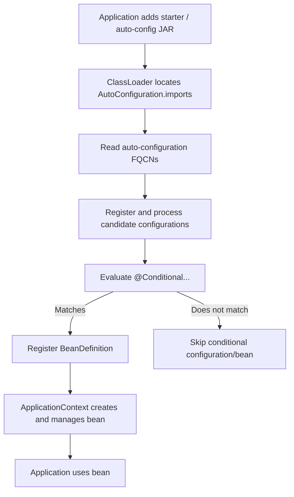

# AutoConfiguration.imports and registration in modern Spring Boot lines

A Spring Boot library can supply prebuilt configuration so that an application automatically receives appropriate beans when a dependency is added to the classpath. For example, an integration library can automatically create a client, converter, or health indicator if the underlying library exists and the user has not manually declared a replacement bean. This mechanism is called **auto-configuration**.

For Spring Boot to find an auto-configuration inside a library, the configuration class must be **registered in the list of auto-configuration candidates**. In modern Spring Boot lines, the standard way to register it is to create the resource:

```text
META-INF/spring/org.springframework.boot.autoconfigure.AutoConfiguration.imports
```

Each line in the file lists the fully qualified class name of a class annotated with `@AutoConfiguration`. Spring Boot reads this resource from dependencies on the classpath, combines the candidates, and evaluates conditions to decide which configurations are applied.

This is a separate step from component scanning. An auto-configuration is typically discovered through the imports resource, after which annotations such as `@ConditionalOnClass`, `@ConditionalOnProperty`, and `@ConditionalOnMissingBean` decide which configuration/beans are actually registered.

## 1. How should an auto-configuration be registered?

A Java class annotated with `@AutoConfiguration` is not automatically discovered by Spring Boot merely because the class exists in a JAR. The library needs to publish this class through the imports resource.

Example class:

```java
package com.acme.greeting.autoconfigure;

import org.springframework.boot.autoconfigure.AutoConfiguration;

@AutoConfiguration
public class GreetingAutoConfiguration {
    // Library @Bean methods and conditions.
}
```

Accompanying resource in the same artifact:

```text
src/main/resources/
└── META-INF/
    └── spring/
        └── org.springframework.boot.autoconfigure.AutoConfiguration.imports
```

File content:

```text
com.acme.greeting.autoconfigure.GreetingAutoConfiguration
```

The path and file name must be exact, including uppercase/lowercase letters. The content consists of fully qualified class names with packages, one class per line. When built, this resource must be packaged into the JAR at the exact corresponding location:

```text
META-INF/spring/org.springframework.boot.autoconfigure.AutoConfiguration.imports
```

If the file is in the wrong directory, has the wrong name, or has an incorrect class name, Boot will not load the candidate as expected. The fact that the class compiles successfully does not prove that the resource was packaged correctly.

## 2. How does Spring Boot read the imports resource?

When the application starts, Boot's enable-auto-configuration mechanism uses the class loader to find resources with the standard name on the classpath. Resources with the same name from multiple JARs can contribute together to the candidate list.

For example, an application depending on:

```text
application.jar
├── spring-boot-autoconfigure.jar
├── acme-greeting-autoconfigure.jar
├── acme-metrics-autoconfigure.jar
└── acme-security-autoconfigure.jar
```

Each auto-configuration library can carry its own resource:

```text
acme-greeting-autoconfigure.jar
└── META-INF/spring/
    └── org.springframework.boot.autoconfigure.AutoConfiguration.imports
        └── com.acme.greeting.autoconfigure.GreetingAutoConfiguration

acme-metrics-autoconfigure.jar
└── META-INF/spring/
    └── org.springframework.boot.autoconfigure.AutoConfiguration.imports
        └── com.acme.metrics.autoconfigure.MetricsAutoConfiguration
```

Spring Boot gathers candidates from matching resources on the classpath. Consequently, an application does not need to know in advance every library that will contribute auto-configurations; each library publishes its own list of classes.

### Role of @EnableAutoConfiguration and @SpringBootApplication

In a normal application, you do not have to call APIs to read the imports resource yourself. The `@SpringBootApplication` annotation includes the capability to enable auto-configuration:

```java
@SpringBootApplication
public class ShopApplication {
    public static void main(String[] args) {
        SpringApplication.run(ShopApplication.class, args);
    }
}
```

Semantically, `@SpringBootApplication` combines three main capabilities:

- `@SpringBootConfiguration`: the application's primary configuration class.
- `@EnableAutoConfiguration`: instructs Spring Boot to apply the auto-configuration mechanism.
- `@ComponentScan`: discovers application components in the package and subpackages according to the scan scope.

The imports resource is used by the auto-configuration mechanism. It is not a configuration file that each application has to write manually to list all libraries it uses.

## 3. @AutoConfiguration: marking an auto-configuration class

In modern Spring Boot, classes published in the imports file typically use the `@AutoConfiguration` annotation:

```java
import org.springframework.boot.autoconfigure.AutoConfiguration;

@AutoConfiguration
public class GreetingAutoConfiguration {
}
```

`@AutoConfiguration` is specifically designed for auto-configuration and essentially carries the semantics of a Spring configuration with `proxyBeanMethods = false`. This matches the auto-configuration style: beans should receive dependencies via factory method parameters or injection, rather than calling `@Bean` methods directly to obtain singletons.

For example:

```java
@AutoConfiguration
public class GreetingAutoConfiguration {

    @Bean
    GreetingFormatter greetingFormatter() {
        return new GreetingFormatter();
    }
}
```

`@Bean` methods still register beans normally. The difference is that auto-configuration does not need full-configuration CGLIB interception to handle calls between factory methods. If another bean needs `GreetingFormatter`, declare it as a parameter:

```java
@Bean
GreetingService greetingService(GreetingFormatter formatter) {
    return new GreetingService(formatter);
}
```

This is container dependency resolution and works naturally with `proxyBeanMethods = false`.

### Do not use @ComponentScan to replace the imports file

A common design mistake is thinking that merely placing an auto-configuration class inside a scanned package will automatically make it a library's auto-configuration.

Component scanning and auto-configuration registration serve different purposes:

| Mechanism | Purpose |
|---|---|
| `@ComponentScan` | Finds application components within the scanned package region |
| `@Import` | Explicitly imports a configuration or selector from another configuration |
| `AutoConfiguration.imports` | Publishes auto-configuration candidates for Spring Boot to evaluate automatically |

A library configuration class might accidentally be found by component scan, but that is not the standard way to distribute auto-configuration. Libraries should register classes via the imports resource, while keeping the auto-configuration package out of the application's scan scope so the same configuration is not discovered through two unnecessary paths.

## 4. Auto-configuration must be conditional

Registering in the imports file only makes the class a candidate. It **does not mean all beans in the class will always be created**. Good auto-configurations typically use conditions to adapt to the classpath and application configuration.

Some common annotations:

| Annotation | Condition |
|---|---|
| `@ConditionalOnClass` | Required class/library is present on the classpath |
| `@ConditionalOnMissingClass` | A specific class is not on the classpath |
| `@ConditionalOnProperty` | Property exists or has a matching value |
| `@ConditionalOnBean` | A matching bean is already registered |
| `@ConditionalOnMissingBean` | No matching bean exists yet; commonly used to let applications override defaults |
| `@ConditionalOnSingleCandidate` | Exactly one candidate of the type exists, or multiple candidates with one matching primary candidate |
| `@ConditionalOnWebApplication` | Application has a matching web type |

Example of a library configuration:

```java
@AutoConfiguration
@ConditionalOnClass(GreetingClient.class)
@ConditionalOnProperty(
        prefix = "acme.greeting",
        name = "enabled",
        havingValue = "true",
        matchIfMissing = true
)
public class GreetingAutoConfiguration {

    @Bean
    @ConditionalOnMissingBean
    GreetingService greetingService(GreetingClient client) {
        return new GreetingService(client);
    }
}
```

Assume `GreetingClient` is provided by a dependency that the auto-configuration library requires. Meaning:

1. Consider the configuration only when the `GreetingClient` class is present.
2. The configuration is active only when `acme.greeting.enabled` is `true`; if the property is not declared, `matchIfMissing = true` enables it by default.
3. Create the `GreetingService` bean only if the application has not already provided a corresponding bean.
4. If the user registers their own `GreetingService` bean, the auto-configuration backs off.

This is a key Spring Boot philosophy: **automatically provide sensible defaults, while letting the application replace them with its own configuration**.

### Be careful with optional dependencies on the classpath

If the checked class is optional and absent from the classpath, avoid forcing the JVM to load that type prematurely through method signatures or fields of the main auto-configuration class. Spring reads annotation metadata through an appropriate mechanism, but having the JVM load the class and resolve method signatures can expose missing types.

A safer pattern is to isolate the parts depending on the optional library inside a nested configuration:

```java
@AutoConfiguration
public class GreetingAutoConfiguration {

    @Configuration(proxyBeanMethods = false)
    @ConditionalOnClass(GreetingClient.class)
    static class GreetingClientConfiguration {

        @Bean
        @ConditionalOnMissingBean
        GreetingService greetingService(GreetingClient client) {
            return new GreetingService(client);
        }
    }
}
```

Here the outer class can be loaded without directly referencing optional APIs in its method signatures; the nested configuration is processed only when the class condition matches. When designing a library with optional dependencies, split configurations by dependency group rather than lumping every method into one large class.

## 5. Auto-configuration ordering: before and after

There are cases where one auto-configuration depends on a `BeanDefinition` contributed by another auto-configuration. In such cases, you can specify configuration processing order.

With `@AutoConfiguration`:

```java
@AutoConfiguration(after = DataSourceAutoConfiguration.class)
public class ReportingAutoConfiguration {
    // ...
}
```

Or using class names:

```java
@AutoConfiguration(
        afterName = "org.springframework.boot.autoconfigure.jdbc.DataSourceAutoConfiguration"
)
public class ReportingAutoConfiguration {
    // ...
}
```

Commonly used attributes:

- `before` / `beforeName`: orders this auto-configuration before the specified configurations.
- `after` / `afterName`: orders this configuration after the specified configurations.

Ordering is helpful when conditions depend on a `BeanDefinition` from another auto-configuration. However, ordering is **not** a tool to control instance initialization order. Dependency relationships between beans are still resolved by the container according to the dependency graph.

For example, if `ReportingAutoConfiguration` needs a `DataSource`, declaring the method parameter is still the way to express the dependency:

```java
@Bean
@ConditionalOnBean(DataSource.class)
ReportRepository reportRepository(DataSource dataSource) {
    return new JdbcReportRepository(dataSource);
}
```

Auto-configuration order helps the condition see the required definition; the method parameter helps the container inject the instance when creating the bean.

### Do not use ordering as a substitute for conditions

Ordering one configuration after another does not guarantee that the required bean will definitely exist. The other auto-configuration might be excluded, its conditions might not match, or the dependency might not be on the classpath. You still need proper conditions and must handle the missing-bean case by design.

## 6. Excluding an auto-configuration

Applications can exclude a specific auto-configuration if they do not want Boot to apply it.

### Via annotation

```java
@SpringBootApplication(
        exclude = {
                SomeAutoConfiguration.class
        }
)
public class ShopApplication {
}
```

Or using class names:

```java
@SpringBootApplication(
        excludeName = {
                "com.acme.SomeAutoConfiguration"
        }
)
public class ShopApplication {
}
```

### Via property

```properties
spring.autoconfigure.exclude=com.acme.SomeAutoConfiguration
```

Excluding can be useful when automatic configuration conflicts with the application architecture or when you want to manually configure an entire piece of infrastructure yourself.

You should not exclude a class merely to make an ambiguous bean error disappear without understanding its conditions. First read the condition report and determine which beans are being created, from which dependencies, and why.

## 7. How does AutoConfiguration.imports differ from spring.factories?

Before the dedicated imports file existed, Spring Boot used the resource:

```text
META-INF/spring.factories
```

In it, auto-configurations were registered under the key:

```properties
org.springframework.boot.autoconfigure.EnableAutoConfiguration=\
com.acme.greeting.autoconfigure.GreetingAutoConfiguration,\
com.acme.metrics.autoconfigure.MetricsAutoConfiguration
```

Starting with Spring Boot 2.7, Boot introduced the `AutoConfiguration.imports` resource as the dedicated auto-configuration registration mechanism. This is the format used in modern Spring Boot 3.x. When developing libraries targeting Boot 3, register auto-configurations in the imports file; do not continue relying on the `EnableAutoConfiguration` key in `spring.factories`.

That does not mean `spring.factories` has disappeared from the entire Spring ecosystem. It can still be used for other extension points or SPIs according to the corresponding version/framework. What changed here is **how auto-configuration candidates are registered**.

### Comparison

| | Legacy mechanism | Modern mechanism |
|---|---|---|
| Resource | `META-INF/spring.factories` | `META-INF/spring/org.springframework.boot.autoconfigure.AutoConfiguration.imports` |
| Format | Properties: key → list of classes | One fully qualified class name per line |
| Auto-configuration key | `org.springframework.boot.autoconfigure.EnableAutoConfiguration` | No key needed; resource name identifies the candidate type |
| Direction for Boot 3 | Do not use legacy key to register auto-configuration | Use the imports file |
| Other SPIs | Can still be used per their own contracts | Does not replace every purpose of spring.factories |

### Migration example

Legacy format:

```properties
org.springframework.boot.autoconfigure.EnableAutoConfiguration=\
com.acme.greeting.autoconfigure.GreetingAutoConfiguration,\
com.acme.metrics.autoconfigure.MetricsAutoConfiguration
```

New format:

```text
com.acme.greeting.autoconfigure.GreetingAutoConfiguration
com.acme.metrics.autoconfigure.MetricsAutoConfiguration
```

Do not copy the properties content verbatim into the imports file. The new file has no key, equals sign, or comma separators; each line is a single class name.

## 8. Starter and auto-configuration are two artifacts with distinct roles

In a Spring Boot library distributed to users, it is common to separate:

1. **Auto-configuration module:** contains configuration classes, conditions, and the imports resource.
2. **Starter module:** dependency aggregator that pulls the auto-configuration module and required libraries into the application.

For example:

```text
acme-greeting/
├── acme-greeting-spring-boot-autoconfigure/
│   ├── src/main/java/
│   │   └── com/acme/greeting/autoconfigure/
│   │       └── GreetingAutoConfiguration.java
│   └── src/main/resources/
│       └── META-INF/spring/
│           └── org.springframework.boot.autoconfigure.AutoConfiguration.imports
│
└── acme-greeting-spring-boot-starter/
    └── dependencies:
        ├── acme-greeting-spring-boot-autoconfigure
        └── required greeting client library
```

When an application adds the starter:

```groovy
dependencies {
    implementation 'com.acme:acme-greeting-spring-boot-starter:1.0.0'
}
```

Gradle pulls in transitive dependencies. The auto-configuration JAR appears on the classpath, the imports resource is found by Boot, and conditions decide which beans are registered.

A starter does not necessarily contain auto-configuration classes or the imports resource. Its primary role is letting users add a single dependency to get a curated set of dependencies. The auto-configuration module is where the automatic configuration classes are published.

### Is it mandatory to separate the two modules?

No. A small library can keep the starter and auto-configuration in the same artifact. Separating them is helpful when:

- You want users to be able to use auto-configuration without pulling the entire starter.
- Multiple starters share one auto-configuration module.
- Optional dependencies need to be managed cleanly.
- You want to separate API/runtime implementation from the Spring Boot integration layer.

What matters is that the artifact containing the auto-configuration classes carries the imports resource at the exact path and is placed on the classpath.

## 9. Testing auto-configuration with ApplicationContextRunner

Do not just verify that the configuration class compiles. Verify that Boot can load the configuration, conditions match properly, and default beans yield to application beans.

Spring Boot provides `ApplicationContextRunner` for small, isolated tests.

Suppose we have:

```java
public interface GreetingClient {
    String greet(String name);
}

public class GreetingService {
    private final GreetingClient client;

    public GreetingService(GreetingClient client) {
        this.client = client;
    }

    public String greet(String name) {
        return client.greet(name);
    }
}
```

Auto-configuration:

```java
@AutoConfiguration
@ConditionalOnClass(GreetingClient.class)
@ConditionalOnProperty(
        prefix = "acme.greeting",
        name = "enabled",
        havingValue = "true",
        matchIfMissing = true
)
public class GreetingAutoConfiguration {

    @Bean
    @ConditionalOnMissingBean
    GreetingService greetingService(GreetingClient client) {
        return new GreetingService(client);
    }
}
```

The test can provide a fake client:

```java
import org.junit.jupiter.api.Test;
import org.springframework.boot.autoconfigure.AutoConfigurations;
import org.springframework.boot.test.context.runner.ApplicationContextRunner;

import static org.assertj.core.api.Assertions.assertThat;

class GreetingAutoConfigurationTest {

    private final ApplicationContextRunner runner =
            new ApplicationContextRunner()
                    .withConfiguration(AutoConfigurations.of(
                            GreetingAutoConfiguration.class))
                    .withBean(GreetingClient.class,
                            () -> name -> "Hello " + name);

    @Test
    void createsGreetingServiceWhenEnabled() {
        runner.withPropertyValues("acme.greeting.enabled=true")
                .run(context -> {
                    assertThat(context).hasSingleBean(GreetingService.class);
                    assertThat(context.getBean(GreetingService.class)
                            .greet("Lan")).isEqualTo("Hello Lan");
                });
    }

    @Test
    void backsOffWhenDisabled() {
        runner.withPropertyValues("acme.greeting.enabled=false")
                .run(context -> {
                    assertThat(context).doesNotHaveBean(GreetingService.class);
                });
    }
}
```

The example assumes `GreetingClient` is on the test classpath and the application has declared appropriate test dependencies such as JUnit Jupiter, AssertJ, and Spring Boot test. `ApplicationContextRunner` helps test configuration conditions without running an entire web application.

### Testing user-defined Bean overrides

You can add a custom bean test configuration:

```java
@Configuration(proxyBeanMethods = false)
static class CustomGreetingConfiguration {
    @Bean
    GreetingService customGreetingService() {
        GreetingClient client = name -> "Welcome " + name;
        return new GreetingService(client);
    }
}
```

Then add this configuration to the runner:

```java
runner.withUserConfiguration(CustomGreetingConfiguration.class)
        .run(context -> {
            assertThat(context).hasSingleBean(GreetingService.class);
            assertThat(context.getBean(GreetingService.class)
                    .greet("Lan")).isEqualTo("Welcome Lan");
        });
```

Because the default bean has `@ConditionalOnMissingBean`, the auto-configuration backs off when the application already provides a matching `GreetingService`. This is an essential test for a starter: default configuration must not obstruct user customization.

## 10. Verifying the resource is packaged in the JAR

A common mistake is having the imports file in the source tree while it does not appear in the published artifact.

With Gradle, resources in `src/main/resources` are typically copied by the `processResources` task to resource outputs and then packaged into the JAR.

After building the library, you can inspect it:

```bash
jar tf build/libs/acme-greeting-spring-boot-autoconfigure-1.0.0.jar
```

The listing must contain:

```text
META-INF/spring/org.springframework.boot.autoconfigure.AutoConfiguration.imports
com/acme/greeting/autoconfigure/GreetingAutoConfiguration.class
```

Class paths may vary according to the real package. If the resource is missing:

- Check that the file is under `src/main/resources/META-INF/spring/`.
- Check that the file name is exact.
- Check resource processing tasks or resource exclude rules in the build.
- Check that the artifact being inspected is the right module/version.

With Maven, resources are also taken by default from `src/main/resources` and packaged into the JAR; if custom resource filtering or packaging is configured, confirm that the imports file is not excluded or altered unintentionally.

## 11. Diagnosing why auto-configuration is not applied

When the application lacks a bean you expected, analyze in order:

1. **Is the artifact on the runtime classpath?** Was the starter/auto-config module dependency added and resolved properly?
2. **Is the resource inside the JAR?** Check the exact path `META-INF/spring/org.springframework.boot.autoconfigure.AutoConfiguration.imports`.
3. **Is the class name correct?** The FQCN in the file must match the compiled package and class.
4. **Does the application enable auto-configuration?** Usually via `@SpringBootApplication` or `@EnableAutoConfiguration`.
5. **Is the configuration class excluded?** Check exclude annotations and the `spring.autoconfigure.exclude` property.
6. **Which condition did not match?** Check classpath, properties, existing beans, application type, and other conditions.
7. **Is the configuration order appropriate?** Is the condition evaluating before the dependent `BeanDefinition` is registered?

### Condition Evaluation Report

Run the application with debug:

```bash
java -jar app.jar --debug
```

Or enable:

```properties
debug=true
```

Spring Boot prints the condition evaluation report, including matched and unmatched configurations. Search for the auto-configuration class name to see which specific condition caused it to be skipped.

If using Actuator, the `conditions` endpoint can provide similar information when the endpoint is properly exposed and secured. Do not leave internal diagnostic endpoints publicly open without controls.

## 12. Common confusions

**"Having `@AutoConfiguration` means Boot automatically finds the class."** Not sufficient. The class must be published via the imports resource (or deliberately imported through another configuration mechanism).

**"The imports file replaces component scanning."** No. Component scanning finds components in packages; the imports file publishes a library's auto-configuration candidates.

**"Every application must manually list all auto-configurations."** No. Libraries publish their own resources, and Boot collects candidates from the classpath.

**"Every class in the imports file definitely creates beans."** No. The class becomes a candidate; conditions can cause part or all of the configuration not to apply.

**"The imports file is a properties file."** No. It is a list of class names, one FQCN per line; there is no key or equals sign as in the old format.

**"Spring Boot 3 still registers auto-configurations via the EnableAutoConfiguration key in spring.factories."** For modern auto-configuration registration, use `AutoConfiguration.imports`. `spring.factories` may still exist for other extension points.

**"Auto-configuration order determines the creation order of all beans."** No. Ordering controls configuration class processing order; the dependency graph and scope govern bean creation.

**"Starter and auto-configuration are the same thing."** No. A starter aggregates dependencies; auto-configuration is the configuration code and imports resource that Boot applies automatically.

**"@ConditionalOnMissingBean makes all beans of the same type disappear."** No. It prevents the corresponding default bean from being registered when a matching bean already exists; the application-provided bean remains.

## 13. Workflow for creating a modern auto-configuration library

When developing an integration library for Spring Boot, you can follow this sequence:

1. Create a configuration class marked with `@AutoConfiguration`.
2. Declare beans with `@Bean`; pass dependencies through factory method parameters.
3. Guard the configuration with appropriate conditions: classpath, property, existing bean, or single candidate.
4. Use `@ConditionalOnMissingBean` for default beans that users may override.
5. Create the imports resource in the exact directory and list the auto-configuration FQCNs.
6. If multiple auto-configurations depend on one another, declare explicit ordering.
7. Package the resource into the JAR and verify it appears in the artifact.
8. Write tests using `ApplicationContextRunner` for condition branches and overrides.
9. Use the Condition Evaluation Report when runtime results do not match expectations.

### Example library structure

```text
acme-greeting-autoconfigure/
├── src/main/java/
│   └── com/acme/greeting/autoconfigure/
│       ├── GreetingAutoConfiguration.java
│       ├── GreetingProperties.java
│       └── GreetingService.java
├── src/main/resources/
│   └── META-INF/spring/
│       └── org.springframework.boot.autoconfigure.AutoConfiguration.imports
└── src/test/java/
    └── com/acme/greeting/autoconfigure/
        └── GreetingAutoConfigurationTest.java
```

Imports content:

```text
com.acme.greeting.autoconfigure.GreetingAutoConfiguration
```

If the library has multiple auto-configuration classes, list each class on its own line. Publish only classes that are genuine auto-configuration entry points; helper configurations can be imported internally from the main class or organized as nested configurations when optional dependencies need isolation.

## 14. Mental model



Key points to remember:

- `AutoConfiguration.imports` is the **publication mechanism** for auto-configuration classes in Spring Boot.
- `@AutoConfiguration` marks an auto-configuration class.
- `@Conditional...` decides whether the configuration applies in the current environment.
- `@Bean` declares objects for the container to manage.
- Starters bring the auto-configuration artifact and required dependencies onto the classpath.
- Tests and the condition report confirm why configurations were applied or skipped.

Once you clearly understand the role of the imports resource, you can build starters for modern Spring Boot: users simply add a dependency, Boot automatically discovers the configurations from the JAR, evaluates conditions, and creates appropriate default beans. Applications still retain the right to override or exclude configurations when their architecture requires it.
