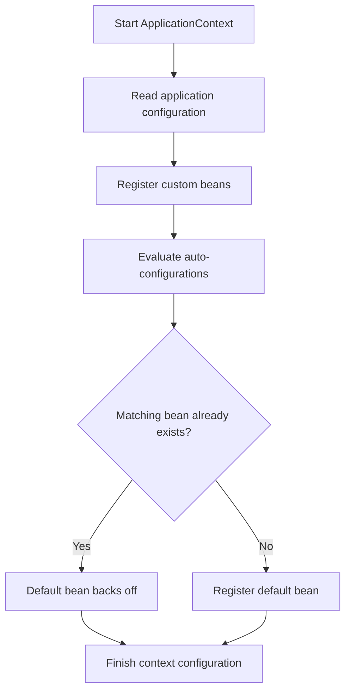

# Back-off mechanism when the application already provides a matching bean

> **Spring Boot Fundamentals · Auto-configuration**  
> Spring Boot provides many default beans so an application can run with minimal configuration. However, when an application wants to choose its own implementation or custom configuration, auto-configuration should **back off**. The common mechanism is `@ConditionalOnMissingBean`: create the default bean only when no matching bean exists yet in the ApplicationContext. This lesson explains how back-off works, what counts as a match, how to write customizable auto-configurations, and how to verify it with tests.

## 1. What is back-off?

Suppose an integration library wants to provide a default notification-sending service so applications can use it right away. However, each application might want to send notifications via email, SMS, a message broker, or an internal system.

If auto-configuration always registered the default implementation, the application would struggle to replace it. If the framework tried to overwrite the application's bean, it could cause bean name collisions or wipe out custom configuration.

Spring Boot solves this by designing auto-configuration around **providing defaults when the application has not yet made a choice**.

For example:

```java
@AutoConfiguration
public class NotificationAutoConfiguration {

    @Bean
    @ConditionalOnMissingBean(NotificationSender.class)
    NotificationSender notificationSender() {
        return new LoggingNotificationSender();
    }
}
```

When the ApplicationContext does not yet have any bean matching `NotificationSender`, Spring Boot registers `LoggingNotificationSender` as the default bean.

If the application has already provided a matching `NotificationSender` bean, the `@ConditionalOnMissingBean` condition does not match and the default factory method is skipped.

That is **back-off**: auto-configuration refrains from creating the default bean because the application already has a choice fulfilling the same role.

### 1.1. Back-off is not replacing an existing bean

It is important to understand the exact behavior:

- Auto-configuration checks whether a matching bean has already been registered.
- If a matching bean already exists, the default bean is not registered from the conditional factory method.
- The application's bean remains intact and is used according to dependency injection rules.
- Spring Boot does not modify the custom object, alter its implementation, or automatically reconfigure that bean.

In other words, auto-configuration **steps aside before creating the default bean**, rather than creating a default and replacing the object afterward.

### 1.2. Why is this a key Spring Boot principle?

A well-designed auto-configuration should:

1. Make the common case work immediately after adding a starter.
2. Allow the application to supply its own bean when customization is needed.
3. Not create conflicting default beans when the application already has a matching implementation.
4. Not force the application to exclude the entire auto-configuration just to replace a single bean.
5. Keep behavior predictable when dependencies or properties change.

Starter users receive convenient default configuration, while the application keeps decision-making authority over components that need customization.

## 2. How does `@ConditionalOnMissingBean` work?

`@ConditionalOnMissingBean` is a Spring Boot conditional annotation. It allows a configuration or bean method to be applied only when no matching bean exists yet in the search scope.

Simple example:

```java
@Bean
@ConditionalOnMissingBean
GreetingService greetingService() {
    return new DefaultGreetingService();
}
```

When placed on a `@Bean` method without specifying a type, Spring Boot infers the type to check from the method's return type.

You can also declare the type explicitly:

```java
@Bean
@ConditionalOnMissingBean(GreetingService.class)
GreetingService greetingService() {
    return new DefaultGreetingService();
}
```

In this example, the condition asks: **is there already a bean matching the `GreetingService` type?**

If not, the factory method is applied. If so, the default bean is not registered.

### 2.1. Checking by bean type

The most common usage is checking by type:

```java
@ConditionalOnMissingBean(PaymentGateway.class)
```

The condition inspects beans with types compatible with `PaymentGateway`, including implementations assignable to that type.

Example interface:

```java
public interface PaymentGateway {
    PaymentResult charge(PaymentRequest request);
}
```

Default implementation:

```java
public class DefaultPaymentGateway implements PaymentGateway {
    @Override
    public PaymentResult charge(PaymentRequest request) {
        // Default payment handling.
        return PaymentResult.accepted();
    }
}
```

The application can provide its own implementation:

```java
public class AcmePaymentGateway implements PaymentGateway {
    @Override
    public PaymentResult charge(PaymentRequest request) {
        // Call the application's payment system.
        return PaymentResult.accepted();
    }
}
```

Because `AcmePaymentGateway` implements `PaymentGateway`, it satisfies the type check. Auto-configuration does not need to register `DefaultPaymentGateway` if the custom bean has already been recognized.

### 2.2. Checking by bean name

You can base the condition on bean name:

```java
@Bean
@ConditionalOnMissingBean(name = "partnerHttpClient")
HttpClient partnerHttpClient() {
    return HttpClient.newHttpClient();
}
```

In this case, the condition focuses on the bean name `partnerHttpClient`. If a bean with that name already exists in the search scope, the default factory method is not applied.

Comparison:

| Check method | Question |
| --- | --- |
| `@ConditionalOnMissingBean(SomeType.class)` | Is there already a bean matching this type? |
| `@ConditionalOnMissingBean(name = "someBean")` | Is there already a bean with this name? |
| `@ConditionalOnMissingBean(type = "com.example.SomeType")` | Is there already a bean matching the type specified by class name? |
| `@ConditionalOnMissingBean(annotation = SomeAnnotation.class)` | Is there already a bean carrying the specified annotation? |

Usually, checking by **type or interface** clearly expresses the role an application can replace. Checking by name is useful when the configuration contract is explicitly defined by bean name.

### 2.3. Default condition on a method infers the return type

For example:

```java
@Bean
@ConditionalOnMissingBean
PaymentGateway paymentGateway() {
    return new DefaultPaymentGateway();
}
```

Because no type/name/annotation is specified in the annotation, Spring Boot can use the `PaymentGateway` return type to determine which bean to check.

That is why you should declare a return type specific enough to represent the **bean contract**. If you write:

```java
@Bean
@ConditionalOnMissingBean
Object paymentGateway() {
    return new DefaultPaymentGateway();
}
```

then the type information available when processing metadata is just `Object`, failing to express the `PaymentGateway` role that the auto-configuration intends to supply. Inference from the return type may not behave as intended.

Declare the actual interface or class type that consumers need:

```java
@Bean
@ConditionalOnMissingBean(PaymentGateway.class)
PaymentGateway paymentGateway() {
    return new DefaultPaymentGateway();
}
```

This makes the condition easy to read, easy to test, and less reliant on type inference.

## 3. Complete example: auto-configuration providing a default bean

Suppose we are building an internal starter that provides a greeting service. Goals:

- Applications adding the starter have `GreetingService` available out of the box.
- If an application provides its own `GreetingService`, the default bean backs off.
- Consumers depend only on the interface, not on a concrete implementation.

### 3.1. Defining the contract

```java
package com.example.greeting;

public interface GreetingService {
    String greet(String name);
}
```

Default implementation:

```java
package com.example.greeting;

public class DefaultGreetingService implements GreetingService {

    @Override
    public String greet(String name) {
        return "Hello, " + name + "!";
    }
}
```

### 3.2. Writing the auto-configuration

```java
package com.example.greeting.autoconfigure;

import com.example.greeting.DefaultGreetingService;
import com.example.greeting.GreetingService;

import org.springframework.boot.autoconfigure.AutoConfiguration;
import org.springframework.boot.autoconfigure.condition.ConditionalOnMissingBean;
import org.springframework.context.annotation.Bean;

@AutoConfiguration
public class GreetingAutoConfiguration {

    @Bean
    @ConditionalOnMissingBean(GreetingService.class)
    GreetingService greetingService() {
        return new DefaultGreetingService();
    }
}
```

This auto-configuration provides a default choice for the application. The `@ConditionalOnMissingBean` annotation is the hook allowing users to replace the implementation without having to exclude the entire `GreetingAutoConfiguration`.

### 3.3. Registering the auto-configuration in the starter

With Spring Boot 3.x, auto-configurations are typically declared in the file:

```text
src/main/resources/META-INF/spring/
└── org.springframework.boot.autoconfigure.AutoConfiguration.imports
```

The file contains fully qualified class names, one class per line:

```text
com.example.greeting.autoconfigure.GreetingAutoConfiguration
```

When the starter is added to an application and the auto-configuration is properly registered, Spring Boot can discover and evaluate this configuration.

Note: the imports file only registers the auto-configuration class into Boot's import mechanism. Conditions on the class and bean methods still decide whether a specific configuration or bean is applied.

### 3.4. Consumers depend only on the interface

```java
package com.example.application;

import com.example.greeting.GreetingService;
import org.springframework.stereotype.Service;

@Service
public class WelcomeService {

    private final GreetingService greetingService;

    public WelcomeService(GreetingService greetingService) {
        this.greetingService = greetingService;
    }

    public String welcome(String userName) {
        return greetingService.greet(userName);
    }
}
```

When the application does not declare its own implementation, Spring Boot provides `DefaultGreetingService`. `WelcomeService` still injects against the `GreetingService` interface.

If the application provides its own implementation, the consumer receives that custom implementation without having to modify `WelcomeService`.

## 4. Application provides its own bean so auto-configuration backs off

An application using the starter can declare a bean with `@Bean`:

```java
package com.example.application.config;

import com.example.greeting.GreetingService;
import org.springframework.context.annotation.Bean;
import org.springframework.context.annotation.Configuration;

@Configuration(proxyBeanMethods = false)
public class CustomGreetingConfiguration {

    @Bean
    GreetingService greetingService() {
        return new CustomGreetingService();
    }
}
```

Custom implementation:

```java
package com.example.application;

import com.example.greeting.GreetingService;

public class CustomGreetingService implements GreetingService {

    @Override
    public String greet(String name) {
        return "Welcome back, " + name + ".";
    }
}
```

During Spring Boot's normal configuration processing:

1. Spring recognizes the application's configuration.
2. The custom `GreetingService` bean is registered.
3. Spring Boot evaluates `GreetingAutoConfiguration`.
4. `@ConditionalOnMissingBean(GreetingService.class)` sees a matching bean already exists.
5. The default `greetingService()` method is not applied.
6. `WelcomeService` is injected with the custom bean.

The application changed the default behavior simply by supplying a bean matching the contract.

### 4.1. Can `@Component` be used instead of `@Bean`?

Yes. If the application owns the implementation, it can be registered via component scanning:

```java
@Component
public class CustomGreetingService implements GreetingService {

    @Override
    public String greet(String name) {
        return "Welcome, " + name + "!";
    }
}
```

When the component is discovered and registered before auto-configuration evaluates its conditions, that bean can also cause the default bean to back off.

However, make sure the class is within component scan scope or registered appropriately. A class annotated with `@Component` that Spring does not discover cannot be seen by the condition.

### 4.2. Custom beans must fulfill the right role

Suppose the application provides:

```java
@Bean
CustomGreetingFormatter greetingFormatter() {
    return new CustomGreetingFormatter();
}
```

If `CustomGreetingFormatter` does not implement `GreetingService` and is not declared with a bean name the condition is checking, it does not cause `@ConditionalOnMissingBean(GreetingService.class)` to back off.

The condition checks **the contract required by the auto-configuration**, not just any bean whose name or function seems related.

## 5. Backing off by interface lets applications swap implementations

Auto-configuration design should target the abstraction that consumers use.

For example:

```java
@Bean
@ConditionalOnMissingBean(Clock.class)
Clock applicationClock() {
    return Clock.systemUTC();
}
```

If the application provides its own implementation matching `Clock`, the default bean backs off.

Similarly:

```java
@Bean
@ConditionalOnMissingBean(CacheManager.class)
CacheManager cacheManager() {
    return new ConcurrentMapCacheManager();
}
```

The application can provide its own cache manager such as Caffeine, Redis, or a custom solution. Auto-configuration should not force every application onto the default implementation.

### 5.1. Why is checking an interface usually helpful?

Suppose a starter provides:

```java
@Bean
@ConditionalOnMissingBean(PaymentGateway.class)
PaymentGateway paymentGateway() {
    return new DefaultPaymentGateway();
}
```

The application can choose any class implementing `PaymentGateway`:

- `StripePaymentGateway`.
- `AcmePaymentGateway`.
- `SandboxPaymentGateway`.
- `TestPaymentGateway`.

Auto-configuration does not need to know the implementation's name. It only cares whether the application already has a bean satisfying the contract.

This reduces coupling between the starter and consuming applications.

### 5.2. Avoid checking overly specifically against the default implementation

A less flexible design:

```java
@Bean
@ConditionalOnMissingBean(DefaultPaymentGateway.class)
DefaultPaymentGateway paymentGateway() {
    return new DefaultPaymentGateway();
}
```

If the application provides `AcmePaymentGateway implements PaymentGateway`, the condition checking `DefaultPaymentGateway` may still fail to find that bean and proceed to create the default. The result is two beans fulfilling the `PaymentGateway` role.

If the goal is to allow the application to substitute any implementation, check the interface or abstraction consumers actually use:

```java
@Bean
@ConditionalOnMissingBean(PaymentGateway.class)
PaymentGateway paymentGateway() {
    return new DefaultPaymentGateway();
}
```

Choose the type condition based on **the contract the application is allowed to replace**.

## 6. Back-off on methods vs. on classes

`@ConditionalOnMissingBean` can be placed on a `@Bean` method or on a configuration class. The scope of impact differs.

### 6.1. Method-level: only the corresponding default bean backs off

For example:

```java
@AutoConfiguration
public class SearchAutoConfiguration {

    @Bean
    @ConditionalOnMissingBean(SearchClient.class)
    SearchClient searchClient() {
        return new DefaultSearchClient();
    }

    @Bean
    SearchHealthIndicator searchHealthIndicator(SearchClient searchClient) {
        return new SearchHealthIndicator(searchClient);
    }

    @Bean
    SearchProperties searchProperties() {
        return new SearchProperties();
    }
}
```

If the application provides a custom `SearchClient`:

- The default `searchClient` bean is not created.
- `searchHealthIndicator` can still be created and receive the custom client.
- `searchProperties` can still be created.

This is usually the right structure when you only want to allow replacing one component in an auto-configuration group.

### 6.2. Class-level: the entire configuration group can back off

For example:

```java
@AutoConfiguration
@ConditionalOnMissingBean(SearchClient.class)
public class SearchAutoConfiguration {

    @Bean
    SearchClient searchClient() {
        return new DefaultSearchClient();
    }

    @Bean
    SearchHealthIndicator searchHealthIndicator(SearchClient searchClient) {
        return new SearchHealthIndicator(searchClient);
    }
}
```

If a `SearchClient` bean already exists, the class-level condition fails to match and the entire configuration class is skipped. Neither the default `searchClient` nor `searchHealthIndicator` is registered from this class.

This is appropriate only when the **entire group of beans** should be skipped if the application already provides `SearchClient`. If the application still needs a default health indicator for its custom client, placing the condition at the method level on the client bean is more appropriate.

### 6.3. Scope selection table

| Goal | Condition placement |
| --- | --- |
| Skip only the default bean if the application already has an implementation | On the `@Bean` method creating the default bean |
| Skip the entire configuration group when the application has a replacement component | On the configuration class |
| One bean has its own condition while other beans are still needed | On the corresponding method |
| Entire group depends on the same feature flag or classpath | On the configuration class |
| Multiple independent beans have different conditions | Split method conditions or organize configurations into clear groups |

## 7. Evaluation timing: why are user beans usually seen before auto-configuration?

`@ConditionalOnMissingBean` can only decide based on bean definitions that the container has already processed at the moment the condition is evaluated. It is not a dynamic query re-running continuously after every bean registration.

Spring Boot designs startup so that application-provided configurations are typically processed before auto-configurations. As a result, custom application beans can be seen when auto-configuration decides whether to create defaults.

Conceptual flow:



This is why a bean in an application `@Configuration` can usually replace a default bean provided by auto-configuration.

### 7.1. Bean conditions only see definitions already processed

A condition cannot reliably predict every bean that will be registered in the future. If another auto-configuration provides the bean being checked yet is processed later, `@ConditionalOnMissingBean` may evaluate before that bean appears.

This is an important consideration when writing **multiple interdependent auto-configurations**.

### 7.2. Controlling order between auto-configurations

Spring Boot provides mechanisms to order auto-configurations, for example:

```java
@AutoConfiguration(after = DataSourceAutoConfiguration.class)
public class JdbcMetricsAutoConfiguration {
    // ...
}
```

Or:

```java
@AutoConfiguration(before = SomeOtherAutoConfiguration.class)
public class CustomAutoConfiguration {
    // ...
}
```

The `before` and `after` attributes control the relative order between auto-configurations. They do not change the order of every bean in the application, nor are they tools for arbitrarily controlling singleton instantiation order.

When a bean condition depends on a bean supplied by another auto-configuration, define the appropriate ordering relationship. Do not rely on file order or method declaration order to guess which beans a condition will see.

### 7.3. Do not use `@ConditionalOnMissingBean` as a dynamic registration mechanism

If a bean only appears after the application has started, conditions do not re-evaluate themselves to create defaults or remove old beans. This mechanism serves ApplicationContext construction.

To swap implementations at runtime, design an abstraction that can route/swap delegates or a dedicated plugin mechanism. Back-off is not a dynamic feature toggle.

## 8. By what criteria is a matching bean determined?

`@ConditionalOnMissingBean` supports multiple ways of specifying conditions. Common attributes:

| Attribute | Meaning |
| --- | --- |
| `value` | Bean types to check |
| `type` | Class names as strings to check |
| `name` | Bean names to check |
| `annotation` | Annotation the bean must carry |
| `ignored` / `ignoredType` | Types ignored during evaluation |
| `parameterizedContainer` | Container types that may hold the checked type, when applicable |
| `search` | Search scope across a context hierarchy |

Example by type:

```java
@ConditionalOnMissingBean(value = {
        PaymentGateway.class,
        RefundGateway.class
})
```

Example by name:

```java
@ConditionalOnMissingBean(name = "applicationObjectMapper")
```

Example by annotation:

```java
@ConditionalOnMissingBean(annotation = PrimaryDataSource.class)
```

These examples illustrate how to declare conditions. Choose criteria matching the starter's bean contract.

### 8.1. Multiple-type conditions usually mean "missing all specified candidates"

When passing multiple types/names/annotations in one condition, consult the annotation documentation for your exact version to understand the exact semantics and how attributes combine. Do not assume a list always means "missing any one of these" by an arbitrary interpretation.

If the business requirement is "create default only when neither interface X nor interface Y exists yet", you can split the conditions or write a custom condition to express the logic unmistakably. Condition design should prioritize readability and testability.

### 8.2. Search scope in a context hierarchy

An ApplicationContext can have parent and child contexts. `@ConditionalOnMissingBean` supports selecting the search scope via `search`.

Common strategies:

- `SearchStrategy.ALL`: inspect the current context and ancestors.
- `SearchStrategy.CURRENT`: inspect only the current context.
- `SearchStrategy.PARENTS`: inspect only ancestors.

The annotation defaults to searching with scope `ALL`. If an application has a context hierarchy and wants a child context to supply its own bean even when the parent already has a bean of the same type, understand and choose the appropriate search strategy.

This is a specialized need. For a typical Spring Boot application with a single main context, changing the default is usually unnecessary.

## 9. Distinguishing back-off from `@Primary` and `@Qualifier`

These three mechanisms are often confused because all relate to multiple beans of the same type, yet they solve different problems.

### 9.1. `@ConditionalOnMissingBean` prevents registering the default

```java
@Bean
@ConditionalOnMissingBean(PaymentGateway.class)
PaymentGateway defaultPaymentGateway() {
    return new DefaultPaymentGateway();
}
```

If a matching `PaymentGateway` bean already exists, the default method is not applied. Typically only the application's custom bean remains.

### 9.2. `@Primary` selects the preferred candidate

```java
@Bean
@Primary
PaymentGateway primaryPaymentGateway() {
    return new AcmePaymentGateway();
}
```

`@Primary` does not prevent other `PaymentGateway` beans from being registered. If a default bean is declared unconditionally, both can coexist; when a consumer injects by type without a qualifier, Spring prefers the primary bean.

### 9.3. `@Qualifier` selects a bean by role

```java
@Bean
PaymentGateway paymentGateway(
        @Qualifier("acmePaymentGateway") PaymentGateway gateway) {
    return new PaymentGatewayFacade(gateway);
}
```

`@Qualifier` selects a candidate at the injection point. It does not make auto-configuration back off on its own.

| Mechanism | Question it answers |
| --- | --- |
| `@ConditionalOnMissingBean` | Should the default bean be registered? |
| `@Primary` | When multiple candidates exist, which bean is the default for injection? |
| `@Qualifier` | Which specific bean by role/qualifier does a consumer need? |

### 9.4. Why is adding `@Primary` alone sometimes not enough?

Suppose auto-configuration creates:

```java
@Bean
PaymentGateway defaultPaymentGateway() {
    return new DefaultPaymentGateway();
}
```

The application creates:

```java
@Bean
@Primary
PaymentGateway customPaymentGateway() {
    return new AcmePaymentGateway();
}
```

Both beans are still registered because the default method has no back-off condition. `@Primary` only helps single-bean injection choose the custom bean. Consumers injecting a collection or looking up by name can still see both.

If a starter wants the default to disappear when the application provides its own implementation, place `@ConditionalOnMissingBean(PaymentGateway.class)` on the default method.

## 10. Back-off differs from bean overriding by name

Some people think Spring Boot "overwrites" the default bean with the application's bean. The back-off mechanism is not based on having two beans with the same name and replacing the definition.

Example without back-off:

```java
@Bean("paymentGateway")
PaymentGateway defaultPaymentGateway() {
    return new DefaultPaymentGateway();
}
```

The application also declares a bean named `paymentGateway`. If both definitions are registered, a bean name collision can occur or behavior will depend on bean definition overriding settings.

Modern Spring Boot discourages bean definition overriding by default and usually disables it. You should not design a starter assuming the application will overwrite beans by name.

Proper approach:

```java
@Bean("paymentGateway")
@ConditionalOnMissingBean(PaymentGateway.class)
PaymentGateway defaultPaymentGateway() {
    return new DefaultPaymentGateway();
}
```

When the application has a matching bean, the default definition is not registered; no same-name overriding is needed.

### 10.1. Bean name differs from type condition

If the application has a bean:

```java
@Bean("customGateway")
PaymentGateway customGateway() {
    return new AcmePaymentGateway();
}
```

then a condition on `PaymentGateway.class` can detect the custom bean even though its bean name differs from `paymentGateway`. This is why checking by abstraction is usually more flexible than checking by default bean name.

## 11. Back-off and other conditions in auto-configuration

A default bean can be subject to multiple conditions simultaneously:

```java
@Bean
@ConditionalOnClass(PaymentClient.class)
@ConditionalOnProperty(
        prefix = "payment",
        name = "enabled",
        havingValue = "true"
)
@ConditionalOnMissingBean(PaymentGateway.class)
PaymentGateway paymentGateway(PaymentClient client) {
    return new DefaultPaymentGateway(client);
}
```

The bean can be registered only when:

1. The `PaymentClient` library class is on the classpath.
2. The `payment.enabled` property has the value `true`.
3. No bean matching `PaymentGateway` exists yet.
4. The `PaymentClient` dependency resolves successfully.
5. No other condition blocks the configuration.

If the application already has a custom gateway while `payment.enabled` is `false`, the entire method is still skipped. That does not mean the custom gateway is deleted; it only means the default auto-configuration is not applied.

### 11.1. Class conditions and method conditions have different scopes

You can put `@ConditionalOnClass` at the class level so the whole configuration group exists only when the library is present, while placing `@ConditionalOnMissingBean` on a method so only that default bean backs off.

For example:

```java
@AutoConfiguration
@ConditionalOnClass(PaymentClient.class)
public class PaymentAutoConfiguration {

    @Bean
    @ConditionalOnMissingBean(PaymentGateway.class)
    PaymentGateway paymentGateway(PaymentClient client) {
        return new DefaultPaymentGateway(client);
    }

    @Bean
    PaymentHealthIndicator paymentHealthIndicator(
            PaymentClient client) {
        return new PaymentHealthIndicator(client);
    }
}
```

If a custom gateway is present, the method creating the default gateway backs off; the health indicator can still be created. However, the health indicator in the example still needs `PaymentClient`. If the client's conditions or bean dependencies are not satisfied, add matching conditions or redesign the dependency graph.

Do not assume that one bean backing off automatically causes every related bean to back off too.

## 12. Notes on ordering and applications providing their own beans

One of the most important rules when writing auto-configuration is: **place bean conditions where application-provided beans have already been registered before the condition is evaluated**.

Spring Boot typically processes user configuration before auto-configuration, so this common pattern works:

```java
@Configuration(proxyBeanMethods = false)
class ApplicationPaymentConfiguration {

    @Bean
    PaymentGateway paymentGateway() {
        return new AcmePaymentGateway();
    }
}
```

An auto-configuration with `@ConditionalOnMissingBean(PaymentGateway.class)` then sees this bean and backs off.

### 12.1. Not every bean configuration has the same order

If a custom bean is itself provided by another auto-configuration, the order between the two auto-configurations can determine whether the condition sees the bean yet.

For example, starter A provides a custom `PaymentGateway`; starter B provides a default `PaymentGateway`. If B evaluates `@ConditionalOnMissingBean` before A registers its bean, B might create the default. In that case, you need to define ordering relationships or consolidate configuration responsibilities appropriately.

With Spring Boot 3.x, you can use `@AutoConfiguration(before = ...)` or `@AutoConfiguration(after = ...)` to declare ordering relationships between auto-configurations.

### 12.2. Bean conditions should not be used as a coordinator across every module

If multiple modules depend on the presence of the same bean, design clearly:

- Which module owns the abstraction?
- Which module provides the default?
- Which module provides custom implementations?
- Which auto-configurations must run before/after?
- Which consumers need their own conditions if the dependency can be absent?

Without clear ordering relationships between modules, conditions can become unpredictable and prone to breakage when new starters are added.

## 13. Example of testing back-off with `ApplicationContextRunner`

Spring Boot provides `ApplicationContextRunner` to test auto-configuration in a small context without starting an entire web application.

### 13.1. Auto-configuration

```java
package com.example.greeting.autoconfigure;

import com.example.greeting.DefaultGreetingService;
import com.example.greeting.GreetingService;

import org.springframework.boot.autoconfigure.AutoConfiguration;
import org.springframework.boot.autoconfigure.condition.ConditionalOnMissingBean;
import org.springframework.context.annotation.Bean;

@AutoConfiguration
public class GreetingAutoConfiguration {

    @Bean
    @ConditionalOnMissingBean(GreetingService.class)
    GreetingService greetingService() {
        return new DefaultGreetingService();
    }
}
```

### 13.2. Application's custom configuration

```java
package com.example.application;

import com.example.greeting.GreetingService;
import org.springframework.context.annotation.Bean;
import org.springframework.context.annotation.Configuration;

@Configuration(proxyBeanMethods = false)
public class CustomGreetingConfiguration {

    @Bean
    GreetingService customGreetingService() {
        return new CustomGreetingService();
    }
}
```

### 13.3. Testing the case without a custom bean

```java
package com.example.greeting.autoconfigure;

import static org.assertj.core.api.Assertions.assertThat;

import com.example.greeting.DefaultGreetingService;
import com.example.greeting.GreetingService;

import org.junit.jupiter.api.Test;
import org.springframework.boot.autoconfigure.AutoConfigurations;
import org.springframework.boot.test.context.runner.ApplicationContextRunner;

class GreetingAutoConfigurationTest {

    private final ApplicationContextRunner contextRunner =
            new ApplicationContextRunner()
                    .withConfiguration(
                            AutoConfigurations.of(GreetingAutoConfiguration.class));

    @Test
    void createsDefaultWhenApplicationHasNoGreetingService() {
        contextRunner.run(context -> {
            assertThat(context).hasSingleBean(GreetingService.class);
            assertThat(context.getBean(GreetingService.class))
                    .isInstanceOf(DefaultGreetingService.class);
        });
    }
}
```

Expected outcome: when no bean is supplied by the application, the default bean is registered.

### 13.4. Testing the case where the application has a custom bean

```java
@Test
void backsOffWhenApplicationProvidesGreetingService() {
    contextRunner
            .withUserConfiguration(CustomGreetingConfiguration.class)
            .run(context -> {
                assertThat(context).hasSingleBean(GreetingService.class);
                assertThat(context.getBean(GreetingService.class))
                        .isInstanceOf(CustomGreetingService.class);
            });
}
```

Expected outcome: there is only one `GreetingService` bean and it is the custom implementation. The default factory method backed off.

The examples assume the test source has complete imports and corresponding implementation classes, and that `spring-boot-starter-test` or required Spring Boot test libraries have been added.

### 13.5. Testing additional cases

You can expand tests to confirm:

- Custom bean provided via `@Bean`.
- Custom bean provided via component scan.
- Bean of a different type does not make the default back off.
- Bean of the same type with a different name still triggers type-condition back-off.
- Default bean is created when custom bean is not registered.
- Outer property or classpath conditions can prevent the entire auto-configuration.

Testing both with and without custom beans proves the starter provides useful defaults while respecting application configuration.

## 14. Diagnosing why a default bean was not created

If a default bean does not appear, there can be several causes:

1. `@ConditionalOnMissingBean` saw a matching bean and intentionally backed off.
2. Another condition on the class or method did not match.
3. The auto-configuration was not registered/imported.
4. The classpath is missing a required library.
5. A property did not enable the feature.
6. A profile is not active.
7. A bean condition depended on a bean not yet registered at evaluation time.
8. The factory method was selected, yet bean creation failed due to a dependency/property/runtime exception.

### 14.1. Enabling the Condition Evaluation Report

Run the application with `--debug`:

```bash
java -jar application.jar --debug
```

Or Maven:

```bash
./mvnw spring-boot:run -Dspring-boot.run.arguments=--debug
```

Or Gradle:

```bash
./gradlew bootRun --args='--debug'
```

Spring Boot can print the Condition Evaluation Report. Locate the relevant auto-configuration or bean method name to see which conditions matched, failed to match, or caused the configuration to be skipped.

### 14.2. Distinguishing back-off from bean creation failure

| Observation | Meaning |
| --- | --- |
| Default bean absent and report states missing-bean condition did not match | A matching bean was already recognized; back-off is the expected behavior |
| Default bean absent and property condition did not match | The feature was not enabled by configuration |
| Default bean absent and class condition did not match | Required class is missing from the classpath |
| Bean definition exists yet context startup fails | Factory method or dependency initialization failed |
| Two beans of the same interface exist | Default lacks back-off or condition checks the wrong abstraction |
| Consumer reports missing bean | No custom bean exists and default was blocked by another condition, or auto-configuration was not loaded |

Do not hastily add a second bean before knowing why the default was skipped. Reading the condition report and dependency graph will identify the true cause.

## 15. Common back-off design mistakes

| Mistake | Consequence | Improvement |
| --- | --- | --- |
| Not using `@ConditionalOnMissingBean` for default beans | Default bean collides with custom bean | Place the condition on the method creating the default |
| Checking the default implementation instead of the interface | Custom implementations of another class do not make the default back off | Check the abstraction consumers use |
| Placing the condition at class level when only one bean needs to back off | Other supporting beans disappear too | Move the condition down to the relevant method |
| Using `@Primary` instead of back-off | Default and custom still coexist | Use `@ConditionalOnMissingBean` if the default should not be created |
| Relying on bean overriding by name | Can hit bean definition conflicts | Design conditions not to register the default when a custom bean exists |
| Factory method return type too general, like `Object` | Inferred type condition is not specific enough | Declare the proper interface/class or specify the type explicitly |
| Bean condition runs before the bean it needs to detect | Default may be created unexpectedly | Check ordering between auto-configurations |
| Custom bean sits outside component scan | Condition cannot see that bean | Bring configuration into context via appropriate scan/import |
| Assuming back-off automatically disables all dependent beans | Consumers or health indicators are still created yet lack dependencies | Place appropriate conditions on each bean in the graph |
| Assuming conditions re-evaluate at runtime | Beans do not appear or vanish after startup | Design a separate runtime mechanism if dynamic switching is needed |

### 15.1. Returning a concrete implementation or an interface?

For example:

```java
@Bean
@ConditionalOnMissingBean(GreetingService.class)
DefaultGreetingService greetingService() {
    return new DefaultGreetingService();
}
```

This can be valid if you want to expose the implementation type. However, consumers usually depend on `GreetingService`. Declaring the return type as the interface:

```java
@Bean
@ConditionalOnMissingBean(GreetingService.class)
GreetingService greetingService() {
    return new DefaultGreetingService();
}
```

usually clarifies the contract provided by the starter.

What matters is that the type checked by the condition accurately reflects the bean role the application is allowed to replace. If you need to check a concrete implementation, explicitly justify why that is appropriate.

### 15.2. Back-off does not fix errors inside custom beans

If the application provides a custom `PaymentGateway` whose factory method throws an exception, auto-configuration can still back off because a matching bean definition was already registered. Spring does not fall back to creating the default bean after the custom bean fails to initialize.

This is intentional: the custom bean represents the application's choice. If that choice is misconfigured, it should fail loudly rather than silently switching to a different implementation.

## 16. Designing application-friendly auto-configuration

When writing a starter or auto-configuration, apply these principles:

1. **Provide conditional defaults.** Use `@ConditionalOnMissingBean` for beans the application may replace.
2. **Check the right abstraction.** Prefer the interface/contract consumers use rather than the starter's internal implementation.
3. **Place conditions at the smallest necessary scope.** Method-level is usually appropriate when only one bean needs back-off; class-level is used when the entire configuration group depends on it.
4. **Declare clear return types.** Do not obscure the type a condition needs to check behind overly general types.
5. **Respect application-provided beans.** Let user configuration be processed before auto-configuration per Boot's mechanism.
6. **Control order between auto-configurations.** Use ordering when a bean condition depends on another configuration.
7. **Do not rely on bean name collisions.** Intentional type/name back-off is better than bean overriding.
8. **Do not use conditions as runtime switches.** Conditions primarily decide configuration when the context is built.
9. **Test both default and custom paths.** Test when no bean exists, when a custom bean exists, with properties, and with missing classes.
10. **Keep the dependency graph consistent.** If a bean depends on another bean that can back off, ensure the consumer bean also has appropriate conditions or fallbacks.

## 17. Practice exercise: creating a starter with a default bean that the application can replace

### Step 1 — Create the interface

```java
package com.example.feature;

public interface FeatureFormatter {
    String format(String value);
}
```

### Step 2 — Create the default implementation

```java
package com.example.feature;

public class DefaultFeatureFormatter implements FeatureFormatter {

    @Override
    public String format(String value) {
        return "[" + value + "]";
    }
}
```

### Step 3 — Create the auto-configuration

```java
@AutoConfiguration
public class FeatureAutoConfiguration {

    @Bean
    @ConditionalOnMissingBean(FeatureFormatter.class)
    FeatureFormatter featureFormatter() {
        return new DefaultFeatureFormatter();
    }
}
```

### Step 4 — Register the auto-configuration

Add the class name of `FeatureAutoConfiguration` to the `AutoConfiguration.imports` file in Spring Boot 3.x format.

### Step 5 — Run the app without a custom bean

Inject `FeatureFormatter` into a service and verify the received bean is `DefaultFeatureFormatter`.

### Step 6 — Provide a custom implementation

Create `CustomFeatureFormatter implements FeatureFormatter` and register it with `@Bean` in the application configuration. Restart and confirm the default bean is no longer registered.

### Step 7 — Try failure scenarios

- Create a bean that does not implement `FeatureFormatter` and observe that the default is still created.
- Change the condition to check `DefaultFeatureFormatter.class` and then provide another custom implementation; observe why the default fails to back off as desired.
- Place the condition on the entire configuration class and observe supporting beans disappearing as well.
- Add another auto-configuration providing the same interface and examine registration order.

### Step 8 — Write tests with `ApplicationContextRunner`

Create two tests: one verifying the default bean is created when no custom bean exists; the other verifying the custom bean is retained and the default bean backs off.

### Self-check questions

1. Does back-off mean Spring Boot replaces an existing bean or skips creating the default bean?
2. What does `@ConditionalOnMissingBean` check?
3. Why is checking by interface usually better than checking the default implementation?
4. If an application provides a bean with the same interface under a different name, does a type condition recognize it?
5. Is the `@Bean` method name the sole default criterion for back-off?
6. Does `@Primary` prevent the default bean from being registered?
7. When should `@ConditionalOnMissingBean` be placed on a method vs. on a class?
8. Why is user configuration usually seen before auto-configuration?
9. What can happen if a bean condition depends on a bean supplied by an auto-configuration running later?
10. What category of issue does `@AutoConfiguration(after = ...)` solve?
11. Why should a factory method declare a sufficiently specific return type?
12. If a custom bean is registered yet its factory method fails to initialize, does Spring automatically create the default as a fallback?
13. How does `ApplicationContextRunner` help verify back-off?
14. How do you distinguish a default bean backing off from a factory method failing to create a bean?

## 18. Reference table

| Scenario | Expected back-off behavior |
| --- | --- |
| Application does not yet have a matching bean | Auto-configuration creates default bean |
| Application provides an implementation of the same interface | Default bean backs off |
| Application provides a bean of a different type, not sharing the contract | Default bean can still be created |
| Only the custom bean's name changes while keeping the same type | Type-based condition can still recognize the custom bean |
| Using `@Primary` without a missing-bean condition | Multiple beans can coexist; primary only prioritizes injection |
| Condition placed on method | Only that bean method is skipped |
| Condition placed on class | Entire configuration is skipped when condition fails |
| Custom bean lies outside the context | Condition cannot see it |
| Custom bean is registered after the condition was evaluated | Back-off does not re-evaluate automatically |
| Custom bean exists yet initialization fails | Context may fail; default does not replace it automatically |
| Need to verify both branches | Use `ApplicationContextRunner` to test default and custom cases |

**Core point:** Spring Boot backs off by registering a default bean only when no matching bean exists yet. `@ConditionalOnMissingBean` expresses this contract directly in the configuration. When designing auto-configuration, check the right interface that applications can replace, place conditions at the right scope, and pay attention to evaluation timing and order between auto-configurations. That way, starters provide helpful defaults while still respecting beans explicitly configured by the application.
