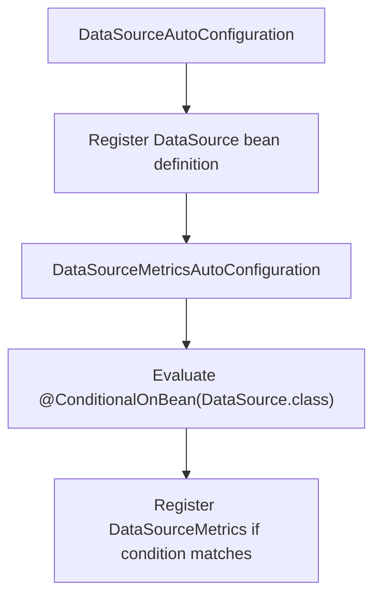
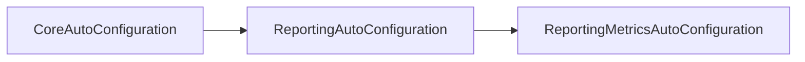

# @AutoConfigureBefore, @AutoConfigureAfter, or equivalent attributes

In Spring Boot, multiple auto-configurations participate together in building the ApplicationContext. One configuration may need to be processed after the database configuration to see a DataSource bean; another configuration may need to stand before the metrics configuration to publish metadata that metrics will use.

Spring Boot provides mechanisms to declare ordering for these configurations:

- **`@AutoConfigureBefore`**: requests that the current auto-configuration be processed before the specified auto-configurations.
- **`@AutoConfigureAfter`**: requests that the current auto-configuration be processed after the specified auto-configurations.
- **`@AutoConfigureOrder`**: supplies a numeric order for the auto-configuration.
- **`before`, `beforeName`, `after`, and `afterName` on `@AutoConfiguration`**: the way to declare ordering directly on an auto-configuration in modern Spring Boot.

These mechanisms control the **processing order of auto-configurations**. They help conditions such as `@ConditionalOnBean` and `@ConditionalOnMissingBean` be evaluated in the proper context. They do not force every bean to be instantiated in a fixed order.

## 1. Why does auto-configuration need ordering?

Suppose a library provides metrics configuration for databases. This configuration should register a bean tracking the connection pool only if another configuration has already registered a `DataSource` bean.

```java
@AutoConfiguration
@ConditionalOnBean(DataSource.class)
public class DataSourceMetricsAutoConfiguration {

    @Bean
    public DataSourceMetrics dataSourceMetrics(DataSource dataSource) {
        return new DataSourceMetrics(dataSource);
    }
}
```

The `@ConditionalOnBean(DataSource.class)` condition needs to see a matching bean already registered in the BeanFactory at the moment the condition is evaluated.

If the auto-configuration creating `DataSource` has not yet been processed, the metrics condition may fail to match. Therefore, the metrics configuration needs to be ordered after the configuration providing `DataSource`.



Without proper ordering, a condition may be evaluated when the bean it needs is not yet known. Auto-configuration ordering clarifies the relationships between configurations.

### 1.1. Configuration order differs from bean creation order

| Concept | What does it control? | Common mechanisms |
|---|---|---|
| Auto-configuration ordering | Which auto-configurations are processed before/after others | `@AutoConfigureBefore`, `@AutoConfigureAfter`, attributes of `@AutoConfiguration` |
| Bean creation ordering | Which dependencies must be supplied before creating another bean | Constructor dependencies, factory methods, dependency graph |
| Explicit bean initialization ordering | Which specific bean must initialize before another for an explicit reason | `@DependsOn` |
| Collection/component ordering | Elements in a list or certain ordered components | `@Order`, `Ordered` |

For example, if `OrderService` constructor-injects `PaymentService`, Spring must supply `PaymentService` before completing `OrderService` creation. There is no need to use `@AutoConfigureAfter` to resolve that relationship.

Conversely, if an auto-configuration uses `@ConditionalOnBean(PaymentGateway.class)` and `PaymentGateway` is supplied by another auto-configuration, that is a configuration processing order issue. `@AutoConfigureAfter` can express that relationship.

**Before/after orders configurations; dependency injection orders bean provisioning by dependency relationships.**

## 2. What is @AutoConfigureBefore?

`@AutoConfigureBefore` marks an auto-configuration as needing to be processed before one or more other auto-configurations.

```java
@Configuration(proxyBeanMethods = false)
@AutoConfigureBefore(CacheAutoConfiguration.class)
public class CustomCacheInfrastructureAutoConfiguration {
}
```

Meaning: Spring Boot needs to place `CustomCacheInfrastructureAutoConfiguration` before `CacheAutoConfiguration` during auto-configuration sorting.

Multiple classes can be specified:

```java
@Configuration(proxyBeanMethods = false)
@AutoConfigureBefore({
        CacheAutoConfiguration.class,
        MetricsAutoConfiguration.class
})
public class SharedInfrastructureAutoConfiguration {
}
```

### 2.1. When should before be used?

A typical situation:

- A library registers supporting beans or metadata.
- Another auto-configuration can use that information to decide how to configure itself.
- The library wants to make explicit that its supporting configuration must be processed before the dependent configuration.

However, verify whether the relationship is genuinely needed. If you only need a bean dependency to be injected by Spring in time, there is no need to add before/after.

### 2.2. before does not mean beans are created earlier

```java
@AutoConfigureBefore(ReportingAutoConfiguration.class)
@Configuration(proxyBeanMethods = false)
public class ReportingDefaultsAutoConfiguration {

    @Bean
    public ReportClock reportClock() {
        return ReportClock.system();
    }
}
```

This does not guarantee the `ReportClock` instance is initialized before every bean of `ReportingAutoConfiguration` is created. It only orders **configurations** during auto-configuration processing.

If a bean in reporting needs `ReportClock`, Spring uses the dependency relationship to supply the matching bean. Do not use before as a substitute for constructor injection or `@DependsOn`.

## 3. What is @AutoConfigureAfter?

`@AutoConfigureAfter` marks the current auto-configuration as needing to be processed after one or more other auto-configurations.

```java
@Configuration(proxyBeanMethods = false)
@AutoConfigureAfter(DataSourceAutoConfiguration.class)
public class DatabaseMetricsAutoConfiguration {

    @Bean
    @ConditionalOnBean(DataSource.class)
    public DatabaseMetrics databaseMetrics(DataSource dataSource) {
        return new DatabaseMetrics(dataSource);
    }
}
```

The metrics configuration is processed after `DataSourceAutoConfiguration`. As a result, the bean condition gets the chance to see the `DataSource` bean definition provided by the earlier configuration.

Multiple auto-configurations can be specified:

```java
@Configuration(proxyBeanMethods = false)
@AutoConfigureAfter({
        DataSourceAutoConfiguration.class,
        HibernateJpaAutoConfiguration.class
})
public class ReportingMetricsAutoConfiguration {
}
```

### 3.1. When should after be used?

- The configuration depends on beans provided by another auto-configuration.
- A `@ConditionalOnBean` condition needs to see a bean definition already registered from another configuration.
- An integration configuration only makes sense after corresponding infrastructure is established during configuration processing.
- An auto-configuration needs to apply after foundational configurations, such as database or web configuration.

Do not use after merely because a class name sounds like an "extension" of another configuration. Declare the relationship only when there is a real dependency in **configuration processing**.

### 3.2. after does not instantiate dependencies manually

If `DatabaseMetricsAutoConfiguration` is processed after `DataSourceAutoConfiguration`, that does not require Spring to invoke the constructors of all DataSource beans before parsing the metrics configuration.

Conditions can work with registered bean definitions before instances are initialized. Later, when the metrics bean is actually created, Spring resolves the `DataSource` dependency through the normal mechanism.

## 4. before and after are relative relationships

The two annotations are not absolute indices. They express relative relationships between auto-configurations.

Suppose there are three configurations:

- `CoreAutoConfiguration` supplies foundational infrastructure.
- `ReportingAutoConfiguration` depends on that infrastructure.
- `ReportingMetricsAutoConfiguration` needs reporting to be registered first.

```java
@AutoConfiguration
public class CoreAutoConfiguration {
    // ...
}

@AutoConfiguration(after = CoreAutoConfiguration.class)
public class ReportingAutoConfiguration {
    // ...
}

@AutoConfiguration(after = ReportingAutoConfiguration.class)
public class ReportingMetricsAutoConfiguration {
    // ...
}
```

The relationships form:



The desired outcome is `Core` before `Reporting`, and then `ReportingMetrics` after `Reporting`. There is no need to assign individual order numbers to each class when before/after relationships already express sufficient constraints.

### 4.1. Multiple constraints can coexist

```java
@AutoConfiguration(after = {
        DataSourceAutoConfiguration.class,
        MetricsAutoConfiguration.class
})
public class DatabaseReportingAutoConfiguration {
}
```

The reporting configuration must be placed after both listed configurations. This declaration does not specify relative order between `DataSourceAutoConfiguration` and `MetricsAutoConfiguration`; if a mandatory relationship also exists between those two classes, declare it in the appropriate place.

### 4.2. Avoid creating ordering cycles

Do not declare conflicting constraints:

```java
@AutoConfigureBefore(B.class)
@Configuration
class A {
}

@AutoConfigureBefore(A.class)
@Configuration
class B {
}
```

The first declaration requires A before B; the second requires B before A. No linear order satisfies both.

An ordering cycle can cause auto-configuration sorting to fail. Build unidirectional relationships and remove unnecessary constraints.

## 5. before/after attributes on @AutoConfiguration

In modern Spring Boot, ordering relationships can be declared directly on `@AutoConfiguration`.

```java
@AutoConfiguration(after = DataSourceAutoConfiguration.class)
public class ReportingAutoConfiguration {
}
```

This is the modern way to express auto-configuration settings. Instead of adding a separate `@AutoConfigureAfter` annotation, you use the `after` attribute of `@AutoConfiguration`.

### 5.1. Corresponding attributes

| Attribute | Meaning |
|---|---|
| `before` | Auto-configuration classes that the current class must precede |
| `beforeName` | Fully qualified names of auto-configuration classes to precede, as strings |
| `after` | Auto-configuration classes that the current class must follow |
| `afterName` | Fully qualified names of auto-configuration classes to follow, as strings |

For example:

```java
@AutoConfiguration(
        before = MetricsAutoConfiguration.class,
        after = DataSourceAutoConfiguration.class
)
public class ReportingAutoConfiguration {
}
```

Meaning:

- Reporting comes after the DataSource configuration.
- Reporting comes before the Metrics configuration.

If you want to use class names instead of class literals:

```java
@AutoConfiguration(
        afterName = "org.springframework.boot.autoconfigure.jdbc.DataSourceAutoConfiguration",
        beforeName = "com.example.metrics.MetricsAutoConfiguration"
)
public class ReportingAutoConfiguration {
}
```

Name-based attributes are useful when you want to avoid direct references to classes in an optional module. They can also reduce coupling when the ordered class is not always present on the classpath.

### 5.2. Class literal or string name?

| Approach | Example | When appropriate |
|---|---|---|
| Class literal | `after = DataSourceAutoConfiguration.class` | Dependency is always available and you want type safety / IDE refactoring |
| Class name | `afterName = "..."` | Class may belong to an optional module and you want to avoid direct references |
| Separate annotation | `@AutoConfigureAfter(DataSourceAutoConfiguration.class)` | Code uses the `@Configuration`-based auto-configuration style in matching versions |

Do not use string class names if the class is actually a mandatory dependency and can be referenced directly safely. Strings are not checked by the compiler; wrong packages or misspelled names are discovered only when processing configuration.

## 6. @AutoConfigureOrder: when numeric ordering is needed

`@AutoConfigureOrder` lets you assign a numeric order to an auto-configuration.

```java
import org.springframework.boot.autoconfigure.AutoConfigureOrder;
import org.springframework.core.Ordered;

@AutoConfigureOrder(Ordered.HIGHEST_PRECEDENCE)
@Configuration(proxyBeanMethods = false)
public class EarlyInfrastructureAutoConfiguration {
}
```

Or:

```java
@AutoConfigureOrder(100)
@Configuration(proxyBeanMethods = false)
public class AdditionalIntegrationAutoConfiguration {
}
```

Numeric rules match Spring's `Ordered` mechanism: **lower numeric values have higher priority / earlier order**, while `Ordered.LOWEST_PRECEDENCE` is the lowest priority value, typically used as the final default.

Use `@AutoConfigureOrder` when you want relative placement by a numeric convention. However, if configuration A genuinely needs to stand before B, declaring a `before` or `after` relationship usually expresses the intent better.

### 6.1. When is numeric order used?

Consider it when:

- Multiple independent auto-configurations need an ordering convention.
- A library wants to provide a default order without depending on a specific class.
- There is no direct dependency relationship between two configurations to use before/after.

Do not use numeric order as a substitute for explicit dependencies. For example, if configuration B needs a bean from A, giving A order 10 and B order 20 does not replace declaring `@AutoConfigureAfter(A.class)` when an explicit relative relationship is needed.

### 6.2. Can numeric order be combined with before/after?

Ordering mechanisms can participate together in sorting auto-configurations. Use them consistently:

- Before/after describes necessary relative constraints.
- Numeric order supplies supplementary priority ordering.
- Do not introduce conflicting constraints.
- Do not rely on an order value to fix a missing bean dependency.

If before/after relationships already suffice, you usually do not need to add order numbers just to "be sure".

## 7. Differences between separate annotations and @AutoConfiguration attributes

Spring Boot has multiple styles for writing auto-configurations depending on the version.

### 7.1. Style using @Configuration and separate annotations

```java
@Configuration(proxyBeanMethods = false)
@AutoConfigureAfter(DataSourceAutoConfiguration.class)
public class ReportingAutoConfiguration {
    // @Bean methods
}
```

This expresses ordering with separate annotations. It is commonly seen in codebases using older configuration conventions.

### 7.2. Style using @AutoConfiguration

```java
@AutoConfiguration(after = DataSourceAutoConfiguration.class)
public class ReportingAutoConfiguration {
    // @Bean methods
}
```

`@AutoConfiguration` is Spring Boot's dedicated annotation for auto-configuration. It integrates the configuration class role and provides ordering attributes such as `before`, `after`, `beforeName`, and `afterName`.

For new code on Spring Boot versions supporting this annotation, this is usually the clearest approach.

### 7.3. Comparison table

| Need | Separate annotation style | Modern attribute style |
|---|---|---|
| Process after configuration A | `@AutoConfigureAfter(A.class)` | `@AutoConfiguration(after = A.class)` |
| Process before configuration B | `@AutoConfigureBefore(B.class)` | `@AutoConfiguration(before = B.class)` |
| After optional class by name | `@AutoConfigureAfter(name = "...")` | `@AutoConfiguration(afterName = "...")` |
| Before optional class by name | `@AutoConfigureBefore(name = "...")` | `@AutoConfiguration(beforeName = "...")` |
| Set numeric order | `@AutoConfigureOrder(100)` | `@AutoConfigureOrder` can continue to be used on auto-configuration |

Do not mix both styles merely to declare the same relationship twice. Choose the style matching your Spring Boot line and module conventions.

## 8. Where are auto-configurations discovered?

Declaring before/after takes effect only when the auto-configuration is brought into Spring Boot's auto-configuration processing mechanism.

In modern Spring Boot, libraries typically publish classes in the file:

```text
META-INF/spring/org.springframework.boot.autoconfigure.AutoConfiguration.imports
```

Example content:

```text
com.example.reporting.autoconfigure.ReportingAutoConfiguration
com.example.metrics.autoconfigure.DatabaseMetricsAutoConfiguration
```

This file lists auto-configuration classes that Boot can import. **Do not rely on line order in this file to express before/after relationships.** Use ordering annotations/attributes to describe required relationships.

### 8.1. Legacy registration style

In older Spring Boot versions, auto-configurations were usually registered via the `EnableAutoConfiguration` key in `META-INF/spring.factories`.

Illustrative example of the old style:

```properties
org.springframework.boot.autoconfigure.EnableAutoConfiguration=\
com.example.reporting.autoconfigure.ReportingAutoConfiguration
```

The registration mechanism has changed across Spring Boot lines. When writing a library, follow the guide for the exact version you support. Registering classes and ordering classes are two separate responsibilities:

- The imports file or registration mechanism tells Boot **which auto-configurations exist**.
- Before/after/order tells Boot **how those auto-configurations must be ordered**.

## 9. Practical scenario: @ConditionalOnBean condition

Suppose a library has two auto-configurations:

1. `ClientAutoConfiguration` creates a `RemoteClient` bean.
2. `ClientMetricsAutoConfiguration` creates a metrics bean if `RemoteClient` exists.

Client configuration:

```java
@AutoConfiguration
public class ClientAutoConfiguration {

    @Bean
    @ConditionalOnMissingBean
    public RemoteClient remoteClient() {
        return new RemoteClient();
    }
}
```

Metrics configuration:

```java
@AutoConfiguration(after = ClientAutoConfiguration.class)
public class ClientMetricsAutoConfiguration {

    @Bean
    @ConditionalOnBean(RemoteClient.class)
    public RemoteClientMetrics remoteClientMetrics(RemoteClient client) {
        return new RemoteClientMetrics(client);
    }
}
```

The `after` relationship ensures the metrics configuration is processed after the client configuration. When the condition is evaluated, the bean definition for `RemoteClient` has had the chance to be registered beforehand.

### 9.1. What happens without after?

If the metrics configuration is processed while `ClientAutoConfiguration` has not yet been processed, `@ConditionalOnBean` may fail to find `RemoteClient`. The metrics bean is not registered.

This is not necessarily a startup error. It might simply cause the metrics feature not to appear. That is why the condition evaluation report is helpful when debugging auto-configuration.

### 9.2. Why not use @DependsOn?

`@DependsOn` affects initialization relationships between specific beans. Yet in the example above, the metrics bean might not even be registered because the condition did not match. An annotation on a bean does not solve **the configuration creating that bean not being processed at the right time**.

Use `after` to order auto-configurations; use dependency injection or `@DependsOn` for relationships between beans when genuinely needed.

## 10. Practical scenario: @ConditionalOnMissingBean and default beans

Suppose a library provides a default `PaymentGateway`. Applications can replace it with their own implementation.

Auto-configuration:

```java
@AutoConfiguration
public class PaymentAutoConfiguration {

    @Bean
    @ConditionalOnMissingBean(PaymentGateway.class)
    public PaymentGateway paymentGateway() {
        return new DefaultPaymentGateway();
    }
}
```

Application:

```java
@Configuration(proxyBeanMethods = false)
public class CustomPaymentConfiguration {

    @Bean
    public PaymentGateway paymentGateway() {
        return new AcmePaymentGateway();
    }
}
```

Spring Boot structures processing so user configurations are processed before auto-configurations. Thus, the missing-bean condition can see the custom bean and the default auto-configuration **backs off**.

Things to remember:

- Do not use before/after to try ordering all regular application configurations.
- Auto-configuration must be designed to respect user-provided beans.
- Conditions only see bean definitions already processed before the moment they run.
- If one auto-configuration depends on a bean provided by another auto-configuration, declare `after` appropriately.

## 11. before/after does not control component scan order

One misconception is that putting `@AutoConfigureAfter` on any `@Configuration` class guarantees Spring will always scan that class after a specific component.

This annotation is meant for **auto-configuration ordering**. It is not a general mechanism for controlling component scanning order across all configuration classes in an application.

Likewise, do not rely on source file order, class names, package names, or method declaration order to guarantee a condition sees a particular bean.

When writing normal application configuration, prefer:

- Declaring dependencies directly through constructors of `@Bean` methods or bean classes.
- Using `@Import` when explicitly importing configurations.
- Splitting auto-configurations into appropriate modules/units.
- Using before/after when ordering actual auto-configurations.

## 12. Distinguishing from @Order and Ordered

Spring Framework has `@Order` and the `Ordered` interface. Their names resemble `@AutoConfigureOrder`, yet their purposes differ.

### 12.1. @Order

`@Order` is usually used to specify priority order of components in contexts supporting ordering, such as elements injected into collections, certain components, or event listeners.

```java
@Component
@Order(1)
public class FirstStartupListener
        implements ApplicationListener<ContextRefreshedEvent> {

    @Override
    public void onApplicationEvent(ContextRefreshedEvent event) {
        // ...
    }
}
```

This example illustrates listener ordering, not how auto-configurations are ordered.

### 12.2. @AutoConfigureOrder

`@AutoConfigureOrder` is for ordering auto-configuration classes:

```java
@AutoConfigureOrder(100)
@Configuration(proxyBeanMethods = false)
public class OptionalFeatureAutoConfiguration {
}
```

### 12.3. Distinction table

| Annotation/interface | What is ordered | Purpose |
|---|---|---|
| `@AutoConfigureBefore` | Auto-configuration classes | Constrains current class before other classes |
| `@AutoConfigureAfter` | Auto-configuration classes | Constrains current class after other classes |
| `@AutoConfigureOrder` | Auto-configuration classes | Numeric order for auto-configurations |
| `@Order` | Objects in contexts supporting ordering | Priority in collections/listeners or corresponding components |
| `Ordered` | Objects implementing the interface | Provides order value programmatically |

If your target is auto-configuration, choose the right Spring Boot mechanism. Using `@Order` expecting it to change auto-configuration import order may not yield the result you want.

## 13. Debugging auto-configuration order

When a condition matches unexpectedly or a default bean fails to back off, inspect the Condition Evaluation Report before changing ordering randomly.

### 13.1. Starting with --debug

```bash
java -jar app.jar --debug
```

Or enable the property:

```properties
debug=true
```

Spring Boot can print the condition report, listing matched or unmatched auto-configurations and reasons.

Look for entries related to:

- The auto-configuration class under inspection.
- `@ConditionalOnBean` or `@ConditionalOnMissingBean`.
- The bean type/name the condition checks.
- The reason the condition did not match.
- Foundational configurations that the current configuration is expected to precede or follow.

### 13.2. Actuator conditions endpoint

In an application with Spring Boot Actuator, the conditions endpoint can supply information about condition evaluation. The endpoint typically has id `conditions`; access depends on dependencies, exposure, and security configuration.

In development, `--debug` logs are a simple way to inspect the Condition Evaluation Report. Do not expose sensitive management endpoints externally just for debugging.

### 13.3. Do not guess ordering from bean creation logs

Bean creation logs reflect instance lifecycle and can be affected by lazy initialization, dependencies, runners, and other factors. They are not direct evidence of auto-configuration processing order.

To know which configurations matched, inspect the condition report and ordering metadata. To know which bean needs which bean, inspect the dependency graph and bean definitions.

## 14. Testing auto-configuration ordering

Spring Boot provides `ApplicationContextRunner` to test auto-configuration in a small context.

Configuration providing the bean:

```java
@AutoConfiguration
public class MarkerAutoConfiguration {

    @Bean
    @ConditionalOnMissingBean
    public Marker marker() {
        return new Marker();
    }
}
```

Configuration depending on that bean:

```java
@AutoConfiguration(after = MarkerAutoConfiguration.class)
public class MarkerConsumerAutoConfiguration {

    @Bean
    @ConditionalOnBean(Marker.class)
    public MarkerConsumer markerConsumer(Marker marker) {
        return new MarkerConsumer(marker);
    }
}
```

Test:

```java
class AutoConfigurationOrderingTests {

    private final ApplicationContextRunner runner =
            new ApplicationContextRunner()
                    .withConfiguration(
                            AutoConfigurations.of(
                                    MarkerConsumerAutoConfiguration.class,
                                    MarkerAutoConfiguration.class
                            )
                    );

    @Test
    void consumerConfigurationSeesMarkerBean() {
        runner.run(context -> {
            assertThat(context).hasSingleBean(Marker.class);
            assertThat(context).hasSingleBean(MarkerConsumer.class);
        });
    }
}
```

Even though the list passed to the runner puts consumer before marker, ordering in the auto-configuration lets Boot sort according to before/after metadata. The test requires the `spring-boot-test` dependency and corresponding `Marker`, `MarkerConsumer` test classes.

This is a small test verifying **conditional bean registration behavior**. In real projects, also test the case where the user supplies the bean to confirm default auto-configuration backs off.

### 14.1. Testing the case where the user supplies their own bean

```java
@Configuration(proxyBeanMethods = false)
class UserMarkerConfiguration {

    @Bean
    Marker customMarker() {
        return new Marker("custom");
    }
}
```

You can add this configuration to the runner:

```java
runner.withUserConfiguration(UserMarkerConfiguration.class)
        .run(context -> {
            assertThat(context).hasSingleBean(Marker.class);
            assertThat(context).hasBean("customMarker");
        });
```

The goal is to confirm auto-configuration respects user beans, rather than only proving ordering when all beans come from the library.

## 15. Common ordering design mistakes

### 15.1. Using after with a class that is not an auto-configuration

`@AutoConfigureAfter` is designed for auto-configuration classes. If the target class is merely a regular scanned component/configuration, the annotation is not a general tool to guarantee processing order for that class.

Check whether the target class actually belongs to the auto-configuration mechanism.

### 15.2. Using before/after to resolve constructor dependencies

If `AService` needs `BService`, constructor injection already expresses the dependency relationship. Using `@AutoConfigureBefore` does not resolve constructor cycles or missing beans; fix the dependency graph.

### 15.3. Relying on line order in AutoConfiguration.imports

The imports file lists auto-configurations to be discovered. Do not treat line order as an ordering contract. Declare before/after or order appropriately.

### 15.4. Using @AutoConfigureOrder for a required dependency

If `ReportingAutoConfiguration` needs a bean provided by `DataSourceAutoConfiguration`, declaring `after` expresses the direct relationship more clearly than a generic order number.

### 15.5. Creating bidirectional before/after relationships

A before B and B before A is an ordering cycle. Review module structure and keep only genuinely necessary relationships.

### 15.6. Declaring too many constraints

An auto-configuration with many unnecessary before/after declarations makes the ordering graph hard to understand, prone to conflicting constraints, and harder to maintain.

Declare only the relationships needed for conditions or configuration to work correctly.

## 16. Workflow for choosing an ordering mechanism

When writing a new auto-configuration, ask these questions in order:

1. **Does the configuration actually need to run before/after another auto-configuration?** If not, do not add ordering.
2. **Does it need to go before or after?** If the current configuration needs a bean provided by the other configuration, usually use after.
3. **Is the target class always present on the classpath?** If yes, use a class literal; if it is an optional integration, consider a class name string.
4. **Is a general numeric order needed?** Use `@AutoConfigureOrder` only when before/after does not fit the need.
5. **Are there conflicting constraints?** Sketch the graph to check for cycles.
6. **Do conditions match as expected?** Use the Condition Evaluation Report or ApplicationContextRunner.
7. **Is this configuration ordering or bean creation dependency?** Choose the corresponding mechanism.

Quick decision table:

| Need | Mechanism |
|---|---|
| Auto-configuration A must run before B | `@AutoConfigureBefore(B.class)` or `before = B.class` |
| Auto-configuration A must run after B | `@AutoConfigureAfter(B.class)` or `after = B.class` |
| Target is an optional class you do not want to reference directly | `name` or `beforeName`/`afterName` |
| Numeric sorting between auto-configurations needed | `@AutoConfigureOrder` |
| Bean A needs bean B during creation | Constructor injection / bean method dependency |
| Bean A must initialize after bean B for a specific side effect | Consider `@DependsOn` |
| Listeners/collections need ordering | `@Order` or `Ordered` |

## 17. Self-check exercises

### Question 1. Reporting needs DataSource

`ReportingAutoConfiguration` has `@ConditionalOnBean(DataSource.class)`. The `DataSource` bean is registered by `DataSourceAutoConfiguration`.

Which ordering should be declared?

**Answer:** Place reporting after data source using `@AutoConfigureAfter(DataSourceAutoConfiguration.class)` or `@AutoConfiguration(after = DataSourceAutoConfiguration.class)`.

### Question 2. Current configuration must run before Metrics

An auto-configuration registers metadata that the Metrics auto-configuration uses during configuration processing.

What should be used?

**Answer:** `@AutoConfigureBefore(MetricsAutoConfiguration.class)` or the corresponding `before` attribute on `@AutoConfiguration`, provided both are proper auto-configurations.

### Question 3. Does after cause beans of the earlier configuration to be instantiated first?

**Answer:** No. `after` controls auto-configuration processing order, not bean instance creation order.

### Question 4. Does `@Order(1)` replace `@AutoConfigureOrder(1)`?

**Answer:** No. The two annotations serve different ordering contexts. Use `@AutoConfigureOrder` for auto-configuration.

### Question 5. Two auto-configurations require A before B and B before A. What is wrong?

**Answer:** There is an ordering constraint cycle, with no linear order satisfying both. Remove or redesign the relationship.

### Question 6. Why shouldn't you rely on line order in the AutoConfiguration.imports file?

**Answer:** This file publishes the list of auto-configurations; ordering relationships should be described with Spring Boot's supported ordering metadata.

### Question 7. A bean definition exists yet its lazy instance has not been created. Can after help a condition see the bean?

**Answer:** Ordering can help a configuration register its bean definition before another condition is evaluated. Conditions do not require a fully initialized instance; bean definitions and type metadata are the focus.

## 18. Key takeaways

- `@AutoConfigureBefore` and `@AutoConfigureAfter` describe relative order between auto-configuration classes.
- Modern `@AutoConfiguration` has `before`, `beforeName`, `after`, and `afterName` attributes to express the same intent.
- `@AutoConfigureOrder` provides numeric order; lower values have earlier priority per `Ordered` conventions.
- Ordering matters when auto-configurations use `@ConditionalOnBean` or `@ConditionalOnMissingBean` based on bean definitions supplied by other configurations.
- These annotations order **configuration processing**, not directly the creation of every bean.
- `@DependsOn` is for initialization relationships between beans; `@Order`/`Ordered` serves other ordering contexts.
- The `AutoConfiguration.imports` file publishes auto-configurations; do not use line order in the file as a before/after contract.
- Declare only genuinely necessary constraints, avoid cycles, and verify with the Condition Evaluation Report or `ApplicationContextRunner`.

When writing an auto-configuration, ask yourself: **"Which configuration does this configuration need to be processed after or before, and is the reason that a condition needs to see a bean definition or a real bean dependency?"** Distinguishing these two cases helps you choose accurately between before/after, numeric order, and dependency injection.
