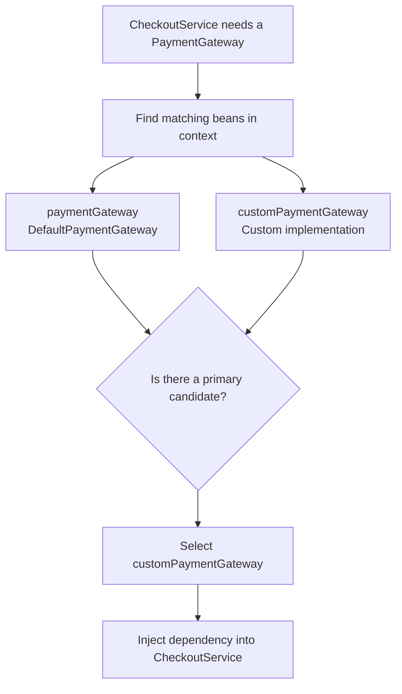
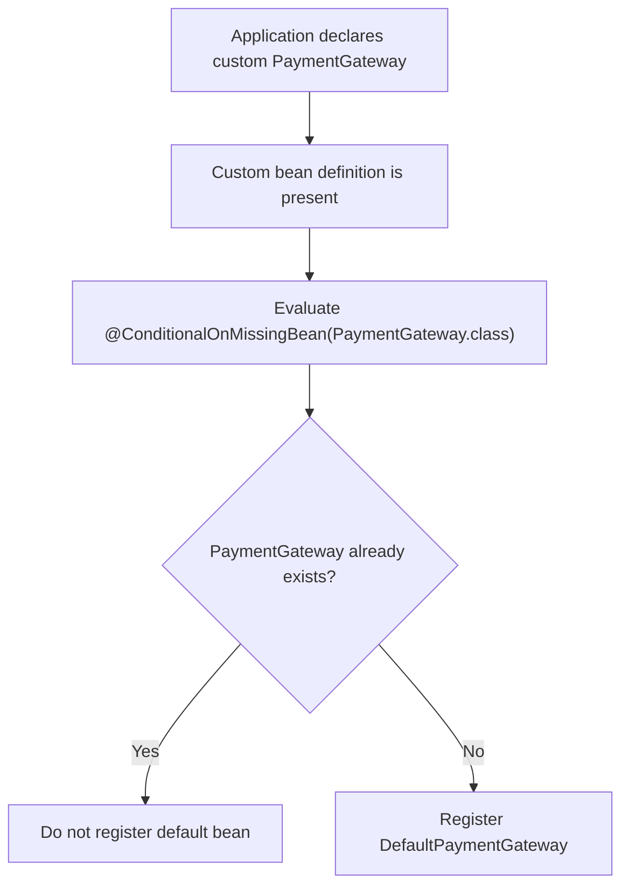
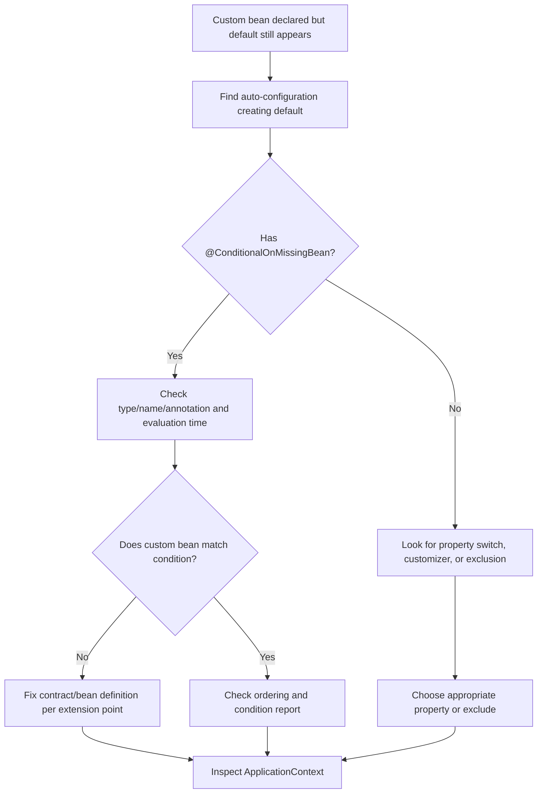

# Limitations of @Primary when trying to prevent an auto-configuration from creating a bean

When a Spring Boot application has multiple beans of the same type, `@Primary` helps Spring choose one bean as the default candidate for single-valued dependencies. This is useful when an application has multiple implementations of the same interface. However, there is a very important limitation: **`@Primary` only affects bean selection when resolving dependencies; it does not prevent Spring from registering or creating another bean from an auto-configuration**.

Suppose a library provides a default `PaymentGateway` via auto-configuration. An application wants to use its own implementation, so it marks its own bean with `@Primary`. Services may then receive the application's implementation, but the auto-configuration can still create the default bean. Both beans still exist in the context; if the default bean opens connections, initializes clients, or holds resources, that work may still happen. If both are marked primary, single-valued injection can even still be ambiguous.

This lesson belongs to the **Spring Boot Customization** chapter of *Spring Boot Fundamentals*. We will distinguish the two phases of **bean registration** and **bean selection**, reproduce the limitation of `@Primary`, and then use the right tools to make auto-configuration back off: `@ConditionalOnMissingBean` in auto-configuration, property switches, exclusions, and extension points provided by the library.

Examples use Java 21 and Spring Boot 3.x. The auto-configuration and payment gateway classes in this article are illustrative examples, not built-in Spring Boot configurations.

## 1. Two different questions: which bean is created and which bean is selected?

This is the core distinction of the lesson:

- **Bean registration/creation:** Does Spring put the bean definition into the container and create an instance?
- **Bean selection:** When a constructor, field, setter, or method needs a dependency, which candidate does Spring pick among the registered beans?

`@Primary` belongs to the second question. It is not a bean registration condition.

| Mechanism | When/where it acts | Question resolved |
|---|---|---|
| `@ConditionalOnMissingBean` | When Spring evaluates configuration/bean definitions | Should this default bean be registered? |
| `@ConditionalOnProperty` | When evaluating conditions against Environment | Is this feature enabled by configuration? |
| Exclude auto-configuration | When selecting the list of imported auto-configurations | Which auto-configuration must not participate? |
| `@Primary` | When the container resolves a matching dependency | If one bean is needed, which candidate is preferred? |
| `@Qualifier` | At the injection point when resolving a dependency | Which candidate does this specific consumer need? |

Short example:

```java
@Bean
@Primary
PaymentGateway customPaymentGateway() {
    return new CustomPaymentGateway();
}
```

The code above registers a bean and marks it primary. It **does not signal Boot to skip every auto-configuration that could create a `PaymentGateway`**. To stop auto-configuration from creating a default, an appropriate condition or exclusion mechanism must exist on the configuration registration side.

## 2. Example: a library provides a default PaymentGateway

Create a shared interface:

```java
package com.example.payment;

public interface PaymentGateway {
    String charge(long amount);
}
```

Default implementation provided by the library:

```java
package com.example.payment.autoconfigure;

import com.example.payment.PaymentGateway;

public class DefaultPaymentGateway implements PaymentGateway {

    public DefaultPaymentGateway() {
        System.out.println("Creating default payment gateway");
    }

    @Override
    public String charge(long amount) {
        return "DEFAULT:" + amount;
    }
}
```

Suppose the library's auto-configuration declares:

```java
package com.example.payment.autoconfigure;

import com.example.payment.PaymentGateway;
import org.springframework.boot.autoconfigure.AutoConfiguration;
import org.springframework.context.annotation.Bean;

@AutoConfiguration
public class PaymentAutoConfiguration {

    @Bean
    PaymentGateway paymentGateway() {
        return new DefaultPaymentGateway();
    }
}
```

In this example, the `paymentGateway()` method has no condition. If the auto-configuration is registered and applied, the method provides the default bean.

The application wants to use its own implementation:

```java
package com.example.demo.config;

import com.example.payment.PaymentGateway;
import org.springframework.context.annotation.Bean;
import org.springframework.context.annotation.Configuration;
import org.springframework.context.annotation.Primary;

@Configuration(proxyBeanMethods = false)
public class CustomPaymentConfiguration {

    @Bean
    @Primary
    PaymentGateway customPaymentGateway() {
        return amount -> "CUSTOM:" + amount;
    }
}
```

Now the application context can contain **two beans of type `PaymentGateway`**:

| Bean name | Implementation | Primary? |
|---|---|---|
| `paymentGateway` | `DefaultPaymentGateway` | No |
| `customPaymentGateway` | Application-provided lambda | Yes |

A service only asks for one gateway:

```java
package com.example.demo.service;

import com.example.payment.PaymentGateway;
import org.springframework.stereotype.Service;

@Service
public class CheckoutService {

    private final PaymentGateway gateway;

    public CheckoutService(PaymentGateway gateway) {
        this.gateway = gateway;
    }

    public String checkout(long amount) {
        return gateway.charge(amount);
    }
}
```

Because the custom bean is primary, `CheckoutService` can receive the custom bean and return `CUSTOM:100`. However, that **does not prove the default bean was not created**. The `DefaultPaymentGateway` constructor may still have run and logged:

```text
Creating default payment gateway
```

This is the limitation to recognize: the application may be using the right bean while still paying the initialization cost of an unnecessary bean.

## 3. What does @Primary do in the example above?

`@Primary` is considered when Spring needs to resolve a single-valued dependency. In the example, both beans are assignable to the `PaymentGateway` constructor parameter:



The container still keeps both beans. `@Primary` does not:

- Delete the default bean.
- Cancel the auto-configuration's bean definition.
- Prevent the auto-configuration's `@Bean` method from being processed.
- Prevent the default implementation's constructor from running.
- Prevent the default bean's resources from being initialized.
- Automatically exclude the auto-configuration class.
- Automatically alter `@ConditionalOnMissingBean` conditions.

### 3.1. If the application only wants consumers to use its custom implementation

If the default bean is lightweight, has no side effects, and keeping both beans is intentional, `@Primary` may be sufficient. But if the goal is to **prevent the default bean from being registered/created**, `@Primary` does not meet the requirement.

### 3.2. If the default bean is also primary

If the auto-configuration marks the default bean with `@Primary` and the application also marks the custom bean as primary, two primary candidates of the same type can leave single-valued dependency injection ambiguous. `@Primary` does not establish a priority order among multiple primary beans.

In that case, you need a qualifier to select specifically, or better yet, configure the auto-configuration so the default backs off when a custom bean is present.

## 4. The right approach for auto-configuration: @ConditionalOnMissingBean

If you are the author of an auto-configuration library, the standard pattern is to provide a default only when the application does not yet have a replacement bean:

```java
package com.example.payment.autoconfigure;

import com.example.payment.PaymentGateway;
import org.springframework.boot.autoconfigure.AutoConfiguration;
import org.springframework.boot.autoconfigure.condition.ConditionalOnMissingBean;
import org.springframework.context.annotation.Bean;

@AutoConfiguration
public class PaymentAutoConfiguration {

    @Bean
    @ConditionalOnMissingBean(PaymentGateway.class)
    PaymentGateway paymentGateway() {
        return new DefaultPaymentGateway();
    }
}
```

When the application provides a bean compatible with `PaymentGateway` and that bean definition is already present when the condition is evaluated, the default method is not used. This is called **back off**: the auto-configuration yields to the application's customization.

`@ConditionalOnMissingBean` placed on a `@Bean` method is the standard way to provide a replaceable default. In an application using this library:

```java
@Configuration(proxyBeanMethods = false)
public class CustomPaymentConfiguration {

    @Bean
    PaymentGateway customPaymentGateway() {
        return amount -> "CUSTOM:" + amount;
    }
}
```

Expected outcome:

1. Spring registers the application's `customPaymentGateway` bean definition.
2. When processing `PaymentAutoConfiguration`, the condition searches for matching beans of type `PaymentGateway`.
3. Because the custom bean already exists, the condition does not match.
4. The default `paymentGateway()` method is skipped.
5. Only the custom bean is provided from these two configurations.



This is the appropriate mechanism to prevent the default bean from being created. **The deciding point is the condition on the bean definition, not the primary annotation on the custom bean.**

## 5. Why must the condition be placed in auto-configuration?

`@ConditionalOnMissingBean` is typically used in auto-configuration because Boot has rules to process application configuration before imported auto-configurations. As a result, user-declared bean definitions are generally visible when the auto-configuration decides whether to provide a default.

For example, the application configuration:

```java
@Configuration(proxyBeanMethods = false)
public class CustomPaymentConfiguration {

    @Bean
    PaymentGateway customPaymentGateway() {
        return amount -> "CUSTOM:" + amount;
    }
}
```

is processed as application configuration. Then the auto-configuration providing the default with a missing-bean condition can detect the customization.

### 5.1. Configuration order matters

Bean-based conditions evaluate the set of bean definitions registered at processing time. If you place `@ConditionalOnMissingBean` on a user configuration that gets processed before the checked bean definition appears, the result may not be what you want.

Therefore, when writing a library, use Spring Boot's auto-configuration pattern rather than scattering default conditions across application component scans. Default configuration should be supplied in an auto-configuration class, where Boot's ordering conventions are designed to support customization.

### 5.2. @AutoConfigureBefore and @AutoConfigureAfter are not arbitrary workarounds

Ordering annotations like `@AutoConfigureBefore` and `@AutoConfigureAfter` declare ordering relationships between auto-configurations. They are useful when one auto-configuration needs to depend on bean definitions or settings from another auto-configuration.

Do not use them to force a default bean to always win or lose against an application bean. For user-provided beans, follow the standard auto-configuration pattern and use `@ConditionalOnMissingBean`.

## 6. The type checked in @ConditionalOnMissingBean must match

A condition can back off only if it checks the right bean type that the application intends to replace.

For example:

```java
@Bean
@ConditionalOnMissingBean(PaymentGateway.class)
PaymentGateway paymentGateway() {
    return new DefaultPaymentGateway();
}
```

The condition checks for beans assignable to `PaymentGateway`. If the application provides an implementation:

```java
@Bean
PaymentGateway customPaymentGateway() {
    return new CustomPaymentGateway();
}
```

then the custom bean satisfies the condition's type.

But suppose the auto-configuration writes:

```java
@Bean
@ConditionalOnMissingBean(DefaultPaymentGateway.class)
PaymentGateway paymentGateway() {
    return new DefaultPaymentGateway();
}
```

The application providing `CustomPaymentGateway implements PaymentGateway` does not mean a bean of type `DefaultPaymentGateway` exists. The condition checks the default's concrete class, so it can still match and create an extra default.

This is a common condition design mistake: **checking a concrete implementation when customization intent is expressed by an interface**.

If the goal is to allow the application to replace any implementation of the contract, put the condition on the contract:

`@ConditionalOnMissingBean(PaymentGateway.class)`

### 6.1. The @Bean method's return type also matters

Spring can use metadata and the `@Bean` method's return type to predict the bean type before creating an instance. When writing auto-configuration, declare a sufficiently specific return type matching the contract consumers use.

For example:

```java
@Bean
@ConditionalOnMissingBean(PaymentGateway.class)
PaymentGateway paymentGateway() {
    return new DefaultPaymentGateway();
}
```

The return type is `PaymentGateway`, matching the contract. If you declare an overly general return type like `Object`, type prediction and type-based condition evaluation can be harder or yield unexpected results in some cases.

### 6.2. Other attributes of @ConditionalOnMissingBean

Besides `value`/`type`, the annotation supports ways to narrow the check, such as:

- `name`: check a specific bean name.
- `annotation`: check an annotation on beans.
- `ignored` and `ignoredType`: exclude certain types from the check.
- `search`: choose the context hierarchy scope to check.

Use these attributes only when there is a clear requirement. For a replaceable default implementation, checking the contract interface is usually the easiest to understand.

## 7. What if a third-party auto-configuration does not use @ConditionalOnMissingBean?

You may not own the library's source code. The library's auto-configuration might register a bean unconditionally:

```java
@AutoConfiguration
public class VendorPaymentAutoConfiguration {

    @Bean
    PaymentGateway vendorPaymentGateway() {
        return new VendorPaymentGateway();
    }
}
```

In this case, adding `@Primary` to the custom bean only helps Spring prefer the custom one when injecting a single `PaymentGateway`. The vendor's default can still be registered and created.

Look for one of the extension points supported by the library:

1. A property to disable the feature or default bean.
2. An exclusion setting to omit the auto-configuration.
3. A customization interface or `Customizer<T>`.
4. Replacement bean configuration documented by the library.
5. A newer library version with a missing-bean condition or suitable back-off mechanism.

If the library provides no extension points at all, `@Primary` cannot turn an unconditional auto-configuration into a conditional one. In that case, consider excluding the configuration, changing the integration approach, or choosing another version/library with suitable extension points.

## 8. Option one: use a property switch if the library supports it

Many auto-configurations provide a property to toggle the feature. For example, the library has:

```java
@AutoConfiguration
@ConditionalOnProperty(
        prefix = "vendor.payment",
        name = "enabled",
        havingValue = "true",
        matchIfMissing = true
)
public class VendorPaymentAutoConfiguration {

    @Bean
    PaymentGateway vendorPaymentGateway() {
        return new VendorPaymentGateway();
    }
}
```

The application can disable it:

```yaml
vendor:
  payment:
    enabled: false
```

When the effective property is `false`, the auto-configuration does not apply under this condition. This is a good approach when the library designs the property as an officially supported extension point.

**You cannot invent an arbitrary property in the application and expect a library that does not check it to stop automatically.** A property only takes effect if the auto-configuration actually inspects it, or if you write a corresponding controlling configuration yourself.

If an auto-configuration has a property prefix, read the documentation or condition report to learn the exact property name, default value, and how to disable it. Do not guess properties from bean names.

## 9. Option two: exclude the auto-configuration

If you do not want an auto-configuration to participate, Spring Boot lets you exclude it.

### 9.1. Using the exclude attribute on @SpringBootApplication

For example:

```java
import org.springframework.boot.autoconfigure.SpringBootApplication;
import com.vendor.payment.autoconfigure.VendorPaymentAutoConfiguration;

@SpringBootApplication(exclude = VendorPaymentAutoConfiguration.class)
public class DemoApplication {
    public static void main(String[] args) {
        SpringApplication.run(DemoApplication.class, args);
    }
}
```

When that class is an auto-configuration candidate imported by Boot, exclusion prevents it from being applied. Beans provided solely by that auto-configuration will not be registered from that configuration.

### 9.2. Using the spring.autoconfigure.exclude property

You can configure it in `application.yml`:

```yaml
spring:
  autoconfigure:
    exclude:
      - com.vendor.payment.autoconfigure.VendorPaymentAutoConfiguration
```

Or pass it via command-line arguments:

```bash
./gradlew bootRun --args='--spring.autoconfigure.exclude=com.vendor.payment.autoconfigure.VendorPaymentAutoConfiguration'
```

On Windows PowerShell:

```powershell
.\gradlew.bat bootRun --args="--spring.autoconfigure.exclude=com.vendor.payment.autoconfigure.VendorPaymentAutoConfiguration"
```

Exclusion is an option at the auto-configuration class level. It is useful when you want to turn off the whole configuration group provided by that class, not just a single bean.

### 9.3. Exclusion has broader impact than a missing-bean condition

| Approach | Scope |
|---|---|
| `@ConditionalOnMissingBean(PaymentGateway.class)` | Only skips the corresponding default bean when a contract bean already exists. Other beans in the same auto-configuration can still be created. |
| Property switch on auto-configuration class | Can disable the whole configuration class or a conditionally guarded part. |
| Exclude auto-configuration class | Removes that configuration from the auto-configuration process. Beans provided only by that class will not be created. |

If you only want to replace the gateway while still needing other beans such as health indicators, metrics, or properties from the same library, excluding the entire class may be too broad. Inspect the auto-configuration structure and choose the smallest scope that meets the requirement.

## 10. Option three: use a customization point instead of replacing the bean

A well-designed library can provide a default bean while letting users customize it through an interface or customizer. For example:

```java
public class PaymentClientProperties {
    private String merchantId;
    private int timeoutMillis = 3000;

    public String getMerchantId() {
        return merchantId;
    }

    public void setMerchantId(String merchantId) {
        this.merchantId = merchantId;
    }

    public int getTimeoutMillis() {
        return timeoutMillis;
    }

    public void setTimeoutMillis(int timeoutMillis) {
        this.timeoutMillis = timeoutMillis;
    }
}
```

Another pattern is:

```java
@FunctionalInterface
public interface PaymentClientCustomizer {
    void customize(PaymentClientBuilder builder);
}
```

The auto-configuration uses customizers when creating the bean:

```java
@Bean
@ConditionalOnMissingBean(PaymentClient.class)
PaymentClient paymentClient(
        ObjectProvider<PaymentClientCustomizer> customizers) {

    PaymentClientBuilder builder = PaymentClientBuilder.create();
    customizers.orderedStream().forEach(customizer ->
            customizer.customize(builder));
    return builder.build();
}
```

The application registers a customizer:

```java
@Bean
PaymentClientCustomizer paymentClientCustomizer() {
    return builder -> builder.timeoutMillis(5000);
}
```

In this example, the application keeps the default client creation process while customizing parameters. There is no need to create a second client bean and no need for `@Primary`. This is a good option if the goal is to change the default's behavior rather than replace the entire implementation.

`ObjectProvider<PaymentClientCustomizer>` lets the auto-configuration retrieve zero or more customizers, while `orderedStream()` respects ordering if customizers declare appropriate order metadata.

## 11. If you want to keep both beans while a specific consumer uses a custom one

There are cases where the application accepts that the default bean still exists, yet wants a specific consumer to use a custom implementation. In that case, `@Primary` or `@Qualifier` is the right tool.

For example:

```java
@Bean
@Primary
PaymentGateway customPaymentGateway() {
    return amount -> "CUSTOM:" + amount;
}
```

Consumers that simply ask for `PaymentGateway` will prefer the custom bean, while a consumer wanting the default can specify:

```java
public AuditService(
        @Qualifier("paymentGateway")
        PaymentGateway defaultGateway) {
    this.defaultGateway = defaultGateway;
}
```

This makes sense if both gateways genuinely need to coexist. However, if the default bean opens sockets, creates thread pools, or holds unnecessary resources, keeping it around just so another consumer could pick it is an architectural decision to consider carefully.

**`@Qualifier` and `@Primary` control dependency injection; they do not prevent a bean definition from being registered.**

## 12. Do not confuse @Primary with bean overriding

Bean overriding is a different mechanism: a bean definition with the same name can replace a previously registered definition if the container allows it. Spring Boot generally does not enable bean definition overriding by default in newer applications; exact behavior and settings may depend on version.

Do not use duplicate bean names to replace auto-configuration when explicit extension points exist.

For example, if both configurations declare the same name:

```java
@Bean
PaymentGateway paymentGateway() {
    return new DefaultPaymentGateway();
}
```

and:

```java
@Bean
PaymentGateway paymentGateway() {
    return new CustomPaymentGateway();
}
```

then this is a bean definition name collision, not a primary selection issue. When overriding is disabled, the application may report a bean definition conflict error. When overriding is enabled, one definition can replace the other according to registration rules; that does not mean `@Primary` prevented the auto-configuration.

To provide a custom bean that can replace a default, a better design is for the auto-configuration to use `@ConditionalOnMissingBean` on the contract.

## 13. How to verify whether the default bean was actually created

Do not just look at the service's output and conclude the auto-configuration backed off. Query the context:

```java
Map<String, PaymentGateway> gateways =
        applicationContext.getBeansOfType(PaymentGateway.class);

gateways.forEach((name, gateway) ->
        System.out.println(name + " -> "
                + gateway.getClass().getSimpleName()));
```

If the result includes both `paymentGateway` and `customPaymentGateway`, the default still exists even though single-valued consumers are using the primary bean.

You can also check beans by name:

```java
boolean defaultExists =
        applicationContext.containsBean("paymentGateway");

boolean customExists =
        applicationContext.containsBean("customPaymentGateway");
```

If the auto-configuration has backed off, the default bean provided by the `paymentGateway()` method will not exist. The exact bean name depends on the method name or an explicitly declared name.

### 13.1. Viewing the condition report

Run the application with `--debug` to view the Condition Evaluation Report:

```bash
./gradlew bootRun --args='--debug'
```

When using Windows PowerShell:

```powershell
.\gradlew.bat bootRun --args="--debug"
```

Find the auto-configuration and default bean method in the report:

- If `@ConditionalOnMissingBean` matched as a missing bean, the default may be registered.
- If the report shows a matching bean was found, the default method backed off.
- If the configuration was excluded by a property or exclusion, read the corresponding reason.

The condition report helps explain configuration decisions; querying `ApplicationContext` verifies which beans are actually registered.

### 13.2. Actuator conditions and beans

In a local environment, you can add Spring Boot Actuator and expose the appropriate endpoints:

```yaml
management:
  endpoints:
    web:
      exposure:
        include: health,conditions,beans
```

Then inspect:

```text
GET /actuator/conditions
GET /actuator/beans
```

`/actuator/conditions` shows why conditions matched/mismatched; `/actuator/beans` lets you observe bean definitions in the context. Only expose sensitive endpoints in controlled environments with appropriate protection.

## 14. Testing the limitation of @Primary with ApplicationContextRunner

`ApplicationContextRunner` helps test a small Spring context without starting the entire application. We can simulate two cases: an unconditional auto-configuration and an auto-configuration with `@ConditionalOnMissingBean`.

### 14.1. Auto-configuration without a missing-bean condition

Example:

```java
@AutoConfiguration
public class UnconditionalPaymentAutoConfiguration {

    @Bean
    PaymentGateway defaultPaymentGateway() {
        return amount -> "DEFAULT:" + amount;
    }
}
```

Test:

```java
import static org.assertj.core.api.Assertions.assertThat;

import org.junit.jupiter.api.Test;
import org.springframework.boot.test.context.runner.ApplicationContextRunner;
import org.springframework.boot.autoconfigure.AutoConfigurations;
import org.springframework.context.annotation.Bean;
import org.springframework.context.annotation.Configuration;
import org.springframework.context.annotation.Primary;

class PrimaryDoesNotPreventRegistrationTest {

    private final ApplicationContextRunner runner =
            new ApplicationContextRunner()
                    .withConfiguration(
                            AutoConfigurations.of(
                                    UnconditionalPaymentAutoConfiguration.class))
                    .withUserConfiguration(CustomPaymentConfiguration.class);

    @Test
    void primarySelectsCustomButDefaultStillExists() {
        runner.run(context -> {
            assertThat(context).hasBean("defaultPaymentGateway");
            assertThat(context).hasBean("customPaymentGateway");

            CheckoutService service = context.getBean(CheckoutService.class);
            assertThat(service.checkout(100)).isEqualTo("CUSTOM:100");
            assertThat(context.getBeansOfType(PaymentGateway.class))
                    .hasSize(2);
        });
    }

    @Configuration(proxyBeanMethods = false)
    static class CustomPaymentConfiguration {
        @Bean
        @Primary
        PaymentGateway customPaymentGateway() {
            return amount -> "CUSTOM:" + amount;
        }

        @Bean
        CheckoutService checkoutService(PaymentGateway gateway) {
            return new CheckoutService(gateway);
        }
    }
}
```

This test proves two things at once:

1. `@Primary` makes `CheckoutService` receive the custom bean.
2. The default bean is still registered by the unconditional auto-configuration.

The `PaymentGateway`, `CheckoutService`, and auto-configuration classes must reside in appropriate test/main sources. This is a test illustrating the mechanism, not a complete compilable test file if those types are missing.

### 14.2. Auto-configuration with a missing-bean condition

Change the auto-configuration to:

```java
@AutoConfiguration
public class ConditionalPaymentAutoConfiguration {

    @Bean
    @ConditionalOnMissingBean(PaymentGateway.class)
    PaymentGateway defaultPaymentGateway() {
        return amount -> "DEFAULT:" + amount;
    }
}
```

Expected test:

```java
class ConditionalPaymentAutoConfigurationTest {

    private final ApplicationContextRunner runner =
            new ApplicationContextRunner()
                    .withConfiguration(
                            AutoConfigurations.of(
                                    ConditionalPaymentAutoConfiguration.class))
                    .withUserConfiguration(CustomPaymentConfiguration.class);

    @Test
    void customBeanMakesAutoConfigurationBackOff() {
        runner.run(context -> {
            assertThat(context).hasBean("customPaymentGateway");
            assertThat(context).doesNotHaveBean("defaultPaymentGateway");
            assertThat(context.getBeansOfType(PaymentGateway.class))
                    .hasSize(1);
        });
    }
}
```

The second test demonstrates the proper mechanism to prevent the default: the condition checks for beans by contract and does not register the default when a custom bean already exists.

### 14.3. Why doesn't this test only check @Primary?

If you only assert that the service returns `CUSTOM:100`, the test cannot distinguish two situations:

- Only the custom bean exists and is selected.
- Both default and custom exist, but custom is selected because it is primary.

To confirm that auto-configuration has backed off, you must verify **the default bean does not exist** or check the number of matching contract beans. That is the difference between testing dependency resolution and testing bean registration.

## 15. Practical scenarios and how to choose a solution

| Scenario | Suitable approach | Why |
|---|---|---|
| You write auto-configuration and want the default to be replaceable | `@ConditionalOnMissingBean` by interface/contract | Default is only registered when the application has no matching bean yet. |
| Library has a documented on/off property | Use the official property switch | This is an extension point supported by the library. |
| Do not want the whole auto-configuration class to participate | Exclude class | Excludes that entire configuration from the applied list. |
| Need to change one parameter of the default client | `@ConfigurationProperties` or customizer | Keeps default lifecycle while customizing behavior. |
| Both default and custom must coexist, consumer needs default | `@Qualifier` at the consumer | Explicitly selects the implementation for a specific use case. |
| Custom bean should be the default choice, acceptable for default to still exist | `@Primary` | Solves candidate selection, does not prevent registration. |
| Need all implementations | Inject `List<T>` or `Map<String,T>` | Every candidate is included in the collection. |

## 16. Common misconceptions

| Misconception | Accurate understanding |
|---|---|
| "Marking a custom bean `@Primary` stops Boot from creating the default." | Primary only prioritizes a bean when resolving single-valued dependencies. |
| "`@Primary` and `@ConditionalOnMissingBean` are the same." | One selects a candidate; the other decides whether to register the default. |
| "If the default bean isn't used, it surely wasn't created." | No; a bean can still be registered and initialized even if consumers use another bean. |
| "`@Qualifier` prevents auto-configuration." | Qualifier only narrows candidates at the injection point. |
| "Adding any property can disable a library." | Properties only take effect if the auto-configuration checks them. |
| "Excluding a bean name equals excluding auto-configuration." | Excluding auto-configuration removes a configuration; bean names are a different scope. |
| "Every missing-bean condition checks the right interface." | You must inspect the exact type/name/annotation the condition checks. |
| "With two primary beans, Spring picks the one declared first." | Multiple matching primary candidates can still cause ambiguity. |
| "If the service returns custom output, the default backed off." | Not necessarily; you must check the context to see whether the default bean still exists. |
| "Bean overriding is a way of using `@Primary`." | Overriding involves bean definition names, not candidate priority. |

## 17. Diagnostic process when a custom bean fails to prevent the default

When an application has declared a custom bean yet still sees the default bean appear, follow these steps in order:

1. **Identify which auto-configuration class provides the default.** Read the report or dependency source to find the `@Bean` method.
2. **Check if the method has any condition.** Is there a `@ConditionalOnMissingBean` or property condition?
3. **Check the condition target.** Does it check an interface, implementation, bean name, or annotation?
4. **Check the custom bean definition.** Was the bean actually registered and is its return type suitable?
5. **Check ordering.** Is the auto-configuration processed under appropriate rules to see the user bean?
6. **Distinguish default existing from default being injected.** Use `getBeansOfType` or Actuator beans.
7. **Choose the right intervention.** Missing-bean condition, property switch, exclusion, customizer, qualifier, or primary depending on the goal.
8. **Write a context test.** Assert both which beans exist and which bean consumers receive.



## 18. Comprehensive practice exercise

Create a `PaymentGateway` interface and default/custom implementations as in section 2. Register the default using an auto-configuration class. Execute each variant:

**Step A — No condition.** Keep the auto-configuration creating the default unconditionally. Add a custom bean with `@Primary`. Verify the service uses custom yet the context has both beans.

**Step B — Only add `@Qualifier`.** Remove primary, place a qualifier on the consumer's constructor. Observe that the consumer chooses the right bean, while the bean count in the context does not change.

**Step C — Add `@ConditionalOnMissingBean`.** Place the condition on the default method, verify the custom bean makes the default back off.

**Step D — Change the condition type.** Temporarily change the condition from `PaymentGateway.class` to `DefaultPaymentGateway.class`. Provide a custom implementation of a different class and observe why the default is still registered.

**Step E — Use a property switch.** Add `@ConditionalOnProperty` to the auto-configuration, disable the property, and verify the configuration is not applied.

**Step F — Exclude auto-configuration.** Exclude the auto-configuration class from the application. Observe that other beans provided only by that class are also gone.

**Step G — Compare results.** For each variant, record three facts: the number of `PaymentGateway` beans in the context, the bean `CheckoutService` receives, and which implementation's constructor was invoked.

The goal is to separate three states: **whether the configuration was applied, whether the bean was created, and which bean the consumer selected**.

## 19. Self-assessment questions

1. Which stage of dependency injection does `@Primary` address?
2. Why does a primary custom bean not prevent an unconditional `@Bean` method in auto-configuration from being processed?
3. How does `@ConditionalOnMissingBean(PaymentGateway.class)` change the default registration outcome?
4. Why should conditions check an interface contract instead of a concrete implementation when a library allows replacing implementations?
5. Why can auto-configuration ordering affect the result of a missing-bean condition?
6. If a library does not support a missing-bean condition, what ways can disable the auto-configuration?
7. When is a property switch more appropriate than exclusion?
8. Why does `@Qualifier` also not prevent a default bean from being created?
9. How does bean overriding differ from primary selection?
10. To prove the default has backed off, why must you check the number of beans in the context rather than just checking service output?

### Complete sample explanation

> `@Primary` only marks a bean as the preferred candidate when Spring needs to resolve a single-valued dependency. It is not a bean registration condition and does not prevent auto-configuration from creating a default. If an auto-configuration declares a bean unconditionally, a primary custom bean may cause consumers to receive the application's implementation while the default still exists and is initialized. For the default to back off when customized, the auto-configuration should place `@ConditionalOnMissingBean` on the `@Bean` method and check the right interface/contract. If a third-party library lacks this condition, look for a property switch, customization point, or exclude the auto-configuration via exclusion. `@Qualifier` also only selects a bean at the injection point; it does not prevent other beans from being registered. Therefore, you must inspect both the bean definitions in the context and the dependency resolution result.

Once you can distinguish **bean registration**, **bean initialization**, and **bean selection**, you will understand why `@Primary` cannot replace `@ConditionalOnMissingBean` when customizing Spring Boot auto-configuration.
