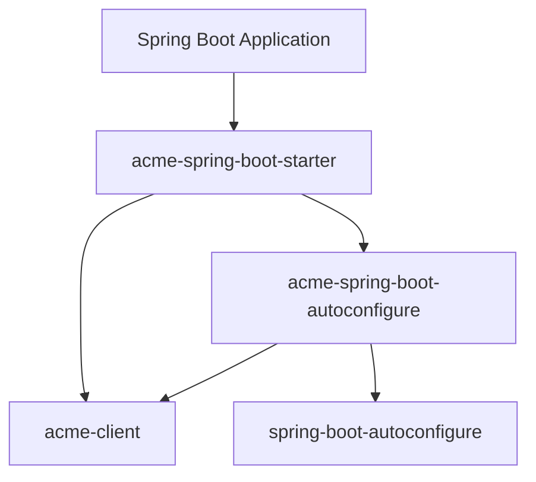
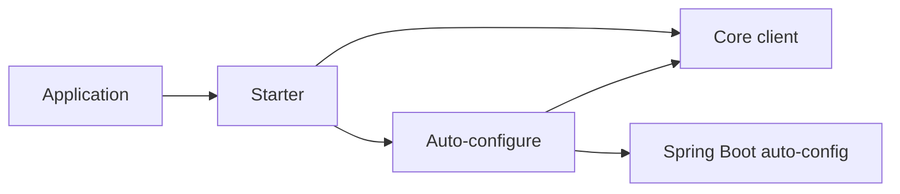

# Separating the auto-configuration module from the dependency-aggregating starter

> **Spring Boot Fundamentals · Spring Boot Customization**  
> When developing a Spring Boot integration library, cleanly separate the module containing auto-configuration code from the starter module used to aggregate dependencies. The auto-configuration module defines default beans, conditions, and property binding. The starter module mainly declares the dependencies an application typically needs to use the feature.

## 1. Why separate them?

Suppose a team develops a library integrating with a partner system. Applications need a default client, the ability to swap implementations, toggle the feature via properties, and pull in only the required libraries.

A common structure has two modules:

1. **acme-spring-boot-autoconfigure**: contains auto-configuration code, properties, conditions, and auto-configuration registration metadata.
2. **acme-spring-boot-starter**: aggregates the auto-configuration module along with dependencies users typically need.

If the library contains Spring-independent logic, you can also extract **acme-client** containing the pure Java API/client.



The starter is an aggregation module: it describes which artifacts should be brought in together. Auto-configuration is an implementation module: it contains Spring integration code.

### 1.1. Responsibilities

| Module | Responsibility | Java code? |
| --- | --- | --- |
| autoconfigure | Auto-configuration, conditions, default beans, and properties | Yes |
| starter | Dependency aggregation for applications | Usually no |
| core client | Spring-independent API and integration logic | Yes |

A starter normally does not need a main class, controller, or executable JAR. Do not repackage it as a server application; a starter is a library artifact for other applications to declare as a dependency.

Separating modules is useful when there are multiple optional integrations, multiple starters sharing configuration, or consumers needing to choose dependencies themselves. For a tiny library, a single module may still suffice.

## 2. Dependency direction



Common rules:

- The application depends on the starter.
- The starter depends on auto-configuration and required libraries.
- Auto-configuration depends on the core API.
- The core library does not depend on the starter.
- Core should avoid depending on Spring Boot if independent reuse is needed.

Do not create a cycle starter → autoconfigure → starter. Auto-configuration should not need the starter to operate. The starter consumes auto-configuration, not a module that configuration code calls back into.

## 3. Core module

Example pure Java client:

```java
package com.acme.client;

import java.net.URI;

public class PartnerClient {

    private final URI endpoint;
    private final String apiKey;

    public PartnerClient(URI endpoint, String apiKey) {
        this.endpoint = endpoint;
        this.apiKey = apiKey;
    }

    public PartnerResponse fetch(String resourceId) {
        return new PartnerResponse(resourceId, "loaded");
    }
}
```

PartnerClient does not need to know about ApplicationContext, `@Bean`, or `@Configuration`. It can be used from a plain Java application or another environment. The core module is easy to unit test and avoids coupling to Spring.

## 4. Auto-configuration module for Spring Boot 3.x

### 4.1. Typed properties

```java
package com.acme.spring;

import java.net.URI;
import java.time.Duration;
import org.springframework.boot.context.properties.ConfigurationProperties;

@ConfigurationProperties(prefix = "acme.partner")
public class PartnerProperties {

    private URI endpoint;
    private String apiKey;
    private Duration connectTimeout = Duration.ofSeconds(3);

    public URI getEndpoint() {
        return endpoint;
    }

    public void setEndpoint(URI endpoint) {
        this.endpoint = endpoint;
    }

    public String getApiKey() {
        return apiKey;
    }

    public void setApiKey(String apiKey) {
        this.apiKey = apiKey;
    }

    public Duration getConnectTimeout() {
        return connectTimeout;
    }

    public void setConnectTimeout(Duration connectTimeout) {
        this.connectTimeout = connectTimeout;
    }
}
```

This class represents the integration configuration. Spring Boot binds properties from application.yml, environment variables, or external config sources. In real production systems, validate endpoint and credentials when the feature is enabled; never commit real API keys.

### 4.2. Auto-configuration class

```java
package com.acme.spring;

import com.acme.client.PartnerClient;
import org.springframework.boot.autoconfigure.AutoConfiguration;
import org.springframework.boot.autoconfigure.condition.ConditionalOnClass;
import org.springframework.boot.autoconfigure.condition.ConditionalOnMissingBean;
import org.springframework.boot.autoconfigure.condition.ConditionalOnProperty;
import org.springframework.boot.context.properties.EnableConfigurationProperties;
import org.springframework.context.annotation.Bean;

@AutoConfiguration
@ConditionalOnClass(PartnerClient.class)
@ConditionalOnProperty(
        prefix = "acme.partner",
        name = "enabled",
        havingValue = "true"
)
@EnableConfigurationProperties(PartnerProperties.class)
public class PartnerAutoConfiguration {

    @Bean
    @ConditionalOnMissingBean
    PartnerClient partnerClient(PartnerProperties properties) {
        return new PartnerClient(
                properties.getEndpoint(),
                properties.getApiKey()
        );
    }
}
```

The configuration expresses:

1. PartnerClient must be on the classpath.
2. Property `acme.partner.enabled` must be true.
3. Spring registers PartnerProperties.
4. If the application has no matching PartnerClient bean yet, auto-configuration creates the default client.
5. If the application already provided its own client, the default factory method backs off.

The example assumes the client constructor takes an endpoint and an API key. In practice, validate values and pass timeout/HTTP settings per the library's real API.

### 4.3. Registering metadata

With Spring Boot 3.x, create the file:

```text
src/main/resources/META-INF/spring/
└── org.springframework.boot.autoconfigure.AutoConfiguration.imports
```

Content:

```text
com.acme.spring.PartnerAutoConfiguration
```

Each auto-configuration class is listed on one line. Spring Boot uses this metadata to discover and import configurations. Simply creating an `@AutoConfiguration` class in a JAR is not enough without registering it.

Spring Boot 2.x used a historical mechanism via `META-INF/spring.factories` for auto-configuration. For Boot 3.x, use `AutoConfiguration.imports` per the target version's convention.

### 4.4. Configuration processor

Maven dependency in the auto-configuration module:

```xml
<dependency>
    <groupId>org.springframework.boot</groupId>
    <artifactId>spring-boot-configuration-processor</artifactId>
    <optional>true</optional>
</dependency>
```

The processor generates metadata for IDE autocomplete on `@ConfigurationProperties`. This is not a runtime dependency needed by applications to run the client. With Gradle, declare it under `annotationProcessor`.

## 5. Dependency-aggregating starter

The `acme-spring-boot-starter` module usually contains no Java code. Minimal POM:

```xml
<project>
    <modelVersion>4.0.0</modelVersion>
    <groupId>com.acme</groupId>
    <artifactId>acme-spring-boot-starter</artifactId>
    <version>1.0.0</version>
    <packaging>jar</packaging>

    <dependencies>
        <dependency>
            <groupId>com.acme</groupId>
            <artifactId>acme-spring-boot-autoconfigure</artifactId>
            <version>${project.version}</version>
        </dependency>
        <dependency>
            <groupId>com.acme</groupId>
            <artifactId>acme-client</artifactId>
            <version>${project.version}</version>
        </dependency>
    </dependencies>
</project>
```

In the application, only declare the starter:

```xml
<dependency>
    <groupId>com.acme</groupId>
    <artifactId>acme-spring-boot-starter</artifactId>
    <version>1.0.0</version>
</dependency>
```

Maven resolves the starter, auto-configuration, and core client along the dependency graph. The starter can aggregate additional HTTP/JSON SDKs or other runtime dependencies, but should only include what the published feature actually requires.

There is no need to create a `@Configuration` class inside the starter just to import PartnerAutoConfiguration. The `AutoConfiguration.imports` file already resides inside the auto-configuration module's JAR and enters the classpath via the dependency.

## 6. Optional dependencies

Separating modules helps control optional libraries. Suppose the auto-configuration supports a vendor SDK that not every consumer uses.

### 6.1. Maven optional

In the auto-configuration module:

```xml
<dependency>
    <groupId>com.vendor</groupId>
    <artifactId>vendor-http-sdk</artifactId>
    <version>2.4.0</version>
    <optional>true</optional>
</dependency>
```

The optional dependency remains available when compiling and testing this module itself. However, Maven does not propagate it transitively to consumers like a normal transitive dependency.

The starter can declare the SDK as a normal dependency:

```xml
<dependency>
    <groupId>com.vendor</groupId>
    <artifactId>vendor-http-sdk</artifactId>
    <version>2.4.0</version>
</dependency>
```

Thus starter users receive the SDK at runtime; users depending solely on auto-configuration can choose the required SDK themselves. `optional=true` is a dependency graph property and does not toggle beans on/off automatically. Spring conditions are still needed to skip configuration when the SDK is absent.

### 6.2. Gradle compileOnly and starter dependencies

Example:

```groovy
// acme-spring-boot-autoconfigure/build.gradle
plugins {
    id 'java-library'
}

dependencies {
    implementation 'org.springframework.boot:spring-boot-autoconfigure'
    compileOnly 'com.vendor:vendor-http-sdk:2.4.0'
    testRuntimeOnly 'com.vendor:vendor-http-sdk:2.4.0'
    annotationProcessor 'org.springframework.boot:spring-boot-configuration-processor'
    testImplementation 'org.springframework.boot:spring-boot-starter-test'
}
```

Starter adds the SDK at runtime:

```groovy
// acme-spring-boot-starter/build.gradle
plugins {
    id 'java-library'
}

dependencies {
    api project(':acme-spring-boot-autoconfigure')
    runtimeOnly 'com.vendor:vendor-http-sdk:2.4.0'
}
```

The example assumes SDK types are not part of a compile-time API that applications must directly reference. If auto-configuration's public API exposes SDK types in method signatures, consider `api`, `compileOnlyApi`, or redesigning the public surface. If consumers need the SDK on the compile classpath, choose `implementation`/`api` instead of `runtimeOnly` per the contract.

### 6.3. Guarding optional integrations with class conditions

```java
@AutoConfiguration
public class VendorAutoConfiguration {

    @Configuration(proxyBeanMethods = false)
    @ConditionalOnClass(name = "com.vendor.http.VendorClient")
    static class VendorClientConfiguration {

        @Bean
        @ConditionalOnMissingBean
        VendorAdapter vendorAdapter(VendorProperties properties) {
            return new VendorAdapter(properties.endpoint());
        }
    }
}
```

Extracting a nested configuration and placing `@ConditionalOnClass` on the class protecting the SDK dependency lets Spring evaluate the condition before processing configurations using optional APIs.

Do not merely attach a condition to one method while letting signatures or return types directly reference potentially absent classes and assuming every case is safe when the JVM inspects metadata.

For an optional integration to work, you need the runtime SDK, auto-configuration metadata, classpath condition, property/bean conditions, valid configuration, and resolvable factory method dependencies.

## 7. Multiple starters sharing auto-configuration

When a library has multiple feature groups, you can create:

```text
acme-integration/
├── acme-client/
├── acme-spring-boot-autoconfigure/
├── acme-spring-boot-starter/
├── acme-spring-boot-starter-web/
└── acme-spring-boot-starter-messaging/
```

For example, the base starter aggregates the client and core configuration; the web starter adds HTTP adapters; the messaging starter adds a message broker and consumer/producer configurations.

Starters can share one auto-configuration artifact if beans and conditions are shared. If integrations have very different dependencies or lifecycles, separating auto-configuration modules can reduce coupling.

Avoid pulling every integration into the default starter if applications only need a subset. Unnecessary dependencies increase build times, runtime image size, version conflict risk, and the number of configurations to evaluate.

## 8. Version management and BOM

When releasing multiple artifacts, versions should stay consistent:

| Artifact | Example version |
| --- | --- |
| acme-client | 1.2.0 |
| acme-spring-boot-autoconfigure | 1.2.0 |
| acme-spring-boot-starter | 1.2.0 |

Starter 1.2.0 should depend on the auto-configuration and core library from the same release, unless another documented versioning policy applies.

A parent POM can manage versions and modules:

```xml
<project>
    <modelVersion>4.0.0</modelVersion>
    <groupId>com.acme</groupId>
    <artifactId>acme-integration</artifactId>
    <version>1.2.0</version>
    <packaging>pom</packaging>

    <modules>
        <module>acme-client</module>
        <module>acme-spring-boot-autoconfigure</module>
        <module>acme-spring-boot-starter</module>
    </modules>

    <properties>
        <java.version>17</java.version>
        <spring-boot.version>3.4.0</spring-boot.version>
    </properties>

    <dependencyManagement>
        <dependencies>
            <dependency>
                <groupId>org.springframework.boot</groupId>
                <artifactId>spring-boot-dependencies</artifactId>
                <version>${spring-boot.version}</version>
                <type>pom</type>
                <scope>import</scope>
            </dependency>
        </dependencies>
    </dependencyManagement>
</project>
```

The Spring Boot version is only an example. Projects must select a version compatible with the Java version and dependencies in use.

You can publish a dedicated BOM if you want consumers to manage versions of multiple Acme artifacts synchronously. BOMs and starters have different responsibilities: a BOM manages versions, a starter aggregates dependencies, auto-configuration contains configuration code, and core contains integration logic.

## 9. Maven POM for each module

### 9.1. Core module

```xml
<project>
    <modelVersion>4.0.0</modelVersion>
    <parent>
        <groupId>com.acme</groupId>
        <artifactId>acme-integration</artifactId>
        <version>1.2.0</version>
        <relativePath>../pom.xml</relativePath>
    </parent>
    <artifactId>acme-client</artifactId>
    <dependencies>
        <!-- Only dependencies genuinely needed for the core client. -->
    </dependencies>
</project>
```

This module does not need `spring-boot-autoconfigure` if you want to keep core independent of Spring.

### 9.2. Auto-configuration module

```xml
<project>
    <modelVersion>4.0.0</modelVersion>
    <parent>
        <groupId>com.acme</groupId>
        <artifactId>acme-integration</artifactId>
        <version>1.2.0</version>
        <relativePath>../pom.xml</relativePath>
    </parent>
    <artifactId>acme-spring-boot-autoconfigure</artifactId>

    <dependencies>
        <dependency>
            <groupId>com.acme</groupId>
            <artifactId>acme-client</artifactId>
            <version>${project.version}</version>
            <optional>true</optional>
        </dependency>
        <dependency>
            <groupId>org.springframework.boot</groupId>
            <artifactId>spring-boot-autoconfigure</artifactId>
        </dependency>
        <dependency>
            <groupId>org.springframework.boot</groupId>
            <artifactId>spring-boot-configuration-processor</artifactId>
            <optional>true</optional>
        </dependency>
        <dependency>
            <groupId>org.springframework.boot</groupId>
            <artifactId>spring-boot-starter-test</artifactId>
            <scope>test</scope>
        </dependency>
    </dependencies>
</project>
```

`acme-client` is marked optional in the example so consumers depending directly on auto-configuration can decide whether to pull in the client. The starter will declare the client as a normal dependency. Depending on the contract, core may not need to be optional if every consumer must have it.

### 9.3. Starter module

```xml
<project>
    <modelVersion>4.0.0</modelVersion>
    <parent>
        <groupId>com.acme</groupId>
        <artifactId>acme-integration</artifactId>
        <version>1.2.0</version>
        <relativePath>../pom.xml</relativePath>
    </parent>
    <artifactId>acme-spring-boot-starter</artifactId>

    <dependencies>
        <dependency>
            <groupId>com.acme</groupId>
            <artifactId>acme-spring-boot-autoconfigure</artifactId>
            <version>${project.version}</version>
        </dependency>
        <dependency>
            <groupId>com.acme</groupId>
            <artifactId>acme-client</artifactId>
            <version>${project.version}</version>
        </dependency>
    </dependencies>
</project>
```

The starter needs no Java source. Maven resolves auto-configuration, core, and transitive dependencies when an application declares the starter.

### 9.4. Inspecting the dependency tree

```bash
./mvnw -pl acme-spring-boot-starter -am dependency:tree
```

You can inspect runtime dependencies separately:

```bash
./mvnw -pl acme-spring-boot-starter dependency:tree -Dscope=runtime
```

From the dependency tree, identify which SDKs are pulled directly or transitively. Do not look only at the starter's POM to infer the entire runtime graph.

## 10. Gradle multi-project

Structure:

```text
acme-integration/
├── settings.gradle
├── build.gradle
├── acme-client/build.gradle
├── acme-spring-boot-autoconfigure/build.gradle
└── acme-spring-boot-starter/build.gradle
```

settings.gradle:

```groovy
rootProject.name = 'acme-integration'

include 'acme-client'
include 'acme-spring-boot-autoconfigure'
include 'acme-spring-boot-starter'
```

Auto-configuration:

```groovy
// acme-spring-boot-autoconfigure/build.gradle
plugins {
    id 'java-library'
}

dependencies {
    implementation 'org.springframework.boot:spring-boot-autoconfigure'
    api project(':acme-client')
    annotationProcessor 'org.springframework.boot:spring-boot-configuration-processor'
    testImplementation 'org.springframework.boot:spring-boot-starter-test'
}

tasks.named('test') {
    useJUnitPlatform()
}
```

`api project(':acme-client')` fits if the auto-configuration's public API exposes types from core and consumers need those types on the compile classpath. If core is only used internally, `implementation` can be chosen. For optional integrations, consider `compileOnly` and ensure the starter provides the runtime dependency.

Starter:

```groovy
// acme-spring-boot-starter/build.gradle
plugins {
    id 'java-library'
}

dependencies {
    api project(':acme-spring-boot-autoconfigure')
    api project(':acme-client')
}
```

The starter uses `api` if you want consumers to receive the dependencies on their compile classpath. If only needed at runtime without exposing types in public API, `implementation` or `runtimeOnly` may be more appropriate. Decide based on the contract rather than copying configurations mechanically.

Core:

```groovy
// acme-client/build.gradle
plugins {
    id 'java-library'
}

dependencies {
    // Plain Java dependencies required for the client.
}
```

Inspect runtime dependencies of the starter:

```bash
./gradlew :acme-spring-boot-starter:dependencies --configuration runtimeClasspath
```

Inspect compile dependencies:

```bash
./gradlew :acme-spring-boot-starter:dependencies --configuration compileClasspath
```

If a dependency is on the runtime classpath but not the compile classpath, that can be right when consumers do not need to reference its types in source. If application code needs to import SDK types, the dependency must be on the compile classpath.

## 11. Properties, conditions, and custom beans

application.yml:

```yaml
acme:
  partner:
    enabled: true
    endpoint: https://partner.example
    api-key: ${ACME_PARTNER_API_KEY}
    connect-timeout: 3s
```

Auto-configuration can use `@ConditionalOnClass` to check the SDK, `@ConditionalOnProperty` to toggle the feature, and `@ConditionalOnMissingBean` to provide a default.

Applications can provide their own bean:

```java
@Configuration(proxyBeanMethods = false)
class CustomPartnerConfiguration {

    @Bean
    PartnerClient partnerClient() {
        return new PartnerClient(
                URI.create("https://internal-proxy.example"),
                readApiKeyFromSecretStore()
        );
    }
}
```

When a matching custom bean is registered before auto-configuration evaluates conditions, the default bean yields. There is no need to modify the starter to swap implementations.

Some features should be enabled by default when dependencies are present; others should require opt-in. Set `matchIfMissing` and `havingValue` policies intentionally. For integrations opening network connections or performing external side effects, explicit opt-in is usually easier to operate.

## 12. Using auto-configuration directly without the starter

There are two consumption paths:

**Convenience path:** depend on the starter to receive configuration and the default dependency set.

**Controlled path:** depend directly on auto-configuration, then declare `acme-client`, the HTTP SDK, and runtime libraries manually as needed.

The second path is useful when you only want part of the integration, want to use a different SDK version, already have a BOM managing dependencies, or need tight classpath control.

If auto-configuration declares optional dependencies, direct consumers must add the required runtime dependencies themselves. If the SDK is missing, the classpath condition may not match and the bean will not be created.

| Usage | Dependency to declare |
| --- | --- |
| Default, fast configuration | acme-spring-boot-starter |
| Choose dependencies manually | acme-spring-boot-autoconfigure plus required runtime libraries |
| Plain client without Spring | acme-client |

Starter documentation should clearly describe both paths so consumers do not mistake a missing runtime SDK for an auto-configuration discovery failure.

## 13. Testing

### 13.1. Testing auto-configuration with ApplicationContextRunner

```java
class PartnerAutoConfigurationTests {

    private final ApplicationContextRunner contextRunner =
            new ApplicationContextRunner()
                    .withConfiguration(
                            AutoConfigurations.of(
                                    PartnerAutoConfiguration.class));

    @Test
    void createsClientWhenEnabled() {
        contextRunner
                .withPropertyValues(
                        "acme.partner.enabled=true",
                        "acme.partner.endpoint=https://partner.example",
                        "acme.partner.api-key=test-key"
                )
                .run(context -> {
                    assertThat(context)
                            .hasSingleBean(PartnerClient.class);
                });
    }

    @Test
    void doesNotCreateClientWhenDisabled() {
        contextRunner
                .withPropertyValues("acme.partner.enabled=false")
                .run(context -> {
                    assertThat(context)
                            .doesNotHaveBean(PartnerClient.class);
                });
    }
}
```

The test focuses on conditions and bean wiring without needing to start an HTTP server or connect to a real partner system.

### 13.2. Testing back-off when the application provides a custom bean

```java
@Test
void backsOffWhenApplicationProvidesCustomClient() {
    PartnerClient customClient =
            new PartnerClient(
                    URI.create("https://custom.example"),
                    "custom-key");

    contextRunner
            .withPropertyValues(
                    "acme.partner.enabled=true",
                    "acme.partner.endpoint=https://partner.example",
                    "acme.partner.api-key=default-key"
            )
            .withBean(
                    PartnerClient.class,
                    () -> customClient)
            .run(context -> {
                assertThat(context)
                        .hasSingleBean(PartnerClient.class);

                assertThat(context.getBean(PartnerClient.class))
                        .isSameAs(customClient);
            });
}
```

When the custom bean is already present, the default bean method does not create a second client. Consumers receive the exact instance provided by the application.

### 13.3. Testing classpath conditions

If the auto-configuration depends on an optional SDK, test both cases:

- SDK present: the corresponding configuration can be applied.
- SDK absent: the SDK-dependent configuration is safely skipped.

You can use an appropriate classloader/filtering mechanism or separate test modules with/without the dependency. Do not only test the SDK-present case and assume the optional branch definitely works.

### 13.4. Testing the starter with a sample application

Auto-configuration tests prove configuration logic. Add smoke tests or a sample app consuming the starter to verify:

- The starter pulls in the right auto-configuration artifact.
- The `AutoConfiguration.imports` file inside the JAR is resolved.
- Runtime SDKs are present.
- The application starts up and beans are registered.
- Custom beans make the default back off.

This test catches bugs that unit tests in the auto-configuration module miss, such as the starter forgetting to declare an SDK dependency or metadata failing to get packaged.

If the starter has no Java logic, there is no need to create dummy classes just to have source files. You can inspect the dependency graph, packaging, and use a sample consumer.

## 14. Verifying artifacts and publishing

After building the auto-configuration module, inspect the JAR contents:

```bash
jar tf acme-spring-boot-autoconfigure-1.2.0.jar
```

Look for the resource:

```text
META-INF/spring/org.springframework.boot.autoconfigure.AutoConfiguration.imports
```

You can extract the resource content to confirm the class name is packaged. A wrong path or a file ignored during the build will prevent Boot from finding the auto-configuration.

The published starter POM must contain dependencies on the auto-configuration, the core library/SDK the starter is responsible for providing, and other required dependencies. Inspect the actual published POM, not just the source POM.

A multi-module project typically builds separate artifacts:

- acme-client-1.2.0.jar
- acme-spring-boot-autoconfigure-1.2.0.jar
- acme-spring-boot-starter-1.2.0.jar

Maven build:

```bash
./mvnw clean verify
```

Or build only the starter along with its dependent modules:

```bash
./mvnw -pl acme-spring-boot-starter -am clean verify
```

Gradle:

```bash
./gradlew clean build
```

Maven publish:

```bash
./mvnw deploy
```

With Gradle, use appropriate publishing configuration for each project. Ensure the starter is not published before the corresponding auto-configuration/core versions can be resolved from the consumer repository.

Clearly document minimum Java version, supported Spring Boot versions, vendor SDK version, properties, default behavior, and which feature group each starter targets. If supporting multiple Boot lines, maintain a corresponding build matrix and tests.

## 15. Common architectural mistakes

| Mistake | Consequence | Fix |
| --- | --- | --- |
| Putting Java auto-configuration in the starter aggregator | Starter both aggregates dependencies and owns logic, hard to reuse | Move configuration code to the autoconfigure module |
| Auto-configuration depending back on starter | Creates dependency cycle or pulls unintended artifacts | Keep direction starter → autoconfigure |
| Starter omits required runtime SDK | App adds starter yet classpath condition fails or bean isn't created | Add required dependencies to the starter |
| Auto-configuration pulls all SDKs non-optionally | App needing only one integration still receives many dependencies | Mark optional where appropriate and split specialized starters |
| Missing AutoConfiguration.imports | Boot does not discover configuration | Package metadata at the exact path |
| Using spring.factories as the new registration mechanism for Boot 3 | Metadata does not follow current convention | Use AutoConfiguration.imports for Boot 3.x |
| Return types/annotations unsafely reference optional classes | Can trigger class loading errors when library is absent | Extract nested configurations and guard at class level |
| Starter pulls unmanaged dependency versions | Prone to version conflicts in consumers | Use BOM/parent dependency management |
| Adding Spring Boot dependencies to core unnecessarily | Plain client becomes coupled to framework | Separate core from Spring integration |
| Using bean overriding to replace default | Name conflicts or unpredictable behavior | Use `@ConditionalOnMissingBean` per contract |
| Testing only auto-configuration, not starter | Misses missing dependencies or metadata | Add sample consumer/smoke tests |
| Starter contains main() or repackaged executable JAR | Wrong artifact role | Keep starter as a dependency aggregation module |
| Multiple starters contain duplicate configuration | Can register duplicate beans or complicate conditions | Share auto-configuration or cleanly split features |
| Confusing api, implementation, compileOnly, runtimeOnly | Consumers lack types on compile/runtime classpath | Choose configuration per API and runtime contract |

### 15.1. Do not put conditions in the starter

A starter usually contains no Java code to evaluate conditions. `@ConditionalOnClass`, `@ConditionalOnProperty`, and `@ConditionalOnMissingBean` annotations belong in the auto-configuration module.

The starter decides which dependencies are pulled in; auto-configuration decides which beans are registered when dependency/property/bean conditions match. The two layers coordinate without replacing each other.

### 15.2. Do not use the starter to arbitrarily override application versions

If a starter pulls versions conflicting with a consumer's BOM, it can cause `NoSuchMethodError`, `ClassNotFoundException`, or hard-to-trace runtime errors. Manage versions via parent/BOM and test against supported platform versions.

### 15.3. Do not let auto-configuration open external connections too early

If a client constructor opens network connections or calls remote APIs, startup becomes dependent on external services and can fail when services are temporarily unavailable.

Prefer creating clients without unnecessary I/O in constructors. Connections or health checks should have appropriate lifecycles and timeouts. Auto-configuration is mainly for wiring dependencies, not turning startup into an uncontrolled sequence of network operations.

## 16. Practice exercise: splitting a combined integration module

Suppose the current project has a single starter module containing PartnerClient, PartnerAutoConfiguration, properties, and all dependencies. Split it into separate modules.

### Step 1 — Identify the core

Move the API/client and Spring-free communication logic into `acme-client`. Keep constructors and APIs clean without adding Spring annotations to core just to make bean registration easier for other modules.

### Step 2 — Create the auto-configuration module

Create `acme-spring-boot-autoconfigure`, move PartnerAutoConfiguration, PartnerProperties, nested configurations for optional integrations, and the `AutoConfiguration.imports` file.

Declare appropriate Spring Boot and core library dependencies per the intended dependency graph.

### Step 3 — Create the starter aggregator

Keep `acme-spring-boot-starter` mostly containing the build descriptor. Declare dependencies on auto-configuration and the core/client SDKs needed for common cases.

### Step 4 — Verify dependency direction

Confirm core does not depend on starter; auto-configuration does not depend on starter; starter depends on auto-configuration; application depends on starter; and no dependency cycles exist.

### Step 5 — Check optional integrations

Pick an optional SDK. Ensure auto-configuration has an appropriate class condition, the starter pulls the SDK if the feature is in the default bundle, and applications using only auto-configuration can choose dependencies themselves.

### Step 6 — Test back-off

Write tests confirming the default bean appears when no custom bean exists, the default backs off when a custom bean is present, disabling via property creates no configuration, and when the optional SDK is absent the SDK-dependent branch is safely skipped.

### Step 7 — Inspect artifacts

Build the JARs, check `AutoConfiguration.imports`, published POMs, and the dependency graph from a sample app declaring only the starter.

### Step 8 — Document consumer paths

Write installation guides for both paths: using the starter for default configuration and dependencies; using auto-configuration directly when managing dependencies manually. Clearly state compatible Java/Spring Boot versions, properties, default beans, and how to provide custom beans.

### Self-check questions

1. Why should the auto-configuration module be separated from the dependency-aggregating starter module?
2. What is the auto-configuration module responsible for?
3. Does a starter aggregator normally need Java source files or `main()`?
4. What is a sensible dependency graph among application, starter, auto-configuration, and core library?
5. Why should the core library avoid depending on Spring Boot if independent reuse is needed?
6. How does Maven `optional=true` affect consumer dependencies?
7. In Gradle, when should you consider `compileOnly`, `api`, `implementation`, and `runtimeOnly`?
8. Through which file does Spring Boot 3.x discover auto-configurations?
9. Why is `@ConditionalOnClass` important when a module has optional integrations?
10. How does `@ConditionalOnMissingBean` let applications replace a default bean?
11. Why is testing only auto-configuration insufficient to verify the starter aggregates dependencies properly?
12. How does a BOM differ from a starter in responsibility?
13. Why should bean overriding not be used to replace a default bean?
14. When does a library not need to be split into multiple modules?
15. If a starter pulls in too many SDKs, how can the architecture be improved?

## 17. Quick reference table

| Artifact | Primary contents | Consumer uses when |
| --- | --- | --- |
| acme-client | Pure Java API and integration logic | Needing the client without Spring Boot |
| acme-spring-boot-autoconfigure | Auto-configuration, conditions, properties, imports metadata | Wanting Spring configuration while choosing dependencies manually |
| acme-spring-boot-starter | Dependency aggregation | Wanting quick installation of the default integration bundle |
| acme-integration-bom (if any) | Version alignment across multiple artifacts | Wanting synchronized version management |

Separating auto-configuration from the starter establishes a clear boundary: **the auto-configuration module decides how Spring creates beans; the starter module decides which dependencies an application receives when installing the feature**. When needed, a core library is extracted further so integration logic does not depend on Spring. This structure keeps starters lean, makes optional dependencies controllable, makes auto-configurations easy to test, and preserves the application's ability to replace default beans as needed.
