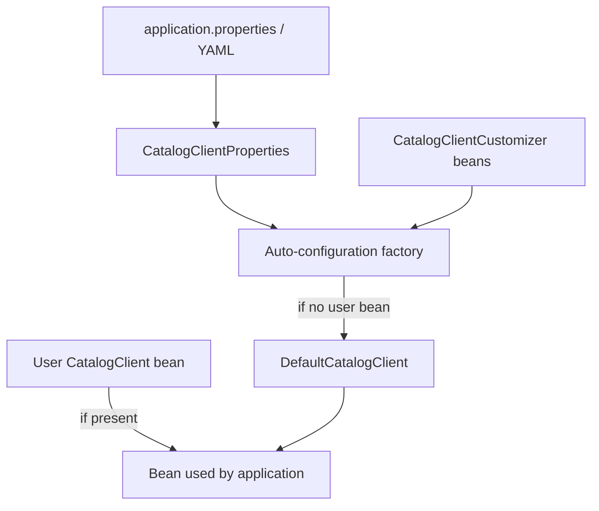
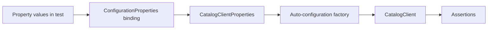

# Verifying that user configurations always have the expected customization path

Spring Boot auto-configuration helps applications run with default settings. However, a good library or starter must allow applications to **replace, adjust, or disable** those defaults via published extension points.

For example, a starter provides a default HTTP client. An application using the starter might need to:

- Change the base URL or timeout via application properties.
- Provide a custom client implementation.
- Register a customizer to add headers, interceptors, or error handling.
- Disable the integration when the feature is not used.
- Keep other default beans intact when replacing only one component.

Those capabilities form the **customization contract**—the customization promise the library makes to applications using it. Simply having configuration "theoretically customizable" is not enough; tests must verify that each customization path is actually applied and default configuration yields at the right time.

This lesson focuses on designing and testing that contract with Spring Boot, particularly using `@ConfigurationProperties`, `@ConditionalOnMissingBean`, customizer interfaces, `ApplicationContextRunner`, and context assertions.

## 1. What does "having a customization path" mean?

A configuration can be considered to have a customization path when the application clearly knows **what can be changed**, **how to supply the change**, and **what behavior occurs after the change**.

For example, a library provides `CatalogClient`. The contract can include three levels:

| Customization level | How the application uses it | Example |
|---|---|---|
| Property | Set values in application configuration | Change base URL, timeout |
| Bean | Register a bean for the published abstraction | Provide a custom `CatalogClient` |
| Customizer | Register a callback extending default configuration | Add headers, interceptors, retry policy |

There are also feature control paths:

| Control level | How to use | Expected result |
|---|---|---|
| Toggle property | `app.catalog.enabled=false` | Integration is not registered |
| Exclude auto-configuration | Remove configuration from import | Starter does not create beans belonging to the excluded configuration |
| Conditional capability | Enable only when required dependencies exist | Without infrastructure beans, corresponding integration stays inactive |

A good customization contract must state clearly:

1. **Extension point:** what parts can the application change?
2. **How to configure:** property, bean, customizer, or exclusion?
3. **Scope:** replace one bean or disable a group of beans?
4. **Precedence:** when both default and custom beans exist, which bean is used?
5. **Observable outcome:** which value or behavior proves customization took effect?
6. **Invalid cases:** does the context fail fast with a clear message?

These are things to verify with tests, not merely describe in a README.

## 2. Designing a customizable auto-configuration

Suppose a starter provides a client to read catalog data. The design has three components:

- `CatalogClientProperties`: configuration via properties.
- `CatalogClientCustomizer`: extension point to modify the builder.
- `CatalogClient`: abstraction the application can provide itself.

Model:



If the user provides a custom bean, auto-configuration must back off. If no custom bean exists, the factory creates the default client from properties and customizers.

### 2.1. Declaring properties

```java
package com.example.catalog.autoconfigure;

import java.net.URI;
import java.time.Duration;

import org.springframework.boot.context.properties.ConfigurationProperties;

@ConfigurationProperties(prefix = "app.catalog")
public class CatalogClientProperties {

    private boolean enabled = true;
    private URI baseUri = URI.create("https://catalog.example.test");
    private Duration timeout = Duration.ofSeconds(3);

    public boolean isEnabled() {
        return enabled;
    }

    public void setEnabled(boolean enabled) {
        this.enabled = enabled;
    }

    public URI getBaseUri() {
        return baseUri;
    }

    public void setBaseUri(URI baseUri) {
        this.baseUri = baseUri;
    }

    public Duration getTimeout() {
        return timeout;
    }

    public void setTimeout(Duration timeout) {
        this.timeout = timeout;
    }
}
```

Default values are part of the contract. Applications can run without declaring properties, while still being able to change them:

```yaml
app:
  catalog:
    enabled: true
    base-uri: https://catalog.internal.example
    timeout: 5s
```

Using appropriate data types such as `URI` and `Duration` lets Spring Boot convert configuration values. For real projects, you can add validation such as `@Validated`, `@NotNull`, `@Positive`, or appropriate constraints.

### 2.2. Publishing a customizer extension point

Instead of requiring applications to subclass internal implementations, the starter can publish a small interface:

```java
package com.example.catalog.autoconfigure;

public interface CatalogClientCustomizer {

    void customize(CatalogClientBuilder builder);
}
```

The builder exposes supported modification points:

```java
package com.example.catalog.autoconfigure;

import java.net.URI;
import java.time.Duration;
import java.util.LinkedHashMap;
import java.util.Map;

public class CatalogClientBuilder {

    private URI baseUri;
    private Duration timeout;
    private final Map<String, String> defaultHeaders =
            new LinkedHashMap<>();

    public CatalogClientBuilder(URI baseUri, Duration timeout) {
        this.baseUri = baseUri;
        this.timeout = timeout;
    }

    public CatalogClientBuilder baseUri(URI baseUri) {
        this.baseUri = baseUri;
        return this;
    }

    public CatalogClientBuilder timeout(Duration timeout) {
        this.timeout = timeout;
        return this;
    }

    public CatalogClientBuilder defaultHeader(String name, String value) {
        this.defaultHeaders.put(name, value);
        return this;
    }

    public CatalogClient build() {
        return new CatalogClient(baseUri, timeout, defaultHeaders);
    }
}
```

The application can register a customizer:

```java
@Configuration(proxyBeanMethods = false)
public class CatalogClientCustomization {

    @Bean
    CatalogClientCustomizer tenantHeaderCustomizer() {
        return builder ->
                builder.defaultHeader("X-Tenant", "north-region");
    }
}
```

A customizer is not a second client bean. It is a callback used by the default factory while building the client.

### 2.3. Creating the abstraction and default implementation

```java
package com.example.catalog.autoconfigure;

import java.net.URI;
import java.time.Duration;
import java.util.Map;

public interface CatalogClient {

    URI baseUri();

    Duration timeout();

    Map<String, String> defaultHeaders();
}
```

Implementation:

```java
package com.example.catalog.autoconfigure;

import java.net.URI;
import java.time.Duration;
import java.util.Map;

public class DefaultCatalogClient implements CatalogClient {

    private final URI baseUri;
    private final Duration timeout;
    private final Map<String, String> defaultHeaders;

    public DefaultCatalogClient(
            URI baseUri,
            Duration timeout,
            Map<String, String> defaultHeaders
    ) {
        this.baseUri = baseUri;
        this.timeout = timeout;
        this.defaultHeaders = Map.copyOf(defaultHeaders);
    }

    @Override
    public URI baseUri() {
        return baseUri;
    }

    @Override
    public Duration timeout() {
        return timeout;
    }

    @Override
    public Map<String, String> defaultHeaders() {
        return defaultHeaders;
    }
}
```

A real implementation might wrap an HTTP library, connection pool, and retry policy. The example above focuses on values observable in tests.

## 3. Using @ConditionalOnMissingBean so applications replace the default

Auto-configuration creates the default client if the application has not provided a `CatalogClient` bean yet:

```java
package com.example.catalog.autoconfigure;

import org.springframework.boot.autoconfigure.AutoConfiguration;
import org.springframework.boot.autoconfigure.condition.ConditionalOnMissingBean;
import org.springframework.boot.autoconfigure.condition.ConditionalOnProperty;
import org.springframework.boot.context.properties.EnableConfigurationProperties;
import org.springframework.context.annotation.Bean;

@AutoConfiguration
@ConditionalOnProperty(
        prefix = "app.catalog",
        name = "enabled",
        havingValue = "true",
        matchIfMissing = true
)
@EnableConfigurationProperties(CatalogClientProperties.class)
public class CatalogClientAutoConfiguration {

    @Bean
    @ConditionalOnMissingBean(CatalogClient.class)
    public CatalogClient catalogClient(
            CatalogClientProperties properties,
            org.springframework.beans.factory.ObjectProvider<CatalogClientCustomizer>
                    customizers
    ) {
        CatalogClientBuilder builder = new CatalogClientBuilder(
                properties.getBaseUri(),
                properties.getTimeout()
        );

        customizers.orderedStream()
                .forEach(customizer -> customizer.customize(builder));

        return builder.build();
    }
}
```

The configuration has three behaviors:

- When `app.catalog.enabled` is not set, the feature is enabled by default because `matchIfMissing = true`.
- When the feature is enabled, the default bean is registered only if no matching `CatalogClient` exists yet.
- When creating the default client, Spring supplies properties and all matching customizers in order.

The application can replace the default with its own bean:

```java
@Configuration(proxyBeanMethods = false)
public class MyCatalogConfiguration {

    @Bean
    public CatalogClient catalogClient() {
        return new MyCatalogClient();
    }
}
```

If the custom bean is registered before the auto-configuration evaluates `@ConditionalOnMissingBean`, the default factory will back off.

**Important:** the condition must check the public abstraction. If the auto-configuration creates `CatalogClient` while the condition checks a different internal class, an application providing a valid implementation may not be recognized as a replacement.

## 4. Distinguishing customization paths

Not every change should be handled by creating a new bean.

### 4.1. Properties: changing configuration values

Use properties when users need to change configurable values such as URLs, timeouts, limits, queue names, or operating modes.

```yaml
app:
  catalog:
    base-uri: https://catalog.internal.example
    timeout: 8s
```

This customization path should be verified by confirming the actual bean receives the bound values.

### 4.2. Custom bean: changing implementation

Use a custom bean when the application wants to replace the entire implementation of an abstraction:

```java
@Bean
CatalogClient catalogClient() {
    return new MyCatalogClient();
}
```

This customization path needs to be verified by the bean's identity or behavior. Tests should also verify that the default bean is not registered alongside it.

### 4.3. Customizer: changing part of the default implementation

Use a customizer when the library wants to keep the default factory and implementation, while giving the application controlled hooks.

```java
@Bean
CatalogClientCustomizer authenticationHeader() {
    return builder ->
            builder.defaultHeader("Authorization", "Bearer test-token");
}
```

This customization path needs to be verified by checking that the final client includes changes from the customizer.

### 4.4. Toggle property or excluding auto-configuration

Use a property when the application wants to toggle a conditional feature:

```yaml
app:
  catalog:
    enabled: false
```

Use exclusion when the application wants to completely remove the auto-configuration:

```java
@SpringBootApplication(
        exclude = CatalogClientAutoConfiguration.class
)
public class Application {
}
```

The two options have different scopes. A property is part of the feature contract published by the library; exclusion is a Spring Boot-level operation to omit the corresponding auto-configuration.

## 5. Why must we verify with tests?

Just reading code, you might see `@ConditionalOnMissingBean` and conclude applications can always replace the default. However, many bugs only surface when the context is actually built:

- The user bean is outside component scan or not imported.
- The custom bean does not satisfy the type checked by the condition.
- The `@Bean` return type is too generic, making metadata unclear.
- Auto-configuration is processed in the wrong order.
- Property prefix or field names do not match.
- A class-level condition accidentally turns off beans the application still needs.
- A customizer is registered yet the factory ignores or never invokes it.
- Two beans of the same type exist, making injection ambiguous.
- Tests only check that the context starts without checking that the final bean has the expected behavior.

Therefore, tests must verify **configuration outcomes**, not merely the absence of exceptions.

A good verification suite usually includes both positive and negative scenarios:

| Case | What to verify |
|---|---|
| No customization | Default bean is created |
| Custom properties | Property values are bound and used |
| Customizer present | Changes are applied to the default client |
| Custom bean present | Default bean backs off, custom bean is used |
| Feature disabled | Feature beans are not registered |
| Optional dependency missing | Auto-configuration does not activate unexpectedly |
| Multiple customizers | Order and combined outcome match the contract |

## 6. ApplicationContextRunner: the tool for testing auto-configuration

`ApplicationContextRunner` is a utility in Spring Boot Test for creating a lightweight ApplicationContext for tests. It lets you add auto-configurations, user configurations, beans, and property values per scenario.

Benefits:

- Tests run faster than starting the full application.
- Each test gets an isolated context.
- Input beans and properties can be precisely controlled.
- Bean presence, absence, count, and values can be asserted.
- Causes of condition matches or mismatches can be inspected via context startup failures/reports when needed.

Common imports:

```java
import org.springframework.boot.autoconfigure.AutoConfigurations;
import org.springframework.boot.test.context.runner.ApplicationContextRunner;
```

Creating a runner:

```java
class CatalogClientAutoConfigurationTests {

    private final ApplicationContextRunner contextRunner =
            new ApplicationContextRunner()
                    .withConfiguration(
                            AutoConfigurations.of(
                                    CatalogClientAutoConfiguration.class
                            )
                    );
}
```

In the example, `AutoConfigurations.of(...)` loads the auto-configuration into the test context. Each test invokes `run(...)` to receive a context built from that test's specific setup.

## 7. Testing default configuration

First case: the application declares no custom bean and sets no custom properties.

```java
@Test
void createsDefaultClientWhenUserDoesNotCustomizeIt() {
    contextRunner.run(context -> {
        assertThat(context).hasSingleBean(CatalogClient.class);

        CatalogClient client = context.getBean(CatalogClient.class);

        assertThat(client).isInstanceOf(DefaultCatalogClient.class);
        assertThat(client.baseUri())
                .isEqualTo(URI.create("https://catalog.example.test"));
        assertThat(client.timeout()).isEqualTo(Duration.ofSeconds(3));
    });
}
```

This test verifies:

- Auto-configuration was applied.
- Exactly one bean exists for the public abstraction.
- The default implementation was chosen.
- Default values from properties actually reached the client.

Checking only that `context` has no errors is insufficient. A context can start successfully without registering the bean the feature needs.

## 8. Testing user replacement of the default bean

This is the most important test to prove applications can swap the implementation.

User configuration:

```java
@Configuration(proxyBeanMethods = false)
static class UserCatalogConfiguration {

    @Bean
    CatalogClient customCatalogClient() {
        return new MyCatalogClient();
    }
}
```

Test:

```java
@Test
void backsOffWhenUserProvidesCatalogClient() {
    contextRunner
            .withUserConfiguration(UserCatalogConfiguration.class)
            .run(context -> {
                assertThat(context).hasSingleBean(CatalogClient.class);
                assertThat(context).hasBean("customCatalogClient");
                assertThat(context).doesNotHaveBean("catalogClient");

                assertThat(context.getBean(CatalogClient.class))
                        .isInstanceOf(MyCatalogClient.class);
            });
}
```

This test proves the contract:

1. User configuration is brought into the context.
2. Auto-configuration detects the existing `CatalogClient` bean.
3. The default bean method `catalogClient` backs off.
4. Only one bean matching the abstraction remains.
5. The bean in use is the user-provided implementation.

If the test finds two `CatalogClient` beans, recheck conditions and auto-configuration processing order.

### 8.1. Why use hasSingleBean?

`hasSingleBean(CatalogClient.class)` checks that there is exactly one bean matching the type. It catches cases where both the default and custom bean coexist.

If you only use:

```java
assertThat(context).hasBean("customCatalogClient");
```

the test could still pass even if the default bean also existed. That is not the back-off behavior the application expects.

Combine checking **presence of the custom bean**, **absence of the default bean**, and **bean count by type**.

## 9. Testing customization via properties

Use `withPropertyValues` to supply values to the test context:

```java
@Test
void bindsUserPropertiesIntoDefaultClient() {
    contextRunner
            .withPropertyValues(
                    "app.catalog.base-uri=https://catalog.test.internal",
                    "app.catalog.timeout=7s"
            )
            .run(context -> {
                assertThat(context).hasSingleBean(CatalogClient.class);

                CatalogClient client = context.getBean(CatalogClient.class);

                assertThat(client.baseUri())
                        .isEqualTo(URI.create("https://catalog.test.internal"));
                assertThat(client.timeout()).isEqualTo(Duration.ofSeconds(7));
            });
}
```

This test confirms the entire chain:



If properties have no effect, check:

- Is the `app.catalog` prefix exact?
- Do property names follow relaxed binding rules?
- Is the properties class registered via `@EnableConfigurationProperties` or an appropriate scanning mechanism?
- Does the factory actually read property values?
- Did the test accidentally supply a custom bean causing the default factory to back off?

Do not only assert getters on the properties bean. The ultimate goal is confirming **the bean used by the application** reflects the bound configuration.

## 10. Testing the customizer extension point

Register a customizer in user configuration:

```java
@Configuration(proxyBeanMethods = false)
static class CustomizerConfiguration {

    @Bean
    CatalogClientCustomizer tenantHeaderCustomizer() {
        return builder ->
                builder.defaultHeader("X-Tenant", "north-region");
    }
}
```

Test:

```java
@Test
void appliesUserCustomizerToDefaultClient() {
    contextRunner
            .withUserConfiguration(CustomizerConfiguration.class)
            .run(context -> {
                assertThat(context).hasSingleBean(CatalogClient.class);

                CatalogClient client = context.getBean(CatalogClient.class);

                assertThat(client.defaultHeaders())
                        .containsEntry("X-Tenant", "north-region");
            });
}
```

The test confirms the customizer was:

1. Registered as a bean.
2. Found via `ObjectProvider`.
3. Invoked while building the default client.
4. Reflected on the final object.

A common mistake is that the customizer bean exists yet the auto-configuration fails to invoke it. A test using only `hasBean(CatalogClientCustomizer.class)` will miss that bug; you must assert on the resulting client.

### 10.1. Testing customizer ordering

If the contract allows multiple customizers, decide whether order matters.

In the example auto-configuration, `orderedStream()` retrieves customizers according to Spring's ordering mechanism. You can register:

```java
@Bean
@Order(10)
CatalogClientCustomizer firstCustomizer() {
    return builder -> builder.defaultHeader("X-Mode", "first");
}

@Bean
@Order(20)
CatalogClientCustomizer secondCustomizer() {
    return builder -> builder.defaultHeader("X-Mode", "second");
}
```

Because the builder uses a map and the later operation overwrites the same key, the final value is `second`. If ordering is part of the public contract, write tests to lock down this behavior.

Do not rely on arbitrary bean registration order. Use `Ordered`/`@Order` or an explicit ordering mechanism when order genuinely matters.

### 10.2. Do customizers apply to user-defined beans?

In the example design, customizers are invoked inside the factory creating the **default client**. If the user provides their own `CatalogClient`, the default factory backs off so customizers do not automatically run on the custom bean.

This is a contract decision to state clearly:

- Customizers only modify the default implementation; or
- The library provides a separate pipeline to apply customizers to user-provided clients as well.

Do not leave users guessing. Tests should confirm the exact documented scope.

## 11. Testing the feature toggle property

Auto-configuration uses:

```java
@ConditionalOnProperty(
        prefix = "app.catalog",
        name = "enabled",
        havingValue = "true",
        matchIfMissing = true
)
```

When the property is false, the client bean should not be registered:

```java
@Test
void doesNotCreateClientWhenFeatureIsDisabled() {
    contextRunner
            .withPropertyValues("app.catalog.enabled=false")
            .run(context -> {
                assertThat(context).doesNotHaveBean(CatalogClient.class);
                assertThat(context).doesNotHaveBean("catalogClient");
            });
}
```

Verify the right scope: when a class-level auto-configuration is disabled, bean methods inside that configuration are not registered either. If another bean in a different configuration also has type `CatalogClient`, tests must distinguish bean sources and intended behavior.

### 11.1. Testing the default when the property is omitted

Since `matchIfMissing = true`, you can write:

```java
@Test
void enablesFeatureWhenPropertyIsMissing() {
    contextRunner.run(context -> {
        assertThat(context).hasSingleBean(CatalogClient.class);
    });
}
```

This is an important test. If you only test property true and false, you can miss the default behavior when users declare nothing.

### 11.2. Distinguishing false from invalid values

If a property receives an invalid value, behavior depends on the condition type and binding mechanism. Decide clearly:

- Does a value other than `true` cause the condition not to match?
- Does binding the property into a boolean trigger a conversion error?
- Is validation needed so startup fails fast?

Do not let a typo silently disable a feature if that leaves the application running in an unexpected state.

## 12. Testing when an optional dependency is missing

Auto-configuration often activates only when required classes or beans are present.

For example:

```java
@AutoConfiguration
@ConditionalOnClass(CatalogTransport.class)
@ConditionalOnProperty(
        prefix = "app.catalog",
        name = "enabled",
        havingValue = "true",
        matchIfMissing = true
)
public class CatalogClientAutoConfiguration {
    // ...
}
```

If the transport library is an optional dependency, you can use `FilteredClassLoader` in tests to simulate the class being absent from the classpath:

```java
@Test
void backsOffWhenOptionalTransportIsMissing() {
    contextRunner
            .withClassLoader(
                    new FilteredClassLoader(CatalogTransport.class)
            )
            .run(context -> {
                assertThat(context).doesNotHaveBean(CatalogClient.class);
            });
}
```

This test is useful for starters with optional integrations. It verifies the library does not fail the application simply because a dependency is not installed.

When using `@ConditionalOnClass`, place references to optional classes appropriately so the JVM does not load the class before the condition has a chance to exclude the configuration. For complex auto-configurations, extract configurations depending on optional libraries into nested configurations or separate classes.

## 13. Testing whether user configuration was brought into the context

An override test might fail because user configuration was not imported, rather than because `@ConditionalOnMissingBean` is wrong.

With `ApplicationContextRunner`, add user configuration explicitly:

```java
contextRunner
        .withUserConfiguration(UserCatalogConfiguration.class)
        .run(context -> {
            // Assertions
        });
```

With full application integration tests, you can use `@SpringBootTest` and `@TestConfiguration`:

```java
@SpringBootTest
@Import(CustomCatalogTestConfiguration.class)
class CatalogApplicationCustomizationTests {

    @Autowired
    CatalogClient catalogClient;

    @Test
    void applicationUsesCustomCatalogClient() {
        assertThat(catalogClient)
                .isInstanceOf(MyCatalogClient.class);
    }

    @TestConfiguration(proxyBeanMethods = false)
    static class CustomCatalogTestConfiguration {

        @Bean
        CatalogClient customCatalogClient() {
            return new MyCatalogClient();
        }
    }
}
```

`@TestConfiguration` adds beans for the test context. `@Import` makes bringing configuration into the test explicit. If relying solely on component scan, make sure the configuration's package is actually within the scan scope.

### 13.1. When to use ApplicationContextRunner vs. @SpringBootTest?

| Tool | Scope | Use when |
|---|---|---|
| `ApplicationContextRunner` | Small, controlled auto-configuration | Checking conditions, default bean, custom bean, properties |
| `WebApplicationContextRunner` | Web application context | Checking configurations depending on a web context |
| `ReactiveWebApplicationContextRunner` | Reactive web context | Checking reactive auto-configuration |
| `@SpringBootTest` | All or most of the application context | Verifying user configuration in a real app, integration wiring |

Start with a context runner to verify the starter's contract. Then use some integration tests to confirm the real application imports configuration and uses beans as expected.

## 14. Verifying that the default bean actually backs off

A strong test should check three things simultaneously:

```java
@Test
void userBeanReplacesDefaultBean() {
    contextRunner
            .withUserConfiguration(UserCatalogConfiguration.class)
            .run(context -> {
                assertThat(context).hasSingleBean(CatalogClient.class);
                assertThat(context).hasBean("customCatalogClient");
                assertThat(context).doesNotHaveBean("catalogClient");

                CatalogClient client = context.getBean(CatalogClient.class);
                assertThat(client).isInstanceOf(MyCatalogClient.class);
            });
}
```

Do not only assert that the custom bean exists. If the default bean also remains, the application may encounter:

- `NoUniqueBeanDefinitionException` when injecting by type.
- Unintended bean selection due to `@Primary`.
- Different behavior between lookup by name and injection by type.
- Redundant resource creation even though the custom implementation does not use it.

### 14.1. @Primary does not replace back-off

For example, the application has:

```java
@Bean
@Primary
CatalogClient customCatalogClient() {
    return new MyCatalogClient();
}
```

If the default bean is still registered, `@Primary` only helps certain type-based injections pick the preferred bean. It **does not remove the default bean** and does not prove auto-configuration respected the extension point.

If the contract says the user bean replaces the default, tests must confirm only one matching bean exists, not merely that injection happened to pick the desired bean.

### 14.2. Do not use bean definition overriding to replace the default

`spring.main.allow-bean-definition-overriding` relates to allowing bean definitions with the same name to be overwritten in specific scenarios. This is not a good extension point mechanism for starters.

An auto-configuration can provide a default via `@ConditionalOnMissingBean`. That allows user beans to be recognized and the default to back off automatically without relying on overwriting bean names.

If overriding must be enabled to customize the starter, revisit the auto-configuration design.

## 15. Verifying return types and abstractions

Bean conditions rely on bean metadata recognizable at evaluation time. Therefore, the return type of a `@Bean` method is part of the customization contract.

Recommended:

```java
@Bean
CatalogClient catalogClient() {
    return new MyCatalogClient();
}
```

Instead of:

```java
@Bean
Object catalogClient() {
    return new MyCatalogClient();
}
```

If auto-configuration checks `CatalogClient.class`, a method returning `Object` may fail to express in metadata which abstraction the bean satisfies when conditions are evaluated.

Similarly, the application should provide the bean under the abstraction the starter publishes:

```java
@Bean
CatalogClient catalogClient() {
    return new MyCatalogClient();
}
```

If the application only registers a class unrelated to the type checked by the condition, auto-configuration has no reason to treat it as a replacement bean.

**Rule:** condition against the public abstraction; user bean publishes that same abstraction; tests confirm the condition detects the bean.

## 16. Auto-configuration ordering and customizability

Application-provided beans must be known before the auto-configuration's missing-bean condition evaluates.

In Spring Boot, auto-configurations are organized to yield when user configurations already provide beans. For an auto-configuration depending on another auto-configuration, you can use ordering such as `@AutoConfiguration(after = ...)` or corresponding annotations.

Example:

```java
@AutoConfiguration(after = DataSourceAutoConfiguration.class)
public class JdbcCatalogAutoConfiguration {

    @Bean
    @ConditionalOnBean(DataSource.class)
    @ConditionalOnMissingBean(CatalogRepository.class)
    CatalogRepository catalogRepository(DataSource dataSource) {
        return new JdbcCatalogRepository(dataSource);
    }
}
```

When a customization test fails to work, check:

- Was user configuration brought into the context?
- Was auto-configuration imported properly?
- Was the condition evaluated after the custom bean was registered?
- Does the user bean's return type publish the right abstraction?
- Did another condition exclude the configuration before missing-bean was evaluated?

Do not add `@AutoConfigureAfter` arbitrarily. Only use ordering when there is a real relationship between auto-configurations. For regular user configuration, rely on Spring Boot's supported registration and ordering mechanism rather than component scan order.

## 17. Reading the Condition Evaluation Report when tests fail

When a default bean appears unexpectedly or a custom bean goes unrecognized, the Condition Evaluation Report helps explain which conditions matched.

You can enable debug mode:

```bash
java -jar app.jar --debug
```

Or:

```properties
debug=true
```

Look for entries related to:

- The auto-configuration under inspection.
- `@ConditionalOnMissingBean` or `@ConditionalOnBean`.
- The bean type or name being searched.
- The reason the condition matched/did not match.
- Other classpath/property conditions that may exclude the configuration.

In Actuator, the `conditions` endpoint can supply the condition report if dependency, exposure, and security are configured.

When using `ApplicationContextRunner`, you can inspect startup failures and context state directly inside the test callback. If the context fails, inspect `context.getStartupFailure()` to read the root cause instead of just asserting a bean and getting a generic failure message.

## 18. A sample test suite for a customization contract

A test class for a starter can be organized into groups:

```java
class CatalogClientAutoConfigurationTests {

    private final ApplicationContextRunner runner =
            new ApplicationContextRunner()
                    .withConfiguration(
                            AutoConfigurations.of(
                                    CatalogClientAutoConfiguration.class
                            )
                    );

    @Test
    void createsDefaultClient() {
        runner.run(context -> {
            assertThat(context).hasSingleBean(CatalogClient.class);
            assertThat(context.getBean(CatalogClient.class))
                    .isInstanceOf(DefaultCatalogClient.class);
        });
    }

    @Test
    void bindsProperties() {
        runner.withPropertyValues(
                "app.catalog.base-uri=https://catalog.test",
                "app.catalog.timeout=6s"
        ).run(context -> {
            CatalogClient client = context.getBean(CatalogClient.class);
            assertThat(client.baseUri())
                    .isEqualTo(URI.create("https://catalog.test"));
            assertThat(client.timeout()).isEqualTo(Duration.ofSeconds(6));
        });
    }

    @Test
    void appliesCustomizer() {
        runner.withUserConfiguration(CustomizerConfiguration.class)
                .run(context -> {
                    CatalogClient client = context.getBean(CatalogClient.class);
                    assertThat(client.defaultHeaders())
                            .containsEntry("X-Tenant", "north-region");
                });
    }

    @Test
    void backsOffForUserBean() {
        runner.withUserConfiguration(UserCatalogConfiguration.class)
                .run(context -> {
                    assertThat(context).hasSingleBean(CatalogClient.class);
                    assertThat(context).hasBean("customCatalogClient");
                    assertThat(context).doesNotHaveBean("catalogClient");
                    assertThat(context.getBean(CatalogClient.class))
                            .isInstanceOf(MyCatalogClient.class);
                });
    }

    @Test
    void disablesFeatureWhenPropertyIsFalse() {
        runner.withPropertyValues("app.catalog.enabled=false")
                .run(context -> {
                    assertThat(context).doesNotHaveBean(CatalogClient.class);
                });
    }
}
```

This is a skeleton for organizing tests. Nested configurations, implementations, and imports must be defined in the project. A test may need extra bean dependencies if the auto-configuration has required dependencies beyond the example.

### 18.1. Also testing context startup failures

Not every customization results in a successful bean. If a property is malformed or required configuration is missing, the contract may require startup to fail clearly.

Example:

```java
@Test
void failsFastForInvalidRequiredConfiguration() {
    runner.withPropertyValues("app.catalog.base-uri=not-a-valid-uri")
            .run(context -> {
                assertThat(context).hasFailed();
                assertThat(context.getStartupFailure()).isNotNull();
            });
}
```

This test is only valid if property binding/validation is actually designed to reject that value. If the application accepts relative URIs or has a custom converter, pick an invalid input matching the real contract.

Do not write a test expecting startup to fail simply because a value looks odd; confirm the validation rule first.

## 19. Common mistakes when verifying customization paths

| Symptom | Cause to check | How to verify |
|---|---|---|
| User bean exists yet default still appears | Condition checks wrong type/name or unsuitable processing order | Assert bean count by type, inspect condition report |
| Default does not appear even though user provided no bean | Another condition failed, missing dependency, or feature disabled | Test each condition independently |
| Property has a value yet client does not change | Binding not enabled or factory does not use properties | Assert values on the final bean |
| Customizer bean exists yet does not affect client | Factory does not receive or invoke customizers | Assert post-customization output |
| Custom bean is not found | Configuration not imported/scanned or incompatible type | Use `withUserConfiguration` and assert bean |
| Injection picks the wrong bean | Multiple candidates; unintended `@Primary`/qualifier | `hasSingleBean` and check implementation |
| Tests pass yet real app cannot customize | Context runner does not simulate how app imports configuration | Add `@SpringBootTest` integration tests |
| Feature still exists when property is false | Property condition placed at wrong scope or bean created by another config | Assert all feature beans and identify source |
| Optional class missing yet context fails | Class referenced too early or classpath condition placed wrongly | `FilteredClassLoader` test |

## 20. Checklist for designing a customization contract

Before releasing a starter or auto-configuration, document and test:

### Properties

- Published prefix and property names.
- Default values.
- Data types and conversions.
- Validation rules.
- Behavior when properties are missing, invalid, or disabled.

### Custom bean

- Which abstraction can be replaced.
- Condition checks that exact abstraction.
- User configuration is processed before auto-configuration.
- Default bean backs off when custom bean exists.
- No unexpected duplicate beans.

### Customizer

- Published interface/callback.
- When the callback is invoked.
- Ordering when multiple customizers exist.
- Scope of application: default bean only or user beans too.
- Behavior when no customizer exists.

### Testing

- Default path.
- Property path.
- Custom bean path.
- Customizer path.
- Feature disabled path.
- Optional dependency missing path if applicable.
- Startup failure for invalid configuration.
- Integration tests in a context close to a real application.

This checklist is the technical contract for designing and writing tests. STEP 5 can perform deeper QA on the lesson's content and implementation.

## 21. Self-check exercises

### Question 1. Is the default bean replaced?

Auto-configuration registers `PaymentGateway` with `@ConditionalOnMissingBean(PaymentGateway.class)`. The application declares a bean `AcmePaymentGateway implements PaymentGateway`.

**Question:** What must the test verify?

**Answer:** There is exactly one `PaymentGateway` bean, the custom bean is used, and the default bean is not registered.

### Question 2. Why is asserting hasBean(customBean) insufficient?

**Answer:** Because the default bean could still coexist. You must check the bean count by abstraction and the absence of the default bean.

### Question 3. When should you use a property instead of a custom bean?

**Answer:** When you only need to change configuration values like URL, timeout, or feature flags. When you need to replace the implementation, providing a bean for the abstraction is more appropriate.

### Question 4. Is a customizer the same as a custom bean?

**Answer:** No. A customizer adjusts how the factory builds the default implementation; a custom bean replaces that implementation. Scope of application must be documented and tested.

### Question 5. Why should @Primary not be used to prove default back-off?

**Answer:** `@Primary` only prioritizes one candidate in autowiring. It does not eliminate the default bean and does not prove the customization contract works properly.

### Question 6. A property binds into the properties object yet the client still uses the old value. What should you check?

**Answer:** Whether the factory reads those properties and passes the values into the client; tests should assert on the final bean rather than only asserting on the properties bean.

### Question 7. When is @SpringBootTest needed alongside ApplicationContextRunner?

**Answer:** When verifying how a real application imports configurations, component scanning, profiles, and full integrations. `ApplicationContextRunner` fits isolated auto-configuration tests.

## 22. Key takeaways

- A good starter must publish **clear customization paths** via properties, custom beans, customizers, or feature toggles.
- `@ConditionalOnMissingBean` helps default auto-configuration back off when the application supplies a matching bean.
- Conditions must check the right abstraction; `@Bean` return types should declare a sufficiently specific type.
- Properties only matter if they are bound and the factory actually uses their values.
- Customizers only matter if the factory invokes them and results appear on the final bean.
- `ApplicationContextRunner` is the right tool for testing defaults, custom beans, properties, customizers, and conditions.
- Bean replacement tests must confirm **the custom bean is used, the default bean is absent, and candidate count is right**.
- `@Primary` and bean definition overriding do not replace the back-off mechanism.
- Supplement with `@SpringBootTest` when needing to verify configuration in a context close to a real application.
- Do not merely check that the context starts successfully; verify the exact behavior users are promised they can customize.

When developing an auto-configuration, ask yourself: **"Which part does the application want to change, where must it declare that change, and which test proves Spring actually uses that choice?"** When every customization path has a test verifying its outcome, the starter's contract becomes easy to understand and reliable.
