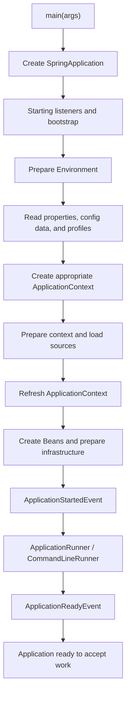
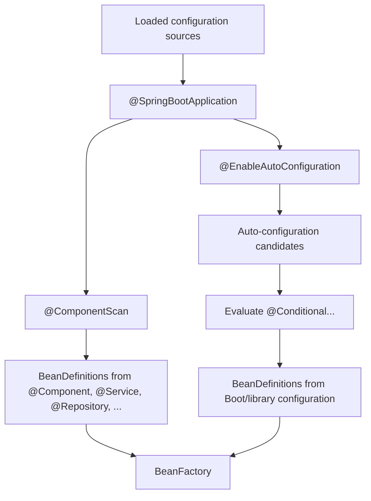

# SpringApplication.run and the General Startup Phases

In a Spring Boot application, the most familiar line of code is usually:

```java
@SpringBootApplication
public class ShopApplication {
    public static void main(String[] args) {
        SpringApplication.run(ShopApplication.class, args);
    }
}
```

This single short call kicks off an entire sequence of tasks: preparing the environment configuration, selecting the ApplicationContext type, loading configuration sources, processing component scanning and auto-configuration, creating Beans, preparing the web server if it is a web application, executing startup runners, and publishing events indicating that the application is ready.

Understanding the `SpringApplication.run(...)` flow helps you know **what happens before and after Beans are created**, place startup logic at the right point, read startup logs, and pinpoint the cause when an application fails to start.

## 1. What is SpringApplication?

`SpringApplication` is the central class that Spring Boot uses to bootstrap and launch a Spring application. It coordinates creating and refreshing the ApplicationContext, preparing the Environment, publishing application events, and invoking startup callbacks.

The most common way to use it is via the static shortcut:

```java
public static void main(String[] args) {
    SpringApplication.run(ShopApplication.class, args);
}
```

This static method creates a `SpringApplication` instance with the provided source and then calls `run(args)`.

You can also create a separate `SpringApplication` instance when you want to customize its behavior:

```java
public static void main(String[] args) {
    SpringApplication application =
            new SpringApplication(ShopApplication.class);

    application.setBannerMode(Banner.Mode.CONSOLE);
    application.setLogStartupInfo(true);

    application.run(args);
}
```

`ShopApplication.class` is a primary configuration source. Depending on the application, that source can be a class annotated with `@SpringBootApplication`, `@Configuration`, or another suitable configuration source.

### What does run return?

`SpringApplication.run(...)` returns a `ConfigurableApplicationContext`:

```java
ConfigurableApplicationContext context =
        SpringApplication.run(ShopApplication.class, args);
```

The context is the container managing the application's Beans and lifecycle. In a typical application, you leave the context running along with the process. For non-web applications, if no background thread or task keeps the process alive, the program may exit after startup tasks complete.

You do not need to call `context.refresh()` manually after `SpringApplication.run(...)`: Boot already performs the refresh during `run`. Calling refresh again arbitrarily can cause errors or produce unintended behavior.

## 2. The Big Picture of the Startup Process

Startup can be divided into major phases:



This is a conceptual learning model, not an exhaustive list of every internal call. Within each phase, there are many extension points and events. The exact order of web server startup, Bean lifecycle, and listeners may vary depending on the ApplicationContext type and application configuration.

An important point: **the context refresh completes before Spring Boot invokes the runners**. Therefore, `ApplicationRunner` and `CommandLineRunner` are suitable for tasks that require the application's Beans to already be initialized.

## 3. Phase 1 — Creating SpringApplication and Determining the Application Type

When static `SpringApplication.run(...)` is called, Boot creates a `SpringApplication` from the source class and prepares the coordination components.

During `SpringApplication` construction, Boot can:

- Deduce the application type based on the classpath: Servlet web, Reactive web, or non-web.
- Locate configured initializers and listeners.
- Prepare the initial configuration sources.
- Set up default application properties.

### Three common application types

| Type | Characteristics | Example |
|---|---|---|
| Servlet web | Uses a servlet-based web stack, typically with Spring MVC and an embedded Servlet server | REST API with `spring-boot-starter-web` |
| Reactive web | Uses a reactive web stack, typically with Spring WebFlux and a reactive server | API using `spring-boot-starter-webflux` |
| Non-web | Does not initialize a web server | Batch job, command-line worker |

Application type deduction is influenced by dependencies on the classpath and the `WebApplicationType` configuration. If needed, you can set it explicitly:

```java
SpringApplication application =
        new SpringApplication(ShopApplication.class);
application.setWebApplicationType(WebApplicationType.NONE);
application.run(args);
```

You should avoid adding multiple web stacks simultaneously and expecting Boot to always guess your architectural intent. If an application requires a specific type, explicit configuration makes behavior easier to reason about.

## 4. Phase 2 — Starting Startup and Preparing Bootstrap

When `run` begins, Spring Boot initializes the startup timer and prepares components needed for the startup process. Registered `SpringApplicationRunListener` instances are notified that startup has begun.

An important early event is `ApplicationStartingEvent`. This event is published very early, before the Environment and main ApplicationContext are fully prepared. Listeners handling this event should not assume they can retrieve business Beans from the context yet.

### ApplicationArguments

Boot converts command-line arguments into an `ApplicationArguments` object:

```java
ApplicationArguments arguments =
        new DefaultApplicationArguments(args);
```

Example execution:

```bash
java -jar shop.jar --spring.profiles.active=dev --server.port=8085 import
```

You can read:

- Option arguments: `--spring.profiles.active=dev`, `--server.port=8085`.
- Non-option arguments: `import`.

`ApplicationArguments` is provided by Spring Boot to `ApplicationRunner`. Meanwhile, `CommandLineRunner` receives the raw `String[]` array directly.

## 5. Phase 3 — Preparing the Environment and Loading Configuration

`Environment` is where Spring manages property sources and active profiles. Before creating the context, Spring Boot prepares the Environment so configuration components can read the necessary values.

Key tasks in this phase:

1. Create or use an Environment appropriate for the application type.
2. Add default property sources and properties from the command line.
3. Load configuration from config data sources such as `application.properties` or `application.yml`.
4. Determine active/default profiles.
5. Allow listeners to observe the prepared Environment.

A notable event is `ApplicationEnvironmentPreparedEvent`. This event is published once the Environment has been prepared. This stage occurs earlier than creating and refreshing the main ApplicationContext.

### Config Data: application.properties and application.yml

Example `src/main/resources/application.yml`:

```yaml
server:
  port: 8085

spring:
  application:
    name: shop-service
  profiles:
    active: dev

logging:
  level:
    com.example.shop: INFO
```

Boot reads configuration sources through the Config Data mechanism. Configuration can come from:

- `application.properties` or `application.yml`.
- Profile-specific configuration files such as `application-dev.yml`.
- Environment variables.
- JVM system properties.
- Command-line arguments.
- Imported sources or additional configuration locations.

For example, you can override the port from the command line:

```bash
java -jar shop.jar --server.port=9090
```

You should not memorize a single simplified precedence order as applying to every source in every situation. Spring Boot follows property source precedence rules; external sources such as command-line arguments can typically override values in configuration files, but you should check the exact version and specific sources when investigating a property.

### Profiles are selected before Beans are created

Example:

```properties
spring.profiles.active=dev
```

or:

```bash
java -jar shop.jar --spring.profiles.active=prod
```

Profiles affect configuration and conditional Beans such as:

```java
@Configuration
@Profile("dev")
public class DevelopmentConfiguration {
    @Bean
    DemoDataLoader demoDataLoader() {
        return new DemoDataLoader();
    }
}
```

Because the Environment is prepared before the context refreshes and Beans are created, Spring can evaluate `@Profile` while processing configuration.

## 6. Phase 4 — Creating the Appropriate ApplicationContext

After the Environment is prepared, Boot creates the ApplicationContext corresponding to the application type.

For example:

- A Servlet web application typically uses a context designed for Servlet web.
- A Reactive web application uses a context suitable for reactive web.
- A Non-web application uses a context without a web server.

Normally, you do not need to create the context manually. `SpringApplication` selects the context based on the web application type and related configuration.

The context is the application's IoC container. It manages BeanDefinitions, Bean instances, dependency injection, the event multicaster, the lifecycle processor, and other infrastructure components.

### ApplicationContextInitializedEvent

During context preparation, Boot applies registered `ApplicationContextInitializer` instances and publishes the corresponding event: `ApplicationContextInitializedEvent`.

An initializer receives a configurable context and can modify certain settings before refresh. It is not the default place to run business logic that requires all Beans to be ready.

Example of an initializer:

```java
public class CustomContextInitializer
        implements ApplicationContextInitializer<ConfigurableApplicationContext> {

    @Override
    public void initialize(ConfigurableApplicationContext context) {
        // Adjust context configuration before refresh.
    }
}
```

You can register an initializer via `SpringApplication` configuration or an appropriate registration mechanism. Keep initializers small and avoid calling `getBean(...)` early, because the context has not yet completed refresh.

## 7. Phase 5 — Preparing the Context and Loading Configuration Sources

After creating the context, Boot prepares it before refreshing:

- Attaches the Environment to the context.
- Applies settings such as `BeanNameGenerator` or `ApplicationStartup` if configured.
- Invokes `ApplicationContextInitializer` instances.
- Registers certain required bootstrap objects.
- Loads the source classes passed into `SpringApplication`.
- Notifies listeners that the context has been prepared and sources have been loaded.

An important event at the end of context preparation is `ApplicationPreparedEvent`. This event is published after the context has been prepared and sources have been loaded, but before refresh completes. You should not assume all singleton Beans are ready at this point.

### What role does @SpringBootApplication play?

The main class is usually annotated with:

```java
@SpringBootApplication
public class ShopApplication {
}
```

This annotation combines:

- `@SpringBootConfiguration`: marks the primary configuration source.
- `@EnableAutoConfiguration`: enables the auto-configuration mechanism.
- `@ComponentScan`: scans for components in the root package and its sub-packages by default.

During refresh, Spring processes these configurations to discover application Beans and auto-configurations declared on the classpath.

### Component scan and auto-configuration

Both sources contribute BeanDefinitions:



Classes on the classpath do not automatically become Beans. They must be discovered through component scanning, imported, registered via `@Bean`, auto-configured, or added via another registration mechanism.

## 8. Phase 6 — Refreshing the ApplicationContext

`refresh()` is a central milestone in the Spring container lifecycle. This is when the context processes BeanDefinitions, registers post-processors, prepares infrastructure, and instantiates standard eager singletons.

At a high level, `AbstractApplicationContext.refresh()` goes through these steps:

1. Prepare the context for refresh.
2. Create/obtain the BeanFactory.
3. Prepare the BeanFactory and basic dependencies.
4. Invoke BeanFactoryPostProcessors.
5. Register BeanPostProcessors.
6. Initialize the message source and application event multicaster.
7. Execute the context-specific `onRefresh()` step.
8. Register application listeners.
9. Finish instantiating non-lazy singletons.
10. Finish refresh, invoke the lifecycle processor, and publish `ContextRefreshedEvent`.

These steps help illustrate the general order. The framework may add internal steps, and some Beans are created earlier because they serve as infrastructure or are required by post-processors.

### BeanFactoryPostProcessor processes BeanDefinitions

A BeanFactoryPostProcessor can modify BeanDefinition metadata before standard business Beans are instantiated—for example, resolving placeholders or adjusting Bean definitions.

A prominent processor is `ConfigurationClassPostProcessor`, which processes configuration classes, component scans, `@Import`, `@Bean`, and related annotation constructs.

### BeanPostProcessor processes Bean instances

After definitions have been processed, Spring registers BeanPostProcessors. They participate in the lifecycle of individual Bean instances—for example, processing annotations, callbacks, and creating proxies.

Distinction:

| Component | Processes | Timing |
|---|---|---|
| BeanFactoryPostProcessor | BeanDefinitions / metadata | Before standard Beans are created |
| BeanPostProcessor | Bean instances | During the initialization of each Bean |

### Creating eager singletons

During BeanFactory initialization completion, Spring normally creates non-lazy singletons. For each Bean, the container:

- Instantiates the object using a constructor or factory method.
- Resolves and injects dependencies.
- Invokes appropriate Aware callbacks.
- Runs initialization callbacks such as `@PostConstruct`, `afterPropertiesSet()`, and custom init methods.
- Applies BeanPostProcessors, which may create proxies.

Once the required steps finish, the Bean is exposed to consumers.

`@Lazy` Beans might not be created until requested. Prototype Beans are created each time the container is asked for one. Therefore, not every BeanDefinition corresponds to an already-existing instance immediately after refresh ends.

## 9. Web Server Preparation During Refresh

For Servlet web applications, the appropriate context prepares the embedded web server during the refresh lifecycle. The server is typically created and started as part of the refresh process via the infrastructure of `ServletWebServerApplicationContext`.

For Reactive web applications, the context and server infrastructure correspond to the reactive stack.

This explains why port conflicts, servlet configuration issues, or web server errors appear during startup before the application reports ready.

Configuration example:

```properties
server.port=8085
```

If the port cannot be bound or the web server fails to initialize, context refresh may fail and `SpringApplication.run(...)` will not return a normally functioning context.

A non-web application does not initialize a web server; it can still create a context, instantiate Beans, and execute runners.

## 10. Important Application Events During Startup

Spring Boot publishes multiple events so listeners can observe progress. A common sequence in modern Boot:

| Event | General Timing |
|---|---|
| `ApplicationStartingEvent` | Startup begins, before Environment/main context are ready |
| `ApplicationEnvironmentPreparedEvent` | Environment has been prepared |
| `ApplicationContextInitializedEvent` | Context has been created and initializers applied |
| `ApplicationPreparedEvent` | Context prepared / sources loaded, before refresh |
| `ContextRefreshedEvent` | ApplicationContext completes refresh |
| `ApplicationStartedEvent` | Context has refreshed, before runners are invoked |
| `ApplicationReadyEvent` | Runners have finished, application is about to be considered ready |
| `ApplicationFailedEvent` | Startup fails at some phase |

Event names and details belong to the API of a specific Spring Boot version. When writing listeners that must support multiple versions, check the API corresponding to the Boot version your application or library targets.

### ApplicationStartedEvent vs. ApplicationReadyEvent

These two events are easily confused:

- `ApplicationStartedEvent`: the context has finished refreshing; Spring Boot publishes this event before calling `ApplicationRunner` and `CommandLineRunner`.
- `ApplicationReadyEvent`: the runners have completed; the application has passed through the Boot-managed startup tasks and is ready to receive traffic/work according to its readiness state.

Therefore, if you need to run startup work after Beans are created, a runner is an appropriate point. If you need to observe when the application has finished all runners, an `ApplicationReadyEvent` listener is more suitable.

## 11. Phase 7 — Invoking ApplicationRunner and CommandLineRunner

After the context refreshes and `ApplicationStartedEvent` is published, Spring Boot invokes Beans implementing:

- `ApplicationRunner`
- `CommandLineRunner`

These are callbacks for work that should run once when the application starts up.

### ApplicationRunner

`ApplicationRunner` receives `ApplicationArguments`, which is convenient when you need to read option and non-option arguments:

```java
@Component
public class StartupReport implements ApplicationRunner {

    @Override
    public void run(ApplicationArguments args) {
        System.out.println("Option names: " + args.getOptionNames());
        System.out.println("Non-option args: " + args.getNonOptionArgs());
    }
}
```

Example execution:

```bash
java -jar shop.jar --mode=import --dry-run file-a.csv
```

The runner can read `mode`, `dry-run`, and the non-option argument `file-a.csv`.

### CommandLineRunner

`CommandLineRunner` receives the raw argument array:

```java
@Component
public class ImportStartupTask implements CommandLineRunner {

    @Override
    public void run(String... args) {
        System.out.println("Argument count: " + args.length);
    }
}
```

### Using @Bean instead of a component

You can also declare a runner via a factory method:

```java
@Configuration(proxyBeanMethods = false)
public class StartupConfiguration {

    @Bean
    ApplicationRunner loadReferenceData(ReferenceDataService service) {
        return args -> service.loadIfRequired();
    }
}
```

The `ReferenceDataService service` parameter is injected by the container like any normal dependency. This makes it explicit which services the runner depends on.

### Controlling runner order

If there are multiple runners, you can use `Ordered` or `@Order`:

```java
@Component
@Order(10)
public class FirstStartupTask implements ApplicationRunner {
    @Override
    public void run(ApplicationArguments args) {
        // Runs before runners with a higher order value.
    }
}

@Component
@Order(20)
public class SecondStartupTask implements ApplicationRunner {
    @Override
    public void run(ApplicationArguments args) {
        // Runs after FirstStartupTask.
    }
}
```

Lower order values take precedence according to Spring's ordering rules. When one runner depends on another, consider consolidating ordered work into a single orchestrating service rather than creating multiple implicitly coupled runners.

### Runners can cause startup to fail

If a runner throws an unhandled exception, `SpringApplication.run(...)` may fail and Boot publishes `ApplicationFailedEvent`. Therefore:

- Only put work in a runner that truly must complete before readiness.
- Handle errors intentionally; do not blindly swallow exceptions.
- Avoid running very long tasks inside a runner if the application needs to be ready to serve traffic quickly.
- For long-running background work, consider a job/queue/background worker mechanism with its own lifecycle.

## 12. Phase 8 — ApplicationReadyEvent and Readiness State

After runners complete, Spring Boot publishes `ApplicationReadyEvent`.

This event indicates that the application has finished the Boot-coordinated startup phase. Afterward, the readiness state can transition to `ACCEPTING_TRAFFIC`.

Boot also tracks availability states, including:

- **Liveness:** whether the application is alive and should not be restarted by an orchestrator merely because a temporary external dependency is unhealthy.
- **Readiness:** whether the application is ready to accept traffic.

In a standard startup sequence, after `ApplicationStartedEvent`, Boot updates liveness to the appropriate state; after runners complete and `ApplicationReadyEvent` is published, readiness transitions to accepting traffic.

When deployed on a platform with health probes, the readiness state can be used to decide when to add an instance to a load balancer. An application whose port is already open while a runner is still importing data should not necessarily receive business requests yet.

### ApplicationReadyEvent listener

Example:

```java
@Component
public class ReadyLogger {

    @EventListener
    public void onReady(ApplicationReadyEvent event) {
        System.out.println("Shop application is ready");
    }
}
```

This listener runs after the runners. It is suitable for logging or lightweight actions once the application is ready. Do not place heavy work or operations lacking a retry strategy in a listener if it could prolong startup or cause unexpected failures.

## 13. What Happens If Startup Fails?

Startup can fail at several phases:

| Phase | Failure Example |
|---|---|
| Preparing Environment | Malformed property, unreadable config data |
| Creating/preparing context | Context initializer throws an exception |
| Processing configuration | Missing class, invalid configuration, incorrect condition or import |
| Creating Beans | Missing dependency, ambiguous multiple Beans, constructor/init callback error |
| Initializing web server | Port already in use, invalid server configuration |
| Running runners | Startup task throws an exception |

On failure, Boot handles the error, closes the context if one was created appropriately, notifies listeners via `ApplicationFailedEvent`, and rethrows the exception to the caller. In `main`, an unhandled exception typically causes the process to exit with an error.

### How to read the stack trace

Do not stop at the outermost exception like `ApplicationContextException` or `BeanCreationException`. Follow the `Caused by` chain to find the root cause:

- `NoSuchBeanDefinitionException`: missing matching Bean.
- `NoUniqueBeanDefinitionException`: multiple Beans of the same type; candidate cannot be uniquely resolved.
- `BeanCreationException`: Bean instantiation or initialization callback failed; check the nested cause.
- `PortInUseException` or similar bind errors: the web server port is unavailable.
- `ConfigDataLocationNotFoundException`: an imported or referenced configuration source does not exist or cannot be read as configured.

### Debugging the condition report

If you suspect an auto-configuration is not being applied, enable debug mode:

```bash
java -jar shop.jar --debug
```

Or set:

```properties
debug=true
```

The Condition Evaluation Report shows which configurations matched or did not match, and which conditions led to that outcome.

## 14. Customizing the Startup Process

Spring Boot provides several extension points. Each type suits a different moment in time.

| Mechanism | Timing | Appropriate Use |
|---|---|---|
| `ApplicationListener` | When the corresponding event is published | Observing startup/context events |
| `ApplicationContextInitializer` | After context creation, before refresh | Adjusting the context before Beans initialize |
| `BeanFactoryPostProcessor` | During refresh, before standard Beans | Adjusting BeanDefinitions |
| `BeanPostProcessor` | During each Bean's lifecycle | Processing instances, creating wrappers/proxies |
| `ApplicationRunner` | After refresh, before ready | Startup work requiring Beans to be ready |
| `CommandLineRunner` | After refresh, before ready | Startup work needing raw args |
| `@EventListener(ApplicationReadyEvent.class)` | After runners | Lightweight actions once the application is ready |

Do not pick an extension point merely because it can execute code. Choose based on the container state your code requires:

- Need to adjust properties/context before Beans are created? Look at an initializer or appropriate Environment configuration.
- Need to modify BeanDefinitions? Look at BeanFactoryPostProcessor.
- Need to process individual objects after creation? Look at BeanPostProcessor.
- Need injected services/repositories? Use a runner.
- Need to know when the application is ready? Use `ApplicationReadyEvent`.

### ApplicationListener example

```java
@Component
public class StartupEventLogger {

    @EventListener
    public void onStarted(ApplicationStartedEvent event) {
        System.out.println("Context refreshed; runners are next");
    }

    @EventListener
    public void onReady(ApplicationReadyEvent event) {
        System.out.println("Runners completed; application is ready");
    }
}
```

Note that component-based listeners must be registered in the context, so they cannot observe events that occur before the context is created. For very early events such as `ApplicationStartingEvent`, you may need to register the listener at the `SpringApplication` level or via the corresponding listener registration mechanism.

## 15. End-to-End Example: Observing Startup Over Time

Let's create a simple application to observe the order of constructor, `@PostConstruct`, runner, and ready event.

**Main class**

```java
@SpringBootApplication
public class StartupDemoApplication {
    public static void main(String[] args) {
        SpringApplication.run(StartupDemoApplication.class, args);
    }
}
```

**Bean with lifecycle callback**

```java
@Component
public class StartupProbe {

    public StartupProbe() {
        System.out.println("1. StartupProbe constructor");
    }

    @PostConstruct
    void initialize() {
        System.out.println("2. StartupProbe @PostConstruct");
    }
}
```

**Runner**

```java
@Component
public class StartupTask implements ApplicationRunner {

    @Override
    public void run(ApplicationArguments args) {
        System.out.println("3. ApplicationRunner");
    }
}
```

**Ready event listener**

```java
@Component
public class StartupReadyListener {

    @EventListener
    public void onReady(ApplicationReadyEvent event) {
        System.out.println("4. ApplicationReadyEvent");
    }
}
```

With standard eager singleton Beans, the illustrative log output follows this order:

```text
1. StartupProbe constructor
2. StartupProbe @PostConstruct
3. ApplicationRunner
4. ApplicationReadyEvent
```

This shows the relative order of the observation points in the example, not a complete log of every Bean in the application. Many other Beans may be created in between; lazy Beans might not be created yet; and the order between unrelated Beans without dependencies should not be treated as fixed.

## 16. Common Misconceptions About SpringApplication.run

**“Calling run immediately creates Beans in file order.”** No. Spring processes BeanDefinitions, the dependency graph, scopes, and lifecycle; ordering does not simply follow class or method order in source files.

**“ApplicationPreparedEvent means all Beans are ready.”** No. This event occurs before refresh. Standard Beans are initialized during refresh.

**“ApplicationStartedEvent and ApplicationReadyEvent are the same.”** No. `ApplicationStartedEvent` is published after refresh but before runners; `ApplicationReadyEvent` is published after runners.

**“@PostConstruct is the right place for all startup tasks.”** No. It belongs to a specific Bean's lifecycle and does not guarantee that all other Beans have been created. Work needing a refreshed context usually belongs in a runner.

**“ApplicationRunner executes before Beans are injected.”** No. A runner is itself a Bean and is invoked after context refresh; its dependencies are resolved by the container like any other Bean.

**“Only web applications need an ApplicationContext.”** No. Non-web apps still use the Spring container and can run runners, scheduling, or background services.

**“Once context refresh finishes, the application is definitely receiving traffic.”** No. Runners may still need to complete before Boot signals ready; readiness can also be affected by health/lifecycle integrations.

**“Auto-configuration order dictates the order Bean instances are created.”** No. Ordering primarily controls how configuration classes are processed; the dependency graph and scopes determine instance creation order.

## 17. Diagnosing Startup by Phase

When an application fails to start, determine where the log stops:

| Symptom | What to Check |
|---|---|
| Environment not yet prepared | Listeners, bootstrap, config data, profiles, and property sources |
| Config file/import not found | Config Data paths, filenames, profiles, and packaged resources |
| Context created but refresh fails | BeanDefinitions, component scan, auto-configuration, dependencies, and lifecycle callbacks |
| Port/server error | `server.port`, web application type, embedded server, and process holding the port |
| ApplicationStartedEvent seen but not ready | ApplicationRunner/CommandLineRunner and startup tasks |
| Ready but unhealthy | Health indicators, external system connections, and readiness configuration |

When you need to verify whether an event was published, write a small listener that logs a timestamp. When you need to know which Bean failed to initialize, read the root stack trace and inspect the dependency graph. When you need to know why an auto-configuration was skipped, use the condition report.

## 18. Practice: Distinguishing Startup Milestones

With a small Spring Boot project, try:

1. Add a log statement inside the constructor of a `@Component`.
2. Add a log statement inside `@PostConstruct` of the same Bean.
3. Add an `ApplicationRunner` and log when the runner executes.
4. Add listeners for `ApplicationStartedEvent` and `ApplicationReadyEvent`.
5. Run the application as non-web, then try a web application with `spring-boot-starter-web`.
6. Place `@Lazy` on a Bean and observe when its constructor is invoked.
7. Add a runner that throws an exception to observe startup failure and the failure event.
8. Change `server.port` via configuration file and command line to see which value the Environment picks up.

These experiments help separate four milestones that are often conflated:

- BeanDefinition has been registered.
- Bean instance has been created and initialization completed.
- ApplicationContext has refreshed.
- The application has finished running runners and reported ready.

## 19. Final Mental Model

```text
SpringApplication.run(...)
    |
    +-- Starting events / bootstrap
    |
    +-- Prepare Environment
    |      +-- command line / system / config data
    |      +-- profiles / property sources
    |
    +-- Create ApplicationContext
    |
    +-- Prepare context and load sources
    |      +-- initializers
    |      +-- @SpringBootApplication
    |      +-- component scan / auto-configuration candidates
    |
    +-- Refresh context
    |      +-- BeanFactoryPostProcessor
    |      +-- BeanPostProcessor registration
    |      +-- Bean creation / dependency injection
    |      +-- initialization callbacks / proxies
    |      +-- web infrastructure where applicable
    |
    +-- ApplicationStartedEvent
    |
    +-- ApplicationRunner / CommandLineRunner
    |
    +-- ApplicationReadyEvent
           |
           +-- Application is ready
```

`SpringApplication.run(...)` orchestrates the entire process from receiving `main(args)` until the application completes startup. The Environment and profiles are prepared before Beans are created; the ApplicationContext is loaded with configuration and then refreshed; during refresh, Spring processes BeanDefinitions, dependency injection, and lifecycles; afterward, Boot invokes runners and publishes the ready event.

Knowing what each phase is responsible for lets you pick the right place to configure properties, initialize data, listen for events, and handle errors. This makes Spring Boot applications easier to start, easier to diagnose, and prevents placing work at a point where the container is not yet ready.
