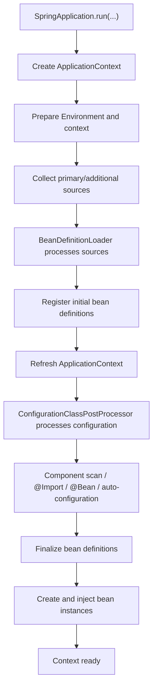
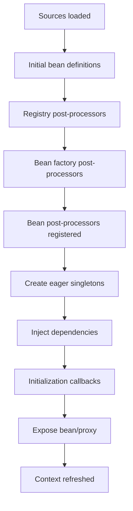

# Registering Configuration Sources and Loading Bean Definitions

When `SpringApplication.run(...)` is called, Spring Boot needs to know where to begin building the application context. An application can supply a startup class, add other configuration classes, or bring a group of modules into the configuration process. Spring Boot uses these sources to register **bean definitions**. Afterward, Spring processes configuration metadata, resolves dependencies, and creates bean instances according to the application context lifecycle.

In the **SpringApplication** chapter of *Spring Boot Fundamentals*, this lesson explains how configuration sources are registered, the role of the primary source, how Spring Boot loads bean definitions, and the difference between registering a source and creating a bean instance.

This forms the foundation for understanding why a class can be on the classpath without being processed as configuration, why adding a single source can cause many beans to be registered, and why `SpringApplication.run(...)` is not simply calling a `main` method.

## 1. Starting from SpringApplication.run(...)

A Spring Boot application typically has a startup class:

```java
package com.example.shop;

import org.springframework.boot.SpringApplication;
import org.springframework.boot.autoconfigure.SpringBootApplication;

@SpringBootApplication
public class ShopApplication {

    public static void main(String[] args) {
        SpringApplication.run(ShopApplication.class, args);
    }
}
```

The call `SpringApplication.run(ShopApplication.class, args)` passes `ShopApplication.class` to Spring Boot as the **primary source**. Spring Boot uses that source to start building the application context.

`@SpringBootApplication` is a composite annotation combining three main roles:

- `@SpringBootConfiguration`: marks the class as a Spring Boot configuration source.
- `@EnableAutoConfiguration`: enables the auto-configuration mechanism.
- `@ComponentScan`: scans for components within the default scan scope or configured packages.

Thus, the startup class is typically the entry point for Spring to discover the application's configuration. However, this class is not the sole configuration source of the context: imported classes, scanned components, auto-configurations, and additionally registered sources can also contribute bean definitions.

## 2. What Is a Configuration Source?

In the context of SpringApplication, a **source** is an input that Spring Boot uses to locate or register bean definitions. A source is not synonymous with a bean instance, nor is it necessarily a concrete bean itself.

The types of sources that the configuration loading mechanism can process include:

- **Java class:** configuration class, component, or directly registered class.
- **Package:** package to scan for component candidates.
- **Resource:** configuration resource, such as XML.
- **String name or path:** interpreted by the loader according to its rules.

In modern Spring Boot applications, Java configuration and component scanning are standard. XML or other source forms can still be used in legacy integrations or applications migrating from older configurations.

### 2.1. A source is not a Maven/Gradle dependency

Distinguish two separate actions:

1. **Build dependency:** puts a library or module onto the compile/runtime classpath.
2. **SpringApplication source:** tells Spring which inputs to process in order to register bean definitions.

For example, adding the `pricing-core` module in Gradle puts `PricingConfiguration` on the classpath. Yet if that class is not scanned, imported, or registered as a source, it does not automatically participate in the application context.

Having a class on the classpath allows the JVM to load the class; having a bean definition in the context is a separate registration step.

### 2.2. One source can lead to many bean definitions

A configuration class can contain multiple `@Bean` methods, import other configurations, or enable component scanning. When the source is processed, it can yield a whole set of bean definitions rather than just one.

Example:

```java
@Configuration(proxyBeanMethods = false)
public class CommerceConfiguration {

    @Bean
    CurrencyService currencyService() {
        return new CurrencyService();
    }

    @Bean
    TaxService taxService() {
        return new TaxService();
    }
}
```

When `CommerceConfiguration` is processed as a configuration source, Spring registers definitions corresponding to `currencyService` and `taxService`. Instances are usually created in a subsequent phase according to scope and dependencies.

## 3. Primary Source and Additional Sources

The **primary source** is the main source passed when creating `SpringApplication`. In a standard application, this is usually the class annotated with `@SpringBootApplication`.

Example:

```java
public static void main(String[] args) {
    SpringApplication.run(ShopApplication.class, args);
}
```

In addition to a single primary source, an application can register extra configuration sources via the varargs constructor:

```java
public static void main(String[] args) {
    SpringApplication application = new SpringApplication(
            ShopApplication.class,
            CommerceConfiguration.class,
            AuditConfiguration.class
    );
    application.run(args);
}
```

The classes passed to the constructor become the primary sources for that startup run. Spring Boot loads them into the same application context. Each class must have appropriate metadata or registration semantics for its intended use.

Another approach is to declare additional configuration directly on the primary source:

```java
@SpringBootApplication
@Import({
        CommerceConfiguration.class,
        AuditConfiguration.class
})
public class ShopApplication {
}
```

The two approaches trigger at different points:

- **Adding primary sources:** adds classes directly to the set of sources that SpringApplication loads.
- **`@Import`:** a configuration source declares which configuration/component classes should be processed during configuration analysis.

In large applications, pick one consistent organizational approach. Avoid both passing the same configuration in primary sources and importing it again unless there is a specific reason.

### 3.1. Using SpringApplicationBuilder

When you need to configure startup behavior or organize multiple contexts, Spring Boot provides `SpringApplicationBuilder`.

Example:

```java
new SpringApplicationBuilder(ShopApplication.class)
        .sources(CommerceConfiguration.class, AuditConfiguration.class)
        .run(args);
```

The builder lets you assemble sources and startup settings via a fluent API. In a typical single-context application, there is no need to use the builder if `SpringApplication.run(...)` already meets your needs.

## 4. Registering a Source vs. Registering a Bean

This is the most common point of confusion in this topic. A class passed as a source can be registered as a bean definition, yet whether that class is processed as a configuration source depends on its metadata and annotations.

Example configuration class:

```java
@Configuration
public class GreetingConfiguration {

    @Bean
    GreetingService greetingService() {
        return new GreetingService();
    }
}
```

When `GreetingConfiguration.class` is loaded as a source, Spring registers the configuration class and, during configuration processing, detects the `@Bean` method to also register `GreetingService`.

An ordinary component class can also be registered directly:

```java
public class GreetingService {

    public String greet() {
        return "Hello Spring";
    }
}
```

If you pass `GreetingService.class` as a source class to SpringApplication, the loader can register that class directly as a bean definition. However, that does not turn the class into a configuration class: it does not automatically supply other `@Bean` methods, enable component scanning, or import modules.

In standard applications, express intent clearly:

- Use `@Service`/`@Component` so component scanning registers the class.
- Use `@Configuration` and `@Bean` to declare how objects are constructed.
- Use `@Import` or primary sources to bring configurations into the context.

### 4.1. Four layers to distinguish

| Layer | Question | Example |
| --- | --- | --- |
| Classpath | Can the JVM locate the class? | Dependency containing `GreetingService` is present |
| Source | Which inputs is Spring Boot instructed to process? | `ShopApplication.class` |
| Bean definition | Does the container have metadata registering the bean? | Definition `greetingService` |
| Bean instance | Has the concrete object been created yet? | A `GreetingService` singleton |

Never infer a later layer solely from an earlier one. A class on the classpath does not mean it is registered; a source does not mean every related class becomes a bean; and having a bean definition does not mean an instance has already been created.

## 5. How Does Spring Boot Load Bean Definitions?

During context preparation, Spring Boot uses a loader mechanism to read the provided sources and register bean definitions into the appropriate registry/bean factory.

At a high level:



This diagram illustrates the main flow, not an exhaustive list of every internal step. The actual sequence also includes environment post-processing, context initializers, listeners, registry post-processors, bean factory post-processors, and bean post-processors.

### 5.1. BeanDefinitionLoader

In Spring Boot, `BeanDefinitionLoader` is the infrastructure component used to register bean definitions from the sources supplied to SpringApplication. It coordinates the readers/scanners suitable for each source type.

Conceptually, the loader can handle sources such as:

- **Java class:** registers a bean definition based on annotation metadata.
- **Package:** scans a package for components.
- **Resource:** reads bean definitions from resources such as XML.
- **String:** resolves a name or path according to loader rules.

Applications normally do not create `BeanDefinitionLoader` directly. `SpringApplication` uses it internally during startup. This is an internal infrastructure detail; application code should use public configuration APIs.

### 5.2. AnnotatedBeanDefinitionReader

For Java classes, Spring can use `AnnotatedBeanDefinitionReader` to register a bean definition based on class annotations and metadata.

Plain Spring Framework example:

```java
AnnotationConfigApplicationContext context =
        new AnnotationConfigApplicationContext();

context.register(ShopConfiguration.class);
context.refresh();
```

This illustrates registering a configuration class using annotation metadata. In Spring Boot, source registration is normally orchestrated by SpringApplication.

### 5.3. ClassPathBeanDefinitionScanner

Component scanning uses a scanner to find matching classes within packages. Common stereotypes include:

- `@Component`
- `@Service`
- `@Repository`
- `@Controller`
- `@RestController`

`@SpringBootApplication` enables component scanning on the application class's package and its sub-packages by default. The scanner finds component candidates and registers bean definitions for matching classes.

Component scanning is one mechanism for registering bean definitions; it is not the entirety of source loading.

### 5.4. XmlBeanDefinitionReader

In applications with XML configuration, Spring can use a reader to load bean definitions from XML resources. Example:

```xml
<beans xmlns="http://www.springframework.org/schema/beans"
       xmlns:xsi="http://www.w3.org/2001/XMLSchema-instance"
       xsi:schemaLocation="
           http://www.springframework.org/schema/beans
           https://www.springframework.org/schema/beans/spring-beans.xsd">

    <bean id="legacyGreetingService"
          class="com.example.legacy.LegacyGreetingService"/>
</beans>
```

In Java configuration, you can import the resource:

```java
@Configuration
@ImportResource("classpath:legacy-beans.xml")
class LegacyIntegrationConfiguration {
}
```

XML is not the preferred configuration style for new Spring Boot applications, but it remains useful when integrating legacy systems or libraries that already provide XML bean definitions.

## 6. Primary Source Is Registered First, Configuration Is Parsed Later

A class annotated with `@SpringBootApplication` is an initial source. When Spring refreshes the context, infrastructure bean factory post-processors proceed to parse configuration metadata.

A key component is `ConfigurationClassPostProcessor`. It handles Java configuration constructs such as:

- `@Configuration`.
- `@ComponentScan`.
- `@Import`.
- `@ImportResource`.
- `@Bean` methods.
- Associated conditions and configuration metadata.

Example:

```java
@SpringBootApplication
@Import(PricingConfiguration.class)
class ShopApplication {
}
```

When the configuration class is processed, Spring discovers `PricingConfiguration` and the bean definitions it declares. If that configuration in turn imports other classes or enables component scanning, additional definitions can also be registered.

This explains why one source can expand into a web of configuration. The initial source is the entry point; configuration annotations determine subsequent sources and definitions.

## 7. Complete Example: Adding a Configuration Source for a Module

Suppose a project has this structure:

```text
src/main/java/
├── com/example/shop/
│   └── ShopApplication.java
└── com/example/shared/pricing/
    ├── PricingConfiguration.java
    └── TaxCalculator.java
```

The package `com.example.shared.pricing` sits outside the sub-packages of `com.example.shop`, so default component scanning from `ShopApplication` does not scan this package automatically.

### 7.1. Create the service in the pricing module

```java
package com.example.shared.pricing;

import java.math.BigDecimal;

public class TaxCalculator {

    private final BigDecimal rate;

    public TaxCalculator(BigDecimal rate) {
        this.rate = rate;
    }

    public BigDecimal calculate(BigDecimal amount) {
        return amount.multiply(rate);
    }
}
```

### 7.2. Create the configuration source

```java
package com.example.shared.pricing;

import java.math.BigDecimal;
import org.springframework.context.annotation.Bean;
import org.springframework.context.annotation.Configuration;

@Configuration(proxyBeanMethods = false)
public class PricingConfiguration {

    @Bean
    public TaxCalculator taxCalculator() {
        return new TaxCalculator(new BigDecimal("0.08"));
    }
}
```

### 7.3. Register the source with @Import

```java
package com.example.shop;

import com.example.shared.pricing.PricingConfiguration;
import com.example.shared.pricing.TaxCalculator;
import java.math.BigDecimal;
import org.springframework.boot.CommandLineRunner;
import org.springframework.boot.SpringApplication;
import org.springframework.boot.autoconfigure.SpringBootApplication;
import org.springframework.context.annotation.Bean;
import org.springframework.context.annotation.Import;

@SpringBootApplication
@Import(PricingConfiguration.class)
public class ShopApplication {

    public static void main(String[] args) {
        SpringApplication.run(ShopApplication.class, args);
    }

    @Bean
    CommandLineRunner demo(TaxCalculator calculator) {
        return args -> System.out.println(
                calculator.calculate(new BigDecimal("100000"))
        );
    }
}
```

When the application starts, Spring processes `ShopApplication`, follows `@Import` to process `PricingConfiguration`, registers the bean definition for `taxCalculator`, and then provides the bean to the `CommandLineRunner` parameter.

The calculation result with the sample numbers is `8000.00` if the `BigDecimal` input has a scale of two decimal places (or `8000.00` from `100000 * 0.08`). This example merely illustrates registration and DI mechanics, not real-world tax rules.

### 7.4. What if PricingConfiguration is not imported?

If the pricing package lies outside the default scan scope and no other registration mechanism is configured, `PricingConfiguration` is not processed. Consequently, `TaxCalculator` has no bean definition for Spring to inject into `demo(...)`, and the context will fail at startup due to a missing dependency.

This is a classic example showing that **having a class on the classpath is not enough to have a bean in the context**.

## 8. Loading Multiple Primary Sources with SpringApplication

When an application needs multiple configuration classes as input sources, you can pass multiple classes to the `SpringApplication` constructor:

```java
public static void main(String[] args) {
    SpringApplication application = new SpringApplication(
            ShopApplication.class,
            PricingConfiguration.class,
            AuditConfiguration.class
    );
    application.run(args);
}
```

This adds multiple classes to the set of primary sources for that startup run. Remember that each source class is registered according to its metadata; a configuration class can extend the context via `@Bean`, `@Import`, or component scanning.

### 8.1. When should you use multiple primary sources?

It can be suitable when:

- The application is assembled from several independent configuration modules.
- A launcher selects configurations depending on the application mode.
- Tests or tools need to initialize a context from a specific set of sources.
- Configuration is organized into groups that the launcher actively combines.

In standard applications, `@Import` on the main configuration usually expresses configuration relationships more cleanly than passing too many classes into `main`.

### 8.2. Do not turn main into the wiring hub for the whole application

If `main` lists dozens of configuration classes, module organization may be lacking focus. You can group related configurations into a higher-level configuration class:

```java
@Configuration(proxyBeanMethods = false)
@Import({
        PricingConfiguration.class,
        AuditConfiguration.class,
        NotificationConfiguration.class
})
class CommerceModuleConfiguration {
}
```

The application only needs to import `CommerceModuleConfiguration`. This establishes clear module boundaries and reduces launcher complexity.

## 9. Loading Package or Resource Sources

Spring Boot's loader supports multiple source types, though in modern applications most code uses configuration classes. Other source types are mainly useful in integrations or specialized applications.

### 9.1. Package scanning

If you want to component-scan a specific package, an explicit declaration is typically:

```java
@Configuration
@ComponentScan(basePackages = "com.example.shared")
class SharedComponentsConfiguration {
}
```

Then bring that configuration into the context via existing component scanning or `@Import`.

Another option is using `scanBasePackages` on `@SpringBootApplication`:

```java
@SpringBootApplication(
        scanBasePackages = {
                "com.example.shop",
                "com.example.shared"
        }
)
public class ShopApplication {
}
```

Both approaches expand component scan scope. Choose the one that best communicates configuration ownership:

- `scanBasePackages` fits when those packages belong to the application's shared component-scan area.
- A dedicated configuration with `@ComponentScan` fits when you want to encapsulate a scan boundary as an importable module.
- `@Import` on a configuration class fits when you only want to opt in to a specific configuration.

### 9.2. XML resource

If XML integration is needed, you can use `@ImportResource`:

```java
@Configuration
@ImportResource("classpath:legacy-context.xml")
class LegacyConfiguration {
}
```

Spring reads the resource and registers the bean definitions described in the XML. The path must match a resource present in the runtime artifact.

### 9.3. Class sources and package sources do not mean the same thing

Passing a configuration class as a source instructs Spring to process that class. Passing a package to component scanning instructs Spring to look for component candidates within that package. Passing an XML resource instructs the reader to parse definitions from that resource.

| Source | Primary Behavior |
| --- | --- |
| Configuration class | Parses configuration metadata, `@Bean`, `@Import`, etc. |
| Component package | Searches for matching classes using component scan filters |
| XML resource | Reads bean definitions declared in XML |
| Plain Java class | Can be registered as a bean source; does not automatically enable component scan or supply extra configuration |

## 10. Configuration Sources and Auto-Configuration

Spring Boot's auto-configuration also contributes bean definitions, though it has its own discovery mechanism. Applications normally do not list individual auto-configuration classes among primary sources.

`@SpringBootApplication` includes `@EnableAutoConfiguration`. This annotation activates Spring Boot's auto-configuration mechanism. Auto-configuration classes are discovered from metadata for the Boot version in use and then evaluated against conditions such as:

- Whether specific classes are present on the classpath.
- Whether properties have matching values.
- Whether required beans already exist or are absent.
- Whether the application has an appropriate web type.

Example of an auto-configuration providing a default bean:

```java
@AutoConfiguration
@ConditionalOnClass(SomeClient.class)
@ConditionalOnMissingBean(SomeService.class)
class SomeServiceAutoConfiguration {

    @Bean
    SomeService someService(SomeClient client) {
        return new DefaultSomeService(client);
    }
}
```

This illustrates a library configuration pattern. In a modern Spring Boot starter, auto-configuration classes are typically registered in metadata:

```text
META-INF/spring/org.springframework.boot.autoconfigure.AutoConfiguration.imports
```

This file lists fully qualified auto-configuration class names, one per line. Spring Boot uses this list to discover auto-configurations; conditions decide which configurations are applied.

### 10.1. Primary source is not synonymous with auto-configuration source

A primary source is an input passed by the application when creating `SpringApplication`. Auto-configuration is Spring Boot's mechanism for adding configuration based on metadata and conditions.

Both sources work together:

1. The application passes the startup class to `SpringApplication`.
2. `@EnableAutoConfiguration` activates auto-configuration discovery.
3. Boot discovers matching auto-configurations.
4. Conditions determine which configurations apply.
5. Bean definitions are registered before the container creates standard beans.

### 10.2. Custom beans can cause auto-configuration to back off

An auto-configuration frequently uses `@ConditionalOnMissingBean` to avoid creating a default bean when the application already defines one. Thus, providing an additional source in your application can change the outcome of auto-configuration.

This is intentional extensibility: Boot supplies sensible defaults, and the application retains the ability to customize.

## 11. Source Registration Is Not Component Scanning

These two concepts are related but distinct:

- **Source registration** feeds an input into the context-building process.
- **Component scanning** searches packages for component candidates and registers bean definitions for matching classes.

Example:

```java
@SpringBootApplication
public class ShopApplication {
}
```

This class is the primary source. Because it includes `@ComponentScan` via `@SpringBootApplication`, Spring also scans its package and sub-packages by default.

If you add:

```java
@Import(PricingConfiguration.class)
```

Spring additionally processes that configuration class. Importing a configuration class does not scan the entire package containing it. If that configuration class itself declares `@ComponentScan`, it can broaden scanning according to its own declaration.

### 11.1. Why does the package of the startup class matter?

Example:

```text
com.example.shop
  ShopApplication
  service/
  repository/
  web/

com.example.shared
  pricing/
  audit/
```

If `ShopApplication` is in `com.example.shop`, default component scanning does not automatically scan `com.example.shared`. That is why many applications place the startup class in a shared root package, or configure scanning/imports explicitly.

An easily managed structure:

```text
com.example
  ShopApplication
  shop/
    service/
    repository/
    web/
  shared/
    pricing/
    audit/
```

When the startup class is in `com.example`, default scanning can cover the appropriate sub-packages. However, do not place the startup class too high up if doing so would cause Spring to scan packages that do not belong to the application.

## 12. Registering Configuration Sources Using the Spring Framework Java API

Spring Framework allows creating a context and registering configuration classes directly via API. This is useful in unit tests, tools, or applications that do not need the Spring Boot launcher.

Example:

```java
import org.springframework.context.annotation.AnnotationConfigApplicationContext;

public class PlainSpringLauncher {

    public static void main(String[] args) {
        AnnotationConfigApplicationContext context =
                new AnnotationConfigApplicationContext();
        try {
            context.register(CommerceConfiguration.class);
            context.register(AuditConfiguration.class);
            context.refresh();

            CommerceService service =
                    context.getBean(CommerceService.class);
            service.execute();
        } finally {
            context.close();
        }
    }
}
```

In this example:

- `register(...)` registers the configuration sources.
- `refresh()` triggers configuration processing and creation of required beans.
- `getBean(...)` retrieves an instance from the context after refresh.
- `close()` closes the context and triggers appropriate destruction callbacks.

This API highlights the phases clearly, though Spring Boot applications normally let `SpringApplication` orchestrate the environment, listeners, initializers, auto-configuration, and lifecycle.

## 13. Context Refresh and When Bean Instances Are Created

Once sources are loaded, bean definitions may exist even though instances have not been created yet. During `refresh()`:

1. The container prepares the bean factory and registry.
2. `BeanDefinitionRegistryPostProcessor` implementations can add further definitions.
3. `BeanFactoryPostProcessor` implementations can modify metadata.
4. Spring registers `BeanPostProcessor` implementations.
5. Non-lazy singletons are instantiated, dependencies are resolved, and lifecycle callbacks are invoked.
6. The context finishes refreshing and publishes the appropriate events.

Diagram:



This is a high-level diagram; some dependencies are created earlier during infrastructure phases, and lazy/prototype beans have different creation timing. The goal is to distinguish **loading definitions** from **instantiating instances**.

### 13.1. Eager and lazy singletons

Default singleton beans are normally created during refresh unless marked lazy or deferred by another mechanism. Lazy beans are created on demand.

```java
@Bean
@Lazy
ReportArchive reportArchive() {
    return new ReportArchive();
}
```

The definition is still registered when the configuration is processed. `@Lazy` changes when the instance is created; it does not mean Spring is unaware the bean exists.

### 13.2. Prototype

Prototype beans also have definitions in the registry, but the container creates a new instance each time the bean is resolved. Registering the definition does not create a single shared instance for reuse.

Therefore, distinguish:

- A bean definition is registered in the context.
- A bean instance is created according to its scope and when requested.

## 14. Common Errors When Registering Sources

### 14.1. Class is on the classpath, yet the bean does not exist

Possible causes:

- The class is not component-scanned.
- The configuration class was not imported or registered.
- The class lacks the annotations/metadata needed to become a bean.
- Auto-configuration was not discovered.
- Conditions did not match.

Troubleshooting steps:

1. Identify which source is responsible for registering the bean.
2. Verify the classpath.
3. Verify package scanning and source registration.
4. Verify `@Import`, `@Bean`, and auto-configuration metadata.
5. Verify profiles and conditions.

### 14.2. Component scan does not find the class

Usually because the class sits outside the root package of `@SpringBootApplication`, or filters exclude that class.

Solutions:

- Place the startup class in an appropriate root package.
- Configure `scanBasePackages` or `@ComponentScan` if needed.
- Import a configuration class if you only want to activate a specific module.

Avoid expanding component scanning across an entire large dependency's package when you only need a single bean.

### 14.3. Configuration class is not processed

A class annotated with `@Configuration` that is neither scanned, imported, nor registered as a source will still not participate in the context.

Confirm that the class actually lies on the configuration path of the current application context.

### 14.4. Missing runtime dependency

If a source references classes from another module whose dependency is absent from the runtime artifact, the application may fail to compile or fail to start. Check Maven/Gradle configuration and dependency scopes.

### 14.5. Two sources register beans with the same name

If two configurations register the same bean name, the context may fail when bean definition overriding is disabled, or overwrite the definition if the registry permits it. Review ownership and bean names rather than enabling overriding indiscriminately.

### 14.6. Passing a plain Java class as a primary source

A plain Java class can be registered as a bean source, but it does not automatically become a configuration class. If you need `@Bean` methods, component scanning, or imports, declare the appropriate configuration metadata.

## 15. Inspecting Bean Definitions in the Application Context

After the context is created, you can use BeanFactory APIs to inspect registered definitions.

Example:

```java
@Bean
CommandLineRunner inspectDefinitions(
        ConfigurableApplicationContext context
) {
    return args -> {
        ConfigurableListableBeanFactory beanFactory =
                context.getBeanFactory();

        for (String name : beanFactory.getBeanDefinitionNames()) {
            BeanDefinition definition =
                    beanFactory.getBeanDefinition(name);
            System.out.println(
                    name + " -> " + definition.getBeanClassName()
            );
        }
    };
}
```

This is a diagnostic example for development environments. Some definitions created via factory methods may not expose a bean class name as straightforwardly as class-based definitions; in those cases, inspect the factory bean/method metadata as well.

### 15.1. Counting bean definitions

You can use:

```java
int count = context.getBeanFactory().getBeanDefinitionCount();
```

The count varies with dependencies, auto-configuration, framework infrastructure, and application configuration. Avoid writing tests tied to an exact absolute count without a compelling reason; adding one starter can raise the bean definition count substantially.

### 15.2. Finding beans by type

```java
Map<String, TaxCalculator> calculators =
        context.getBeansOfType(TaxCalculator.class);
```

This API shows matching bean instances after the context is ready. It differs from counting definitions or inspecting source classes.

### 15.3. Debugging component scan and auto-configuration

When it is unclear where a bean comes from:

- Enable appropriate debug logging for component scanning.
- Use `--debug` to view Spring Boot's condition evaluation report.
- Inspect bean names and definition metadata.
- Cross-check the dependency tree to see which module provides the class.

These tools answer different questions: which classes component scanning found, which conditions matched, which bean definitions exist, and which libraries are present.

## 16. Testing Source Registration

You can verify in tests that a configuration source actually provides the required bean.

### 16.1. Testing with @SpringBootTest

```java
import static org.assertj.core.api.Assertions.assertThat;

import com.example.shared.pricing.TaxCalculator;
import org.junit.jupiter.api.Test;
import org.springframework.beans.factory.annotation.Autowired;
import org.springframework.boot.test.context.SpringBootTest;

@SpringBootTest
class ShopApplicationTest {

    @Autowired
    private TaxCalculator taxCalculator;

    @Test
    void pricingSourceProvidesTaxCalculator() {
        assertThat(taxCalculator).isNotNull();
    }
}
```

This test loads the application's context. If `PricingConfiguration` is properly imported, `TaxCalculator` can be injected. If source registration is missing, the context fails before the test method runs.

### 16.2. Testing with ApplicationContextRunner

For small configurations or auto-configurations, you can use `ApplicationContextRunner`:

```java
new ApplicationContextRunner()
        .withUserConfiguration(PricingConfiguration.class)
        .run(context -> {
            assertThat(context).hasSingleBean(TaxCalculator.class);
        });
```

This tests a configuration source in isolation without booting the entire application.

### 16.3. Testing component scanning

If you want to verify that a component is found via scanning, create a test configuration with the intended scan scope and assert the bean is present. Avoid accidentally importing the bean directly in the test and concluding that component scanning worked; each test should isolate the specific mechanism it aims to verify.

## 17. Configuring Sources by Environment

An application may require different sources in dev and production. You can use profiles:

```java
@Configuration
@Profile("dev")
class DevToolsConfiguration {

    @Bean
    DemoDataLoader demoDataLoader() {
        return new DemoDataLoader();
    }
}
```

```java
@Configuration
@Profile("prod")
class ProductionIntegrationConfiguration {

    @Bean
    ExternalClient externalClient() {
        return createProductionClient();
    }
}
```

If both configurations are imported or scanned, `@Profile` determines which configuration matches the active profile.

Profiles do not replace source registration:

- The configuration must be brought into the processing pipeline.
- The profile must match for the configuration to be applied.
- The bean definition must be registered before an instance can be created.

If a configuration is never discovered, activating a profile will not make the class appear on its own.

## 18. Common Misconceptions

| Misconception | Accurate Understanding |
| --- | --- |
| “Passing a class to `SpringApplication.run` guarantees it acts as configuration.” | Sources are processed by their metadata and type; a plain Java class does not automatically supply other configurations. |
| “Having a dependency in Gradle makes its beans appear automatically.” | A dependency only puts classes on the classpath; scanning, importing, `@Bean`, or another registration mechanism is needed. |
| “The primary source is the only configuration source.” | Imports, component scanning, and auto-configuration can contribute additional definitions. |
| “Loading a bean definition creates the instance immediately.” | A definition is metadata; instances are created based on scope and when needed by the container. |
| “`@Import` scans the entire package of the imported class.” | `@Import` brings the specified class into processing; scanning occurs only if scanning is explicitly configured. |
| “Component scanning and source registration are the same thing.” | Source registration supplies inputs; component scanning is one mechanism for finding component candidates. |
| “All beans are created when `run` starts.” | Eager singletons are normally created during refresh; lazy/prototype and certain other beans follow their own timing. |
| “Auto-configuration is a class that must be passed to `run`.” | Boot discovers auto-configurations via metadata and its enablement mechanism. |
| “Bean name and source name are the same.” | A source is a configuration input; a bean name identifies a definition in the registry. |

## 19. Investigation Workflow When a Bean Is Not Loaded

When a dependency fails to inject, follow these steps:

1. **Identify the required bean:** record its type and bean name if qualified by name.
2. **Identify the registration source:** component scan, `@Bean`, `@Import`, XML, or auto-configuration.
3. **Check the classpath:** is the module containing the class present at runtime?
4. **Check the source:** is the configuration class included in primary/additional sources or imported/scanned?
5. **Check conditions:** do profiles, properties, and conditions permit registration?
6. **Check the registry:** does the bean definition exist after configuration processing?
7. **Check instantiation:** if the definition exists but the instance cannot be created, read the stack trace and dependency graph.

Recording template:

```text
Expected bean type/name:
Expected source:
Classpath present:
Source discovered:
Configuration condition:
Bean definition registered:
Instance creation result:
Root cause:
Verification:
```

This workflow separates source discovery errors from condition failures, definition registration, and instance creation. That way, you avoid tweaking component scans when the real issue is a missing dependency, or toggling properties when a configuration was never imported.

## 20. Practice Exercises

### Exercise 1 – Identifying the primary source

Create a `ShopApplication` class annotated with `@SpringBootApplication`, then call:

```java
SpringApplication.run(ShopApplication.class, args);
```

Explain which class is the primary source, which packages are scanned by default, and why a class in a sibling package might not be discovered.

### Exercise 2 – Adding a configuration source

Create `PricingConfiguration` outside the default scan package. Try both approaches:

- Import using `@Import(PricingConfiguration.class)`.
- Pass the class into `SpringApplication` primary sources.

Verify that the `TaxCalculator` bean appears in the context under both approaches.

### Exercise 3 – Distinguishing source and bean instance

Create a configuration with a lazy singleton bean. After context refresh:

- Verify the bean definition already exists.
- Determine when the instance is created.
- Compare with an eager singleton bean.

Explain why registering a definition does not imply immediate object instantiation.

### Exercise 4 – Component scan or import?

Create a package `com.example.shared` containing two groups of components where the application needs only one configuration. Compare expanding `scanBasePackages` with importing a specific configuration. Choose the better approach and explain the scope of discovered beans.

### Exercise 5 – XML integration

Create an XML file declaring `LegacyGreetingService`, then import it with `@ImportResource`. Verify the bean can be retrieved via `ApplicationContext`. Distinguish XML resources from Java configuration sources.

### Exercise 6 – Inspecting auto-configuration

Add an appropriate starter and enable `--debug`. Locate a related auto-configuration in the condition evaluation report. Explain how the auto-configuration source was discovered and which conditions determined bean registration.

### Exercise 7 – Investigating a missing bean

Create a service that injects `TaxCalculator`, but remove `@Import(PricingConfiguration.class)`. Read the startup error, then restore the import. Document the chain of causes from source discovery to bean definition and dependency injection.

## 21. Key Takeaways

Spring Boot uses **sources** as inputs to build the application context. The class passed to `SpringApplication.run(...)` is typically the primary source, while other configurations can be added through additional primary sources, `@Import`, component scanning, XML resources, or auto-configuration.

Keep these distinctions clear:

- **Classpath:** classes available for the JVM to load.
- **Source:** input that Spring is instructed to process.
- **Bean definition:** metadata describing how the container manages a bean.
- **Bean instance:** concrete Java object created according to scope and dependencies.

`SpringApplication` coordinates context creation, environment preparation, source loading, and context refresh. `BeanDefinitionLoader` along with readers/scanners registers initial definitions; `ConfigurationClassPostProcessor` continues processing `@Configuration`, `@ComponentScan`, `@Import`, `@Bean`, and related configurations. Once definitions are finalized, the container creates and injects bean instances according to their lifecycle.

When a bean is missing, check in sequence: **classpath → source discovery → configuration processing → conditions → bean definition → instance creation**. Separating each stage clearly makes organizing `SpringApplication`, structuring configuration modules, and diagnosing startup failures much more accurate.
