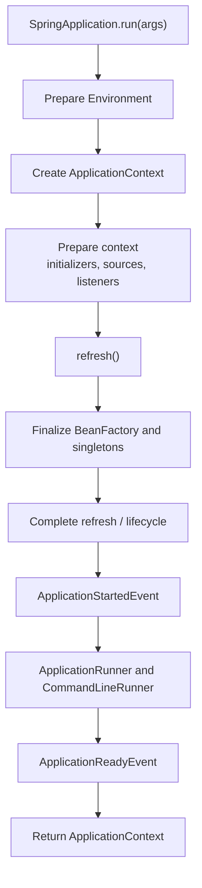
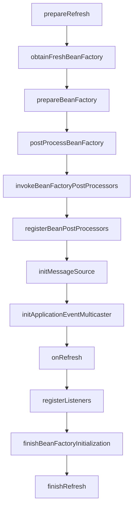
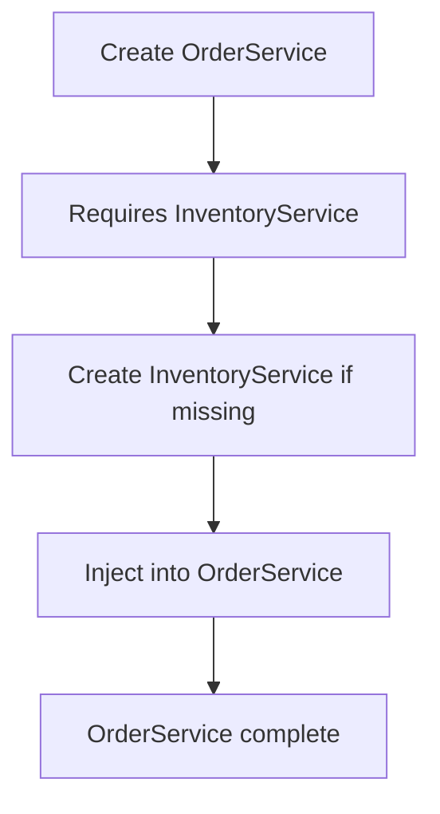

# Context Refresh and Finalizing Container Infrastructure

When calling `SpringApplication.run(...)`, Spring Boot does not merely instantiate an application context object and return immediately. The application must go through a sequence of steps to load configuration, register bean definitions, prepare the IoC container, instantiate required singletons, wire dependencies, start lifecycle-managed components, and publish status events. The centerpiece of this sequence is **refreshing the application context**.

Understanding the refresh process helps you answer common questions:

- Why can a bean be scanned yet its constructor only executes at a later phase?
- When does Spring process `@Configuration`, `@ComponentScan`, and `@Bean` methods?
- How does `BeanFactoryPostProcessor` differ from `BeanPostProcessor`?
- Why do missing dependency errors usually appear before the application reports startup success?
- When is the embedded web server created and ready to accept requests?
- Does `ApplicationRunner` execute before or after `ApplicationReadyEvent`?
- If refresh fails, how are the container and already-created beans handled?

This lesson belongs to the **SpringApplication** chapter of *Spring Boot Fundamentals*. We will walk from the `SpringApplication.run` call into the `AbstractApplicationContext.refresh` flow, then trace when the container completes infrastructure setup and the application transitions to ready.

Examples use Java 21 and Spring Boot 3.x. Some internal details may vary across Spring Framework/Spring Boot versions; the steps below describe the common flow of a modern Spring Boot application.

## 1. What Is ApplicationContext and Why Must It Be Refreshed?

`ApplicationContext` is Spring's high-level container abstraction. It extends `BeanFactory` and adds capabilities such as:

- Managing and providing beans.
- Dependency injection.
- Publishing and receiving application events.
- Resource access.
- Message source and internationalization support.
- Bean lifecycle integration.

When an `ApplicationContext` is created, the container has not necessarily finished registering and initializing all beans. The context must be **refreshed** to process configuration, finalize the bean factory, and transition into an active operational state.

In Spring Framework, the central method is:

```java
public void refresh() throws BeansException, IllegalStateException
```

This method is defined in `AbstractApplicationContext`. Concrete implementations can add custom behavior through hooks such as `onRefresh()` or `finishRefresh()`.

### 1.1. Refresh does not mean recreating every object in the application

Refresh focuses on the container and the bean definitions managed by that container. It does not:

- Recreate ordinary Java objects manually instantiated by the application with `new` outside Spring.
- Automatically run every business method of your services.
- Immediately execute every job or scheduled task.
- Guarantee that all external services are healthy simply because the context refreshed.

A refreshed context means the container initialization procedure has completed under its configured conditions. Business readiness also involves runners, the web server, readiness checks, external dependencies, and operational configuration.

## 2. Viewing the Entire SpringApplication.run Flow

A main class usually looks like:

```java
package com.example.demo;

import org.springframework.boot.SpringApplication;
import org.springframework.boot.autoconfigure.SpringBootApplication;

@SpringBootApplication
public class DemoApplication {

    public static void main(String[] args) {
        SpringApplication.run(DemoApplication.class, args);
    }
}
```

`SpringApplication.run` coordinates Spring Boot's startup process. At a high level, the common flow includes:

1. Initialize the bootstrap context and announce startup.
2. Prepare the `Environment` from property sources, profiles, and command-line arguments.
3. Create the right type of `ApplicationContext` based on the application type.
4. Prepare the context, apply initializers, and load configuration sources.
5. Call `refresh()` to finalize the container.
6. Perform post-refresh steps, record startup, and publish the application started event.
7. Invoke `ApplicationRunner` and `CommandLineRunner` beans.
8. Publish `ApplicationReadyEvent` and return the context to the caller.



This diagram gives an overall view; several intermediate events/listeners and minor steps are omitted for clarity. The following sections dive into the refresh phase.

## 3. Before Refresh: How Does Spring Boot Prepare the Context?

Before calling `refresh()`, Boot performs several important tasks. Do not lump all of them inside `AbstractApplicationContext.refresh()`.

### 3.1. Preparing the Environment

`Environment` represents the application's configuration environment. It aggregates property sources and active profiles so other components can read configuration values.

Example:

```yaml
spring:
  profiles:
    active: dev

app:
  greeting:
    prefix: "Hello"
```

Command-line arguments can also override configuration:

```bash
./gradlew bootRun --args='--app.greeting.prefix=Hi'
```

When the context is prepared, it receives the appropriate Environment. Beans and conditions processed afterward can use the loaded values.

### 3.2. Choosing the ApplicationContext type

Spring Boot chooses a context matching the application type and classpath:

- Non-web applications typically use a generic context.
- Servlet web applications use a context supporting an embedded servlet web server.
- Reactive web applications use a context suited to a reactive web server.

Selecting the right context type matters because web contexts can create and start a web server in specialized hooks. Not every application has Tomcat or an HTTP server.

### 3.3. ApplicationContextInitializer

`ApplicationContextInitializer<C>` allows customizing the context after creation but before refresh.

Example:

```java
import org.springframework.context.ApplicationContextInitializer;
import org.springframework.context.ConfigurableApplicationContext;

public class DemoContextInitializer
        implements ApplicationContextInitializer<ConfigurableApplicationContext> {

    @Override
    public void initialize(ConfigurableApplicationContext context) {
        context.getEnvironment()
                .getSystemProperties()
                .put("app.initializer.applied", "true");
    }
}
```

This example illustrates an initializer modifying the Environment. In real projects, choose a property source or API tailored to your configuration goal; avoid mutating global system properties if you only need configuration scoped to the context.

Initializers can be registered via Spring Boot configuration, such as `SpringApplication.addInitializers(...)`:

```java
SpringApplication application =
        new SpringApplication(DemoApplication.class);
application.addInitializers(new DemoContextInitializer());
application.run(args);
```

Initializers run before refresh, so they can customize the context before bean definitions are initialized.

### 3.4. Loading configuration sources

Boot loads the configuration sources passed to `SpringApplication`. In a typical application, that source is the main class annotated with `@SpringBootApplication`. Processing of configuration classes continues during refresh through post-processors.

Key distinction:

- **Prepare context:** attach Environment, apply initializers, prepare context, and load sources.
- **Refresh context:** process bean factory, configuration metadata, post-processors, singletons, and lifecycle.

## 4. What Steps Are Inside AbstractApplicationContext.refresh?

`AbstractApplicationContext.refresh()` is the core of container finalization. The common sequence of steps can be summarized as:

```java
public void refresh() {
    // Pseudocode: illustrates flow, not the complete source.
    prepareRefresh();
    ConfigurableListableBeanFactory beanFactory = obtainFreshBeanFactory();
    prepareBeanFactory(beanFactory);
    postProcessBeanFactory(beanFactory);
    invokeBeanFactoryPostProcessors(beanFactory);
    registerBeanPostProcessors(beanFactory);
    initMessageSource();
    initApplicationEventMulticaster();
    onRefresh();
    registerListeners();
    finishBeanFactoryInitialization(beanFactory);
    finishRefresh();
}
```

The snippet above is **simplified pseudocode** for learning the sequence. The actual source includes synchronization, startup steps, exception handling, shutdown hooks, and other details.



Memorize this sequence by each step's responsibility. There is no value in memorizing method names without understanding what part of the container each step prepares.

## 5. Step 1 — prepareRefresh(): Preparing Context State

`prepareRefresh()` prepares the context before refreshing the BeanFactory. Key tasks include:

- Recording the refresh startup timestamp.
- Setting the context state to active and marking refresh as in progress.
- Initializing or validating any required context property sources.
- Validating required properties if the context declares any.
- Preparing synchronization primitives and internal state for the refresh.

At this stage, Spring has not gone through bean creation yet. It is preparing the context so the refresh pipeline can proceed safely.

### Required properties

In some setups, an application can declare mandatory properties that must exist. If a property is missing, the context can fail immediately during preparation instead of waiting for a bean to read it.

Conceptual example:

```java
context.getEnvironment().setRequiredProperties("app.region");
```

When refresh validates required properties, missing `app.region` causes configuration validation to fail.

## 6. Step 2 — obtainFreshBeanFactory(): Obtaining the Context's BeanFactory

ApplicationContext uses a `BeanFactory` to manage bean definitions and singleton instances. `obtainFreshBeanFactory()` obtains or refreshes the internal factory appropriate for the context implementation.

In standard contexts, the factory is typically an implementation based on `DefaultListableBeanFactory`. This is where bean definitions are stored, beans are registered, and dependency resolution is supported.

### What is a bean definition?

A bean definition is metadata describing how the container creates and manages a bean, such as:

- Bean class or factory method.
- Scope such as singleton or prototype.
- Constructor arguments and property values.
- Lazy initialization flag.
- Dependencies and related metadata.
- Init method or destroy method.

Configuration example:

```java
@Configuration(proxyBeanMethods = false)
public class ServiceConfiguration {

    @Bean
    GreetingService greetingService(GreetingFormatter formatter) {
        return new GreetingService(formatter);
    }
}
```

When the configuration is processed, Spring registers a bean definition for `greetingService`. The bean definition describes the factory method and required dependency; the `GreetingService` instance will be created in the appropriate phase.

**Registering a bean definition does not mean the constructor or factory method has executed.**

## 7. Step 3 — prepareBeanFactory(): Preparing Core Infrastructure

`prepareBeanFactory(beanFactory)` configures foundational capabilities so the BeanFactory can operate within an ApplicationContext.

Typical tasks:

- Setting the appropriate class loader.
- Registering an expression resolver to support SpEL.
- Registering basic property editors or conversion infrastructure.
- Configuring directly resolvable dependencies such as `BeanFactory`, `ResourceLoader`, `ApplicationEventPublisher`, and `ApplicationContext`.
- Registering certain internal bean post-processors such as listener detectors.
- Configuring aware interfaces that should not be autowired through ordinary lookup.

Thanks to this, beans can receive Spring infrastructure dependencies and use capabilities like resource loading or event publishing.

Example of a bean receiving ApplicationContext:

```java
@Component
public class ContextAwareService {

    private final ApplicationContext context;

    public ContextAwareService(ApplicationContext context) {
        this.context = context;
    }

    public String applicationName() {
        return context.getApplicationName();
    }
}
```

Spring knows how to supply `ApplicationContext` for this dependency because it is a container-resolvable dependency. You do not declare `@Bean ApplicationContext` manually in a standard application configuration.

### `Environment` and property injection

Environment is also part of context infrastructure. A bean can inject `Environment` or a `@ConfigurationProperties` object to read configuration:

```java
@Component
public class RegionService {
    private final Environment environment;

    public RegionService(Environment environment) {
        this.environment = environment;
    }

    public String region() {
        return environment.getProperty("app.region", "local");
    }
}
```

A bean can be instantiated only after the context configuration and required dependencies are prepared.

## 8. Step 4 — postProcessBeanFactory(): Hook for Specific Contexts

`postProcessBeanFactory(beanFactory)` is an extension point allowing subclasses of `AbstractApplicationContext` to customize the BeanFactory after basic preparation.

Concrete contexts can add processing needed for their specific environment. For example, a web context may prepare web-related scopes or infrastructure.

In normal applications, you rarely override this method directly. When writing framework extensions or custom context implementations, you must understand the ordering because bean factory post-processing in the following steps builds on this prepared state.

## 9. Step 5 — invokeBeanFactoryPostProcessors(): Processing Bean Definitions

This is one of the most critical stages of refresh.

`BeanFactoryPostProcessor` allows modifying **bean definitions and BeanFactory metadata** before standard application beans are instantiated. A specialized sub-interface, `BeanDefinitionRegistryPostProcessor`, can register additional bean definitions.

For instance, `ConfigurationClassPostProcessor` is a crucial post-processor. It processes configuration classes and annotations such as:

- `@Configuration`.
- `@ComponentScan`.
- `@Import`.
- `@ImportResource`.
- `@Bean`.
- Conditional configurations supported in the corresponding environment.

Through this phase, Spring parses Java configuration, discovers components, and registers bean definitions prior to pre-instantiating singletons.

### 9.1. Where does component scanning happen?

When `@SpringBootApplication` is processed as a configuration class, `@ComponentScan` is handled during configuration class parsing via BeanFactory post-processors. Spring locates matching components within the package scope and registers bean definitions.

Example:

```java
package com.example.demo;

@SpringBootApplication
public class DemoApplication {
}
```

```java
package com.example.demo.service;

@Service
public class OrderService {
}
```

The bean definition for `OrderService` is registered when the configuration class is processed. The `OrderService` instance is typically created during singleton pre-instantiation afterward, assuming the bean is non-lazy and singleton-scoped.

### 9.2. Auto-configuration is also processed during the configuration phase

`@EnableAutoConfiguration` feeds Boot's auto-configuration candidates into processing. Conditional configurations are evaluated against the classpath, Environment, existing bean definitions, and other conditions.

If conditions match, the corresponding bean definitions are registered. Otherwise, that configuration is skipped.

This explains why adding a starter causes infrastructure beans to appear: dependencies alter the classpath, making certain auto-configurations eligible during configuration class processing.

### 9.3. BeanFactoryPostProcessor is not BeanPostProcessor

These two interfaces have similar names but operate in two different phases:

| Interface | Target Processed | Main Timing |
|---|---|---|
| `BeanFactoryPostProcessor` | Bean definitions and BeanFactory metadata | Before standard application beans are instantiated. |
| `BeanPostProcessor` | Bean instances | During the creation and initialization of each bean. |

Examples:

- `ConfigurationClassPostProcessor` processes configuration metadata and registers bean definitions.
- `AutowiredAnnotationBeanPostProcessor` handles injection annotations such as `@Autowired` on bean instances.
- `CommonAnnotationBeanPostProcessor` supports lifecycle/injection annotations such as `@PostConstruct` and `@Resource` in appropriate environments.

Do not mistakenly think `@Autowired` is processed by `BeanFactoryPostProcessor`. It is primarily processed during a bean instance's lifecycle by a `BeanPostProcessor`.

## 10. Step 6 — registerBeanPostProcessors(): Preparing Bean Instance Processors

`BeanPostProcessor` allows Spring to intercept beans before and after initialization. Processors can:

- Perform dependency injection.
- Process lifecycle annotations.
- Create AOP proxies.
- Detect listeners.
- Apply other framework integrations.

For example, when a service has an `@Autowired` field or constructor, the injection mechanism involves the appropriate processors. When a bean has AOP applied, a post-processor can wrap the target in a proxy to apply transactions, security, or advice.

### 10.1. Why must BeanPostProcessors be registered before creating most beans?

BeanPostProcessors need to be in place to process beans created afterward. If registered too late, beans already instantiated earlier would miss the full processor pipeline.

Spring registers BeanPostProcessors in a dedicated step of refresh, before pre-instantiating most application singletons.

### 10.2. A lifecycle callback example

```java
import jakarta.annotation.PostConstruct;
import org.springframework.stereotype.Component;

@Component
public class CacheWarmup {

    @PostConstruct
    void initialize() {
        System.out.println("CacheWarmup initialized");
    }
}
```

Once the bean is created and dependencies are populated, the `@PostConstruct` callback runs during initialization via post-processing. For eager singletons, the log usually appears during context refresh; for lazy beans, it may appear only when the bean is first requested.

### 10.3. AOP proxies can be introduced during post-processing

Example service:

```java
@Service
public class TransferService {

    @Transactional
    public void transfer() {
        // ...
    }
}
```

When transaction infrastructure is configured, Spring can create a proxy to apply transaction advice. The bean received by consumers can be a proxy rather than the raw target object. This illustrates how post-processing can alter the object exposed by the container.

## 11. Step 7 — initMessageSource(): Preparing the Message Source

ApplicationContext includes the `MessageSource` abstraction for message resolution and internationalization.

If the application declares a bean with the conventional name `messageSource`, the context uses that bean. Otherwise, the context sets up a default message source or delegates according to its implementation.

Example:

```java
import org.springframework.context.MessageSource;
import org.springframework.context.annotation.Bean;
import org.springframework.context.annotation.Configuration;
import org.springframework.context.support.ReloadableResourceBundleMessageSource;

@Configuration(proxyBeanMethods = false)
public class MessageConfiguration {

    @Bean
    MessageSource messageSource() {
        var source = new ReloadableResourceBundleMessageSource();
        source.setBasename("classpath:messages");
        source.setDefaultEncoding("UTF-8");
        return source;
    }
}
```

With corresponding resource files, the application can look up messages by key and locale. This is part of application context infrastructure, not a mandatory business bean for every application.

## 12. Step 8 — initApplicationEventMulticaster(): Preparing the Event System

Spring features an application event system. Beans can publish events, and listeners can receive matching events.

ApplicationContext needs an `ApplicationEventMulticaster` to dispatch events within the context. If the user does not define a bean with the conventional name `applicationEventMulticaster`, the context creates a default multicaster.

Listener example:

```java
import org.springframework.context.event.EventListener;
import org.springframework.stereotype.Component;
import org.springframework.context.event.ContextRefreshedEvent;

@Component
public class ContextReadyListener {

    @EventListener
    public void onContextRefreshed(ContextRefreshedEvent event) {
        System.out.println("ApplicationContext refreshed");
    }
}
```

`ContextRefreshedEvent` is published while completing refresh. A listener must be registered before the event is published in order to receive it.

### Spring Framework events vs. Spring Boot events

Do not confuse these events:

| Event | Meaning |
|---|---|
| `ContextRefreshedEvent` | ApplicationContext has finished refreshing. |
| `ApplicationStartedEvent` | Spring Boot has completed refresh and post-refresh steps prior to invoking runners. |
| `ApplicationReadyEvent` | Spring Boot has finished executing runners and the application is considered ready. |
| `ApplicationFailedEvent` | Running the application failed. |

Boot events have their own timing in the orchestration of `SpringApplication.run`; not all of them are published inside `AbstractApplicationContext.refresh()`.

## 13. Step 9 — onRefresh(): Hook for Specific Contexts

`onRefresh()` is a hook for context implementations to perform specialized work during refresh.

An important example is web contexts:

- `ServletWebServerApplicationContext` manages embedded servlet web server infrastructure.
- `ReactiveWebServerApplicationContext` manages reactive web server infrastructure.

In a servlet context, the web server is created during refresh and started during the web context's refresh-completion steps. Thus, the web server can leverage the beans and infrastructure that have already been prepared.

A non-web application has no embedded HTTP server startup step.

### Creating the web server and being ready to serve requests are close yet distinct milestones

A web context must:

1. Prepare the web server and web infrastructure.
2. Complete required bean initialization.
3. Start the server according to context lifecycle.
4. Publish the appropriate web server initialized event.

Do not assume that merely creating the context means the HTTP port is already accepting requests. When the server starts operating belongs to the lifecycle of the web context and web server implementation.

## 14. Step 10 — registerListeners(): Registering Application Listeners

Once the event multicaster is ready and the context has run its refresh hook, Spring registers configured listeners.

Listeners can be registered via:

- Beans implementing `ApplicationListener<E>`.
- `@EventListener` annotations on bean methods.
- Listeners added programmatically to the context via API.
- Listeners registered by Boot or framework integrations.

Interface-based listener example:

```java
import org.springframework.context.ApplicationListener;
import org.springframework.context.event.ContextRefreshedEvent;
import org.springframework.stereotype.Component;

@Component
public class RefreshAuditListener
        implements ApplicationListener<ContextRefreshedEvent> {

    @Override
    public void onApplicationEvent(ContextRefreshedEvent event) {
        System.out.println("Refresh completed for "
                + event.getApplicationContext().getDisplayName());
    }
}
```

The listener receives matching events when the multicaster dispatches them. If the listener bean needs instantiation, it also follows container lifecycle rules.

## 15. Step 11 — finishBeanFactoryInitialization(): Finalizing the BeanFactory

This is a key stage for making the container ready to serve application beans. In the common flow, Spring:

- Finalizes infrastructure configurations such as the conversion service.
- Registers embedded value resolvers if needed.
- Initializes special beans such as `LoadTimeWeaverAware` when present.
- Freezes configuration metadata where appropriate.
- Calls `preInstantiateSingletons()` to create remaining eager singletons.

### 15.1. preInstantiateSingletons()

For ordinary non-lazy singleton beans, Spring creates instances in this step. This is when:

- Constructors are called.
- Constructor dependencies are resolved.
- Field/setter injection is processed.
- Bean initialization callbacks are invoked.
- BeanPostProcessors may wrap beans into proxies.

Example:

```java
@Component
public class InventoryService {

    public InventoryService() {
        System.out.println("InventoryService constructor");
    }
}
```

If `InventoryService` is an eager singleton, its constructor typically runs during refresh's singleton pre-instantiation step.

### 15.2. Dependencies are resolved according to the dependency graph

Suppose:

```java
@Service
public class OrderService {
    private final InventoryService inventoryService;

    public OrderService(InventoryService inventoryService) {
        this.inventoryService = inventoryService;
    }
}
```

When creating `OrderService`, Spring must supply `InventoryService`. If inventory has not yet been created, the container creates that dependency according to applicable scope/lazy rules. Therefore, actual constructor execution order may differ from class declaration or file order.



### 15.3. Eager singletons catch errors early

If a required dependency does not exist or a constructor throws an exception, creating eager singletons fails during startup. The application cannot finish refreshing and will not publish `ApplicationReadyEvent`.

This is intentional with eager initialization: many configuration errors are caught before the application declares itself ready.

### 15.4. Lazy beans may not be created yet

Beans marked `@Lazy` may not be pre-instantiated. However, if an eager singleton requires one as a constructor dependency, Spring may still create the lazy bean to satisfy that dependency. If `@Lazy` is placed at an injection point, Spring can use a proxy to defer resolving the target.

Thus, after refresh you cannot assume every bean definition already has an instance. A bean definition can exist in the context even when no instance has been created.

### 15.5. FactoryBean and its product

If a bean definition represents a `FactoryBean<T>`, the container also accounts for its product according to the factory contract. The factory instance and the product instance are two distinct objects. With specialized factories like `SmartFactoryBean`, the container receives additional information on whether the product should be eagerly initialized.

Do not assume all `FactoryBean` products are instantiated identically to regular singleton beans; check `getObjectType()`, `isSingleton()`, and the semantics of the specific factory.

## 16. Step 12 — finishRefresh(): Completing Lifecycle and Publishing ContextRefreshedEvent

After BeanFactory initialization completes, `finishRefresh()` performs the final steps of context refresh. In the common flow:

- Initializes the `LifecycleProcessor` if needed.
- Invokes the lifecycle processor to start lifecycle-managed beans.
- Publishes `ContextRefreshedEvent`.
- Performs any remaining context refresh completion work.

### 16.1. LifecycleProcessor and SmartLifecycle

A bean implementing `Lifecycle` or `SmartLifecycle` can participate in context start/stop lifecycle events.

Example:

```java
import org.springframework.context.SmartLifecycle;
import org.springframework.stereotype.Component;

@Component
public class MessageConsumerLifecycle implements SmartLifecycle {

    private volatile boolean running;

    @Override
    public void start() {
        running = true;
        System.out.println("Message consumer started");
    }

    @Override
    public void stop() {
        running = false;
        System.out.println("Message consumer stopped");
    }

    @Override
    public boolean isRunning() {
        return running;
    }
}
```

This is a minimal example illustrating the callbacks. In a real consumer, `start()` might register a listener or begin receiving messages, while `stop()` should halt message consumption and release resources safely.

`SmartLifecycle` can also control phases and auto-startup. The container uses the lifecycle processor to start and stop components according to the configured rules.

### 16.2. ContextRefreshedEvent

Once the context completes refresh, Spring publishes `ContextRefreshedEvent`. This is a Spring Framework event signaling that the context has been initialized or refreshed.

If there is a context hierarchy, the event can be published for each context. Listeners should check `event.getApplicationContext()` if they only care about a specific context.

**`ContextRefreshedEvent` is not synonymous with `ApplicationReadyEvent`.** Boot still has post-refresh steps, including executing runners.

## 17. After Refresh: Spring Boot Runs Runners and Reports Ready

Once `refresh()` returns successfully, `SpringApplication.run` proceeds with post-refresh orchestration.

One key step is invoking:

- `ApplicationRunner`.
- `CommandLineRunner`.

Both interfaces let you run startup logic after the context has refreshed:

```java
import org.springframework.boot.ApplicationArguments;
import org.springframework.boot.ApplicationRunner;
import org.springframework.stereotype.Component;

@Component
public class StartupDataLoader implements ApplicationRunner {

    @Override
    public void run(ApplicationArguments args) {
        System.out.println("Load startup data");
    }
}
```

Or:

```java
import org.springframework.boot.CommandLineRunner;
import org.springframework.stereotype.Component;

@Component
public class StartupDiagnostics implements CommandLineRunner {

    @Override
    public void run(String... args) {
        System.out.println("Startup arguments: " + args.length);
    }
}
```

If there are multiple runners, you can use `Ordered` or `@Order` to control invocation order among runners.

### 17.1. Order of key events

An important event sequence in modern Spring Boot applications:

| Event/Step | General Timing |
|---|---|
| `ApplicationStartingEvent` | Very early, when SpringApplication starts. |
| `ApplicationEnvironmentPreparedEvent` | Environment has been prepared. |
| `ApplicationContextInitializedEvent` | Context has been created and initializers applied. |
| `ApplicationPreparedEvent` | Context prepared before refresh. |
| `ContextRefreshedEvent` | Inside ApplicationContext refresh completion. |
| `ApplicationStartedEvent` | After context refresh and initial post-refresh steps complete, before runners. |
| `ApplicationRunner` / `CommandLineRunner` | After ApplicationStartedEvent, before ApplicationReadyEvent. |
| `ApplicationReadyEvent` | After runners complete; application is considered ready. |

Exact event names and details depend on the Boot version, yet the core distinction remains:

**ContextRefreshedEvent → ApplicationStartedEvent → runners → ApplicationReadyEvent.**

### 17.2. What if a runner fails?

If a runner throws an exception, `SpringApplication.run` may fail. `ApplicationReadyEvent` will not be published as a successful startup. Boot handles the error through failure handling and closes the context via the corresponding procedure.

Therefore, runners should perform deliberate startup work with clear timeouts and error policies. Avoid placing an infinite long-running task inside a runner if the application needs to report ready and serve traffic.

## 18. How Does the Embedded Web Server Participate in Refresh?

For servlet web applications, Boot uses a context such as `ServletWebServerApplicationContext`. This context integrates creating and starting the embedded web server into its lifecycle.

Dependency example:

```groovy
dependencies {
    implementation 'org.springframework.boot:spring-boot-starter-web'
}
```

With matching classpath and configuration, Boot can configure an embedded server such as Tomcat. General flow:

1. Boot selects a servlet web application context.
2. During refresh, the context prepares the web server and web infrastructure.
3. Beans and context infrastructure are finalized.
4. The web context starts the server during the finish-refresh phase.
5. After refresh, Boot continues with events and runners.
6. The application completes startup and publishes the ready event.

The server is typically already started before runners are invoked in the standard servlet web flow. Hence, a runner may execute after the server has been created/started, while the application still does not publish `ApplicationReadyEvent` until runners finish.

### Web server initialized event

Spring Boot publishes a dedicated event when the embedded web server is initialized, such as `ServletWebServerInitializedEvent` for servlet servers. This event can be used to inspect server/actual port details, especially when configured with a random port.

Do not confuse a web server initialized event with `ApplicationReadyEvent`: one indicates the server has initialized; the other signals that Boot's entire startup sequence has passed through the runners.

## 19. How Does the Container Handle Refresh Failures?

Refresh can fail at many points:

- A configuration class cannot be processed.
- A BeanFactoryPostProcessor throws an exception.
- A BeanPostProcessor fails to initialize.
- A constructor dependency cannot be resolved.
- An eager bean throws an exception in its constructor or init callback.
- A lifecycle component fails to start.
- The web server fails to start.

Spring/Boot handles the error and does not treat the application as having started successfully. On a failed refresh, the context does not become an ordinarily active context. Singletons already created during the attempt may be destroyed via container cleanup; Boot also closes the context during failure handling.

### 19.1. Reading exceptions from outer to inner

Logs typically show layered wrapper exceptions, for example:

```text
Application run failed
  -> BeanCreationException
      -> UnsatisfiedDependencyException
          -> NoSuchBeanDefinitionException
```

Do not stop at the `Application run failed` line. Follow the `Caused by` chain to find the root cause:

- Which bean was being created?
- Which dependency could not be resolved?
- Which property was missing?
- Which constructor/init callback threw the error?
- Which auto-configuration condition failed to match?

### 19.2. Example of a missing bean error

```text
Parameter 0 of constructor in CheckoutService
required a bean of type 'PaymentGateway' that could not be found.
```

This error occurs when the container creates `CheckoutService` and resolves constructor dependencies. Check component scanning, auto-configuration, bean conditions, profiles, and the actual bean type.

### 19.3. Example of a constructor error

```java
@Component
public class ExternalClient {
    public ExternalClient() {
        throw new IllegalStateException("Invalid endpoint");
    }
}
```

If the bean is an eager singleton, the error typically appears during refresh. If the bean is lazy and not required by an eager dependency, the error may only surface when the bean is requested for the first time.

## 20. Closing the Context and Shutdown Lifecycle

An ApplicationContext does not just have a startup process; it also has a shutdown lifecycle.

When a context closes:

- LifecycleProcessor stops `Lifecycle`/`SmartLifecycle` beans according to applicable rules.
- Beans with destroy methods or callbacks such as `@PreDestroy` are processed.
- Singleton resources are destroyed in an order respecting dependencies and lifecycles.
- The context transitions to an inactive/closed state.

Example:

```java
import jakarta.annotation.PreDestroy;
import org.springframework.stereotype.Component;

@Component
public class ConnectionManager {

    @PreDestroy
    void close() {
        System.out.println("Release connection resources");
    }
}
```

In a Boot application, a shutdown hook is typically registered to close the context when the JVM exits normally. If the application manages the context manually, you can also call `context.close()` or use try-with-resources with an appropriate context.

### 20.1. Shutdown order matters too

If a consumer bean needs another resource to shut down safely, design the lifecycle so the consumer stops operating before the resource is destroyed. `SmartLifecycle` phases and dependency relationships can help determine start/stop ordering.

Do not infer bean destruction order solely from constructor invocation order.

## 21. A Small Application to Observe All Startup Milestones

We can create a few components to log messages and compare their timing.

### 21.1. Eager bean and callbacks

```java
package com.example.demo.lifecycle;

import jakarta.annotation.PostConstruct;
import jakarta.annotation.PreDestroy;
import org.springframework.stereotype.Component;

@Component
public class StartupProbe {

    public StartupProbe() {
        System.out.println("1. StartupProbe constructor");
    }

    @PostConstruct
    void initialize() {
        System.out.println("2. StartupProbe PostConstruct");
    }

    @PreDestroy
    void destroy() {
        System.out.println("7. StartupProbe PreDestroy");
    }
}
```

### 21.2. Listener for ContextRefreshedEvent

```java
package com.example.demo.lifecycle;

import org.springframework.context.event.ContextRefreshedEvent;
import org.springframework.context.event.EventListener;
import org.springframework.stereotype.Component;

@Component
public class RefreshProbe {

    @EventListener
    public void onRefresh(ContextRefreshedEvent event) {
        System.out.println("3. ContextRefreshedEvent");
    }
}
```

### 21.3. Listener for ApplicationStartedEvent and ApplicationReadyEvent

```java
package com.example.demo.lifecycle;

import org.springframework.boot.context.event.ApplicationStartedEvent;
import org.springframework.boot.context.event.ApplicationReadyEvent;
import org.springframework.context.event.EventListener;
import org.springframework.stereotype.Component;

@Component
public class BootEventProbe {

    @EventListener
    public void onStarted(ApplicationStartedEvent event) {
        System.out.println("4. ApplicationStartedEvent");
    }

    @EventListener
    public void onReady(ApplicationReadyEvent event) {
        System.out.println("6. ApplicationReadyEvent");
    }
}
```

### 21.4. Runner

```java
package com.example.demo.lifecycle;

import org.springframework.boot.ApplicationArguments;
import org.springframework.boot.ApplicationRunner;
import org.springframework.stereotype.Component;

@Component
public class StartupProbeRunner implements ApplicationRunner {

    @Override
    public void run(ApplicationArguments args) {
        System.out.println("5. ApplicationRunner");
    }
}
```

Illustrative log sequence:

```text
1. StartupProbe constructor
2. StartupProbe PostConstruct
3. ContextRefreshedEvent
4. ApplicationStartedEvent
5. ApplicationRunner
6. ApplicationReadyEvent
```

When the JVM/context shuts down gracefully, the `PreDestroy` callback may appear:

```text
7. StartupProbe PreDestroy
```

The exact log order across beans can vary due to the dependency graph, bean creation order, listener ordering, and lifecycle phases. This exercise illustrates major milestones; do not rely on ordering among unrelated beans without declared dependencies or ordering.

## 22. Checking Context State in Tests

With Spring Boot Test, `@SpringBootTest` can start an application context to verify bean wiring:

```java
package com.example.demo;

import static org.assertj.core.api.Assertions.assertThat;

import org.junit.jupiter.api.Test;
import org.springframework.beans.factory.annotation.Autowired;
import org.springframework.boot.test.context.SpringBootTest;
import org.springframework.context.ApplicationContext;

@SpringBootTest
class ApplicationContextRefreshTest {

    @Autowired
    ApplicationContext context;

    @Test
    void contextHasRefreshedAndProvidesService() {
        assertThat(context.isActive()).isTrue();
        assertThat(context.getBean(InventoryService.class)).isNotNull();
    }
}
```

This test confirms the context started successfully and the bean is accessible. It does not prove every lazy bean has been instantiated, because lazy beans might still have no instance.

### 22.1. Testing post-refresh events

You can use a listener or test utility to record events. A simple way is registering a listener in a test configuration:

```java
@TestConfiguration
static class EventTestConfiguration {

    @Bean
    RefreshRecorder refreshRecorder() {
        return new RefreshRecorder();
    }
}
```

`RefreshRecorder` can implement `ApplicationListener<ContextRefreshedEvent>` and store a flag when the event arrives. However, when using the test context cache, keep in mind that contexts can be reused across tests; do not assume every test method boots a fresh context.

### 22.2. Using ApplicationContextRunner for small auto-configurations

If you only want to test a single configuration or condition, `ApplicationContextRunner` is usually lighter than `@SpringBootTest`:

```java
new ApplicationContextRunner()
        .withUserConfiguration(MyAutoConfiguration.class)
        .run(context -> {
            assertThat(context).hasSingleBean(MyService.class);
        });
```

It creates a lightweight context, letting you verify the refresh outcome and bean definitions of the configuration under test.

## 23. Concepts to Distinguish When Reading Startup Logs

| Concept | Meaning |
|---|---|
| Bean definition registered | Bean metadata has been registered in the factory. |
| Bean instance created | Constructor or factory method has instantiated the object. |
| Bean initialized | Dependencies and applicable initialization callbacks have been processed. |
| Bean post-processed | Bean has passed through BeanPostProcessors and may be wrapped/proxied. |
| Context refreshed | ApplicationContext refresh pipeline has completed. |
| Application started | Boot has completed refresh and published the started event. |
| Application ready | Runners have completed and Boot published the ready event. |

A log saying “Found candidate component” does not prove the constructor has run. A constructor log does not prove the bean has completed all post-processing. A `ContextRefreshedEvent` does not imply runners have finished. These milestones must be kept distinct when debugging.

## 24. Diagnosing Common Errors During Refresh

### 24.1. Bean not found

Messages like `NoSuchBeanDefinitionException` or `UnsatisfiedDependencyException`:

- Check the component scan package.
- Check auto-configuration conditions.
- Check profiles and properties.
- Check whether the bean was excluded or backed off by a condition.
- Check the dependency type and qualifiers.

### 24.2. Bean created but init failed

If the stack trace shows `BeanCreationException` with a deeper cause inside a constructor or `@PostConstruct`:

- Check injected configuration values.
- Check whether initialization performs network/file/database operations.
- Check timeout and retry policies.
- Consider eager vs. lazy initialization based on readiness requirements.

### 24.3. BeanPostProcessor or proxy error

If errors occur while registering post-processors or creating proxies:

- Check AOP/transaction/security dependencies.
- Check bean types and whether methods can be proxied.
- Check processor registration order if custom configurations exist.
- Check classpath and dependency versions.

### 24.4. Web server fails to start

Check:

- Is the port already used by another process?
- Are servlet/reactive web dependencies appropriate?
- Does a web server customizer have an error?
- Are SSL or connector properties valid?
- Were the beans required for web infrastructure created successfully?

### 24.5. Context refresh succeeds but runner fails

If an error occurs after `ApplicationStartedEvent`:

- Check `ApplicationRunner` and `CommandLineRunner`.
- Check initialization data and external calls.
- Determine whether the runner is executing an overly long task or missing a timeout.
- Remember that `ApplicationReadyEvent` will not be published if a runner fails.

## 25. Comprehensive Practice Exercise

Create a small Spring Boot application and perform the following:

**Step A — Observe constructors.** Create an eager `@Component` that logs in its constructor and `@PostConstruct`. Run the application and identify which phase they appear in.

**Step B — Observe component scanning.** Create a service in a sub-package of the main class. Verify its bean definition is registered and its instance is created during refresh.

**Step C — Observe BeanFactoryPostProcessor.** Write a simple `BeanFactoryPostProcessor` that only logs when invoked. Compare its timing with a business bean's constructor.

**Step D — Observe BeanPostProcessor.** Write a simple `BeanPostProcessor` logging bean names in before/after initialization. Use it only for observation, avoiding complex dependencies inside the processor.

**Step E — Test a lazy bean.** Annotate a singleton with `@Lazy` and do not inject it into any eager bean. Verify that context refresh does not instantiate it until `getBean` is called.

**Step F — Test an eager dependency.** Inject the lazy bean into the constructor of an eager service. Observe that the dependency gets created early to satisfy the service.

**Step G — Track events.** Register listeners for `ContextRefreshedEvent`, `ApplicationStartedEvent`, and `ApplicationReadyEvent`. Add an `ApplicationRunner` to observe ordering.

**Step H — Test a failing runner.** Make the runner throw an exception in a test environment. Observe startup failing and the ready event not being published.

**Step I — Test a web context.** Add a web starter, run the application on a random port, and observe the web server initialized event. Compare with a non-web application.

**Step J — Test shutdown.** Close the context or stop the JVM gracefully; observe `SmartLifecycle.stop()` and `@PreDestroy`.

After each step, note three milestones: **when the bean definition is registered, when the instance is created, and which status event the application publishes**.

## 26. Self-Assessment Questions

1. Why does an ApplicationContext need to be refreshed after creation?
2. How does `SpringApplication.run` prepare the Environment and context before refresh?
3. What core infrastructure does `prepareBeanFactory` set up?
4. How does `BeanFactoryPostProcessor` differ from `BeanPostProcessor` in target and timing?
5. What role does `ConfigurationClassPostProcessor` play with `@Configuration`, `@ComponentScan`, and `@Bean`?
6. When are constructors of eager singletons normally invoked?
7. Why does a bean definition existing not mean an instance has been created?
8. How does `finishRefresh` relate to the lifecycle processor and `ContextRefreshedEvent`?
9. How does `ContextRefreshedEvent` differ from `ApplicationStartedEvent` and `ApplicationReadyEvent`?
10. Why does `ApplicationRunner` run after refresh yet before the ready event?
11. How does the embedded servlet web server participate in refresh and finish refresh?
12. If a runner throws an exception, does the application publish `ApplicationReadyEvent`?
13. How can a lazy bean end up created during refresh because of an eager dependency?
14. When refresh fails, why should you read the `Caused by` chain instead of looking only at `Application run failed`?
15. When the context closes, what are `LifecycleProcessor` and destroy callbacks responsible for?

### Complete Sample Explanation

> `SpringApplication.run` prepares the Environment, creates the ApplicationContext, applies initializers, and loads configuration sources before calling refresh. Inside `AbstractApplicationContext.refresh`, Spring prepares the context state and BeanFactory, invokes BeanFactoryPostProcessors to parse configuration classes and register bean definitions, registers BeanPostProcessors to process bean instances, initializes the message source and event multicaster, and finalizes the BeanFactory. During singleton pre-instantiation, eager singletons are created, dependencies are resolved, and initialization callbacks and post-processing run. The context then completes lifecycle startup and publishes `ContextRefreshedEvent`. Spring Boot subsequently publishes `ApplicationStartedEvent`, executes `ApplicationRunner`/`CommandLineRunner`, and publishes `ApplicationReadyEvent` if the runners succeed. For web contexts, the embedded server is integrated into the refresh lifecycle. If refresh or a runner fails, Boot handles the startup failure and does not treat the application as ready.

Once you can clearly distinguish **preparing the context**, **refreshing the BeanFactory**, **creating and post-processing beans**, **completing lifecycle**, and **Boot signaling ready**, you understand why Spring Boot requires multiple phases to take a container from initial configuration to a running application.
