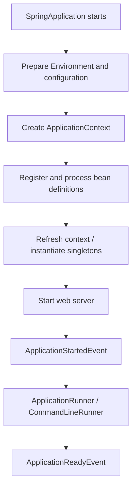
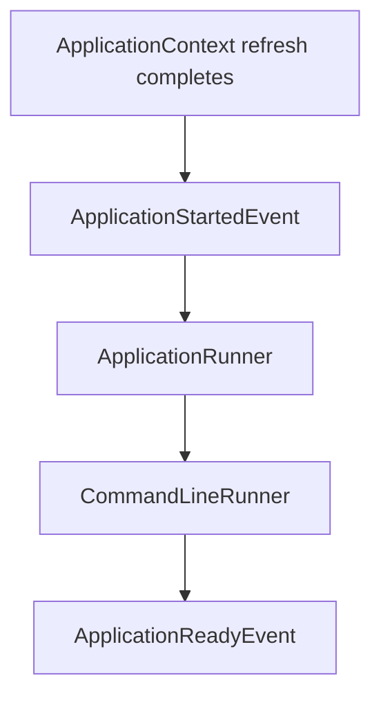
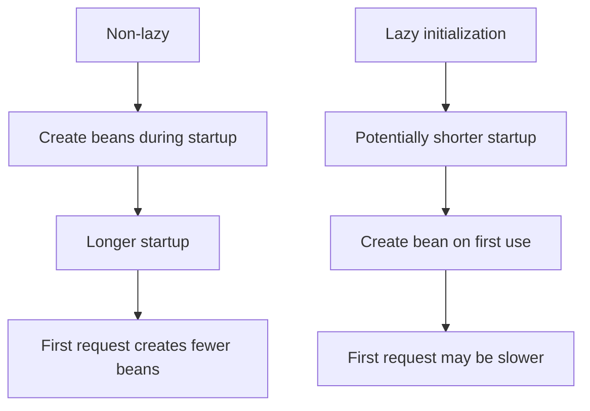

# ApplicationStartup and Observing Startup Step Durations

A Spring Boot application can take several seconds or longer to start. That time usually spans multiple activities: preparing the Environment, reading configuration, scanning components, registering bean definitions, instantiating singletons, setting up the web server, invoking callbacks, and executing custom application startup tasks.

Looking solely at the log line “Started ... in ... seconds” tells you the total startup duration, not **which step is taking the time**. Spring Framework provides the **ApplicationStartup** API to record instrumented startup steps. Spring Boot adds **BufferingApplicationStartup**, an Actuator endpoint, and additional observability tools to aid analysis.

This lesson explains how to measure and interpret startup duration step by step, distinguish context creation from application readiness, instrument custom application work, and use the collected data to locate bottlenecks.

## 1. Total Startup Time Does Not Explain the Cause

Suppose application logs report:

```text
Started ShopApplication in 8.742 seconds
```

This number is helpful for knowing how long startup took on that run. Yet it does not answer:

- How long did Spring spend processing configuration?
- Is component scanning traversing too many packages?
- Is creating a particular bean slow due to a remote connection?
- How long did Hibernate take to build metadata?
- How long is `ApplicationRunner` taking to load data?
- Was the web server ready before or after startup tasks ran?
- Did duration increase due to application code, classpath size, the JVM, or the deployment environment?

To answer those questions, you need visibility into finer-grained milestones.

For example, a startup sequence can be broken into:



This diagram shows only major phases. In practice, many sub-steps are nested, and exact ordering depends on application type and configuration.

**The goal of startup observation** is identifying which step consumes time, whether it belongs to the framework or the application, and where optimization is possible.

## 2. What Is ApplicationStartup?

`ApplicationStartup` is Spring Framework's abstraction for recording instrumented **startup steps** during container startup.

Core components:

- `ApplicationStartup`: API for starting a startup step.
- `StartupStep`: represents a unit of work with a start and end point.
- `StartupStep.Tag`: metadata identifying the step, such as a bean name or task type.
- `BufferingApplicationStartup`: implementation buffering steps in memory for later inspection.
- `FlightRecorderApplicationStartup`: implementation emitting startup events for Java Flight Recorder (JFR).

Each step has a name, ID, parent/child relationship, and tags. Step duration is measured from when it starts until `end()` is called.

Conceptual example:

```text
StartupStep
  name: spring.beans.instantiate
  id: 42
  parentId: 17
  tags:
    beanName = catalogService
  start:  ...
  end:    ...
  duration: ...
```

Specific step names and recorded tags depend on the Spring Framework/Spring Boot version and instrumented components. Do not treat internal step names as a stable business API across all versions.

### 2.1. ApplicationStartup is not a general-purpose profiler

`ApplicationStartup` only records sections of code instrumented with startup tracking. It does not automatically measure every line of Java, every method call, or every database query across the entire application.

It answers **“how long did the instrumented startup steps take?”**. When a step is slow, use logs, metrics, JFR, or a profiler to dig deeper inside that step.

## 3. Configuring BufferingApplicationStartup

`BufferingApplicationStartup` retains startup steps in an internal buffer. It is a convenient way to inspect the timeline after the application starts.

Example in the main class:

```java
package com.example.shop;

import org.springframework.boot.SpringApplication;
import org.springframework.boot.autoconfigure.SpringBootApplication;
import org.springframework.boot.context.metrics.buffering.BufferingApplicationStartup;

@SpringBootApplication
public class ShopApplication {

    public static void main(String[] args) {
        SpringApplication application =
                new SpringApplication(ShopApplication.class);

        application.setApplicationStartup(
                new BufferingApplicationStartup(2048)
        );

        application.run(args);
    }
}
```

Explanation:

- Create `SpringApplication` as usual.
- Instantiate `BufferingApplicationStartup` with a capacity of `2048`.
- Attach this implementation to `SpringApplication` before calling `run`.
- Spring uses the configured startup recorder throughout context creation.

Capacity bounds how many steps are retained in the buffer. Choose a capacity sufficient for the steps your application needs to observe; if the app has many beans and auto-configurations, step counts can grow considerably.

### 3.1. Why must it be configured before run?

The startup recorder must be attached before Spring starts executing the steps you want to measure. If you wait until the context has finished refreshing to configure it, you miss all earlier steps.

Configure it right when constructing `SpringApplication`:

```java
SpringApplication application =
        new SpringApplication(ShopApplication.class);

application.setApplicationStartup(
        new BufferingApplicationStartup(2048)
);

application.run(args);
```

Do not wait until `ApplicationReadyEvent` to create the recorder if your goal is observing the full startup.

### 3.2. Using SpringApplicationBuilder

If the application uses the builder, configure the startup recorder in the builder chain:

```java
new SpringApplicationBuilder(ShopApplication.class)
        .applicationStartup(new BufferingApplicationStartup(2048))
        .run(args);
```

Exact method names and builder capabilities may depend on the Spring Boot version. Use the API supported by your project's version.

## 4. What Information Does a Startup Step Contain?

A `StartupStep` provides basic fields:

| Field | Meaning |
|---|---|
| `name` | Name of the instrumented unit of work |
| `id` | Identifier of the step |
| `parentId` | ID of the parent step if nested inside another step |
| `tags` | Key/value metadata describing the step |
| `startTime` | Start timestamp on the timeline |
| `duration` | Elapsed duration of the step |

Parent/child relationships reveal structure:

```text
spring.context.refresh
  ├── spring.beans.instantiate
  │     ├── create bean: dataSource
  │     └── create bean: catalogService
  ├── initialize message infrastructure
  └── start embedded web server
```

This is an illustrative diagram, not a guarantee of exact step names or tree structure across every version.

### 4.1. ID and parent ID help read nested steps

Suppose step A begins, creates step B while running, and B finishes before A finishes. B can be recorded as a child of A.

When analyzing, do not sum the durations of all steps blindly. Since a parent step includes the runtime of its child steps, summing all durations double-counts elapsed time.

Use parent/child relationships to distinguish enclosing steps from detailed sub-tasks.

### 4.2. Tags identify what the step is doing

Step names can be fairly generic. Tags supply context, such as:

```text
name: spring.beans.instantiate
tags:
  beanName: entityManagerFactory
```

Tags make it easy to filter and group steps by bean or task type. Built-in tags depend on framework instrumentation; you can also attach custom tags to your application's own startup steps.

## 5. Reading the Timeline After Startup

`BufferingApplicationStartup` exposes the recorded timeline via `getBufferedTimeline()`.

Example:

```java
import org.springframework.boot.context.metrics.buffering.BufferingApplicationStartup;
import org.springframework.boot.context.metrics.buffering.StartupTimeline;
import org.springframework.core.metrics.StartupStep;

BufferingApplicationStartup startup =
        new BufferingApplicationStartup(2048);

SpringApplication application =
        new SpringApplication(ShopApplication.class);

application.setApplicationStartup(startup);

ConfigurableApplicationContext context = application.run(args);

StartupTimeline timeline = startup.getBufferedTimeline();

for (StartupTimeline.TimelineEvent event : timeline.getEvents()) {
    StartupStep step = event.getStartupStep();

    System.out.printf(
            "%s | id=%d | parent=%s | duration=%s%n",
            step.getName(),
            step.getId(),
            step.getParentId(),
            event.getDuration()
    );
}
```

Illustrative output:

```text
spring.context.prepare   | id=1  | parent=null | duration=PT0.08S
spring.beans.instantiate | id=8  | parent=3    | duration=PT0.31S
spring.context.refresh   | id=3  | parent=1    | duration=PT2.10S
```

Numbers and names in this output are illustrative only. Inspect the actual output from your application and Boot version.

### 5.1. Reading step tags

You can iterate over tags to print additional metadata:

```java
for (StartupTimeline.TimelineEvent event : timeline.getEvents()) {
    StartupStep step = event.getStartupStep();

    System.out.println("Step: " + step.getName());

    for (StartupStep.Tag tag : step.getTags()) {
        System.out.println(tag.getKey() + " = " + tag.getValue());
    }
}
```

Tags may indicate bean names, resource types, or other details depending on the step. Do not assume every step carries the same set of tags.

### 5.2. Saving timelines for comparisons

If you want to compare multiple startup runs, export the data to a file or external observability system appropriately. Record accompanying context:

- Application version.
- Java and Spring Boot versions.
- Active profiles and key properties.
- Runtime environment, CPU/memory limits, and deployment method.
- Cache/classloader state if relevant.
- Measurement timestamp and run type (cold start vs. warm start).

Keeping durations without surrounding context makes it very hard to tell whether two measurements are truly comparable.

## 6. Observing via the Actuator Startup Endpoint

Spring Boot Actuator provides a `startup` endpoint to expose the startup timeline when the application uses `BufferingApplicationStartup`.

First, add the Actuator dependency compatible with your project version. With Gradle:

```groovy
dependencies {
    implementation("org.springframework.boot:spring-boot-starter-actuator")
}
```

Configure the recorder at bootstrap:

```java
SpringApplication application =
        new SpringApplication(ShopApplication.class);

application.setApplicationStartup(
        new BufferingApplicationStartup(2048)
);

application.run(args);
```

Then expose the endpoint in management configuration:

```yaml
management:
  endpoints:
    web:
      exposure:
        include: health,info,startup
```

In an environment where Actuator uses default HTTP management endpoints, you can access:

```text
http://localhost:8080/actuator/startup
```

The actual URL depends on `management.endpoints.web.base-path`, management port, and security configuration.

### 6.1. What does the endpoint provide?

The `startup` endpoint returns recorded steps including identifiers, tags, and timeline durations. Exact JSON structure depends on the Spring Boot version.

When reviewing the output, focus on:

- Steps with long durations.
- Which parent step encloses a slow step.
- Beans or components named in tags.
- Steps repeated many times.
- Which phase dominates the startup timeline.

Avoid coupling long-lived tooling tightly to internal JSON fields without checking the API of your target Spring Boot version.

### 6.2. Securing the endpoint

Startup reports can reveal bean names, classes, packages, and internal application structure. Therefore:

- Expose the endpoint only when genuinely needed.
- Protect it with proper security configuration.
- Prefer using it in development, testing, or tightly controlled administrative environments.
- Never expose management endpoints to the public Internet merely for convenience.

### 6.3. When the endpoint does not appear

Check in order:

1. Is Spring Boot Actuator on the classpath?
2. Was `BufferingApplicationStartup` configured before `run()`?
3. Is the `startup` endpoint enabled and exposed?
4. Do the management port or base path differ from defaults?
5. Is security blocking the request?
6. Does your Spring Boot version support the `startup` endpoint as configured?

If you only need local diagnostics, reading the timeline directly from `BufferingApplicationStartup` avoids exposing an HTTP endpoint altogether.

## 7. Using Java Flight Recorder for Deeper Inspection

`FlightRecorderApplicationStartup` is another `ApplicationStartup` implementation that integrates with Java Flight Recorder (JFR).

Example:

```java
import org.springframework.boot.SpringApplication;
import org.springframework.core.metrics.jfr.FlightRecorderApplicationStartup;

SpringApplication application =
        new SpringApplication(ShopApplication.class);

application.setApplicationStartup(
        new FlightRecorderApplicationStartup()
);

application.run(args);
```

JFR records startup steps as events viewable in compatible recording analysis tools such as Java Mission Control.

### 7.1. How do Buffering and JFR differ?

| Mechanism | Storage / Observation | Best When |
|---|---|---|
| `BufferingApplicationStartup` | Keeps steps in an in-memory buffer | You want to inspect the timeline via code or Actuator |
| `FlightRecorderApplicationStartup` | Emits events to Java Flight Recorder | You want to correlate startup steps with JVM/JFR data |
| Manual timing logs | Records milestones and durations measured by your app | You want to time a specific workflow |
| Micrometer startup metrics | Records overall milestones to a metrics registry | You want to track startup across deployments |

JFR lets you correlate Spring startup steps alongside CPU usage, allocations, threads, class loading, and other JVM activity. It shines when a step is slow yet the timeline alone does not explain what happened inside it.

### 7.2. JFR does not replace reading startup steps

JFR provides broader data, yet you still need to know which events relate to Spring startup. Opening a recording without knowing which phase you are inspecting can lead you to chase unrelated events.

Start with the startup timeline, pinpoint the slow region, and then use JFR to drill deeper if necessary.

## 8. Instrumenting Custom Application Startup Work

Spring and Spring Boot instrument many internal steps, yet custom work written by your application may not show up as granular steps. Examples:

- Loading a product catalog cache.
- Reading tenant metadata.
- Verifying connectivity to external services.
- Loading rules or dictionaries.
- Warming up an index.
- Running migrations or data preparation tasks.

You can record custom startup steps through `ApplicationStartup`.

```java
import org.springframework.core.metrics.ApplicationStartup;
import org.springframework.core.metrics.StartupStep;

public class CatalogWarmup {

    public void warmUp(ApplicationStartup applicationStartup) {
        StartupStep step =
                applicationStartup.start("app.catalog.warmup");

        step.tag("catalog", "products");

        try {
            loadInitialCatalog();
        } finally {
            step.end();
        }
    }

    private void loadInitialCatalog() {
        // Catalog preparation work
    }
}
```

This illustrates the step recording API:

1. Call `start(...)` to open a step.
2. Add tags to identify the work.
3. Execute the task being measured.
4. Call `end()` in `finally` so the step closes even if an exception occurs.

`ApplicationStartup` is the recorder configured at bootstrap. If you want to instrument a specific component, pass the recorder to it according to your architecture; do not assume it is automatically registered as an injectable bean in every version.

### 8.1. Use consistent step names

Step names should:

- Have their own namespace, such as `app.catalog.warmup`.
- Describe the work rather than overly terse method names.
- Remain stable across releases if you compare timelines over time.
- Never contain personal data, tokens, passwords, or sensitive details.

Tags should hold concise metadata like `catalog=products`, `phase=warmup`, or `source=local`. Never put secrets or payload contents into startup reports.

### 8.2. Always close steps in a finally block

Avoid:

```java
StartupStep step = startup.start("app.catalog.warmup");
loadInitialCatalog();
step.end();
```

If `loadInitialCatalog()` throws an exception, `end()` is never called. The step will not be recorded properly.

Prefer:

```java
StartupStep step = startup.start("app.catalog.warmup");
try {
    loadInitialCatalog();
} finally {
    step.end();
}
```

If you need to track success or failure of the task, record status through logging or separate metrics. `StartupStep` primarily captures duration and descriptive metadata for a unit of work.

## 9. Distinguishing ApplicationStartup from Lifecycle Events

Startup steps offer granular timing. Application events mark major milestones in the `SpringApplication` lifecycle.

Key events:

| Event | General Milestone |
|---|---|
| `ApplicationStartingEvent` | SpringApplication starts running, before Environment and ApplicationContext are fully prepared |
| `ApplicationEnvironmentPreparedEvent` | Environment has been prepared |
| `ApplicationContextInitializedEvent` | ApplicationContext has been initialized, before bean definitions are loaded |
| `ApplicationPreparedEvent` | Context prepared and bean definitions loaded, before refresh |
| `ApplicationStartedEvent` | Context has refreshed, before invoking ApplicationRunner and CommandLineRunner |
| `ApplicationReadyEvent` | Runners have finished; application reaches ready |
| `ApplicationFailedEvent` | Startup failed |

Lifecycle names and details may be supplemented across Boot versions. This table distinguishes common milestones without replacing the API docs for your project's version.

### 9.1. Why is ApplicationStartedEvent not ApplicationReadyEvent?

After context refresh, Spring Boot publishes `ApplicationStartedEvent`. Next, the application invokes:

- `ApplicationRunner`
- `CommandLineRunner`

Once runners complete, Boot publishes `ApplicationReadyEvent`.

Consequently, if runners perform heavy work, the gap between started and ready can be substantial.



This is why “context refreshed” time and “application ready” time must be kept distinct.

### 9.2. Listener for startup milestones

You can register a listener early via `SpringApplication.addListeners(...)`:

```java
import org.springframework.boot.SpringApplication;
import org.springframework.boot.context.event.ApplicationReadyEvent;
import org.springframework.boot.context.event.ApplicationStartedEvent;
import org.springframework.context.ApplicationEvent;
import org.springframework.context.ApplicationListener;

public class StartupMilestoneListener
        implements ApplicationListener<ApplicationEvent> {

    private final long startedAt = System.nanoTime();

    @Override
    public void onApplicationEvent(ApplicationEvent event) {
        if (event instanceof ApplicationStartedEvent) {
            logElapsed("context-refreshed");
        }

        if (event instanceof ApplicationReadyEvent) {
            logElapsed("application-ready");
        }
    }

    private void logElapsed(String milestone) {
        long elapsedNanos = System.nanoTime() - startedAt;
        double elapsedSeconds = elapsedNanos / 1_000_000_000.0;

        System.out.printf(
                "%s reached after %.3f seconds%n",
                milestone,
                elapsedSeconds
        );
    }
}
```

Register the listener before running:

```java
SpringApplication application =
        new SpringApplication(ShopApplication.class);

application.addListeners(new StartupMilestoneListener());

application.run(args);
```

The listener is created before `run()`, so its timing baseline sits close to bootstrap. For standardized production measurements, use the same starting point and clock source across all comparisons.

### 9.3. Listeners registered in the context can miss early events

If a listener is registered only as a bean once the context starts building, it cannot receive events published before that listener bean exists.

For very early events like `ApplicationStartingEvent`, register the listener directly on `SpringApplication` before calling `run()`. For later events, a listener bean or `@EventListener` may suffice depending on registration timing.

## 10. Distinguishing Startup Metrics from the Startup Timeline

Spring Boot Actuator/Micrometer can expose aggregate startup metrics such as:

- `application.started.time`
- `application.ready.time`

These two metrics track startup milestones at the application level:

| Metric | General Meaning |
|---|---|
| `application.started.time` | Elapsed time from startup beginning until ApplicationContext refresh finishes |
| `application.ready.time` | Elapsed time from startup beginning until the application reaches ready |

Metric export and storage depend on Actuator, the Micrometer registry, and application configuration.

### 10.1. When to use metrics?

Metrics are great for:

- Tracking startup duration across deployments.
- Comparing releases.
- Spotting sudden startup regressions.
- Observing the gap between context refresh and application readiness.
- Building dashboards or threshold alerts.

### 10.2. When to use the timeline?

The timeline answers:

- Which specific step is slow?
- Which bean or auto-configuration is involved?
- Are many child steps repeating?
- Is startup slow during refresh, bean instantiation, or another phase?

Metrics show the **overall picture**; the timeline pinpoints **specific units of work**. Both tools complement each other.

## 11. Manual Timing When Only a Small Measurement Is Needed

Not every task needs `ApplicationStartup`. If you only want to time a block of code or an application-managed startup task, you can use `System.nanoTime()`.

Example:

```java
long start = System.nanoTime();

try {
    catalogLoader.load();
} finally {
    long elapsed = System.nanoTime() - start;

    System.out.printf(
            "Catalog load took %.2f ms%n",
            elapsed / 1_000_000.0
    );
}
```

Use `System.nanoTime()` for elapsed durations because it suits monotonic interval timing. Avoid subtracting two `System.currentTimeMillis()` values for precision timing when a monotonic clock is available.

Spring also offers `StopWatch` for sequential measurements:

```java
import org.springframework.util.StopWatch;

StopWatch stopWatch = new StopWatch("catalog-startup");

stopWatch.start("load-products");
catalogLoader.loadProducts();
stopWatch.stop();

stopWatch.start("warm-cache");
catalogLoader.warmCache();
stopWatch.stop();

System.out.println(stopWatch.prettyPrint());
```

`StopWatch` is handy for comparing tasks in a code block, though it does not create startup steps in the `ApplicationStartup` timeline. Pick the tool matching the question you want to answer.

## 12. How to Read Metrics to Locate Bottlenecks

When opening a startup timeline, do not blindly sort all steps by duration and try optimizing the longest one immediately. Read systematically:

### Step 1. Check total duration and the ready milestone

Compare:

- Time from start to `ApplicationStartedEvent`.
- Time from start to `ApplicationReadyEvent`.
- Overall metrics if available.

If the gap between started and ready is large, examine runners or listeners running after context refresh.

### Step 2. Find long parent steps

If `spring.context.refresh` accounts for most of the time, expand its child steps to see which part inside refresh is expensive.

Do not add parent and child durations together as independent parts when child time is already included in the parent.

### Step 3. Identify involved beans or components

Read tags to identify the bean. A bean can be slow because:

- Its constructor performs heavy work.
- `@PostConstruct` or an init method calls a remote service.
- A factory method loads data.
- An ORM builds metadata or validates schemas.
- A bean depends on many other beans, triggering an entire initialization chain.

### Step 4. Determine whether time is spent in I/O or CPU

A startup step reports elapsed time, not whether the thread waited on network, disk, or burned CPU.

If I/O is suspected, inspect connection logs, timeouts, and client traces. If CPU or class loading is suspected, use JFR or a profiler.

### Step 5. Change one variable and re-measure

Examples:

- Narrow component-scan scope.
- Move heavy tasks out of constructors.
- Avoid calling remote endpoints inside init callbacks unless mandatory.
- Apply lazy initialization intentionally.
- Tune ORM or migration configuration.
- Remove unused auto-configurations.

After each change, measure again under comparable conditions to confirm the effect.

## 13. Common Causes of Slow Startup

| Symptom | Possible Cause | Investigation Direction |
|---|---|---|
| Prolonged context refresh | Many beans, post-processors, or complex configuration | Inspect bean instantiation steps and condition report |
| One bean has huge duration | Constructor/init callback doing heavy work | Check tags, logs, and time that code independently |
| Slow inside ORM | Entity scanning, metadata, schema validation, or migrations | Check ORM and database logs |
| Slow before context refresh | Environment, classpath scanning, configuration loading | Check startup steps and bootstrap logs |
| Slow between started and ready | Runners or listeners doing heavy work | Time `ApplicationRunner`/`CommandLineRunner` individually |
| Slow only in deployment environment | Network, DNS, secret/config service, CPU/memory, or storage | Compare environments and use JFR/metrics |
| First run slow, subsequent runs fast | OS caches, JIT, image/class loading, or reused connections | Distinguish cold start from warm start |

These are hypotheses to investigate, not conclusions drawn from step names alone. Combine the timeline with logs, metrics, and real environment observations.

## 14. How Does Lazy Initialization Affect Measurements?

Spring Boot supports lazy initialization to defer creating eligible beans until they are requested.

Configuration example:

```properties
spring.main.lazy-initialization=true
```

Lazy initialization can reduce startup time because fewer beans are instantiated during startup. However, the bean creation cost does not vanish; it shifts to the first time the bean is used.



Therefore, never optimize startup metrics while ignoring first-request latency. In applications with strict readiness requirements, determine which beans must be ready before accepting traffic.

If lazy initialization is enabled, test:

- Startup time.
- First-request latency.
- Behavior when a bean fails to initialize.
- Application readiness.
- Whether critical dependencies were deferred unintentionally.

## 15. Startup Callbacks Can Increase Duration

Callbacks like `@PostConstruct`, `InitializingBean.afterPropertiesSet()`, and `@Bean(initMethod = "...")` execute during bean initialization.

If a callback does heavy work, the bean instantiation step lengthens.

For example, constructors should not do excessive work:

```java
@Service
public class CatalogService {

    public CatalogService(RemoteCatalogClient client) {
        // Avoid loading the entire remote catalog here
        // unless strictly required just to construct the object.
    }
}
```

Decide clearly which work must finish before the bean can be used and which work can run in another startup phase or in the background.

Note that moving work into an `ApplicationRunner` does not automatically make startup “faster” in the sense of reaching ready sooner. Runners run before `ApplicationReadyEvent`; if a runner is heavy, time-to-ready still rises.

If work can run in the background after readiness is announced, design readiness state and request behavior while data is still loading. Never mark an application ready when a mandatory capability is not yet functional.

## 16. Distinguishing Startup Time from Readiness and Liveness

These three concepts answer different questions:

- **Startup time:** how long the application takes to get through startup steps.
- **Readiness:** whether the application is ready to accept traffic.
- **Liveness:** whether the process is healthy enough to keep running rather than being restarted.

An application may have finished creating its context yet still not be ready because a runner is loading required data. Conversely, an application may be ready while an optional integration is not yet enabled.

Do not use startup duration as a substitute for health checks. Use health/readiness indicators to report operational state, and `ApplicationStartup` plus metrics to measure duration.

## 17. Comparing Cold Starts and Warm Starts

When measuring startup, distinguish:

- **Cold start:** fresh JVM process with cold caches and un-warmed JIT; incurs first-time class loading and initialization costs.
- **Warm start:** environment already holds some caches or OS/JVM state different from a cold start; runs can measure faster.

A single run is not enough to conclude a change improved startup.

Measurement practices should:

1. Run multiple trials under comparable conditions.
2. Record cold vs. warm when distinguishable.
3. Use identical Java versions, configuration, profiles, and datasets.
4. Compare medians or percentiles rather than picking only the fastest run.
5. Record both startup ready time and first-request latency.
6. Never compare local measurements directly with production without noting substantial environmental differences.

Inside containers, CPU/memory limits, image size, filesystem, and network latency can markedly affect results.

## 18. Reducing Overhead and Protecting Startup Data

Startup instrumentation carries overhead. Buffering retains extra metadata; JFR writes events; manual logging can produce heavy output.

When enabling observation:

- Choose a buffer capacity just large enough for your goal.
- Enable the required level of detail only in appropriate environments.
- Never place secrets, tokens, URLs with credentials, or personal data into tags.
- Disable or restrict the endpoint after investigation if it does not need to stay on.
- Avoid logging a line for every single step when an application has huge step counts.
- Protect startup report data as internal application metadata.

Do not optimize by turning off instrumentation before gathering enough data to understand the bottleneck. Once investigated, switch to aggregate metrics for routine monitoring and re-enable detailed timelines when needed.

## 19. Practical Example: Recording a Startup Timeline and Comparing Ready Milestones

### 19.1. Application configuration

```java
package com.example.shop;

import org.springframework.boot.SpringApplication;
import org.springframework.boot.autoconfigure.SpringBootApplication;
import org.springframework.boot.context.metrics.buffering.BufferingApplicationStartup;

@SpringBootApplication
public class ShopApplication {

    public static void main(String[] args) {
        SpringApplication application =
                new SpringApplication(ShopApplication.class);

        application.setApplicationStartup(
                new BufferingApplicationStartup(4096)
        );

        application.addListeners(new StartupMilestoneListener());

        application.run(args);
    }
}
```

### 19.2. Recording started and ready milestones

```java
package com.example.shop;

import org.springframework.boot.context.event.ApplicationReadyEvent;
import org.springframework.boot.context.event.ApplicationStartedEvent;
import org.springframework.context.ApplicationEvent;
import org.springframework.context.ApplicationListener;

public class StartupMilestoneListener
        implements ApplicationListener<ApplicationEvent> {

    private final long startNanos = System.nanoTime();

    @Override
    public void onApplicationEvent(ApplicationEvent event) {
        if (event instanceof ApplicationStartedEvent) {
            printElapsed("context-refreshed");
        } else if (event instanceof ApplicationReadyEvent) {
            printElapsed("application-ready");
        }
    }

    private void printElapsed(String name) {
        double seconds =
                (System.nanoTime() - startNanos) / 1_000_000_000.0;

        System.out.printf("%s: %.3f seconds%n", name, seconds);
    }
}
```

### 19.3. Exposing the startup endpoint in development

```yaml
management:
  endpoints:
    web:
      exposure:
        include: health,info,startup
```

Start the application and inspect `/actuator/startup` on the configured management endpoint.

### 19.4. Interpreting results

Suppose:

```text
context-refreshed: 4.200 seconds
application-ready: 7.800 seconds
```

The ~3.6-second gap occurs after context refresh and before ready. Inspect `ApplicationRunner`, `CommandLineRunner`, and related listeners before trying to optimize bean creation.

If the timeline reveals a bean initialization taking 2.5 seconds during refresh, inspect what that bean does. It may be calling a remote API or loading data in an init callback.

These two examples show how combining **high-level lifecycle milestones** and **detailed startup steps** isolates the problem area.

## 20. Common Misconceptions

| Statement | True or False? | Explanation |
|---|---|---|
| `ApplicationStartup` measures every method in the application | **False** | It records instrumented startup steps |
| `BufferingApplicationStartup` builds a dashboard automatically | **False** | It buffers the timeline; read it via API or supported endpoints |
| Simply adding Actuator gives a startup timeline | **False** | You must configure a compatible recorder, usually `BufferingApplicationStartup` |
| `ApplicationStartedEvent` means the application is ready | **False** | Runners still execute before `ApplicationReadyEvent` |
| Parent and child step durations are independent and additive | **False** | Child time can be included inside parent time |
| `@Lazy` eliminates bean creation cost | **False** | It defers the cost until the bean is first requested |
| `@PostConstruct` runs after the entire context is ready | **False** | It runs during that bean's initialization |
| The startup endpoint is a health check | **False** | It displays startup steps; it does not verify dependency health |
| JFR only measures Spring beans | **False** | JFR captures broad JVM events; the startup recorder adds Spring startup events |
| A single measurement proves an optimization | **False** | Repeat measurements under comparable conditions |
| Reducing time to context refresh always reduces time to ready | **False** | Runners and post-refresh work can still dominate |
| Every bean must be eagerly initialized | **False** | Lazy initialization can fit, provided first-request latency and readiness are accounted for |

## 21. Self-Check Questions

### Question 1. Why isn't the log “Started in 8 seconds” enough to find the root cause?

**Answer:** It only reports total elapsed time. You need a startup timeline, metrics, or profiler to pinpoint which step takes the time.

### Question 2. Which implementation keeps startup steps in an in-memory buffer?

**Answer:** `BufferingApplicationStartup`.

### Question 3. When must the recorder be configured?

**Answer:** Before calling `SpringApplication.run(...)`, so startup steps from the beginning are recorded.

### Question 4. How does `ApplicationStartedEvent` differ from `ApplicationReadyEvent`?

**Answer:** Started is published after context refresh, before runners; Ready is published after runners complete.

### Question 5. A parent step has a duration of 3 seconds and a child step has a duration of 2 seconds. Can we conclude the total time is 5 seconds?

**Answer:** No. The child step's time may fall inside the parent step; adding them directly double-counts.

### Question 6. If the startup endpoint does not appear, what should you check?

**Answer:** Actuator dependency, `BufferingApplicationStartup`, endpoint exposure, management base path/port, security, and Boot version support.

### Question 7. Why can `spring.main.lazy-initialization=true` lower startup metrics yet slow down the first request?

**Answer:** Bean creation cost shifts from startup to the first time the bean is requested.

### Question 8. When a custom startup step may throw an exception, where should the step be closed?

**Answer:** Inside a `finally` block so `end()` is always invoked.

### Question 9. When a step is slow and you don't know whether it is waiting on I/O or burning CPU, what should you use?

**Answer:** Combine dependency logs/metrics with JFR or a profiler to inspect activity inside the step.

## 22. Takeaways

- `ApplicationStartup` is Spring Framework's API for recording instrumented startup steps.
- `StartupStep` holds a name, ID, parent/child link, and tags; duration is measured between `start()` and `end()`.
- `BufferingApplicationStartup` buffers the timeline for inspection via API or the Actuator `startup` endpoint.
- `FlightRecorderApplicationStartup` integrates startup steps with Java Flight Recorder for deeper diagnosis.
- The recorder must be configured before calling `SpringApplication.run(...)`.
- `ApplicationStartedEvent` marks context refresh completion; `ApplicationReadyEvent` fires after runners finish.
- `application.started.time` and `application.ready.time` track overall milestones; the timeline identifies specific steps.
- Custom startup steps should have clear names and tags, close in `finally`, and exclude sensitive data.
- Lazy initialization shifts bean creation cost to first use; measure both startup and first-request latency.
- To optimize reliably, measure under comparable conditions, find slow steps, distinguish CPU vs. I/O, and re-measure after changes.

When an application starts slowly, ask yourself: **“Is the extra time before context refresh, inside a specific startup step, or after context refresh yet before ApplicationReadyEvent?”** Pinpointing the phase directs you to the right data and tools to uncover the cause.
