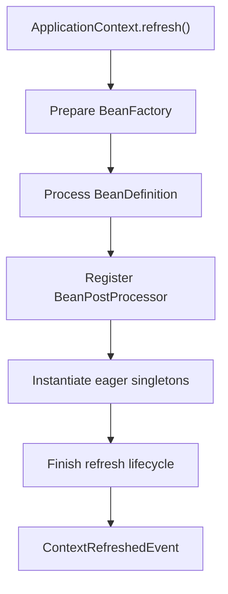
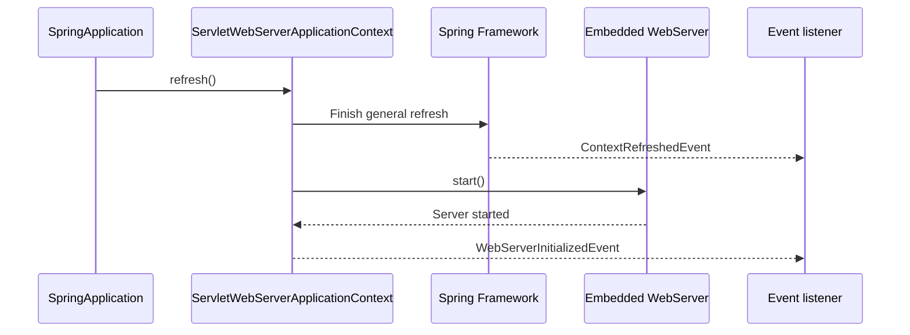
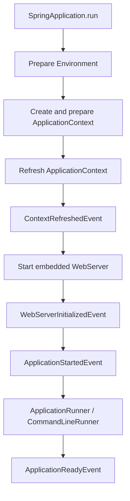
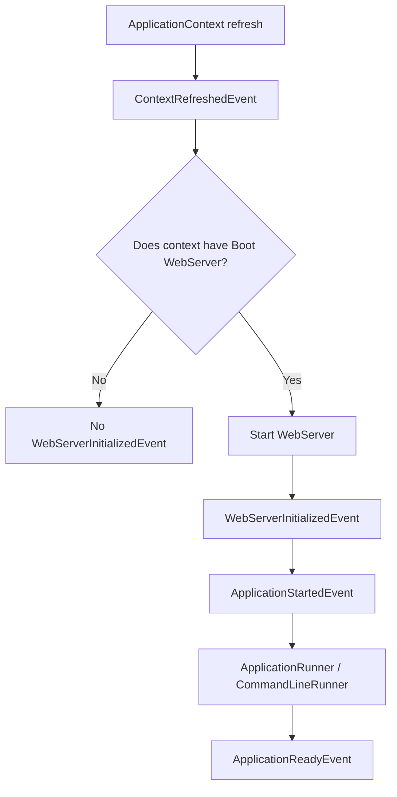

# ContextRefreshedEvent, WebServerInitializedEvent, and Emission Scope

During Spring Boot startup, many events are published to notify listeners that a lifecycle milestone has occurred. Two events commonly encountered when exploring when the container and web server are ready are:

- `ContextRefreshedEvent`: published by Spring Framework when an `ApplicationContext` completes its refresh process.
- `WebServerInitializedEvent`: published by Spring Boot when a `WebServer` has been initialized and started in a web application context.

These two events do not report the same thing. A context may have refreshed while the embedded web server has not started yet. An application can also have multiple contexts or multiple web servers, so a listener may receive multiple events of the same type in a single run.

Understanding **emission scope** helps you avoid running duplicate tasks, read the right source context from the event, obtain the correct port, and pick the right callback for startup work.

## 1. Two Events Reporting Two Different Milestones

`ContextRefreshedEvent` belongs to Spring Framework:

```java
import org.springframework.context.event.ContextRefreshedEvent;
```

It indicates that an `ApplicationContext` has finished refreshing. During the refresh phase, Spring has processed BeanDefinitions, registered post-processors, instantiated regular eager singletons, and completed the context's lifecycle steps.

`WebServerInitializedEvent` belongs to Spring Boot:

```java
import org.springframework.boot.web.context.WebServerInitializedEvent;
```

This event carries the `WebServer` and the corresponding web application context. A listener can obtain the actual port from:

```java
event.getWebServer().getPort()
```

Distinction:

| Event | What Does It Report? | Does It Guarantee the Web Server Is Running? |
|---|---|---|
| `ContextRefreshedEvent` | An ApplicationContext finished refreshing | No |
| `WebServerInitializedEvent` | The context's WebServer has been started/initialized | Yes, for a web server managed and published by Boot |
| `ApplicationStartedEvent` | Context has refreshed, before runners | For typical web apps, server initialization occurred during refresh |
| `ApplicationReadyEvent` | Runners have finished, application reaches Boot's ready milestone | Typically yes for web apps, though also depends on health/readiness and operational configuration |

`ContextRefreshedEvent` is a **Spring context** event. `WebServerInitializedEvent` is a **Spring Boot web server** event. They should not be used interchangeably.

## 2. When Is ContextRefreshedEvent Published?

`ApplicationContext` has its own lifecycle. When the context refreshes successfully, Spring publishes `ContextRefreshedEvent` to report that the context has finished preparing.

For a typical context, refresh involves these major steps:

1. Prepare the context and BeanFactory.
2. Process BeanFactoryPostProcessors and BeanDefinitions.
3. Register BeanPostProcessors.
4. Prepare infrastructure such as message source and event multicaster.
5. Create non-lazy singletons and inject dependencies.
6. Finish refresh, start eligible SmartLifecycle beans, and publish the event.

Overview diagram:



This event does not mean all startup work across the entire application is finished. It signals the refresh milestone of **the context that published the event**. Work executed by `ApplicationRunner` or `CommandLineRunner` still happens afterward.

### A Context Can Refresh Multiple Times

`ContextRefreshedEvent` can be published every time a context finishes refreshing. In a typical application, Spring Boot refreshes the main context once at startup. However, tests, multi-context applications, or code managing its own contexts can trigger multiple refreshes and multiple events.

Therefore, listeners should not assume that "a single process receives exactly one `ContextRefreshedEvent`." If a listener performs side effects such as registering schedules, loading data, sending notifications, or creating external resources, consider idempotency and context scope.

## 3. When Is WebServerInitializedEvent Published?

Spring Boot provides the `WebServer` abstraction for embedded servers. For Servlet applications, the context is typically `ServletWebServerApplicationContext`; for Reactive applications, the corresponding context is the reactive web server application context.

In a typical web server startup flow, the context completes general refresh, and then the web application context starts the server and publishes `WebServerInitializedEvent` (via the appropriate event subclass).

Simplified diagram for a Servlet application:



Thus, in Boot's typical embedded web server context, `ContextRefreshedEvent` is usually published before `WebServerInitializedEvent`. At the moment `ContextRefreshedEvent` is received, do not assume the port is already bound or the server is accepting connections.

When receiving `WebServerInitializedEvent`, you can retrieve:

- `event.getWebServer()`: the WebServer that Boot just initialized.
- `event.getWebServer().getPort()`: the actual port the server is using.
- `event.getApplicationContext()`: the web application context owning that server.

### Port Configured as 0

An application can ask the operating system to choose a free port:

```properties
server.port=0
```

In that case, you cannot obtain the actual port merely by reading the `server.port` property, because the configured value is `0`. After the server binds successfully, the event provides the assigned port:

```java
@EventListener
public void onWebServerInitialized(WebServerInitializedEvent event) {
    int actualPort = event.getWebServer().getPort();
    System.out.println("Server port: " + actualPort);
}
```

This is a practical reason to listen to this event in integration tests or environments that need to advertise a dynamically assigned server address.

## 4. What Subtypes Does WebServerInitializedEvent Have?

Spring Boot provides specific events for each web stack:

| Event class | Web stack | Package |
|---|---|---|
| `ServletWebServerInitializedEvent` | Servlet / Spring MVC | `org.springframework.boot.web.servlet.context` |
| `ReactiveWebServerInitializedEvent` | Reactive / Spring WebFlux | `org.springframework.boot.web.reactive.context` |

Both are subtypes of `WebServerInitializedEvent`. If a listener only cares about the port regardless of web stack, it can accept the supertype:

```java
@EventListener
public void onWebServerInitialized(WebServerInitializedEvent event) {
    int port = event.getWebServer().getPort();
    // Handle general WebServer information.
}
```

If you need Servlet-specific or Reactive-specific APIs, accept the specific subtype:

```java
@EventListener
public void onServletServerInitialized(
        ServletWebServerInitializedEvent event) {
    // Handle Servlet web server specific information.
}
```

Do not force every event to be a Servlet event in an application that might run on multiple web stacks. Choose the listener parameter type according to the abstraction level your logic actually needs.

## 5. Emission Scope of ContextRefreshedEvent

The most important scope of `ContextRefreshedEvent` is **a specific ApplicationContext**. The event carries the context that published it via `getApplicationContext()`.

In a simple application:

```text
JVM process
└── Main ApplicationContext
    ├── Bean definitions
    ├── Bean instances
    └── ContextRefreshedEvent
```

Normally you see one event from the main context when the application starts. However, a Spring application can have a context hierarchy:

```text
Parent ApplicationContext
    ├── Shared beans
    └── Child Web ApplicationContext
        ├── Web beans
        └── Child's ContextRefreshedEvent
```

Parent and child are two distinct contexts. Each context has its own lifecycle and can publish its own refresh event.

### Events from a Child Can Propagate Up to the Parent

In `ApplicationContext`'s default event publishing mechanism, an event is published in the current context and can be forwarded up to the parent context. Therefore, a listener registered in the parent may receive events originating from a child context.

This has an important consequence:

- A listener living in the parent does not guarantee the events it receives always come from the parent.
- Check `event.getApplicationContext()` to know the exact context that published the event.
- Parent events are not automatically propagated down to children in the reverse direction.

Example filtering events by context:

```java
@Component
public class ContextRefreshLogger {
    private final ApplicationContext ownContext;

    public ContextRefreshLogger(ApplicationContext ownContext) {
        this.ownContext = ownContext;
    }

    @EventListener
    public void onContextRefreshed(ContextRefreshedEvent event) {
        if (event.getApplicationContext() != ownContext) {
            return;
        }

        System.out.println(
                "This context refreshed: " + ownContext.getId());
    }
}
```

Comparing by identity ensures the listener only handles events emitted by the exact context containing the listener. If you want to track child contexts as well, remove the filter condition and log `event.getApplicationContext().getId()` to distinguish them.

### Do Not Equate a Context with a Package or a Bean

A single context can manage beans across many packages; a single package can serve as a configuration source for multiple contexts. Events are published per **ApplicationContext instance**, not per package, configuration class, or individual bean.

## 6. Emission Scope of WebServerInitializedEvent

`WebServerInitializedEvent` is published in association with a web server and the web application context managing it. Therefore, the number of events depends on how many server contexts are initialized, rather than simply being one event per JVM.

Scenarios:

- A simple Servlet application with one embedded server: typically produces one `ServletWebServerInitializedEvent`.
- A simple Reactive application with one embedded server: typically produces one `ReactiveWebServerInitializedEvent`.
- An application with a separate management server/context: may produce an additional event for the management web server.
- An application with a context hierarchy or multiple web application contexts: listeners may observe events from multiple contexts.
- A non-web application: has no Boot `WebServer` to start, so there is no corresponding `WebServerInitializedEvent`.

### Separate Management Port

In some Actuator configurations, management endpoints can use a separate port:

```properties
server.port=8080
management.server.port=9090
```

When the management server is created in a separate context, an additional server initialization event can occur. Do not assume every event indicates the port serving the primary REST API.

Read the context attached to the event along with the port:

```java
@EventListener
public void onWebServerInitialized(WebServerInitializedEvent event) {
    String contextId = event.getApplicationContext().getId();
    int port = event.getWebServer().getPort();

    System.out.println(
            "Context " + contextId + " uses port " + port);
}
```

If an application runs multiple servers, you may need to classify by context or web server metadata instead of grabbing the first event and treating it as the main port.

### No Event in Non-Web Applications

A batch or command-line application can create an ApplicationContext normally and publish `ContextRefreshedEvent`, without creating an embedded web server. Consequently, there is no `WebServerInitializedEvent`.

This is a useful distinction when writing shared libraries for both web and non-web applications: do not require a server event as a mandatory condition of the general lifecycle.

## 7. Example Listener Observing Both Events

The following example works in a Spring Boot Servlet or Reactive web application. It logs the context and port reported by the events:

```java
package com.example.startup;

import org.slf4j.Logger;
import org.slf4j.LoggerFactory;
import org.springframework.boot.web.context.WebServerInitializedEvent;
import org.springframework.context.ApplicationContext;
import org.springframework.context.event.ContextRefreshedEvent;
import org.springframework.context.event.EventListener;
import org.springframework.stereotype.Component;

@Component
public class StartupEventObserver {
    private static final Logger log =
            LoggerFactory.getLogger(StartupEventObserver.class);

    private final ApplicationContext ownContext;

    public StartupEventObserver(ApplicationContext ownContext) {
        this.ownContext = ownContext;
    }

    @EventListener
    public void onContextRefreshed(ContextRefreshedEvent event) {
        ApplicationContext source = event.getApplicationContext();

        log.info("Context refreshed: id={}, displayName={}",
                source.getId(), source.getDisplayName());
    }

    @EventListener
    public void onWebServerInitialized(WebServerInitializedEvent event) {
        ApplicationContext source = event.getApplicationContext();

        log.info("Web server initialized: context={}, port={}",
                source.getId(), event.getWebServer().getPort());
    }
}
```

In this example, `ownContext` is injected to illustrate how to identify the context owning the listener. If the goal is to process events solely from that context, you can add the check:

```java
if (event.getApplicationContext() != ownContext) {
    return;
}
```

If you want to log all contexts in a hierarchy, keep the listener unfiltered and always print the context ID. In a system with a separate management context, this logging helps explain why multiple port events appear.

The example assumes a logger is on the classpath via Spring Boot's default logging. There is no need to call `getBean(...)` manually in the listener; Spring injects the context and registers the listener like other beans.

## 8. Ordering with ApplicationStartedEvent, Runners, and ApplicationReadyEvent

These two events are part of a broader startup sequence. For a typical Spring Boot embedded web application, you can picture:



In Boot's web server application context, `ContextRefreshedEvent` is typically published during general refresh before the context starts the embedded server and publishes `WebServerInitializedEvent`. Only after `refreshContext(...)` completes does `SpringApplication` publish `ApplicationStartedEvent`, and then execute runners. After runners comes `ApplicationReadyEvent`.

This is the general order for an embedded web server context, not a guarantee that every context in a complex system emits only once or that all listeners receive events in a single global order.

### Choosing an Event by Need

| Need | Mechanism to Consider | Reason |
|---|---|---|
| Know a context has refreshed | `ContextRefreshedEvent` | Spring context-level event |
| Get actual port after server binds | `WebServerInitializedEvent` | Event carries the WebServer |
| Run startup work needing ready beans, before readiness | `ApplicationRunner` / `CommandLineRunner` | Called by Boot after refresh |
| Know runners finished and app reached ready milestone | `ApplicationReadyEvent` | Application-level event after runners |
| Observe startup failure | `ApplicationFailedEvent` | Boot reports error during run |

`ContextRefreshedEvent` does not replace runners. `WebServerInitializedEvent` does not replace `ApplicationReadyEvent`: the server may have started while runners are still executing.

## 9. Using ContextRefreshedEvent Can Cause Duplicate Execution

Consider a listener that schedules a periodic job:

```java
@EventListener
public void onContextRefreshed(ContextRefreshedEvent event) {
    scheduler.scheduleAtFixedRate(this::runJob, Duration.ofMinutes(1));
}
```

This code is risky if the listener receives multiple refresh events or events from multiple contexts. Each invocation can register another schedule, causing the same job to run repeatedly.

If you genuinely need to use this event:

- Clearly identify which context is allowed to trigger the work.
- Make the operation idempotent.
- Have a guard against duplicate registration.
- Manage and cancel resources according to the context lifecycle.
- Consider a runner or lifecycle component if the job only needs to run once after context startup.

Example filtering the context:

```java
@EventListener
public void onContextRefreshed(ContextRefreshedEvent event) {
    if (event.getApplicationContext() != ownContext) {
        return;
    }

    initializeOnce();
}
```

Filtering the context solves receiving events from other contexts, but does not by itself guarantee `initializeOnce()` runs only once if the same context refreshes again. Idempotency remains important.

## 10. Using WebServerInitializedEvent to Capture a Dynamic Port

A practical situation is an integration test running a server on a random port. Configuration:

```properties
server.port=0
```

Listener capturing the port:

```java
@Component
public class BoundPortHolder {
    private volatile int port = -1;

    @EventListener
    public void onWebServerInitialized(WebServerInitializedEvent event) {
        this.port = event.getWebServer().getPort();
    }

    public int getPort() {
        return port;
    }
}
```

`volatile` ensures proper visibility when reading/writing the value across threads in a simple example. In real applications, Spring Boot tests already provide dedicated mechanisms for retrieving the local server port; this listener primarily illustrates the event.

Do not use a global static variable to store the port if the application can create multiple contexts/servers. Static state is easily overwritten by events from other contexts and causes tests to interfere with one another.

## 11. Which Thread Invokes Event Listeners?

By default, Spring's `ApplicationEventMulticaster` typically dispatches events synchronously on the event-publishing thread unless another executor is configured. This means:

- A `ContextRefreshedEvent` listener can execute directly within the context refresh thread.
- A `WebServerInitializedEvent` listener can execute within the startup thread publishing the event.
- A slow listener can prolong startup time.
- Unhandled exceptions in a listener can affect the publishing/startup flow, depending on multicaster and error handler configuration.

Do not perform network calls or heavy data processing inside a listener unless it genuinely belongs in the event dispatch flow. If a listener only logs, updates small metadata, or stores a port, synchronous handling is usually appropriate.

If you move an event listener to an asynchronous executor, keep in mind that the event handler may run after the startup phase moves on. In that case, do not assume the listener's work has finished before `ApplicationReadyEvent`, unless you design explicit synchronization.

## 12. Does ContextRefreshedEvent Mean the Application Is Ready?

No. This event only states that the source context has refreshed.

For example, with a web server context:

1. Spring creates eager beans and completes general refresh.
2. `ContextRefreshedEvent` is published.
3. Boot starts the embedded server and publishes `WebServerInitializedEvent`.
4. `SpringApplication` publishes `ApplicationStartedEvent`.
5. Runners perform startup tasks.
6. Boot publishes `ApplicationReadyEvent`.

If a runner must load a cache, sync data, or check a required dependency, the application may not be ready to receive traffic until runners complete and readiness is updated.

Therefore:

- Use `ContextRefreshedEvent` to observe a context's refresh milestone.
- Use `WebServerInitializedEvent` to know the server has started and its actual port.
- Use `ApplicationRunner` for startup work that must complete before ready.
- Use `ApplicationReadyEvent` to observe the application-ready milestone after runners.

## 13. Test Example with a Random Port

In a Spring Boot integration test, you can run a web server on a random port:

```java
@SpringBootTest(webEnvironment = SpringBootTest.WebEnvironment.RANDOM_PORT)
class WebServerEventTest {
    // Spring Boot starts the web server with an OS-assigned port.
}
```

In many tests, `@LocalServerPort` can inject the actual port:

```java
@SpringBootTest(webEnvironment = SpringBootTest.WebEnvironment.RANDOM_PORT)
class HttpIntegrationTest {

    @LocalServerPort
    int port;

    @Test
    void serverHasAnAssignedPort() {
        assertThat(port).isPositive();
    }
}
```

This is a convenient testing approach when you only need to call HTTP endpoints. If the test's goal is to verify your own event listener, observe that the listener is invoked and inspect the context/port passed in the event; there is no need to manage the entire server lifecycle manually.

With `WebServerInitializedEvent`, remember that server events only occur when the test creates a web application context with a server. A non-web `ApplicationContextRunner` does not publish this event.

## 14. Common Mistakes and Misconceptions

| Symptom | Possible Cause | How to Handle |
|---|---|---|
| Reading port in `ContextRefreshedEvent` yields no value yet | Context finishes refreshing before embedded server starts | Use `WebServerInitializedEvent` |
| Listener runs multiple times | Multiple contexts or context refreshes multiple times | Log context ID, filter context, and make side effects idempotent |
| Two ports are logged | Multiple web server contexts, e.g., application and management | Inspect context ID and classify servers |
| `WebServerInitializedEvent` never appears | Non-web application or no Boot WebServer | Check `WebApplicationType` and web stack |
| App not ready despite server event | Runners still running or startup incomplete | Use `ApplicationReadyEvent`/readiness to monitor |
| Parent listener receives child event | Event propagated up to parent context | Check `event.getApplicationContext()` |
| Startup prolonged by listener | Listener runs synchronously and performs heavy work | Shorten handler or design controlled async work |

## 15. Investigation Workflow When Receiving Multiple Events

When logs show multiple `ContextRefreshedEvent` or `WebServerInitializedEvent` instances, record the following information:

1. Actual event type and subclass.
2. `event.getApplicationContext().getId()`.
3. `event.getApplicationContext().getDisplayName()`.
4. Parent context if present.
5. Port from `event.getWebServer().getPort()` for web server events.
6. Timestamp when the event was published.

Logging example:

```java
@EventListener
public void logWebServer(WebServerInitializedEvent event) {
    var context = event.getApplicationContext();
    log.info("WebServer event: contextId={}, parentId={}, port={}, eventType={}",
            context.getId(),
            context.getParent() != null ? context.getParent().getId() : "none",
            event.getWebServer().getPort(),
            event.getClass().getSimpleName());
}
```

This information helps distinguish:

- One context refreshing again.
- Parent and child contexts both publishing events.
- Application server and management server.
- Servlet server and Reactive server.
- A listener registered in the parent receiving events published by a child.

Do not deduce the number of contexts solely from callback count. Read the context identity attached to the event.

## 16. Mental Model



Remember the three scopes:

- **Context scope:** `ContextRefreshedEvent` is tied to each successfully refreshed ApplicationContext.
- **Web server scope:** `WebServerInitializedEvent` is tied to each Boot WebServer started in a web application context.
- **Application readiness:** `ApplicationReadyEvent` reports that the application finished runners, which is broader than a single context refreshing or a server starting.

When writing listeners, always inspect which context the event carries and execute side effects only within the intended scope. If you need to know a context has refreshed, use `ContextRefreshedEvent`; if you need the server's actual port, use `WebServerInitializedEvent`; if you need to wait until all startup runners complete, use `ApplicationReadyEvent`. Choosing the right event keeps startup clear, avoids duplicate execution, and prevents confusing a listening server port with a fully ready application.
