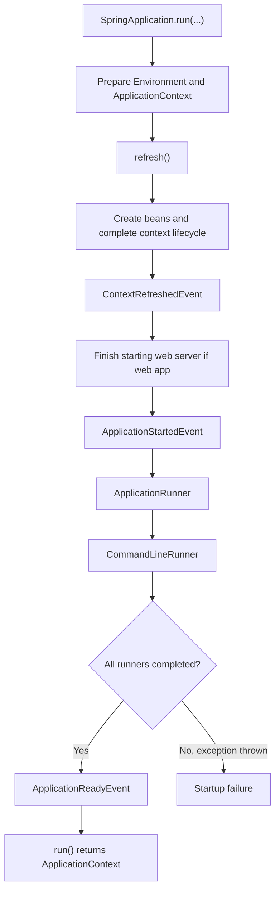

# ApplicationStartedEvent Differs in Timing from ApplicationReadyEvent

Spring Boot publishes several application events during startup. Two events that are frequently confused are `ApplicationStartedEvent` and `ApplicationReadyEvent`, because both appear after the `ApplicationContext` has refreshed. However, they mark **two different milestones in the startup lifecycle**:

- `ApplicationStartedEvent` is published after context refresh completes, **before** Spring Boot invokes `ApplicationRunner` and `CommandLineRunner`.
- `ApplicationReadyEvent` is published **after all runners have completed**, when Spring Boot considers the application ready to serve requests.

This difference matters greatly when you need to run startup tasks, record application status, check readiness, or decide when to begin receiving traffic. If a task must finish before the application is considered ready, you need to understand where runners and the ready event sit in the sequence.

This lesson belongs to the **Events and Runners** chapter of *Spring Boot Fundamentals*. We will follow the timeline of `SpringApplication.run`, distinguish both events from `ContextRefreshedEvent`, use `ApplicationListener` and `@EventListener`, and test event and runner ordering with a small application.

Examples use Java 21 and Spring Boot 3.x. Some auxiliary events and internal details may vary across versions, but the core relationship between these two events and runners described below is the standard modern Spring Boot startup flow.

## 1. Two Events Marking Two Different Startup Milestones

### `ApplicationStartedEvent`

Spring Boot publishes `ApplicationStartedEvent` after the application context has been successfully refreshed and the main refresh steps are complete. At this point:

- Bean definitions have been processed.
- Required eager singletons have been created and initialized.
- Lifecycle components are started according to the refresh process.
- For web applications, the embedded web server has gone through the web context's startup phase.
- Spring Boot **has not yet called** `ApplicationRunner` and `CommandLineRunner`.

Thus, `ApplicationStartedEvent` is appropriate when you want to know the context has started and passed refresh, while startup runners still remain to be executed.

### `ApplicationReadyEvent`

Spring Boot publishes `ApplicationReadyEvent` after runners have been called and completed successfully. At this point:

- The context has refreshed.
- The `ApplicationRunner` and `CommandLineRunner` beans in the startup sequence have finished running.
- Synchronous startup tasks placed inside runners have completed.
- Boot signals that the application is ready to serve according to its lifecycle.

If a runner throws an exception and startup fails, the application does not reach the normal successful ready milestone; `ApplicationReadyEvent` will not be published as a successful startup.

### Direct Comparison

| Criterion | `ApplicationStartedEvent` | `ApplicationReadyEvent` |
|---|---|---|
| Timing | After context refresh | After runners finish |
| Bean initialization | Completed per refresh process | Completed |
| Runners | Not yet called | Finished running |
| Meaning | Application has started | Application is ready |
| Use when | Need to know context has refreshed | Need to know startup runners have completed |
| If a runner fails | This event may already have been published | No successful ready event |

Key takeaway: **Started is after refresh; Ready is after runners.**

## 2. Position of the Two Events in SpringApplication.run

The main class typically calls:

```java
package com.example.demo;

import org.springframework.boot.SpringApplication;
import org.springframework.boot.autoconfigure.SpringBootApplication;

@SpringBootApplication
public class DemoApplication {

    public static void main(String[] args) {
        SpringApplication.run(DemoApplication.class, args);
    }
}
```

In a typical Spring Boot startup flow, the important sequence can be summarized as:

1. SpringApplication starts launching and prepares the Environment.
2. Boot creates and prepares the ApplicationContext.
3. Boot invokes context refresh.
4. The context finishes refreshing and publishes `ContextRefreshedEvent`.
5. For a web context, the embedded web server is started per the context lifecycle.
6. Boot publishes `ApplicationStartedEvent`.
7. Boot invokes `ApplicationRunner` and `CommandLineRunner`.
8. If runners complete, Boot publishes `ApplicationReadyEvent`.
9. `SpringApplication.run` completes and returns the ApplicationContext to the caller.



The diagram focuses on the main milestones distinguishing Started and Ready. Order among runners depends on the ordering mechanism; both runner interfaces can be ordered by Boot in the same startup sequence.

### 2.1. `ContextRefreshedEvent` Occurs Before `ApplicationStartedEvent`

`ContextRefreshedEvent` is a Spring Framework event, published when an ApplicationContext completes refresh. It is not a Spring Boot-specific event.

`ApplicationStartedEvent` is a Spring Boot event, published after `SpringApplication` completes context refresh and the corresponding post-refresh steps.

Therefore, if you specifically need to know about container refresh, consider `ContextRefreshedEvent`. If you need Spring Boot's startup milestone right before runners, use `ApplicationStartedEvent`.

### 2.2. Web Server Initialized Event Is Another Milestone

Servlet web applications can publish `ServletWebServerInitializedEvent` when the embedded servlet web server has been initialized. Reactive web applications have a corresponding event for the reactive web server.

This is a web server-related event and does not replace Started or Ready:

- `ServletWebServerInitializedEvent`: the web server has been initialized.
- `ApplicationStartedEvent`: the context has refreshed and Boot is preparing to invoke runners.
- `ApplicationReadyEvent`: runners have finished and Boot reports the application ready.

## 3. Why Does Spring Boot Need Both Started and Ready?

Context refresh and startup runners serve different purposes.

During refresh, Spring focuses on completing container infrastructure:

- Reading and processing configuration.
- Registering bean definitions.
- Creating eager singletons and injecting dependencies.
- Applying BeanPostProcessors.
- Initializing lifecycle components.
- Starting appropriate web infrastructure.

After refresh, the application may still need to perform application-level startup tasks, such as:

- Loading reference data into a cache.
- Verifying or preparing business data.
- Registering information with an orchestration service.
- Building indexes or loading metadata.
- Validating required business configuration.

Spring Boot provides runners to perform this work. `ApplicationStartedEvent` is published before runners so listeners know the context has refreshed; `ApplicationReadyEvent` is published after runners to signal that the startup sequence is complete.

### 3.1. Example of Startup Data

Suppose an application needs to load a list of countries into a cache before reporting ready:

```java
package com.example.demo.startup;

import org.springframework.boot.ApplicationArguments;
import org.springframework.boot.ApplicationRunner;
import org.springframework.stereotype.Component;

@Component
public class ReferenceDataLoader implements ApplicationRunner {

    private final ReferenceDataService referenceDataService;

    public ReferenceDataLoader(ReferenceDataService referenceDataService) {
        this.referenceDataService = referenceDataService;
    }

    @Override
    public void run(ApplicationArguments args) {
        referenceDataService.loadCountries();
    }
}
```

In this example, `ReferenceDataLoader` is called after `ApplicationStartedEvent` and before `ApplicationReadyEvent`. If `loadCountries()` completes normally, Boot proceeds to the ready event.

If loading data throws an exception, startup can fail and the ready event is not published. This makes sense if the country data cache is a mandatory prerequisite for serving requests.

## 4. ApplicationRunner and CommandLineRunner Sit Between the Two Events

Spring Boot's two runner interfaces:

```java
public interface ApplicationRunner {
    void run(ApplicationArguments args) throws Exception;
}
```

and:

```java
public interface CommandLineRunner {
    void run(String... args) throws Exception;
}
```

They are called after context refresh and before `ApplicationReadyEvent`.

### 4.1. Difference in Arguments

| Interface | Parameter | When Appropriate |
|---|---|---|
| `ApplicationRunner` | `ApplicationArguments` | Need access to arguments parsed into option and non-option arguments. |
| `CommandLineRunner` | `String... args` | Want to receive the raw command-line argument strings directly. |

Example:

```java
@Component
public class ApplicationArgumentReporter implements ApplicationRunner {

    @Override
    public void run(ApplicationArguments args) {
        System.out.println("Option names: " + args.getOptionNames());
        System.out.println("Non-option args: " + args.getNonOptionArgs());
    }
}
```

If run with:

```bash
./gradlew bootRun --args='--app.mode=demo input-a input-b'
```

`ApplicationRunner` can read the `app.mode` option and the list of non-option arguments via `ApplicationArguments`. `CommandLineRunner` receives the raw argument strings via its API.

### 4.2. Ordering of Runners

If multiple runners exist, Spring Boot supports ordering via `Ordered` or `@Order`:

```java
@Component
@Order(10)
public class CacheLoader implements ApplicationRunner {

    @Override
    public void run(ApplicationArguments args) {
        System.out.println("Load cache");
    }
}
```

```java
@Component
@Order(20)
public class StartupVerifier implements ApplicationRunner {

    @Override
    public void run(ApplicationArguments args) {
        System.out.println("Verify startup data");
    }
}
```

Lower order values usually run first. Use ordering when runners have an actual dependency relationship, such as loading a cache before verifying data. When possible, prefer grouping tightly coupled steps into a single startup service so order is not scattered across multiple places.

### 4.3. Both Runner Types Participate in the Same Startup Sequence

Boot invokes beans implementing `ApplicationRunner` and `CommandLineRunner`. Do not rely on class declaration order or component scan order to guess which runner runs first. Declare `@Order`/`Ordered` explicitly when order matters.

Runners are called synchronously in the normal startup sequence. Once `run` returns, Boot moves on to the next runner and finally publishes the ready event.

## 5. Registering Listeners for ApplicationStartedEvent

There are two common ways to listen for events in a Spring application.

### 5.1. Using `@EventListener`

A bean can declare a method accepting the event:

```java
package com.example.demo.events;

import org.springframework.boot.context.event.ApplicationStartedEvent;
import org.springframework.context.event.EventListener;
import org.springframework.stereotype.Component;

@Component
public class StartedEventListener {

    @EventListener
    public void onApplicationStarted(ApplicationStartedEvent event) {
        System.out.println("Context refreshed; runners are next.");
        System.out.println("Application: "
                + event.getApplicationContext().getDisplayName());
    }
}
```

This listener bean is created and registered in the context. When Boot publishes `ApplicationStartedEvent`, the method is called.

This is a suitable place for operations that need to know the context has refreshed, but should not be treated as completion of readiness because runners have not finished yet.

### 5.2. Implementing `ApplicationListener<E>`

You can also create a listener class:

```java
package com.example.demo.events;

import org.springframework.boot.context.event.ApplicationStartedEvent;
import org.springframework.context.ApplicationListener;
import org.springframework.stereotype.Component;

@Component
public class StartedApplicationListener
        implements ApplicationListener<ApplicationStartedEvent> {

    @Override
    public void onApplicationEvent(ApplicationStartedEvent event) {
        System.out.println("Application started event received");
    }
}
```

Both approaches listen for the event. `@EventListener` is convenient for methods inside an existing bean; `ApplicationListener<E>` fits when you want a class with an explicit listener responsibility or need programmatic registration.

## 6. Registering Listeners for ApplicationReadyEvent

A listener for the ready event can be written similarly:

```java
package com.example.demo.events;

import org.springframework.boot.context.event.ApplicationReadyEvent;
import org.springframework.context.event.EventListener;
import org.springframework.stereotype.Component;

@Component
public class ReadyEventListener {

    @EventListener
    public void onApplicationReady(ApplicationReadyEvent event) {
        System.out.println("All startup runners have completed.");
    }
}
```

By the time this method is invoked, synchronous runners in the startup sequence have finished. Hence, the listener can record the ready milestone, emit a metric, or notify an observability component that startup is complete.

However, do not place mandatory initialization work inside a ready listener if that work must finish **before** the application is considered ready. When the listener runs, Boot has already published the ready event; put mandatory work inside a runner so it executes before this milestone.

### 6.1. One Listener Receiving Both Events

If you want to observe the timeline inside a single class:

```java
package com.example.demo.events;

import org.springframework.boot.context.event.ApplicationReadyEvent;
import org.springframework.boot.context.event.ApplicationStartedEvent;
import org.springframework.context.event.EventListener;
import org.springframework.stereotype.Component;

@Component
public class StartupTimelineListener {

    @EventListener
    public void onStarted(ApplicationStartedEvent event) {
        System.out.println("1. ApplicationStartedEvent");
    }

    @EventListener
    public void onReady(ApplicationReadyEvent event) {
        System.out.println("3. ApplicationReadyEvent");
    }
}
```

A runner can record the milestone in between:

```java
@Component
public class TimelineRunner implements ApplicationRunner {

    @Override
    public void run(ApplicationArguments args) {
        System.out.println("2. ApplicationRunner");
    }
}
```

General output:

```text
1. ApplicationStartedEvent
2. ApplicationRunner
3. ApplicationReadyEvent
```

This sequence illustrates one runner. If multiple runners exist, all runners must finish before the ready event.

## 7. Availability State: Liveness and Readiness

Spring Boot also provides application availability to express liveness and ability to receive traffic. These two concepts relate to startup events but are not identical to them.

### Liveness

Liveness answers the question: **is the process/application still functioning or has it entered a state requiring a restart?**

Spring Boot can transition the liveness state to `CORRECT` after `ApplicationStartedEvent`. This signals that the application has passed the context refresh phase.

### Readiness

Readiness answers the question: **is the application ready to accept requests/traffic?**

In the startup lifecycle, readiness typically starts in a non-accepting state and transitions to `ACCEPTING_TRAFFIC` after startup runners complete and `ApplicationReadyEvent` is published.

| Milestone | Typical Meaning |
|---|---|
| Context refresh complete | Container and bean infrastructure refreshed. |
| `ApplicationStartedEvent` | Boot reports started; runners not yet completed. |
| Liveness `CORRECT` | Application passed foundational startup phase. |
| `ApplicationReadyEvent` | Runners completed; Boot reports ready. |
| Readiness `ACCEPTING_TRAFFIC` | Application can begin receiving traffic per availability state. |

### 7.1. Reading Availability State

A bean can accept `ApplicationAvailability`:

```java
package com.example.demo.health;

import org.springframework.boot.availability.ApplicationAvailability;
import org.springframework.boot.availability.ReadinessState;
import org.springframework.stereotype.Component;

@Component
public class ReadinessReporter {

    private final ApplicationAvailability availability;

    public ReadinessReporter(ApplicationAvailability availability) {
        this.availability = availability;
    }

    public ReadinessState currentReadiness() {
        return availability.getReadinessState();
    }
}
```

You can also listen for availability change events:

```java
import org.springframework.boot.availability.AvailabilityChangeEvent;
import org.springframework.boot.availability.ReadinessState;
import org.springframework.context.event.EventListener;
import org.springframework.stereotype.Component;

@Component
public class ReadinessStateListener {

    @EventListener
    public void onReadinessChanged(
            AvailabilityChangeEvent<ReadinessState> event) {
        System.out.println("Readiness: " + event.getState());
    }
}
```

These state events allow observability or orchestration systems to know when an instance can take traffic. In environments with Kubernetes or load balancers, readiness probes can use appropriate health/availability endpoints to decide whether to route traffic to the instance.

### 7.2. ApplicationReadyEvent Does Not Replace Health Checks

The ready event is a Spring Boot lifecycle milestone. It does not by itself prove that all dependent systems remain healthy throughout runtime. For example:

- The database can lose connectivity right after ready.
- A message broker can go down.
- An external service can fail.
- An asynchronously launched background task may still be running.

Readiness/health indicators should reflect dependencies genuinely needed to serve traffic. If an optional feature is unavailable, it is not always necessary to mark the entire application unready; that decision depends on business and architectural requirements.

## 8. Synchronous Runners vs. Asynchronous Work

An easy-to-miss subtlety: Boot waits for a runner method to return, but does not automatically wait for background tasks spawned by the runner.

Example:

```java
@Component
public class BackgroundWarmupRunner implements ApplicationRunner {

    private final Executor executor;

    public BackgroundWarmupRunner(Executor executor) {
        this.executor = executor;
    }

    @Override
    public void run(ApplicationArguments args) {
        executor.execute(this::warmup);
    }

    private void warmup() {
        // Task running in the background.
    }
}
```

The runner calls `executor.execute` and returns immediately. Boot can proceed and publish `ApplicationReadyEvent` while `warmup()` is still executing.

Therefore:

- If warmup is mandatory before receiving traffic, the runner must wait for the task to finish, such as using a future and waiting for the result with a timeout.
- If warmup is optional background work, manage its state separately and do not assume the ready event waits for it.
- If the application's readiness depends on a background job, update the availability state or health indicator according to an explicit rule.

Example runner awaiting a task:

```java
@Component
public class RequiredWarmupRunner implements ApplicationRunner {

    private final WarmupService warmupService;

    public RequiredWarmupRunner(WarmupService warmupService) {
        this.warmupService = warmupService;
    }

    @Override
    public void run(ApplicationArguments args) throws Exception {
        warmupService.prepare().get(30, TimeUnit.SECONDS);
    }
}
```

The example assumes `prepare()` returns a `Future<?>` or compatible type. Choose an appropriate timeout and error-handling strategy. Do not wait indefinitely, as that could prevent the application from ever becoming ready.

### 8.1. `@Async` on Event Listeners

If a listener is annotated with `@Async` and async execution is enabled, the listener method can run on another thread. Publishing an event does not mean Boot waits for async work inside the listener to finish.

Example:

```java
@Async
@EventListener
public void onReady(ApplicationReadyEvent event) {
    sendStartupNotification();
}
```

The ready event is still published at Boot's designated milestone; notifications may continue afterward. If a notification is a mandatory condition for readiness, do not turn it into a fire-and-forget async task.

## 9. Choosing an Event or a Runner for Startup Work?

Runners and event listeners serve two distinct purposes.

| Need | Usually Appropriate Approach |
|---|---|
| Perform a synchronous task that must finish before ready | `ApplicationRunner` or `CommandLineRunner` |
| Detect that context refreshed but runners have not executed yet | `ApplicationStartedEvent` |
| Record that the startup sequence completed | `ApplicationReadyEvent` |
| React when ApplicationContext refreshes | `ContextRefreshedEvent` |
| React when web server is initialized | `ServletWebServerInitializedEvent` or equivalent |
| Monitor liveness/readiness states | `AvailabilityChangeEvent` and `ApplicationAvailability` |

### 9.1. Use Runners When Controlling Startup

If the application needs to:

- Verify mandatory data.
- Load required caches.
- Run migrations or prepare data per a designed workflow.
- Halt startup if a preparation step fails.

then a runner is usually the clearest choice because Boot waits for `run` to return before publishing the ready event.

### 9.2. Use the Started Event When Observing the Refresh Milestone

A listener for `ApplicationStartedEvent` fits:

- Logging or recording metrics for the context refresh milestone.
- Recording the startup phase.
- Triggering work that is not a prerequisite for runners completing.
- Observing that the context is ready for runners to proceed.

If a task must finish before ready, consider a runner instead of a Started listener.

### 9.3. Use the Ready Event When Signaling Startup Completion

A listener for `ApplicationReadyEvent` fits:

- Recording a startup-completed metric.
- Sending an operational notification after startup.
- Starting post-startup tasks that do not need to block readiness.
- Integrating with application status observers.

Do not use a ready listener to execute a step that the application must finish before being considered ready, because this event already marks the post-runner milestone.

## 10. Do Event Listeners Run Synchronously?

Under default configuration, the application event multicaster typically invokes listeners synchronously on the event-publishing thread. Thus, a long-running listener can prolong event dispatch itself and affect startup.

Example:

```java
@EventListener
public void onReady(ApplicationReadyEvent event) {
    performLongRunningTask();
}
```

If this method takes several minutes, event handling can drag on before the publishing thread continues. The ready event has already been published, yet `SpringApplication.run` may not return to the caller until synchronous listeners complete.

If using an async listener, the method can run on a separate thread and the publisher does not wait for completion. Choose intentionally:

- Short listeners, recording metrics or updating state: can run synchronously.
- Long, optional tasks: consider async with error management.
- Mandatory tasks before ready: use synchronous runners or a coordinating mechanism that awaits completion.

### 10.1. Ordering Between Listeners

If multiple listeners subscribe to the same event, you can use `@Order` or `Ordered` to define invocation order in listener mechanisms that support ordering.

Example:

```java
@Component
public class FirstReadyListener {

    @Order(10)
    @EventListener
    public void onReady(ApplicationReadyEvent event) {
        System.out.println("First listener");
    }
}
```

In real code, place `@Order` on the method or bean in the position supported by the annotation and event listener mechanism. Listener ordering only controls the order of listeners handling the same event; it does not change the position of `ApplicationReadyEvent` in the startup lifecycle.

## 11. How Do the Two Events Relate If a Runner Fails?

Consider the sequence:

```text
Context refresh
ApplicationStartedEvent
ApplicationRunner
CommandLineRunner
ApplicationReadyEvent
```

If a runner throws an exception:

1. `ApplicationStartedEvent` may already have been published because it occurs before runners.
2. The runner fails and the exception enters startup failure handling.
3. Subsequent startup steps do not complete along the normal success path.
4. `ApplicationReadyEvent` is not published as a successful startup.
5. Spring Boot handles the error and closes the context per the failure workflow.

This helps separate "context has refreshed" from "application is ready." An application can emit Started and still never reach Ready.

### 11.1. Failing Runner Example

```java
@Component
public class RequiredConfigurationCheck implements ApplicationRunner {

    @Override
    public void run(ApplicationArguments args) {
        if (!configurationIsValid()) {
            throw new IllegalStateException(
                    "Required startup configuration is invalid");
        }
    }

    private boolean configurationIsValid() {
        return false; // Solely to illustrate startup failure.
    }
}
```

In this example, the context may have refreshed and `ApplicationStartedEvent` been published. However, the runner throws an exception, so Boot does not proceed to a successful ready event.

### 11.2. ApplicationFailedEvent

When startup fails, Spring Boot can publish `ApplicationFailedEvent` via failure handling. This event helps record startup errors and the associated context if one exists.

Example:

```java
import org.springframework.boot.context.event.ApplicationFailedEvent;
import org.springframework.context.event.EventListener;
import org.springframework.stereotype.Component;

@Component
public class StartupFailureListener {

    @EventListener
    public void onFailure(ApplicationFailedEvent event) {
        System.err.println("Application startup failed: "
                + event.getException().getMessage());
    }
}
```

Note: bean listeners in the context may not be suitable for receiving very early failure events, since the context might not have been created or finished registering listeners yet. For events that need to observe the entire startup from the beginning, register the listener directly on `SpringApplication` before calling `run`.

## 12. Listener Beans vs. Listeners Registered Directly on SpringApplication

Not every Spring Boot event can be received by a `@Component` bean.

Very early events such as `ApplicationStartingEvent` are published before the application context is ready to create listener beans. Therefore, component-based listeners cannot receive events published before they exist and are registered.

You can register listeners early:

```java
import org.springframework.boot.SpringApplication;
import org.springframework.boot.context.event.ApplicationStartedEvent;
import org.springframework.context.ApplicationListener;

public class DemoApplication {

    public static void main(String[] args) {
        SpringApplication application =
                new SpringApplication(DemoConfiguration.class);

        application.addListeners(
                (ApplicationListener<ApplicationStartedEvent>) event ->
                        System.out.println("Application started"));

        application.run(args);
    }
}
```

For `ApplicationStartedEvent` and `ApplicationReadyEvent`, the context already exists, so normal listener beans in the context can receive them. Still, if you need to observe the entire chain of events starting before the context is created, registering listeners on `SpringApplication` is more appropriate.

### 12.1. Distinguishing Pre-Registered Listeners and Context-Created Listeners

| Registration Method | When Available | Best Fit |
|---|---|---|
| `application.addListeners(...)` | Before `run` | Very early events, observing entire startup |
| `ApplicationListener<E>` bean | When listener bean is created/registered in context | Events at stages where context already exists |
| `@EventListener` method | When bean and listener method are registered | Events in normal application lifecycle |

## 13. Verifying Order with a Runnable Example

Let's create a small non-web application so the timeline is easy to see.

### 13.1. Shared Timeline

```java
package com.example.demo.startup;

import java.util.List;
import java.util.concurrent.CopyOnWriteArrayList;

public class StartupTimeline {

    private final List<String> steps = new CopyOnWriteArrayList<>();

    public void add(String step) {
        steps.add(step);
        System.out.println(step);
    }

    public List<String> steps() {
        return List.copyOf(steps);
    }
}
```

### 13.2. Configuration and Runner

```java
package com.example.demo.startup;

import org.springframework.boot.ApplicationRunner;
import org.springframework.boot.autoconfigure.SpringBootApplication;
import org.springframework.context.annotation.Bean;
import org.springframework.context.annotation.Configuration;

@Configuration(proxyBeanMethods = false)
public class StartupProbeConfiguration {

    @Bean
    StartupTimeline startupTimeline() {
        return new StartupTimeline();
    }

    @Bean
    ApplicationRunner startupRunner(StartupTimeline timeline) {
        return args -> timeline.add("runner");
    }
}
```

When using this configuration in a real application, place it in a scanned package or import it from the main configuration.

### 13.3. Listeners for Started and Ready

```java
package com.example.demo.startup;

import org.springframework.boot.context.event.ApplicationReadyEvent;
import org.springframework.boot.context.event.ApplicationStartedEvent;
import org.springframework.context.event.EventListener;
import org.springframework.stereotype.Component;

@Component
public class StartupEventRecorder {

    private final StartupTimeline timeline;

    public StartupEventRecorder(StartupTimeline timeline) {
        this.timeline = timeline;
    }

    @EventListener
    public void onStarted(ApplicationStartedEvent event) {
        timeline.add("started");
    }

    @EventListener
    public void onReady(ApplicationReadyEvent event) {
        timeline.add("ready");
    }
}
```

When these components are registered together in one application, the general timeline will be:

```text
started
runner
ready
```

If additional runners exist, they will appear between started and ready according to their configured ordering.

## 14. Testing with SpringApplication and Event Listeners

To verify ordering relationships, you can instantiate a dedicated `SpringApplication` in a test and register listeners before calling `run`. The example below uses a shared timeline to record Started, runner, and Ready milestones:

```java
package com.example.demo.startup;

import static org.assertj.core.api.Assertions.assertThat;

import java.util.List;
import org.junit.jupiter.api.Test;
import org.springframework.boot.ApplicationRunner;
import org.springframework.boot.SpringApplication;
import org.springframework.boot.WebApplicationType;
import org.springframework.boot.autoconfigure.SpringBootApplication;
import org.springframework.boot.context.event.ApplicationReadyEvent;
import org.springframework.boot.context.event.ApplicationStartedEvent;
import org.springframework.context.ApplicationListener;
import org.springframework.context.ConfigurableApplicationContext;
import org.springframework.context.annotation.Bean;

class StartupEventOrderTest {

    @SpringBootApplication
    static class TestApplication {

        @Bean
        StartupTimeline timeline() {
            return new StartupTimeline();
        }

        @Bean
        ApplicationRunner runner(StartupTimeline timeline) {
            return args -> timeline.add("runner");
        }
    }

    @Test
    void startedIsBeforeRunnerAndReadyIsAfterRunner() {
        SpringApplication application =
                new SpringApplication(TestApplication.class);
        application.setWebApplicationType(WebApplicationType.NONE);

        application.addListeners(
                (ApplicationListener<ApplicationStartedEvent>) event ->
                        event.getApplicationContext()
                                .getBean(StartupTimeline.class)
                                .add("started"));

        application.addListeners(
                (ApplicationListener<ApplicationReadyEvent>) event ->
                        event.getApplicationContext()
                                .getBean(StartupTimeline.class)
                                .add("ready"));

        try (ConfigurableApplicationContext context =
                     application.run()) {
            List<String> steps =
                    context.getBean(StartupTimeline.class).steps();

            assertThat(steps).containsExactly(
                    "started",
                    "runner",
                    "ready");
        }
    }
}
```

This test launches a non-web Spring Boot application context to focus on the startup sequence. Listeners are registered directly on `SpringApplication` before `run`, while the runner is registered as a bean in the context.

In a real project, `StartupTimeline` and test configuration classes need to reside in appropriate source sets. If the application has other runners or listeners, the output will include extra steps; isolate test configuration so assertions are not affected by out-of-scope components.

### 14.1. Testing a Failing Runner

You can create a test runner that throws an exception and listeners tracking whether the ready event fired. The expectations are:

- The Started event was recorded before the runner.
- The runner throws an exception.
- The Ready event was not recorded.
- `SpringApplication.run` propagates the startup failure to the caller.

When testing failures, use an isolated context and catch the exception at the test boundary. Do not use static shared state across parallel tests, as it can corrupt event ordering.

## 15. Common Pitfalls When Using These Two Events

### 15.1. Using the Started Event to Mark the App Ready for Traffic

`ApplicationStartedEvent` is published before runners. If runners load required data or verify configuration, the application has not completed the startup sequence yet. Do not treat Started as equivalent to Ready.

### 15.2. Putting Mandatory Tasks Into a Ready Listener

The Ready event is published after runners. If a listener starts a task that must complete before the application accepts traffic, the ready milestone has already been emitted before that task finishes. Move mandatory tasks into a runner or a startup mechanism that awaits completion.

### 15.3. Launching Async Work and Assuming Boot Waits

If a runner or listener submits work to an executor and returns, Boot does not automatically wait for the background task. Await the future or manage readiness explicitly if the work is mandatory.

### 15.4. Confusing ContextRefreshedEvent with ApplicationReadyEvent

ContextRefreshedEvent only means the context has refreshed. Boot still has runners and post-refresh steps. The Ready event appears only after runners.

### 15.5. Assuming a Bean Event Listener Receives Every Startup Event

A listener bean cannot receive events published before the context and listener bean exist. For very early events, pre-register listeners on `SpringApplication`.

### 15.6. Relying on Bean Declaration Order to Predict Runner Order

Use `@Order` or `Ordered` if order matters. Do not rely on class names, file locations, or component scan order.

### 15.7. Ignoring Startup Errors in Listeners/Runners

If a synchronous runner or listener throws an exception, startup can fail. For optional tasks, consider handling the exception and recording appropriate status; for mandatory tasks, letting startup fail may be better than reporting ready when prerequisites are unmet.

## 16. Choosing the Right Place for Each Type of Work

| Task | Where to Consider | Reason |
|---|---|---|
| Record that the context has refreshed | `ApplicationStartedEvent` listener | Event occurs after refresh and before runners. |
| Load mandatory data before serving | `ApplicationRunner` | Boot waits for runners to finish before Ready. |
| Validate mandatory business configuration | Runner | Can fail startup if conditions are not met. |
| Emit "startup runners completed" metric | `ApplicationReadyEvent` listener | This milestone occurs after runners. |
| Send optional post-startup notification | Ready listener or managed async task | Does not need to block mandatory preparation. |
| Track traffic-accepting status | Availability state/readiness health | Reflects readiness rather than a single event. |
| React to context refresh in a plain Spring app | `ContextRefreshedEvent` | Does not depend specifically on a Spring Boot event. |
| React when embedded server is initialized | Web server initialized event | Tied to the web server's lifecycle. |

A clear way to organize startup is keeping mandatory steps in runners and using event listeners for observation/status. When work can run after ready, manage it as separate background work with clear logging, timeouts, and status tracking.

## 17. Comprehensive Practice Exercise

Create a non-web Spring Boot application to observe events, runners, and readiness.

**Step A — Register a Started listener.** Create a bean using `@EventListener` to log `started` upon receiving `ApplicationStartedEvent`.

**Step B — Create a runner.** Create an `ApplicationRunner` that logs `runner` when `run` is called.

**Step C — Register a Ready listener.** Create a bean that logs `ready` upon receiving `ApplicationReadyEvent`.

**Step D — Observe the timeline.** Run the application and confirm the general order `started → runner → ready`.

**Step E — Add a second runner.** Use `@Order` to order two runners. Verify both runners fall between Started and Ready.

**Step F — Make a runner fail.** Have one runner throw an exception. Verify Started appeared while Ready did not appear as a successful startup.

**Step G — Try an async task.** Have a runner submit a task to an executor and return immediately. Observe that Ready can appear before the background task completes.

**Step H — Read readiness state.** Inject `ApplicationAvailability` and record `ReadinessState` during startup stages.

**Step I — Try a web application.** Add the web starter and observe the web server initialized event relative to Started, runners, and Ready.

**Step J — Compare ContextRefreshedEvent.** Register a listener for this event and give it a distinct marker in the timeline. Verify it occurs before ApplicationStartedEvent in the normal startup flow.

After each step, explicitly note which events occurred, which runners completed, and whether the application is eligible to receive traffic yet.

## 18. Self-Assessment Questions

1. Is `ApplicationStartedEvent` published before or after `ApplicationRunner`?
2. At what point is `ApplicationReadyEvent` published?
3. Why do both events appear after context refresh yet carry different meanings?
4. How does `ContextRefreshedEvent` differ from `ApplicationStartedEvent`?
5. If a runner throws an exception, how might Started and Ready appear?
6. Why should tasks required before readiness be placed in a runner?
7. If a runner launches a background task and returns immediately, does Boot wait for the task to finish?
8. How does `ApplicationRunner` differ from `CommandLineRunner` in its input parameter?
9. How does `@Order` affect runner and listener ordering?
10. Does `ApplicationReadyEvent` guarantee all external dependencies will stay healthy forever?
11. How does liveness differ from readiness?
12. Why can a listener bean not receive events published before the context exists?
13. When should you register a listener directly on `SpringApplication`?
14. Why should you not use a Ready listener to perform a task that must finish before ready?

### Complete Model Explanation

> `ApplicationStartedEvent` is published by Spring Boot after ApplicationContext refresh completes and before `ApplicationRunner` or `CommandLineRunner` are invoked. It marks that the application has started at the container level, but startup runners have not completed yet. Boot invokes runners according to their configured ordering; only if all complete successfully does it publish `ApplicationReadyEvent` to signal the application is ready. Thus, Started suits observing the refresh milestone, while Ready suits recording that the startup sequence completed. If a runner fails, Started may have fired, whereas Ready will not appear as a successful startup. Tasks mandatory before taking traffic should run inside runners; asynchronously launched background tasks are not automatically awaited by Boot. Availability state and readiness health provide additional operational signals so orchestration systems can decide whether to route traffic to the instance.

When you can pinpoint **where context refresh finished, when runners start and finish, and after which milestone Boot publishes Ready**, you have mastered the distinction between `ApplicationStartedEvent` and `ApplicationReadyEvent` in the startup lifecycle.
