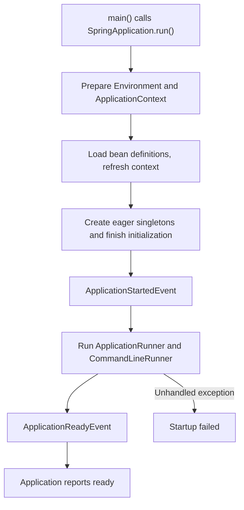
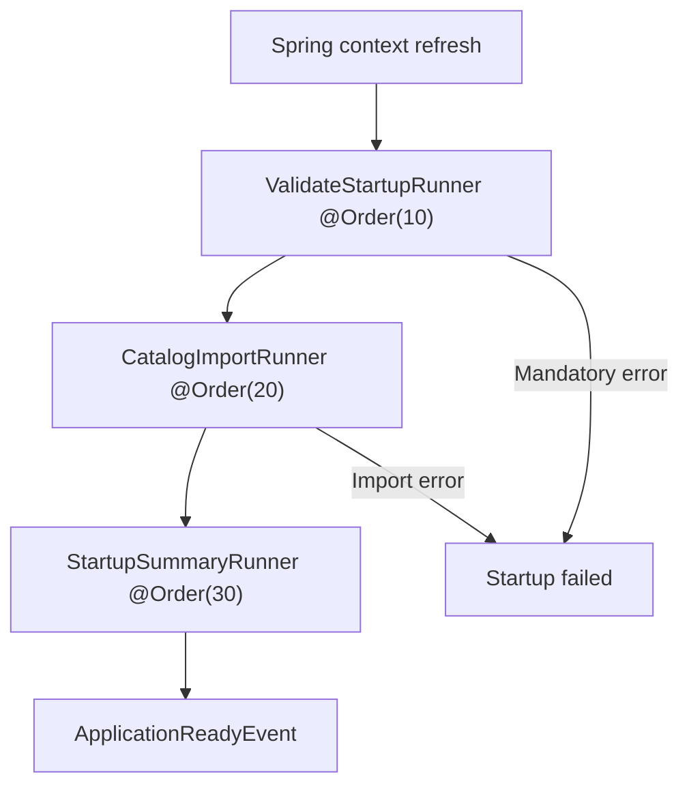

# ApplicationRunner with ApplicationArguments

A Spring Boot application does not only need to instantiate beans and open a web server. In many systems, once the application context finishes initializing, the application also needs to validate configuration, load initial data, synchronize metadata, print diagnostic details, or run a task passed from the command line. Spring Boot provides **`ApplicationRunner`** to execute this kind of work during the startup process.

`ApplicationRunner` is a functional interface with the method `run(ApplicationArguments args)`. Spring Boot automatically discovers beans implementing that interface and invokes them **once per application startup that reaches the runner execution stage**. The `ApplicationArguments` object lets you read command-line arguments in structured form: named options, option values, and non-option arguments.

In the **Events and Runners** chapter of *Spring Boot Fundamentals*, we will examine when runners execute, how to write and register runners, how arguments are parsed, how multiple runners are ordered, how startup failures are handled, how it differs from `CommandLineRunner` and other lifecycle callbacks, and common real-world scenarios.

## 1. What Problem Does ApplicationRunner Solve?

Consider a product management application. At startup, the application may need to perform a preparation step:

- Check whether the data import directory exists.
- Read a `--import.enabled=true` flag to decide whether to import sample data.
- Select a dataset via `--dataset=catalog-2026.csv`.
- Load configuration parameters needed for a job.
- Print validation output so operators know how far startup preparation got.

If everything is placed directly inside `main`, the application context is not yet ready to provide Spring-managed services. If placed inside a bean's constructor or `@PostConstruct`, preparation may run too early, before parts of the context are finalized.

`ApplicationRunner` provides a clean execution point **after the context has been refreshed**, allowing it to inject services, repositories, configuration properties, and other beans to carry out startup work.

First example:

```java
package com.example.catalog.startup;

import org.springframework.boot.ApplicationArguments;
import org.springframework.boot.ApplicationRunner;
import org.springframework.stereotype.Component;

@Component
public class StartupMessageRunner implements ApplicationRunner {

    @Override
    public void run(ApplicationArguments args) {
        System.out.println("Application context is initialized.");
    }
}
```

When Spring Boot starts and finds `StartupMessageRunner` via component scanning, it registers the class as a bean. After the context refreshes, Spring Boot calls `run(...)`. Application code does not need to invoke this method manually from `main`.

## 2. The ApplicationRunner Contract

The interface resides in package:

```java
org.springframework.boot.ApplicationRunner
```

At its core, the contract is:

```java
@FunctionalInterface
public interface ApplicationRunner {

    void run(ApplicationArguments args) throws Exception;
}
```

There are three main characteristics.

**First, the runner receives `ApplicationArguments`.** Instead of dealing directly with a `String[]` array, you get an API distinguishing options from positional arguments.

**Second, the runner can throw `Exception`.** If an unhandled error escapes `run(...)`, Spring Boot treats it as a failure during startup; `SpringApplication.run(...)` does not complete normally.

**Third, the runner is a container-managed bean.** It can be instantiated and injected with dependencies like other Spring beans. Implementing the interface alone does not register the bean if the class is not scanned or declared in configuration.

### 2.1. Functional Interface

Because it has a single abstract method, `ApplicationRunner` can be implemented as a lambda:

```java
@Configuration(proxyBeanMethods = false)
class StartupRunnerConfiguration {

    @Bean
    ApplicationRunner welcomeRunner() {
        return args -> System.out.println("Ready to initialize tasks.");
    }
}
```

A lambda fits very short preparation steps. When logic grows, has multiple branches, or needs isolated testing, a dedicated class is usually easier to read and maintain.

## 3. When Does a Runner Execute During Startup?

Spring Boot's main sequence can be pictured as follows:



This diagram summarizes the key steps involving runners. In reality, there are also listeners, context initializers, bean factory post-processors, web server lifecycle steps, availability events, and other internals.

In a typical startup flow, the important order is:

1. Spring Boot creates and refreshes the `ApplicationContext`.
2. Bean definitions are processed and eager singletons are initialized.
3. `ApplicationStartedEvent` is published after the context refreshes, before runners execute.
4. Spring Boot invokes `ApplicationRunner` and `CommandLineRunner` beans.
5. If all runners complete, Spring Boot publishes `ApplicationReadyEvent`.
6. Afterward, the application's readiness state can be updated to report readiness to accept traffic per the availability mechanism.

### 3.1. What Does "After Context Refresh" Mean?

When the runner is invoked, dependency injection and regular initialization callbacks for required beans have already occurred. The runner can use an injected Spring service:

```java
@Component
public class ProductWarmupRunner implements ApplicationRunner {

    private final ProductCacheService cacheService;

    public ProductWarmupRunner(ProductCacheService cacheService) {
        this.cacheService = cacheService;
    }

    @Override
    public void run(ApplicationArguments args) {
        cacheService.preloadFrequentlyUsedProducts();
    }
}
```

There is no need to call `getBean(...)` manually. Spring supplies `ProductCacheService` via the constructor, and then Boot invokes the runner.

### 3.2. Runners Execute Before ApplicationReadyEvent

This matters if a task must finish **before the application is considered ready**. For instance, a runner loads an essential lookup table. If loading fails and throws an exception, the application does not complete normal startup.

In web applications, the web server may already be initialized and its socket may already be open before runners finish. Therefore, do not treat `ApplicationRunner` as an absolute barrier preventing every HTTP request from arriving before preparation. In deployment environments with readiness probes, coordinate readiness states and platform routing.

### 3.3. Runners Execute Once Per Startup, Not Per Request

If a runner is a singleton bean, `run(...)` is not invoked again automatically for each HTTP request. It is not a controller, scheduled task, or listener reacting to repeated events.

If another application context is created via another `SpringApplication.run(...)` call, that context has its own startup process and corresponding runners can execute during the new startup.

## 4. How to Register an ApplicationRunner

There are two common ways.

### 4.1. Creating a `@Component` Class

```java
package com.example.catalog.startup;

import org.springframework.boot.ApplicationArguments;
import org.springframework.boot.ApplicationRunner;
import org.springframework.stereotype.Component;

@Component
public class CatalogCheckRunner implements ApplicationRunner {

    private final CatalogService catalogService;

    public CatalogCheckRunner(CatalogService catalogService) {
        this.catalogService = catalogService;
    }

    @Override
    public void run(ApplicationArguments args) {
        catalogService.verifyCatalogIntegrity();
    }
}
```

The class must sit within component scan scope or be registered through an appropriate Spring mechanism.

### 4.2. Declaring a `@Bean`

```java
@Configuration(proxyBeanMethods = false)
class CatalogStartupConfiguration {

    @Bean
    ApplicationRunner catalogCheckRunner(CatalogService catalogService) {
        return args -> catalogService.verifyCatalogIntegrity();
    }
}
```

This approach fits when runner registration belongs to a module configuration. It is also handy when only a short lambda is needed.

### 4.3. Implementing the Interface Alone Is Not Enough

This code:

```java
public class DetachedRunner implements ApplicationRunner {
    @Override
    public void run(ApplicationArguments args) {
        System.out.println("This code is not registered as a bean.");
    }
}
```

is not automatically discovered by Boot if the class is not registered as a bean. Likewise, if a developer manually creates `new DetachedRunner()` outside the container, Spring Boot will not treat that object as a runner to call.

Spring Boot discovers **runner beans inside the application context**; it does not scan every class on the classpath for the interface.

## 5. What Is ApplicationArguments?

`ApplicationArguments` is an abstraction representing command-line arguments parsed by Spring Boot. It gives access to both the raw argument array and structured argument groups.

Commonly used APIs:

| API | Data Returned |
| --- | --- |
| `getSourceArgs()` | The original `String[]` array passed in |
| `getOptionNames()` | Set of names of supplied options |
| `containsOption(String name)` | Checks whether the option is present |
| `getOptionValues(String name)` | List of values for an option, or `null` if option is absent |
| `getNonOptionArgs()` | List of arguments not formatted as options |

Example invocation:

```bash
java -jar catalog-service.jar --mode=import --dataset=products.csv --verbose region-a
```

Spring Boot can parse this as:

```text
Raw source args:
  --mode=import
  --dataset=products.csv
  --verbose
  region-a

Option names:
  mode
  dataset
  verbose

Non-option args:
  region-a
```

`mode` and `dataset` have values attached via `=`. `verbose` is a valueless option. `region-a` is a non-option argument.

### 5.1. `getSourceArgs()`

```java
@Override
public void run(ApplicationArguments args) {
    String[] source = args.getSourceArgs();
    System.out.println(Arrays.toString(source));
}
```

`getSourceArgs()` returns the original arguments. It is useful when you need exact original order or to integrate with another parser.

Do not print raw arguments to production logs if they might contain passwords, tokens, or sensitive information.

### 5.2. `getOptionNames()`

```java
Set<String> optionNames = args.getOptionNames();
```

The result is a set of option names without the `--` prefix and without values. Do not depend on iteration order of this set if deterministic output is required; sort them before displaying.

### 5.3. `containsOption()`

```java
boolean verbose = args.containsOption("verbose");
```

This method returns `true` when the option appears. It is appropriate for reading a flag like `--verbose`.

Note: `containsOption("verbose")` is not equivalent to reading the boolean value of `--verbose=false`. In that case, the option still appears; if you want to support true/false values, read `getOptionValues(...)` and parse them.

### 5.4. `getOptionValues()`

```java
List<String> values = args.getOptionValues("mode");
```

When run with `--mode=import`, the list contains one element `import`. If the option does not appear, the method returns `null`. If the option appears without a value, Spring Boot returns an empty list.

Distinguish three states:

| Command Line | `containsOption("mode")` | `getOptionValues("mode")` |
| --- | --- | --- |
| No `mode` | `false` | `null` |
| `--mode` | `true` | Empty list |
| `--mode=import` | `true` | List containing `"import"` |

When handling a required option with a value, do not only check `containsOption`. Verify that the value list has the expected count and a supported value.

### 5.5. `getNonOptionArgs()`

```java
List<String> positionalArgs = args.getNonOptionArgs();
```

With the command:

```bash
java -jar catalog-service.jar --mode=import region-a products.csv
```

`getNonOptionArgs()` holds `region-a` and `products.csv`. These arguments do not use `--name=value` syntax and are treated as positional arguments.

## 6. Option Syntax: Using `--name=value`

`ApplicationArguments`'s parser primarily recognizes long-option syntax:

```text
--option
--option=value
```

Example:

```bash
java -jar app.jar --output=report.csv --limit=50
```

`output` has value `report.csv`; `limit` has string value `50`.

Easy-to-miss mistake:

```bash
java -jar app.jar --output report.csv
```

This syntax is **not equivalent** to `--output=report.csv` in `ApplicationArguments`. The parser may treat `--output` as a valueless option and `report.csv` as a non-option argument. Therefore, when designing a CLI around `ApplicationArguments`, instruct users to supply values using `=`.

### 6.1. Arguments with Spaces

Values containing spaces must be properly shell-quoted:

```bash
java -jar app.jar --label="Catalog Import November"
```

After the shell processes quotes, the JVM receives a single argument like `--label=Catalog Import November`. `ApplicationArguments` reads the value as one string.

Quoting rules differ across Bash, PowerShell, and other shells; test them when writing cross-platform launch scripts.

### 6.2. Options Provided Multiple Times

Example:

```bash
java -jar app.jar --tag=core --tag=urgent --tag=nightly
```

Then:

```java
List<String> tags = args.getOptionValues("tag");
```

returns a list containing `core`, `urgent`, and `nightly`.

Do not assume every option has only one value. For a required single-valued option, check the count to avoid accidentally picking only the first or last element.

### 6.3. Short Options

`ApplicationArguments` is not a full CLI parser library supporting syntax like `-v`, `-o file`, or subcommands. An argument like `-v` is not parsed like the long option `--verbose`.

If the application needs complex positional grammar, help text, subcommands, shell completion, or automatic type conversion, consider a dedicated CLI framework. `ApplicationArguments` fits simple option reading inside the Spring Boot lifecycle.

## 7. Complete Example: Validating and Importing a Catalog at Startup

Suppose the application has a data import service:

```java
package com.example.catalog;

import java.nio.file.Path;
import org.springframework.stereotype.Service;

@Service
public class CatalogImportService {

    public void importFrom(Path source, boolean dryRun) {
        if (dryRun) {
            System.out.println("Preview import from: " + source);
            return;
        }

        System.out.println("Importing catalog from: " + source);
        // Read, validate, and persist real data using appropriate dependencies.
    }
}
```

A runner reading arguments:

```java
package com.example.catalog.startup;

import com.example.catalog.CatalogImportService;
import java.nio.file.Path;
import java.util.List;
import org.springframework.boot.ApplicationArguments;
import org.springframework.boot.ApplicationRunner;
import org.springframework.stereotype.Component;

@Component
public class CatalogImportRunner implements ApplicationRunner {

    private final CatalogImportService importService;

    public CatalogImportRunner(CatalogImportService importService) {
        this.importService = importService;
    }

    @Override
    public void run(ApplicationArguments args) {
        if (!args.containsOption("import")) {
            return;
        }

        String fileName = requiredSingleValue(args, "file");
        boolean dryRun = args.containsOption("dry-run");

        importService.importFrom(Path.of(fileName), dryRun);
    }

    private String requiredSingleValue(
            ApplicationArguments args,
            String name
    ) {
        List<String> values = args.getOptionValues(name);

        if (values == null || values.size() != 1
                || values.get(0).isBlank()) {
            throw new IllegalArgumentException(
                    "Expected exactly one value for --" + name
            );
        }

        return values.get(0);
    }
}
```

Launch to import:

```bash
java -jar catalog-service.jar --import --file=./data/products.csv
```

Launch to preview:

```bash
java -jar catalog-service.jar --import --file=./data/products.csv --dry-run
```

If `--import` is absent, the runner finishes without importing data. If `--import` is present without `--file=...`, the runner throws `IllegalArgumentException` so startup does not silently proceed with missing input.

### 7.1. Why Use Constructor Injection?

`CatalogImportRunner` depends on `CatalogImportService` via its constructor. That keeps dependencies explicit and makes it easy to test the runner with a fake or mock service. There is no need to inject the entire `ApplicationContext` just to look up a service at runtime.

### 7.2. Why Check for Exactly One Value?

If run with:

```bash
java -jar app.jar --import --file=a.csv --file=b.csv
```

`getOptionValues("file")` can contain two values. If business rules require a single file, the runner should report a clear error instead of arbitrarily picking one value. If multiple files should be supported, design the API to accept a list and specify processing order.

### 7.3. Why Provide Dry-Run?

For operations that modify data, `--dry-run` helps validate arguments and preview intended behavior before writing. In production systems, dry-run mode must be enforced consistently in the service layer, not merely by logging a line while still performing writes elsewhere.

### 7.4. When Not to Use This Startup Import Pattern?

If the import is huge, takes hours, or needs independent retries, attaching the entire job to a web service's startup will delay readiness and hurt operability. Instead, use a dedicated batch/CLI application, scheduler, or job worker with its own orchestration. `ApplicationRunner` can still serve as the entry point for **a CLI application dedicated to a single job**, but it is not a replacement for a batch system.

## 8. ApplicationArguments and Spring Environment

There are two distinct information-reading needs:

1. Reading the raw arguments the user passed to the process.
2. Reading application configuration aggregated across multiple property sources.

`ApplicationArguments` addresses the first need. `Environment` and `@ConfigurationProperties` fit the second need better.

Example:

```bash
java -jar app.jar --server.port=9090 --job.mode=import
```

In a standard Spring Boot setup, command-line properties are added to the `Environment` with high precedence over many other property sources. Thus, `server.port` can affect the web server port during startup.

Inside a runner:

```java
@Component
class ArgumentsAndEnvironmentRunner implements ApplicationRunner {

    private final Environment environment;

    ArgumentsAndEnvironmentRunner(Environment environment) {
        this.environment = environment;
    }

    @Override
    public void run(ApplicationArguments args) {
        System.out.println(
                "CLI option present: " + args.containsOption("job.mode")
        );
        System.out.println(
                "Resolved mode: " + environment.getProperty("job.mode")
        );
    }
}
```

The two reads can produce different results. `containsOption("job.mode")` checks only CLI arguments. `Environment.getProperty("job.mode")` reads the resolved value across property sources, including config files, environment variables, and command-line properties by precedence.

### 8.1. Disabling Command-Line Properties in Environment

Spring Boot has an option not to add command-line arguments into the `Environment`'s property sources:

```java
SpringApplication application =
        new SpringApplication(ShopApplication.class);
application.setAddCommandLineProperties(false);
application.run(args);
```

This alters how command-line properties participate in `Environment` resolution. However, runners still receive the `ApplicationArguments` constructed from the original arguments.

Do not confuse "excluding CLI from Environment" with "runners not receiving CLI arguments."

### 8.2. When to Use `@ConfigurationProperties`?

If configuration has multiple fields, such as timeout, batch size, endpoint, and retry policy, group them into a strongly typed structure:

```java
@ConfigurationProperties(prefix = "catalog.import")
public record CatalogImportProperties(
        int batchSize,
        boolean validateOnly
) {
}
```

Once the corresponding configuration properties registration is enabled, services can inject `CatalogImportProperties`. Runners should only use `ApplicationArguments` for invocation-control concerns like `--import`, `--dry-run`, or positional inputs.

Do not copy values back and forth between `Environment` and `ApplicationArguments` without a clear purpose. The two abstractions have different responsibilities.

## 9. ApplicationRunner vs. CommandLineRunner

Spring Boot provides both interfaces:

```java
public interface ApplicationRunner {
    void run(ApplicationArguments args) throws Exception;
}
```

```java
public interface CommandLineRunner {
    void run(String... args) throws Exception;
}
```

The main difference lies in the parameter type:

| Criterion | `ApplicationRunner` | `CommandLineRunner` |
| --- | --- | --- |
| `run` parameter | `ApplicationArguments` | `String...` |
| Reading named options | Built-in API | Manual string parsing |
| Reading raw arguments | `getSourceArgs()` | Received directly |
| Reading positional arguments | `getNonOptionArgs()` | Manual separation |
| Execution timing | After refresh, before ready | Same phase |
| Ordering | `@Order`/`Ordered` | `@Order`/`Ordered` |
| Registration | Bean in context | Bean in context |
| Can throw Exception | Yes | Yes |

If you need to parse `--name=value`, `ApplicationRunner` is usually more convenient. If you only need the raw argument array or run a task ignoring syntax, `CommandLineRunner` can be more concise.

### 9.1. Both Runner Types Execute in the Same Phase

Spring Boot collects `ApplicationRunner` and `CommandLineRunner` beans and sorts them for execution. They are not split into two rigid groups like "all ApplicationRunners first, all CommandLineRunners second."

Order between them depends on each bean's ordering metadata. When deterministic order is required, declare it explicitly.

### 9.2. Do Not Implement Both Interfaces on the Same Bean

A class can implement both interfaces in Java, yet Spring Boot may invoke both callbacks on that bean during runner execution. That easily causes the work to run twice.

Pick one interface matching your needs. If you need both raw arguments and option parsing, `ApplicationRunner` already provides `getSourceArgs()` and usually suffices.

## 10. Execution Order of Multiple Runners

An application can have several startup tasks:

- Validate required configuration.
- Load reference data.
- Warm up caches.
- Print preparation summary.

If they depend on one another, execution order must be explicitly specified. Spring supports `@Order` or the `Ordered` interface.

### 10.1. Using `@Order`

```java
@Component
@Order(10)
public class ConfigurationValidationRunner
        implements ApplicationRunner {

    @Override
    public void run(ApplicationArguments args) {
        System.out.println("1. Validate configuration");
    }
}
```

```java
@Component
@Order(20)
public class ReferenceDataRunner
        implements ApplicationRunner {

    @Override
    public void run(ApplicationArguments args) {
        System.out.println("2. Load reference data");
    }
}
```

```java
@Component
@Order(30)
public class StartupSummaryRunner
        implements ApplicationRunner {

    @Override
    public void run(ApplicationArguments args) {
        System.out.println("3. Startup tasks completed");
    }
}
```

Smaller order values take precedence over larger ones. If beans share the same order or have no explicit ordering, do not rely on class scanning order or file declaration order.

### 10.2. Using `Ordered`

```java
@Component
public class ConfigurableStartupRunner
        implements ApplicationRunner, Ordered {

    @Override
    public int getOrder() {
        return 50;
    }

    @Override
    public void run(ApplicationArguments args) {
        System.out.println("Runs at order 50");
    }
}
```

`Ordered` fits when a class wants to supply its order programmatically via a method. For static order, `@Order` is usually more concise.

### 10.3. Do Runners Execute in Parallel?

During normal startup, Spring Boot invokes runners sequentially in sorted order. A runner can launch asynchronous work itself, in which case application code must manage completion and errors. If `run` merely submits a task and returns immediately, Boot can proceed through remaining runners and publish `ApplicationReadyEvent` before that task finishes.

If a task must finish before readiness, the runner must wait for completion appropriately or use another startup mechanism with a clear completion contract.

## 11. How Errors in ApplicationRunner Affect Startup

Example:

```java
@Component
public class RequiredConfigRunner implements ApplicationRunner {

    @Override
    public void run(ApplicationArguments args) {
        if (!args.containsOption("tenant")) {
            throw new IllegalStateException(
                    "Missing required startup option: --tenant=..."
            );
        }
    }
}
```

When an exception escapes `run(...)`, Spring Boot treats startup as incomplete. `SpringApplication.run(...)` runs failure handling and publishes `ApplicationFailedEvent` per the startup mechanism; `ApplicationReadyEvent` is not published as a successful startup.

### 11.1. Distinguishing Mandatory and Optional Errors

Some tasks must fail fast:

- Missing mandatory security configuration.
- Unable to load essential reference data.
- Unable to verify a condition making the application unsafe to continue.

Some tasks can handle errors and still allow the application to start:

- Unable to refresh a non-essential cache.
- Unable to fetch secondary display metadata.
- Unable to generate a purely diagnostic report.

Do not catch every exception and just log it to let the application proceed if the feature cannot function properly. Conversely, do not take down an entire web service over a non-essential operation.

### 11.2. Can Declare `throws Exception`

```java
@Override
public void run(ApplicationArguments args) throws Exception {
    externalSystem.verifyConnection();
}
```

The contract permits checked exceptions. Still, add contextual messages so operators know which startup step failed.

### 11.3. Startup Transactions and Side Effects

If a runner writes data, sends messages, or calls external APIs, an error partway through can leave side effects even though startup failed. That is why you need to design:

- **Idempotency:** re-running does not create duplicate data or send duplicate jobs unintentionally.
- **Transaction boundaries:** groups of database operations may need proper transactions.
- **Controlled retries:** distinguish transient errors from configuration errors.
- **Timeouts:** do not stall startup indefinitely.
- **Clear error details:** log which step failed and how to remediate.

Spring Boot calls runners during startup, yet does not automatically wrap the entire `run(...)` method in a transaction. If transactions are needed, place logic in a managed Spring service and apply `@Transactional` at the appropriate boundary.

## 12. ApplicationRunner vs. Other Lifecycle Callbacks

There are multiple ways to execute code at startup, occurring at different times.

| Mechanism | Typical Timing | Purpose |
| --- | --- | --- |
| Constructor | When creating bean instance | Initialize state and receive dependencies |
| `@PostConstruct` | After injection, during each bean's initialization | Finalize internal bean state |
| `InitializingBean.afterPropertiesSet()` | During each bean's initialization | Spring-coupled initialization callback |
| `ContextRefreshedEvent` | When a context completes refresh | React to context refresh event |
| `ApplicationStartedEvent` | After refresh and before runners | Observe when context has started |
| `ApplicationRunner` | After started event, before ready event | Startup work using arguments |
| `CommandLineRunner` | Same runner phase | Startup work using raw arguments |
| `ApplicationReadyEvent` | After runners have finished | Run logic once application is ready |

### 12.1. Compared to `@PostConstruct`

`@PostConstruct` belongs to the lifecycle of **a specific bean**:

```java
@Component
class LookupCache {

    @PostConstruct
    void initialize() {
        // Finalize internal state of this bean alone.
    }
}
```

It can run while the context is still creating other beans. If a task requires multiple beans working together and needs process arguments, `ApplicationRunner` is usually more suitable.

### 12.2. Compared to ApplicationStartedEvent

`ApplicationStartedEvent` is published once the context has refreshed, **before** runners. Listeners for this event fit observing startup timing or performing an event-driven action prior to runners.

If a task needs command-line options, `ApplicationRunner` provides a direct, easy-to-test API.

### 12.3. Compared to ApplicationReadyEvent

`ApplicationReadyEvent` is published after Spring Boot finishes executing runners. Thus, listeners on this event fit operations needing to know startup is complete.

If a step must finish **before** the application is reported ready, perform it in a runner instead of waiting for `ApplicationReadyEvent`.

### 12.4. Compared to ApplicationContextInitializer

`ApplicationContextInitializer` intervenes in the context **before refresh**. It fits early infrastructure configuration. It is not equivalent to a runner, which uses beans already initialized after refresh.

If you need to modify bean definitions or the environment before the container instantiates services, choose an early-stage extension point. If you need ready services to perform startup work, a runner is more appropriate.

## 13. ApplicationRunner in Web Applications

In web services, runners are commonly used for short tasks:

- Verifying required resources.
- Warming up small, critical caches.
- Validating schema metadata.
- Loading necessary configuration before readiness.

However, code in a runner can significantly increase startup time. If a runner takes two minutes, the application may not publish `ApplicationReadyEvent` during that time.

### 13.1. Readiness and Startup Probes

Kubernetes or deployment platforms can use readiness probes to decide when to route traffic to an instance. Spring Boot provides application availability and Actuator health probes in appropriate configurations.

Because runners execute before the ready event, synchronous work in a runner can delay when the application is marked ready. Still, the web server socket may already be open prior to runners; therefore configure readiness probes and routing properly rather than relying solely on Java execution order.

### 13.2. Do Not Run Heavy Data Operations on Every Replica

If five replicas are deployed, each replica has its own application context and startup sequence. Runners are not "run once across the whole cluster." Import or migration logic placed in a runner can execute on all five instances.

For cluster-wide work such as major database migrations, creating shared seed data, or sending bulk notifications, consider locking mechanisms, leader election, dedicated migration tools, or standalone jobs. Never assume a runner has only a single executor.

### 13.3. Runners Re-Execute on Deploy/Restart

Each time the process or application context restarts, runners can execute again. Hence, data created inside a runner must be safe to re-run:

```java
public void ensureDefaultCategories() {
    if (!repository.existsByCode("GENERAL")) {
        repository.save(new Category("GENERAL", "General"));
    }
}
```

This illustration only fits simple environments. In multi-replica systems, check-then-insert has a race condition; enforce unique constraints and use idempotent/transactional writes.

## 14. ApplicationRunner in CLI or Batch Applications

A Spring Boot application does not have to be a web service. You can use Spring Boot to build a command-line tool with dependency injection, configuration, and logging.

Example:

```java
@SpringBootApplication
public class ImportCliApplication {

    public static void main(String[] args) {
        SpringApplication application =
                new SpringApplication(ImportCliApplication.class);
        application.setWebApplicationType(WebApplicationType.NONE);
        application.run(args);
    }
}
```

Then create an `ApplicationRunner` to read `--input=...` and run the job. With `WebApplicationType.NONE`, the application does not start a servlet or reactive web server.

### 14.1. Runners Do Not Automatically Determine Exit Codes

If an application performs a task and exits, design the lifecycle and process exit code appropriately. Spring Boot provides `SpringApplication.exit(context)` along with `ExitCodeGenerator` for scenarios requiring exit code control.

CLI launcher example:

```java
public static void main(String[] args) {
    ConfigurableApplicationContext context =
            SpringApplication.run(ImportCliApplication.class, args);

    int exitCode = SpringApplication.exit(context);
    System.exit(exitCode);
}
```

This example illustrates process orchestration after `run(...)` returns successfully. If startup throws an exception, lines after `run(...)` may not execute; if specific exit codes are needed for failure cases too, handle them at the launcher/error-handling layer.

Do not arbitrarily call `System.exit(...)` inside a web service runner because it terminates the entire process.

### 14.2. Batch Processing Duration

If a runner runs for a long time, monitoring systems may consider startup slow or timed out. For batch/CLI tools, that may be intentional, yet the job orchestrator's timeout must match the job's duration.

For web services, separate long-running batch tasks from startup so the application is not held unready for extended periods.

## 15. Validating Arguments Consistently

`ApplicationArguments` retrieves arguments, yet it does not enforce business validation rules on its own. Runner authors must decide:

- Which options are required.
- Which options are optional.
- Which options are pure flags.
- Which options accept multiple values.
- Which values are valid.
- Relationships between options.
- How to handle unsupported options.

Example helper for a required single-valued option:

```java
static String requireOne(
        ApplicationArguments args,
        String option
) {
    List<String> values = args.getOptionValues(option);
    if (values == null || values.size() != 1
            || values.get(0).isBlank()) {
        throw new IllegalArgumentException(
                "Missing or invalid --" + option + "=<value>"
        );
    }
    return values.get(0);
}
```

Helper parsing a positive integer:

```java
static int requirePositiveInt(
        ApplicationArguments args,
        String option
) {
    String value = requireOne(args, option);
    try {
        int parsed = Integer.parseInt(value);
        if (parsed <= 0) {
            throw new IllegalArgumentException(
                    "--" + option + " must be positive"
            );
        }
        return parsed;
    } catch (NumberFormatException ex) {
        throw new IllegalArgumentException(
                "--" + option + " must be an integer", ex
        );
    }
}
```

When run with:

```bash
java -jar app.jar --batch-size=200
```

`getOptionValues("batch-size")` returns the string `"200"`. Your code parses it into an `int`.

### 15.1. Do Not Infer Boolean Flags with `containsOption` When `=false` Is Allowed

If the CLI permits `--dry-run=false`, `containsOption("dry-run")` still returns true. Two valid designs exist:

- Support `--dry-run` solely as a presence flag. Reject `--dry-run=false`.
- Support `--dry-run=true` and `--dry-run=false`, reading the value and explicitly parsing it as a boolean.

Pick one convention and document it in help/documentation; do not accidentally mix the two meanings.

### 15.2. Do Not Log Secrets from `getSourceArgs`

If a user runs:

```bash
java -jar app.jar --api-key=some-secret-value
```

printing `Arrays.toString(args.getSourceArgs())` exposes sensitive values in logs. For secrets, use proper secret management and configuration sources rather than passing them directly as CLI arguments whenever possible. When diagnostics are needed, log only option names or masked values.

## 16. Unit Testing ApplicationRunner

Because `run` takes the `ApplicationArguments` interface, you can test argument-parsing logic without starting the full Spring Boot runtime.

Spring Boot supplies the `DefaultApplicationArguments` implementation:

```java
import org.junit.jupiter.api.Test;
import org.springframework.boot.ApplicationArguments;
import org.springframework.boot.DefaultApplicationArguments;

import static org.junit.jupiter.api.Assertions.*;

class ApplicationArgumentsTest {

    @Test
    void separatesOptionsAndPositionalArguments() {
        ApplicationArguments args =
                new DefaultApplicationArguments(
                        "--mode=import",
                        "--tag=core",
                        "--tag=urgent",
                        "--dry-run",
                        "region-a"
                );

        assertTrue(args.containsOption("mode"));
        assertEquals(List.of("import"), args.getOptionValues("mode"));
        assertEquals(
                List.of("core", "urgent"),
                args.getOptionValues("tag")
        );
        assertTrue(args.containsOption("dry-run"));
        assertEquals(List.of(), args.getOptionValues("dry-run"));
        assertEquals(List.of("region-a"), args.getNonOptionArgs());
        assertNull(args.getOptionValues("missing"));
    }
}
```

This test simply demonstrates `DefaultApplicationArguments`; add the `java.util.List` import and appropriate JUnit dependencies.

### 16.1. Testing a Runner with a Fake Service

Consider a runner that calls a service only when `--import` is present. You can pass a fake service to record invocations:

```java
@Test
void importsFileWhenFlagIsPresent() throws Exception {
    RecordingCatalogImportService service =
            new RecordingCatalogImportService();
    CatalogImportRunner runner = new CatalogImportRunner(service);

    runner.run(new DefaultApplicationArguments(
            "--import",
            "--file=./data/products.csv",
            "--dry-run"
    ));

    assertEquals(Path.of("./data/products.csv"), service.lastPath());
    assertTrue(service.lastDryRun());
}
```

The snippet assumes `RecordingCatalogImportService` is a fake with recording APIs compatible with `CatalogImportRunner`'s dependency. In real projects, use a service interface or appropriate mock for isolated testing.

### 16.2. Testing Missing Required Options

```java
@Test
void rejectsImportWithoutFile() {
    CatalogImportRunner runner = new CatalogImportRunner(importService);

    assertThrows(
            IllegalArgumentException.class,
            () -> runner.run(new DefaultApplicationArguments("--import"))
    );
}
```

This test verifies invalid input is rejected clearly instead of launching an import with `null`.

### 16.3. Integration Testing with ApplicationContext

If you need to verify that the runner is registered by Spring and receives dependencies properly, use an integration test that starts a context. However, be cautious: `@SpringBootTest` can cause runners to execute during test startup.

If the runner has side effects (DB writes, API calls, file imports), design activation conditions or fake dependencies so tests do not execute unintended operations. Often, unit testing the runner class and integration testing service logic separately is enough to cover critical behavior.

## 17. Conditionally Enabling/Disabling ApplicationRunner

Not every runner should execute in every environment. Conditions can be applied:

```java
@Component
@ConditionalOnProperty(
        prefix = "catalog.startup",
        name = "warmup-enabled",
        havingValue = "true"
)
class CatalogWarmupRunner implements ApplicationRunner {

    private final CatalogCache cache;

    CatalogWarmupRunner(CatalogCache cache) {
        this.cache = cache;
    }

    @Override
    public void run(ApplicationArguments args) {
        cache.warmup();
    }
}
```

When the property does not match, the runner bean is not registered. This completely removes the runner from the set Spring Boot executes.

Another option is always registering the runner while checking a CLI flag inside `run`:

```java
if (!args.containsOption("warmup")) {
    return;
}
cache.warmup();
```

The two approaches mean different things:

- **Condition on the bean:** decides whether the runner exists in the context.
- **Condition inside the method:** the runner exists, yet skips the task at runtime.

If a feature belongs to deployment configuration, `@ConditionalOnProperty` or `@Profile` expresses it well. If an operator chooses tasks per invocation, `ApplicationArguments` is more fitting.

### 17.1. Using `@Profile`

```java
@Component
@Profile("dev")
class DemoDataRunner implements ApplicationRunner {
    @Override
    public void run(ApplicationArguments args) {
        // Load sample data for the development environment.
    }
}
```

In production, this bean is not registered unless the `dev` profile is active. Using profiles avoids accidentally running test logic, though data operations should still include checks and be safe to re-run.

## 18. Common Mistakes When Using ApplicationRunner

| Symptom | Possible Cause | Remediation |
| --- | --- | --- |
| `run` method is never called | Class is not a bean, outside component scan, or excluded by condition | Check `@Component`, `@Bean`, `@Import`, and profiles |
| Runner misses an option | Wrong syntax, e.g., `--file data.csv` | Use `--file=data.csv` and inspect actual arguments |
| `getOptionValues` returns `null` | Option was not supplied | Distinguish absent option from valueless option |
| `getOptionValues` returns an empty list | Option supplied as a valueless flag | Use `containsOption` or require `--name=value` |
| Runner executes twice in one startup | Two runner beans with the same logic, or one bean implements both runner interfaces | Check registered beans and callbacks |
| Runner runs again after deploy | Each instance restart invokes runners | Design idempotency; do not assume once-per-cluster execution |
| Application not ready yet | Runner still running or threw startup error | Check logs, duration, and exceptions from runners |
| Wrong task order | Missing ordering or identical order values | Use explicit `@Order`/`Ordered` |
| Dependency bean not found | Service not registered or condition mismatch | Check component scan, config, and auto-configuration |
| Test accidentally imports real data | Spring test context starts runner with side effects | Use test profiles, activation conditions, fake services, or unit tests |

### 18.1. Distinguishing a Runner That Never Runs from One That Skips

If a runner logs nothing, there are two distinct possibilities:

1. The runner bean was not registered, so Spring Boot never called it.
2. The bean was called, yet logic inside `run` returned early due to a missing CLI flag.

To investigate, first confirm the bean exists in the context, then inspect arguments and conditional branches inside the method.

### 18.2. Distinguishing Startup Failures from Business Logic Failures

An exception escaping a runner prevents normal startup completion. If an error occurs inside an async task submitted by a runner that already returned, that error can happen after `ApplicationReadyEvent` and will not fail `SpringApplication` via the same path.

If the task's outcome is required for readiness, tie task completion explicitly to the runner or readiness lifecycle.

## 19. Practice: Ordered Runners with Arguments

Suppose an application imports data in steps:



First runner validates configuration:

```java
@Component
@Order(10)
class ValidateStartupRunner implements ApplicationRunner {

    @Override
    public void run(ApplicationArguments args) {
        if (args.containsOption("import")
                && !args.containsOption("file")) {
            throw new IllegalArgumentException(
                    "--file=<path> is required with --import"
            );
        }
    }
}
```

Second runner imports data:

```java
@Component
@Order(20)
class CatalogImportRunner implements ApplicationRunner {

    private final CatalogImportService service;

    CatalogImportRunner(CatalogImportService service) {
        this.service = service;
    }

    @Override
    public void run(ApplicationArguments args) {
        if (!args.containsOption("import")) {
            return;
        }

        List<String> files = args.getOptionValues("file");
        if (files == null || files.size() != 1) {
            throw new IllegalArgumentException(
                    "Expected exactly one --file=<path>"
            );
        }

        service.importFrom(
                Path.of(files.get(0)),
                args.containsOption("dry-run")
        );
    }
}
```

Final runner logs summary:

```java
@Component
@Order(30)
class StartupSummaryRunner implements ApplicationRunner {

    @Override
    public void run(ApplicationArguments args) {
        System.out.println("Startup runners completed.");
    }
}
```

If the import runner throws an exception, subsequent runners will not run in the normal execution chain and startup fails. This gives ordering practical significance, while business code should still live in services for testing and reuse.

### 19.1. When Is One Runner Better Than Three?

If the steps form a tight workflow belonging to one job and requiring transaction/retry as a single unit, it can be cleaner to use **one runner** calling an orchestration service:

```java
@Component
class CatalogStartupRunner implements ApplicationRunner {

    private final CatalogStartupWorkflow workflow;

    CatalogStartupRunner(CatalogStartupWorkflow workflow) {
        this.workflow = workflow;
    }

    @Override
    public void run(ApplicationArguments args) {
        workflow.validate(args);
        workflow.importIfRequested(args);
        workflow.report();
    }
}
```

This expresses business order directly via method calls instead of scattering it across ordering metadata on multiple beans. Use multiple runners when they represent relatively independent startup responsibilities needing only simple ordering.

## 20. Practice Exercises

### Exercise 1 – Simple Runner

Create a `HelloRunner` class implementing `ApplicationRunner` and register it with `@Component`. In `run`, print a message.

Start the application and observe the message appearing after context refresh. Explain why you do not need to call `run` manually from `main`.

### Exercise 2 – Parsing Options and Positional Arguments

Run with:

```bash
java -jar app.jar --mode=import --tag=alpha --tag=beta --dry-run region-a
```

Use `ApplicationArguments` to print:

- Option names.
- Value list for `mode`.
- Value list for `tag`.
- `containsOption("dry-run")`.
- Non-option arguments.

Explain the difference between `getSourceArgs` and `getNonOptionArgs`.

### Exercise 3 – Handling Missing Option Values

Write a runner requiring exactly one value for `--file=...`. Test these cases:

1. No `file` option.
2. Only `--file`.
3. `--file=a.csv`.
4. `--file=a.csv --file=b.csv`.

For each case, predict `getOptionValues("file")` and decide whether the runner should proceed or raise an error.

### Exercise 4 – Comparing ApplicationRunner and CommandLineRunner

Create two runners that print arguments: one using `ApplicationArguments` and one accepting `String... args`. Run with valued options and positional arguments. Compare the amount of code needed to separate them.

### Exercise 5 – Execution Order

Create three `ApplicationRunner` beans with `@Order(30)`, `@Order(10)`, and `@Order(20)`. Observe execution order. Add a `CommandLineRunner` with `@Order(15)` and predict its position in the same startup sequence.

### Exercise 6 – Startup Failure

Write a runner validating a mandatory option. If missing, throw `IllegalArgumentException`. Observe startup failing and confirm `ApplicationReadyEvent` is not published as a successful startup.

### Exercise 7 – Testing Without Starting the Entire Application

Instantiate `DefaultApplicationArguments` with a sample argument array. Write a unit test verifying `containsOption`, `getOptionValues`, and `getNonOptionArgs`. Then call `run(...)` directly on the runner with a fake service and verify the right business method was invoked.

### Exercise 8 – Choosing a Runner or a Batch Job

A web application needs to import one million records on every deploy. Analyze the impact on startup time, multiple replicas, retries, and idempotency. Propose when to move the import into a separate batch job.

## 21. Key Takeaways

`ApplicationRunner` is Spring Boot's extension point for tasks **after the application context refreshes and before `ApplicationReadyEvent`**. Spring Boot discovers runner beans in the context and invokes `run(ApplicationArguments args)` during startup.

Key principles:

- **Runners must be Spring beans.** Implementing the interface alone is not enough; `@Component`, `@Bean`, or equivalent registration is needed.
- **`ApplicationArguments` provides basic parsing.** Use `getOptionNames`, `containsOption`, `getOptionValues`, `getNonOptionArgs`, and `getSourceArgs` to read CLI arguments.
- **Option values use `--name=value` syntax.** Valueless options and absent options are two distinct states.
- **`ApplicationRunner` and `CommandLineRunner` run in the same phase.** The primary difference is the argument type received.
- **Use `@Order` or `Ordered` when order matters.** Do not rely on component scan order.
- **Exceptions escaping a runner cause startup failure.** Throw errors only for conditions that genuinely prevent the application from operating properly.
- **Each application instance runs its own runners.** Restarts and multiple replicas can execute the same work multiple times; design idempotency and control side effects.
- **Synchronous runners can prolong startup.** For large workloads, consider batch jobs, schedulers, or standalone processors.

When you need work performed at startup, ask: **does this work require initialized beans, does it need command-line arguments, must it complete before readiness, and is it safe to re-run?** If the answers align with the post-refresh phase, `ApplicationRunner` with `ApplicationArguments` provides a clear structure for organizing startup logic in Spring Boot.
