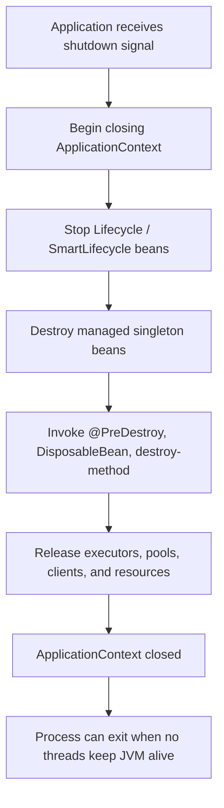
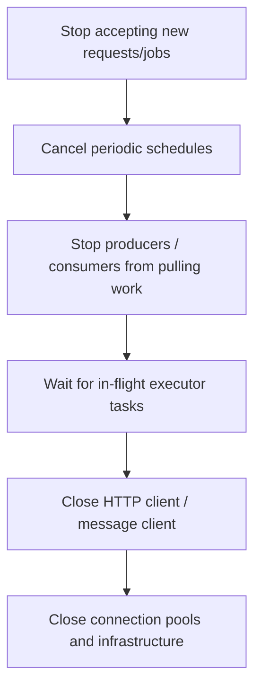

# Cleaning Up Executors, Schedulers, Connections, and Self-Created Resources

A Spring Boot application may start up successfully and serve requests normally yet still run into problems on shutdown: the process fails to exit, threads keep running, connection pools are not closed, or a scheduled task keeps calling external services while the application context is being destroyed.

These issues commonly arise when an application creates long-lived resources on its own—such as `ExecutorService`, `ScheduledExecutorService`, HTTP clients, JDBC connections, sockets, file watchers, or background polling components. Resources can be instantiated with `new` in code, yet Spring only manages closing them if those resources are registered with appropriate lifecycle callbacks.

This lesson covers how to determine **who owns each resource**, when to stop accepting new work, how to await in-flight tasks, how to release connections, how to declare bean destruction callbacks, and how to observe shutdown in Spring Boot.

## 1. Why Is Shutdown Also Part of Design?

In a long-running application, constructors and request-handling methods are not the only things that matter. Every opened resource needs a termination strategy:

- Executors spawn worker threads to run asynchronous tasks.
- Schedulers create threads and schedule periodic jobs.
- Connection pools hold connections to databases or external systems.
- HTTP clients may maintain their own connection pools and event loops.
- File watchers, sockets, streams, or consumers may hold file descriptors and background threads.
- Self-created tasks may be writing data, publishing messages, or executing transactions.

Without proper closing, consequences can include:

1. The JVM fails to exit because non-daemon threads remain alive.
2. Deployments are forcefully terminated when the graceful shutdown window expires.
3. In-flight tasks are cut off mid-way, leaving data or processing state inconsistent.
4. Connections and file descriptors remain open longer than necessary.
5. Tests creating multiple application contexts leak threads or resources.
6. Tasks continue accepting new work after the application has started shutting down.

**Rule:** every resource with a `close()`, `shutdown()`, `stop()`, or `dispose()` method needs an owner and a predictable termination path.

## 2. How Does Spring Boot Shut Down an Application?

When `ApplicationContext` closes normally, Spring stops components with managed lifecycles and then executes appropriate destruction callbacks on beans.

A high-level flow:



The diagram shows the general sequence, not every internal callback or the exact ordering across all beans. Spring also takes bean dependencies and lifecycle phases into account.

### 2.1. Closing Context vs. Sudden Process Termination

Several scenarios:

| Scenario | Cleanup opportunity |
|---|---|
| Calling `context.close()` | Spring executes the context closing sequence |
| Stopping via SIGTERM when shutdown hook is active | JVM has an opportunity to run shutdown hook and close context |
| Stopping app from IDE via graceful mode | Cleanup may run, depending on the stop mechanism |
| SIGKILL or forceful process termination | Cannot rely on Java shutdown hooks |
| JVM crash, power loss | Callbacks cannot be guaranteed to run |
| Test creates and then closes context | Destroy callbacks of managed beans can run |

Spring Boot normally registers a shutdown hook to close the context when the JVM exits legitimately. Do not use cleanup callbacks as the sole mechanism guaranteeing a business operation is not lost during power loss or forceful kills.

Business operations requiring durability should use transactions, retry mechanisms, message acknowledgments, idempotency, or appropriate persistent state storage.

### 2.2. Stop Accepting New Work Before Cleaning Up Resources

A useful mental order:

```text
Stop accepting new work
        ↓
Cancel upcoming scheduled runs
        ↓
Let in-flight work finish within a time limit
        ↓
Cancel/interrupt remaining work when needed
        ↓
Close connections, clients, pools, and supporting resources
        ↓
Record shutdown outcome
```

If you close the database pool before running tasks finish, tasks will fail because database connections are no longer available. Therefore, shutdown ordering must reflect the application's dependency graph.

## 3. Identifying the Owner of Each Resource

Not every resource needs to be closed manually. The key is distinguishing:

- **Spring-managed resources:** beans with destruction callbacks or managed by the framework/starters.
- **Self-created resources:** created inside a method, constructor, or helper whose lifecycle Spring does not directly know about.
- **Borrowed resources:** such as a JDBC `Connection` borrowed from a pool, which must be returned promptly without closing the entire pool.

Reference guide:

| Resource | Who typically owns it? | Typical termination approach |
|---|---|---|
| `ThreadPoolTaskExecutor` registered as a Spring bean | Spring context | Executor lifecycle/destroy callback |
| `ThreadPoolTaskScheduler` registered as a Spring bean | Spring context | Cancel schedules and shut down per lifecycle |
| `ExecutorService` created via `Executors.newFixedThreadPool(...)` in a service | The service that created it | `shutdown()`, `awaitTermination()`, possibly `shutdownNow()` |
| Self-created `ScheduledExecutorService` | Component that created scheduler | `ScheduledFuture.cancel(...)` and shut down scheduler |
| Auto-configured `DataSource` pool by Boot | Spring context / pool bean | Pool closed when bean is destroyed |
| JDBC `Connection` borrowed from pool | Calling code or Spring transaction infrastructure | Return connection via `close()` / proper release API |
| Library client with `close()` or `dispose()` | Creating component or managing bean | Call close API exposed by the library |
| `InputStream`/`OutputStream` opened in a method | Method opening the stream | `try-with-resources` |
| Shared executor/client supplied by an external library | Declared owner of that resource | Borrowers do not close what they do not own |

**Do not close someone else's resource.** A service injecting a Spring Boot-created `DataSource` should never call `dataSource.close()` just because that service has no more work. Closing the pool affects every component sharing it.

Conversely, if a service calls `Executors.newSingleThreadExecutor()` on its own, Spring cannot automatically know to stop that executor unless the service declares cleanup.

## 4. ExecutorService: Stopping, Waiting, and Handling Remaining Work

`ExecutorService` is Java's abstraction for executing tasks on worker threads. Common ways to create one:

```java
ExecutorService executor = Executors.newFixedThreadPool(4);
ExecutorService single = Executors.newSingleThreadExecutor();
ScheduledExecutorService scheduler =
        Executors.newScheduledThreadPool(2);
```

If these executors are created directly in code, you must design how they close.

### 4.1. What Does shutdown() Do?

```java
executor.shutdown();
```

`shutdown()` initiates an orderly shutdown:

- Stops accepting new tasks.
- Previously submitted tasks continue executing per executor policy.
- Calling `shutdown()` usually returns immediately without waiting for all workers to finish.

Therefore, calling `shutdown()` alone does not prove the executor has fully stopped.

### 4.2. What Does awaitTermination() Do?

```java
boolean finished =
        executor.awaitTermination(10, TimeUnit.SECONDS);
```

This method waits up to the specified timeout after the executor begins shutdown. It returns:

- `true` when the executor has terminated.
- `false` if the timeout elapsed before termination.

The method can throw `InterruptedException` if the waiting thread is interrupted.

### 4.3. What Does shutdownNow() Do?

```java
List<Runnable> notStarted = executor.shutdownNow();
```

`shutdownNow()` attempts to stop actively executing tasks—typically by interrupting worker threads—and returns the list of queued tasks that never started executing.

**It does not guarantee canceling all running tasks.** If a task ignores interrupts or is stuck in an API that does not respond to interruption, the task may keep running.

Therefore, reliable shutdown requires both sides:

1. The executor has a shutdown strategy.
2. Task code handles cancellation/interruption properly.

### 4.4. Pattern for Closing an Executor with Timeout

```java
import java.util.List;
import java.util.concurrent.ExecutorService;
import java.util.concurrent.TimeUnit;

public final class ExecutorShutdown {

    private ExecutorShutdown() {
    }

    public static void stop(ExecutorService executor) {
        executor.shutdown();

        try {
            if (!executor.awaitTermination(10, TimeUnit.SECONDS)) {
                List<Runnable> pending = executor.shutdownNow();

                System.out.println(
                        "Tasks not started: " + pending.size()
                );

                if (!executor.awaitTermination(5, TimeUnit.SECONDS)) {
                    System.err.println(
                            "Executor did not terminate in time"
                    );
                }
            }
        } catch (InterruptedException ex) {
            executor.shutdownNow();
            Thread.currentThread().interrupt();
        }
    }
}
```

Notable points:

- Bounded waiting time.
- Attempts orderly shutdown first.
- Escalates to forceful cancellation upon timeout.
- Does not swallow the shutdown-calling thread's interrupt status.
- Logs if the executor fails to terminate.

The 10-second and 5-second durations are illustrative only. Actual shutdown budgets depend on task duration and deployment environment limits.

## 5. Self-Created Executor Inside a Spring Service

Example of a service creating its own thread pool:

```java
import java.util.concurrent.ExecutorService;
import java.util.concurrent.Executors;

import jakarta.annotation.PreDestroy;
import org.springframework.stereotype.Service;

@Service
public class InvoiceBackgroundService {

    private final ExecutorService executor =
            Executors.newFixedThreadPool(3);

    public void submitInvoiceJob(Runnable job) {
        executor.submit(job);
    }

    @PreDestroy
    public void shutdown() {
        ExecutorShutdown.stop(executor);
    }
}
```

Spring manages the `InvoiceBackgroundService` bean, so during normal bean destruction, the `@PreDestroy` method is invoked. The service takes responsibility for stopping the executor it created.

Keep in mind:

- A new `submitInvoiceJob` call may encounter `RejectedExecutionException` once executor shutdown begins.
- Long tasks can keep the destroy callback waiting until timeout.
- If the service creates multiple executors, it must close all of them.
- If an executor is shared among other beans, establish a dedicated owner and clear rules on who may close it.
- If an executor is created inside a request method, prefer a shared executor or close within method scope; never spawn a new pool per request without destroying it.

### 5.1. Do Not Rely Solely on Daemon Threads

Making worker threads daemons can allow the JVM to exit even while workers are still running. However, daemon threads do not replace proper shutdown:

- Tasks can be abruptly terminated mid-execution.
- Unflushed data can be lost.
- Connections or resources are not released by application logic.
- You lose visibility into whether tasks finished.

Use intentional lifecycle and cancellation even when threads are daemons.

## 6. Prefer ThreadPoolTaskExecutor When Integrating with Spring

In Spring applications, `ThreadPoolTaskExecutor` is usually more convenient than an `ExecutorService` detached from bean lifecycle. It is Spring's executor, offering pool management APIs and shutdown handling when managed as a context bean.

Example configuration:

```java
import org.springframework.context.annotation.Bean;
import org.springframework.context.annotation.Configuration;
import org.springframework.scheduling.concurrent.ThreadPoolTaskExecutor;

@Configuration(proxyBeanMethods = false)
public class BackgroundExecutorConfiguration {

    @Bean(name = "backgroundExecutor")
    public ThreadPoolTaskExecutor backgroundExecutor() {
        ThreadPoolTaskExecutor executor =
                new ThreadPoolTaskExecutor();

        executor.setCorePoolSize(4);
        executor.setMaxPoolSize(8);
        executor.setQueueCapacity(100);
        executor.setThreadNamePrefix("background-");
        executor.setWaitForTasksToCompleteOnShutdown(true);
        executor.setAwaitTerminationSeconds(20);

        return executor;
    }
}
```

Spring initializes the executor bean within the context lifecycle and handles shutdown via `ExecutorConfigurationSupport` mechanisms instead of leaving you with an unmanaged pool.

Example usage in a service with `@Async`:

```java
import org.springframework.scheduling.annotation.Async;
import org.springframework.stereotype.Service;

@Service
public class ReceiptService {

    @Async("backgroundExecutor")
    public void generateReceipt(Long orderId) {
        // Generate receipt for order
    }
}
```

For `@Async` to work, the application must enable async processing appropriately, such as with `@EnableAsync`. Note that self-invocation within the same instance does not pass through the Spring AOP proxy the way calls from another bean do.

### 6.1. Key Shutdown Options

| Option | Purpose |
|---|---|
| `setWaitForTasksToCompleteOnShutdown(true)` | Allows accepted tasks to proceed per executor policy during shutdown |
| `setAwaitTerminationSeconds(n)` | Waits up to `n` seconds for executor termination during shutdown |
| `setThreadNamePrefix(...)` | Helps identify threads in logs and thread dumps |
| `setQueueCapacity(...)` | Bounds/shapes the queue, affecting remaining work on shutdown |
| `setCorePoolSize(...)`, `setMaxPoolSize(...)` | Tunes execution capacity and concurrency |

Do not conclude that setting `waitForTasksToCompleteOnShutdown=true` guarantees every task finishes. Tasks may run too long, the wait budget is finite, or the container may be forcefully killed beforehand.

### 6.2. Choosing Cancel vs. Wait Policy by Business Need

Some tasks should try to finish:

- Finishing a brief state write.
- Flushing a small buffer.
- Processing an already-received event lacking durable retry.

Some tasks can safely be canceled:

- Cache warm-up.
- Telemetry polling.
- Non-critical periodic checks.
- Recomputable work that does not harm consistency.

If work must be guaranteed across restarts or crashes, do not rely solely on waiting for an executor. Place the work in a durable queue, database, or retry-capable job system.

## 7. Schedulers: Canceling Schedules and Stopping Background Threads

Schedulers differ from regular executors in that they also hold **future scheduled runs**. A periodic task can keep firing until its schedule or the scheduler itself is canceled.

Two common types:

- Java's `ScheduledExecutorService`.
- Spring's `ThreadPoolTaskScheduler` and `@Scheduled` mechanism.

### 7.1. Self-Created ScheduledExecutorService

Example:

```java
ScheduledExecutorService scheduler =
        Executors.newScheduledThreadPool(1);

ScheduledFuture<?> scheduledTask =
        scheduler.scheduleAtFixedRate(
                this::refreshCache,
                0,
                30,
                TimeUnit.SECONDS
        );
```

When the application shuts down, address both objects:

```java
scheduledTask.cancel(true);
ExecutorShutdown.stop(scheduler);
```

`cancel(true)` requests canceling upcoming runs and may interrupt a currently running execution. Afterward, shut down the scheduler to halt execution. Calling cancel does not guarantee the task has finished or rolled back any side effects.

If a component owns multiple schedules, keep a `ScheduledFuture<?>` reference for each schedule you need to cancel individually. If you only call pool shutdown, understand the executor's policy regarding queued periodic and delayed tasks.

### 7.2. ThreadPoolTaskScheduler as a Spring Bean

Example:

```java
import org.springframework.context.annotation.Bean;
import org.springframework.context.annotation.Configuration;
import org.springframework.scheduling.concurrent.ThreadPoolTaskScheduler;

@Configuration(proxyBeanMethods = false)
public class SchedulingConfiguration {

    @Bean
    public ThreadPoolTaskScheduler taskScheduler() {
        ThreadPoolTaskScheduler scheduler =
                new ThreadPoolTaskScheduler();

        scheduler.setPoolSize(3);
        scheduler.setThreadNamePrefix("scheduled-");
        scheduler.setWaitForTasksToCompleteOnShutdown(false);
        scheduler.setAwaitTerminationSeconds(15);

        return scheduler;
    }
}
```

When the scheduler is a Spring-managed bean, the container manages its lifecycle and destruction. For periodic tasks, you usually want to stop new schedules and allow or attempt canceling active work based on business rules.

Understand what these flags mean on your specific Spring Framework version; how the scheduler treats delayed and periodic tasks on shutdown can depend on the underlying `ScheduledThreadPoolExecutor` policy.

### 7.3. @Scheduled Does Not Need Manual Thread Creation Inside the Method

With `@EnableScheduling` and `@Scheduled`:

```java
import org.springframework.scheduling.annotation.Scheduled;
import org.springframework.stereotype.Component;

@Component
public class CacheRefreshJob {

    @Scheduled(fixedDelayString = "PT30S")
    public void refresh() {
        // Cache refresh task
    }
}
```

Spring manages schedule registration. You do not need to open a separate `ScheduledExecutorService` inside this method.

When the context closes, Spring-managed scheduling performs appropriate cleanup. Still, if an active method performs long blocking I/O or ignores interrupts, shutdown can still be delayed.

### 7.4. Canceling the Schedule Is Not Enough If the Task Ignores Interruption

A job might call an HTTP client with a very long read timeout or block on `BlockingQueue.take()`. On shutdown, ensure:

- I/O timeouts are configured.
- `InterruptedException` is handled.
- Interrupts are not swallowed inside an infinite loop.
- A stop flag or cancellation state exists if the task loops.
- Idempotency is considered for tasks that might re-run after restart.

The scheduler controls when runs start; the task's own logic determines whether it stops cooperatively.

## 8. JDBC Connection and DataSource: Borrowing a Connection vs. Closing the Pool

A common design mistake is confusing a `Connection` borrowed from a pool with the `DataSource`/pool itself.

### 8.1. Connections Borrowed from a DataSource Must Be Returned Promptly

Plain JDBC example:

```java
import java.sql.Connection;
import java.sql.PreparedStatement;
import java.sql.ResultSet;
import java.sql.SQLException;
import javax.sql.DataSource;

public long countOrders(DataSource dataSource) throws SQLException {
    String sql = "SELECT COUNT(*) FROM orders";

    try (Connection connection = dataSource.getConnection();
         PreparedStatement statement =
                 connection.prepareStatement(sql);
         ResultSet rows = statement.executeQuery()) {

        rows.next();
        return rows.getLong(1);
    }
}
```

In a typical connection pool, calling `connection.close()` via try-with-resources **returns the connection to the pool** instead of immediately closing the physical socket. This ends temporary usage of the connection.

Forgetting to close connections can exhaust the pool for other requests even while the application context remains healthy.

### 8.2. Prefer JdbcTemplate with Spring JDBC

In Spring applications using a transaction manager, `JdbcTemplate` manages acquiring and releasing connections via Spring infrastructure.

```java
import org.springframework.jdbc.core.JdbcTemplate;
import org.springframework.stereotype.Repository;

@Repository
public class OrderStatisticsRepository {

    private final JdbcTemplate jdbcTemplate;

    public OrderStatisticsRepository(JdbcTemplate jdbcTemplate) {
        this.jdbcTemplate = jdbcTemplate;
    }

    public Long countOrders() {
        return jdbcTemplate.queryForObject(
                "SELECT COUNT(*) FROM orders",
                Long.class
        );
    }
}
```

This reduces the risk of forgetting to close or mishandling connections inside transactions.

If acquiring connections manually in code using Spring transactions, understand `DataSourceUtils` and transaction connection binding. Calling raw `dataSource.getConnection()` carelessly may obtain connections that do not participate in the expected transaction.

### 8.3. Do Not Close the DataSource Pool After Each Use

Example of **what not to do**:

```java
@Service
public class ReportService {

    private final HikariDataSource dataSource;

    public ReportService(HikariDataSource dataSource) {
        this.dataSource = dataSource;
    }

    public void executeReport() {
        // ...
        dataSource.close(); // Do not close the shared pool here
    }
}
```

The pool is an application-wide shared resource. It is typically managed by Spring and closed when the bean is destroyed during context shutdown.

If you declare `HikariDataSource` yourself:

```java
@Bean(destroyMethod = "close")
public HikariDataSource reportingDataSource() {
    HikariConfig config = new HikariConfig();
    config.setJdbcUrl("jdbc:postgresql://localhost:5432/reporting");
    config.setUsername("app");
    config.setPassword("configured-outside-code");

    return new HikariDataSource(config);
}
```

Spring can invoke `close()` on the bean when the context closes. In real applications, do not hard-code passwords; bind them from external configuration or a secret manager.

Spring also infers certain common destroy methods on `@Bean` declarations. Even so, when a resource has a specific, critical close contract, `destroyMethod = "close"` makes the intent unmistakable to maintainers.

## 9. HTTP Clients, Message Consumers, Sockets, and Self-Created Resources

Different integration libraries expose different closing APIs:

- A client may implement `AutoCloseable`.
- A pool may use `close()` or `shutdown()`.
- A reactive client/resource may use `dispose()`.
- A message consumer may need to stop its poll loop, commit/ack appropriately, and then close.
- Sockets, file watchers, or streams may hold OS handles until `close()` is called.

Do not apply `close()` mechanically to every object. Read the lifecycle contract of the library you are using.

### 9.1. Bringing Resources into the Spring Bean Lifecycle

Example of a library class with `open()` and `close()`:

```java
@Configuration(proxyBeanMethods = false)
public class ExternalClientConfiguration {

    @Bean(initMethod = "open", destroyMethod = "close")
    public ExternalClient externalClient() {
        return new ExternalClient();
    }
}
```

Spring calls `open()` during bean initialization and `close()` during bean destruction lifecycle.

This is appropriate when you do not want library classes depending directly on Spring annotations.

### 9.2. Do Not Close Shared Clients from Individual Services

If three services inject the same singleton client, none of them should close the client when a request finishes. The context or an owner bean is responsible for closing it.

```text
OrderService ----\
PaymentService ---+--> SharedHttpClient (Spring-managed)
ReportService ----/
                          |
                          v
                    context shutdown
                          |
                          v
                   close SharedHttpClient
```

If a client is borrowed from a framework or elsewhere, clarify whether the caller needs to close it. Ownership must be explicitly documented.

### 9.3. Per-Request or Per-Method Resources

For short-lived resources such as file streams, the cleanest approach is closing immediately within the scope of use:

```java
try (InputStream input = Files.newInputStream(filePath)) {
    // Read file
}
```

Do not defer closing short-lived streams until `@PreDestroy` on a singleton service. Doing so can hold file descriptors for the entire application lifetime.

## 10. @PreDestroy: Cleanup on Spring-Managed Beans

`@PreDestroy` (in `jakarta.annotation` in modern Spring Boot releases) marks a method to be called before the bean is destroyed per its lifecycle.

```java
import jakarta.annotation.PreDestroy;
import org.springframework.stereotype.Component;

@Component
public class LocalBufferManager {

    private final ExecutorService executor =
            Executors.newSingleThreadExecutor();

    @PreDestroy
    public void onShutdown() {
        ExecutorShutdown.stop(executor);
    }
}
```

Advantages:

- Cleanup lives right next to the code owning the resource.
- No need to configure method names elsewhere.
- When the context closes normally, Spring calls the callback on beans in managed scopes.

However, there are limits:

- Callbacks do not run if the JVM is forcefully killed.
- If you instantiate objects via `new` outside Spring, the annotation has no automatic effect.
- For prototype beans, Spring does not manage full destruction lifecycles as it does for singletons.
- Callbacks can be cut short if the platform's shutdown deadline expires.

### 10.1. Callbacks Should Be Concise, Idempotent, and Bounded by Timeouts

A bean may be asked to clean up multiple times by custom shutdown logic, tests, or multi-path closing. Therefore, callbacks should tolerate repeated calls.

Example using `AtomicBoolean`:

```java
private final AtomicBoolean closed = new AtomicBoolean();

@PreDestroy
public void close() {
    if (!closed.compareAndSet(false, true)) {
        return;
    }

    ExecutorShutdown.stop(executor);
}
```

If a callback contains blocking I/O, enforce a clear timeout. An infinitely blocked `@PreDestroy` method can stall shutdown and force the platform to kill the process.

## 11. @Bean(destroyMethod = "...") and DisposableBean

If a class prefers not to import Spring annotations, configuring lifecycle on the `@Bean` method is usually appropriate:

```java
@Configuration(proxyBeanMethods = false)
public class ResourceConfiguration {

    @Bean(destroyMethod = "shutdown")
    public ExecutorService exportExecutor() {
        return Executors.newFixedThreadPool(2);
    }
}
```

When the context closes, Spring calls `shutdown()`. However, that method alone does not wait for all tasks to finish; if you need timeouts and termination tracking, use a wrapper bean that owns the executor and provides a full cleanup method.

### 11.1. Wrapper Bean with Clear Stop Behavior

```java
public class ExportEngine implements AutoCloseable {

    private final ExecutorService executor =
            Executors.newFixedThreadPool(2);

    public void submit(Runnable task) {
        executor.submit(task);
    }

    @Override
    public void close() {
        ExecutorShutdown.stop(executor);
    }
}
```

Registration:

```java
@Bean(destroyMethod = "close")
public ExportEngine exportEngine() {
    return new ExportEngine();
}
```

The wrapper clearly expresses ownership: `ExportEngine` owns the executor and is responsible for terminating all internal resources.

### 11.2. DisposableBean

Spring also provides the interface:

```java
public interface DisposableBean {
    void destroy() throws Exception;
}
```

Example:

```java
@Component
public class LegacyConsumer implements DisposableBean {

    @Override
    public void destroy() {
        // Stop consumer, release resources
    }
}
```

`DisposableBean` works when the class accepts depending on Spring APIs. For POJOs or external libraries, `@PreDestroy` or `@Bean(destroyMethod = "...")` is usually more flexible.

### 11.3. Avoid Triggering Cleanup Twice via Multiple Mechanisms

A bean can end up with multiple destruction callbacks. If they both close a non-idempotent resource, you may hit exceptions from duplicate closing.

For example, if a class has `@PreDestroy close()` and `@Bean(destroyMethod = "close")`, check how the framework deduplicates callbacks before configuring both. In practice, pick one clear cleanup path per resource and make `close` idempotent whenever possible.

## 12. SmartLifecycle: When Stop Ordering Needs Coordination

There are cases where `@PreDestroy` alone is too late or insufficient. For instance:

- A poller must stop pulling more messages before the executor is closed.
- A worker must signal to stop accepting jobs and then wait for running jobs.
- A module has multi-stage stopping that must coordinate with other dependencies.
- An integration needs phased start/stop ordering alongside other lifecycle beans.

Spring's `SmartLifecycle` lets a bean participate in managed start/stop, including phases and completion callbacks.

Example:

```java
import java.util.concurrent.atomic.AtomicBoolean;
import org.springframework.context.SmartLifecycle;

public class MessagePoller implements SmartLifecycle {

    private final AtomicBoolean running =
            new AtomicBoolean(false);

    @Override
    public void start() {
        running.set(true);
        // Start polling/receiving messages
    }

    @Override
    public void stop() {
        running.set(false);
        // Stop polling; for async resources, wait per design
    }

    @Override
    public void stop(Runnable callback) {
        try {
            stop();
        } finally {
            callback.run();
        }
    }

    @Override
    public boolean isRunning() {
        return running.get();
    }

    @Override
    public int getPhase() {
        return 100;
    }
}
```

The code above illustrates a bean participating in stop callbacks. For an asynchronously stopping component, only call `callback.run()` **after stopping truly completes**, including error cases per contract; calling it early lets the container proceed to closing dependencies while workers still use them.

### 12.1. How Does Phase Control Ordering?

With `SmartLifecycle`, lower phases generally start earlier and stop later; higher phases generally start later and stop earlier. Spring-managed dependency relationships also influence actual ordering.

Hypothetical example:

```text
Start:
  ConnectionInfrastructure (phase 0)
      ↓
  MessagePoller (phase 100)

Stop:
  MessagePoller (phase 100)
      ↓
  ConnectionInfrastructure (phase 0)
```

This gives the poller an opportunity to stop using connections before infrastructure closes.

Do not pick arbitrary phase numbers without considering the lifecycles of framework integrations in use. Check the phases of related components and override only when a real ordering requirement exists.

### 12.2. @PreDestroy and SmartLifecycle Complement Each Other

You can use:

- `SmartLifecycle.stop()` to **halt work-intake loops** and wait for active processing to end.
- `@PreDestroy` or a destroy method to **release remaining resources**.

Avoid having both callbacks race to close the same executor/pool. Separate responsibilities cleanly: stop activity first, close resources afterward.

## 13. Web Server Graceful Shutdown

Spring Boot supports graceful shutdown for compatible embedded web servers. Common configuration:

```yaml
server:
  shutdown: graceful

spring:
  lifecycle:
    timeout-per-shutdown-phase: 30s
```

General behavior:

- The web server stops serving new requests according to its server mechanism.
- In-flight requests are given a window to complete.
- Spring proceeds with lifecycle stopping and bean destruction by phase/callback.
- `spring.lifecycle.timeout-per-shutdown-phase` limits wait time for **each applicable shutdown phase**, rather than acting as a single clock guaranteeing total shutdown in at most 30 seconds.

Therefore, account for graceful HTTP duration, executor shutdown, bean destruction, and platform behavior together.

### 13.1. Graceful HTTP Does Not Automatically Resolve Background Jobs

A completed HTTP request does not mean:

- `@Async` tasks submitted by that request have finished.
- Schedulers have no running tasks left.
- Message consumers have stopped pulling messages.
- File watchers and custom thread pools have closed.
- Connection pools have no remaining borrowers.

Web server graceful shutdown only addresses one slice of shutdown. Every background component still requires an appropriate lifecycle.

### 13.2. Orchestration Environments Have Time Limits

For example, in container platforms, a process may receive SIGTERM and then be killed if it does not exit within the allowed window.

Therefore:

- Design tasks with timeouts and cancellation support.
- Stop accepting new work early.
- Align shutdown budgets with platform limits.
- Log when timeouts are exceeded.
- Use durable mechanisms for work that cannot be lost.

Do not treat graceful shutdown as a guarantee that multi-minute jobs will always finish before a container is replaced.

## 14. Closing Order for Interdependent Resources

Suppose a system has:

- An HTTP server receiving requests.
- An executor running background tasks.
- A scheduler triggering periodic tasks.
- A `RemoteClient` calling external APIs.
- A `DataSource` serving the database.

A reasonable target order:



This is a design guideline, not an order Spring automatically enforces for every application. To realize it, express dependencies between beans and apply appropriate lifecycle phases and callbacks.

### 14.1. Dependency Relationships Tell Spring Destruction Order

Example:

```java
@Service
public class DataExportService {

    private final ExportClient exportClient;

    public DataExportService(ExportClient exportClient) {
        this.exportClient = exportClient;
    }
}
```

`DataExportService` depends on `ExportClient`. During singleton destruction, Spring can use the dependency relationship to process the dependent bean before the dependency. Still, threads spawned by the service can outlive destroy callbacks; actively stop them before the client closes.

### 14.2. @DependsOn Does Not Replace Shutdown Logic

`@DependsOn` can declare initialization/destruction ordering between specific beans, yet it does not make a running worker thread stop or wait for tasks to finish.

Adding `@DependsOn` alone will not fix resource leaks. You still need cancel, shutdown, await, and close.

## 15. Interruption and Cancellation Must Be Handled Inside Tasks

Calling `shutdownNow()` or `Future.cancel(true)` is only a request. Tasks must cooperate to stop.

Example of an interruptible task:

```java
public void runPollingLoop() {
    try {
        while (!Thread.currentThread().isInterrupted()) {
            pollOnce();
            Thread.sleep(1000);
        }
    } catch (InterruptedException ex) {
        Thread.currentThread().interrupt();
    } finally {
        releaseTaskLocalResources();
    }
}
```

Here, `Thread.sleep` throws `InterruptedException` when interrupted. In the catch block, restore the interrupt flag so callers can detect the thread's interrupted state.

For blocking APIs that do not respond to interruption, configure separate timeouts or use that library's cancel/close API.

### 15.1. Do Not Swallow Interruption

Bad example:

```java
while (true) {
    try {
        pollOnce();
        Thread.sleep(1000);
    } catch (InterruptedException ex) {
        // Ignore and continue loop
    }
}
```

The task can keep running forever even after the executor is told to shut down. If stopping is a valid request, exit the loop and restore the flag where appropriate.

### 15.2. Side Effects Need Idempotency

A task can be stopped after sending a request yet before recording success state. After a restart, the same task may run again.

For operations with side effects such as payments, sending emails, or updating state, design idempotency keys, transactions, or completion confirmation mechanisms. Thread cleanup alone does not solve duplicate processing or data loss.

## 16. Complete Example: A Bean Owning a Self-Created Scheduler

Suppose a module manages its own scheduler because it needs custom behavior. It creates a `ScheduledExecutorService` and must close it when the context stops.

### 16.1. Class Owning the Scheduler

```java
package com.example.monitoring;

import java.util.concurrent.Executors;
import java.util.concurrent.ScheduledExecutorService;
import java.util.concurrent.ScheduledFuture;
import java.util.concurrent.TimeUnit;
import java.util.concurrent.atomic.AtomicBoolean;

public class MetricsPoller implements AutoCloseable {

    private final ScheduledExecutorService scheduler =
            Executors.newSingleThreadScheduledExecutor();

    private final AtomicBoolean closed =
            new AtomicBoolean(false);

    private ScheduledFuture<?> scheduledTask;

    public synchronized void start() {
        if (closed.get()) {
            throw new IllegalStateException("Poller is closed");
        }

        if (scheduledTask != null) {
            return;
        }

        scheduledTask = scheduler.scheduleWithFixedDelay(
                this::pollOnce,
                0,
                10,
                TimeUnit.SECONDS
        );
    }

    private void pollOnce() {
        if (closed.get()) {
            return;
        }

        System.out.println("Collecting metrics...");
    }

    @Override
    public synchronized void close() {
        if (!closed.compareAndSet(false, true)) {
            return;
        }

        if (scheduledTask != null) {
            scheduledTask.cancel(true);
        }

        ExecutorShutdown.stop(scheduler);
    }
}
```

Explanation:

- The component creates the scheduler itself, so it owns and closes it.
- `start()` does not register duplicate schedules if called repeatedly.
- `close()` uses `AtomicBoolean` to prevent repeated cleanup execution.
- The schedule is canceled before shutting down the executor.
- Shutdown is time-bounded via the `ExecutorShutdown` helper presented earlier.
- This is a minimal example; real tasks need timeouts, logging, and error handling per requirements.

### 16.2. Bean Registration and Callbacks

```java
package com.example.monitoring;

import org.springframework.context.annotation.Bean;
import org.springframework.context.annotation.Configuration;

@Configuration(proxyBeanMethods = false)
public class MetricsPollerConfiguration {

    @Bean(initMethod = "start", destroyMethod = "close")
    public MetricsPoller metricsPoller() {
        return new MetricsPoller();
    }
}
```

When Spring creates the bean, the `start()` callback registers the task. When the context closes normally, the `close()` callback cancels the schedule and stops the executor.

This way, library code does not need to import Spring annotations; lifecycle stays in configuration.

### 16.3. When to Choose Spring's TaskScheduler Instead?

If you do not need custom scheduler APIs or custom ownership, a `ThreadPoolTaskScheduler` declared as a Spring bean is usually simpler. It leverages framework lifecycle and integrates with `@Scheduled`/`TaskScheduler`.

Create your own scheduler only when a specific requirement calls for it; in that case, make ownership explicit as shown above.

## 17. Verifying Cleanup When ApplicationContext Closes

A basic verification method is creating a test context, retrieving the resource bean, closing the context, and asserting the callback ran.

Example resource class:

```java
public class TestResource implements AutoCloseable {

    private boolean closed;

    public boolean isClosed() {
        return closed;
    }

    @Override
    public void close() {
        closed = true;
    }
}
```

Configuration:

```java
@Configuration(proxyBeanMethods = false)
public class TestResourceConfiguration {

    @Bean(destroyMethod = "close")
    public TestResource testResource() {
        return new TestResource();
    }
}
```

Illustrative test:

```java
@Test
void closesManagedResourceWhenContextCloses() {
    AnnotationConfigApplicationContext context =
            new AnnotationConfigApplicationContext(
                    TestResourceConfiguration.class
            );

    TestResource resource = context.getBean(TestResource.class);

    assertThat(resource.isClosed()).isFalse();

    context.close();

    assertThat(resource.isClosed()).isTrue();
}
```

This is a meaningful lifecycle test because it verifies behavior when the context closes, not just that calling `close()` directly works.

### 17.1. Verifying Executor Termination

For executors, after closing the context you can verify:

- Did the executor enter shutdown state?
- Did `isTerminated()` become true within a finite wait time?
- Were running tasks interrupted or completed per contract?
- Are any new threads still being spawned or keeping the process alive?

Do not write tests relying on `Thread.sleep(1000)` assuming every machine has identical timing. Use `CountDownLatch`, `Future`, and bounded timeouts when synchronization is needed.

### 17.2. Do Not Test Only the Happy Path

Useful scenarios to test:

- Closing the context when no tasks are running.
- Closing while a task is nearly finished.
- Closing while a task is blocked yet interruptible.
- Closing while a scheduler has delayed tasks not yet due.
- Closing the resource a second time.
- Partial bean creation failure in context: which resources were already created and who must close them?

A constructor that opens a resource and then throws an exception before the bean is fully Spring-managed may need cleanup right inside the factory/constructor failure path; never assume destroy callbacks always run for beans that failed to construct.

## 18. Observing Shutdown via Logs and Metrics

When shutdown is slow, you need data just as you do when analyzing startup.

A good shutdown log typically shows:

- When rejecting new work began.
- How many tasks were active and how many remained queued.
- How many schedules the scheduler canceled.
- How long the executor took to terminate.
- Which clients/pools closed.
- Which components timed out.
- When context closure completed.

Illustrative log:

```text
Shutdown requested
Scheduler: cancelled 3 recurring tasks
Background executor: active=2 queued=5
Background executor: terminated after 1.8s
HTTP client: closed
DataSource pool: closed
ApplicationContext closed
```

Never log secrets, JDBC passwords, or sensitive payload contents.

### 18.1. Thread Dumps When the JVM Fails to Exit

If the application received a shutdown request yet the JVM keeps running, inspect a thread dump to find lingering non-daemon threads.

In environments with JDK tools, you can run:

```bash
jcmd <pid> Thread.print
```

Look for threads carrying the prefixes you configured for executors, schedulers, or clients. A thread still waiting on a queue or socket can pinpoint which component failed to shut down or which task is stuck.

`ThreadPoolTaskExecutor.setThreadNamePrefix(...)` and `ThreadPoolTaskScheduler.setThreadNamePrefix(...)` speed up investigation.

### 18.2. Connection Pool Metrics

If using HikariCP with Micrometer/Actuator, pool metrics (when enabled/configured) can show active, idle, and pending connections. On shutdown, the crucial thing is avoiding closing the pool while tasks still need connections.

Active connection count alone does not tell the whole story. Correlate task logs, transactions, and pool close timestamps.

## 19. Common Shutdown Bugs

| Symptom | Possible cause | Resolution |
|---|---|---|
| JVM does not exit | Self-created executor still has non-daemon threads | Add owner and cleanup; inspect thread dump |
| Scheduler keeps running after service stops serving | Self-created schedule never canceled | Keep `ScheduledFuture`, cancel then shut down scheduler |
| Tasks fail during shutdown | Pool/client closed before tasks finished | Adjust stop order and timeouts |
| Shutdown takes too long | Task blocks on I/O or ignores interruption | Add timeouts, cancellation, and stop state |
| Connection pool exhausted at runtime | Forgot to close borrowed connections | Use try-with-resources or `JdbcTemplate` |
| Other beans hit database errors | One service closed a shared `DataSource` | Move close responsibility to owner/context |
| Test suite hangs after finishing | Test context executor/scheduler never closed | Use bean lifecycle or close context explicitly |
| Cleanup running twice causes exceptions | Multiple callbacks closing non-idempotent resource | Pick one clear owner/callback; make `close` idempotent |
| Context closes yet resources remain open | Resource is not a Spring bean or lacks destroy callback | Register bean and lifecycle or clean up from owner |
| Graceful HTTP finishes yet deploy still hangs | Background tasks still running | Check async executors, schedulers, consumers |
| Resource leak on startup failure | Constructor/factory opened resource then threw error | Clean up in error path before returning bean |
| SIGKILL loses jobs | No opportunity for cleanup | Use durable queues, transactions, retries/idempotency |

## 20. Step-by-Step Shutdown Design Process for a Module

When adding a long-lived resource, follow this sequence:

### Step 1. Identify the Owner

Who creates the resource? Which bean has authority to close it? Is the resource shared?

If you cannot answer those questions, ownership design is unclear.

### Step 2. Define How to Stop Accepting Work

A module may have HTTP endpoints, schedulers, queue consumers, or public task-submission methods. Once shutdown starts, do not keep accepting unbounded new work.

### Step 3. Decide What to Drain vs. Cancel

For each task type, decide:

- Let it complete?
- What timeout is needed?
- Can it be canceled safely?
- If canceled, can the work run again?
- Does state need to be persisted to resume?

### Step 4. Choose the Right Spring Callback

| Scenario | Choice |
|---|---|
| Component creates an executor itself | `@PreDestroy` or owner's close method |
| POJO/library client registered via `@Bean` | Appropriate `destroyMethod = "close"`/`"shutdown"` |
| Worker needing phased stopping | `SmartLifecycle` |
| Spring-managed `ThreadPoolTaskExecutor` | Configure shutdown policy and let context manage |
| Spring-managed `ThreadPoolTaskScheduler` | Configure scheduling/shutdown policy appropriately |
| Short-lived connection from pool | Close/return within scope of use |
| Shared pool | Let pool bean owner/context close |

### Step 5. Set Timeouts and Handle Interruption

Do not wait indefinitely when the platform enforces a shutdown deadline. Do not use `shutdownNow()` expecting it to forcefully abort every blocking I/O call.

### Step 6. Verify Against a Real Context

Close the `ApplicationContext` while sample tasks are running and observe the outcome. Do not just invoke a close method in a unit test and conclude destruction wiring works.

### Step 7. Observe in Deployment Environments

Log shutdown phases and durations. Compare your application's budget with what the platform allows.

## 21. Common Misconceptions

| Statement | True or false? | Explanation |
|---|---|---|
| Spring automatically closes every `ExecutorService` created with `new` | **False** | Spring must know the owner/lifecycle or have a bean with an appropriate callback |
| `shutdown()` waits for all tasks to finish before returning | **False** | Use `awaitTermination` if you want to wait |
| `shutdownNow()` is guaranteed to kill every thread | **False** | It mainly tries interrupting tasks; tasks must cooperate |
| Making worker threads daemons is enough for cleanup | **False** | JVM can exit yet tasks/resources remain improperly cleaned up |
| `@PreDestroy` runs even with `kill -9` | **False** | Forceful kills do not guarantee Java cleanup |
| Any service injecting `DataSource` should close `DataSource` when done | **False** | Services normally only close/return `Connection`s; the pool is managed by its owner |
| Closing a pooled JDBC `Connection` always closes the physical socket | **False** | It normally returns the connection to the pool |
| `@Scheduled` opens a new pool for every method | **False** | Scheduling is coordinated by the container via a scheduler |
| Graceful HTTP guarantees all `@Async` tasks finished | **False** | Async workers need their own lifecycle |
| `@DependsOn` automatically stops worker threads | **False** | It does not replace shutdown/cancellation |
| `@Bean(destroyMethod="shutdown")` always waits for tasks to finish | **False** | Depends on the invoked method's implementation |
| Moving jobs to `ApplicationRunner` makes the app ready sooner | **False** | Runners execute before the `ApplicationReadyEvent` milestone |
| A job that must run once only needs graceful shutdown | **False** | Needs durability and idempotency across restarts/crashes |

## 22. Self-Check Exercises

### Question 1. Self-Created Executor

A `@Service` declares:

```java
private final ExecutorService executor =
        Executors.newFixedThreadPool(4);
```

**Question:** When the context closes, is Spring guaranteed to automatically call `executor.shutdown()`?

**Answer:** No. The executor is a self-created field without its own bean lifecycle. The service needs a cleanup callback, or the executor must be declared as a Spring-managed lifecycle bean.

### Question 2. shutdown() and awaitTermination()

**Question:** Why can calling `shutdown()` and immediately closing the database pool cause errors?

**Answer:** `shutdown()` does not wait for tasks to finish. Running tasks may still need the database. Use proper draining/awaiting before closing infrastructure that tasks depend on.

### Question 3. ScheduledFuture

**Question:** A self-created scheduler registers a periodic job. Why keep `ScheduledFuture<?>`?

**Answer:** So that specific schedule can be canceled on shutdown before shutting down the scheduler. This is especially useful when a component owns multiple schedules.

### Question 4. Connection Pool

**Question:** On each request, code acquires a `Connection` from HikariCP. Should it call `connection.close()` or `dataSource.close()` after processing?

**Answer:** Return the `Connection` to the pool within the scope of use (e.g., try-with-resources). Never close a shared `DataSource` after individual requests.

### Question 5. @PreDestroy and SIGKILL

**Question:** A service has `@PreDestroy` to finish writing data to the database. Does this mechanism guarantee data is written if the container is forcefully killed?

**Answer:** No. Use durable storage and proper transactions/retries/idempotency; shutdown callbacks are best-effort cleanup when the termination path allows them to run.

### Question 6. SmartLifecycle

**Question:** A consumer must stop pulling messages before the connection factory closes. What can coordinate that ordering?

**Answer:** Use bean dependencies combined with `SmartLifecycle` phases/stop callbacks, or framework-provided lifecycle integration. Simply closing connections in `@PreDestroy` without stopping the consumer first can cause errors.

### Question 7. Interruption

**Question:** `shutdownNow()` was called yet a thread keeps looping. What should you check?

**Answer:** Whether the task checks the interrupt flag, swallows `InterruptedException`, uses blocking I/O without timeout/cancellation, and maintains an appropriate stop flag.

### Question 8. Testing Resource Cleanup

**Question:** Why does a test calling `resource.close()` directly not prove Spring will automatically clean up the resource?

**Answer:** Because it does not test lifecycle wiring. You must close the `ApplicationContext` and assert the bean destroy callback actually runs.

## 23. Takeaways

- **Every long-lived resource needs an explicit owner and shutdown path.**
- `ExecutorService.shutdown()` stops accepting new tasks; `awaitTermination()` waits; `shutdownNow()` only attempts task cancellation via interruption.
- Self-created schedulers must cancel periodic schedules and close the underlying executor.
- `ThreadPoolTaskExecutor` and `ThreadPoolTaskScheduler` should be declared as Spring lifecycle beans when appropriate.
- `@PreDestroy`, `DisposableBean`, and `@Bean(destroyMethod = "...")` are ways to attach cleanup to bean destruction.
- `SmartLifecycle` is useful for phased stopping and coordinating consumers/producers before closing infrastructure.
- JDBC `Connection`s are borrowed from a pool and must be returned promptly; shared `DataSource` pools are normally managed by the Spring context.
- Web server graceful shutdown does not replace shutting down background tasks, schedulers, and clients.
- Tasks must cooperate with interruption, enforce timeouts, and handle re-execution when interrupted mid-flight.
- Verify by closing `ApplicationContext`, observing termination, thread dumps, shutdown logs, and resource states.

Whenever adding an executor, scheduler, or connection manager, ask yourself: **"Who creates it, who is still using it when the app shuts down, what order lets work finish, and who calls close last?"** Reliable shutdown starts with clear answers to those four questions.
