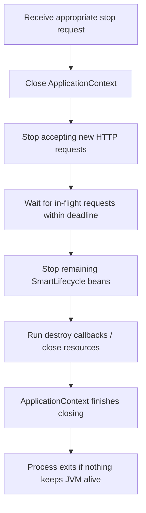
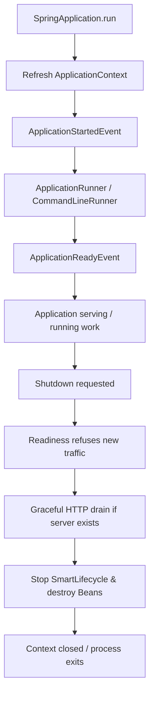

# Limits of Graceful Shutdown by Application Type

When a Spring Boot instance stops to deploy a new version, restart, or reclaim resources, what matters is not only **whether the process can exit**. We also want in-flight requests to have a chance to finish, avoid accepting new work right before stopping, and reduce the risk of aborted transactions or data loss.

That is the goal of **graceful shutdown** (stopping with a waiting period). With embedded web servers supported by Spring Boot, shutdown can stop accepting new requests and grant in-flight requests a period of time to complete before closing the server entirely.

However, graceful shutdown **does not guarantee that every task in the JVM will finish**. Its actual effectiveness depends on the application type, web server, connection style, background jobs, how the process is launched, and deployment platform time limits.

This lesson distinguishes those scenarios so you understand when `server.shutdown` helps, when it has no effect, and what extra mechanisms are needed for safe application shutdown.

## 1. Stopping with a Grace Period vs. Stopping Immediately

Suppose a REST API is processing three requests when the system sends a stop signal:

```text
Before shutdown:
  Request A: nearly finished
  Request B: querying the database
  Request C: about to start

When graceful shutdown begins:
  - Server stops accepting new requests per its mechanism
  - A and B have an opportunity to complete
  - C is processed only if already accepted by the server before the stop cutoff
  - Once the timeout expires, server and context proceed to close
```

If stopped immediately, active connections can be cut off prematurely. With graceful stopping, the odds of finishing requests improve, yet limits remain: requests can hang indefinitely, the wait deadline can expire, or the runtime environment can forcefully terminate the process before Spring finishes its lifecycle.

Do not read the word "graceful" as "wait forever until everything finishes". It means the system **attempts an orderly shutdown within a bounded window across managed components**.

## 2. Where Does Spring Boot Support Graceful Shutdown?

Spring Boot performs graceful shutdown for **embedded web servers** while closing `ApplicationContext`. This is the key point for distinguishing application types:

| Application / deployment type | Does `server.shutdown` control a Boot-managed web server? | Main limitations |
|---|---|---|
| Spring MVC / Servlet with embedded Tomcat or Jetty | Yes | Primarily handles HTTP requests and connections managed by the embedded server |
| Spring WebFlux with embedded Reactor Netty, or corresponding supported web server | Yes | Reactive requests may involve long streams, subscriptions, and separate cancellation |
| Servlet/Reactive using Undertow on Boot lines that still support it | Yes per that line's documentation | Rejecting new requests differs from Tomcat/Jetty/Netty |
| Non-web applications (CLI, batch, workers with no HTTP) | No embedded HTTP server to control | Needs separate lifecycle for jobs, queue consumers, schedulers, executors |
| WAR running inside an external servlet container | Does not directly control stopping the external container | Host server and deployment system govern connectors/lifecycle |
| Apps adding a gRPC server, socket server, or standalone consumer | Only affects the Boot-managed HTTP server | Custom endpoints/consumers require separate drain and stop mechanisms |

One application can combine multiple workloads at once. For instance, a REST API may serve HTTP, run `@Scheduled` tasks, and consume from Kafka. The embedded HTTP server's graceful shutdown is only **one part** of shutting down that application.

### Distinguishing Spring Boot Versions

Default behavior and the set of supported web servers change across releases:

- **Spring Boot 3.5:** official documentation describes graceful shutdown as enabled by default and lists Jetty, Reactor Netty, Tomcat, and Undertow.
- **Spring Boot 4.0:** official documentation describes graceful shutdown as enabled by default and lists Jetty, Reactor Netty, and Tomcat; Undertow is no longer in this list.
- **Older lines such as Boot 3.3 and Boot 2.x:** documentation instructs enabling the feature with `server.shutdown=graceful`. Do not take defaults from Boot 3.5/4.0 and apply them backward to every version.

Therefore, before configuring production, verify **your actual Boot version, actual server type, and the documentation for that exact release line**. Never assume all Boot applications share the same default.

## 3. Configuring Graceful Shutdown and Wait Time

In projects where you want graceful shutdown intent stated explicitly, you can set:

```properties
server.shutdown=graceful
spring.lifecycle.timeout-per-shutdown-phase=25s
```

Or YAML:

```yaml
server:
  shutdown: graceful
spring:
  lifecycle:
    timeout-per-shutdown-phase: 25s
```

Meaning:

- `server.shutdown=graceful` requests graceful shutdown for supported embedded web servers. On versions where it is enabled by default, this line still makes intent clear.
- `spring.lifecycle.timeout-per-shutdown-phase` sets the maximum duration for **each `SmartLifecycle` shutdown phase**. Embedded web server graceful shutdown participates in a phase early in shutdown.
- Once the phase deadline expires, Spring continues closing; there is no guarantee all unfinished requests will complete.

To request immediate shutdown on lines supporting this property:

```properties
server.shutdown=immediate
```

**Common pitfall:** `timeout-per-shutdown-phase=25s` does not mean "the entire JVM is guaranteed to exit in 25 seconds". The context may have multiple phases, destruction callbacks, executors awaiting tasks, external system connections, and other cleanup time. Docker/Kubernetes/systemd termination limits form yet another layer.

## 4. Where Does Graceful Shutdown Happen in the Lifecycle?

In a typical embedded web app, Spring Boot closes `ApplicationContext` and coordinates stopping via `SmartLifecycle`. Web server graceful shutdown runs early in shutdown so other beans remain available while in-flight requests finish.



The diagram illustrates the principle; exact order depends on scopes, phases, bean dependencies, and server implementation. Other callbacks/stop components still participate while the context is closing.

Why not close the datasource right when the stop signal arrives? Because an in-flight request may still need database transactions or queries. Stopping HTTP intake first curbs new work; deferring dependency destruction gives existing work a chance to finish.

However, `@PreDestroy` and `DisposableBean.destroy()` do not automatically become "wait until all requests are done". They are per-bean cleanup callbacks. If a bean owns background workers or queue consumers, you must design proper stop/drain behavior.

## 5. Differences Across Embedded HTTP Servers

All Boot-supported servers share the goal of limiting new requests during the wait period, yet **how they reject** requests can differ:

| Web server | Behavior when stopping new requests per Boot docs | What clients must understand |
|---|---|---|
| Tomcat | Stops accepting at the network layer | New connections may be refused or fail |
| Jetty | Stops accepting at the network layer | Client/load balancer must retry/fail over to another instance |
| Reactor Netty | Stops accepting at the network layer | Open HTTP/stream connections may need separate handling |
| Undertow (on Boot 3.5 and supported lines) | May accept new connections yet return HTTP 503 | Clients see a "Service Unavailable" response rather than necessarily a connection error |

This difference explains why test clients see different errors across servers even with graceful shutdown enabled. **Do not write tests expecting every server to return HTTP 503**, or every server to close sockets at the exact same moment.

Keep-alive connections, HTTP/2, connection pools, and proxies/load balancers also affect how requests are rejected or connections reused. Verify against your actual server and protocol.

## 6. Servlet MVC: Short HTTP Requests Are Usually Well Supported

A REST endpoint responding within a few seconds is the easiest case to reason about:

```java
@RestController
@RequestMapping("/reports")
public class ReportController {
    private final ReportService reportService;

    public ReportController(ReportService reportService) {
        this.reportService = reportService;
    }

    @PostMapping
    public ResponseEntity<String> create(@RequestBody ReportInput input) {
        String id = reportService.create(input);
        return ResponseEntity.ok(id);
    }
}
```

The example assumes `ReportInput` and `ReportService` are defined; the controller uses synchronous request processing.

If a request was already accepted by the server before graceful shutdown started, the container can allow it to finish and return a response within the grace period. New requests are handled according to the server's rejection mechanism.

**Limitations in this scenario:**

- Requests making slow database or external API calls can exceed the grace period.
- If a transaction commits only after the deadline or the process is killed, the request is not guaranteed to succeed.
- An upstream proxy may have a shorter timeout, disconnecting the client even while the server is still processing.
- Clients may retry after network errors; write endpoints should have an appropriate idempotency strategy.

Graceful shutdown reduces aborted requests, yet does not replace transactions, timeouts, retry policies, and idempotency.

### MVC Async Requests

In Spring MVC, endpoints can return `Callable<T>`, `DeferredResult<T>`, or use async processing. Both the HTTP connector and an executor participate in the request lifecycle. On shutdown:

- The web server must manage requests already accepted.
- The task executor must remain available to handle necessary work long enough.
- MVC async request timeouts must be considered separately.

If the executor shuts down too early or async work runs on a self-created executor not managed by Spring, graceful HTTP server shutdown **does not guarantee** all of that async work completes.

## 7. WebFlux and Long Reactive Streams

Spring WebFlux can run on Reactor Netty or another supported embedded server. For finite-response requests, graceful shutdown likewise tries to let in-flight requests complete within the grace period.

However, reactive applications cover multiple workload shapes:

```java
@RestController
public class PriceController {

    @GetMapping("/prices")
    public Mono<Price> currentPrice() {
        return priceService.fetchCurrentPrice();
    }
}
```

The example assumes `Price` and `priceService` are defined. `Mono<Price>` typically completes after emitting at most one value, fitting the bounded request model.

Meanwhile, a stream can stay open indefinitely:

```java
@GetMapping(value = "/prices/live", produces = MediaType.TEXT_EVENT_STREAM_VALUE)
public Flux<Price> livePrices() {
    return priceService.updates();
}
```

If `updates()` emits data continuously, this request **has no natural completion point** within the grace period. The server cannot keep every SSE connection open forever just to shut down gracefully. Once the stop deadline hits, connections may be closed or subscriptions canceled depending on stack/protocol.

Prepare for:

- Cancellation and resource cleanup inside the reactive pipeline.
- SSE client reconnection, potentially with event IDs to resume from the last received checkpoint.
- Timeouts/circuit breakers for backend tasks.
- Side effects handling duplicate retries if clients reconnect and resend actions.

**Never assume** a `Flux` will always finish simply because the server is in graceful shutdown. HTTP server shutdown and data-source lifecycle must be designed cohesively.

## 8. WebSocket, SSE, Streaming, and Long-Running Requests

This is the group most prone to deployment misunderstandings:

| Connection / workload | Finite completion point? | Shutdown limitation |
|---|---|---|
| Fast REST request | Usually yes | Can be awaited within grace period |
| Multi-minute REST request | Yes, but slow | May be cut off when timeout expires |
| SSE stream | Usually no | Cannot wait forever; needs reconnect and resume |
| WebSocket session | Can persist very long | Needs protocol/app logic to close session and client reconnect |
| HTTP/2 with multiplexed streams | Multiple requests over one connection | Exact draining depends on server/protocol |
| Large file download/upload | Yes, depends on size/speed | May exceed grace period and be interrupted mid-transfer |

### WebSocket

WebSocket is a long-lived connection established after an HTTP upgrade. Do not assume standard HTTP request stopping will ensure every WebSocket session finishes a business "conversation".

A real-time application should have a strategy to:

1. Stop creating new sessions when the instance prepares to stop.
2. Notify clients or close WebSockets intentionally when possible.
3. Finish or mark unprocessed messages and decide whether to persist them to a durable queue.
4. Let clients reconnect to another instance and sync state.

Close frames, heartbeats, session timeouts, and reconnect mechanisms must be designed for the specific WebSocket server/library. Graceful shutdown **does not automatically provide a resume protocol** for clients.

### Streaming Responses and Large Uploads

If the server stops after 25 seconds while a streaming response needs 3 minutes, the request may be closed. For downloads, clients should support resume/range requests if business requires it. For uploads or large transactions, design safe re-submission and handling of incomplete payloads.

Choose the grace period based on disruption tolerance and actual request duration distribution, not merely the average duration. Even with a long grace period, always plan for external forced kills.

## 9. Non-Web Applications: server.shutdown Does Not Manage Jobs

A Spring Boot application may have no HTTP server at all:

```java
public static void main(String[] args) {
    SpringApplication application =
            new SpringApplication(BatchApplication.class);
    application.setWebApplicationType(WebApplicationType.NONE);
    application.run(args);
}
```

In this case, configuring:

```properties
server.shutdown=graceful
```

has no embedded HTTP server to act upon. The application can still close `ApplicationContext` and run `SmartLifecycle` stop callbacks, `@PreDestroy`, or destroy methods. However, that **does not automatically know** which step a job is on, which messages were acknowledged, or which transaction needs finishing.

For example, a batch import reading a file:

```text
Read record → validate → write database → update checkpoint
                                     ^
                              stop signal here
```

If the process is killed before the checkpoint, the next run must know how far processing progressed. Web server graceful stop does not solve this. Batch apps should have:

- Recoverable checkpoints / progress state.
- Clear transaction boundaries.
- A mechanism to stop picking up new work.
- Letting current work finish or roll back safely.
- Retry/idempotency capability if interrupted at any point.

If using Spring Batch, leverage job repositories, step executions, and restartability per your design. Setting `server.shutdown=graceful` alone does not make a batch job restartable.

## 10. Message Consumers: Kafka, RabbitMQ, JMS

A service can both expose HTTP APIs and continuously consume messages:

```java
@KafkaListener(topics = "orders")
public void handle(OrderEvent event) {
    orderProcessor.process(event);
}
```

This example assumes Spring Kafka and related classes are present. The consumer follows the lifecycle of the listener container/messaging library, **not** the HTTP requests drained by the web server.

To stop safely, messaging systems generally need:

1. Stop polling or stop accepting new deliveries.
2. Allow in-flight messages to finish within an appropriate window.
3. Commit offsets or acknowledge only after side effects are safely persisted per processing semantics.
4. Hand off unprocessed partitions/work to other consumers or the next run.
5. Handle duplicate deliveries via idempotency/deduplication under at-least-once semantics.

The closing order across listener containers, transaction managers, datasources, and executors must align. If the datasource closes before the consumer finishes its message, graceful web shutdown will not prevent failures.

Spring Kafka/Rabbit/JMS provide their own lifecycle, ack, and stop timeout properties. Read the documentation for the exact integration you use; `spring.lifecycle.timeout-per-shutdown-phase` does not replace every broker consumer timeout.

### At-Least-Once Does Not Mean Exactly-Once

If a message finishes processing yet the process dies before ack/commit, the broker may redeliver that message. This is normal in distributed systems, even with graceful shutdown. Never treat graceful stopping as a guarantee of "no duplicate processing"; make business operations retry-safe.

## 11. @Scheduled and @Async: Dependent on Executors/Schedulers

Suppose an application has a periodic schedule:

```java
@Scheduled(fixedDelayString = "PT1M")
public void reconcile() {
    reconciliationService.runOnce();
}
```

And an asynchronous method:

```java
@Async
public CompletableFuture<Void> sendEmailAsync() {
    mailService.sendPending();
    return CompletableFuture.completedFuture(null);
}
```

These tasks run via schedulers/executors. When the context closes, how they stop depends on executor type, lifecycle, and dedicated shutdown settings. The web server stopping new requests **does not mean** all tasks queued in executors are awaited.

For executors/schedulers **auto-configured by Spring Boot**, relevant properties include:

```properties
spring.task.execution.shutdown.await-termination=true
spring.task.execution.shutdown.await-termination-period=20s
spring.task.scheduling.shutdown.await-termination=true
spring.task.scheduling.shutdown.await-termination-period=20s
```

General meaning: asks the respective executor/scheduler to wait for remaining tasks up to a configured duration. Exact behavior depends on Boot version, executor type (thread pool vs. virtual-thread executor), whether you defined a custom executor bean, and task state.

**If you create `Executors.newFixedThreadPool(...)` yourself and hold it in a static field without registering cleanup**, Spring does not own its lifecycle. You must stop the executor and handle pending tasks manually.

Do not just raise timeouts. Distinguish task types:

- Short, fast-completing tasks: usually safe to await.
- Long tasks with checkpoints: allow controlled stop and resume.
- Infinite tasks (polling loops): must have a stop flag / cancellation.
- Tasks blocked on network I/O: need timeouts and proper interruption handling.

## 12. SmartLifecycle and Stop Callbacks for Custom Work

To make a background-work component participate in Spring's orderly lifecycle, use `SmartLifecycle`.

This interface provides methods such as `start()`, `stop()`, `isRunning()`, `getPhase()`, and `stop(Runnable callback)`. When the context closes, the lifecycle processor coordinates stopping by phase and relies on the callback to know when the component has stopped.

Concept:

```java
@Component
public class QueueConsumerLifecycle implements SmartLifecycle {
    private volatile boolean running;

    @Override
    public void start() {
        running = true;
        // Start the consumer owned by this component.
    }

    @Override
    public void stop(Runnable callback) {
        running = false;
        // Tell consumer to stop receiving new messages;
        // invoke callback only when stopping has completed.
        stopConsumerAsync(callback);
    }

    @Override
    public void stop() {
        running = false;
        // Synchronous or fallback stop mechanism of the component.
    }

    @Override
    public boolean isRunning() {
        return running;
    }
}
```

This snippet **illustrates the lifecycle contract**, not runnable standalone code: `stopConsumerAsync` must be implemented by the application and must guarantee invoking the callback promptly, even if stopping fails. Real implementations must also handle threading, start/stop races, exceptions, and idempotency.

When writing `SmartLifecycle`:

- Only mark stopped after essential resources have actually halted.
- When stopping asynchronously, invoke the callback only after stopping finishes; never leave the callback uncalled indefinitely.
- Choose phases deliberately and consider bean dependency relationships.
- Ensure services needed by the consumer are not destroyed before draining finishes.

Do not write custom `SmartLifecycle` wrappers to replace messaging listener containers that already have solid lifecycles. Prefer the library's built-in stop/drain support, writing custom lifecycle only when you genuinely own custom resources.

## 13. @PreDestroy Is Useful, Not a Complete Drain Mechanism

A bean can close resources at the end of its lifecycle:

```java
@Component
public class FileWriterResource {
    private final BufferedWriter writer;

    public FileWriterResource() throws IOException {
        writer = Files.newBufferedWriter(
                Path.of("output.log"),
                StandardOpenOption.CREATE,
                StandardOpenOption.APPEND);
    }

    public synchronized void writeLine(String value) throws IOException {
        writer.write(value);
        writer.newLine();
    }

    @PreDestroy
    public synchronized void close() throws IOException {
        writer.flush();
        writer.close();
    }
}
```

The example assumes appropriate Java and Jakarta annotation imports are present. It shows cleanup of a resource owned by the bean.

However, `@PreDestroy` does not automatically stop producers still writing to the writer from other threads. If tasks keep running after the file closes, they will fail. You must **stop work sources first**, wait for or hand off in-flight work, and only then close resources.

That is the difference between *draining* (letting active work conclude in a controlled way) and *cleanup* (closing resources).

## 14. Spring's Grace Period vs. Platform Deadlines

A container deployment example:

```text
Orchestrator decides to stop instance
  ↓
Mark unready / remove from traffic routing
  ↓
Send appropriate stop signal to process
  ↓
Spring closes context and awaits graceful shutdown
  ↓
Run stop/close resource callbacks
  ↓
Process exits

If deadline exceeded:
  Platform may forcefully kill process
```

On Linux/containers, the stop signal is typically `SIGTERM`, followed after a grace window by `SIGKILL` if the process still has not exited. On Kubernetes, `terminationGracePeriodSeconds` caps a Pod's termination time under Kubernetes lifecycle; this budget must also cover hooks such as `preStop` and process cleanup time.

Illustrative example:

```yaml
# application.yml
server:
  shutdown: graceful
spring:
  lifecycle:
    timeout-per-shutdown-phase: 25s
```

```yaml
# Excerpt from an illustrative Pod spec
spec:
  terminationGracePeriodSeconds: 50
```

These two numbers **are not a fixed formula guaranteeing clean shutdown**. If the application has multiple lifecycle phases, slow cleanup, lengthy hooks, or sluggish external dependencies, total time can exceed the budget. The platform can kill the process before Spring finishes.

### Container PID 1 and Signals

A common deployment mistake is launching Java via a shell script that fails to forward signals properly. Using exec form like `ENTRYPOINT ["java", "-jar", "app.jar"]` helps the Java process receive container signals directly in many environments.

Do not assume an IDE's "Stop" button or a forced kill goes through shutdown hooks. Boot's documentation also notes that IDEs may terminate immediately instead of gracefully if they do not send the appropriate signal.

On Windows or development machines, process termination differs from Linux. When testing, use a stop mechanism that supports shutdown hooks and inspect context close logs instead of inferring success merely from the console window disappearing.

## 15. Readiness and Stopping Incoming Traffic

Graceful shutdown on the embedded server is a final line of defense. In multi-instance systems, coordinate with the load balancer or Kubernetes to **stop sending new requests** to the stopping instance.

Spring Boot Actuator can publish state:

- `LivenessState`: whether the application is still operational at the process/lifecycle level.
- `ReadinessState`: whether the application is ready to accept new work.

During graceful shutdown, Spring Boot can transition readiness to `REFUSING_TRAFFIC`. However, HTTP readiness probes may become unreachable once the server stops accepting requests. Therefore, proxies/orchestrators will not necessarily see one last probe response.

With Kubernetes, consider:

- Readiness probes and endpoint list update propagation.
- Propagation delay to load balancers/ingress.
- Existing keep-alive connections.
- A `preStop` hook if time is needed for routing systems to stop sending traffic.
- Termination deadlines for the entire Pod and any sidecars.

If Actuator runs on a separate management port, a passing probe on the management server does not prove the main server is handling requests properly. In some setups, expose readiness/liveness paths on the main port per Boot documentation.

**Readiness does not finish requests for you; graceful server shutdown does not instantly notify every external proxy.** The two mechanisms complement each other and must both be designed into your deployment strategy.

## 16. Transactions, Durability, and Retries Are Still Needed

A request finishing within the grace period does not guarantee all associated work is done if the application already returned the HTTP response before:

- Sending a message to a broker.
- Writing an event to an outbox.
- Running an `@Async` task.
- Calling an external service asynchronously.
- Flushing data from a self-managed buffer.

Example:

```java
@PostMapping("/payments")
public ResponseEntity<Void> pay(@RequestBody PaymentCommand command) {
    paymentService.accept(command);
    emailService.sendAsync(command.email());
    return ResponseEntity.accepted().build();
}
```

The HTTP request can finish very quickly while the email task runs afterward. Web server graceful shutdown only sees the HTTP request, and will not automatically await the email task unless executors/lifecycles are configured accordingly.

For critical business flows, consider durable queues or the transactional outbox pattern so work is durably recorded before returning the response. Avoid staking reliability on the process staying alive long enough after the response.

Concepts to combine:

- **Timeout:** bounds how long an operation waits.
- **Transaction:** groups consistent changes within a boundary.
- **Retry:** recovers from transient failures.
- **Idempotency:** handles repeated requests/messages without corrupting outcomes.
- **Checkpoint:** resumes long jobs after interruption.
- **Graceful shutdown:** reduces disruption within the allowed stop window.

They complement one another; no single mechanism replaces the rest.

## 17. When Running Under an External Servlet Container

If a Spring Boot application is packaged as a WAR and deployed into an external servlet container—such as an operations-managed Tomcat instance—Boot's embedded `server.shutdown` property does not directly dictate how the external container stops its listeners/connectors.

In that model:

- The operations platform decides when and how to stop the external Tomcat/Jetty server.
- The Spring application may receive context closure and bean cleanup when the container undeploys/stops, depending on container lifecycle.
- Timeouts for in-flight requests, sessions, connectors, and sibling web apps are governed by the host server.
- Do not assume setting `server.shutdown=graceful` inside a WAR guarantees graceful stopping of the entire servlet container.

Review the host server's shutdown configuration and WAR deploy/redeploy behavior. When multiple apps share one container, stopping a single app differs from stopping the whole server.

## 18. Distinguishing SpringApplication.run Completion from Shutdown

An application starts up and closes its context at distinct milestones:



`ApplicationReadyEvent` marks the end of startup, not a guarantee the app stays healthy afterward. When shutdown starts, readiness and lifecycle shift toward stopping.

A non-web application still receives `ApplicationReadyEvent` upon finishing startup even without an HTTP server, and can still run background work afterward. Conversely, graceful HTTP shutdown can still be triggered in a web app before the process actually exits.

## 19. Limits Table by Application Type

| Application type | What graceful web shutdown protects | What the app must still design itself |
|---|---|---|
| MVC REST CRUD | Standard in-flight HTTP requests | Transactions, request timeouts, retries, idempotency |
| MVC async / `DeferredResult` | HTTP connector and server-managed request half | Executor, completion/cancellation, async timeouts |
| Finite WebFlux API | In-flight HTTP exchanges | Reactor pipeline cleanup, downstream timeouts |
| SSE / streaming | Ability to await stream within deadline | Reconnect, resume, stream termination |
| WebSocket | Some connection behavior depending on server | Close protocol, session state, reconnect |
| Batch/CLI | No HTTP server to drain | Checkpoints, restartability, stop controls |
| Kafka/Rabbit/JMS worker | Does not control broker consumer | Stop polling, ack/offset, retries, deduplication |
| `@Scheduled` / `@Async` | Does not manage all tasks automatically | Executor shutdown and task cancellation |
| External WAR | Does not control host servlet container | Container stop/redeploy configuration |
| Multi-protocol app | Only Boot's embedded HTTP server | Lifecycles for gRPC, sockets, other consumers |

**Design check questions:** Which component accepts new work? Which component knows what work is unfinished? Which component holds durable state to recover if killed? Answering these three questions matters far more than merely increasing timeouts.

## 20. How to Test Safe Shutdown

You can build a manual test with one finite-duration endpoint and one streaming endpoint:

1. Configure `server.shutdown=graceful` and an easily observable grace period, such as 25 seconds.
2. Send an HTTP request that finishes in 5 seconds, while preparing a new request.
3. Send a stop signal to Java using a mechanism supported by your environment so Spring's shutdown hook runs.
4. Observe whether the in-flight request returns a response within the deadline.
5. Observe how the new request is rejected by your web server.
6. Test a request longer than the grace period and observe actual behavior.
7. Test SSE/WebSocket to see how connections close and clients reconnect.
8. If message consumers or async tasks exist, log stop progress and remaining unfinished work separately.

Do not extrapolate from a single passing test that data will never be lost. Test multiple failure cases: hung requests, slow databases, mid-flight messages, SIGTERM, forced kills, and restarts under real orchestration.

### Illustrative Slow Endpoint

```java
@RestController
class DemoShutdownController {

    @GetMapping("/demo/slow")
    String slow() throws InterruptedException {
        Thread.sleep(5_000);
        return "completed";
    }
}
```

This endpoint is **strictly for learning and observation**, not a production request-handling pattern. Using `Thread.sleep` ties up request threads; in real apps use I/O APIs with timeouts and patterns suited to MVC or WebFlux.

During testing, compare timestamps in logs: signal received, graceful server shutdown started, in-flight request completed, context closed, and process exited. This helps separate HTTP server timeouts from executor, broker, or platform timeouts.

## 21. Misconceptions to Avoid

**"Enabling graceful shutdown means everything in the app exits safely."** No. The embedded web server only controls its own requests/connections. Jobs, queue consumers, and executors have separate lifecycles.

**"Setting `server.shutdown=graceful` is enough for batch apps."** No. Non-web apps have no HTTP server to apply that setting to.

**"A 25-second grace period guarantees the JVM exits in 25 seconds."** No. `spring.lifecycle.timeout-per-shutdown-phase` applies per lifecycle phase; total stop time involves other components too.

**"Every server returns HTTP 503 for new requests."** No. Rejection behavior depends on server and version; Tomcat, Jetty, and Reactor Netty generally stop accepting at the network layer, whereas Undertow on supported lines may return 503.

**"Once the HTTP request finishes, all related work is done."** No. `@Async`, background events, or post-response messages may still be running.

**"SSE or WebSocket connections can simply be awaited until they close naturally."** Not always. Many connections live indefinitely and need explicit close/reconnect protocols.

**"Stopping a process from the IDE is always identical to SIGTERM."** No. Some development tools kill processes immediately without running shutdown hooks as expected.

**"Kubernetes will wait forever for Spring to shut down gracefully."** No. Orchestrators enforce deadlines and can forcefully kill pods.

**"No new requests means no new work."** False if the app still runs schedulers, broker consumers, gRPC servers, or internal tasks.

## 22. Process for Choosing the Right Solution

When adding graceful shutdown to an application, walk through these questions:

1. **What kind of app is it?** Servlet web, Reactive web, non-web, external WAR, or multi-protocol?
2. **Which server/Boot version is used?** Tomcat, Jetty, Reactor Netty, Undertow (if still supported), and is graceful shutdown enabled by default?
3. **Do workloads have finite completion points?** Short REST, long requests, SSE, WebSocket, batch, or consumers?
4. **Who accepts new work?** HTTP server, Kafka/Rabbit, schedulers, thread pools, custom sockets?
5. **Who awaits and closes resources?** `SmartLifecycle`, messaging listener containers, executors, destroy callbacks?
6. **If forcefully killed, how does it recover?** Transactions, checkpoints, offsets, durable queues, idempotency?
7. **How much time does the platform grant?** Grace periods, `preStop` hooks, termination deadlines, load balancer propagation?
8. **Have real shutdown scenarios been tested?** Locally and in deployment environments, with long requests, downstream failures, and restarts?

This is reasoning by **scope of responsibility**: the server handles HTTP; Spring manages bean lifecycles; libraries manage consumers/executors; the platform decides when the process must end.

## 23. Version-Specific References

- [Spring Boot 3.5 — Graceful Shutdown](https://docs.spring.io/spring-boot/3.5/reference/web/graceful-shutdown.html): describes defaults, embedded servers, and differences when rejecting new requests.
- [Spring Boot 4.0 — Graceful Shutdown](https://docs.spring.io/spring-boot/4.0/reference/web/graceful-shutdown.html): documentation for the 4.0 line, listing Tomcat, Jetty, and Reactor Netty.
- [Spring Boot — Task Execution and Scheduling](https://docs.spring.io/spring-boot/reference/features/task-execution-and-scheduling.html): configuring task executors and schedulers.
- [Spring Boot — Actuator Endpoints / Kubernetes Probes](https://docs.spring.io/spring-boot/reference/actuator/endpoints.html): readiness, liveness, and states during shutdown.
- [Spring Framework — Task Execution and Scheduling](https://docs.spring.io/spring-framework/reference/integration/scheduling.html): lifecycle and executors/schedulers in Spring.

Graceful shutdown works best when an application has **clear work boundaries**: stop accepting additional work, give in-flight work a chance to finish within deadline, and close resources in the right order. For embedded Servlet or Reactive HTTP servers, Spring Boot covers stopping new requests and waiting for in-flight exchanges. For batch, messaging, `@Async`, `@Scheduled`, WebSocket, and long streaming, you must design additional lifecycle, cancellation, retries, and recoverability. A system truly has a safe shutdown strategy only when both the application and deployment platform respect these limits together.
