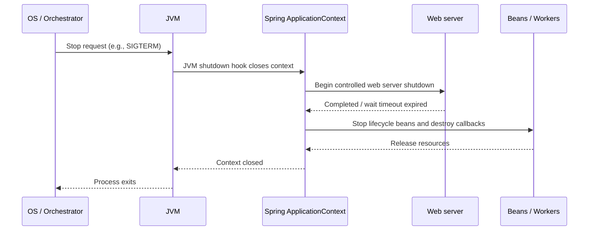

# Distinguishing Controlled Shutdown from Forcefully Terminated Processes

A Spring Boot application may run normally for days, yet sooner or later it must stop: deploying a new version, changing configuration, scaling replicas up or down, server maintenance, or shutting down a one-shot tool. Not every way a process ends produces the same result.

**Controlled shutdown (graceful shutdown)** is the process where an application receives a stop request and gets a chance to **stop accepting new work, finish or safely handle in-flight work, release resources, and end the Spring context lifecycle**. Conversely, **forced termination** happens when the operating system, deployment platform, or another mechanism stops the process before the application has a chance to run its full cleanup sequence.

In the **State and Shutdown** chapter of *Spring Boot Fundamentals*, we distinguish these two situations across three layers: the OS/JVM process, the Spring `ApplicationContext` lifecycle, and request or business-work lifecycles. This lesson also introduces web server graceful shutdown configuration, signal handling, Spring events and callbacks, data-integrity risks, Docker/Kubernetes operations, and verifying shutdown behavior.

## 1. Why Does How an Application Stops Matter?

Imagine an order-processing application:

1. Client sends an order request.
2. Service checks inventory.
3. Service writes the order to the database.
4. Service publishes an event to a message broker.
5. Service returns a response to the client.

If the process is terminated between step 3 and step 4, the order may be saved while the event is never published. If the client never receives a response, it may retry; the system must avoid creating duplicate orders. If a worker just received a message without acknowledging completion yet, the broker may redeliver that message.

Graceful shutdown helps **reduce the risk of mid-flight interruption** by granting a window for the application to stop accepting new work and finish ongoing work. However, it does not replace transactional design, idempotency, or recovery mechanisms: applications can still crash, lose power, exceed shutdown deadlines, or be forcefully killed.

Good operational design needs both:

- **Smooth shutdown behavior:** attempt to complete active work within the granted time window.
- **Resilience to sudden termination:** data remains consistent and tasks can be re-run or recovered safely when cleanup does not finish in time.

## 2. Three Concepts: Stop Request, Graceful Shutdown, and Forced Termination

First, separate three concepts that are often conflated.

### 2.1. Stop Request

An operations tool asks the application to terminate. On Unix-like systems, this request may arrive via `SIGTERM`. When running an app in a terminal, `Ctrl+C` typically sends `SIGINT`. In Java, calling `System.exit(...)` also starts normal JVM termination.

A stop request **does not guarantee the application will shut down smoothly**. It only provides an opportunity for the process to run shutdown logic if the JVM can still execute and receives the request.

### 2.2. Graceful Shutdown

This is behavior at the application and framework level:

- Transition state toward preparing to stop.
- Block or limit new work.
- Allow in-flight work to complete within a time limit.
- Stop background components in an appropriate order.
- Invoke destruction callbacks and close resources.
- Close the context, then the process exits.

Graceful shutdown normally has a **deadline**. A process cannot wait forever for a hung request or an unresponsive worker.

### 2.3. Forced Termination

In forced termination, the process is stopped before those steps can complete. The classic Linux example is `SIGKILL`:

```bash
kill -KILL <pid>
```

`SIGKILL` cannot be caught or delayed by the application to run shutdown hooks. Other situations also preclude reliable cleanup: host power loss, severe JVM crashes, code calling `Runtime.halt(...)`, or forcefully killing a container.

### 2.4. Comparison Table

| Aspect | Controlled shutdown | Forced termination |
| --- | --- | --- |
| Does JVM have time to run cleanup? | Usually yes | None or insufficient |
| Does Spring context close normally? | Possible, if shutdown completes fully | Cannot be guaranteed |
| `@PreDestroy` / destroy callbacks | Have an opportunity to run | Cannot be relied upon |
| In-flight requests | Can be awaited within deadline | Can be abruptly severed |
| Workers and message consumers | Can stop intake, finish/release work | Can be cut off mid-flight |
| Connection resources | Chance to close per protocol | OS reclaims process resources, yet app cleanup logic does not run |
| Data risk | Reduced, not completely eliminated | Higher without transactions and recovery |
| Guarantee level | Depends on timeouts and external systems | No guarantee app callbacks run |

**Key point:** an application cannot guarantee graceful shutdown on its own when the environment decides to terminate the process immediately.

## 3. Shutdown Signals at the Operating System Layer

On Linux and Unix-like systems, common signals include:

| Signal | Common meaning | Smooth shutdown opportunity |
| --- | --- | --- |
| `SIGTERM` | Request process termination | Usually yes; JVM can run shutdown hooks |
| `SIGINT` | Interrupt process, typically from `Ctrl+C` | Usually yes in normal interactive runs |
| `SIGKILL` | Kernel ends process immediately | No; cannot be caught or ignored |
| `SIGQUIT` | System/runtime-dependent; on JVM typically triggers diagnostics | Should not be treated as a default graceful shutdown signal |

Example:

```bash
# Request controlled termination:
kill -TERM 12345

# Forcefully terminate process:
kill -KILL 12345
```

`12345` is only an illustrative PID. Never run these commands against critical processes without verifying the exact PID and operational plan.

### 3.1. SIGTERM Does Not Guarantee Graceful Shutdown Succeeds

`SIGTERM` gives the process a chance to run shutdown. Yet if the app is hung, deadlocked, missing proper shutdown hooks, or hits a time limit, shutdown may not finish. The operations platform may follow up with `SIGKILL` once the grace period expires.

Therefore, saying "send SIGTERM for graceful shutdown" should be understood as **requesting controlled termination**, not an absolute guarantee.

### 3.2. Windows Does Not Use the Same POSIX Model

On Windows, actions such as ending a process in Task Manager or `Stop-Process` are not exact equivalents to sending `SIGTERM` to a Linux process. Some termination methods end the process without giving the application enough opportunity to run callbacks.

To test Spring lifecycle on Windows, close the context intentionally inside the app or trigger shutdown via a suitable Java runner. Do not take an IDE's "Stop" button behavior as proof that every deployment environment triggers graceful shutdown identically.

## 4. From Stop Signal to Spring Boot Lifecycle

Spring Boot runs on the JVM and manages `ApplicationContext`. During normal startup, Boot registers a JVM shutdown hook to close the context when the JVM terminates in a way that permits shutdown hooks to run.

General flow:



This diagram illustrates core responsibilities, not a guarantee of the exact order of every internal callback. Spring manages multiple shutdown phases via the lifecycle processor, and component order also depends on phases, dependencies, and bean types.

### 4.1. Context Closing Differs from Process Exiting

`ApplicationContext.close()` requests closing the Spring context. However, **closing the context does not always mean the JVM exits immediately**. If unstopped non-daemon threads remain or code keeps running outside the context, the JVM can stay alive.

Conversely, the OS can terminate the JVM without ever running `ApplicationContext.close()`. Thus, process state and Spring context state are related yet distinct aspects.

### 4.2. Shutdown Hooks Do Not Run in Every Situation

JVM shutdown hooks typically execute when the JVM exits normally via `System.exit(...)` or receives a catchable termination signal. They are **not guaranteed to run** when:

- The process receives `SIGKILL`.
- The OS or host machine stops abruptly.
- The JVM crashes.
- Code calls `Runtime.getRuntime().halt(...)`.
- The platform kills the process before hooks finish.

Never design data correctness around the assumption that "`@PreDestroy` will definitely run".

## 5. Configuring Web Server Graceful Shutdown in Spring Boot

Spring Boot supports graceful shutdown for supported embedded web servers. Typical configuration:

```properties
server.shutdown=graceful
spring.lifecycle.timeout-per-shutdown-phase=30s
```

Or YAML:

```yaml
server:
  shutdown: graceful

spring:
  lifecycle:
    timeout-per-shutdown-phase: 30s
```

### 5.1. server.shutdown=graceful

The `server.shutdown` property asks Spring Boot to use controlled web server shutdown instead of the immediate stop mode. Exact behavior for new connections and in-flight requests depends on the web server implementation.

Popular embedded servers such as Tomcat, Jetty, Reactor Netty, and Undertow behave differently at the network layer. Do not assume every server responds to new requests with the same HTTP status code during shutdown.

### 5.2. spring.lifecycle.timeout-per-shutdown-phase

The `spring.lifecycle.timeout-per-shutdown-phase` property specifies the wait duration for each shutdown phase managed by the Spring lifecycle processor. For web server graceful shutdown, this is a key limit for awaiting in-flight work.

Example:

```properties
spring.lifecycle.timeout-per-shutdown-phase=45s
```

That value expresses the maximum wait for **each corresponding shutdown phase**, not a promise that the entire process exits in exactly 45 seconds. With multiple phases, other callbacks, or non-Spring components, total duration may differ. Moreover, the deployment environment may enforce a shorter timeout.

### 5.3. Do Not Assume Graceful Shutdown Is Always Enabled

Versions and application types vary in defaults and support. If a system has explicit shutdown requirements, **declare `server.shutdown=graceful` explicitly**, set appropriate timeouts, and test on your exact Spring Boot version and web server.

### 5.4. Cases Without a Web Server

A `WebApplicationType.NONE` application has no embedded HTTP server to drain requests. In that case, `server.shutdown=graceful` cannot by itself make a batch worker or message consumer shut down safely.

Background components must implement their own stop logic, task completion, and cleanup via lifecycle beans or their own coordination mechanisms.

## 6. "Stop Accepting New Work" and "Finish Old Work" Are Two Separate Steps

A system may handle multiple kinds of work:

- HTTP requests.
- Messages from Kafka/RabbitMQ.
- Scheduled jobs.
- `@Async` tasks or thread pools.
- WebSocket/streaming connections.
- Long-running batch jobs.

Graceful shutdown must answer two questions:

**One: how do we stop accepting additional new work?**

The application must stop routing or accepting new tasks—for example, readiness transitions to unready, the HTTP server starts graceful stop, consumers stop polling/receiving messages, or schedulers stop triggering jobs.

**Two: how do we handle remaining in-flight work?**

The application must await tasks within deadlines, ensure valid transactions, acknowledge or return messages per protocol, close streams, and release resources.

An application that only "stops taking new work" yet closes the DB immediately can still break in-flight requests. Conversely, waiting for old work while still accepting new work means the active count may never drop to zero.

## 7. Lifecycle Callbacks When Closing a Spring Context

Spring provides several mechanisms for beans to participate in shutdown.

### 7.1. @PreDestroy

On a Spring singleton bean:

```java
package com.example.catalog.infrastructure;

import jakarta.annotation.PreDestroy;
import org.springframework.stereotype.Component;

@Component
public class CatalogResourceHolder {

    private boolean open = true;

    public void useResource() {
        if (!open) {
            throw new IllegalStateException("Resource already closed");
        }
        // Perform work with the bean-owned resource.
    }

    @PreDestroy
    public void closeResource() {
        open = false;
        System.out.println("CatalogResourceHolder: cleanup invoked");
    }
}
```

When the context closes along its normal lifecycle, Spring gets a chance to call `@PreDestroy`-annotated methods. This is the right place to release **resources owned by the bean**, such as closing clients, streams, or objects with a close API.

Limits to remember:

- `@PreDestroy` is not guaranteed to run on forced process termination.
- Callbacks should not perform unbounded work.
- When a prototype bean is handed to a client, the container usually does not track full destruction callbacks for that prototype instance.
- Cleanup logic should be safe to invoke repeatedly if designs or libraries might close the resource beforehand.

In real classes, if the resource exposes a `close()` method, call that API instead of merely flipping a boolean as in the illustrative example.

### 7.2. DisposableBean and Custom destroyMethod

You can implement `DisposableBean`:

```java
@Component
public class ReportConnectionHolder implements DisposableBean {

    @Override
    public void destroy() {
        // Close connections or resources owned by this bean.
    }
}
```

Or declare a destroy method when defining the bean:

```java
@Configuration(proxyBeanMethods = false)
class ExternalClientConfiguration {

    @Bean(destroyMethod = "close")
    ExternalClient externalClient() {
        return new ExternalClient();
    }
}
```

These mechanisms execute during Spring's normal lifecycle destruction; they do not enable cleanup once the kernel terminates the process immediately.

### 7.3. ContextClosedEvent

Spring emits `ContextClosedEvent` when the context closes via normal mechanisms:

```java
@Component
public class ShutdownEventLogger {

    @EventListener(ContextClosedEvent.class)
    public void onContextClosing() {
        System.out.println("Spring context is closing");
    }
}
```

This is a Spring context lifecycle event, not an OS signal. Listeners help record or react to context closure, yet **are not guaranteed to run when the OS forcefully terminates the process**.

### 7.4. SmartLifecycle for Components Needing Coordinated Start/Stop

`SmartLifecycle` fits components needing phased start/stop, such as consumers, background workers, or server adapters. The interface includes `start()`, `stop()`, `isRunning()`, `getPhase()`, and `stop(Runnable callback)`.

A minimal example:

```java
package com.example.catalog.infrastructure;

import java.util.concurrent.atomic.AtomicBoolean;
import org.springframework.context.SmartLifecycle;
import org.springframework.stereotype.Component;

@Component
public class IntakeLifecycle implements SmartLifecycle {

    private final AtomicBoolean running = new AtomicBoolean();

    @Override
    public void start() {
        running.set(true);
        // Enable accepting work.
    }

    @Override
    public void stop() {
        running.set(false);
        // Stop accepting new work and stop component.
    }

    @Override
    public void stop(Runnable callback) {
        stop();
        callback.run();
    }

    @Override
    public boolean isRunning() {
        return running.get();
    }
}
```

In the example above, `stop()` is modeled as completing synchronously, so the callback runs right after `stop()`. For workers that actually stop asynchronously, **call `callback.run()` only after stopping has completed**. Calling the callback too early lets Spring move to the next phase while the worker is still running.

`getPhase()` can be overridden to control order: higher phase values normally stop before lower phase values. Spring Boot's web server and infrastructure components also participate in lifecycle; inspect phases and dependencies when configuring interdependent workers.

## 8. Designing Background Tasks for Controlled Shutdown

Consider a worker managing its own loop. It must not simply run `while(true)` and ignore stop requests.

Example of a cooperative stopping mechanism:

```java
public final class BackgroundLoop implements Runnable {

    private final AtomicBoolean running = new AtomicBoolean(true);

    @Override
    public void run() {
        while (running.get() && !Thread.currentThread().isInterrupted()) {
            try {
                doOneUnitOfWork();
            } catch (InterruptedException ex) {
                Thread.currentThread().interrupt();
                break;
            }
        }
        releaseOwnedResources();
    }

    public void requestStop() {
        running.set(false);
    }

    private void doOneUnitOfWork() throws InterruptedException {
        // Execute one unit of work with appropriate timeouts / interruption handling.
    }

    private void releaseOwnedResources() {
        // Clean up resources owned by the worker.
    }
}
```

This is an illustrative example. In production code, ensure cleanup runs inside `finally` so unexpected errors do not leak resources, manage threads via proper executors, and avoid blocking operations that ignore interruption.

### 8.1. Handling InterruptedException

A common mistake:

```java
try {
    Thread.sleep(1000);
} catch (InterruptedException ignored) {
    // Ignore and keep looping.
}
```

If a worker is asked to stop yet swallows `InterruptedException` and keeps working, shutdown can drag out or time out. The standard pattern is restoring the interrupt flag and stopping per contract:

```java
catch (InterruptedException ex) {
    Thread.currentThread().interrupt();
    return;
}
```

Not every task should abort immediately upon interruption: some must finish a transaction boundary or write a checkpoint. Still, interruption handling must be designed deliberately rather than ignored accidentally.

### 8.2. ExecutorService

For self-created executors, the owning code must shut them down properly:

```java
ExecutorService executor = Executors.newFixedThreadPool(4);

// When stopping is needed:
executor.shutdown(); // Stop accepting new tasks.

try {
    if (!executor.awaitTermination(20, TimeUnit.SECONDS)) {
        executor.shutdownNow(); // Attempt to interrupt unfinished tasks.
    }
} catch (InterruptedException ex) {
    executor.shutdownNow();
    Thread.currentThread().interrupt();
}
```

Distinguish clearly:

- `shutdown()` stops accepting new tasks while letting already-submitted tasks proceed.
- `awaitTermination(...)` waits up to a bounded duration.
- `shutdownNow()` attempts to stop running tasks, typically via interruption; it does not guarantee immediate termination.

This is Java-level logic, not equivalent to the kernel forcefully terminating the process. If the OS sends `SIGKILL`, the JVM has no chance to execute these lines.

### 8.3. Spring-Managed Executors

If using `ThreadPoolTaskExecutor` or a task scheduler configured by Spring Boot, review the shutdown, await-termination, and timeout settings matching your framework version. Spring Boot provides configuration groups for task execution and task scheduling; exact behavior also depends on the actual executor bean.

Do not assume all `@Async` or `@Scheduled` jobs drain automatically just because the web server enabled `server.shutdown=graceful`. Web servers and executors have distinct lifecycles.

## 9. In-Flight Requests When the Web Server Begins Graceful Shutdown

Suppose an HTTP handler takes 12 seconds to generate a report:

```java
@RestController
@RequestMapping("/reports")
public class ReportController {

    private final ReportService reportService;

    public ReportController(ReportService reportService) {
        this.reportService = reportService;
    }

    @PostMapping("/generate")
    public ResponseEntity<ReportResult> generate(
            @RequestBody ReportRequest request
    ) {
        return ResponseEntity.ok(reportService.generate(request));
    }
}
```

If the application receives a stop request while the report is running, graceful shutdown tries to let the active request complete within the allowed limit while refusing new work per the web server's mechanism.

Still, the outcome also depends on:

- How long the request takes to finish.
- Spring's graceful shutdown timeout.
- Timeouts in load balancers, reverse proxies, and clients.
- Container/orchestrator grace periods.
- Whether internal logic supports cancellation/interruption.
- Connection type (traditional HTTP, streaming, WebSocket, etc.).

### 9.1. No Guarantee Every Response Completes

If a request takes 90 seconds while the grace period is only 30 seconds, the application may be forcefully stopped before the request finishes. The client may then receive a connection error or timeout.

Therefore, **graceful shutdown is a best effort to finish work within a time budget**, not a guarantee every request succeeds regardless of duration.

### 9.2. Long-Lived Connections Need Dedicated Design

WebSocket, Server-Sent Events (SSE), long polling, and streaming responses can last indefinitely. Simply waiting for all connections to close naturally could prevent the application from ever stopping.

Design connection closing policies, reconnect notifications, timeouts, and/or handoff protocols. Basic embedded web server graceful shutdown does not automatically solve all of those business requirements.

## 10. Readiness: Signaling Not to Accept New Traffic Before Stopping

In environments with load balancers or orchestrators, a clean shutdown normally removes the instance from traffic-receiving endpoints before sockets close.

Spring Boot includes the **Application Availability** abstraction covering readiness and liveness. When preparing to shut down, the appropriate readiness state can be `ReadinessState.REFUSING_TRAFFIC`, indicating the instance should not take new work.

### 10.1. Liveness and Readiness Differ

| State | Question | Relation to shutdown |
| --- | --- | --- |
| Liveness | Is the process still alive / capable of recovering? | Do not use liveness failure as a traffic-draining tool |
| Readiness | Should the instance accept new traffic right now? | Can switch to refusing traffic during shutdown |

An instance executing controlled shutdown can still be "alive", yet no longer ready for new requests. Conflating the two easily causes platforms to restart or kill the instance instead of draining it.

### 10.2. Health Probes with Spring Boot Actuator

In applications with Spring Boot Actuator and health probes enabled, common endpoints are:

```text
GET /actuator/health/liveness
GET /actuator/health/readiness
```

Depending on environment and configuration, enable/expose appropriate probes, e.g.:

```properties
management.endpoint.health.probes.enabled=true
```

Do not expose all Actuator endpoints to the public Internet merely to serve readiness probes. Restrict network access and manage security for management endpoints.

### 10.3. Readiness Does Not Directly Stop the JVM

Readiness only signals routing/orchestration components whether an instance should receive traffic. Transitioning readiness to refusing traffic **does not automatically close the application context**. Conversely, closing the context does not guarantee every load balancer stops routing traffic instantaneously: updating endpoint lists takes time.

Thus, smooth shutdown usually coordinates:

1. Stop routing new traffic.
2. Let remaining requests complete.
3. Stop workers and release resources.
4. Exit the process.

## 11. SpringApplication.exit and ApplicationContext.close

In some Java/Spring Boot tools, the application can proactively request shutdown without waiting for an OS signal.

### 11.1. Closing the Context

```java
ConfigurableApplicationContext context =
        SpringApplication.run(ToolApplication.class, args);

// Once tasks finish and the app wants to close:
context.close();
```

`close()` triggers the context closing lifecycle, including lifecycle stopping and appropriate destruction callbacks.

As noted earlier, **closing the context does not always mean the JVM exits immediately** if non-daemon threads or unmanaged components remain.

### 11.2. SpringApplication.exit

Spring Boot provides the API:

```java
int exitCode = SpringApplication.exit(context);
```

This API closes the context and determines an exit code via relevant `ExitCodeGenerator`s. `SpringApplication.exit(context)` itself **does not call `System.exit(...)` to force the entire JVM to exit**.

In a CLI application intending to terminate the process, you may see:

```java
ConfigurableApplicationContext context =
        SpringApplication.run(ToolApplication.class, args);

int exitCode = SpringApplication.exit(context);
System.exit(exitCode);
```

This is reasonable coordination for a one-shot app. Do not call `System.exit(...)` inside a regular request handler because it terminates the entire JVM, impacting all other requests and workers.

### 11.3. System.exit vs. Runtime.halt

`System.exit(status)` initiates normal JVM shutdown, where registered shutdown hooks have an opportunity to run. That still does not guarantee all Spring cleanup completes if hooks hang or the platform enforces a time limit.

`Runtime.getRuntime().halt(status)` terminates the VM without running normal shutdown hooks. It is not a way to request graceful shutdown.

## 12. Docker: stop vs. kill

When running in Docker, container stop commands behave differently.

### 12.1. docker stop

Example:

```bash
docker stop --time 45 catalog-service
```

Under Docker's standard mechanism, `stop` sends the configured stop signal (usually `SIGTERM` by default on Linux) to the main process in the container, waits up to the timeout, and then forcefully terminates if the container has not stopped yet.

If the JVM receives the signal properly and has enough time, Spring has a chance to run graceful shutdown. Otherwise, it may be killed after the timeout.

### 12.2. docker kill

```bash
docker kill catalog-service
```

Docker's `kill` command uses `SIGKILL` by default on Linux, so you should not expect Spring to perform normal cleanup.

Docker supports specifying custom signals in some operations, yet the lesson's point is distinguishing **a stop request with a grace period** from **forced termination**.

### 12.3. PID 1 and Writing ENTRYPOINT

In Linux containers, signals go to the primary process (PID 1). If the JVM sits behind a shell wrapper that fails to forward signals properly, Java may never receive `SIGTERM` as intended.

Use exec-form `ENTRYPOINT`:

```dockerfile
FROM eclipse-temurin:21-jre
WORKDIR /app
COPY build/libs/catalog-service.jar app.jar
ENTRYPOINT ["java", "-jar", "/app/app.jar"]
```

If using a shell script as entrypoint, the script must handle/forward signals and typically use `exec java -jar ...` to replace the shell process with the JVM.

Do not use an arbitrary shell-form entrypoint and assume shutdown signals will reach Java. This is a common reason graceful shutdown fails in containers.

## 13. Kubernetes: terminationGracePeriodSeconds and Termination Limits

Kubernetes orchestrates Pod lifecycles. When a Pod is requested to terminate, the standard workflow provides a window for containers to stop before the platform forcefully kills them.

An illustrative configuration:

```yaml
apiVersion: apps/v1
kind: Deployment
metadata:
  name: catalog-api
spec:
  replicas: 2
  selector:
    matchLabels:
      app: catalog-api
  template:
    metadata:
      labels:
        app: catalog-api
    spec:
      terminationGracePeriodSeconds: 60
      containers:
        - name: catalog-api
          image: example/catalog-api:1.0
          ports:
            - containerPort: 8080
```

`terminationGracePeriodSeconds: 60` defines the Pod's grace period budget in the example. When termination is requested, kubelet coordinates lifecycle hooks and sends the stop signal to the container process per the runtime mechanism.

If the application fails to exit within the allowed time, the process may be forcefully killed. Hence, Spring-level timeouts must fit within the platform's grace period.

### 13.1. preStop Hook

Kubernetes supports a `preStop` lifecycle hook. Some systems use the hook to signal stopping intake or pause briefly while endpoints are removed from load balancers.

Illustrative example:

```yaml
lifecycle:
  preStop:
    exec:
      command: ["/bin/sh", "-c", "sleep 5"]
```

**Important note:** the Pod's grace period countdown starts during termination, and `preStop` execution time **comes out of that same budget**. If a Pod has 60 seconds total and the hook takes 5 seconds, the application cannot assume it still has 60 full seconds after the hook.

A bare `sleep` is not a complete solution for every system. Some environments need coordination across readiness, endpoint updates, load balancer convergence time, and real shutdown logic.

### 13.2. Balancing Timeouts

Suppose:

```properties
server.shutdown=graceful
spring.lifecycle.timeout-per-shutdown-phase=45s
```

and the Pod has a 60-second grace period. That does not mean you always have exactly 15 seconds left for other callbacks: there are `preStop` duration, multiple shutdown phases, resource cleanup, and platform overhead.

Measure real shutdown times and leave headroom. Timeouts should never be tuned simply by setting both numbers equal.

### 13.3. Multiple Replicas and Recoverability

During rolling updates, multiple Pods start or stop per deployment strategy. Each Pod has its own in-flight requests. Graceful shutdown reduces errors while shifting traffic, yet the system still needs:

- Enough replicas to serve load while a Pod leaves.
- Readiness probes reflecting traffic eligibility.
- Load balancers updating endpoints properly.
- Controlled retries and request idempotency.
- Client timeouts not set shorter than valid business operations.

Graceful shutdown does not replace system-wide availability design.

## 14. Message Consumers: Smooth Shutdown Must Account for Acknowledgments

Consider an application consuming events from a broker:

```text
Broker -> Consumer -> Business processing -> Database
                      |
                      v
               Acknowledge / commit
```

Upon receiving a stop signal, the consumer should:

1. Stop pulling new messages or slow intake.
2. Complete in-flight messages within a time limit.
3. Commit offsets/acknowledge per broker and application semantics.
4. Close the consumer and dependencies according to lifecycle.

If the process is killed between processing and acknowledgment, the message may be redelivered once another consumer takes over. Thus, handlers need **idempotency** or appropriate deduplication mechanisms.

### 14.1. At-Least-Once and Duplicate Processing

Under at-least-once delivery, a broker can redeliver a message even after business work finished if the ack was not persisted yet. For example, an `OrderPaid` event might be processed again after a restart.

If the handler blindly adds funds to a balance without checking event IDs, reprocessing causes severe bugs. Design ledgers, unique constraints, idempotency keys, or transaction/outbox patterns appropriately.

Graceful shutdown lowers the odds of cutting off at a dangerous moment, yet cannot eliminate redelivery.

### 14.2. Do Not Ack Too Early

If a consumer acknowledges before committing to the database, a forced termination right after ack can lose work without the broker ever redelivering. Ordering and consistency across processing, commit, and ack must match the broker's protocol.

### 14.3. Do Not Use @PreDestroy to "Process All Remaining Messages" Indefinitely

A `@PreDestroy` running an unbounded loop can stall shutdown until the orchestrator kills the process. Workers should have bounded stop/drain APIs and a strategy to hand off or reprocess leftover work.

## 15. Scheduled Jobs and Asynchronous Tasks

`@Scheduled`, `@Async`, or custom executor jobs are not automatically managed like HTTP requests.

Example:

```java
@Component
class MetricsAggregationJob {

    @Scheduled(fixedDelay = 60_000)
    public void aggregate() {
        // Compute and write periodic metrics.
    }
}
```

When the context closes, the scheduler must stop triggering new jobs, and a currently running job may need time to finish. Depending on executor/scheduler configuration, behavior varies.

Questions to answer:

- Is the job allowed to finish after a stop request arrives?
- If interrupted, is there a checkpoint to resume from?
- Does it hold transactions open for long periods?
- Could two replicas execute the same job concurrently?
- Does the executor await termination with an appropriate timeout?

Do not treat `server.shutdown=graceful` as the sole configuration for all background tasks.

## 16. Databases, Transactions, and External Resources

During graceful shutdown, an application context can close data sources, HTTP clients, messaging connections, and other resource beans via lifecycle callbacks.

If a request is still using the database while the data source closes too early, that request fails. Spring manages lifecycle by dependency and phase, yet custom components must also implement proper stop designs to avoid closing resources while work still uses them.

### 16.1. Transaction Boundaries

If a transaction has not committed when the process is forcefully killed, the database normally rolls back the incomplete transaction per its engine behavior. Yet do not infer that **all side effects are rolled back**: HTTP calls, emails, messages, or written files may lie outside that transaction.

A workflow:

```text
DB commit -> send email -> return HTTP response
```

can be killed after DB commit yet before sending the email. Graceful shutdown tries to finish the flow, but to guarantee consistency on crashes, use outbox patterns, retry states, and idempotency.

### 16.2. OS Resources vs. Business Resources

When a process is killed, the OS typically reclaims file descriptors and process memory. That is not equivalent to the application completing business protocols such as:

- Writing a job checkpoint.
- Committing the final record.
- Acknowledging a message.
- Sending a handoff event.
- Calling a logout or lease-release business API.

Distinguish **OS reclaiming process resources** from **the application completing business protocols**.

## 17. Building a Demo Application to Observe Shutdown

You can create a minimal Spring Boot web application with a slow endpoint and a bean logging shutdown.

### 17.1. Configuration

```yaml
server:
  port: 8080
  shutdown: graceful

spring:
  lifecycle:
    timeout-per-shutdown-phase: 30s
```

### 17.2. Endpoint Simulating Slow Processing

```java
package com.example.shutdown;

import java.util.Map;
import org.springframework.web.bind.annotation.GetMapping;
import org.springframework.web.bind.annotation.RestController;

@RestController
public class SlowController {

    @GetMapping("/slow")
    public Map<String, String> slow() throws InterruptedException {
        Thread.sleep(10_000);
        return Map.of("result", "completed");
    }
}
```

`Thread.sleep(...)` is solely to make the demo easy to observe; in real applications, avoid intentionally holding request threads with sleep.

### 17.3. Bean Logging Cleanup

```java
package com.example.shutdown;

import jakarta.annotation.PreDestroy;
import org.springframework.stereotype.Component;

@Component
public class CleanupLogger {

    @PreDestroy
    public void onDestroy() {
        System.out.println("CleanupLogger: @PreDestroy invoked");
    }
}
```

### 17.4. Observing with Two Terminals

On Linux/macOS, start the application in the first terminal:

```bash
java -jar target/shutdown-demo.jar
```

In the second terminal, call the endpoint:

```bash
curl http://localhost:8080/slow
```

While the request is still running, send `SIGTERM` to the **exact JVM PID of the demo** from another terminal:

```bash
kill -TERM <java-pid>
```

With graceful settings and sufficient timeout, the request can complete, and then the application proceeds to close the context. Logs should show the `@PreDestroy` callback running.

After observing and restarting the demo, you can test `SIGKILL` against the **same demo process** to compare:

```bash
kill -KILL <java-pid>
```

With `SIGKILL`, do not expect `@PreDestroy` logs to appear; the running request may have its connection severed.

**Safety note:** run this only against your demo app and non-critical data. Never run kill commands on production services or someone else's processes. Behavior may differ across operating systems, web servers, and how JVM launchers forward signals.

### 17.5. Scenarios Worth Testing

| Scenario | What to observe |
| --- | --- |
| No active requests when sending SIGTERM | Context closes and cleanup runs |
| 10s request with 30s grace period | Request can complete prior to shutdown |
| Request longer than graceful timeout | Request may be interrupted once deadline expires |
| Sending SIGKILL | Cleanup not guaranteed; process exits immediately |
| Unmanaged executor created | JVM may fail to exit as expected when only closing context |
| Running in container with short timeout | Orchestrator may kill even while Spring is draining |

The goal is not turning the demo into a benchmark, but observing that **shutdown behavior depends on both application lifecycle and external operational mechanisms**.

## 18. Monitoring and Diagnosing Shutdown Issues

When an app shuts down slowly or gets killed, gather evidence layer by layer.

### 18.1. Information to Record

- Who issued the stop request: operator, orchestrator, autoscaler, or process failure?
- Which signal or API was used?
- Timestamp shutdown began and timestamp the process disappeared.
- `server.shutdown` and lifecycle timeout settings.
- Container/Pod grace period.
- Number of in-flight requests, jobs, or messages when stopping started.
- Logs from `ContextClosedEvent`, `SmartLifecycle.stop`, and `@PreDestroy` if any.
- Unfinished tasks, unacknowledged messages, or uncommitted transactions.

### 18.2. Distinguishing Startup Failures from Shutdown Failures

Spring Boot emits `ApplicationFailedEvent` when startup fails; killing a running process does not mean Spring will emit this event. To track shutdown, use lifecycle callbacks, shutdown logs, metrics, and deployment platform events.

Do not rely on a single final log line to be certain cleanup finished. With asynchronous logging, forced process termination can leave buffered logs unflushed. Cross-check exit codes, Pod/container statuses, and external system data.

### 18.3. Exit Codes and Signals

Exit codes help classify some situations, though they are not universal absolute rules across all OSes/runtimes:

- `0` usually means the process exited cleanly.
- Non-`0` usually indicates an error or unsuccessful termination.
- On many Unix-like systems, shells report exit status as `128 + signal number` when killed by a signal—for instance, `137` often corresponds to `SIGKILL`.

Do not conclude "137 definitely means OOM" or "143 definitely means graceful shutdown succeeded" from a code alone. For instance, 137 can come from an OOM kill **or** the platform explicitly sending `SIGKILL`. Inspect container events, memory usage, termination reasons, and logs.

## 19. Common Misconceptions

| Misconception | Accurate understanding |
| --- | --- |
| "SIGTERM always makes Spring shut down cleanly." | SIGTERM grants a chance for cleanup; timeouts, deadlocks, and errors can still prevent completion. |
| "SIGKILL also invokes @PreDestroy." | SIGKILL cannot be caught by the JVM to run shutdown hooks. |
| "Enabling server.shutdown=graceful drains all background jobs." | That property mainly handles the web server; executors, consumers, and jobs need separate lifecycles. |
| "Context.close() means the JVM has exited." | Closing the context and exiting the process are two separate things. |
| "If @PreDestroy ran, data is guaranteed consistent." | Cleanup does not replace transactions, idempotency, and crash recovery. |
| "Container stop is identical to container kill." | Stop typically requests termination and waits; kill can terminate immediately. |
| "Kubernetes gives 60s, so Spring definitely gets 60 full seconds." | `preStop`, multiple phases, and overhead share that grace period budget. |
| "Readiness refused means the JVM stopped." | Readiness signals not accepting new traffic, not a command to terminate the process. |
| "Once the web server closes connections, all messages are processed." | HTTP traffic and message consumers have independent lifecycles. |
| "If one instance receives SIGTERM, sibling replicas stop too." | Each Pod/process has its own lifecycle; deployments require system-level coordination. |

## 20. Practice Exercises

### Exercise 1 – Classify Termination Types

Classify these scenarios:

1. Operator sends `kill -TERM` to a JVM on Linux.
2. Operator sends `kill -KILL`.
3. A CLI app calls `SpringApplication.exit(context)`.
4. Server loses power.
5. `docker stop` waits until timeout expires and then kills.

For each case, explain which parts get a chance to run lifecycle callbacks and which cannot be guaranteed.

### Exercise 2 – Enable Graceful Shutdown

Create a Spring Boot web application with an endpoint taking 8–10 seconds. Configure:

```yaml
server:
  shutdown: graceful
spring:
  lifecycle:
    timeout-per-shutdown-phase: 30s
```

Send a request, then request shutdown with `SIGTERM` in a test environment. Observe the response and `@PreDestroy` logs.

### Exercise 3 – Shorten Shutdown Timeout

Keep the endpoint running for 10 seconds but set the lifecycle timeout shorter than the request duration. Repeat the experiment and explain why graceful shutdown cannot guarantee request completion once the deadline expires.

### Exercise 4 – Design a Cooperative Worker

Create a worker processing an internal queue. Add an `AtomicBoolean` stop flag, stop accepting new items, finish the active item, and shut down the executor using `shutdown()`/`awaitTermination(...)`.

Explain why `shutdownNow()` is not equivalent to `SIGKILL` and why workers must handle interruption properly.

### Exercise 5 – Data on Crash

A handler saves an order to the DB and then publishes an event to a broker. The process is killed between the two steps. Identify the possible resulting states and propose how transactions, outbox, or idempotency enable recovery.

### Exercise 6 – Kubernetes Termination Design

A Pod has `terminationGracePeriodSeconds: 45` and a `preStop` hook taking about 5 seconds. Calculate the **theoretical remaining time budget** for subsequent shutdown steps, then explain why a Spring shutdown phase should not be configured to the full 45 seconds.

### Exercise 7 – Readiness and Liveness

Describe an instance's state:

- Still has a live JVM and can finish in-flight requests.
- Does not want new requests.
- Is shutting down the app and awaiting workers.

Which state fits readiness? Should liveness be failed just to drain an instance from the load balancer?

### Exercise 8 – Docker stop vs. kill

Build an image launching the JVM with exec-form `ENTRYPOINT`. Try `docker stop --time 30` on the demo container and inspect cleanup logs. Then try `docker kill` with non-critical demo data and compare.

Explain why a shell-form entrypoint that fails to forward signals properly can break graceful shutdown.

## 21. Key Takeaways

**Controlled shutdown** is the process where an application is notified of impending shutdown and given time to stop accepting new work, finish remaining work, close the Spring context, and release resources. **Forced termination** cuts off the process without guaranteeing those steps execute.

In Spring Boot, distinguish:

- **OS/JVM layer:** `SIGTERM` and `SIGINT` usually allow shutdown hooks to run; `SIGKILL` and `Runtime.halt(...)` do not.
- **Spring layer:** `ApplicationContext.close()`, `ContextClosedEvent`, `SmartLifecycle`, and `@PreDestroy` participate in shutdown when the context closes normally.
- **Web layer:** `server.shutdown=graceful` combined with `spring.lifecycle.timeout-per-shutdown-phase` helps web servers shut down cleanly within a time limit.
- **Platform layer:** Docker, Kubernetes, and load balancers control signal delivery, grace period budgets, and traffic draining timing.
- **Business layer:** transactions, idempotency, checkpoints, message acknowledgments, and retries protect the system even when graceful shutdown cannot finish in time.

When designing shutdown mechanisms, answer four questions: **when do we stop accepting new work, how much in-flight work remains, how long may we wait, and if the process is killed immediately, how does the system recover?** A reliable Spring Boot application not only shuts down smoothly under favorable conditions, but also preserves data accuracy and recovers when there is no opportunity to run any cleanup callback at all.
