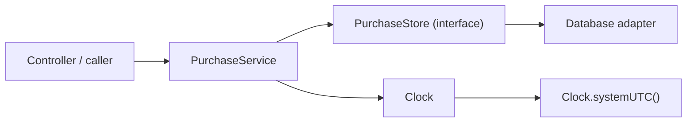
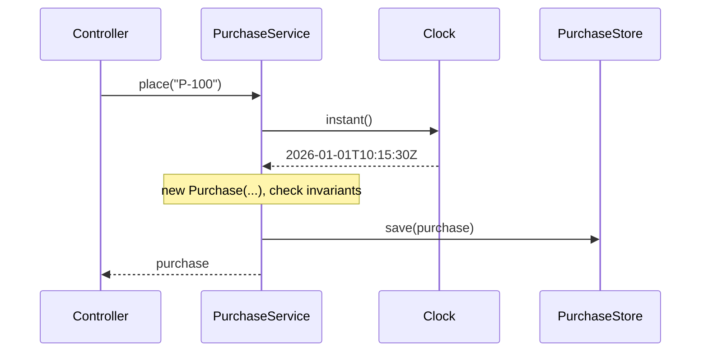

# Constructors, Immutability, and Testable Object Design

In a Spring Boot application, an object often both carries data and collaborates with other objects to process business logic. How an object is initialized determines whether it can enter an invalid state; how state is managed determines whether data can be mutated unexpectedly; and how dependencies are passed determines whether a class can be tested independently.

This lesson builds three closely connected foundations:

1. **Constructors** create an object with all required data and dependencies right from the start.
2. **Immutability** keeps established state stable and easy to reason about.
3. **Testable design** enables swapping real dependencies for test implementations while keeping control over time and external factors.

The examples use Java 21 syntax, JUnit 5, and Spring Boot 3. Each snippet focuses on a single idea; when placing them into a project, put classes into their corresponding files and packages and add the imports suggested by your IDE.

## 1. A Constructor Is the Contract for Object Creation

A constructor is a special member of a Java class: its name matches the class name, it has no return type (not even `void`), and it runs when an object is created with `new` or when the framework performs appropriate instantiation. A constructor typically has two duties:

- Receive the required inputs for the object to operate.
- Validate constraints and assign a valid initial state.

Example of an order that must have a reference code and creation timestamp:

```java
import java.time.Instant;
import java.util.Objects;

public final class Purchase {
    private final String reference;
    private final Instant createdAt;

    public Purchase(String reference, Instant createdAt) {
        if (reference == null || reference.isBlank()) {
            throw new IllegalArgumentException("reference must not be blank");
        }
        this.reference = reference;
        this.createdAt = Objects.requireNonNull(createdAt, "createdAt");
    }

    public String reference() {
        return reference;
    }

    public Instant createdAt() {
        return createdAt;
    }
}
```

This code enforces **business invariants** at the point of object creation: once the constructor completes normally, `reference` cannot be blank and `createdAt` cannot be `null`. Every caller invoking `new Purchase(...)` is checked by the same rule, instead of having to remember to validate in every controller or service.

The two exception types carry distinct meanings: `IllegalArgumentException` describes an invalid input value; `NullPointerException` from `Objects.requireNonNull` indicates a missing required field or dependency. In an HTTP API, Spring can translate input errors into appropriate responses at the boundary layer, but domain validation remains necessary.

### 1.1. Parameters, `this`, and `final` Fields

In `this.reference = reference`, the left side is the current object's field, while the right side is the constructor parameter. The `this` keyword disambiguates when both share the same name.

A `final` field can only be assigned once under Java's initialization rules. For a `blank final` instance field, the constructor must ensure it is initialized on every normal completion path. This makes missing dependencies or missing required data an explicit error at object creation time.

If a class declares no constructors, the compiler generates a default no-argument constructor. **Once you declare at least one constructor yourself, Java no longer generates the no-argument constructor.** For example:

```java
public class Course {
    private final String title;

    public Course(String title) {
        this.title = title;
    }
}

Course a = new Course("Spring Boot"); // Valid
// Course b = new Course();           // Compile error
```

### 1.2. Overloading and Constructor Delegation

A class can have multiple constructors if their parameter lists differ. When one constructor calls another constructor of the **same class**, use `this(...)`. In Java 21, the `this(...)` call must be the first statement of the calling constructor.

```java
public final class RetryPolicy {
    private final int maxAttempts;
    private final long delayMillis;

    public RetryPolicy(int maxAttempts) {
        this(maxAttempts, 200L);
    }

    public RetryPolicy(int maxAttempts, long delayMillis) {
        if (maxAttempts < 1 || delayMillis < 0) {
            throw new IllegalArgumentException("Invalid retry policy");
        }
        this.maxAttempts = maxAttempts;
        this.delayMillis = delayMillis;
    }
}
```

Advantage: all initialization paths pass through one single constraint check. In an inheritance hierarchy, `super(...)` calls the superclass constructor; a constructor cannot have both `this(...)` and `super(...)` as its first call. If multiple initialization styles are needed with parameters that are easy to confuse, a named static factory like `RetryPolicy.withDefaultDelay(3)` can make intent clearer.

### 1.3. Constructors Are Not the Place for Heavy Business Work

Constructors should validate data and assign fields. Avoid making HTTP calls, sending emails, running database queries, reading files, or starting long-running threads inside a constructor. Those actions make bean initialization unpredictable and force unit tests to prepare infrastructure even when testing a simple method.

If creating an object requires multi-step business workflows, move that workflow into a clearly scoped service or factory. The constructor remains responsible for protecting the object's internal state.

## 2. What Is Data Immutability?

An **immutable** object is an object whose observable state does not change after it is created. Callers can read the data but cannot alter the state of that object through any exposed access path.

Practical benefits:

- Easier to reason about: values validated in the constructor remain valid.
- Safer to share: reduces the risk of two parts of the system accidentally modifying the same data.
- Easier to test: when inputs are fixed, outcomes depend less on call history.
- Easier to work with concurrently: there are no writes to internal state causing races, although surrounding systems still need proper synchronization.

**`final` does not automatically make an object immutable.** It prevents reassigning the reference variable, not mutating the referenced object.

```java
final var tags = new java.util.ArrayList<String>();
tags.add("spring");
tags.add("java"); // Still valid: the list is mutable

// tags = new ArrayList<>(); // Invalid: reassigning a final variable
```

Similarly, `private final List<String> tags` only protects the `tags` reference, not automatically the contents of the list.

### 2.1. Elements That Make an Immutable Type

For a value object, the typical design is:

1. Use `private final` fields.
2. Supply all required values via the constructor and check invariants.
3. Provide no setters or state-mutating methods.
4. Do not let external mutable objects directly access internal data.
5. Make defensive copies when receiving or returning mutable data.
6. Consider inheritance: a `final class` cannot be subclassed to break its immutability contract.

Example:

```java
import java.util.List;
import java.util.Objects;

public final class CustomerProfile {
    private final String email;
    private final List<String> roles;

    public CustomerProfile(String email, List<String> roles) {
        if (email == null || email.isBlank()) {
            throw new IllegalArgumentException("email is required");
        }
        this.email = email;
        this.roles = List.copyOf(Objects.requireNonNull(roles, "roles"));
    }

    public String email() {
        return email;
    }

    public List<String> roles() {
        return roles;
    }
}
```

Why use `List.copyOf`?

```java
var inputRoles = new java.util.ArrayList<String>();
inputRoles.add("USER");

var profile = new CustomerProfile("alice@example.com", inputRoles);
inputRoles.add("ADMIN");

System.out.println(profile.roles()); // [USER]
// profile.roles().add("ADMIN");      // UnsupportedOperationException
```

If the constructor only assigned `this.roles = roles`, mutating `inputRoles` afterward would change `profile`'s state without going through `profile`. If `Collections.unmodifiableList(roles)` were used directly, the result is a **view that disallows modification through the view** yet can still reflect changes made to the underlying list. `List.copyOf` provides an unmodifiable snapshot through the list API; it also rejects `null` elements.

**Important limitation:** the copy here is a **shallow copy**. If list elements are mutable objects, callers can still modify an element's contents. That is why the example uses `String`, which is immutable; for mutable elements, copy each element or switch to immutable types.

### 2.2. Defensive Copies for Mutable Objects

Suppose you must integrate with a legacy API using `java.util.Date` (which is mutable). Marking the field `final` alone is not enough:

```java
import java.util.Date;
import java.util.Objects;

public final class LegacyEvent {
    private final Date occurredAt;

    public LegacyEvent(Date occurredAt) {
        Date value = Objects.requireNonNull(occurredAt, "occurredAt");
        this.occurredAt = new Date(value.getTime()); // Defensive copy on input
    }

    public Date occurredAt() {
        return new Date(occurredAt.getTime());       // Defensive copy on return
    }
}
```

Whenever possible, prefer immutable `java.time` types such as `Instant`, `LocalDate`, and `Duration` over `Date` and `Calendar` in new domain code.

### 2.3. Records in Java 21

A record is a concise syntax for representing structured data. Java automatically generates a canonical constructor, accessors, `equals`, `hashCode`, and `toString`. Record components are stored in `private final` fields, and records cannot be extended.

```java
import java.util.List;
import java.util.Objects;

public record OrderLine(String sku, int quantity) {
    public OrderLine {
        if (sku == null || sku.isBlank()) {
            throw new IllegalArgumentException("sku is required");
        }
        if (quantity <= 0) {
            throw new IllegalArgumentException("quantity must be positive");
        }
    }
}

public record CreateOrderCommand(String customerId, List<OrderLine> lines) {
    public CreateOrderCommand {
        if (customerId == null || customerId.isBlank()) {
            throw new IllegalArgumentException("customerId is required");
        }
        lines = List.copyOf(Objects.requireNonNull(lines, "lines"));
        if (lines.isEmpty()) {
            throw new IllegalArgumentException("Order must have a line");
        }
    }
}
```

This is a **compact constructor**: after running validation and adjusting parameters, Java automatically assigns the processed parameters to the record's fields. For `List<OrderLine>`, the snapshot is safe because `OrderLine` is itself a record containing only `String` and `int`.

A record **does not guarantee deep immutability** if a component is `List<MutableItem>`, an array, `Date`, or another mutable object. The designer must still decide the copy and data protection policy.

### 2.4. When to Use Immutability and When Not To

| Case | Usually Appropriate Choice | Reason |
| --- | --- | --- |
| Domain values: money, date ranges, addresses | Immutable class or record | Easy to validate and share |
| Input/output DTOs without state-transition lifecycles | Record or immutable class | Clear data contract |
| Application configuration | Immutable configuration object | Prevents configuration from being mutated at runtime |
| Domain objects with valid state-transition operations | Encapsulation, mutation through domain methods | Still enforces invariants |
| JPA entities | Usually requires a class with JPA-compatible instantiation/state handling | The provider must instantiate, track, and update the entity |

Do not force every object in an application to be immutable. For an entity with a lifecycle such as an `Invoice` transitioning from `DRAFT` to `PAID`, what matters is **controlling how changes happen** via domain methods, rather than exposing unrestricted setters for every field.

## 3. Constructor Injection in Spring Boot

A dependency is an object a class needs to complete its work, such as a repository, payment gateway, password encoder, or time source. In Spring, the container is responsible for creating and wiring beans via **Dependency Injection (DI)**.

Consider a service that needs to save a purchase and capture the current timestamp. Instead of having the service create these dependencies itself, require them in the constructor:

```java
import java.time.Instant;
import java.util.Objects;

public record Purchase(String reference, Instant createdAt) {
    public Purchase {
        if (reference == null || reference.isBlank()) {
            throw new IllegalArgumentException("reference must not be blank");
        }
        Objects.requireNonNull(createdAt, "createdAt");
    }
}

public interface PurchaseStore {
    void save(Purchase purchase);
}
```

```java
import java.time.Clock;
import java.util.Objects;
import org.springframework.stereotype.Service;

@Service
public class PurchaseService {
    private final PurchaseStore store;
    private final Clock clock;

    public PurchaseService(PurchaseStore store, Clock clock) {
        this.store = Objects.requireNonNull(store, "store");
        this.clock = Objects.requireNonNull(clock, "clock");
    }

    public Purchase place(String reference) {
        Purchase purchase = new Purchase(reference, clock.instant());
        store.save(purchase);
        return purchase;
    }
}
```

When Spring creates `PurchaseService`, it needs to find a bean matching `PurchaseStore` and a `Clock` bean. The application needs to provide a `PurchaseStore` implementation (for example, a database adapter annotated with `@Repository`) and can declare a `Clock` bean as follows:

```java
import java.time.Clock;
import org.springframework.context.annotation.Bean;
import org.springframework.context.annotation.Configuration;

@Configuration
public class TimeConfiguration {
    @Bean
    public Clock clock() {
        return Clock.systemUTC();
    }
}
```

With a single constructor, Spring can use that constructor to inject dependencies without needing `@Autowired`. If multiple eligible constructors exist, you must disambiguate which constructor is used for injection according to Spring's rules, typically with `@Autowired` on the desired constructor.

Relationship diagram:



`PurchaseService` knows the persistence **contract**, without needing to know whether the storage layer uses SQL, MongoDB, in-memory storage, or a test adapter. In the real application, dependencies are wired by Spring; in unit tests, you can call the constructor directly.

### 3.1. Why Is Constructor Injection Usually Better Than Field Injection?

Compare the two approaches:

```java
// Field injection: dependency is not visible in the instantiation API
@Service
class FieldInjectedService {
    @Autowired
    private PurchaseStore store;
}

// Constructor injection: required dependency is publicly explicit
@Service
class ConstructorInjectedService {
    private final PurchaseStore store;

    ConstructorInjectedService(PurchaseStore store) {
        this.store = Objects.requireNonNull(store);
    }
}
```

With field injection, calling `new FieldInjectedService()` outside Spring produces an instance with `store == null`, and readers cannot see the dependency in the constructor. Constructor injection makes dependencies explicit, allows `final` fields, makes instantiating objects in tests straightforward, and helps detect circular dependencies when building the bean graph.

Setter injection still has its place for genuinely optional dependencies or mutable configuration, but should not turn required dependencies into potentially missing state after object creation.

### 3.2. Do Not Instantiate Dependencies with `new` Inside a Service

A hard-to-test pattern:

```java
public class HardToTestPurchaseService {
    private final PurchaseStore store = new JdbcPurchaseStore(/* connection configuration */);

    // Hard to replace JdbcPurchaseStore with an implementation for unit tests.
}
```

The snippet above illustrates tight coupling to a concrete adapter; it is not a standalone runnable class. When a service directly decides how to create external dependencies, tests must pay the cost of initializing infrastructure. Let the configuration layer / DI container choose the implementation and let the service declare what it needs via its constructor.

**A long constructor is a design signal:** if a service requires too many unrelated dependencies, check whether it is taking on too many responsibilities. Avoid arbitrarily bundling all dependencies into a "context" class just to hide the problem.

### 3.3. Lombok `@RequiredArgsConstructor`

If the project already uses Lombok, this annotation can generate a constructor for uninitialized `final` fields and fields annotated with Lombok's `@NonNull`:

```java
import lombok.RequiredArgsConstructor;
import org.springframework.stereotype.Service;

@Service
@RequiredArgsConstructor
public class CatalogService {
    private final ProductCatalog catalog;

    public Product find(String sku) {
        return catalog.findBySku(sku);
    }
}
```

In this example, `ProductCatalog` and `Product` are illustrative application types. Lombok performs **compile-time code generation**; dependency injection is still performed by Spring. Only use Lombok when the project has annotation processing configured and the team understands the generated constructor. For foundational lessons, writing constructors manually makes the contract easier to observe.

### 3.4. Immutable Configuration with `@ConfigurationProperties`

Related configuration properties should be grouped into a typed object rather than scattering `@Value` throughout services:

```java
import java.time.Duration;
import org.springframework.boot.context.properties.ConfigurationProperties;

@ConfigurationProperties(prefix = "feature.checkout")
public record CheckoutProperties(boolean enabled, Duration timeout) {
    public CheckoutProperties {
        if (timeout == null || timeout.isNegative() || timeout.isZero()) {
            throw new IllegalArgumentException("timeout must be positive");
        }
    }
}
```

```yaml
feature:
  checkout:
    enabled: true
    timeout: 5s
```

In Spring Boot 3, a record with a single canonical constructor can be bound from configuration when registered via `@ConfigurationPropertiesScan` or `@EnableConfigurationProperties(CheckoutProperties.class)`. This is immutable configuration data once bound; do not annotate that record with `@Component` just to rely on component scanning for constructor binding.

## 4. Designing So Unit Tests Do Not Need to Start Spring

The strength of constructor injection is that you can test a class's logic like a **regular Java object**. When dependencies are expressed via interfaces, tests can use minimal implementations instead of a real database.

For `PurchaseService` above, a JUnit 5 unit test:

```java
import static org.junit.jupiter.api.Assertions.assertEquals;
import static org.junit.jupiter.api.Assertions.assertThrows;
import static org.junit.jupiter.api.Assertions.assertTrue;

import java.time.Clock;
import java.time.Instant;
import java.time.ZoneOffset;
import java.util.ArrayList;
import java.util.List;
import org.junit.jupiter.api.Test;

class PurchaseServiceTest {
    private final Clock fixedClock = Clock.fixed(
            Instant.parse("2026-01-01T10:15:30Z"),
            ZoneOffset.UTC
    );

    @Test
    void placesPurchaseAtPredictableTime() {
        List<Purchase> saved = new ArrayList<>();
        PurchaseStore fakeStore = purchase -> saved.add(purchase);
        PurchaseService service = new PurchaseService(fakeStore, fixedClock);

        Purchase result = service.place("P-100");

        assertEquals("P-100", result.reference());
        assertEquals(Instant.parse("2026-01-01T10:15:30Z"), result.createdAt());
        assertEquals(List.of(result), saved);
    }

    @Test
    void rejectsBlankReferenceBeforeSaving() {
        List<Purchase> saved = new ArrayList<>();
        PurchaseService service = new PurchaseService(
                purchase -> saved.add(purchase),
                fixedClock
        );

        assertThrows(IllegalArgumentException.class, () -> service.place(" "));
        assertTrue(saved.isEmpty());
    }
}
```

These tests do not use `@SpringBootTest`, a Spring context, network ports, or a database. They verify two exact things: output data with a deterministic timestamp, and invalid input not being written to the store.

### 4.1. Why Inject `Clock` Instead of Calling `Instant.now()` Directly?

This code ties the service to real-world wall-clock time:

```java
Purchase purchase = new Purchase(reference, Instant.now());
```

A test wanting to assert the exact timestamp will suffer from execution-time drift or require tolerance ranges. Injecting `Clock` allows:

- The application to use `Clock.systemUTC()`.
- Tests to use `Clock.fixed(...)` for a fixed timestamp.
- Other tests to use `Clock.offset(...)` to simulate advancing time.

This is an example of a general principle: **any non-deterministic or environment-dependent factor should go through a replaceable boundary**, such as time, UUID generation, HTTP clients, or notification services. You do not need to invent a custom interface for every operation if Java or a library already provides a suitable abstraction (`Clock` is one example).

### 4.2. How Do Fakes, Stubs, and Mocks Differ?

| Test Double | Role | Example |
| --- | --- | --- |
| Stub | Returns pre-programmed data | A repository always returns a sample `Customer` |
| Fake | Simple working implementation with real behavior | An in-memory store backed by a `Map` or `List` |
| Mock | Records/verifies that interactions occurred | Verifying `repository.save(...)` was called |

The `PurchaseService` test above uses a small `PurchaseStore` implementation that records into a `List` and observes the result. If Mockito is needed, it can be replaced with:

```java
import static org.mockito.Mockito.mock;
import static org.mockito.Mockito.verify;

PurchaseStore store = mock(PurchaseStore.class);
PurchaseService service = new PurchaseService(store, fixedClock);

Purchase created = service.place("P-100");
verify(store).save(created);
```

Both approaches are valid. Choose whichever expresses the behavior under test most clearly; there is no need to mock simple value objects. Avoid writing tests that merely mirror every line of the implementation without asserting meaningful business requirements.

### 4.3. Unit Tests and Integration Tests Complement Each Other

| Test Type | Needs to Start Spring? | Well-Suited For Verifying |
| --- | --- | --- |
| Plain Java class unit test | No | Validation, business branches, interactions with dependencies |
| Spring slice test | Partial context | MVC binding, JSON, repositories, or specialized integration slices |
| `@SpringBootTest` | Usually yes | Bean wiring, configuration, and multi-component integration flows |

Unit tests cannot catch every bean registration error. Integration tests can catch a missing `PurchaseStore` bean, duplicate `Clock` beans, or invalid Spring configuration. Still, do not use `@SpringBootTest` for every constructor check or plain Java calculation.

## 5. Boundaries Between Data, Business Logic, and Infrastructure

A maintainable design usually separates:

- **Value objects / commands / DTOs**: data constructed through constructors with invariant checks; favor immutability.
- **Domain/service logic**: processes rules and coordinates dependencies passed via constructor.
- **Infrastructure adapters**: implement interfaces such as database queries, HTTP clients, and email sending.
- **Spring configuration**: selects implementations and declares beans.

Example flow for placing an order:



A good controller does not assemble a service's dependencies itself, and a service does not pick its own storage technology. With this separation, swapping `PurchaseStore` in a test only requires passing a different implementation into the constructor.

### 5.1. Special Considerations for JPA Entities and Spring Proxies

The immutable `Purchase` example above is a domain value, **not a JPA entity**. Entities managed by JPA usually need a no-argument constructor with appropriate visibility (often `protected`), and the framework needs mechanisms for proxying and state tracking. Therefore, do not mechanically apply `final class`, `record`, or `final` fields to all entities.

Example of a minimal entity:

```java
import jakarta.persistence.Entity;
import jakarta.persistence.GeneratedValue;
import jakarta.persistence.GenerationType;
import jakarta.persistence.Id;

@Entity
public class InvoiceEntity {
    @Id
    @GeneratedValue(strategy = GenerationType.IDENTITY)
    private Long id;

    private String status;

    protected InvoiceEntity() {
        // For JPA
    }

    public InvoiceEntity(String status) {
        if (status == null || status.isBlank()) {
            throw new IllegalArgumentException("status is required");
        }
        this.status = status;
    }

    public void markPaid() {
        if (!"DRAFT".equals(status)) {
            throw new IllegalStateException("Only draft invoices can be paid");
        }
        this.status = "PAID";
    }
}
```

This entity has mutation, but the mutation is encapsulated in the `markPaid()` behavior along with validity checks. In a real application, you also need to design appropriate mappings, persistence mechanics, versioning/concurrency, and transactions.

Spring also has AOP and proxy mechanisms (such as `@Transactional`). Some proxy types require subclassing and cannot override `final` methods. Be thoughtful before marking proxied services or entities `final` when they rely on framework proxying. **Immutability is a decision based on the nature of the data**, not a mandatory rule on every bean.

### 5.2. Singleton Beans and Thread Safety

By default, Spring creates singleton beans within an application context. `private final PurchaseStore store` keeps the dependency reference stable, but **does not make all state used by the bean thread-safe**.

This example is prone to bugs:

```java
@Service
class UnsafeCounterService {
    private int counter;

    int next() {
        return ++counter; // Potential race condition when multiple requests call concurrently
    }
}
```

A stateless service is usually much easier to share safely across requests. If mutable state inside a bean is unavoidable, design proper synchronization, atomic operations, or a purpose-built storage mechanism. Immutable value objects eliminate one class of issues, but do not replace concurrency design for the overall application.

## 6. Common Mistakes and How to Spot Them

| Symptom | Consequence | How to Address |
| --- | --- | --- |
| Constructor does not validate required values | Objects can be created in an invalid state | Validate invariants at creation time |
| Setters exist for every field just for "convenience" | Anywhere in the code can break invariants | Only expose mutations with clear business meaning |
| `final List` field stores the caller's list directly | Caller mutating the list alters the object | Create a snapshot; protect mutable elements too |
| Record contains a mutable collection without copying | Record is not truly immutable | Validate/copy in the compact constructor |
| Field injection for required dependencies | Hard to instantiate the object outside Spring | Constructor injection with `final` |
| Service creates its own HTTP/database client | Hard to swap in unit tests | Inject an appropriate interface/adapter |
| Calling `Instant.now()` in time-sensitive logic | Tests are hard to make deterministic | Inject `Clock` |
| Constructor calls database/network | Bean creation triggers side effects | Move work to an explicit method |
| Forcing JPA entities and proxied services to be `final` | Can conflict with framework mechanisms | Separate domain values from entities; consider proxies |
| Singleton bean holds arbitrary mutable state | Concurrent requests race on shared state | Prefer stateless design or choose proper concurrency mechanisms |

## 7. Workflow for Designing a New Class

When preparing to create a class in a Spring Boot project, you can think through this sequence:

1. **Define its role**: does this class hold a value, store domain state, or coordinate behavior?
2. **List invariants**: which values are required, what are the valid ranges, and what conditions must always hold?
3. **Design the constructor**: which parameters must be present for the object to be ready for use? Are overloads or named factories needed?
4. **Determine mutability**: can a `record` or immutable class be used? If state changes, who is allowed to change it and through which operations?
5. **Separate external dependencies**: how are database, HTTP, email, time source, and randomness passed in?
6. **Determine test levels**: plain Java logic can be tested with `new`; wiring and integration are checked with Spring/integration tests when needed.

A helpful thought experiment: *"Without a Spring context and without a database, can I instantiate this class with fake dependencies and test its most important business logic?"* If the answer is no, check whether the class is directly tied to infrastructure, wall-clock time, or shared state.

## 8. Hands-on Practice Exercises

### Exercise 1 — Protecting Immutable Data

Design `ShoppingCartSnapshot` containing `customerId` and `List<OrderLine>`. Require that customer ID is not blank, the list is not empty, and once created it cannot be mutated indirectly by modifying the input collection. Try adding an element to the original list after initialization and verify the snapshot remains unchanged.

Hint: use `record`, a compact constructor, `List.copyOf`, and the immutable `OrderLine` from section 2.

### Exercise 2 — Converting from Field Injection to Constructor Injection

Given a class using `@Autowired private NotificationGateway gateway;`, replace it with a `private final` field and a constructor taking `NotificationGateway`. Write a fake implementation that records sent notifications into a list, then write a unit test asserting the results when calling the service method.

### Exercise 3 — Removing Dependency on Real Time

A service computes a deadline using `Instant.now().plus(Duration.ofHours(24))`. Inject `Clock`, use `Clock.systemUTC()` in application configuration, and use `Clock.fixed(...)` in a unit test to verify the exact deadline.

### Exercise 4 — Choosing the Right State Model

Examine two objects: `Money(amount, currency)` and `Invoice(status, paidAt)`. Explain why `Money` should usually be immutable, while `Invoice` may need domain methods to change state. State the invariants that must hold when `Invoice` transitions to `PAID`.

## 9. Takeaways for Applying This in Spring Boot

Constructors answer **"what does an object need to be validly created?"**. Immutability answers **"once created, who is allowed to change this data?"**. Constructor injection answers **"where does an object get its collaborators from?"**. These three questions help clarify class boundaries before adding framework annotations.

When data suits immutability, construct complete state in the constructor, protect collections and mutable objects, and use records when they express the problem cleanly. When writing services, pass required dependencies via constructor, keep business logic decoupled from infrastructure creation, and test classes as plain Java before writing integration tests. For entities and proxied beans, respect framework requirements rather than applying a single rigid formula to every class.
