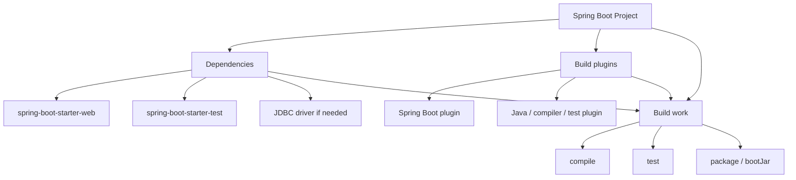

# Gradle or Maven: Distinguishing Dependencies, Plugins, and Tasks

> **Spring Boot Fundamentals · Prerequisites**  
> This lesson helps you read a Spring Boot project using **Gradle** or **Maven**, understand which libraries go into the application, which tools assist the build process, and which actions actually execute when you run a command. You do not need to master both systems from day one, but you must accurately distinguish **dependencies**, **plugins**, and **tasks/goals** so you do not get confused when adding Spring Web, running tests, or packaging the application.

## 1. Why Do We Need a Build Tool When Learning Spring Boot?

A Spring Boot application rarely contains only the Java code we write. To build and run the application, the project must also:

- Download appropriate libraries such as Spring Web, Spring Data JPA, Jackson, or a JDBC driver.
- Compile Java code, place resources in the right locations, and compile test code.
- Run tests, perform quality checks, and produce output files like `.jar`.
- Package a Spring Boot executable JAR that can be launched with `java -jar`.
- Perform auxiliary tasks such as code generation, documentation generation, or building container images if the project needs them.

Both **Gradle** and **Maven** are build tools capable of handling these jobs. They differ in how builds are described and how commands are invoked, yet serve very similar purposes.

| Question | Maven | Gradle |
| --- | --- | --- |
| Primary build file commonly seen | `pom.xml` | `build.gradle` (Groovy DSL) or `build.gradle.kts` (Kotlin DSL) |
| Work organization model | Lifecycles made of phases; plugins provide goals | Tasks with dependency relationships forming a task graph |
| How application libraries are declared | `<dependencies>` | `dependencies { ... }` |
| How build capabilities are extended | Maven plugin | Gradle plugin |
| Compile, test, and package commands | `mvnw compile`, `mvnw test`, `mvnw package` | `gradlew compileJava`, `gradlew test`, `gradlew build`, `gradlew bootJar` |
| Mechanism to keep the build environment consistent | Maven Wrapper `mvnw` | Gradle Wrapper `gradlew` |

Spring Boot supports both tools. Choose the one suited to the project you are working on; understanding the three core concepts accurately matters far more than debating which tool is always better.

## 2. The Big Picture: Dependencies, Plugins, and Executable Work

Imagine we want to build an API returning a list of books.

- **Dependency:** pre-packaged code that **your application or tests use**, such as Spring MVC.
- **Plugin:** an extension that teaches **the build tool how to perform or organize work**, such as the Spring Boot plugin for running the app during development and creating an executable JAR.
- **Task (Gradle) / goal (Maven):** **a specific unit of work executed** during a build, such as compiling, testing, creating a JAR, or running Spring Boot.



The diagram shows the conceptual relationship: plugins **can provide** tasks or goals; tasks/goals **can use** dependencies when they run. Adding a dependency by itself does not mean you asked the build tool to run a task; applying a plugin does not mean every task of that plugin runs automatically.

### 2.1. Distinguishing via Short Questions

| When You See a Config Line or Command | What to Ask? | Identification |
| --- | --- | --- |
| `implementation 'org.springframework.boot:spring-boot-starter-web'` | Which library does the application need? | Dependency |
| `<dependency>...spring-boot-starter-web...</dependency>` | Which library does the application need? | Dependency |
| `id 'org.springframework.boot'` | What capability is added to the build tool? | Gradle plugin |
| `<artifactId>spring-boot-maven-plugin</artifactId>` inside `<build><plugins>` | Which goals are added to Maven? | Maven plugin |
| `./gradlew bootRun` | Which action should run? | Gradle task |
| `./mvnw spring-boot:run` | Which plugin goal is invoked? | Maven plugin goal |
| `./mvnw package` | Up to which stage is the lifecycle requested? | Maven lifecycle phase |

**Common confusion:** a Maven goal is **not synonymous** with a Maven lifecycle phase. A Gradle task and a Maven goal are close in representing "a specific unit of work", whereas a Maven phase is a stage that can trigger multiple goals bound to it.

## 3. Dependencies: Libraries Needed by the Application or Tests

A dependency is a software package that a project relies on. In Java, most dependencies are distributed as JARs and may bring along transitive dependencies.

Example for a REST API:

- `spring-boot-starter-web`: a starter that brings in libraries related to Spring MVC and JSON in a coordinated configuration.
- `spring-boot-starter-test`: a set of dependencies for writing and running tests.
- `org.postgresql:postgresql`: the JDBC driver for connecting to PostgreSQL when the application uses that database.

A starter is also a **dependency**. What makes it special is that it is designed to pull in a coherent set of dependencies for a given capability, rather than forcing you to pick every infrastructure library individually.

### 3.1. Dependencies in Gradle

Groovy DSL example, excerpted from `build.gradle`:

```groovy
dependencies {
    implementation 'org.springframework.boot:spring-boot-starter-web'
    testImplementation 'org.springframework.boot:spring-boot-starter-test'
    runtimeOnly 'org.postgresql:postgresql'
}
```

Here:

- `implementation`: dependency needed when compiling and running application code; normally not exposed as part of the public API of a library module using the `java-library` plugin.
- `testImplementation`: dependency for compiling and running tests.
- `runtimeOnly`: needed at runtime but typically unnecessary on the compile classpath; JDBC drivers can often go here when code uses the JDBC API without directly referencing driver-specific classes.

Names like `implementation`, `testImplementation`, or `runtimeOnly` are called **dependency configurations** in Gradle; they are not Gradle tasks.

Other useful configurations:

| Gradle Configuration | Primary Role | Typical Example |
| --- | --- | --- |
| `implementation` | Needed by application code at compile time and runtime | Spring Web starter |
| `compileOnly` | Needed only at compile time, not placed on runtime classpath | APIs provided by the runtime container |
| `runtimeOnly` | Needed only at execution time | JDBC driver in some applications |
| `testImplementation` | Compiling and running tests | Spring Boot Test starter |
| `testRuntimeOnly` | Needed only when running tests | A test runtime component |
| `annotationProcessor` | Runs annotation processors at compile time | Code-generating processors, if used |

Configurations are defined by Gradle and plugins; exact semantics depend on plugins such as `java` and `java-library`. Choosing the wrong configuration can cause compile errors or missing-class errors at runtime.

### 3.2. Dependencies in Maven

Excerpt from `pom.xml`:

```xml
<dependencies>
    <dependency>
        <groupId>org.springframework.boot</groupId>
        <artifactId>spring-boot-starter-web</artifactId>
    </dependency>

    <dependency>
        <groupId>org.springframework.boot</groupId>
        <artifactId>spring-boot-starter-test</artifactId>
        <scope>test</scope>
    </dependency>

    <dependency>
        <groupId>org.postgresql</groupId>
        <artifactId>postgresql</artifactId>
        <scope>runtime</scope>
    </dependency>
</dependencies>
```

Maven uses `<scope>` to express a dependency's scope. When omitted, the default scope is `compile`.

| Maven Scope | Typical Meaning | Notes |
| --- | --- | --- |
| `compile` (default) | Present on compile, test, and runtime classpaths; propagated transitively | Suitable for primary libraries |
| `provided` | Needed for compile/test, expected to be supplied by the runtime environment | Not packaged as a regular runtime dependency |
| `runtime` | Not needed to compile main code, but needed at run/test time | Suitable for certain drivers |
| `test` | Used for test code and test execution | Does not enter regular application runtime |
| `system` | References a JAR via a local system path | Should be avoided in regular projects as it reduces reproducibility |
| `import` | Used only for POMs inside `dependencyManagement` | For importing BOMs; not a scope for a regular JAR |

**Gradle configurations and Maven scopes do not map strictly one-to-one.** For example, `implementation` is not identical to `compile` across all module types; how a Java library module exposes its API also depends on `api`, `implementation`, plugins, and publication mechanics.

### 3.3. Dependencies Are Identified by Coordinates

A dependency is normally identified by group, artifact name, and version:

```text
Group                  Artifact                      Version
org.springframework.boot : spring-boot-starter-web  : (managed)
org.postgresql          : postgresql                : (managed)
```

In Gradle, the common shorthand is:

```groovy
implementation 'group:artifact:version'
```

In Maven, the tags are:

```xml
<groupId>group</groupId>
<artifactId>artifact</artifactId>
<version>version</version>
```

Sometimes Spring Boot examples omit versions on starters or JDBC drivers. This only works when **dependency management** supplies the corresponding version, such as the Spring Boot BOM or version management from the project's parent/BOM.

Do not assume that "omitting the version makes Gradle/Maven pick a version arbitrarily." Without appropriate version management rules, the dependency will fail to resolve or will follow another version rule declared elsewhere.

### 3.4. Transitive Dependencies

When an application declares `spring-boot-starter-web`, that dependency itself declares other libraries. The build tool resolves the dependency graph according to its resolution rules.

Illustrative example:

```text
Application
└── spring-boot-starter-web
    ├── spring-boot-starter
    ├── spring-boot-starter-json
    └── spring-webmvc
        └── related Spring libraries
```

This diagram only illustrates the concept; the actual dependency graph varies by version.

Transitive dependencies reduce manual configuration, yet can also introduce version conflicts, unwanted dependencies, or missing classes after exclusions. When in doubt, **inspect the resolved dependency graph** rather than guessing solely from direct declarations.

## 4. Plugins: Extending Build Tool Capabilities

Application dependencies answer "which libraries does the program code need?". Plugins answer "what extra capabilities and rules does the build tool have?".

### 4.1. Plugins in Gradle

An example `build.gradle` using Groovy DSL:

```groovy
plugins {
    id 'java'
    id 'org.springframework.boot' version '3.5.0'
    id 'io.spring.dependency-management' version '1.1.7'
}
```

Meaning:

- `java`: adds Java project build capabilities, providing configurations and tasks such as `compileJava`, `test`, `jar`, and `build`.
- `org.springframework.boot`: integrates Spring Boot into the build; together with the Java plugin, it can provide `bootRun`, `bootJar`, `bootBuildImage`, and other features.
- `io.spring.dependency-management`: Gradle's dependency management plugin; when combined with the Spring Boot Gradle plugin, it can automatically import the BOM matching the Boot plugin version.

**Version note:** `3.5.0` and `1.1.7` here are illustrative versions for a Spring Boot 3.x configuration. When creating a real project, use supported and compatible versions per current documentation or project configuration.

In Gradle, applying a plugin typically **registers** tasks and sets up configuration. It does not mean immediately running `test` or producing a JAR file. Tasks execute when explicitly requested or when pulled into the task graph of an invoked command.

### 4.2. Plugins in Maven

Maven plugins are declared in the `<build>` section of `pom.xml`, not in `<dependencies>` reserved for application libraries.

```xml
<build>
    <plugins>
        <plugin>
            <groupId>org.springframework.boot</groupId>
            <artifactId>spring-boot-maven-plugin</artifactId>
        </plugin>
    </plugins>
</build>
```

`spring-boot-maven-plugin` provides goals, including:

- `spring-boot:run`: runs the Spring Boot application during development.
- `spring-boot:repackage`: repackages the artifact into an executable layout per Spring Boot's packaging mechanism.
- `spring-boot:build-image`: builds a container image via plugin-supported mechanisms when appropriately configured.

In projects using `spring-boot-starter-parent`, plugin configuration, versions, and certain executions may already be managed or configured by the parent. In projects not using that parent, you may need to declare the plugin version and binding/execution so `repackage` runs during the desired phase. Merely having the plugin name in the file does not guarantee every goal runs automatically when invoking `package`.

Maven also has foundational plugins such as compiler, resources, surefire (for running unit tests), and jar plugins. Many of their goals are bound to lifecycle phases by default based on packaging and project configuration.

### 4.3. Why Spring Boot Starters and Spring Boot Plugins Do Not Replace Each Other

Look at the similar names:

```text
spring-boot-starter-web  -> dependency
org.springframework.boot -> Gradle plugin
spring-boot-maven-plugin -> Maven plugin
```

If you only add the Spring Web starter, you get the libraries to write web code, but you do not automatically get a `bootJar` task or `repackage` goal.

If you only add the Spring Boot build plugin, you get build integration capabilities, but the application does not magically gain Spring MVC controllers, Jackson, or a JDBC driver if the required dependencies have not been added.

A typical Spring Boot application uses **both** application dependencies **and** a build plugin; each serves a distinct purpose.

## 5. Tasks in Gradle: A Named Unit of Work

Gradle organizes builds around **tasks**. A task can compile code, run tests, build an archive, generate documentation, or perform custom actions.

Common tasks available once corresponding plugins are applied:

| Gradle Task | Typical Function | Source |
| --- | --- | --- |
| `compileJava` | Compiles main Java code | Java plugin |
| `processResources` | Processes/copies main resources | Java plugin |
| `classes` | Lifecycle task aggregating main classes/resources steps | Java plugin |
| `test` | Runs tests per project setup | Java plugin |
| `jar` | Builds a standard Java JAR | Java plugin |
| `assemble` | Builds distributable artifacts | Base/Java plugin |
| `check` | Aggregates verification tasks, typically including tests | Base/Java plugin |
| `build` | Typically depends on `assemble` and `check` | Base/Java plugin |
| `bootRun` | Runs the Spring Boot application | Spring Boot Gradle plugin |
| `bootJar` | Builds a Spring Boot executable JAR | Spring Boot Gradle plugin |
| `bootBuildImage` | Builds a container image via buildpacks | Spring Boot Gradle plugin |

**Tasks are not a rigid "linear stage sequence".** Gradle constructs a **task graph** based on the requested task and task dependencies. Tasks outside the graph normally do not run; a task may be skipped if its outputs are up to date and incremental build conditions apply.

Examples:

```bash
# Linux / macOS (from the project directory)
./gradlew tasks
./gradlew test
./gradlew build
./gradlew bootRun
./gradlew bootJar
```

On Windows PowerShell:

```powershell
.\gradlew.bat tasks
.\gradlew.bat test
.\gradlew.bat bootRun
```

`./gradlew build` typically triggers all work required to build and verify the project, not just a single compile step. With the Spring Boot plugin, you can also invoke `bootJar` specifically when you want to build an executable JAR.

### 5.1. Creating a Custom Gradle Task

In `build.gradle` using Groovy DSL:

```groovy
tasks.register('showModuleName') {
    group = 'help'
    description = 'Print the example module name'

    doLast {
        println 'catalog-service'
    }
}
```

Invoking the task:

```bash
./gradlew showModuleName
```

Sample output:

```text
> Task :showModuleName
catalog-service
```

`tasks.register` declares the task using Gradle's lazy configuration mechanism; `doLast` attaches an action that runs when the task actually executes. Simply opening `build.gradle` or running an unrelated task does not execute this `println` action.

### 5.2. Task Dependencies Are Not Library Dependencies

These two Gradle snippets both use the word "dependency", yet describe two different relationships:

```groovy
dependencies {
    implementation 'org.springframework.boot:spring-boot-starter-web'
}

tasks.register('announce') {
    doLast {
        println 'Build is ready'
    }
}

tasks.register('verifyWithAnnouncement') {
    dependsOn tasks.named('announce')
}
```

- `dependencies { implementation ... }`: relationship between the **application module** and a **JAR library**.
- `dependsOn tasks.named('announce')`: **execution order** relationship between tasks. When `verifyWithAnnouncement` is requested, Gradle executes `announce` beforehand.

Do not confuse task-level `dependsOn` with application dependencies, even though both carry the word "dependency".

## 6. Goals and Lifecycle Phases in Maven

Maven organizes builds around **lifecycles**. The most common standard lifecycle is `default`, with phases such as:

```text
validate
   ↓
compile
   ↓
test
   ↓
package
   ↓
verify
   ↓
install
   ↓
deploy
```

These are simplified key milestones, not an exhaustive list of every lifecycle phase. When you invoke a phase, Maven runs the preceding phases in the **same lifecycle**, executing any **plugin goals bound** to those phases.

Examples:

```bash
# Linux / macOS
./mvnw test
./mvnw package
./mvnw verify
```

On Windows PowerShell:

```powershell
.\mvnw.cmd test
.\mvnw.cmd package
.\mvnw.cmd spring-boot:run
```

Typically:

- `mvnw test`: runs through the phases needed to compile and run unit tests.
- `mvnw package`: proceeds through creating the packaged artifact, usually a JAR or WAR depending on packaging.
- `mvnw verify`: performs additional verification steps if configured by the project.
- `mvnw spring-boot:run`: invokes **a plugin goal** to run the Spring Boot application; there is no phase named `run`.

### 6.1. Distinguishing Phases and Goals

In Maven:

- **Phase** is a milestone in the lifecycle, such as `package`.
- **Goal** is a concrete action provided by a plugin, such as `compiler:compile`, `surefire:test`, `jar:jar`, or `spring-boot:repackage`.
- **Plugin execution/binding** determines which goal runs at which phase, and with what configuration.

Conceptual illustration:

```text
mvn package
    ├── ... phases prior to package
    ├── compiler:compile      (when bound to compile)
    ├── surefire:test         (when bound to test)
    ├── jar:jar               (when bound to package)
    └── spring-boot:repackage (if bound/applicable)
```

If `spring-boot:repackage` is not bound to the build process, it will not run automatically merely because the project has the `spring-boot-starter-web` dependency.

### 6.2. Invoking a Goal Directly

Assuming the Spring Boot Maven Plugin is declared:

```bash
./mvnw spring-boot:run
```

`spring-boot` is the plugin prefix Maven recognizes for `spring-boot-maven-plugin`; `run` is a goal of that plugin. Another common direct plugin invocation is:

```bash
./mvnw dependency:tree
```

This invokes the `tree` goal of the Maven Dependency Plugin to print the dependency graph, provided the plugin and resolution work properly. It does not add any new libraries to the application.

### 6.3. Does Maven Have "Tasks"?

In casual conversation, people may refer to Maven operations as "tasks", yet the accurate terms in Maven's model are **goal** and **phase**. When reading Spring Boot guides, a helpful distinction is:

- `./gradlew bootRun`: requests a **Gradle task**.
- `./mvnw spring-boot:run`: requests a **Maven plugin goal**.
- `./mvnw package`: requests a **Maven phase**, triggering execution of its bound goals.

## 7. Two Basically Equivalent Spring Boot Projects

The examples below illustrate a Spring Boot 3.x REST service running on Java 17. They show **two ways to write build configuration**, not two files that should coexist in the same application.

### 7.1. Gradle Groovy DSL Example

File `settings.gradle`:

```groovy
rootProject.name = 'catalog-service'
```

File `build.gradle`:

```groovy
plugins {
    id 'java'
    id 'org.springframework.boot' version '3.5.0'
    id 'io.spring.dependency-management' version '1.1.7'
}

group = 'com.example'
version = '0.0.1-SNAPSHOT'

java {
    toolchain {
        languageVersion = JavaLanguageVersion.of(17)
    }
}

repositories {
    mavenCentral()
}

dependencies {
    implementation 'org.springframework.boot:spring-boot-starter-web'
    testImplementation 'org.springframework.boot:spring-boot-starter-test'
}

tasks.named('test') {
    useJUnitPlatform()
}
```

Reading block by block:

1. `plugins`: brings in Java build tooling, Spring Boot integration, and dependency management.
2. `group`, `version`: project artifact identifiers, not plugins or tasks.
3. `java { toolchain ... }`: configures the Java toolchain for related tasks.
4. `repositories`: where Gradle fetches dependencies—Maven Central here.
5. `dependencies`: adds the libraries needed for web code and tests.
6. `tasks.named('test')`: customizes an **existing task** to use the JUnit Platform.

This is **Groovy DSL**. If a project uses `build.gradle.kts`, Kotlin DSL syntax differs, for example:

```kotlin
dependencies {
    implementation("org.springframework.boot:spring-boot-starter-web")
    testImplementation("org.springframework.boot:spring-boot-starter-test")
}

tasks.named<Test>("test") {
    useJUnitPlatform()
}
```

Do not copy Groovy syntax directly into a Kotlin DSL file or vice versa. With `tasks.named<Test>`, you need the `Test` type imported or handled via standard Gradle Kotlin DSL script imports.

### 7.2. Maven Example

File `pom.xml`:

```xml
<project xmlns="http://maven.apache.org/POM/4.0.0"
         xmlns:xsi="http://www.w3.org/2001/XMLSchema-instance"
         xsi:schemaLocation="http://maven.apache.org/POM/4.0.0
         https://maven.apache.org/xsd/maven-4.0.0.xsd">
    <modelVersion>4.0.0</modelVersion>

    <parent>
        <groupId>org.springframework.boot</groupId>
        <artifactId>spring-boot-starter-parent</artifactId>
        <version>3.5.0</version>
        <relativePath/>
    </parent>

    <groupId>com.example</groupId>
    <artifactId>catalog-service</artifactId>
    <version>0.0.1-SNAPSHOT</version>

    <properties>
        <java.version>17</java.version>
    </properties>

    <dependencies>
        <dependency>
            <groupId>org.springframework.boot</groupId>
            <artifactId>spring-boot-starter-web</artifactId>
        </dependency>

        <dependency>
            <groupId>org.springframework.boot</groupId>
            <artifactId>spring-boot-starter-test</artifactId>
            <scope>test</scope>
        </dependency>
    </dependencies>

    <build>
        <plugins>
            <plugin>
                <groupId>org.springframework.boot</groupId>
                <artifactId>spring-boot-maven-plugin</artifactId>
            </plugin>
        </plugins>
    </build>
</project>
```

Reading block by block:

1. `parent`: inherits many standard Spring Boot settings and dependency management, along with plugin management and related build defaults.
2. `groupId`, `artifactId`, `version`: identifiers for the artifact produced by the project.
3. `properties`: selects the Java version used by the parent/plugins when configuring the build.
4. `dependencies`: application and test libraries, whose versions are managed here by the parent.
5. `build/plugins`: registers the Spring Boot Maven Plugin for the build process.

Both Gradle and Maven can produce a valid Spring Boot application. Both files above use the illustrative version **3.5.0**; when working on a real project, follow **the exact Spring Boot version already chosen by the project** along with plugins compatible with that version.

### 7.3. Connecting to Java Source Code

With either build system, the source code can be:

```java
package com.example.catalog;

import org.springframework.boot.SpringApplication;
import org.springframework.boot.autoconfigure.SpringBootApplication;

@SpringBootApplication
public class CatalogApplication {
    public static void main(String[] args) {
        SpringApplication.run(CatalogApplication.class, args);
    }
}
```

A controller in subpackage `com.example.catalog.api`:

```java
package com.example.catalog.api;

import org.springframework.web.bind.annotation.GetMapping;
import org.springframework.web.bind.annotation.RestController;

@RestController
public class StatusController {

    @GetMapping("/status")
    public String status() {
        return "ready";
    }
}
```

The application relies on the Spring Web dependency for annotations and HTTP handling APIs. The Gradle task `bootRun` or Maven goal `spring-boot:run` starts the application; the packaging task/goal creates a distributable artifact. **The exact same application code** can be built with either build system.

## 8. Version Management and BOMs: Who Decides Library Versions?

A Spring Boot application pulls in many dependencies. If every library chose versions independently, incompatible version combinations would easily occur.

Spring Boot publishes a **BOM (Bill of Materials)** listing managed dependency versions so that common libraries form a compatible set. A BOM **manages versions**; the BOM itself does not add all of those libraries as dependencies of your application.

### 8.1. In Maven: Parent or Importing a BOM

The earlier example used:

```xml
<parent>
    <groupId>org.springframework.boot</groupId>
    <artifactId>spring-boot-starter-parent</artifactId>
    <version>3.5.0</version>
    <relativePath/>
</parent>
```

This parent supplies dependency management and helpful Maven defaults. If organizational constraints prevent using the Spring Boot parent, you can import the BOM into `dependencyManagement`:

```xml
<dependencyManagement>
    <dependencies>
        <dependency>
            <groupId>org.springframework.boot</groupId>
            <artifactId>spring-boot-dependencies</artifactId>
            <version>3.5.0</version>
            <type>pom</type>
            <scope>import</scope>
        </dependency>
    </dependencies>
</dependencyManagement>
```

**Distinction:** `dependencyManagement` only sets version rules and certain metadata for dependencies when used; it is not the same as adding a `<dependency>` to the actual dependency list. When importing the BOM instead of using the parent, plugin versions and executions usually must be configured manually.

### 8.2. In Gradle: Dependency-Management Plugin or Native Platform

The Gradle setup in section 7 used `io.spring.dependency-management` for BOM integration. With Gradle's native BOM support instead, an illustrative dependency block looks like:

```groovy
dependencies {
    implementation platform(
        'org.springframework.boot:spring-boot-dependencies:3.5.0'
    )
    implementation 'org.springframework.boot:spring-boot-starter-web'

    testImplementation platform(
        'org.springframework.boot:spring-boot-dependencies:3.5.0'
    )
    testImplementation 'org.springframework.boot:spring-boot-starter-test'
}
```

This is an **alternative version-management approach**, not a block to paste blindly into a project already using the dependency-management plugin. Ensure the platform is applied to every configuration using unversioned dependencies. Version selection and resolution details differ between the two mechanisms.

### 8.3. Can You Specify Versions Manually?

Yes, but only with a clear reason. Overriding a version manually can change the version Spring Boot tested alongside other components. When upgrading a library for a bug fix or security patch, evaluate compatibility across the entire dependency set and test the application.

**A BOM is neither a plugin nor a task/goal.** A BOM is a special POM used to manage a curated set of dependency versions.

## 9. Wrappers: Tools for Consistent Builds

To build a project, developer machines and CI environments need a matching build tool version. The Gradle Wrapper and Maven Wrapper supply scripts and configuration to use the exact build tool version chosen by the project.

Example layout:

```text
Gradle:
catalog-service/
├── build.gradle
├── settings.gradle
├── gradlew
├── gradlew.bat
└── gradle/wrapper/...

Maven:
catalog-service/
├── pom.xml
├── mvnw
├── mvnw.cmd
└── .mvn/wrapper/...
```

- `gradlew` / `gradlew.bat`: Gradle Wrapper scripts.
- `mvnw` / `mvnw.cmd`: Maven Wrapper scripts.
- Wrapper configuration files determine the build tool version and distribution source.

A wrapper is **not** an application dependency, nor a Gradle task or Maven plugin goal. It is the bootstrap mechanism for the build tool.

In projects that provide a wrapper, prefer running the wrapper script over a globally installed Gradle or Maven of unknown version:

```bash
# Gradle
./gradlew build

# Maven
./mvnw verify
```

The Linux/macOS command examples assume the scripts have executable permissions. On Windows, use the `.bat` or `.cmd` scripts as shown.

## 10. Quick Reference: From Practical Need to Config Change and Command

| Need | Gradle | Maven |
| --- | --- | --- |
| Add Spring Web | `dependencies { implementation 'org.springframework.boot:spring-boot-starter-web' }` | Add `spring-boot-starter-web` inside `<dependencies>` |
| Add a test library | `testImplementation` | Dependency with `<scope>test</scope>` |
| Enable Spring Boot build integration | Plugin `org.springframework.boot` | `spring-boot-maven-plugin` inside `<build><plugins>` |
| Run the application during development | `./gradlew bootRun` | `./mvnw spring-boot:run` |
| Run tests | `./gradlew test` | `./mvnw test` |
| Overall build/verification | `./gradlew build` | `./mvnw verify` |
| Create a Spring Boot executable JAR | `./gradlew bootJar` | `./mvnw package` when `repackage` goal is configured/bound |
| List available work | `./gradlew tasks --all` | Check lifecycle/plugin goals or call `help:describe` for the plugin |
| Inspect dependency graph | `./gradlew dependencies --configuration runtimeClasspath` | `./mvnw dependency:tree` |
| Trace why a version was selected | `./gradlew dependencyInsight --dependency <name> --configuration runtimeClasspath` | `dependency:tree`, `help:effective-pom`, and dependency management |
| Clean build outputs and rebuild | `./gradlew clean build` | `./mvnw clean package` |

Commands only work when the project has configured the corresponding plugin, task, or goal and the environment meets its requirements. For example, `bootRun` does not exist in every Gradle Java project; `spring-boot:run` requires the Spring Boot Maven Plugin to resolve properly.

### 10.1. Can You Run a Build Without Running Tests?

Sometimes you need to skip tests for quick experimentation; for instance:

```bash
# Gradle: skip the test task if it is in the task graph
./gradlew build -x test

# Maven: do not execute tests, though still compile tests
./mvnw package -DskipTests
```

These two options achieve a similar goal of skipping test execution, though their exact mechanisms differ. In Maven, `-Dmaven.test.skip=true` can also skip compiling tests and should only be used when you understand the consequences.

In CI and before releases, run the defined test suite; skipping tests should be a deliberate choice, never a default workaround for failing builds.

## 11. Troubleshooting Common Build Errors

### Error A — Added a Starter, Yet `bootRun` Is Not Found

**Symptom:** running `./gradlew bootRun` fails with Gradle reporting no such task.

**What to consider:** having the `spring-boot-starter-web` dependency does not mean the Spring Boot Gradle Plugin is applied; furthermore, `bootRun` depends on having the appropriate Java plugin/configuration applied.

**How to handle:** inspect `plugins` in `build.gradle` or `build.gradle.kts`, run `./gradlew tasks --all`, and verify plugin compatibility with the project version. Adding a starter to `dependencies` does not substitute for a build plugin.

### Error B — Maven Fails to Recognize Goal `spring-boot:run`

**Symptom:** Maven cannot resolve the plugin prefix or cannot find the invoked goal.

**What to consider:** `spring-boot-maven-plugin` is not declared/resolved properly; syntax, version, or repository issue.

**How to handle:** inspect `<build><plugins>`, Maven settings, and error details. `spring-boot:run` has a colon because it is a plugin goal; `mvn run` is not an equivalent command.

### Error C — Code Compiles, Yet Runtime Reports a Missing Class

**Symptom:** `ClassNotFoundException` or `NoClassDefFoundError` at runtime.

**What to consider:** the library was on the compile classpath yet absent from the runtime classpath; e.g., placed in `compileOnly` or Maven `provided` improperly, or excluded.

**How to handle:** inspect the **runtime** dependency graph, dependency scopes/configurations, and how the application is packaged. A dependency available at compile time is not guaranteed to be carried into runtime.

### Error D — Version Is Omitted, Yet the Build Still Runs

**Symptom:** neither Gradle nor Maven declares a version on `spring-boot-starter-web`, yet it resolves fine.

**Explanation:** the version may already be managed by the Spring Boot BOM, parent, or another rule. Gradle/Maven is not ignoring versions.

**How to handle:** identify where versions are managed: Maven `dependencyManagement`/parent, Gradle `platform`, or the dependency-management plugin.

### Error E — Plugin Is Present, Yet the Goal Does Not Run During `package`

**Symptom:** `spring-boot-maven-plugin` is in `pom.xml`, yet the output is only a regular JAR.

**What to consider:** `spring-boot:repackage` is not bound to the desired phase when not using a matching parent, or an execution/skip setting prevents it from running.

**How to handle:** check the parent, `<executions>`, effective POM, and Maven build output. Declaring a plugin and binding a goal to a lifecycle phase are two related but distinct steps.

### Error F — Changed `implementation` to `runtimeOnly` and Code Fails to Compile

**Symptom:** Java source imports a class from a library, yet the compiler cannot find the class.

**Explanation:** `runtimeOnly` does not place that dependency on the main code's compile classpath. If Java source needs to import a dependency's API, its configuration must allow compile-time visibility.

**How to handle:** determine which phases use the class and choose `implementation`, `compileOnly`, `runtimeOnly`, or a dedicated configuration accordingly.

## 12. Reading an Unfamiliar Project in Five Minutes

When picking up an unfamiliar Spring Boot repository, you can follow this sequence:

1. **Locate the build files.** `pom.xml` indicates Maven; `build.gradle` or `build.gradle.kts` indicates Gradle. In multi-module repositories, inspect module build files as well as root configuration.
2. **Locate the wrapper.** Use `mvnw` or `gradlew` when available.
3. **Read plugins first.** Identify whether it is a Java, Spring Boot, or Kotlin project or uses specialized plugins; this tells you which tasks/goals can exist.
4. **Read dependencies.** Distinguish runtime, compile, test, and build-tool dependencies.
5. **Identify version management.** Locate the parent/BOM/plugin managing dependency versions instead of guessing versions from starter names.
6. **Check the build commands in use.** Run the appropriate task or phase; when errors occur, distinguish build configuration errors from application code errors.

A useful rule of thumb: when encountering an unfamiliar line in a build file, ask **"does this line add a library to the application, add a capability to the build tool, or ask to execute a unit of work?"**. That question usually points directly to the right concept to look up.

## 13. Self-Guided Practice Exercises

This exercise assumes you have a simple Spring Boot REST application built with Gradle **or** Maven, with a `GET /status` endpoint returning `"ready"`. Pick the tool your project uses and walk through these steps.

### Exercise 1 — Identification

In the build file, point out:

1. The dependency responsible for providing web APIs to write controllers.
2. The dependency intended for testing.
3. The plugin supporting Spring Boot packaging/running.
4. Which command actually runs tests and which command runs the application.

Do not confuse the Spring Boot starter with the Spring Boot build plugin despite their similar names.

### Exercise 2 — Adding a Dependency Without Changing Plugins

Add the PostgreSQL JDBC driver in the appropriate runtime scope:

Gradle:

```groovy
dependencies {
    runtimeOnly 'org.postgresql:postgresql'
}
```

Maven:

```xml
<dependency>
    <groupId>org.postgresql</groupId>
    <artifactId>postgresql</artifactId>
    <scope>runtime</scope>
</dependency>
```

Keep existing dependencies intact. Then inspect the dependency graph and locate the driver. Resolving the driver **does not by itself make** the application connect to a database successfully; you still need the URL, credentials, and proper connection components.

### Exercise 3 — Running a Build Action

If using Gradle:

```bash
./gradlew test
./gradlew bootJar
```

If using Maven:

```bash
./mvnw test
./mvnw package
```

Observe the messages showing which tasks or goals executed and what artifacts were produced. On Windows, replace `./gradlew` with `.\gradlew.bat` and `./mvnw` with `.\mvnw.cmd`.

### Exercise 4 — Explaining Scenarios

Given three statements:

- "I added `spring-boot-starter-web`, so Gradle automatically has the `bootRun` task."
- "I declared `spring-boot-maven-plugin` inside `<dependencies>` because the application needs the plugin at runtime."
- "I ran `mvn package`, so Maven will execute the `spring-boot:repackage` goal in all cases."

All three contain flaws:

1. `bootRun` is a task provided by the Spring Boot build plugin mechanism with proper configuration, not registered by the web starter itself.
2. Maven build plugins belong under `<build><plugins>`; `<dependencies>` is normally for application/test libraries.
3. The `repackage` goal only runs during `package` when properly bound/configured and required conditions are met.

## 14. Takeaways Before Proceeding to Subsequent Spring Boot Lessons

| Component | What Is It? | Clear Example |
| --- | --- | --- |
| **Dependency** | Library needed by application or test code | `spring-boot-starter-web` |
| **Gradle plugin** | Extension adding build capabilities to Gradle | `id 'org.springframework.boot'` |
| **Maven plugin** | Extension supplying goals to Maven | `spring-boot-maven-plugin` |
| **Gradle task** | Unit of work executed in the task graph | `bootRun`, `bootJar`, `test` |
| **Maven goal** | Concrete action from a Maven plugin | `spring-boot:run`, `compiler:compile` |
| **Maven lifecycle phase** | Milestone in the build lifecycle that can run multiple goals | `test`, `package`, `verify` |
| **BOM / dependency management** | Mechanism for managing dependency versions | `spring-boot-dependencies` |
| **Wrapper** | Script ensuring the project's build tool version is used | `gradlew`, `mvnw` |

With Spring Boot, keep three separate questions in mind: **Which libraries does the application need? Which capabilities does the build tool need? And what work do I want to execute?** Answering these clearly helps you read build configurations, place dependencies properly, run the right commands, and troubleshoot project issues systematically.
