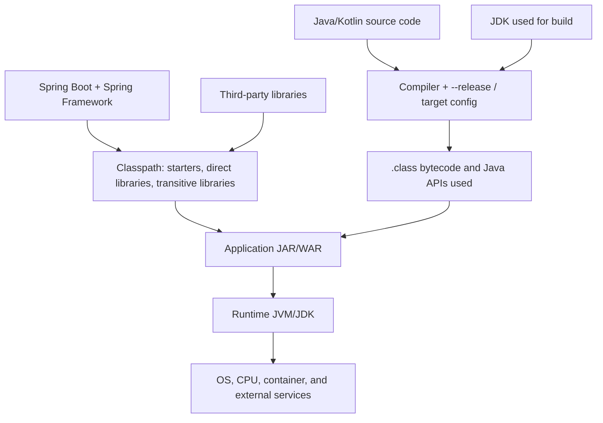
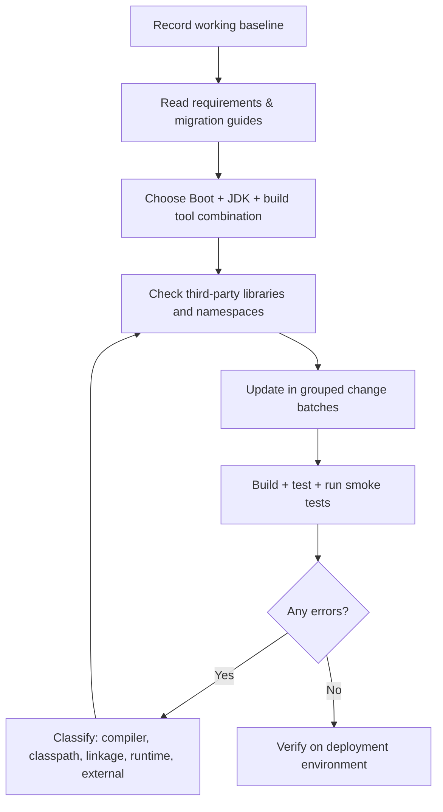

# Compatibility of JDK, Frameworks, and Third-Party Libraries

A Spring Boot project can **compile cleanly on a developer's machine yet fail to run on a server**. Another project runs fine on Java 17, yet upgrading Spring Boot or adding a library triggers `NoSuchMethodError`, `ClassNotFoundException`, or `javax` versus `jakarta` errors. These failures usually occur because multiple software layers participate in building and running the application without sharing the same "compatibility contract".

This lesson teaches you to read a Spring Boot project as **a system of interconnected versions**, identify which layer causes a conflict, and upgrade in a controlled sequence. You do not need to memorize version matrices for every library; what matters is knowing **what to check, when to check it, and with what evidence**.

## 1. The Overall Picture: Compatibility Spans Multiple Layers

A Spring Boot application typically consists of the following layers:



An application can fail if **any critical seam** is incompatible. For example:

- Bytecode is compiled for Java 21 while the production JVM only supports up to Java 17.
- Code calls older Spring Framework APIs while a newer Spring Boot manages different APIs.
- An older library references `javax.servlet.*` while a Spring Boot 3 application uses the Servlet ecosystem under the `jakarta.servlet.*` namespace.
- Two libraries require different API versions, yet dependency resolution selects only one version for the runtime classpath.
- Pure Java libraries run fine, yet an accompanying native library does not support the deployment environment's CPU architecture or OS.

Thus, the question "Does the project support Java 21?" must be unpacked: **which Spring Boot version, which libraries, which build tool, which bytecode target, and which JVM will execute it?**

### Five Types of Compatibility to Distinguish

| Type | Question to Answer | Example Failure |
|---|---|---|
| **Build-tool compatibility** | Do Gradle/Maven and their plugins run on the current JDK? | An older Gradle wrapper fails to start on a newer JDK |
| **Source/API compatibility** | Does source code use only APIs and syntax supported by the chosen target? | Using a Java 21-only API with `--release 17` set |
| **Binary/runtime compatibility** | Can the JVM read the bytecode, and do referenced classes/methods still exist? | `UnsupportedClassVersionError`, `NoSuchMethodError` |
| **Framework integration compatibility** | Do Spring Boot, Spring Framework, and integration libraries belong to the same API generation? | Mismatched Spring Security/Hibernate/Servlet generations |
| **Environment compatibility** | Do the OS, CPU, native dependencies, databases, and deployment setup match? | A JNI library built only for x86_64 on an ARM64 server |

"Compiles successfully" verifies only **part** of this table. It does not prove every runtime path will work.

## 2. JDK, JRE, JVM, and Bytecode: Who Does What?

Before discussing Spring Boot, separate the Java concepts:

- **JDK (Java Development Kit)** contains development tools such as `javac`, `jar`, `javadoc`, and diagnostic utilities, alongside a matching Java runtime.
- **JVM (Java Virtual Machine)** executes Java bytecode. A given JVM understands only class file formats and runtime features supported by its version.
- **Java runtime** is the environment required to run the application. In real deployments, this may be a runtime/JDK image or a stripped-down runtime image created via `jlink`.
- **Bytecode** resides in `.class` files generated during compilation. The class file format has its own version number.
- **Java API** refers to the classes, methods, and behaviors used by source code or bytecode. Compatible bytecode format alone is insufficient if a referenced API does not exist at runtime.

Common class file major versions:

| Target Java Version | Class File Major Version | Consequence |
|---|---:|---|
| Java 8 | 52 | A Java 8 JVM understands bytecode up to its level |
| Java 11 | 55 | Cannot run directly on a Java 8 JVM |
| Java 17 | 61 | Cannot run directly on a Java 11 JVM |
| Java 21 | 65 | Cannot run directly on a Java 17 JVM |

Normally, newer JVMs can execute older bytecode. Still, **do not equate being able to read bytecode with guaranteed correct execution**: removed APIs, behavior changes, native libraries, security changes, and reflective access rules can all cause failures.

### Typical Failure: Compiled for Java 21, Run on Java 17

If the compiler emits class file major version 65 while the runtime only supports up to 61, you may see:

```text
java.lang.UnsupportedClassVersionError:
  ... has been compiled by a more recent version of
  the Java Runtime (class file version 65.0),
  this version of the Java Runtime only recognizes
  class file versions up to 61.0
```

This means **the running JVM is too old for the bytecode**, not a bug in `@SpringBootApplication` or dependency injection. The fix path is:

1. Verify the actual JVM running the application.
2. Upgrade the runtime to a compatible version **or** recompile for a supported target, provided all code and dependencies genuinely support that target.
3. Ensure library JARs also use bytecode not exceeding the production JVM's limit.

Lowering the compile target of **your own application source** cannot fix a third-party library already published with Java 21 bytecode.

### Checking Which Java Versions Are Active

In a terminal:

```bash
java --version
javac --version
```

The first command shows the Java launcher/runtime found in the current environment. The second shows the available compiler. They **can belong to two different JDKs** if `PATH` and `JAVA_HOME` are misaligned.

For Gradle projects, the following command reveals the JVM running Gradle:

```bash
./gradlew --version
```

On Windows PowerShell/CMD, use `.\gradlew.bat --version`. Do not assume the JDK running Gradle is always the JDK used to compile: **Java toolchains** can select a different JDK for `JavaCompile`, `test`, or other Java tasks depending on configuration.

## 3. Build JDK Differs from Target Java Version

Distinguish three pieces of information:

1. **Build-tool JDK**: which JVM starts the Gradle daemon or Maven?
2. **Compiler/toolchain JDK**: which `javac` compiles source code?
3. **Java release/bytecode target**: which minimum Java runtime do the application and libraries require?

For example, a Gradle project can use JDK 21 to compile source targeting Java 17:

```groovy
plugins {
    id 'java'
}

java {
    toolchain {
        languageVersion = JavaLanguageVersion.of(21)
    }
}

tasks.withType(JavaCompile).configureEach {
    options.release = 17
}
```

In this example, the toolchain requests a Java 21 compiler, while `--release 17` restricts language features, standard platform APIs, and bytecode to Java 17. This configuration makes sense **when both the framework and all runtime dependencies support Java 17**.

Conversely, if you only write:

```groovy
java {
    toolchain {
        languageVersion = JavaLanguageVersion.of(21)
    }
}
```

then compilation targets Java 21 by default. Do not assume that because your source uses only simple syntax, the resulting bytecode will run on Java 17.

**Why does `--release` matter?** Separate `-source` and `-target` flags do not prevent accidentally calling standard platform APIs introduced in newer JDKs. `--release` controls the visible standard Java APIs at compile time as well. Still, it does not check the Java level required by external dependencies for you.

### A Quick Scenario Table

| Compiler | `--release` | Runtime JVM | Expected Outcome |
|---|---:|---|---|
| JDK 21 | 21 | Java 21 | Compatible at bytecode level |
| JDK 21 | 17 | Java 17 | Potentially compatible if all dependencies also support 17 |
| JDK 21 | 21 | Java 17 | Incompatible with class file 65 |
| JDK 17 | 21 | Java 21 | Compiler 17 cannot target release 21 |

No single Java version number suffices to describe an entire project's setup.

## 4. Spring Boot, Spring Framework, and JDK Must Match as a Set

Spring Boot is an integration and configuration layer built on multiple projects: Spring Framework, Spring Data, Spring Security (if used), HTTP servers, JSON, persistence, logging, testing, and many other components.

Spring Boot releases ship with a **curated and tested set of managed dependency versions**. Choosing a Boot version also chooses a baseline ecosystem of libraries. Consequently, manually bumping or downgrading Spring Framework alone can yield an untested combination.

A few **illustrative generational milestones (not a list of all latest versions)**:

| Application Generation | Related Framework | Key Considerations |
|---|---|---|
| Spring Boot 2.x | Spring Framework 5.x | Many legacy Java EE integrations use `javax.*` namespaces |
| Spring Boot 3.x | Spring Framework 6.x | Requires Java 17+; Jakarta EE ecosystem moves many APIs from `javax.*` to `jakarta.*` |

For instance, with a Spring Boot 3.x project, choosing between Java 17 and Java 21 must be checked against **the exact Boot release line in use**, build tooling docs, and remaining libraries. When moving to another Boot **major version**, consult its release notes and migration guide, as major upgrades can alter minimum Java requirements, framework APIs, dependency versions, and configuration mechanics.

### Why You Should Not "Force the Latest Framework Into an Older Boot"

Suppose a Spring Boot release manages a specific Spring Framework 6.x line. You force a different `spring-context` version while leaving `spring-webmvc`, `spring-core`, and other Spring modules on the older BOM. The build tool may assemble an **inconsistent combination**.

Errors might not appear when compiling your application source. They may surface only at runtime when one Spring class calls a method missing from another Spring class:

```text
java.lang.NoSuchMethodError:
  '... org.springframework.somepackage.SomeType.someMethod(...)'
```

This is a **binary linkage** failure across API versions. Before editing code, inspect the dependency graph and verify which set of Spring versions is selected.

**Practical rule:** for dependencies managed by Spring Boot, prefer letting Boot's BOM pick versions. Override a library only with a clear reason, after reviewing compatibility notes and running thorough tests.

## 5. The `javax` → `jakarta` Transition

A major change when migrating from legacy Java EE stacks to Jakarta EE is the namespace change across many APIs. In Spring Boot 3, Jakarta-based Servlet/JPA/Validation libraries are used in those areas.

| Area | Legacy Java EE API | Equivalent Jakarta API |
|---|---|---|
| Servlet | `javax.servlet.http.HttpServletRequest` | `jakarta.servlet.http.HttpServletRequest` |
| Persistence (JPA) | `javax.persistence.Entity` | `jakarta.persistence.Entity` |
| Bean Validation | `javax.validation.Valid` | `jakarta.validation.Valid` |
| Lifecycle annotations | `javax.annotation.PostConstruct` | `jakarta.annotation.PostConstruct` |

Example of a Jakarta Persistence entity:

```java
package com.example.catalog;

import jakarta.persistence.Entity;
import jakarta.persistence.GeneratedValue;
import jakarta.persistence.GenerationType;
import jakarta.persistence.Id;

@Entity
public class Product {

    @Id
    @GeneratedValue(strategy = GenerationType.IDENTITY)
    private Long id;

    private String name;

    protected Product() {
    }

    public Product(String name) {
        this.name = name;
    }
}
```

This snippet illustrates appropriate namespaces/annotations in a Jakarta JPA environment. To actually run persistence, the application still needs the JPA dependency and matching database/provider configuration.

**Do not assume every `javax.*` package must become `jakarta.*`.** Java SE APIs such as `javax.crypto` or `javax.swing` are not Jakarta EE APIs renamed here. Only migrate namespaces belonging to APIs covered by the Jakarta transition.

### Issues with Third-Party Libraries Lacking Jakarta Support

Suppose you upgrade an application to Spring Boot 3, yet an old servlet filter library still uses:

```java
import javax.servlet.Filter;
```

while the runtime server/framework uses `jakarta.servlet.Filter`. These two types have **different binary names**, so an object implementing the old interface cannot be treated as implementing the new interface. Putting both API JARs on the classpath does not convert implementations. Typically you must:

1. Upgrade the filter library to a release supporting Jakarta.
2. If the library is unmaintained, look for an alternative library or rewrite the needed integration against the Jakarta API.
3. Verify the entire integration chain: Spring Security, Servlet container, JPA provider, Bean Validation, JSON, and related starters if used.

This is an **API-level difference**, not a "missing import line" issue solvable by renaming packages in application source without checking binary dependencies.

## 6. Starters and BOMs: Why Boot Reduces Version Conflicts

In Spring Boot, a **starter** is typically an umbrella dependency for a capability, such as `spring-boot-starter-web` or `spring-boot-starter-data-jpa`. Starters bring in needed dependencies in a sensible combination.

A **BOM (Bill of Materials)** is a set of version management rules across many artifacts. A project using Spring Boot dependency management properly can declare managed dependencies without repeating versions on every line:

```groovy
dependencies {
    implementation 'org.springframework.boot:spring-boot-starter-web'
    implementation 'org.springframework.boot:spring-boot-starter-validation'
    testImplementation 'org.springframework.boot:spring-boot-starter-test'
}
```

This configuration **assumes the project has applied Spring Boot's version management** (such as `io.spring.dependency-management` integrated with Boot or Gradle's native BOM platform properly configured). Without dependency management, many unversioned dependency declarations will fail to resolve.

Benefits of a BOM:

- Reduces manually picking dozens of framework and integration library versions.
- Lowers the risk of version drift among Spring modules or libraries Boot coordinates with.
- Establishes a consistent baseline for upgrading along a specific Boot release.

Yet a BOM is **not an absolute guarantee**:

- It does not govern every third-party dependency outside the BOM.
- It cannot resolve API breaking changes between an older library and a newer Boot.
- It cannot make a Java 21 bytecode library run on Java 17.
- It does not replace functional testing against real databases, message brokers, OSes, and external services.

### Example: Direct vs. Transitive Libraries

Consider a simple dependency tree:

```text
my-spring-boot-app
├── spring-boot-starter-web
│   ├── spring-webmvc
│   ├── spring-boot-starter-json
│   │   └── jackson-databind
│   └── spring-boot-starter-tomcat
└── legacy-reporting-client
    └── jackson-databind (demands a different version)
```

Both branches depend on `jackson-databind`. The build tool must resolve which artifact/version gets selected for a given classpath configuration. Resolution **differs between Gradle and Maven**, and BOMs, constraints, direct dependencies, and exclusions all influence the result. Therefore, never assume "the library I listed last wins".

Read the **actual resolved dependency graph**, not just the declarations in `build.gradle` or `pom.xml`.

### When Should You Declare Explicit Versions?

- A dependency **not managed by the current BOM** generally needs an explicitly chosen version.
- A dependency needing a **security patch** not yet in the current BOM may require a temporary override, weighing compatibility and planning to return to Boot-managed versions once a matching release arrives.
- When adopting a third-party starter/extension, consult the **compatibility matrix published by that project itself** against your Spring Boot and JDK versions.

Do not bump Spring Framework, Hibernate, Jackson, or Spring Security individually merely because a newer release exists without understanding how they align with your Boot release.

## 7. Third-Party Library Compatibility: Four Checkpoints

A library might claim "Java 17 support" and still fail with a Spring Boot 3 application. "Support" needs to be unpacked.

### 7.1. Minimum Java Level and Bytecode

Library JARs contain compiled classes. If a class has major version 65, the runtime must understand that bytecode (Java 21+). Even if your own source compiles with `--release 17`, that JAR still cannot run on a Java 17 JVM.

With libraries using multi-release JARs, different class implementations may exist per Java version. Compatibility then depends on how the runtime selects classes and the library's documented guarantees, not guesswork from filenames.

### 7.2. Source API and Binary Compatibility

Two frequently confused concepts:

- **Source compatibility**: whether existing source code still compiles against a newer API version.
- **Binary compatibility**: whether pre-compiled bytecode still links properly with classes/methods/fields at runtime.

Removing a method or changing its signature can trigger `NoSuchMethodError` at runtime even when your project builds cleanly because the caller lives inside a pre-compiled dependency.

Illustrative example:

```text
Library A was compiled against Library B version X:
  BClient.send(String)

Actual runtime only has Library B version Y:
  BClient.send(Request)

When A calls send(String) → NoSuchMethodError can occur.
```

The fix is not wrapping it in `try/catch` to ignore linkage errors; you must align API/binary versions or update the adapter calling that API.

### 7.3. Compatibility with Framework Extension Points

Spring extension libraries can depend deeply on framework internals:

- Security filter chains and authentication infrastructure.
- Servlet filters, interceptors, controllers, and embedded servers.
- Spring Data, JPA/Hibernate, transaction managers, and persistence integrations.
- Validation providers, Jackson modules, and serialization customizers.
- Actuator, logging, and observability integrations.

For example, a starter written for Spring Boot 2 does not automatically work with Boot 3 merely because both run on a newer JDK. Look for releases targeting the **matching Boot generation**, not just the matching Java version.

### 7.4. Environment Constraints and Native Components

Some libraries ship JNI/native code, browser integrations, compression codecs, cryptography libraries, or OS hooks. They may require:

- Specific OS: Windows, Linux, or macOS.
- Specific CPU architecture: x86_64, ARM64.
- Specific C libraries/native runtimes or OS packages.
- File/network permissions and suitable container configuration.

Thus, passing tests on a laptop does not prove compatibility when deploying to an ARM64 Linux container, even when JVM and Boot versions match.

## 8. Do Not Forget Build Tools, Plugins, and Annotation Processors

A Spring Boot application passes through a build system before becoming a runnable JAR. These components have their **own version support lifecycles**:

| Component | Must Align With | Example Problem |
|---|---|---|
| Gradle wrapper | JDK running Gradle and plugin versions | Old wrapper cannot run on the build JDK |
| Maven | JDK starting Maven and plugin versions | Old compiler/test plugin does not recognize newer releases |
| Spring Boot Gradle/Maven plugin | Build tool and Spring Boot release | Old plugin lacks current packaging/task support |
| Compiler plugin / `javac` | Source level and Java release | "invalid target release" |
| Annotation processors (e.g., Lombok, MapStruct) | JDK compiler, annotation APIs, and tooling | Processor compilation failure on newer JDKs |
| Test frameworks | JDK, test engine, Spring Test | Tests not discovered or test runtime failures |

When upgrading JDKs, sometimes **the very first thing to upgrade is the Gradle wrapper or Maven plugins**, even before editing application code. Check docs for both "JDK supported to run Gradle" and "JDK supported for compilation via toolchains": these two criteria do not necessarily match.

When using an IDE, also distinguish:

- Project SDK/JDK in the IDE.
- Gradle JVM or Maven runner JDK used by the IDE.
- Java toolchain and bytecode target declared in the build file.
- Actual JVM configured in Run/Debug configurations.

Mismatches across these four explain why "it runs in the IDE, fails in Gradle" or vice versa.

## 9. A Concrete Scenario: Upgrading a Legacy App to Spring Boot 3

Suppose a long-lived application runs Spring Boot 2.x with legacy servlet filters, old Spring Security, and JPA using `javax.persistence`. You want to migrate to Spring Boot 3.x and JDK 21.

These are **two distinct changes**:

1. **Changing JDK**: verify build tool/plugin support for JDK 21, target bytecode, reflection access, dependency Java versions, and runtime image.
2. **Changing major Spring Boot version**: verify minimum Java requirements, Spring Framework 6, Jakarta namespaces, compatible Hibernate/Security/Servlet/Validation versions, property changes, and auto-configuration changes.

Doing both in one huge commit without a measured baseline makes it hard to tell whether a failure comes from Java, the framework, or an integration library.

### Controlled Execution Model



**Step 1 — Record the baseline.** Document current versions of JDK, Spring Boot, build tools, and direct/resolved dependencies. Record key working business flows for comparison.

**Step 2 — Pick a supported version set.** Use the system requirements and dependency versions of the **specific Spring Boot release** you plan to target. Cross-check release notes for integrated libraries like Hibernate, Spring Security, and third-party starters.

**Step 3 — Update build tools and Java config.** Ensure the wrapper/plugins run cleanly on the new JDK; declare a toolchain for dev and CI consistency. Define the target Java runtime explicitly.

**Step 4 — Migrate integration APIs if needed.** Switch relevant Java EE imports to Jakarta; upgrade libraries tied to `javax.servlet`/`javax.persistence` to Jakarta-compatible releases.

**Step 5 — Keep dependency management consistent.** Prefer Boot's BOM and prune legacy overrides that no longer have a justification. For unmanaged dependencies, pick versions per compatibility docs.

**Step 6 — Test and verify deployment.** Compile, run tests, start the app, invoke endpoints, verify database connections/transactions/serialization/authentication, then validate on a container/JVM matching production.

Whether to **upgrade the JDK runtime first** or **upgrade Boot first** depends on project constraints; sometimes an intermediate step reduces simultaneous changes, whereas other times legacy libraries block upgrading the JDK first. Keep an explicit version matrix and verify after each step.

## 10. Inspecting the Dependency Graph with Gradle and Maven

When hitting classpath errors, staring at `implementation` lines in a build file is not enough. You must inspect **which version was actually chosen** and **which branch pulled it into the project**.

### With Gradle

On Linux/macOS (on Windows, replace `./gradlew` with `.\gradlew.bat`):

```bash
# Gradle JVM and wrapper version
./gradlew --version

# List Java toolchains detected by Gradle
./gradlew javaToolchains

# Inspect resolved dependencies for runtime
./gradlew dependencies --configuration runtimeClasspath

# Trace why a module was selected and where it came from
./gradlew dependencyInsight \
  --configuration runtimeClasspath \
  --dependency jackson-databind
```

In multi-module projects, prefix with the project path, such as `./gradlew :app:dependencies --configuration runtimeClasspath` if a Gradle module named `app` actually exists.

Distinguish `compileClasspath` from `runtimeClasspath`: a dependency can exist at compile time yet be absent (or resolved to a different version) at runtime. Always inspect the **classpath experiencing the failure**, not just compile dependencies.

### With Maven

```bash
# Which JDK is Maven running on?
mvn -version

# Project dependency tree
mvn dependency:tree

# Narrow down to a group/artifact; filter syntax depends on the plugin
mvn dependency:tree -Dincludes=com.fasterxml.jackson.core:jackson-databind
```

If the project uses the Maven Wrapper, prefer `./mvnw` (or `mvnw.cmd` on Windows) to stay on the project's specified Maven version.

Maven's `dependencyManagement` and nearest-wins resolution have their own rules; Gradle's platforms, constraints, and conflict resolution affect version selection differently. **The two tools do not always produce identical dependency graphs even from similar-looking declarations.**

### Finding Which JAR Contains a Class File

Sometimes an error names a class whose originating dependency is unclear. Start with the dependency graph, then inspect specific JAR contents:

```bash
jar tf some-library.jar
```

The JAR name above is a placeholder; substitute the actual artifact path. You can use `javap -verbose` to view class file metadata for an extracted or classpath class, including its `major version`.

If multiple JARs contain the same fully qualified class, classloader/classpath ordering can trigger unpredictable errors. Resolve the source of duplicate libraries rather than merely tweaking source imports.

## 11. Decoding Errors by Compatibility Layer

| Error / Symptom | First Suspect Layer | Investigation Path |
|---|---|---|
| `invalid target release: 21` | Compiler / build JDK | `javac --version`, toolchain, compiler plugin |
| `UnsupportedClassVersionError` | Bytecode > runtime JVM | Class file major version, `java --version` in runtime environment |
| `ClassNotFoundException` | Missing class on active classpath | Dependency/runtime packaging, namespace, classloader |
| `NoClassDefFoundError` | Required class cannot load/initialize | Inspect root cause, classpath, and initialization failures |
| `NoSuchMethodError` | Binary API version mismatch | Dependency graph, owning JAR, compiled API version |
| `IncompatibleClassChangeError` | Breaking change in binary structure | Align linked libraries and framework versions |
| `javax.servlet...` / `jakarta.servlet...` errors | Mismatched Servlet API generation | Check Boot, Servlet, and third-party starters |
| `BeanCreationException` after Boot upgrade | Config / auto-configuration / framework integration | Read nested cause, config conditions, migration guide |
| `UnsatisfiedDependencyException` | Bean wiring or foundational bean failed to create | Inspect deepest cause; may stem from missing dependency |
| JVM/Gradle fails to start after Java upgrade | Build tool / JDK compatibility | Gradle wrapper or Maven/plugin requirements |
| Fails only on production container | Runtime image / platform / config | Java in image, CPU/OS, env vars, native dependencies |

High-level Spring errors are often just **consequences**. For instance, `BeanCreationException` may wrap `NoClassDefFoundError`, beneath which lies a missing dependency. When debugging, always locate the **root cause** in the stack trace.

### Three Sample Reasoning Chains

**Case A — `UnsupportedClassVersionError` immediately on running a JAR**

Check `java --version` inside the real container. If runtime is Java 17 while bytecode is class file 65, the issue is JDK/target. Do not start by editing controllers or beans.

**Case B — `NoSuchMethodError` right after upgrading a third-party starter**

Find the class/method in the stack trace, trace the owning artifact, and run `dependencyInsight` or `dependency:tree` to see the resolved runtime version. Compare against the version the caller library was compiled/tested with. Fix by choosing a compatible set of libraries.

**Case C — Filter fails to load after upgrading to Spring Boot 3**

Check which API the filter implements: `javax.servlet.Filter` or `jakarta.servlet.Filter`. Verify a Jakarta-supporting release of that library and matching Servlet container/framework versions. Adding `javax.servlet-api` JARs will not turn a legacy filter into a Jakarta filter.

## 12. Distinguishing Compatibility from "Newer" Versions

A higher version is not automatically more compatible:

- **Patch/minor/major** indicates intended change scope; actual compatibility depends on each project's versioning policy.
- APIs can be deprecated before removal in a major release; compiling with warnings does not prove compatibility in future releases.
- A newer library may require a newer JDK, making an older production Java runtime a bottleneck.
- A newer release may support a newer Spring Boot while dropping support for an older Boot.
- A dependency override may patch one vulnerability while breaking binary API compatibility for another library.

Within a Boot-managed artifact group, **compatibility of the combined set** matters more than having every artifact on its highest possible version.

### Version Pinning and Reproducibility

Stable builds require knowing exactly which artifacts are used:

- Commit the project's Gradle Wrapper or Maven Wrapper.
- Manage direct dependency, BOM, and plugin versions explicitly.
- For systems requiring strict reproducibility, consider dependency locking and dependency verification per your build tool.
- Avoid dynamic version ranges such as `latest.release` or `+` patterns in controlled environments.
- Pin deployed Java runtime/container images; avoid relying on mutable container tags without control.

These practices eliminate "it built yesterday, fails today" surprises even when application source has not changed.

## 13. Compatibility Matrix: A Simple Decision Tool

Before committing to an upgrade, build a table based on your **project's actual environment**, rather than blindly picking the newest numbers:

| Component | Current | Target | Source of Verification |
|---|---|---|---|
| JDK for Gradle/Maven | e.g., Java 17 | e.g., Java 21 | Build tool/plugin requirements |
| Java compile target | 17 | 17 or 21 | `--release`/toolchain config |
| Production JVM | 17 | 21 if targeting 21 | Deployment image/runtime |
| Spring Boot | A specific release | Target release | System requirements, migration guide |
| Spring Framework | Per current BOM | Per target BOM | Boot dependency versions |
| HTTP/Servlet stack | Per current starter | Per target starter | Servlet/Jakarta compatibility |
| Persistence/Validation | Current provider | Compatible provider | Provider/starter notes |
| Third-party starters | Current versions | Versions supporting target Boot | Vendor compatibility matrices |
| Test/build tooling | Current wrapper/plugins | Versions supporting target JDK | Tool requirements and CI |

When filling out the table, avoid writing just "Spring Boot 3" or "Java 21": exact patch/minor versions, build plugins, runtime images, and specific starters often determine whether the application actually runs.

### Example of Reading the Matrix

Consider three options:

| Option | Boot | Compile Target | Runtime | Assessment |
|---|---|---|---|---|
| A | Compatible Boot 3.x | Java 17 | Java 17 | Sound at basic Java level; still verify dependencies |
| B | Compatible Boot 3.x | Java 21 | Java 17 | Incompatible at bytecode level |
| C | Compatible Boot 3.x | Java 17 | Java 21 | Bytecode can run on newer JVM; still verify framework/libraries and runtime behavior |

This table **does not validate an entire arbitrary project's version combination**. It merely illustrates how to reason: every seam must align at once.

## 14. Self-Verification Exercises

### Exercise 1 — Identifying Three Java Versions

In a Spring Boot project using Gradle:

1. Run `java --version`, `javac --version`, and `./gradlew --version`.
2. Open the build file and inspect the Java toolchain and `options.release` (if set).
3. Check the actual image/runtime used in the target runtime environment.
4. Record three columns: **Build JDK**, **bytecode target**, and **runtime JVM**. If they differ, explain why.

The expected output is a table with concrete versions, not a vague note saying "the machine runs Java 21".

### Exercise 2 — Tracing a Transitive Library

In a project with `spring-boot-starter-web`:

1. Run `./gradlew dependencies --configuration runtimeClasspath`.
2. Find `jackson-databind` in the output.
3. Run `./gradlew dependencyInsight --configuration runtimeClasspath --dependency jackson-databind`.
4. Record the selected version and at least one dependency path pulling it into the project.

If using Maven, run `mvn dependency:tree` with an appropriate filter.

### Exercise 3 — Classifying Upgrade Errors

Given three messages:

```text
A. UnsupportedClassVersionError: class file version 65.0; runtime up to 61.0
B. java.lang.NoSuchMethodError: 'X LibraryB.someMethod(...)'
C. java.lang.ClassNotFoundException: javax.servlet.Filter
```

Identify the first investigation path:

- **A:** bytecode/JVM compatibility; check build target and Java runtime.
- **B:** binary API/dependency resolution; check artifacts and actual resolved versions.
- **C:** classpath and Servlet/Jakarta generation, especially across major Spring Boot upgrades.

After classifying each, propose **one concrete piece of evidence to collect** before modifying source code: Java runtime version, dependency graph, or the JAR/API used by the library.

## 15. References When Selecting Real-World Versions

Version matrices evolve across releases, so when starting a project or upgrading an application, consult documentation for the **exact release**:

- [Spring Boot Reference Documentation](https://docs.spring.io/spring-boot/index.html): Java/build tool requirements, dependency versions, starters, migrations.
- [Spring Framework Reference](https://docs.spring.io/spring-framework/reference/): Spring Framework APIs and integration capabilities.
- [Gradle Compatibility Matrix](https://docs.gradle.org/current/userguide/compatibility.html): JDKs supported to run Gradle and compile via Java toolchains.
- [Maven Compiler Plugin Documentation](https://maven.apache.org/plugins/maven-compiler-plugin/): source/target/release configuration in Maven.
- [Java SE Releases](https://www.oracle.com/java/technologies/java-se-glance.html): information on Java SE release generations.
- Release notes and compatibility matrices of **each specific third-party library**, especially those integrating deeply with Spring, JPA, Servlet, or Security.

These links are starting points. Pick the documentation version matching the artifacts you use; "current" does not necessarily describe an application staying on an older release.

## 16. Mental Model to Remember

Do not ask only **"Does this library run on the new Java?"**. Answer in sequence:

1. **Can it build?** Do Gradle/Maven, plugins, compiler, and JDK work together?
2. **Can the bytecode run?** Does the runtime JVM support the class file version and required Java APIs?
3. **Does the framework align?** Do Spring Boot, Spring Framework, and starters belong to a compatible version set?
4. **Do integration libraries align?** Are APIs, binary compatibility, and Jakarta/Java EE namespaces of third-party libraries compatible?
5. **Can it run in real deployment?** Are container images, OS/CPU, native dependencies, configuration, and external services aligned?

Compatibility in Spring Boot is a **whole-stack property**, from compiler to JVM, from BOM to dependency graph, and from source code to production environment. When an error occurs, identifying which layer broke the contract lets you choose the right diagnostic tool and fix the root cause instead of randomly changing version numbers.
