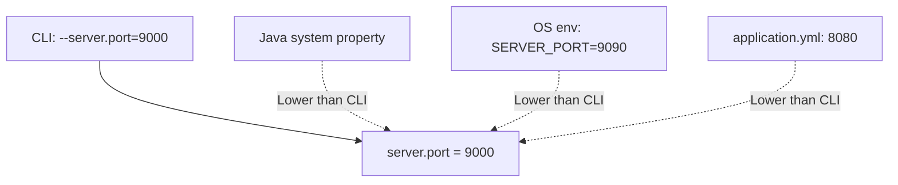

# Precedence Rules When a Property Appears in Multiple Sources

> **Spring Boot Fundamentals · Application Configuration**  
> A property such as `server.port`, `spring.datasource.url`, or `app.feature.enabled` can be declared simultaneously in `application.yml`, an external configuration file outside the JAR, an environment variable, a Java system property, and a command-line argument. Spring Boot uses a **deterministic precedence order** to pick the effective value. Understanding that order lets you deploy a single JAR across environments, explain why a value is overridden, and avoid hard-to-trace operational bugs.

## 1. When multiple sources declare the same key, how does Spring Boot choose?

Suppose the application has a default value:

```yaml
# src/main/resources/application.yml
server:
  port: 8080
```

The deployment environment also sets:

```bash
export SERVER_PORT=9090
```

And when launching the application, the operator passes:

```bash
java -jar orders.jar --server.port=9000
```

In a run where all of these sources are active, `server.port` ends up as `9000`: command-line arguments have higher precedence than environment variables, which in turn have higher precedence than values in `application.yml`.

Spring Boot does not pick a value because "a file was read later" or because "a key was written closer to the end of the source code." It builds `Environment` from multiple `PropertySource`s, applies the precedence order, and resolves values according to that order.



**Foundational rule:** When two sources provide the same property recognized by Spring as the same key, the value from the **higher-precedence** source wins. The remaining values still exist in their original sources, just not as the value `Environment` returns for that key.

### 1.1. What is a PropertySource?

A `PropertySource` is a source of key–value pairs. For example:

- An `application.properties` file.
- A YAML document loaded into config data.
- Operating system environment variables.
- Java system properties.
- Command-line arguments.
- A source added manually or supplied by an integration library.

Spring aggregates these sources through the `Environment` abstraction. APIs such as `Environment.getProperty(...)`, `@Value`, and `@ConfigurationProperties` rely on this configuration mechanism to read or bind data.

```java
@Component
public class EffectivePortReporter {

    private final Environment environment;

    public EffectivePortReporter(Environment environment) {
        this.environment = environment;
    }

    public String readPort() {
        return environment.getProperty("server.port", "8080");
    }
}
```

The default parameter `"8080"` in `getProperty` is used only when the environment cannot resolve the property; it is **not a competing PropertySource** against external sources.

### 1.2. Precedence does not equal reliability

The fact that a command-line property takes precedence over a file does not mean it is always valid or safe. Precedence is a technical rule enabling externalized configuration. The final value still needs validation for correctness, data type, and suitability for the environment.

For instance, `server.port=-100` may win during resolution and still cause an error when the server tries to use the invalid value.

## 2. Precedence order of configuration sources

The Spring Boot 3.x documentation lists sources from **lowest to highest**; later entries can override earlier ones. The table below presents them in reverse, from **highest to lowest**, for easier reference when resolving conflicts.

| Precedence | Configuration source | Notes |
| --- | --- | --- |
| 1 — highest | Devtools global settings | Only when Devtools is active, for local development |
| 2 | `@TestPropertySource` | Source for testing |
| 3 | `@DynamicPropertySource` | Dynamic source for testing |
| 4 | `properties` attribute on `@SpringBootTest` or test slices | Source for testing |
| 5 | Command-line arguments | e.g., `--server.port=9000` |
| 6 | `SPRING_APPLICATION_JSON` | Configuration JSON passed via env/system property/CLI |
| 7 | `ServletConfig` init parameters | Applies only in a suitable servlet environment |
| 8 | `ServletContext` init parameters | Applies only in a suitable servlet environment |
| 9 | JNDI attributes | e.g., `java:comp/env` when JNDI is available |
| 10 | Java system properties | e.g., `-Dserver.port=8081` |
| 11 | OS environment variables | e.g., `SERVER_PORT=9090` |
| 12 | `RandomValuePropertySource` | Mainly for `random.*` |
| 13 | Config data | `application.properties`/`application.yml` and imported files |
| 14 | `@PropertySource` on `@Configuration` classes | Added during context refresh, with timing limitations |
| 15 — lowest | Default properties | Set via `SpringApplication.setDefaultProperties(...)` |

**Scope note:** This is the default source order described for Spring Boot 3.x. Some sources exist only in applicable environments; pure CLI apps typically have no servlet sources, and test sources do not appear in production. Libraries or custom code can insert `PropertySource`s at custom positions, so inspect the actual `Environment` when extensions are involved.

### 2.1. The most important sources in typical applications

In most Spring Boot applications, we commonly encounter these sources from highest to lowest:

```text
Command-line arguments
          ↓
SPRING_APPLICATION_JSON
          ↓
Java system properties (-D...)
          ↓
OS environment variables
          ↓
Config data (application.yml, profile files, external files...)
          ↓
@PropertySource
          ↓
Default properties
```

Arrows indicate **decreasing precedence**. If a key exists at a higher level, values at lower levels will not take effect unless the higher source is omitted or lacks that key.

### 2.2. Two things to remember

First, this precedence order applies to **configuration sources**, not the order of statements written in Java source code.

Second, **config data has its own internal ordering**: there are multiple file locations, multiple profiles, and imports. When the same key appears in multiple files, check the ordering inside the config data group before comparing against env/system/CLI.

## 3. Combined example: one key in five places

Suppose all of the following values are present during a single launch:

| Source | Declaration | Value |
| --- | --- | --- |
| `application.yml` inside JAR | `server.port: 8080` | 8080 |
| `./config/application.yml` outside JAR | `server.port: 8085` | 8085 |
| Environment variable | `SERVER_PORT=9090` | 9090 |
| System property | `-Dserver.port=8081` | 8081 |
| Command-line argument | `--server.port=9000` | 9000 |

Illustrative command in a Unix shell:

```bash
export SERVER_PORT=9090
java -Dserver.port=8081 -jar orders.jar --server.port=9000
```

Without another special source taking higher precedence, `server.port` is `9000`.

Removing sources one by one reveals the changes:

| Sources present | Result |
| --- | --- |
| All five sources | 9000 |
| Without command line | 8081 |
| Without command line and system property | 9090 |
| Only the two files | 8085 |
| Only the file inside the JAR | 8080 |

This table helps visualize the override layers. Values in files do not disappear; higher-precedence sources simply shadow them.

### 3.1. Placement of `-D` and `--` differs

A Java system property is passed to the JVM with `-D`, usually placed **before `-jar`**:

```bash
java -Dserver.port=8081 -jar orders.jar
```

A Spring Boot command-line argument is placed **after the JAR name** and uses `--key=value`:

```bash
java -jar orders.jar --server.port=9000
```

Both mechanisms can affect `server.port`, yet belong to two distinct `PropertySource`s. CLI arguments processed by Spring Boot have higher precedence than Java system properties in the default order.

### 3.2. When command-line properties are disabled

By default, Spring Boot converts `--name=value` arguments into properties. You can disable this when starting the application:

```java
public static void main(String[] args) {
    SpringApplication app = new SpringApplication(OrdersApplication.class);
    app.setAddCommandLineProperties(false);
    app.run(args);
}
```

If disabled, `--server.port=9000` will not be added to `Environment` as a command-line property by default. Another source with the highest precedence among those remaining will determine the value.

Do not disable this feature if the application still needs to accept configuration flags from the command line.

## 4. Precedence within the config data group

`application.yml` or `application.properties` belongs to the **config data** group. Spring Boot automatically searches files on the JAR/classpath and outside the JAR at default locations.

For common cases, the order from lowest to highest inside config data is:

1. Base application file packaged in the JAR.
2. Profile-specific file packaged in the JAR.
3. Base application file outside the JAR.
4. Profile-specific file outside the JAR.

For example, if the same property exists in:

```text
classpath:/application.yml
classpath:/application-prod.yml
file:./application.yml
file:./application-prod.yml
```

and the `prod` profile is active, `./application-prod.yml` can provide the winning value within the config data group.

### 4.1. Files outside the JAR take precedence over packaged files

Example inside the JAR:

```yaml
# src/main/resources/application.yml
app:
  greeting: "Hello from JAR"
```

File outside the JAR at a location automatically searched by Spring Boot:

```yaml
# ./config/application.yml
app:
  greeting: "Hello from deployment"
```

Without env/system/CLI overrides, `app.greeting` resolves from the file outside the JAR.

This is the basis for building one JAR and configuring it differently in staging, production, and local environments without editing source or rebuilding.

### 4.2. Profile-specific overrides non-profile at the same location tier

Inside the JAR:

```yaml
# application.yml
app:
  mode: standard
  retry-count: 2
```

And:

```yaml
# application-prod.yml
app:
  mode: production
```

When activating the `prod` profile:

- `app.mode` receives `production`.
- `app.retry-count` remains `2` because the profile file does not declare a replacement value.

This is **per-present-property** overriding; you do not need to copy every key from the base file into the profile file.

### 4.3. When multiple profiles are active at once

For example:

```bash
java -jar orders.jar --spring.profiles.active=prod,live
```

If two profile files in the same location group declare the same property, the profile appearing later in the active list can win under the "last wins" rule; in this example, the value from `application-live.yml` can override the corresponding value from `application-prod.yml`.

This rule applies at the **location group level**. When using `spring.config.location` with multiple locations/groups, check how locations are grouped; do not infer that every profile file across every location is always compared in a single global order.

### 4.4. When both properties and YAML exist at the same location

If the same location contains both `application.properties` and `application.yml`, Spring Boot gives precedence to the `.properties` version for overlapping keys.

Choose one primary format per configuration location to avoid ambiguity over which source wins. Converting from YAML to properties does not alter precedence among CLI, env, and config data, though it can affect file selection within the same location.

### 4.5. Default searched locations

Spring Boot typically searches config data in the classpath root, the `config/` directory on the classpath, the working directory, the `config/` directory outside the working directory, and direct subdirectories of `config/` outside the JAR. Later locations in the default list can override earlier ones per config data rules.

The relative path `./` is based on the **process working directory**, not necessarily the directory holding the JAR file. In Docker or systemd, the working directory may differ from what developers see when running locally.

## 5. `spring.config.location` and `spring.config.additional-location`

Spring Boot allows specifying configuration paths instead of relying solely on default locations.

### 5.1. `spring.config.location` replaces default locations

For example:

```bash
java -jar orders.jar \
  --spring.config.location=optional:classpath:/defaults/,optional:file:./deploy-config/
```

This specifies the set of locations Spring Boot should search. Using `spring.config.location` **replaces** the default config data locations.

This can be surprising: an `application.yml` inside the JAR will no longer be searched via default locations unless included in the new location list.

Use `optional:` when a file or directory may not exist and its absence is valid. If a required location does not exist, Spring Boot can halt startup with a `ConfigDataLocationNotFoundException`-related error.

### 5.2. `spring.config.additional-location` adds locations

For example:

```bash
java -jar orders.jar \
  --spring.config.additional-location=optional:file:./private-config/
```

This property **adds** locations to the default ones. Additional locations are evaluated under config data precedence rules and can override default files.

If your goal is to retain packaged files inside the JAR while letting external files override them, `additional-location` is usually clearer than rewriting all default locations yourself.

### 5.3. Location order and location groups

Multiple locations are separated by commas; locations are evaluated in declaration order and later locations can override earlier ones. Semicolons can be used to group locations at the same precedence tier (a location group).

Difference in meaning:

```properties
spring.config.location=classpath:/cfg/,classpath:/ext/
```

versus:

```properties
spring.config.location=classpath:/cfg/;classpath:/ext/
```

With multiple profiles, grouping affects the ordering of profile-specific documents and thus the final value. Do not add or remove `;` merely for formatting readability.

### 5.4. File-discovery properties must be set early

`spring.config.name`, `spring.config.location`, and `spring.config.additional-location` are used **before** config data files are loaded so Boot knows which files to look for. Therefore, provide them via an early-available configuration source such as an environment variable, Java system property, or command-line argument.

Do not rely on an as-yet-undiscovered `application.yml` file to specify the location of that very file.

## 6. `spring.config.import`: imported sources can override the declaring file

An `application.yml` file can import extra data:

```yaml
spring:
  config:
    import: optional:file:./overrides.properties

app:
  theme: light
```

`overrides.properties`:

```properties
app.theme=dark
```

When the import loads successfully, `app.theme` in the config data group can receive `dark`. Spring Boot treats imported config as supplementary documents with **higher precedence than the file declaring the import**.

### 6.1. Position of the import line inside the file does not decide precedence

These two snippets have identical source-ordering meaning:

```properties
spring.config.import=optional:file:./overrides.properties
app.theme=light
```

```properties
app.theme=light
spring.config.import=optional:file:./overrides.properties
```

Whether the import line comes before or after `app.theme` does not change precedence. The order is determined by the config data import mechanism.

### 6.2. Importing multiple locations

You can pass multiple locations in `spring.config.import`. Imports are evaluated in declaration order; later imports can override earlier ones.

In addition, when applicable, Boot also considers profile-specific variants of imported files. Always inspect both active profiles and which imported files actually loaded when values seem unexpected.

### 6.3. Imports cannot override higher-tier sources such as CLI

Although an imported file has higher precedence than the file declaring the import within the config data group, it still sits inside the **config data** group. Command-line arguments, Java system properties, and OS environment variables have higher precedence than the entire config data group by default.

Thus, if an imported file declares `app.theme=dark` while the command line passes `--app.theme=contrast`, the effective value remains `contrast`.

## 7. Environment variables and key naming rules

Many operating systems or deployment platforms make dots or dashes inconvenient in environment variable names. Spring Boot supports variable names compatible with configuration binding.

For example:

```properties
server.port=8080
spring.profiles.active=prod
app.feature.enabled=true
```

Can be supplied via environment variables:

```bash
export SERVER_PORT=9090
export SPRING_PROFILES_ACTIVE=prod
export APP_FEATURE_ENABLED=true
```

With `@ConfigurationProperties`, Spring Boot uses **relaxed binding** to associate compatible name variants of a property.

### 7.1. Common rule for mapping environment variables

For canonical kebab-case configuration names, converting to an environment variable name usually follows:

1. Replace dots `.` with underscores `_`.
2. Remove dashes `-` in each segment.
3. Convert to uppercase.

For example:

| Property | Common environment variable |
| --- | --- |
| `server.port` | `SERVER_PORT` |
| `spring.profiles.active` | `SPRING_PROFILES_ACTIVE` |
| `my.service.remote-address` | `MY_SERVICE_REMOTEADDRESS` |
| `app.feature.enabled` | `APP_FEATURE_ENABLED` |

Depending on key structure and access API, relaxed binding has nuances. In real applications, define canonical kebab-case properties and use `@ConfigurationProperties` for structured configuration.

### 7.2. Environment variables beat files

If `application.yml` has:

```yaml
app:
  feature:
    enabled: false
```

and the environment has:

```bash
export APP_FEATURE_ENABLED=true
```

then the value bound to the corresponding property can be `true` because OS environment variables have higher precedence than config data.

Pay special attention to environment variables injected by Kubernetes Deployments, Docker Compose, CI/CD pipelines, or hosting platforms, as they may be overriding values committed in the repository.

### 7.3. Having both env and Java system properties at the same time

For example:

```bash
export SERVER_PORT=9090
java -Dserver.port=8081 -jar orders.jar
```

Without a CLI property or higher-precedence source, `server.port` is `8081` because Java system properties sit above OS environment variables in the default order.

**Do not confuse an OS environment variable with a Java system property:** even though both can be supplied outside the JAR, they belong to two different sources and precedence tiers.

## 8. `SPRING_APPLICATION_JSON`: multiple properties in one JSON payload

When a deployment platform makes passing a single environment variable convenient, you can use `SPRING_APPLICATION_JSON`:

```bash
export SPRING_APPLICATION_JSON='{"app":{"feature":{"enabled":true},"mode":"fast"}}'
java -jar orders.jar
```

Spring Boot parses the JSON into keys such as:

```text
app.feature.enabled=true
app.mode=fast
```

This source has higher precedence than Java system properties and OS environment variables, yet lower precedence than command-line arguments in the default order.

You can also pass the JSON data via a Java system property or command-line argument named `spring.application.json` accordingly.

### 8.1. JSON `null` does not erase lower-precedence values

If the JSON contains:

```json
{"app":{"mode":null}}
```

`PropertySourcesPropertyResolver` treats a `null` value as a property with no value. Hence, JSON `null` **cannot be used to clear or override with null** an `app.mode` value present in a lower-precedence source.

If you want to disable a feature, use an explicit meaningful value such as `enabled=false` instead of expecting null to shadow an older setting.

## 9. `@PropertySource` and default properties

### 9.1. `@PropertySource` has relatively low precedence

For example:

```java
@Configuration(proxyBeanMethods = false)
@PropertySource("classpath:integration-defaults.properties")
public class IntegrationConfiguration {
}
```

`integration-defaults.properties` can provide fallback values for keys not defined in config data or higher-precedence sources.

However, a property source declared via `@PropertySource` is added when the `ApplicationContext` refreshes. As a result, it may arrive **too late** to control settings read during early startup such as `logging.*` and `spring.main.*`.

For core Spring Boot properties, prefer config data or external sources processed at the appropriate time.

### 9.2. Default properties have the lowest precedence

You can set fallbacks programmatically:

```java
public static void main(String[] args) {
    SpringApplication app = new SpringApplication(OrdersApplication.class);

    Map<String, Object> defaults = new HashMap<>();
    defaults.put("app.feature.enabled", "false");
    defaults.put("app.timeout", "5s");

    app.setDefaultProperties(defaults);
    app.run(args);
}
```

These defaults take effect only if no higher-precedence source provides the corresponding key.

This approach fits when the application needs bootstrap-level fallbacks, but should not be used as a way to override deployment configuration.

### 9.3. Default values in `@Value` are a separate fallback layer

```java
@Value("${app.timeout:5s}")
private Duration timeout;
```

`5s` inside the placeholder is a default value when no matching property exists; it does not create a new `PropertySource`. If the environment has `app.timeout=20s` in any valid source, the injected value will be `20s` after appropriate type conversion.

## 10. Do `@Value`, `Environment`, and `@ConfigurationProperties` follow the exact same rules?

All three draw configuration from Spring `Environment`, though they differ in binding capabilities and type conversion.

### 10.1. `Environment.getProperty`

```java
@Component
public class ModeReporter {

    private final Environment environment;

    public ModeReporter(Environment environment) {
        this.environment = environment;
    }

    public String mode() {
        return environment.getProperty("app.mode", "standard");
    }
}
```

Use when you need to access a few specific keys. For the same `Environment` and matching key, the higher-precedence source decides the resolved value.

### 10.2. `@Value`

```java
@Component
public class AuditClient {

    public AuditClient(
            @Value("${app.audit.enabled:false}") boolean enabled) {
        // Use the resolved and converted value.
    }
}
```

`@Value` suits a few standalone values. Use canonical kebab-case placeholder names for more consistent name resolution.

### 10.3. `@ConfigurationProperties`

```java
@ConfigurationProperties(prefix = "app.retry")
public class RetryProperties {

    private int maxAttempts = 3;
    private Duration delay = Duration.ofSeconds(1);

    public int getMaxAttempts() {
        return maxAttempts;
    }

    public void setMaxAttempts(int maxAttempts) {
        this.maxAttempts = maxAttempts;
    }

    public Duration getDelay() {
        return delay;
    }

    public void setDelay(Duration delay) {
        this.delay = delay;
    }
}
```

For multiple related properties, typed binding groups data into an object and supports relaxed binding, type conversion, metadata, and validation.

**Distinction to keep in mind:** Source precedence and **structural combination rules** are two different things. A scalar usually takes the value from the highest-precedence source; a collection or map has additional binding rules.

## 11. When a property is a list or map: replace or merge?

This is a common place to misapply the rule "higher source overrides lower source."

### 11.1. Lists are usually replaced, not appended

Base file example:

```yaml
app:
  servers:
    - https://one.example
    - https://two.example
```

Profile file:

```yaml
app:
  servers:
    - https://prod.example
```

When binding a `@ConfigurationProperties` list with a higher-precedence profile, the result is normally a list containing only `https://prod.example`. Spring Boot does not automatically append the two entries from the base file into the profile list.

This makes sense when you want a profile to define its complete set of servers.

### 11.2. Maps can merge by key

Base file example:

```yaml
app:
  labels:
    region: global
    owner: platform
```

Profile file:

```yaml
app:
  labels:
    region: apac
```

When binding a map, the `region` value from the higher-precedence source can win, while the `owner` key from the lower source is preserved if not overridden.

Conceptual result:

```yaml
app:
  labels:
    region: apac
    owner: platform
```

Cases with maps holding complex values require checking detailed binding rules; do not assume every nested structure performs a deep merge identical to YAML anchors/merges.

### 11.3. Practical consequence

If an environment variable or profile sets just one list element, you can accidentally lose elements declared in the base file. With a map, keys from lower sources can remain. When values appear "missing" or "extra", inspect the data type and binder rules rather than looking solely at `PropertySource` order.

## 12. Multiple documents in the same YAML file

Spring Boot supports splitting a single YAML file into multiple documents using `---`. Each document can have its own activation condition:

```yaml
app:
  message: default
---
spring:
  config:
    activate:
      on-profile: prod
app:
  message: production
```

When the `prod` profile is active, the second document activates and can override `app.message` from the first document. Without that profile, the value from the default document is used.

Documents are processed in order alongside their activation conditions. If multiple documents in the same file are active and define the same key, later documents can override earlier ones.

Do not confuse `---` inside YAML with Markdown horizontal rules; inside a YAML code block it is YAML document separator syntax.

## 13. Precedence in Spring Boot tests

In tests, a key can be overridden by configuration sources that exist only in the test environment.

For example:

```java
@SpringBootTest(properties = "app.feature.enabled=false")
class FeatureTests {
}
```

Or:

```java
@TestPropertySource(properties = "app.feature.enabled=true")
@SpringBootTest
class FeatureOverrideTests {
}
```

Or dynamic properties, often used with Testcontainers:

```java
@DynamicPropertySource
static void databaseProperties(DynamicPropertyRegistry registry) {
    registry.add("spring.datasource.url", () -> database.getJdbcUrl());
}
```

Under Spring Boot 3.x source ordering, `@TestPropertySource` and `@DynamicPropertySource` belong to the test source group with higher precedence than normal application sources. `@TestPropertySource` sits above `@DynamicPropertySource` in Boot's source list. Test annotations can create and combine property sources via Spring Test mechanisms, so when multiple annotations write the same key, verify the actual test context.

### 13.1. Avoid depending on the test runner's machine environment

A test that needs a specific value should set that value in test configuration instead of assuming CI machines lack environment variables with the same name. For integration tests, use `@SpringBootTest(properties = ...)` or an appropriate mechanism to reduce interference from external configuration.

### 13.2. `ApplicationContextRunner` helps inspect configuration

For example:

```java
class AppPropertyTests {

    private final ApplicationContextRunner runner =
            new ApplicationContextRunner()
                    .withPropertyValues("app.mode=test");

    @Test
    void readsConfiguredMode() {
        runner.run(context -> {
            String mode = context.getEnvironment()
                    .getProperty("app.mode");

            assertThat(mode).isEqualTo("test");
        });
    }
}
```

`ApplicationContextRunner` works well for testing values and context startup conditions in a small scope. This example is illustrative Java test code; imports for JUnit, AssertJ, and Spring Boot test are omitted to focus on the concept.

## 14. How to determine which source is winning

When the application reads a value different from what you expected, inspect from the outside in:

1. Does any command-line argument set the same key?
2. Is `SPRING_APPLICATION_JSON` present?
3. Is there a `-D...` Java system property?
4. Is an environment variable supplied by the shell, container, or CI/CD?
5. Which profiles are active?
6. Is there an external file outside the JAR or `spring.config.additional-location`?
7. Is `spring.config.import` present?
8. Are there both properties and YAML files at the same location?
9. Was a custom or test source added to `Environment`?

This is a practical checklist rather than a replacement for the full precedence table. Once you find a higher-precedence source holding the key, you can explain why the value in the file was shadowed.

### 14.1. Printing `PropertySource` entries for diagnostics

Example tracing only the non-sensitive `server.port` key:

```java
@Component
public class PropertyOriginReporter implements ApplicationRunner {

    private final ConfigurableEnvironment environment;

    public PropertyOriginReporter(ConfigurableEnvironment environment) {
        this.environment = environment;
    }

    @Override
    public void run(ApplicationArguments args) {
        String key = "server.port";
        System.out.println("Resolved: " + environment.getProperty(key));

        for (PropertySource<?> source : environment.getPropertySources()) {
            Object candidate = source.getProperty(key);
            if (candidate != null) {
                System.out.println(source.getName() + " -> " + candidate);
            }
        }
    }
}
```

In a `ConfigurableEnvironment`, the property sources collection is traversed in resolver precedence order; sources earlier in the list typically have higher precedence. However, calling `source.getProperty(key)` directly can differ from how relaxed binding resolves aliases and name variants, so treat this snippet as an observation aid rather than a complete source analyzer for every key style.

Do not log keys such as passwords, tokens, API keys, or private keys. When debugging production, prefer tools that mask sensitive values.

### 14.2. Spring Boot Actuator

If the application includes Actuator, two helpful endpoints are:

- `/actuator/env`: inspect `Environment` information, property sources, and value origins within the scope supported by the endpoint.
- `/actuator/configprops`: inspect configuration bound into `@ConfigurationProperties`.

Endpoint accessibility depends on enable/expose configuration and security settings. Do not expose them publicly just to view settings, as configuration metadata or values may be sensitive.

### 14.3. Logging config data at startup

To see which config files Spring Boot is loading, you can enable detailed logging for the package:

```properties
logging.level.org.springframework.boot.context.config=TRACE
```

This is a diagnostic tool for file order and locations; do not leave trace logging enabled long-term in production if logs grow too large or risk exposing operational details.

`--debug` usually prints the Condition Evaluation Report to explain auto-configuration, but a condition report **does not replace** inspecting the source of individual property values. For the question "why is `app.mode` X?", check `Environment` and property origins.

## 15. Practical troubleshooting scenarios

### Scenario A — File inside JAR has no effect

`application.yml` contains `server.port=8080`, yet the server runs on port `9000`. Check the command line first; the deployment command is very likely passing `--server.port=9000`. If not, check system properties and OS env.

### Scenario B — Edited YAML file but the result did not change

The application may be loading a higher-precedence file outside the JAR, an active profile file overriding it, or an environment variable holding the same key. Check the working directory, list of loaded files, and property origin.

### Scenario C — Works locally, wrong in Docker

Docker Compose or Kubernetes may declare `SERVER_PORT`, `SPRING_PROFILES_ACTIVE`, or application variables in the container. Those variables have higher precedence than config data files inside the image. Check the container's actual env, not just configuration files in the repo.

### Scenario D — Set property in `@PropertySource` but logging did not change

Some early startup properties are already read before `@PropertySource` is added to `Environment`. Move the values to an earlier source such as config data or environment variables.

### Scenario E — Replaced one list item and lost the other items

A list bound from a higher-precedence source normally **replaces** a lower-precedence list. If you want the full list, declare all required elements in the higher-precedence source instead of expecting automatic appending.

### Scenario F — Imported file overrides the declaring file

`spring.config.import` gives the imported document higher precedence than the document declaring the import. Check the values in the imported file and its profile-specific variants.

### Scenario G — Used `spring.config.location` and default files are no longer read

`spring.config.location` replaces default locations. If you only want to add a configuration directory, look at `spring.config.additional-location`.

### Scenario H — JSON sets null yet the old value still appears

`SPRING_APPLICATION_JSON` with JSON null does not delete lower-precedence values under the default resolver. Use an explicit value with clear semantics or redesign how the configuration is disabled.

## 16. Hands-on exercise: observing layer-by-layer overrides

### Step 1 — Declare in a file

Create `src/main/resources/application.yml`:

```yaml
app:
  display-name: from-jar
  feature:
    enabled: false
```

### Step 2 — Read the value via `Environment`

```java
@Component
public class ConfigPrinter implements ApplicationRunner {

    private final Environment environment;

    public ConfigPrinter(Environment environment) {
        this.environment = environment;
    }

    @Override
    public void run(ApplicationArguments args) {
        System.out.println(
                "app.display-name = "
                        + environment.getProperty("app.display-name"));
    }
}
```

Run the application and observe `from-jar`.

### Step 3 — Create a file outside the JAR

Create `./config/application.yml` in the process's working directory:

```yaml
app:
  display-name: from-external-file
```

Run again and observe the value from the file outside the JAR.

### Step 4 — Override with env

In a Unix shell:

```bash
export APP_DISPLAYNAME=from-env
java -jar orders.jar
```

Observe the env value being bound/resolved appropriately. For properties containing dashes, pay attention to env name conversion under relaxed binding.

### Step 5 — Override with a system property

```bash
java -Dapp.display-name=from-system -jar orders.jar
```

The system property takes precedence over OS env when no higher source is present.

### Step 6 — Override with CLI

```bash
java -Dapp.display-name=from-system \
  -jar orders.jar \
  --app.display-name=from-cli
```

Expected value is `from-cli`.

### Step 7 — Try a profile

Create `application-prod.yml` setting `app.display-name=from-prod-profile`, then run:

```bash
java -jar orders.jar --spring.profiles.active=prod
```

If no env/system/CLI overrides `app.display-name`, the profile file can determine the value within the config data group.

### Step 8 — Explain the results

Write a table with columns: source, key, value, precedence level, and final value. Change only one source per run and state why that source won according to the ordering.

### Self-check questions

1. What roles do `PropertySource` and `Environment` play?
2. When CLI, Java system property, and env all declare the same key, which source has the highest precedence?
3. Why can a value in `application.yml` be overridden by a file outside the JAR?
4. Where do profile-specific files sit relative to base files in config data ordering?
5. If `prod,live` are active, which profile can override within the same location group?
6. How does `spring.config.location` differ from `spring.config.additional-location`?
7. Why should `spring.config.location` be declared early?
8. Can a file imported via `spring.config.import` override the file declaring the import?
9. Which environment variable normally corresponds to `spring.profiles.active`?
10. Why does `@PropertySource` not always control `logging.*`?
11. Does JSON null erase a value from a lower-precedence source?
12. How do lists and maps differ when bound from multiple sources?
13. How can you determine the actual source of a value in a running application?
14. Why might changing a property in the repository not change an application running in Docker?
15. If an application adds a custom `PropertySource`, can you assume the default ordering still holds unconditionally?

## 17. Quick reference table

| Question | Rule |
| --- | --- |
| Does CLI or env win? | CLI wins |
| Does Java system property or OS env win? | Java system property wins |
| Does OS env or `application.yml` win? | OS env wins |
| Does a file outside the JAR or inside the JAR win? | External file usually wins in default config data |
| Does a profile file or base file win? | Profile file wins at the same location tier |
| Both `.properties` and YAML at the same location? | `.properties` takes precedence |
| Imported file or file declaring the import? | Imported file takes precedence over the declaring document |
| `spring.config.location` or `spring.config.additional-location`? | One replaces default locations; one adds to them |
| Is `@PropertySource` suitable for early `logging.*`? | Usually not, because it is added too late |
| Does JSON null delete older values? | Not under the default resolver |
| Do lists from multiple sources concatenate automatically? | Usually not; the higher source replaces the list |
| Maps from multiple sources? | Can merge by key with higher-source keys winning |
| Where to inspect a value's origin? | `Environment`, Actuator `env`/`configprops`, config data logs |

**Principle to remember:** Spring Boot has multiple `PropertySource`s ordered by precedence. When the same property appears in multiple sources, the **higher** source determines the effective value. Within the config data group, file location, profiles, location groups, and imports determine internal ordering. When results differ from expectations, identify exactly which sources were loaded, which source is winning, and what data type is being bound.

**Official reference:** [Spring Boot — Externalized Configuration](https://docs.spring.io/spring-boot/3.5/reference/features/external-config.html).
