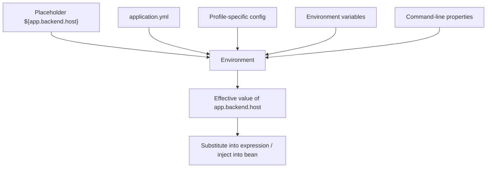
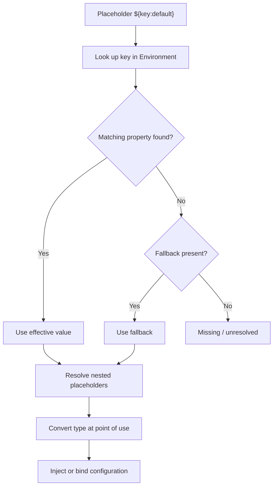

# Placeholders `${...}`, Default Values, and Property References

In Spring Boot, application configuration often comes from multiple sources: `application.properties`, `application.yml`, environment variables, command-line arguments, or profile-specific files. One property may need to reuse the value of another property. The **placeholder** syntax `${...}` lets Spring perform that reference without duplicating fixed values.

```properties
app.backend.host=localhost
app.backend.port=8081
app.backend.base-url=http://${app.backend.host}:${app.backend.port}/api
```

When the application reads `app.backend.base-url` through Spring's property resolution mechanism, the result is:

```text
http://localhost:8081/api
```

Placeholders also allow **default values** when a key has not been supplied:

```text
${property-name}
${property-name:default-value}
```

This lesson is part of the **Application Configuration** chapter of *Spring Boot Fundamentals*. We will examine what placeholders mean, how values are resolved from `Environment`, how to combine fallbacks and multi-level references, how to use them with `@Value` and `@ConfigurationProperties`, and common configuration mistakes.

Examples use Java 21 and Spring Boot 3.x. Placeholders in this lesson are Spring syntax, not HTML template syntax or shell commands.

## 1. What is a placeholder?

A placeholder is an expression asking Spring to look up a **property** and substitute that property's value in place of the expression.

For example:

```java
@Value("${app.display-name}")
private String displayName;
```

With configuration:

```yaml
app:
  display-name: Order Service
```

`displayName` receives the value `Order Service`. Spring looks up the property by name in the current configuration environment rather than reading from a similarly named Java variable.

### 1.1. Role of Environment and PropertySource

Spring uses the `Environment` abstraction to read configuration properties. Underneath, `Environment` can hold multiple `PropertySource`s, such as values from files, the operating system environment, system properties, or command-line arguments.

When Spring resolves:

```text
${app.backend.host}
```

it looks up the effective value of the `app.backend.host` key across registered configuration sources. If multiple sources declare the same key, **property source precedence** determines which value is used.



Placeholders do not register Spring beans and do not create new properties. They simply request **value lookup and substitution** in contexts where Spring supports placeholder resolution.

### 1.2. Two common syntax forms

| Expression | Meaning |
|---|---|
| `${app.name}` | Look up the value of `app.name`. |
| `${app.name:demo}` | Look up `app.name`; if not provided, use `demo`. |
| `${app.port:8080}` | Use the declared port or default to `8080`. |
| `${app.optional-label:}` | Fallback is the empty string. |

In strict resolution contexts such as `@Value("${app.name}")` in Spring Boot, if a required key does not exist and has no fallback, bean creation normally fails with an unresolved placeholder error.

## 2. Using a colon to declare a default value

Consider a service that needs to know its retry count:

```java
import org.springframework.beans.factory.annotation.Value;
import org.springframework.stereotype.Component;

@Component
public class RetrySettings {

    private final int maxAttempts;

    public RetrySettings(
            @Value("${app.retry.max-attempts:3}") int maxAttempts) {
        this.maxAttempts = maxAttempts;
    }

    public int maxAttempts() {
        return maxAttempts;
    }
}
```

With `app.retry.max-attempts=5`, the bean receives `5`. When the property is absent, the bean receives the default `3`.

### 2.1. A default value is data, not validation

The placeholder `${app.retry.max-attempts:3}` does not mean Spring will silently repair any invalid value into `3`:

| Property value | Result when injected as `int` |
|---|---|
| Property absent | Uses default string `3`, converted to integer 3. |
| `app.retry.max-attempts=5` | Receives integer 5. |
| `app.retry.max-attempts=abc` | Can fail when converting to `int`. |
| `app.retry.max-attempts=` | Can fail when converting an empty string to `int`. |

A fallback is used when **the property cannot be resolved** according to resolver rules, not as a data validation mechanism or catch-all for invalid values.

### 2.2. Empty string as a fallback

```java
@Value("${app.banner:}")
private String banner;
```

If `app.banner` is absent, the result is normally `""`. This is useful when a string field is genuinely optional. For numbers, dates, required URLs, or secrets, pick a valid fallback or require explicit configuration.

### 2.3. Fallbacks containing colons

A URL can serve as a default value:

```java
@Value("${app.backend.base-url:http://localhost:8080}")
private String baseUrl;
```

In this expression, the first colon after the key separates the key from the fallback. `http://localhost:8080` is the default content. For long expressions, declaring the default URL in a configuration file is easier to read.

## 3. Referencing properties in application.properties

Suppose an application has several endpoints sharing the same backend:

```properties
app.backend.host=localhost
app.backend.port=8081

app.backend.base-url=http://${app.backend.host}:${app.backend.port}
app.backend.users-url=${app.backend.base-url}/users
app.backend.orders-url=${app.backend.base-url}/orders
app.backend.health-url=${app.backend.base-url}/actuator/health
```

Result after the properties are resolved:

| Property | Effective value |
|---|---|
| `app.backend.base-url` | `http://localhost:8081` |
| `app.backend.users-url` | `http://localhost:8081/users` |
| `app.backend.orders-url` | `http://localhost:8081/orders` |
| `app.backend.health-url` | `http://localhost:8081/actuator/health` |

Instead of duplicating the backend address on every line, you manage a single host/port pair. This is beneficial when the application runs across different environments.

### 3.1. Multi-level references

```properties
app.host=localhost
app.port=8080
app.root-url=http://${app.host}:${app.port}
app.api-url=${app.root-url}/v1
app.user-url=${app.api-url}/users
```

When Spring resolves `app.user-url`, it resolves the references inside `app.api-url` and `app.root-url` to produce the final URL.

### 3.2. Avoid circular references

This configuration is invalid:

```properties
app.first=${app.second}
app.second=${app.first}
```

The two properties reference each other in a cycle with no terminal value. Spring can report a circular placeholder reference error. Pick one property as the root source or use a fallback that is genuinely independent of the cycle.

### 3.3. Referenced properties do not have to be in the same file

```properties
app.backend.base-url=https://${app.backend.host}:${app.backend.port:443}/v1
```

`app.backend.host` can come from a profile-specific file, an environment variable, or a command-line argument. Placeholders look up values through `Environment`, allowing the application to deploy the same base configuration file in multiple places.

## 4. Using placeholders in application.yml

YAML represents properties using nested structures:

```yaml
app:
  backend:
    host: localhost
    port: 8081
    base-url: "http://${app.backend.host}:${app.backend.port}"
    users-url: "${app.backend.base-url}/users"
  title: "Backend at ${app.backend.host}"
```

The property name inside a placeholder still uses **dotted form** such as `app.backend.host`, even though YAML uses indentation levels.

### 4.1. Quoting in YAML

Wrap strings containing URLs, colons, or multiple placeholders in quotes:

```yaml
app:
  backend:
    url: "https://${app.backend.host:localhost}:${app.backend.port:8443}/api"
```

Quoting ensures the YAML parser treats the value as a string. Distinguish two kinds of errors:

- **YAML error:** the file does not have valid YAML syntax.
- **Placeholder error:** YAML loaded fine, but Spring could not resolve the referenced key.

### 4.2. Colons have two roles

In YAML:

```yaml
app:
  backend:
    host: localhost
    url: "http://${app.backend.host:localhost}"
```

The colon in `host: localhost` belongs to YAML mapping syntax. The colon in `${app.backend.host:localhost}` is the Spring placeholder default-value separator.

## 5. Injecting values with @Value

`@Value` can appear on a field, constructor parameter, method parameter, or `@Bean` factory method parameter. It is the most direct way to retrieve a few simple settings.

### 5.1. Field injection

```java
package com.example.demo;

import org.springframework.beans.factory.annotation.Value;
import org.springframework.stereotype.Component;

@Component
public class AppInfo {

    @Value("${app.display-name:Demo application}")
    private String displayName;

    public String displayName() {
        return displayName;
    }
}
```

The value is resolved when Spring creates and processes the bean. Field syntax is concise, though constructors make dependencies explicit and let you test objects without Spring.

### 5.2. Constructor injection

```java
package com.example.demo.client;

import org.springframework.beans.factory.annotation.Value;
import org.springframework.stereotype.Component;

@Component
public class BackendSettings {

    private final String baseUrl;
    private final int retryLimit;

    public BackendSettings(
            @Value("${app.backend.base-url:http://localhost:8080}")
            String baseUrl,
            @Value("${app.backend.retry-limit:3}")
            int retryLimit) {
        this.baseUrl = baseUrl;
        this.retryLimit = retryLimit;
    }

    public String baseUrl() {
        return baseUrl;
    }

    public int retryLimit() {
        return retryLimit;
    }
}
```

Spring resolves the placeholders, then converts values to `String` or `int` to invoke the constructor. If a value is invalid or a required property is missing, bean creation can fail.

### 5.3. Parameters of a @Bean method

```java
import org.springframework.beans.factory.annotation.Value;
import org.springframework.context.annotation.Bean;
import org.springframework.context.annotation.Configuration;

@Configuration(proxyBeanMethods = false)
public class BackendConfiguration {

    @Bean
    BackendClient backendClient(
            @Value("${app.backend.base-url:http://localhost:8080}")
            String baseUrl) {
        return new BackendClient(baseUrl);
    }
}
```

`BackendClient` is an illustrative class whose constructor takes a URL. This approach fits well when instantiating a third-party library bean from configuration values.

## 6. Referencing properties across configuration sources

Spring Boot's `Environment` can combine sources such as:

- `application.properties` or `application.yml` files.
- Profile-specific files: `application-dev.yml`, `application-prod.yml`.
- Environment variables.
- Java system properties.
- Command-line arguments.
- Other configured `PropertySource`s and Config Data.

When the same key appears in multiple sources, the **value from the higher-precedence source** is used.

Example `application.properties`:

```properties
app.backend.host=localhost
app.backend.port=8080
app.backend.url=http://${app.backend.host}:${app.backend.port}
```

On the deployment server, the application has environment variables:

```text
APP_BACKEND_HOST=backend.internal
APP_BACKEND_PORT=9090
```

Under Boot's environment-variable property-mapping rules, `app.backend.url` can resolve to:

```text
http://backend.internal:9090
```

The host and port properties themselves are overridden; the URL definition line stays unchanged.

### 6.1. Overriding via command line

```bash
./gradlew bootRun --args='--app.backend.host=staging.internal --app.backend.port=8181'
```

In Windows PowerShell:

```powershell
.\gradlew.bat bootRun --args="--app.backend.host=staging.internal --app.backend.port=8181"
```

Command-line properties in standard Boot setups can override values in files. Thus `${app.backend.host}` does not necessarily use the exact line you see in `application.properties`.

### 6.2. Profile-specific configuration

`application.yml`:

```yaml
app:
  backend:
    host: localhost
    port: 8080
    url: "http://${app.backend.host}:${app.backend.port}"
```

`application-prod.yml`:

```yaml
app:
  backend:
    host: backend.production.internal
    port: 8443
```

When the `prod` profile is active and no higher-precedence source overrides them, the URL will use the `prod` profile's host and port. Referencing avoids duplicating the same URL template across every profile.

## 7. Canonical key names and relaxed binding

Spring Boot provides **relaxed binding** to map properties across naming styles appropriate to each configuration source. For placeholders in Spring Boot files, use **canonical lowercase kebab-case** property names:

```text
${app.backend.base-url}
```

For example, a property name might appear in different forms:

```text
app.backend.base-url
app.backend.baseUrl
APP_BACKEND_BASEURL
```

Spring Boot can handle compatible forms per source. Writing placeholders in canonical form helps relaxed lookup work more consistently rather than tying the expression to a specific camelCase variant.

### 7.1. Corresponding environment variable names

The usual rule for converting a canonical name to an environment variable is replacing dots with underscores, removing dashes within each segment, and converting to uppercase:

| Property | Environment variable |
|---|---|
| `app.backend.host` | `APP_BACKEND_HOST` |
| `app.backend.port` | `APP_BACKEND_PORT` |
| `app.backend.base-url` | `APP_BACKEND_BASEURL` |
| `app.retry.max-attempts` | `APP_RETRY_MAXATTEMPTS` |

Environment variable names can become harder to predict when properties contain many words. Therefore, when an override does not take effect, double-check the name mapping and runtime environment.

### 7.2. Stay consistent in documentation

Rather than alternating between `app.backend.baseUrl` and `app.backend.base-url`, pick the canonical form for examples, configurations, and placeholders. This reduces mistakes when moving between YAML, properties, environment variables, and command-line arguments.

## 8. Nested placeholders and multi-level fallbacks

A fallback can itself be a placeholder:

```properties
app.primary-region=${APP_REGION:local}
app.processing-region=${app.override-region:${app.primary-region}}
```

If `app.override-region` has a value, it is used. Otherwise, Spring tries `app.primary-region`. If `APP_REGION` is also absent, the final result is `local`.

### 8.1. An endpoint configuration example

```properties
app.backend.host=${app.default-host:localhost}
app.backend.port=${app.default-port:8080}
app.backend.url=http://${app.backend.host}:${app.backend.port}
```

All properties remain managed by `Environment`. If you supply `app.backend.host` directly via a higher-precedence source, that value beats the fallback line in the base file.

### 8.2. Dynamic references in key names

Spring can resolve nested placeholders inside a key name:

```properties
app.environment=dev
app.endpoint.dev=https://dev.example.internal
app.endpoint.prod=https://prod.example.internal
app.active-endpoint=${app.endpoint.${app.environment}}
```

With `app.environment=dev`, the final key looked up is `app.endpoint.dev`. This technique is useful in certain cases, though for large environment configurations, profile-specific Config Data is usually easier to understand.

### 8.3. Beware of reference cycles

```properties
app.a=${app.b}
app.b=${app.a}
```

There is no base value to terminate the reference cycle. Spring can report a circular reference error. When debugging, trace the full reference chain rather than looking only at the final injected property.

## 9. Distinguishing placeholders from SpEL

Spring has two distinct syntaxes:

| Syntax | Role | Example |
|---|---|---|
| `${...}` | Reference a property in `Environment` | `${app.backend.port:8080}` |
| `#{...}` | Evaluate Spring Expression Language in a supported context | `#{2 * 3}` |

For example:

```java
@Value("${app.backend.port:8080}")
private int backendPort;

@Value("#{2 * 3}")
private int six;
```

`backendPort` retrieves configuration data or its fallback. `six` receives the result of evaluating the SpEL expression.

In `@Value`, you can combine both mechanisms:

```java
@Value("#{${app.feature.enabled:false} ? 'enabled' : 'disabled'}")
private String featureLabel;
```

Keep expressions short, however. For multi-branch logic, binding the property to a boolean and handling it in Java is easier to read and test.

A value in `application.properties` does not automatically become SpEL just because it contains `#{...}`. Property placeholder resolution and SpEL evaluation are two separate steps with their own conditions and contexts.

## 10. Spring placeholders vs. shell variables

Bash also writes variables with a dollar sign and braces:

```bash
echo "${APP_REGION}"
```

In Bash, the shell performs variable expansion. In `application.properties`:

```properties
app.region=${APP_REGION:local}
```

Spring is the component resolving the placeholder when reading the property value. Both places use similar-looking syntax, but the timing and source of lookup differ.

In PowerShell, the syntax to read an environment variable is different:

```powershell
$env:APP_REGION
```

When writing launch scripts, distinguish strings expanded by the shell beforehand from configuration file contents processed by Spring later.

## 11. Required configuration, optional configuration, and secrets

Not every property should have a fallback.

For example, a URL used for local development:

```java
@Value("${app.backend.base-url:http://localhost:8080}")
private String backendUrl;
```

A localhost fallback makes sense for demos or development. Conversely, for an API key:

```java
@Value("${payment.provider.api-key}")
private String apiKey;
```

If the key is required, it is usually better to let bean creation fail when it is missing and supply the value via secret management or an appropriate environment.

Setting a dummy fallback such as:

```java
@Value("${payment.provider.api-key:dummy}")
private String apiKey;
```

can allow the application to start successfully and only fail later when calling the external system. A fallback is an intentional business decision, not a default way to hide configuration errors.

### 11.1. Missing values differ from empty values

`${app.banner:}` falls back to an empty string if the property is absent. However, when a property exists with empty content, the resolver may treat it as a provided value. Do not assume a fallback always replaces empty strings.

For required properties, combine typed configuration with validation if you need to guarantee non-empty values or valid ranges.

## 12. @Value or @ConfigurationProperties?

`@Value` works well when a bean needs only one or two simple settings. When configuration is large and interrelated, `@ConfigurationProperties` is easier to organize.

| Aspect | `@Value` | `@ConfigurationProperties` |
|---|---|---|
| Definition | Expression placed at injection point | Object grouping properties sharing a prefix |
| Data types | Converts each value individually | Binder supports objects, nested values, collections |
| Best fit | A few isolated values | An entire module's configuration group |
| Validation | Implement manually as needed | Integrates cleanly with Bean Validation |
| Placeholders in sources | Supported | Supported inside bound values |

Example configuration:

```yaml
app:
  backend:
    host: localhost
    port: 8081
    base-url: "http://${app.backend.host}:${app.backend.port}"
```

Declare record:

```java
package com.example.demo.config;

import org.springframework.boot.context.properties.ConfigurationProperties;

@ConfigurationProperties(prefix = "app.backend")
public record BackendProperties(
        String host,
        int port,
        String baseUrl
) {
}
```

Register binding:

```java
import org.springframework.boot.context.properties.EnableConfigurationProperties;
import org.springframework.context.annotation.Configuration;

@Configuration(proxyBeanMethods = false)
@EnableConfigurationProperties(BackendProperties.class)
public class BackendPropertiesConfiguration {
}
```

Consumer:

```java
@Service
public class BackendService {

    private final BackendProperties properties;

    public BackendService(BackendProperties properties) {
        this.properties = properties;
    }

    public String baseUrl() {
        return properties.baseUrl();
    }
}
```

This configuration group can still use placeholders to compose `base-url` from host and port. If you need structured defaults or validation, you can design them directly on the configuration type instead of scattering fallbacks across multiple beans.

## 13. Reading values with Environment

If you need to read properties conditionally at runtime, a bean can inject `Environment`:

```java
package com.example.demo.config;

import org.springframework.core.env.Environment;
import org.springframework.stereotype.Component;

@Component
public class ConfigurationReporter {

    private final Environment environment;

    public ConfigurationReporter(Environment environment) {
        this.environment = environment;
    }

    public String backendUrl() {
        return environment.getProperty(
                "app.backend.base-url",
                "http://localhost:8080");
    }
}
```

`getProperty(key, defaultValue)` accepts a fallback via API. That differs from `${key:default}` syntax inside a placeholder string, even though both can produce the same value.

If a property is required, you can use:

```java
String apiKey =
        environment.getRequiredProperty("payment.provider.api-key");
```

If the property is not found, `getRequiredProperty` can throw an exception. Avoid logging tokens, passwords, and secrets directly when verifying configuration.

## 14. Testing placeholders with ApplicationContextRunner

Spring Boot Test provides `ApplicationContextRunner` to create a lightweight context and verify how Spring injects values.

Self-contained configuration example:

```java
package com.example.demo.config;

import static org.assertj.core.api.Assertions.assertThat;

import org.junit.jupiter.api.Test;
import org.springframework.beans.factory.annotation.Value;
import org.springframework.boot.test.context.runner.ApplicationContextRunner;
import org.springframework.context.annotation.Bean;
import org.springframework.context.annotation.Configuration;

class PlaceholderResolutionTest {

    record Endpoint(String url, int port) {}

    @Configuration(proxyBeanMethods = false)
    static class EndpointConfiguration {

        @Bean
        Endpoint endpoint(
                @Value("${app.backend.base-url:http://localhost:8080}")
                String url,
                @Value("${app.backend.port:8080}")
                int port) {
            return new Endpoint(url, port);
        }
    }

    private final ApplicationContextRunner runner =
            new ApplicationContextRunner()
                    .withUserConfiguration(EndpointConfiguration.class);

    @Test
    void usesFallbackWhenPropertyIsAbsent() {
        runner.run(context -> {
            Endpoint endpoint = context.getBean(Endpoint.class);
            assertThat(endpoint.url())
                    .isEqualTo("http://localhost:8080");
            assertThat(endpoint.port()).isEqualTo(8080);
        });
    }

    @Test
    void resolvesReferencesFromPropertyValues() {
        runner.withPropertyValues(
                "app.backend.host=api.internal",
                "app.backend.port=9091",
                "app.backend.base-url=https://${app.backend.host}:${app.backend.port}/v1")
              .run(context -> {
                  Endpoint endpoint = context.getBean(Endpoint.class);
                  assertThat(endpoint.url())
                          .isEqualTo("https://api.internal:9091/v1");
                  assertThat(endpoint.port()).isEqualTo(9091);
              });
    }
}
```

The first test checks the fallback; the second checks the reference chain across properties. Running requires the appropriate Spring Boot Test/JUnit/AssertJ dependencies. You do not need to create a REST endpoint just to test placeholders.

### 14.1. Testing a missing required property

```java
@Bean
RequiredClient requiredClient(
        @Value("${app.required-endpoint}") String endpoint) {
    return new RequiredClient(endpoint);
}
```

If `app.required-endpoint` is missing and this bean is created, the context can fail. You can add a test asserting startup failure to ensure mandatory configuration is properly enforced.

### 14.2. Tests should not depend on personal machine environment variables

In tests, declare needed properties explicitly via `withPropertyValues` or test configuration. Relying on real environment variables on your local machine can yield different outcomes on CI or teammates' machines.

## 15. Common pitfalls

| Symptom | Possible cause | How to resolve |
|---|---|---|
| `Could not resolve placeholder 'app.name'` | Property is missing or misspelled | Check `Environment`, profile, and fallback |
| Always gets fallback even though env var is set | Environment variable name does not map to the key | Use canonical keys and verify relaxed binding rules |
| Numeric injection fails | Empty or non-numeric value | Configure valid data and validation |
| URL still contains literal placeholder syntax | String was not processed by Spring's placeholder mechanism | Check how and where the string is read/stored |
| Value differs from `application.yml` | A higher-precedence source overrode it | Check profiles, command line, and property sources |
| Cycle between two properties | Properties reference each other | Break the reference cycle |
| Used `#{...}` instead of `${...}` | Confused SpEL with placeholder | Pick the right syntax |
| Wrongly referenced nested YAML key | Confused YAML nesting with dotted property name | Use `app.backend.host` form |

### 15.1. Unresolved placeholder

Suppose:

```java
@Value("${payment.provider.url}")
private String providerUrl;
```

When `payment.provider.url` is missing, the error may say:

```text
Could not resolve placeholder 'payment.provider.url'
```

Check the key, active profile, loaded configuration sources, and whether this should be a required value. Do not rush to add a dummy fallback if the value must be supplied in production.

### 15.2. Placeholders are not bean lookups

`${app.backend.url}` reads a property in `Environment`. It does not mean "find a bean named app.backend.url." To inject beans, use constructor injection, `@Qualifier`, or an appropriate bean lookup API.

## 16. Diagnostic workflow

When a placeholder does not yield the expected result, follow these steps in order:

1. **Read the expression.** Which key is being looked up? Is there a fallback?
2. **Identify where resolution occurs.** `@Value`, `@ConfigurationProperties`, `Environment`, or non-Spring code?
3. **Check configuration sources.** Were base files, profile files, environment variables, system properties, and command-line arguments loaded properly?
4. **Check key naming.** Is canonical kebab-case used and is the environment variable mapped accurately?
5. **Find the winning source.** Which `PropertySource` has the highest precedence for that key?
6. **Check value state.** Is it missing, empty, or the wrong type?
7. **Trace nested references.** Is there a cycle or an undeclared key?
8. **Check the target type.** Can the final string convert to `int`, `Duration`, URL, or the required type?
9. **Clarify the business intent.** Should it use a fallback or fail fast?



The diagram shows the general flow; a resolver may apply strict rules or allow leaving unresolved placeholders depending on the API and configuration.

## 17. Comprehensive practice exercise

Create a Spring Boot application with `application.yml` and a bean reading configuration. Perform each step in sequence:

**Step A — Basic properties.** Declare `app.backend.host` and `app.backend.port`. Use placeholders to construct `app.backend.base-url`.

**Step B — Fallback.** Remove port, use `${app.backend.port:8080}`, and observe the URL.

**Step C — Environment override.** Supply host via an environment variable or command-line argument; confirm the URL reflects the effective value.

**Step D — Profile.** Create `application-dev.yml` and `application-prod.yml`; set different hosts, run each profile, and compare.

**Step E — Inject with @Value.** Inject the URL and retry limit into a bean's constructor. Observe the values after type conversion.

**Step F — Nested fallback.** Use `${app.backend.host:${app.default-host:localhost}}`; try supplying and removing each key.

**Step G — Required configuration.** Add `@Value("${app.required-token}")`, omit the property, and observe startup failure.

**Step H — Wrong type value.** Supply `app.backend.port=abc` for an `int` parameter to understand why fallbacks do not replace validation.

**Step I — ConfigurationProperties.** Group host, port, and URL into a record and inject it into a service.

**Step J — Automated tests.** Use `ApplicationContextRunner` to verify results both when properties are present and when they are missing.

After each step, answer: **Where did the property come from? Was a fallback used? What type was the final value converted into?**

## 18. Self-assessment questions

1. What does `${app.name}` ask Spring to do?
2. How does `${app.name:demo}` differ from `${app.name}`?
3. Is a fallback always applied when a value exists but is empty?
4. Why reference host and port to build the base URL instead of duplicating the URL in multiple places?
5. What format must key names use inside YAML placeholders?
6. If the same property appears in both a file and the command line, which value is used?
7. Why does Spring Boot recommend canonical kebab-case in placeholders?
8. What is the usual environment variable mapping for `app.backend.base-url`?
9. How can `@Value` convert a fallback string into `int`?
10. How do `${...}` and `#{...}` differ in purpose?
11. When is `@ConfigurationProperties` preferable to multiple `@Value` fields?
12. What problem does a circular reference between two properties cause?
13. Why should you not add a dummy fallback for a required secret?
14. What advantage does `Environment.getProperty` offer when reading configuration programmatically?
15. When a placeholder fails to resolve, which data sources should you check?

### Complete sample explanation

> In Spring Boot, the placeholder `${key}` looks up a property in `Environment`. The syntax `${key:default}` supplies a fallback when no matching value is available. Placeholders can be used in `application.properties`, `application.yml`, or `@Value` to derive values from other properties. `Environment` aggregates multiple `PropertySource`s and applies precedence, so a referenced property can come from a profile, environment variable, or command-line argument. Use canonical kebab-case names for good compatibility with relaxed binding. When a property is missing, empty, or of the wrong type, distinguish the cases: a fallback does not replace validation, and an unresolved required placeholder can cause bean creation to fail. `@Value` fits a few values, whereas `@ConfigurationProperties` is more convenient for structured configuration groups.

Once you can identify the key inside `${...}`, know which fallback applies, and trace which `PropertySource` supplies the final value, you understand how **placeholders, default values, and property references** work in Spring Boot.
