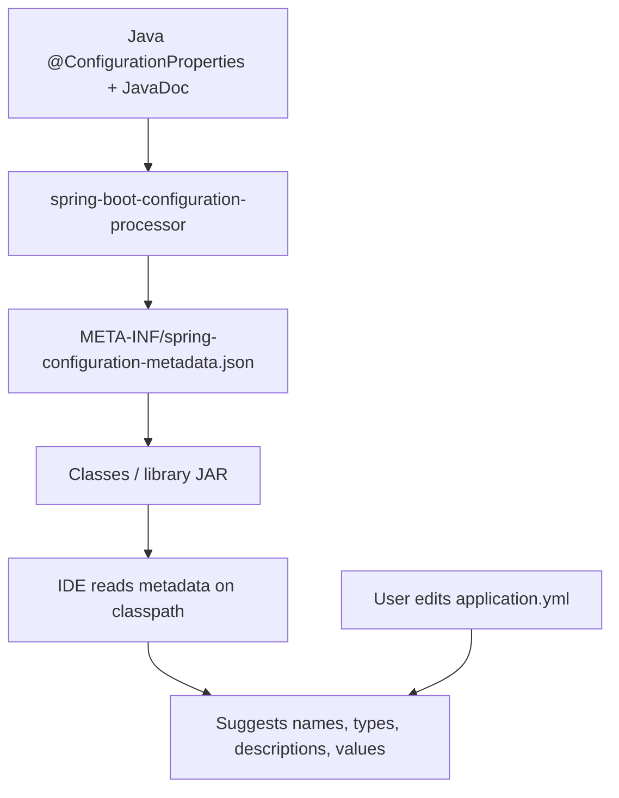
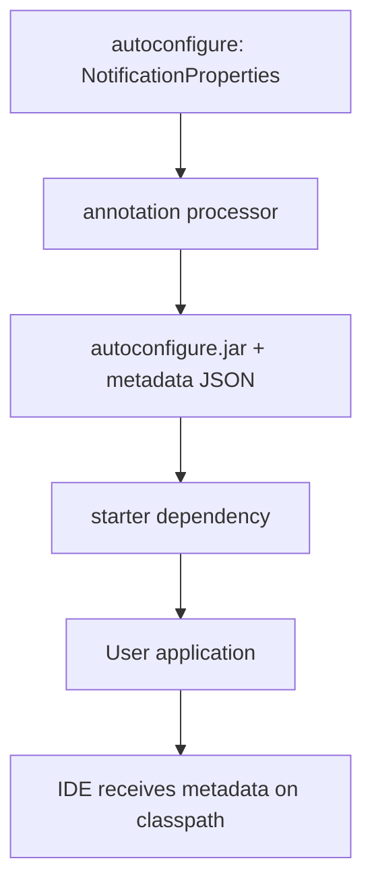

# Configuration Metadata and IDE Property Autocompletion

> **Spring Boot Fundamentals · Application Configuration**  
> When opening `application.yml` or `application.properties`, IDEs can suggest keys like `server.port`, explain their purpose, and indicate the expected data type. For properties defined by your own project or a custom starter, the same experience comes from **Spring Boot configuration metadata**. Metadata describes configuration groups, property names, data types, default values, deprecation status, and completion hints. It helps configuration authors see *which keys exist, what to enter, and where documentation lives*; metadata is **not** a mechanism for creating beans, binding properties, or validating data at runtime.

## 1. The problem: where do IDEs learn property names from?

Suppose an application has a class:

```java
@ConfigurationProperties(prefix = "acme.notifications")
public class NotificationProperties {
    private boolean enabled;
    // ...
}
```

A developer opens `application.yml` and starts typing:

```yaml
acme:
  notifications:
    en
```

If the module includes proper metadata and the IDE supports Spring Boot, the IDE can suggest `enabled`, show its boolean type, display documentation, and sometimes offer navigation to the declaring class.

To do this, the IDE does not need to run the application. Instead, it reads metadata available on the classpath, typically from JARs containing the file:

```text
META-INF/spring-configuration-metadata.json
```

This JSON file is generated primarily by **`spring-boot-configuration-processor`** while compiling `@ConfigurationProperties` classes. Spring Boot libraries and many starters bundle their corresponding metadata as well.



Keep three layers clearly separated:

| Layer | Responsibility |
| --- | --- |
| `@ConfigurationProperties` and Spring Boot Binder | Defines how configuration data binds into objects at runtime |
| `spring-boot-configuration-processor` | Analyzes source code and generates JSON descriptions at build time |
| IDE or Spring extensions | Reads JSON to offer completion, documentation, and warnings in the editor |

Generating metadata **does not guarantee** that a configuration bean is registered. Conversely, an application can bind a property cleanly at runtime without metadata, though the IDE may not suggest that key.

## 2. Distinguishing key names, values, and metadata

Example of real configuration in `application.yml`:

```yaml
acme:
  notifications:
    enabled: true
    timeout: 3s
    transport: email
```

This data holds **runtime environment values**. When the application boots, those values can be overridden by profiles, environment variables, or command-line arguments according to `PropertySource` precedence.

Metadata instead describes keys and usage:

```json
{
  "properties": [
    {
      "name": "acme.notifications.enabled",
      "type": "java.lang.Boolean",
      "description": "Enable or disable sending notifications."
    },
    {
      "name": "acme.notifications.timeout",
      "type": "java.time.Duration",
      "description": "Timeout for a send operation."
    }
  ]
}
```

This is a **simplified example** of JSON metadata, not a guarantee that the processor always emits the exact same fields byte for byte. Type names, entry ordering, and extra metadata depend on source code and processor version.

The difference:

- `application.yml` containing `enabled: true` means this environment wants to enable the feature.
- Metadata containing `enabled` and `type: java.lang.Boolean` means this is a documented boolean key.
- The IDE uses metadata to assist whoever writes configuration files.
- The Spring Boot Binder still reads values, converts types, instantiates objects, and handles errors at startup.

A metadata file packaged inside a starter **does not automatically apply configuration values** to the application. Values must come from `Environment` or defaults in the configuration class.

## 3. Three main sections of the JSON format

A `spring-configuration-metadata.json` file typically contains these arrays:

- `groups`: property groups sharing a prefix, usually corresponding to a `@ConfigurationProperties` class.
- `properties`: specific properties with type, description, declaring source, and default value when known.
- `hints`: value suggestions or providers helping IDEs offer completions.

Overall example:

```json
{
  "groups": [
    {
      "name": "acme.notifications",
      "type": "com.example.shop.config.NotificationProperties",
      "sourceType": "com.example.shop.config.NotificationProperties"
    }
  ],
  "properties": [
    {
      "name": "acme.notifications.enabled",
      "type": "java.lang.Boolean",
      "description": "Enable or disable sending notifications.",
      "sourceType": "com.example.shop.config.NotificationProperties"
    },
    {
      "name": "acme.notifications.timeout",
      "type": "java.time.Duration",
      "description": "Timeout for a send operation.",
      "sourceType": "com.example.shop.config.NotificationProperties"
    }
  ],
  "hints": [
    {
      "name": "acme.notifications.template-id",
      "values": [
        {
          "value": "welcome",
          "description": "Welcome notification template."
        },
        {
          "value": "order-confirmed",
          "description": "Order confirmation template."
        }
      ]
    }
  ]
}
```

Common fields:

| Field | Meaning |
| --- | --- |
| `name` | Canonical name of the group or property, e.g., `acme.notifications.timeout` |
| `type` | Associated Java type, e.g., `java.time.Duration` or the properties class name |
| `sourceType` | Class containing the declaration or data source recognized by the processor |
| `sourceMethod` | Source method name when metadata pertains to a factory method |
| `description` | Description displayed by IDEs as documentation |
| `defaultValue` | Default value representable in metadata |
| `deprecation` | Info about deprecated properties and replacement keys |
| `values` inside `hints` | List of suggested values |
| `providers` inside `hints` | Dynamic suggestion mechanism supported by IDEs |

Not every property includes every field. Metadata is meant to capture information that can be inferred from code or supplemented manually.

### 3.1. Canonical names should use kebab-case

For example, prefer:

```properties
acme.notifications.retry.max-attempts=5
```

rather than mixing camelCase, snake_case, or uppercase across config files. Spring Boot's Binder supports relaxed binding so environment variables can follow their own convention, whereas metadata standardizes on lowercase canonical names with dot-separated segments and hyphenated words.

### 3.2. Metadata is descriptive, not an executable JSON Schema

Do not treat the metadata file as a mandatory schema enforced on all configuration at runtime. If an IDE sees a property absent from metadata, it may warn or omit completion, yet Spring Boot does not automatically reject keys missing from this JSON file.

To validate configuration at runtime, use appropriate data types, `@ConfigurationProperties` validation, bean conditions, or explicit verification logic.

## 4. Preparing a `@ConfigurationProperties` example

Let us build configuration for a notification feature. Properties include:

| Key | Purpose |
| --- | --- |
| `acme.notifications.enabled` | Enable/disable notifications |
| `acme.notifications.endpoint` | Notification service address |
| `acme.notifications.timeout` | Operation timeout |
| `acme.notifications.transport` | Transport type |
| `acme.notifications.template-id` | Notification template ID |
| `acme.notifications.retry.max-attempts` | Maximum retry attempts |
| `acme.notifications.retry.delay` | Delay between attempts |

### 4.1. JavaBean configuration class

```java
package com.example.shop.config;

import java.net.URI;
import java.time.Duration;

import org.springframework.boot.context.properties.ConfigurationProperties;

@ConfigurationProperties(prefix = "acme.notifications")
public class NotificationProperties {

    /** Enable or disable sending notifications. */
    private boolean enabled = false;

    /** Service endpoint used to send notifications. */
    private URI endpoint;

    /** Maximum time to wait for a send operation. */
    private Duration timeout = Duration.ofSeconds(3);

    /** Transport used to deliver notifications. */
    private Transport transport = Transport.CONSOLE;

    /** Default notification template identifier. */
    private String templateId = "welcome";

    /** Retry settings when sending fails. */
    private Retry retry = new Retry();

    public boolean isEnabled() {
        return enabled;
    }

    public void setEnabled(boolean enabled) {
        this.enabled = enabled;
    }

    public URI getEndpoint() {
        return endpoint;
    }

    public void setEndpoint(URI endpoint) {
        this.endpoint = endpoint;
    }

    public Duration getTimeout() {
        return timeout;
    }

    public void setTimeout(Duration timeout) {
        this.timeout = timeout;
    }

    public Transport getTransport() {
        return transport;
    }

    public void setTransport(Transport transport) {
        this.transport = transport;
    }

    public String getTemplateId() {
        return templateId;
    }

    public void setTemplateId(String templateId) {
        this.templateId = templateId;
    }

    public Retry getRetry() {
        return retry;
    }

    public void setRetry(Retry retry) {
        this.retry = retry;
    }

    public enum Transport {
        CONSOLE,
        EMAIL
    }

    public static class Retry {

        /** Maximum attempts, including the initial try. */
        private int maxAttempts = 3;

        /** Wait duration between retry attempts. */
        private Duration delay = Duration.ofMillis(250);

        public int getMaxAttempts() {
            return maxAttempts;
        }

        public void setMaxAttempts(int maxAttempts) {
            this.maxAttempts = maxAttempts;
        }

        public Duration getDelay() {
            return delay;
        }

        public void setDelay(Duration delay) {
            this.delay = delay;
        }
    }
}
```

This JavaBean configuration models a structured object. The `retry` property is a nested object, so keys like `acme.notifications.retry.max-attempts` bind into the `Retry` instance.

The `/** ... */` comments on fields document each property. The processor can extract this JavaDoc when generating metadata.

### 4.2. Application configuration file

```yaml
acme:
  notifications:
    enabled: true
    endpoint: https://notify.example.test
    timeout: 5s
    transport: email
    template-id: order-confirmed
    retry:
      max-attempts: 4
      delay: 500ms
```

Once bound:

- `enabled` becomes `true`.
- `endpoint` converts to `URI`.
- `timeout` and `retry.delay` convert to `Duration`.
- `transport` converts to enum `Transport.EMAIL`.
- `retry.maxAttempts` becomes `4`.

The processor provides name and type info to IDEs; the Binder performs actual runtime conversion.

### 4.3. Do not forget to register the properties bean

`@ConfigurationProperties` marks a class as bindable, yet the class still needs proper registration.

One option for an application:

```java
@SpringBootApplication
@ConfigurationPropertiesScan
public class ShopApplication {

    public static void main(String[] args) {
        SpringApplication.run(ShopApplication.class, args);
    }
}
```

`@ConfigurationPropertiesScan` discovers `@ConfigurationProperties` classes in scanned packages.

An option for a specific configuration module:

```java
@Configuration(proxyBeanMethods = false)
@EnableConfigurationProperties(NotificationProperties.class)
public class NotificationConfiguration {

    @Bean
    NotificationService notificationService(
            NotificationProperties properties) {
        return new NotificationService(properties);
    }
}
```

This assumes `NotificationService` is an application class with a matching constructor. Pick one intentional registration approach; avoid mixing mechanisms that create unexpected duplicate beans.

**Important:** Generating metadata for `NotificationProperties` with the processor does not replace `@ConfigurationPropertiesScan` or `@EnableConfigurationProperties`.

## 5. Adding `spring-boot-configuration-processor` for Maven

In projects using Spring Boot dependency management, declare the processor in the module containing `@ConfigurationProperties` classes:

```xml
<dependency>
    <groupId>org.springframework.boot</groupId>
    <artifactId>spring-boot-configuration-processor</artifactId>
    <optional>true</optional>
</dependency>
```

Purpose:

- Supplies the annotation processor that runs at compile time.
- Reads annotations, types, and JavaDoc to generate metadata.
- `optional` prevents the processor dependency from leaking transitively into consuming applications as a regular dependency.
- Without the Spring Boot BOM or parent POM, specify a processor version compatible with your Boot release.

### 5.1. Annotation processing must actually be enabled

Adding the dependency to the POM alone may not suffice under every JDK, Maven Compiler Plugin version, or build setup. Ensure the compiler enables annotation processing and places the processor on the processor path.

For projects configuring `annotationProcessorPaths` explicitly, configuration can look like:

```xml
<build>
    <plugins>
        <plugin>
            <groupId>org.apache.maven.plugins</groupId>
            <artifactId>maven-compiler-plugin</artifactId>
            <configuration>
                <annotationProcessorPaths>
                    <path>
                        <groupId>org.springframework.boot</groupId>
                        <artifactId>spring-boot-configuration-processor</artifactId>
                        <version>${spring-boot.version}</version>
                    </path>
                </annotationProcessorPaths>
            </configuration>
        </plugin>
    </plugins>
</build>
```

This illustrates `annotationProcessorPaths`; choose syntax and version management matching your project's plugin and JDK. If other processors (such as Lombok) are used, list them all on the path and verify processor ordering/interactions.

### 5.2. Generating metadata with Maven

For example:

```bash
./mvnw clean compile
```

After compiling, the metadata file usually appears in the module's output directory, such as:

```text
target/classes/META-INF/spring-configuration-metadata.json
```

When packaged as a JAR, that file must sit on the classpath of the published artifact. IDEs often need the Maven project reloaded/reimported and built to recognize updated metadata.

### 5.3. Processor dependency is not a runtime dependency

Do not treat the processor as a library called by business code at runtime. Generated metadata is packaged with the module's classes/resources; IDEs read that JSON. Applications can start normally without the processor JAR on the runtime classpath.

## 6. Adding the processor for Gradle

In a Gradle project using the Java plugin with Spring Boot version management:

```groovy
plugins {
    id 'java'
}

dependencies {
    annotationProcessor 'org.springframework.boot:spring-boot-configuration-processor'
}
```

If the Gradle project lacks a BOM/platform managing versions, declare a matching processor version.

### 6.1. Annotation processor and runtime dependency are different configurations

| Gradle configuration | Purpose |
| --- | --- |
| `annotationProcessor` | Supplies annotation processors to the compiler |
| `implementation` | Supplies libraries needed to compile and run the module |
| `api` in `java-library` | Dependency exposed on consumers' compile API |
| `compileOnly` | Needed only at compile time, not automatically at runtime |
| `runtimeOnly` | Needed only at runtime |

The processor belongs on the `annotationProcessor` path. Do not substitute `runtimeOnly`, because the runtime classpath will not cause the compiler to emit JSON.

### 6.2. Building and locating the generated file

```bash
./gradlew clean compileJava
```

Typical output:

```text
build/classes/java/main/META-INF/spring-configuration-metadata.json
```

Exact paths depend on plugins, language, and source sets. To confirm metadata is packaged, inspect the final build artifact rather than checking only for annotations in Java source.

### 6.3. With additional metadata, pay attention to task ordering

If you supply `additional-spring-configuration-metadata.json` in resources for the processor to merge, Gradle projects may need to ensure resources are available when `compileJava` runs:

```groovy
tasks.named('compileJava') {
    dependsOn tasks.named('processResources')
}
```

This configuration illustrates task wiring for Gradle projects that need it. Follow your project's DSL and task graph; if a plugin already handles this, do not add duplicate configuration.

## 7. What does auto-generated metadata contain?

The processor analyzes `@ConfigurationProperties` structures to generate property descriptions. Typical entries include:

- Group names based on `prefix`.
- Property names following Boot's canonical rules.
- Java types of properties.
- JavaDoc descriptions.
- Nested property information.
- Some default values inferable at compile time.
- Deprecation metadata when declared with the corresponding annotation.

Exact details depend on Spring Boot version, compiler, binding style, and how fields, getters, or constructors are written.

### 7.1. Metadata is generated from source, not runtime evaluation

Suppose:

```java
private Duration timeout = Duration.ofSeconds(3);
```

The Binder uses that initialized object as the default if not overridden. However, the annotation processor cannot necessarily infer `3s` for every arbitrary Java expression.

Do not take a missing `defaultValue` in JSON as proof that the application has no default. Conversely, a `defaultValue` recorded in metadata does not stop a higher-precedence property source from overriding it at runtime.

For defaults that are hard to infer statically, you can supply additional metadata so IDEs document them accurately.

### 7.2. Booleans, numbers, enums, and durations

Types such as `boolean`, `int`, `Duration`, or enums give IDEs useful signals:

- Boolean: usually suggests `true`/`false`.
- Integer: IDE recognizes numeric input.
- Enum: IDE can suggest enum constants.
- Duration: editors can recognize formats like `3s` or `500ms`.
- URI: IDE knows the property expects an address.

Actual behavior depends on the IDE and its extensions. Metadata does not mandate identical suggestion UIs across every editor.

### 7.3. Nested properties

With `NotificationProperties` above, the retry group can be described along paths:

```text
acme.notifications.retry.max-attempts
acme.notifications.retry.delay
```

Inner classes supported by the binder as nested objects can be analyzed automatically by the processor. When referencing an external nested type or clarifying nested object boundaries, use `@NestedConfigurationProperty` on the appropriate field or getter.

For example:

```java
@NestedConfigurationProperty
private RetryPolicy retry = new RetryPolicy();
```

This annotation hints to the metadata processor about nesting; it **does not change how the Binder works**. Collections and maps are already recognized as container structures; you do not need `@NestedConfigurationProperty` on every `List` or `Map`.

## 8. Constructor binding and Java records

Spring Boot supports immutable configuration via constructor binding. For a record with an eligible constructor, Boot 3.x uses that constructor to bind without setters.

For example:

```java
package com.example.shop.config;

import java.time.Duration;

import org.springframework.boot.context.properties.ConfigurationProperties;
import org.springframework.boot.context.properties.bind.DefaultValue;

@ConfigurationProperties(prefix = "acme.retry")
public record RetryProperties(
        @DefaultValue("3") int maxAttempts,
        @DefaultValue("250ms") Duration delay
) {
}
```

When this object is registered via `@ConfigurationPropertiesScan` or `@EnableConfigurationProperties`, the Binder uses `@DefaultValue` values if the corresponding properties are absent.

The processor can also generate metadata from record components and related annotations. `@DefaultValue` usage and constructor binding must match your Spring Boot version.

### 8.1. When to use JavaBeans vs. records?

| JavaBean properties | Record/constructor binding |
| --- | --- |
| Fits when setters and mutable objects are needed | Fits immutable configuration |
| Defaults set via field initializers | Defaults expressed via constructor/`@DefaultValue` |
| Familiar with traditional JavaBean patterns | Required settings clear in constructor |
| Processor reads fields/getters | Processor reads constructor/record components |

Both can produce metadata; choose based on your application's data model rather than rewriting all code solely for IDE completions.

### 8.2. Do not use @Component carelessly with constructor binding

For immutable properties, registering via `@ConfigurationPropertiesScan` or `@EnableConfigurationProperties` lets Spring Boot manage the binder properly. Beans created via `@Component` or regular factory methods instantiate differently; do not assume every constructor on a Spring component will be treated as configuration constructor binding.

## 9. Adding hints the processor cannot infer automatically

Automatic metadata cannot know every valid domain value. For instance, `template-id` is a `String`, yet the team wants to suggest two common templates: `welcome` and `order-confirmed`.

Create the source file:

```text
src/main/resources/META-INF/additional-spring-configuration-metadata.json
```

Contents:

```json
{
  "hints": [
    {
      "name": "acme.notifications.template-id",
      "values": [
        {
          "value": "welcome",
          "description": "User welcome template."
        },
        {
          "value": "order-confirmed",
          "description": "Order confirmation template."
        }
      ]
    }
  ]
}
```

The processor reads additional metadata and merges it with auto-generated metadata during the build. When the IDE picks it up, users see those two suggested values for `acme.notifications.template-id`.

### 9.1. Additional vs. generated files differ

| File | Origin | Should you edit directly? |
| --- | --- | --- |
| `spring-configuration-metadata.json` | Generated by processor at build time | Do not hand-edit inside build output |
| `additional-spring-configuration-metadata.json` | Authored by developers in source resources | Yes, this is the input for supplementing metadata |

If you edit files inside `target/classes` or `build/classes`, the next clean build overwrites them. Keep additional metadata in source control and rebuild.

### 9.2. Documenting properties the processor cannot see

Some properties do not come directly from a `@ConfigurationProperties` class—for example, code reading keys via `Environment.getProperty` or a library's own API.

You can describe them in the additional file:

```json
{
  "properties": [
    {
      "name": "acme.notifications.compatibility-mode",
      "type": "java.lang.Boolean",
      "description": "Enable compatibility mode for legacy clients.",
      "defaultValue": false
    }
  ]
}
```

Adding an entry to metadata **does not implement** reading the `compatibility-mode` key. Code still has to handle that property itself. Metadata only informs IDEs and users what the key means.

### 9.3. Avoid conflicting overlapping definitions

Use the additional file to fill gaps missing from auto-generated metadata. If the same property appears in both generated and additional metadata, verify the merged output in the built artifact, especially if type, default, or description differ.

A maintainable practice is: **let the processor generate what it can infer from Java code; use additional metadata for details the processor cannot reliably know, such as value hints or manually read properties**.

## 10. `hints`: guiding value entry in IDEs

A `String` property can accept arbitrary values. Knowing only that it is a `String`, an IDE cannot tell which values are helpful. `hints` supply that context.

For example:

```json
{
  "hints": [
    {
      "name": "acme.notifications.template-id",
      "values": [
        {"value": "welcome", "description": "Welcome notification."},
        {"value": "order-confirmed", "description": "Order confirmation."},
        {"value": "delivery-updated", "description": "Delivery update."}
      ]
    }
  ]
}
```

These values are **suggestions**, not a whitelist enforced at runtime.

### 10.1. Are hint values a whitelist?

No. If the property is a `String` and the binder has no validation restricting values, users can still configure `template-id: another-template`. The IDE may not suggest it, yet the Binder will not reject it simply because it is absent from `hints`.

If only a fixed set of values is allowed:

- Use an enum or meaningful validation.
- Or check values during initialization logic.
- Provide clear error messages when configuration is invalid.

Metadata guides; validation enforces what is accepted at runtime.

### 10.2. Use enums when the set of values is truly closed

For example, transport:

```java
public enum Transport {
    CONSOLE,
    EMAIL
}
```

When a property is an enum, IDEs can infer suggestions straight from the type without manually maintaining JSON entries. This prevents enum changes in code from drifting out of sync with hand-written hints.

For value sets that vary by deployment or user, `String` plus flexible hints may fit better.

### 10.3. Value providers

Metadata also supports `providers` so IDEs can offer context-aware suggestions such as class names, Spring bean names, or profile names—when the IDE supports the corresponding provider.

This is an extensible mechanism. Not every provider works identically in every IDE; when writing advanced metadata, test against your team's editors and provide fallback documentation for users.

## 11. Descriptions and JavaDoc help property readers

A short property name may not explain behavior sufficiently.

Writing only:

```java
private Duration timeout;
```

tells the IDE this is a `Duration`, not whether it governs connecting, reading, or the entire request.

Write clear JavaDoc:

```java
/**
 * Maximum time to wait for a response when sending a notification.
 * If this duration is exceeded, the send operation is considered failed.
 */
private Duration timeout = Duration.ofSeconds(3);
```

A good description answers:

1. What does the property control?
2. What units or format are expected?
3. What is the default value, if any?
4. What happens if omitted?
5. Are there dependencies on other properties or business limits?

### 11.1. Descriptions should not merely repeat the property name

Unhelpful example:

```java
/** Notification timeout. */
private Duration timeout;
```

More informative description:

```java
/**
 * Maximum wait time for a notification delivery request.
 * Value must be positive; e.g., 500ms or 3s.
 */
private Duration timeout = Duration.ofSeconds(3);
```

### 11.2. State units explicitly

For `Duration` and `DataSize`, users typically write values like `2s`, `500ms`, or `64MB`. If bare numbers without units are entered, the Binder applies the default unit of the type or supporting annotation; therefore, documentation should encourage explicit unit suffixes to prevent misunderstandings.

For example:

```yaml
acme:
  notifications:
    timeout: 3s
```

is clearer than `timeout: 3`.

### 11.3. Metadata must never expose secrets

Metadata is packaged in the JAR and easily readable by IDEs, build tools, or anyone inspecting the artifact. Never place API keys, passwords, private tokens, or secret internal endpoints into `defaultValue`, hints lists, or JavaDoc.

Document property names and how to supply secrets securely from the runtime environment rather than putting real values in metadata.

## 12. Marking deprecated properties

Applications sometimes rename properties in newer releases. Suppose the old key:

```properties
acme.notifications.legacy-enabled=true
```

is replaced by:

```properties
acme.notifications.enabled=true
```

Metadata can include deprecation information so IDEs warn users and suggest the replacement key.

### 12.1. `@DeprecatedConfigurationProperty`

Example JavaBean compatibility property:

```java
private boolean legacyEnabled;

/**
 * Legacy property kept solely for compatibility.
 */
@Deprecated
@DeprecatedConfigurationProperty(
        reason = "This name no longer reflects the current configuration structure.",
        replacement = "acme.notifications.enabled"
)
public boolean isLegacyEnabled() {
    return legacyEnabled;
}

@Deprecated
public void setLegacyEnabled(boolean legacyEnabled) {
    this.legacyEnabled = legacyEnabled;
}
```

`@DeprecatedConfigurationProperty` goes on the getter in JavaBean style and instructs the processor to emit deprecation metadata. `@Deprecated` is the standard Java annotation; both convey metadata at different layers.

### 12.2. Illustrative deprecation JSON

```json
{
  "properties": [
    {
      "name": "acme.notifications.legacy-enabled",
      "type": "java.lang.Boolean",
      "deprecation": {
        "reason": "Use the enabled property instead.",
        "replacement": "acme.notifications.enabled",
        "level": "warning"
      }
    }
  ]
}
```

Metadata can specify `warning` or `error` to indicate deprecation severity according to the schema and IDE support. That level does not automatically turn into a runtime exception.

### 12.3. Metadata does not migrate old values automatically

Simply declaring `replacement` in JSON **does not** cause Spring Boot to copy values from the old key to the new key. If backward compatibility is needed, the library must define its own policy:

- Continue reading the old key during a transition period.
- Define clear precedence if both old and new keys appear.
- Document upgrade steps and removal timelines.
- Use an appropriate migration mechanism if available in your ecosystem.

Do not mistake a deprecation hint for a migration engine.

## 13. Metadata and multi-environment configuration

Suppose a properties class is packaged inside a starter. An application has:

```yaml
# application.yml
acme:
  notifications:
    enabled: false
    timeout: 3s
```

and:

```yaml
# application-prod.yml
acme:
  notifications:
    enabled: true
    timeout: 5s
```

The starter's metadata is identical across local, test, and production. It describes the **set of supported keys**, not the final resolved values after applying profiles and `PropertySource` precedence.

If the deployment environment has a higher-precedence environment variable, runtime values can differ from both YAML files. That does not make the metadata wrong; they are two separate mechanisms.

### 13.1. Metadata is not a tool for finding which source won

To determine whether `acme.notifications.timeout` ended up as `3s`, `5s`, or a CLI override, inspect `Environment` and `PropertySource` order.

Metadata only tells you that `timeout` exists and has type `Duration`. To trace sources, use config data logging, `Environment`, property origins, or properly secured Actuator `env`.

### 13.2. Metadata can exist even when a feature is disabled

For example, an auto-configuration has:

```java
@ConditionalOnProperty(
        prefix = "acme.notifications",
        name = "enabled",
        havingValue = "true"
)
```

When `enabled=false`, the notification bean is not created. Yet metadata for `acme.notifications.timeout` still resides in the JAR, so IDEs continue suggesting it.

This is normal: **bean creation conditions and editor metadata have independent lifecycles**.

## 14. How IDEs use metadata in practice

When an IDE supports Spring Boot configuration metadata and the classpath is imported cleanly, typical capabilities include:

- Autocompleting property names while typing YAML or properties.
- Displaying expected property types.
- Showing descriptions or quick documentation.
- Suggesting values from enums or metadata hints.
- Highlighting deprecated properties and offering replacements.
- In some IDEs, navigating from a property to its declaring class or field.

For example, while typing:

```yaml
acme:
  notifications:
    tr
```

the IDE can suggest `transport`. When typing:

```yaml
acme:
  notifications:
    transport:
```

the IDE can propose `console` and `email` because the property is an enum or has hints.

### 14.1. IDEs and extensions determine the final experience

Metadata is a shared information source, while actual features depend on the editor:

- IntelliJ IDEA with appropriate Spring support uses metadata from dependencies.
- VS Code typically needs Spring Boot / Spring Tools extensions.
- Eclipse/STS has its own Spring configuration support.
- Other editors may offer basic YAML syntax highlighting without reading metadata.

Do not assume every editor automatically suggests custom properties merely because the JSON file is in the JAR. Check plugins, Maven/Gradle import state, and Boot version support.

### 14.2. IDEs can suggest properties without running the application

That is metadata's main strength. IDEs only need the project model and JARs containing the JSON; they do not need to launch the `ApplicationContext` to discover property names.

Conversely, a property generated or read dynamically at runtime without being described in metadata may not show up in completion even though the application handles it fine.

### 14.3. Are "unknown property" warnings always right?

No. An IDE may flag a key as unknown if:

- The module producing metadata has not been built or imported yet.
- A starter is present at runtime yet missing from the IDE's model classpath.
- Annotation processing has not run.
- The key is queried dynamically via `Environment.getProperty`.
- The IDE lacks support for a specific schema or provider.

Do not delete a valid property just because the editor does not suggest it. Verify the declaring class, binding, artifact metadata, and runtime behavior.

## 15. Metadata in custom starters and auto-configuration modules

When building a custom Spring Boot starter, a common layout is:

```text
acme-notifications/
├── acme-notifications-core/
│   └── src/main/java/.../
├── acme-notifications-autoconfigure/
│   ├── src/main/java/.../NotificationProperties.java
│   ├── src/main/java/.../NotificationAutoConfiguration.java
│   └── src/main/resources/META-INF/
│       └── additional-spring-configuration-metadata.json
└── acme-notifications-starter/
    └── pom.xml
```

The `autoconfigure` module owns the `@ConfigurationProperties` class, so it should include the processor to generate metadata. The `starter` module mainly aggregates dependencies and does not need the processor if it contains no properties source files to process.

### 15.1. How metadata reaches consuming applications



As long as the starter brings in the `autoconfigure` artifact, IDEs can read metadata from that JAR. There is no need to duplicate the JSON into the starter's own JAR.

### 15.2. Metadata can live inside dependency libraries

Applications do not have to write `@ConfigurationProperties` for every library. When a starter packages metadata, IDEs automatically suggest that starter's properties. That is why completions for `spring.datasource.*` or `management.*` appear right after adding the corresponding dependency.

### 15.3. Keep versions aligned

The module holding the annotation processor, the auto-configuration module, and the Spring Boot runtime should stay on compatible versions via dependency management/BOM. Building a library against a vastly different Boot generation than the application runtime can cause metadata and runtime behavior to diverge.

Metadata helps discover properties in the IDE; it is not proof that every combination of starter and Boot versions is binary-API compatible.

## 16. Packaging and inspecting the JSON file

After building a library, inspect the JAR:

```bash
jar tf target/acme-notifications-autoconfigure-1.0.0.jar
```

Look for:

```text
META-INF/spring-configuration-metadata.json
```

You can inspect its contents inside the artifact:

```bash
unzip -p target/acme-notifications-autoconfigure-1.0.0.jar \
  META-INF/spring-configuration-metadata.json
```

`unzip` availability depends on your OS and installed tools; on Windows, use an equivalent JAR extraction tool. The goal is confirming that metadata **was actually packaged**, not merely present briefly in a build folder.

### 16.1. Distinguishing easily confused metadata files

| File | Purpose |
| --- | --- |
| `META-INF/spring-configuration-metadata.json` | Property descriptions for IDEs and tooling |
| `META-INF/additional-spring-configuration-metadata.json` | Supplementary metadata authored by developers as input to the processor |
| `META-INF/spring/org.springframework.boot.autoconfigure.AutoConfiguration.imports` | List of auto-configuration classes for Spring Boot to import |
| `application.yml` / `application.properties` | Configuration values for an application or environment |
| `META-INF/spring.factories` | Historical metadata mechanism for some extensions; does not replace JSON configuration metadata |

These files serve completely different purposes. A library containing `spring-configuration-metadata.json` does not automatically become an auto-configuration. Conversely, having `AutoConfiguration.imports` does not prove properties have IDE completion.

### 16.2. Should you commit generated files?

Usually you do not commit the `spring-configuration-metadata.json` generated under `target` or `build`. Commit Java sources and `additional-spring-configuration-metadata.json` (if any), and let reproducible builds generate the output.

If your organization uses custom packaging pipelines, verify generated metadata is retained inside the JAR and not stripped by resource filtering, shading, or packaging rules.

## 17. Troubleshooting when the IDE does not suggest properties

A common situation: the `@ConfigurationProperties` class looks right, yet `application.yml` shows no completions.

Check systematically:

1. **Is the processor in the build?** Check Maven dependencies/plugins or Gradle `annotationProcessor`.
2. **Did annotation processing run?** Run a compile build and check whether the JSON file was generated.
3. **Was the properties class recognized?** Check `@ConfigurationProperties(prefix = ...)`, getters/setters or constructor binding, visibility, and nested type structure.
4. **Does the JSON contain the right keys?** Open the output to inspect `properties[].name` and `groups[].name`.
5. **Does the artifact include metadata?** Inspect the JAR contents, especially for published modules.
6. **Has the IDE refreshed its project model?** Reload Maven/Gradle, reimport, or rebuild.
7. **Is the Spring Boot plugin enabled?** Check IDE tooling support.
8. **Are you editing the right module/classpath?** In multi-module projects, the module holding `application.yml` must see the JAR containing metadata.
9. **Are there JSON syntax errors in additional metadata?** Check syntax, path, and task ordering.
10. **Is the property a dynamic key?** If code reads it manually via `Environment`, the processor cannot see it and additional metadata is required.

### 17.1. No generated file exists

Possible causes:

- Missing `spring-boot-configuration-processor`.
- Processor added to runtime configuration instead of the compiler processor path.
- Annotation processing disabled or never executed.
- Built a module that does not contain the `@ConfigurationProperties` class.
- Compiler/plugin misconfigured the processor path.
- Compilation failed before metadata generation could run.

Fix the build configuration and compile output rather than editing YAML to "wake up" the IDE.

### 17.2. JSON file exists, yet no completion appears

Possible causes:

- JSON is not on the classpath the IDE uses for the currently open module.
- IDE has not reimported dependencies after building.
- Spring Boot support plugin is not installed or enabled.
- Property is typed with a different prefix or canonical name than declared in metadata.
- IDE does not support a specific hint provider.
- Generated JSON is malformed or dropped during packaging.

This issue typically lies on the **path from metadata to editor**, not in the Binder.

### 17.3. IDE suggests the property, yet startup still fails

Suppose the IDE knows `acme.notifications.timeout` is a `Duration` and suggests it, yet a user enters:

```yaml
acme:
  notifications:
    timeout: not-a-duration
```

The application can fail binding at startup because the value cannot convert to `Duration`. Metadata helps spot issues earlier if the IDE validates values, yet does not guarantee every user-entered value is valid.

### 17.4. Metadata has stale or wrong descriptions

Build cache may retain an older file, JavaDoc changed without rerunning the processor, or additional metadata conflicts with source. Rebuild the metadata-producing module, inspect the new JSON, and reload dependencies in consumers.

Never edit JSON inside build output directories while ignoring source, since the next compile will erase those edits.

## 18. Metadata and validation are two separate features

If you need timeouts to be positive and retry counts to stay within bounds, use runtime validation.

Example with Jakarta Bean Validation and `@Validated`:

```java
@Validated
@ConfigurationProperties(prefix = "acme.notifications")
public class NotificationProperties {

    @Min(1)
    @Max(10)
    private int maxAttempts = 3;

    // Getters and setters omitted.
}
```

When the properties bean is instantiated and validation is properly configured, Spring Boot checks constraints during binding. The project needs a compatible Bean Validation implementation on the classpath.

`@Min` and `@Max` do not turn metadata JSON into a validation engine catching every invalid value inside the IDE. Editors may leverage some hints, yet authoritative validation happens at runtime via the validator.

### 18.1. Separating three questions

| Question | Mechanism that answers it |
| --- | --- |
| "What are this key's name and type?" | Configuration metadata |
| "Which source supplied the final value?" | `Environment` and `PropertySource` precedence |
| "Is the final value valid?" | Binder, type conversion, and validation |

Do not try to fix precedence bugs by editing metadata; likewise, do not try to solve validation bugs using hint lists alone.

## 19. Hands-on exercise: creating property completions for an application

This exercise works with a Spring Boot 3.x project using Java 17+, Maven or Gradle, and an IDE with Spring Boot support.

### Step 1 — Create the properties class

Create `NotificationProperties` with prefix `acme.notifications`. Add at least:

- `enabled` as `boolean`.
- `timeout` as `Duration`.
- `transport` as enum `CONSOLE`/`EMAIL`.
- `templateId` as `String`.
- `retry.maxAttempts` inside a nested object.

Write JavaDoc describing the purpose of each property.

### Step 2 — Register the class

Use `@ConfigurationPropertiesScan` on the application or `@EnableConfigurationProperties(NotificationProperties.class)` in a configuration class.

Inject `NotificationProperties` into a service and read the values after startup to confirm runtime binding works.

### Step 3 — Add the annotation processor

Maven: configure `spring-boot-configuration-processor` in the module containing the properties class.

Gradle: add the dependency under `annotationProcessor`.

Run compile on the module. You do not need to start the application just to generate JSON.

### Step 4 — Inspect generated metadata

Open:

```text
META-INF/spring-configuration-metadata.json
```

in the build output. Locate `acme.notifications.enabled` and `acme.notifications.timeout`. Inspect `name`, `type`, `description`, and `defaultValue` if present.

### Step 5 — Test IDE autocompletion

Open `application.yml` and type:

```yaml
acme:
  notifications:
```

Trigger IDE completion and observe whether properties are suggested. Try typing `transport:` and check if enum values are proposed, if your IDE supports it.

### Step 6 — Add supplementary metadata

Create:

```text
src/main/resources/META-INF/additional-spring-configuration-metadata.json
```

Add hints for `acme.notifications.template-id` with `welcome` and `order-confirmed`. Rebuild, inspect the generated metadata, and test completion in the IDE.

### Step 7 — Try deprecation

Add a legacy property, annotate its getter with `@DeprecatedConfigurationProperty`, and specify a `replacement`. Rebuild and observe the `deprecation` entry and IDE warning if supported.

### Step 8 — Test a runtime error

Set `timeout: invalid-value` in YAML and start the application. Observe the binding failure. Contrast "the IDE knows the property" with "the runtime accepts the value."

### Step 9 — Package and consume from another module

If working in a multi-module project, move the properties class and processor into an auto-configuration module. Package the JAR, add it as a dependency to a sample consumer, and verify the consumer's IDE still reads metadata from the library.

### Self-check questions

1. What is `spring-configuration-metadata.json` used for?
2. Is metadata generated at build time or on every application startup?
3. Does `@ConfigurationProperties` generate JSON automatically without an annotation processor?
4. Does `spring-boot-configuration-processor` need to be on the runtime classpath?
5. How do `groups`, `properties`, and `hints` differ?
6. Does an entry in metadata automatically create a bean or bind a property?
7. Why should you write meaningful JavaDoc on configuration fields?
8. Why might a default value in Java code not appear in metadata?
9. What need does `additional-spring-configuration-metadata.json` address?
10. Are hint values a whitelist enforced by Spring Boot at runtime?
11. Can enums help IDEs suggest values without hand-written JSON?
12. Does `@DeprecatedConfigurationProperty` automatically migrate values from the old key to the new key?
13. With nested properties, why can the IDE suggest `retry.max-attempts`?
14. Why does a starter's metadata still appear even when bean creation conditions do not match?
15. If the IDE does not show completions, should you inspect build output or edit YAML first?
16. If the IDE suggests a property yet the app cannot bind it, which layers should you inspect?
17. In a multi-module project, should the processor go in the empty starter module or the module containing `@ConfigurationProperties`?
18. Does `AutoConfiguration.imports` replace `spring-configuration-metadata.json`?

## 20. Quick reference table

| Need | Related component |
| --- | --- |
| Define a group of prefix-bound properties | `@ConfigurationProperties` |
| Register properties object as a bean | `@ConfigurationPropertiesScan` or `@EnableConfigurationProperties` |
| Generate completion JSON for IDEs | `spring-boot-configuration-processor` |
| Metadata file read by IDEs | `META-INF/spring-configuration-metadata.json` |
| Manually add descriptions/properties/hints | `META-INF/additional-spring-configuration-metadata.json` |
| Add suggested values for Strings | `hints.values` |
| Support context-aware suggestions | `hints.providers` when supported by IDE |
| Document properties clearly | JavaDoc on appropriate fields/getters |
| Warn on legacy configuration keys | `@DeprecatedConfigurationProperty` or deprecation metadata |
| Validate values at runtime | Binder, type conversion, and validation |
| Find overriding configuration sources | `Environment` and `PropertySource` |
| Verify library JAR | Check `META-INF/spring-configuration-metadata.json` inside artifact |
| Library starter | Pulls in the module holding auto-configuration and metadata |
| Diagnose missing completions | Processor, build output, IDE import/plugins, and classpath |

**Conclusion:** Configuration metadata acts as a "descriptive contract" between Spring Boot libraries and developer tooling. `@ConfigurationProperties` defines the configuration structure; `spring-boot-configuration-processor` turns that structure and documentation into `spring-configuration-metadata.json`; IDEs use that metadata to suggest property names, types, and values. When details cannot be inferred by the processor, supplement metadata via `additional-spring-configuration-metadata.json`. This improves the configuration authoring experience without replacing runtime binding, property-source precedence, bean registration, or validation.
