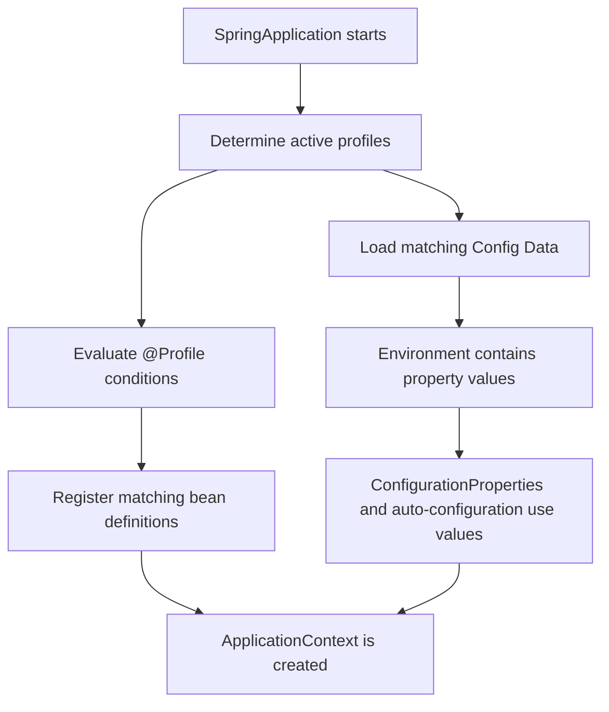

# Profiles are used to select which configuration parts apply

In a Spring Boot project, the same source code can be run on a developer's machine, in a test environment, in staging, and in production. These environments often differ in external service URLs, notification methods, connection parameters, logging levels, or certain beans that are only needed in specific environments.

Spring Profiles help select **which configuration parts are applied when building the ApplicationContext** based on the set of active profiles (*active profiles*). This mechanism allows keeping a single codebase while organizing environment-specific choices.

There are two important questions:

1. **Which beans are registered?** For example, using a mock implementation in `test` and a real implementation in `prod`.
2. **Which configuration values are loaded?** For example, `catalog.base-url` in `application-dev.yml` differs from `application-prod.yml`.

Profiles do not automatically change all application behavior on their own. Spring only applies the choices that you have explicitly associated with a profile using annotations, Config Data files, or corresponding conditions.

## 1. Mental model: Profiles select configuration, they do not generate behavior on their own

Imagine an application with the following structure:

```text
application.yml
application-dev.yml
application-test.yml
application-prod.yml

AuditService
  ├── ConsoleAuditRecorder   (@Profile("dev"))
  ├── FakeAuditRecorder      (@Profile("test"))
  └── DatabaseAuditRecorder  (@Profile("prod"))
```

When `dev` is active, Spring Boot can load `application-dev.yml` and Spring Framework can register `ConsoleAuditRecorder`. When `prod` is active, the production Config Data and bean definitions are selected.



This is a high-level diagram. During bootstrap, preparing the Environment and processing Config Data follow a specific order; bean conditions are evaluated when the container processes the corresponding definitions.

A profile like `prod` is only a **label**. It does not automatically enable HTTPS, protect secrets, select a production database, or make methods thread-safe. All effects must come from explicitly written configuration and code.

## 2. Which parts of configuration can profiles select?

| Configuration type | How does a profile affect it? | Example |
|---|---|---|
| Component-scanned beans | `@Profile` decides whether the bean is registered | `@Service @Profile("test")` |
| Beans created via Java configuration | `@Profile` on a `@Bean` method | A fake Clock in tests |
| Entire configuration class | `@Profile` on `@Configuration` | A group of local-only beans |
| Property values | Load profile-specific files | `application-prod.yml` |
| Conditional YAML/properties documents | `spring.config.activate.on-profile` | Configuration section applied only in prod |
| Parameters for auto-configuration | Profile loads properties; auto-configuration reads them | JDBC URL, logging level, server port |
| Indirect feature flags | Profile supplies values, another condition uses them | `@ConditionalOnProperty` |
| A set of supporting profiles | Profile groups or include | `production` activates `proddb`, `prodmq` |

Profiles **do not automatically** select an object if that object is created outside Spring with `new` and has no logic checking the Environment; they do not automatically switch implementations per HTTP request; they do not guarantee that a connection is ready; and they do not immediately change existing beans in the context when a YAML file is edited after startup.

## 3. @Profile selects a bean implementation

Suppose an application needs to record audit events:

```java
package com.example.audit;

public interface AuditRecorder {
    void record(String event);
}
```

In the development environment, we want to log to the console:

```java
package com.example.audit;

import org.springframework.context.annotation.Profile;
import org.springframework.stereotype.Component;

@Component
@Profile("dev")
public class ConsoleAuditRecorder implements AuditRecorder {

    @Override
    public void record(String event) {
        System.out.println("[DEV AUDIT] " + event);
    }
}
```

In the test environment, we want an easily observable implementation without calling real infrastructure:

```java
package com.example.audit;

import org.springframework.context.annotation.Profile;
import org.springframework.stereotype.Component;

import java.util.ArrayList;
import java.util.List;

@Component
@Profile("test")
public class InMemoryAuditRecorder implements AuditRecorder {

    private final List<String> events = new ArrayList<>();

    @Override
    public void record(String event) {
        events.add(event);
    }

    public List<String> events() {
        return List.copyOf(events);
    }
}
```

In production, for example, an implementation integrating with audit infrastructure:

```java
package com.example.audit;

import org.springframework.context.annotation.Profile;
import org.springframework.stereotype.Component;

@Component
@Profile("prod")
public class ProductionAuditRecorder implements AuditRecorder {

    private final AuditGateway gateway;

    public ProductionAuditRecorder(AuditGateway gateway) {
        this.gateway = gateway;
    }

    @Override
    public void record(String event) {
        gateway.send(event);
    }
}
```

`AuditGateway` is an abstraction provided by the project. For the production application to start, a suitable `AuditGateway` bean must also be present.

The business service only needs the interface:

```java
package com.example.orders;

import com.example.audit.AuditRecorder;
import org.springframework.stereotype.Service;

@Service
public class OrderService {

    private final AuditRecorder auditRecorder;

    public OrderService(AuditRecorder auditRecorder) {
        this.auditRecorder = auditRecorder;
    }

    public void placeOrder() {
        // Process the order.
        auditRecorder.record("ORDER_CREATED");
    }
}
```

If only `dev` is active, the container registers `ConsoleAuditRecorder`. If only `test` is active, the container registers `InMemoryAuditRecorder`. If only `prod` is active, the container registers `ProductionAuditRecorder`.

### 3.1. Why not check the profile name inside every service?

You could write logic like:

```java
if ("prod".equals(currentProfile)) {
    // ...
} else {
    // ...
}
```

However, when many services check profiles themselves, environment-selection logic becomes scattered. `@Profile` lets you place the condition at the **bean creation point**, while business code depends only on the abstraction.

This approach is suitable when **implementations genuinely differ**. If only a URL or timeout differs, you usually do not need to create multiple implementations.

### 3.2. What if no matching bean exists?

In the example above, there is no `AuditRecorder` bean when only `staging` is active. `OrderService` may fail to start because its constructor has no matching dependency.

Spring does not automatically infer that "staging is similar to production" and pick the prod bean.

You need to explicitly design one of the following options:

- Provide a dedicated implementation for staging.
- Allow one implementation to be used by multiple profiles.
- Provide a default bean with an appropriate condition.
- Reject unsupported profile combinations and report a clear error.

## 4. @Profile on a @Bean method

For classes that do not use Spring annotations, you can place `@Profile` directly on a `@Bean` method.

For example, using `Clock` built into the JDK:

```java
package com.example.time;

import java.time.Clock;
import java.time.Instant;
import java.time.ZoneOffset;

import org.springframework.context.annotation.Bean;
import org.springframework.context.annotation.Configuration;
import org.springframework.context.annotation.Profile;

@Configuration(proxyBeanMethods = false)
public class ClockConfiguration {

    @Bean
    @Profile("test")
    public Clock fixedClockForTests() {
        return Clock.fixed(
                Instant.parse("2026-01-01T00:00:00Z"),
                ZoneOffset.UTC
        );
    }

    @Bean
    @Profile("!test")
    public Clock systemClock() {
        return Clock.systemUTC();
    }
}
```

When `test` is active, only `fixedClockForTests` matches. When `test` is not active, `systemClock` matches.

This is a good choice for illustration because we do not need to modify the JDK `Clock` class. The annotation resides on the **bean definition**, not on the implementation.

### 4.1. A configuration class can contain beans with different profiles

```java
@Configuration(proxyBeanMethods = false)
public class ReportingConfiguration {

    @Bean
    @Profile("local")
    ReportStore localReportStore() {
        return new InMemoryReportStore();
    }

    @Bean
    @Profile("cloud")
    ReportStore cloudReportStore(CloudClient client) {
        return new CloudReportStore(client);
    }

    @Bean
    ReportFormatter reportFormatter() {
        return new ReportFormatter();
    }
}
```

In this example, `ReportStore`, `CloudClient`, and the implementations are classes/abstractions defined by the project.

- `localReportStore` is only registered if `local` is active.
- `cloudReportStore` is only registered if `cloud` is active and the required dependency is present.
- `reportFormatter` is not restricted by the profiles placed on the other two methods.

When a bean is used in every environment, there is no need to attach `@Profile` just to make it feel "configurable".

## 5. @Profile on a @Configuration class

When multiple beans belonging to the same configuration apply only to one profile, place the annotation on the entire class:

```java
@Configuration(proxyBeanMethods = false)
@Profile("local")
public class LocalIntegrationConfiguration {

    @Bean
    LocalMessageQueue localMessageQueue() {
        return new LocalMessageQueue();
    }

    @Bean
    LocalEventPublisher localEventPublisher(
            LocalMessageQueue queue
    ) {
        return new LocalEventPublisher(queue);
    }
}
```

When `local` is not active, the bean methods are not registered **from this configuration**.

Placing `@Profile` at the class level avoids repeating the annotation on each method, but it also makes it easy to accidentally exclude beans that should be used in every environment. If a bean is not local-only, move it to another configuration class.

### 5.1. Class-level and method-level conditions can combine

If a configuration class carries `@Profile("cloud")` and a method inside carries `@Profile("dev")`, the bean method must satisfy both the class-level condition and the method-level condition. In the simple case, this corresponds to requiring both `cloud` and `dev` to be active.

Do not read a method annotation in isolation while ignoring the condition on its enclosing class.

## 6. Profile-specific Config Data: application-{profile}.yml

Spring Boot loads configuration sources appropriate for the active profiles. Common structure:

```text
src/main/resources/
├── application.yml
├── application-dev.yml
├── application-test.yml
└── application-prod.yml
```

The `application.yml` file contains shared values:

```yaml
spring:
  application:
    name: catalog-service

server:
  port: 8080

app:
  catalog:
    base-url: http://localhost:9000
    timeout: 3s
```

The `application-dev.yml` file contains values for development:

```yaml
logging:
  level:
    com.example.catalog: DEBUG

app:
  catalog:
    base-url: http://localhost:9001
    timeout: 1s
```

The `application-prod.yml` file:

```yaml
logging:
  level:
    com.example.catalog: INFO

app:
  catalog:
    base-url: https://catalog.internal.example
    timeout: 5s
```

If only `dev` is active and no higher-precedence configuration source overrides them, the effective values can be:

| Property | Value |
|---|---|
| `spring.application.name` | `catalog-service` |
| `server.port` | `8080` |
| `app.catalog.base-url` | `http://localhost:9001` |
| `app.catalog.timeout` | `1s` |
| `logging.level.com.example.catalog` | `DEBUG` |

The shared file still takes effect; profile-specific files do not need to repeat every property.

### 6.1. Changing a property does not automatically change the implementation

Setting `app.catalog.timeout: 1s` in YAML only creates a value in the `Environment`. Spring Boot or application code must **consume** that property for it to affect behavior.

For example, if `CatalogClient` does not read `app.catalog.timeout`, the profile loaded the right file, yet the client's timeout remains unchanged.

**Distinction:**
- A profile selects the **source of values**.
- A bean or auto-configuration decides **how those values are applied**.

### 6.2. .properties files are also supported

Alongside YAML, you can write:

```properties
# application-prod.properties
app.catalog.base-url=https://catalog.internal.example
app.catalog.timeout=5s
logging.level.com.example.catalog=INFO
```

Choose a consistent convention in the project and avoid declaring the same property across multiple files without understanding precedence rules.

## 7. @ConfigurationProperties to receive profile-specific values

When multiple properties belong to the same feature, bind them into a strongly typed class:

```java
package com.example.catalog;

import java.net.URI;
import java.time.Duration;
import org.springframework.boot.context.properties.ConfigurationProperties;

@ConfigurationProperties(prefix = "app.catalog")
public class CatalogProperties {

    private URI baseUrl = URI.create("http://localhost:9000");
    private Duration timeout = Duration.ofSeconds(3);

    public URI getBaseUrl() {
        return baseUrl;
    }

    public void setBaseUrl(URI baseUrl) {
        this.baseUrl = baseUrl;
    }

    public Duration getTimeout() {
        return timeout;
    }

    public void setTimeout(Duration timeout) {
        this.timeout = timeout;
    }
}
```

Register the properties bean:

```java
import org.springframework.boot.context.properties.EnableConfigurationProperties;
import org.springframework.context.annotation.Bean;
import org.springframework.context.annotation.Configuration;

@Configuration(proxyBeanMethods = false)
@EnableConfigurationProperties(CatalogProperties.class)
public class CatalogConfiguration {

    @Bean
    CatalogClient catalogClient(CatalogProperties properties) {
        return new CatalogClient(
                properties.getBaseUrl(),
                properties.getTimeout()
        );
    }
}
```

Here `CatalogClient` is an application class with a constructor accepting `URI` and `Duration`.

When the active profile changes between startups, the same factory method can create a bean using different values.

### 7.1. Should @Profile be placed on a properties class?

If the properties bean is registered via `@EnableConfigurationProperties`, the appropriate place to make registration conditional on a profile is the configuration class that uses `@EnableConfigurationProperties`. If the properties bean is registered via configuration-properties scanning, `@Profile` can be placed on the scanned properties class itself.

Do not place `@Profile` arbitrarily and assume it is always applied, because how `@ConfigurationProperties` is registered affects where the condition is processed.

## 8. Selecting individual YAML documents with spring.config.activate.on-profile

You do not have to create one file per profile. A single `application.yml` can contain multiple documents separated by `---`.

```yaml
spring:
  application:
    name: catalog-service

app:
  catalog:
    timeout: 3s
    base-url: http://localhost:9000

---
spring:
  config:
    activate:
      on-profile: dev

app:
  catalog:
    timeout: 1s
    base-url: http://localhost:9001

---
spring:
  config:
    activate:
      on-profile: prod

app:
  catalog:
    timeout: 5s
    base-url: https://catalog.internal.example
```

The first section can always be applied according to Config Data loading rules. The second section is activated only when profile `dev` matches; the third section when `prod` matches.

### 8.1. on-profile supports expressions

For example, a document used for staging or production:

```yaml
spring:
  config:
    activate:
      on-profile: "staging | prod"

app:
  observability:
    detailed-audit: true
```

The expression uses the OR operator so the document matches if `staging` or `prod` is active. Complex expressions can combine AND, NOT, and parentheses using Spring's profile expression syntax.

### 8.2. Choosing multiple files vs. one multi-document file?

Use separate files such as `application-prod.yml` when each environment's configuration is sufficiently long, needs independent review, or benefits from clear separation of responsibilities.

Use multiple documents in one file when the differences are small and easy to read side by side.

Avoid declaring the same group of properties in both `application-prod.yml` and an `on-profile: prod` document unless the team intentionally designs the override order.

## 9. How can profiles be activated?

Active profiles must be determined in the `Environment` before Spring evaluates profile-specific configuration sections.

### 9.1. Command-line argument

```bash
java -jar catalog-service.jar --spring.profiles.active=dev
```

Multiple profiles:

```bash
java -jar catalog-service.jar --spring.profiles.active=prod,metrics
```

### 9.2. Environment variable

Linux/macOS:

```bash
export SPRING_PROFILES_ACTIVE=prod
java -jar catalog-service.jar
```

Windows PowerShell:

```powershell
$env:SPRING_PROFILES_ACTIVE = "dev"
java -jar catalog-service.jar
```

Spring Boot supports relaxed binding so the environment variable `SPRING_PROFILES_ACTIVE` maps to the `spring.profiles.active` property.

### 9.3. Via a configuration file without a profile condition

```yaml
spring:
  profiles:
    active: dev
```

This is convenient for demonstrations, but you should not hard-code `prod` or `dev` in a shared artifact used across all environments if the deployment system needs to make the choice.

### 9.4. Via SpringApplication

```java
SpringApplication application =
        new SpringApplication(CatalogApplication.class);

application.setAdditionalProfiles("local");

application.run(args);
```

You can add profiles programmatically via the API when there are special bootstrap requirements. However, for ordinary projects, explicit deployment configuration is usually easier to inspect than letting `main` code decide the environment.

### 9.5. Confirming via startup log

The log may contain a message such as:

```text
The following 1 profile is active: "dev"
```

Or when there are no active profiles:

```text
No active profile set, falling back to 1 default profile: "default"
```

Exact wording may vary by version. When investigating configuration issues, always confirm the **actually active** profile set rather than guessing based on an environment name.

## 10. What is the default profile?

When no active profiles are declared, Spring has a **default profiles** mechanism. The default name is usually `default`.

For example:

```java
@Component
@Profile("default")
public class DefaultAuditRecorder implements AuditRecorder {
    // ...
}
```

This bean matches when Spring is using the default profile, and **not** when another profile is active whose own bean is missing.

### 10.1. The default profile is not a per-bean fallback

Suppose `dev` is active, but there is no `AuditRecorder` for dev. Spring does not automatically fall back to `@Profile("default")` to fill the gap if the default profile is not activated.

The default profile only reflects the profile set applied when there are no active profiles according to `Environment` rules.

### 10.2. Changing the default profile

You can configure:

```properties
spring.profiles.default=local
```

When no active profile is set, `local` can serve as the default profile instead of `default`. If you want to disable a special default profile, Spring Boot also supports the value `none` in the corresponding configuration.

For production systems, activate profiles explicitly; avoid letting a default profile accidentally enable production infrastructure.

## 11. Multiple profiles can be active at the same time

```properties
spring.profiles.active=dev,metrics
```

This profile set causes both `dev` and `metrics` to be treated as active. This is useful when one group of configuration describes the environment and another describes additional capabilities.

### 11.1. @Profile with an array of values is OR

```java
@Component
@Profile({"dev", "test"})
public class ConsoleNotificationSender implements NotificationSender {
    // ...
}
```

The bean is registered when **at least one** profile in the list matches.

If you want both profiles to match simultaneously, use a profile expression:

```java
@Component
@Profile("dev & cloud")
public class CloudDevelopmentDiagnostics {
    // ...
}
```

If you want either of the two, you can write:

```java
@Component
@Profile("dev | test")
public class NonProductionDiagnostics {
    // ...
}
```

### 11.2. Negating a profile

```java
@Component
@Profile("!prod")
public class LocalSafetyBanner {
    // ...
}
```

This bean is registered when `prod` is not active.

Be careful: `!prod` is not equivalent to "dev only". It also matches `staging`, `test`, or cases with no prod profile. If you only want dev/test, use a specific restricting condition.

### 11.3. Two profiles can cause two implementations to appear

If `dev,prod` are active simultaneously, both beans:

```java
@Bean
@Profile("dev")
AuditRecorder devRecorder() { /* ... */ }

@Bean
@Profile("prod")
AuditRecorder prodRecorder() { /* ... */ }
```

can be registered.

When a service injects an `AuditRecorder` by type, Spring may fail with multiple matching beans (`NoUniqueBeanDefinitionException`). Profiles do not automatically give production higher priority over development when choosing an implementation.

This is why you need to clearly define supported profile combinations, or design another candidate-selection mechanism such as `@Qualifier`/`@Primary` when truly needed.

## 12. When multiple profiles set the same property

Suppose the application activates:

```properties
spring.profiles.active=dev,metrics
```

And both `application-dev.yml` and `application-metrics.yml` set `app.logging.detail`. When the files belong to the same group and equivalent configuration location, Spring Boot uses the profile-specific config order, where a profile declared later can generally override values for the same key following a **last-wins** rule.

However, Spring Boot does not have only those files. Command-line arguments, environment variables, Config Data imports, and other property sources also participate with their own precedence order.

Therefore, never conclude that "`application-prod.yml` always beats every other source." Check which source is actually supplying the final value.

### 12.1. How to determine an effective value

When `app.catalog.base-url` is incorrect, check:

1. The actual active profiles and their order.
2. `application.yml` and the `application-{profile}.yml` files.
3. `on-profile` documents in multi-document files.
4. Values from environment variables or command-line arguments.
5. `spring.config.import` and external config locations.
6. Whether the bean binds/reads the right key.

A log line showing active profiles alone does not prove which file supplied a property.

## 13. spring.profiles.group: grouping multiple profiles

Spring Boot supports profile groups so one logical profile activates additional member profiles.

```yaml
spring:
  profiles:
    group:
      production:
        - proddb
        - prodmq
        - observability
```

If you run:

```bash
java -jar app.jar --spring.profiles.active=production
```

Spring Boot can activate `production` along with the profiles declared in the group: `proddb`, `prodmq`, and `observability`.

This is useful when production requires many configuration modules that deployers should not have to enter individually.

### 13.1. A group does not create dependencies on its own

Activating `prodmq` does not automatically install a Kafka/RabbitMQ client or create valid connection settings. The required libraries, beans, and properties must still exist.

A group only organizes a set of profile names; it is not a readiness check or package installer.

### 13.2. Where to declare a group

Under modern Spring Boot Config Data rules, `spring.profiles.group` is declared in a **non-profile-specific** document. Avoid placing a group inside a document that is only activated by `spring.config.activate.on-profile`.

## 14. spring.profiles.include: adding profiles

Another mechanism is:

```yaml
spring:
  profiles:
    include:
      - common-observability
```

`spring.profiles.include` adds profiles according to supported configuration rules.

| Property | Purpose |
|---|---|
| `spring.profiles.active` | Select active profiles |
| `spring.profiles.default` | Select default profiles when no active profile is set |
| `spring.profiles.include` | Include additional profiles |
| `spring.profiles.group.*` | Group profiles under a logical name |

### 14.1. Do not declare active/include/group in a profile-specific document

In Spring Boot versions using Config Data (from 2.4 onward), properties such as `spring.profiles.active`, `spring.profiles.default`, `spring.profiles.include`, and `spring.profiles.group` have rules requiring them to be used only in documents not activated by profile.

An example that is invalid in configuration intent:

```yaml
spring:
  config:
    activate:
      on-profile: prod
  profiles:
    active: metrics
```

The document already requires `prod` to be active, yet tries to select another active profile inside itself. Do not use this kind of "chain activation". Instead, use a group in a shared document or provide the set of active profiles from the deployment environment.

## 15. Profiles and @ConditionalOnProperty are different

A profile typically represents an environment or configuration group, while a feature flag is a choice to enable or disable a specific capability. The two concepts can relate, but they are not identical.

For example, an application only registers a scheduler when:

```java
@Configuration(proxyBeanMethods = false)
public class ReportingSchedulingConfiguration {

    @Bean
    @ConditionalOnProperty(
            prefix = "app.reporting",
            name = "scheduler-enabled",
            havingValue = "true"
    )
    ReportScheduler reportScheduler() {
        return new ReportScheduler();
    }
}
```

`application-dev.yml`:

```yaml
app:
  reporting:
    scheduler-enabled: false
```

`application-prod.yml`:

```yaml
app:
  reporting:
    scheduler-enabled: true
```

Here, **the profile selects the property value**. `@ConditionalOnProperty` itself decides whether the `ReportScheduler` bean is registered.

If you need to temporarily disable the scheduler in production, you only need to override the corresponding property in the deployment environment without necessarily changing the application's profile.

### 15.1. Tool selection table

| Requirement | Mechanism to consider |
|---|---|
| Choose a fake payment gateway for tests | `@Profile("test")` |
| Vary URLs, timeouts per environment | Config Data + `@ConfigurationProperties` |
| Enable/disable a feature independently of environment | `@ConditionalOnProperty` |
| Create a bean only when a dependency already exists | `@ConditionalOnBean` |
| Provide a default bean and let the application replace it | `@ConditionalOnMissingBean` |
| Change behavior per request tenant | Runtime strategy/routing, not `@Profile` alone |

Do not use `@Profile` for every case just because it is easy to write. Choosing the right mechanism avoids generating too many profile names such as `prod-with-email`, `prod-without-email`, or `staging-feature-x`.

## 16. Profiles do not replace Environment and property-source precedence

Spring's `Environment` manages both active profiles and property sources. Profiles are one way of selecting Config Data, not the entire property-resolution mechanism.

A property can come from:

- Packaged `application.yml`.
- Profile-specific files.
- External Config Data.
- Environment variables.
- JVM system properties.
- Command-line arguments.
- Property sources provided by tests or code.

For example, even if `application-prod.yml` sets:

```yaml
server:
  port: 8080
```

the following command can make the server use port `9090`:

```bash
java -jar app.jar --spring.profiles.active=prod --server.port=9090
```

Command-line arguments have higher precedence than packaged configuration files in standard Spring Boot setups.

### 16.1. Profiles do not guarantee secret safety

Do not commit real production passwords/API keys in `application-prod.yml`. Profile-specific files can still reside in the source repository or be packaged inside the JAR.

Example referencing an environment variable:

```yaml
app:
  payment:
    endpoint: https://payments.internal.example
    api-key: ${PAYMENT_API_KEY}
```

In the final Markdown, this reference expression uses the `${PAYMENT_API_KEY}` syntax; the deployment environment must supply the corresponding value via a secret manager or appropriate secure mechanism.

Profiles only select configuration parts; authentication, authorization, TLS, and secret management must be designed independently.

## 17. Profiles do not swap already-created beans at runtime

`@Profile` is evaluated while building the ApplicationContext. Once the container has created beans, simply editing `application-prod.yml` on disk or changing an external environment variable does not turn an already-injected bean into another implementation.

For example:

1. The application starts with `dev`.
2. Spring registers `ConsoleAuditRecorder` and injects it into `OrderService`.
3. Someone changes the OS environment variable to `prod`.
4. `OrderService` does not automatically receive `ProductionAuditRecorder` in the current context.

Normally a restart/redeploy is needed for configuration to be re-selected. If a system has a dynamic refresh mechanism, that is an additional design with its own constraints regarding lifecycle, refresh scope, and consistency.

Profiles are also not a solution for choosing a provider per HTTP request. If each tenant needs a different payment provider, use an appropriate strategy/routing bean or service.

## 18. End-to-end example: what do dev, test, and prod select?

Suppose a system has:

- `NotificationSender` to send notifications.
- `CatalogClient` to call the catalog.
- `ReportScheduler` for periodic synchronization.
- A JDBC DataSource to access the database.

An appropriate organization:

```text
Profile dev:
  NotificationSender = logging implementation
  Catalog URL = http://localhost:9000
  Scheduler enabled = false
  JDBC URL = local database

Profile test:
  NotificationSender = fake implementation
  Catalog URL = local fake server
  Scheduler enabled = false
  JDBC URL = test database

Profile prod:
  NotificationSender = production gateway
  Catalog URL = internal HTTPS endpoint
  Scheduler enabled = true
  JDBC URL = external secret/config
```

### 18.1. Selecting NotificationSender with @Profile

```java
public interface NotificationSender {
    void send(String recipient, String message);
}
```

```java
@Configuration(proxyBeanMethods = false)
public class NotificationConfiguration {

    @Bean
    @Profile({"dev", "test"})
    NotificationSender loggingNotificationSender() {
        return (recipient, message) ->
                System.out.println(
                        "Notification to " + recipient + ": " + message
                );
    }

    @Bean
    @Profile("prod")
    NotificationSender productionNotificationSender(
            ExternalNotificationGateway gateway
    ) {
        return gateway::send;
    }
}
```

`ExternalNotificationGateway` is a project interface with a `send(String, String)` method. In production, a corresponding bean must exist; tests must not accidentally call the production gateway.

### 18.2. Selecting properties with Config Data

`application.yml`:

```yaml
spring:
  application:
    name: order-service

app:
  catalog:
    timeout: 3s
```

`application-dev.yml`:

```yaml
app:
  catalog:
    base-url: http://localhost:9000
  reports:
    scheduler-enabled: false
```

`application-test.yml`:

```yaml
app:
  catalog:
    base-url: http://localhost:9010
  reports:
    scheduler-enabled: false
```

`application-prod.yml`:

```yaml
app:
  catalog:
    base-url: https://catalog.internal.example
    timeout: 5s
  reports:
    scheduler-enabled: true
```

### 18.3. Selecting the scheduler with a property condition

```java
@Bean
@ConditionalOnProperty(
        prefix = "app.reports",
        name = "scheduler-enabled",
        havingValue = "true"
)
ReportScheduler reportScheduler() {
    return new ReportScheduler();
}
```

In this example, the property condition itself decides whether to enable the scheduler, while the profile loads the value from the corresponding file.

### 18.4. Selecting DataSource parameters without changing the DataSource class

In an application with the JDBC/JPA starter and an appropriate driver, `application-dev.yml` might contain:

```yaml
spring:
  datasource:
    url: jdbc:h2:mem:devdb
    username: sa
    password: ""
```

While production has:

```yaml
spring:
  datasource:
    url: ${DB_JDBC_URL}
    username: ${DB_USERNAME}
    password: ${DB_PASSWORD}
```

Spring Boot can still create the same type of infrastructure bean; only the connection values differ. H2 requires the corresponding driver on the classpath. Production requires the actual driver, credentials, network, and database.

## 19. Testing @Profile with @ActiveProfiles

Spring Test supports `@ActiveProfiles` to control profiles in a test context.

```java
import org.junit.jupiter.api.Test;
import org.springframework.beans.factory.annotation.Autowired;
import org.springframework.boot.test.context.SpringBootTest;
import org.springframework.context.ApplicationContext;
import org.springframework.test.context.ActiveProfiles;

import static org.assertj.core.api.Assertions.assertThat;

@SpringBootTest
@ActiveProfiles("dev")
class DevelopmentWiringTest {

    @Autowired
    private ApplicationContext context;

    @Test
    void usesDevelopmentNotificationSender() {
        assertThat(context.containsBean("loggingNotificationSender"))
                .isTrue();
        assertThat(context.containsBean("productionNotificationSender"))
                .isFalse();
    }
}
```

A corresponding test for `prod`:

```java
@SpringBootTest
@ActiveProfiles("prod")
class ProductionWiringTest {

    @Autowired
    ApplicationContext context;

    @Test
    void usesProductionNotificationSender() {
        assertThat(context.containsBean("productionNotificationSender"))
                .isTrue();
        assertThat(context.containsBean("loggingNotificationSender"))
                .isFalse();
    }
}
```

Note: To start the prod context in tests, you must provide an appropriate fake/mock for `ExternalNotificationGateway` and required production dependencies. Do not let tests perform real transactions or send messages to real infrastructure.

### 19.1. Tests must check both present and absent beans

Asserting only that `loggingNotificationSender` is present may miss a bug where the production sender is also registered. A good test should verify:

- The expected bean exists.
- The inappropriate bean does not exist.
- There are no unintended multiple candidates for the same abstraction.
- The final property matches the active profile.

### 19.2. Testing bean selection with ApplicationContextRunner

For a small context, you can explicitly set the profile:

```java
import org.junit.jupiter.api.Test;
import org.springframework.boot.test.context.runner.ApplicationContextRunner;

import static org.assertj.core.api.Assertions.assertThat;

class ClockConfigurationTests {

    private final ApplicationContextRunner runner =
            new ApplicationContextRunner()
                    .withUserConfiguration(ClockConfiguration.class);

    @Test
    void usesFixedClockWithTestProfile() {
        runner
                .withInitializer(context ->
                        context.getEnvironment()
                                .setActiveProfiles("test"))
                .run(context -> {
                    assertThat(context).hasBean("fixedClockForTests");
                    assertThat(context).doesNotHaveBean("systemClock");
                });
    }

    @Test
    void usesSystemClockOtherwise() {
        runner.run(context -> {
            assertThat(context).hasBean("systemClock");
            assertThat(context).doesNotHaveBean("fixedClockForTests");
        });
    }
}
```

`ApplicationContextRunner` tests bean conditions in an isolated context. It does not automatically prove that `SpringApplication`'s full `application-test.yml` loading pipeline ran the same way as in production. If the goal is to test real Config Data files, write an integration test aligned with Spring Boot's bootstrap process.

## 20. Investigating when a profile does not select expected configuration

When the application uses the wrong URL or a bean does not appear, diagnose in a clear sequence.

### Step 1: Confirm active profiles

Check the startup log or read `Environment`:

```java
import java.util.Arrays;
import org.springframework.core.env.Environment;
import org.springframework.stereotype.Component;

@Component
public class ActiveProfileLogger {

    public ActiveProfileLogger(Environment environment) {
        System.out.println(
                "Active profiles: " +
                Arrays.toString(environment.getActiveProfiles())
        );
    }
}
```

### Step 2: Check bean registration scope

- Is the class within the component-scan path?
- Is the `@Configuration` class imported?
- Is `@Profile` on the component, configuration, or `@Bean`?
- Is there a class-level condition excluding all beans?
- Is there another condition such as `@ConditionalOnClass` or `@ConditionalOnProperty` that must also be satisfied?

### Step 3: Check files and property sources

- Is the filename exact, such as `application-dev.yml` or `application-prod.yml`?
- Is the file on the classpath / in a loaded config location?
- Are there `spring.config.activate.on-profile` documents?
- Do command-line arguments or environment variables override the property?
- Is there a Config Data import applied in that environment?
- Is the properties class bound and used by the factory?

### Step 4: Read Spring errors

If no bean exists, you may encounter `UnsatisfiedDependencyException` or `NoSuchBeanDefinitionException`. If both implementations coexist, you may encounter `NoUniqueBeanDefinitionException`.

Do not immediately fix it with `@Primary` if the original intent is to register only one bean. Determine which profiles match, which conditions are effective, and why there are multiple candidates.

### Step 5: Use diagnostic tools

Run with `--debug`:

```bash
java -jar catalog-service.jar --debug
```

The Condition Evaluation Report can help explain which auto-configurations matched or did not match. For profile beans, inspect bean definitions, logs, and test contexts to confirm.

Actuator endpoints such as `env`, `configprops`, and `conditions` can be helpful if enabled appropriately. They may contain internal information, so configure exposure/security carefully and do not expose sensitive data publicly.

## 21. Common misconceptions

| Statement | True or false? | Explanation |
|---|---|---|
| Having `application-dev.yml` automatically activates dev | **False** | A matching active/default profile is required |
| Profiles only select beans | **False** | Profiles also select Config Data |
| Profiles only change properties | **False** | `@Profile` can select bean definitions |
| `@Profile({"dev","test"})` requires both to be active | **False** | It is an OR operation |
| `@Profile("!prod")` means dev only | **False** | Any combination without prod can match |
| With two active profiles, Spring picks prod beans before dev beans | **False** | Two beans of the same type can coexist |
| `application-prod.yml` always has higher precedence than every config source | **False** | Property-source precedence must be considered |
| A new property in YAML creates behavior automatically | **False** | Code or auto-configuration must read the property |
| `@Profile("default")` is a fallback for missing beans | **False** | The default profile is used when no active profile is set |
| Editing a YAML file at runtime immediately swaps beans | **False** | That is not default `@Profile` behavior |
| Profiles guarantee the database is connected | **False** | Health checks and runtime verification are needed |
| Using the prod profile is enough to protect secrets | **False** | Separate secret management is required |
| Every feature flag should be a profile | **False** | Independent features should use property conditions |
| `@ActiveProfiles("test")` automatically blocks all real API calls | **False** | Tests need proper fakes/mocks and isolation |

## 22. Self-check exercises

### Exercise 1: Changing timeout

An application only differs in HTTP timeout between dev and prod, while the HTTP client implementation is identical.

**Question:** Do you need to create two client beans with `@Profile`?

**Answer:** Usually no. Using a profile-specific property and `@ConfigurationProperties` is sufficient.

### Exercise 2: Switching implementations

Tests must not call the real payment gateway, while production must use the real gateway.

**Question:** Where can profiles be used?

**Answer:** Use `@Profile("test")` for the fake gateway and `@Profile("prod")` for the production gateway, while ensuring supported profile combinations always have the right dependencies.

### Exercise 3: on-profile document

```yaml
app:
  feature:
    mode: basic

---
spring:
  config:
    activate:
      on-profile: staging

app:
  feature:
    mode: preview
```

**Question:** When `staging` is active and there is no higher-precedence source, what is `app.feature.mode`?

**Answer:** `preview`.

### Exercise 4: Combining profiles

There are two `CacheStore` beans annotated with `@Profile("dev")` and `@Profile("metrics")`, respectively.

**Question:** What can happen if `dev,metrics` are active?

**Answer:** Both beans can be registered; injecting `CacheStore` by type may be ambiguous without an appropriate selection rule.

### Exercise 5: Invalid placement

A YAML document uses `spring.config.activate.on-profile: prod` but also declares `spring.profiles.active: metrics` inside that same document.

**Question:** Is this a valid way to add a profile?

**Answer:** No, under modern Config Data rules. Place profile groups/includes/activation in a non-profile-specific location as prescribed.

### Exercise 6: Feature flag

A scheduler needs to be toggled independently of whether the application is running in staging or prod.

**Question:** Should you use a profile or a property condition?

**Answer:** `@ConditionalOnProperty` is more suitable, while profile-specific configuration can supply per-environment defaults.

### Exercise 7: Default profile

Does a `@Profile("default")` bean automatically appear when `dev` is active but a dev bean is missing?

**Answer:** No. The default profile is not a per-bean fallback.

### Exercise 8: Runtime

The application started with `dev` and injected `ConsoleAuditRecorder`. Later, `application-prod.yml` is edited.

**Question:** Does the active bean automatically become the production recorder?

**Answer:** No. A restart/redeploy or an explicitly designed dynamic refresh mechanism is required.

## 23. Takeaways

- **Profiles select configuration parts**, primarily bean definitions and Config Data sources.
- `@Profile` is used on components, configuration classes, or `@Bean` methods to decide which beans exist in the context.
- `application-{profile}.yml` and `spring.config.activate.on-profile` are used to select property values per profile.
- Profiles do not automatically turn a custom property into a feature; a bean or auto-configuration must read and use that value.
- Active profiles can be declared via command line, environment, valid configuration files, or bootstrap APIs.
- The default profile applies when no active profile is set; it is not a per-bean fallback.
- Multiple profiles can be active simultaneously; a `@Profile` array is OR, and expressions can use AND, OR, and NOT.
- Profile groups/includes help organize related profiles, but must be declared in valid Config Data locations.
- `@ConditionalOnProperty` is usually better suited for environment-independent feature flags.
- Profiles do not replace secret management, health checks, runtime routing, or dynamic refresh mechanisms.
- Test with `@ActiveProfiles`, verifying registered beans, excluded beans, and final property values.

When designing configuration for a Spring Boot application, ask yourself: **"Is the difference between environments a bean implementation, a configuration value, or just a feature toggle?"** The answer will help you choose accurately between `@Profile`, profile-specific Config Data, and other configuration conditions.
