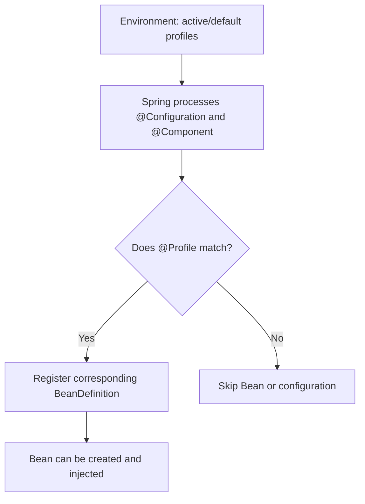
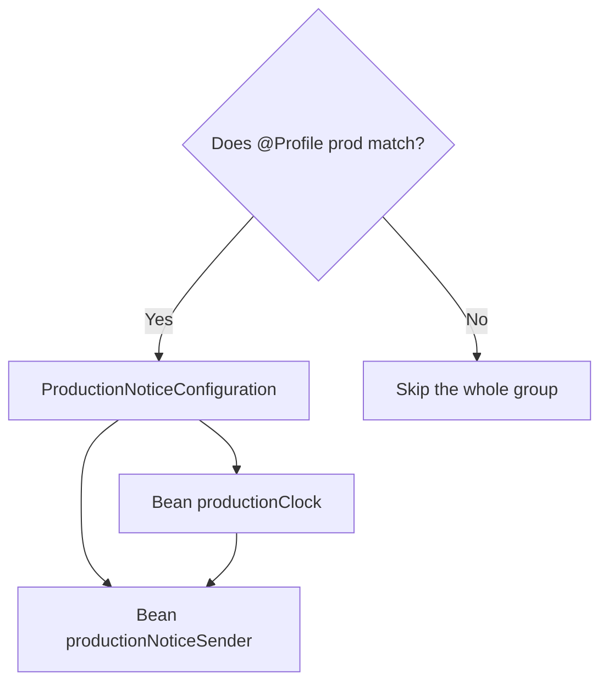

# @Profile on components, configurations, and bean groups

A Spring Boot application often has to run in multiple environments: a developer's machine, integration environments, testing, and production. Those environments can share the same source code while needing different Beans. For example, in development we want to send notifications to the console, whereas production uses an adapter that can send notifications to a real system.

Spring provides the `@Profile` annotation to **register a component or configuration only when the matching profile is active**. This annotation can be placed on an individual component, on a `@Configuration` class to apply to an entire group of Beans, or on individual `@Bean` methods to select selectively within a configuration class.

The key is understanding that `@Profile` operates at the **configuration and BeanDefinition registration phase**, not as an `if` statement executed every time a service runs. When the context starts, Spring inspects the active/default profiles, evaluates the condition, and decides which Beans exist in the container.

After this lesson, you will know how to choose where to place `@Profile`, organize Bean groups by environment, combine multiple profiles, use Spring Boot profile groups, and verify actual configuration without causing dependency injection ambiguity.

## 1. What is a Profile in Spring?

A profile is a logical name used to distinguish an **activated set of configurations**. For example:

- `dev`: development environment.
- `test`: integration testing.
- `staging`: pre-production.
- `prod`: production.
- `cloud`: a deployment characteristic.
- `observability`: an instrumentation/observability configuration group.

These names are examples chosen by the development team, not a mandatory set enforced by Spring. Spring stores profile information in the `Environment`.



Two concepts need to be separated:

- **Active profiles:** profiles explicitly activated, usually via properties, environment variables, command line, or API.
- **Default profiles:** fallback profiles used when there are no active profiles. By Spring's default configuration, the default profile name is `default`, though it can be customized.

Multiple profiles can be active **at the same time**. A profile is not an enum with only a single value; for instance, `prod` and `cloud` can be activated together. This provides flexibility, but can also cause multiple Beans of the same type to appear if you do not design conditions carefully.

## 2. Declaring and activating profiles in Spring Boot

Spring Boot supports the property:

```properties
spring.profiles.active=dev
```

You can place it in `application.properties` or an appropriate external configuration source. With YAML:

```yaml
spring:
  profiles:
    active: dev
```

You can specify multiple profiles separated by commas:

```properties
spring.profiles.active=prod,cloud
```

### Passing via the command line

```bash
java -jar profile-demo.jar --spring.profiles.active=dev
```

Or running with the production profile:

```bash
java -jar profile-demo.jar --spring.profiles.active=prod
```

### Via environment variables

In a deployment environment, you can use:

```bash
export SPRING_PROFILES_ACTIVE=prod
java -jar profile-demo.jar
```

This example uses common shell syntax on Linux/macOS. On Windows or container/orchestration systems, the syntax for setting environment variables differs.

### Choosing the right configuration source

Property sources in Spring Boot follow precedence rules. Command-line arguments or environment variables can be used to change the profile without modifying the artifact. Instead of hard-coding `prod` in the source code, let the deployment system supply the profile through configuration.

In multi-environment applications, a helpful pattern is keeping `application.yml` for shared settings and using `application-dev.yml` and `application-prod.yml` for environment-specific configuration values. However, **profile-specific configuration files and the `@Profile` annotation are two different mechanisms**: one loads configuration values, while the other decides which Beans/configurations are registered.

## 3. @Profile on an individual component

The most straightforward case is wanting an implementation to exist only in one environment:

```java
package com.example.profiledemo;

public interface NoticeSender {
    String send(String message);
}
```

Bean for the development environment:

```java
package com.example.profiledemo;

import org.springframework.context.annotation.Profile;
import org.springframework.stereotype.Component;

@Component
@Profile("dev")
public class DevNoticeSender implements NoticeSender {
    @Override
    public String send(String message) {
        return "[DEV-CONSOLE] " + message;
    }
}
```

When Spring component-scans this class:

- If profile `dev` is active, the BeanDefinition for `DevNoticeSender` is registered.
- If profile `dev` does not match, the class is skipped during registration.
- The Java class can still exist on the classpath; `@Profile` does not delete the class or forbid instantiating objects with `new`.

Because `@Profile` is a Spring condition, the following **does not** have profile semantics:

```java
DevNoticeSender sender = new DevNoticeSender();
```

You create the object directly in Java, so Spring neither evaluates `@Profile` nor manages that object.

### Other stereotypes work as well

`@Service`, `@Repository`, `@Controller`, and `@RestController` are stereotypes discovered by Spring as components. You can place `@Profile` on those classes:

```java
@Service
@Profile("test")
public class StubFraudCheckService implements FraudCheckService {
    @Override
    public boolean isAllowed(String account) {
        return true; // Only a stub for a specific type of test.
    }
}
```

In production, provide another appropriate implementation and do not let the stub leak outside its intended profile. Remember that if no `FraudCheckService` Bean is registered while another service requires injecting it, the context will fail to create the Bean.

## 4. @Profile on @Configuration: enabling or disabling a whole group of Beans

If multiple Beans always belong to the same environment, placing `@Profile` on every method is repetitive and error-prone. Instead, place `@Profile` on the **configuration class**:

```java
package com.example.profiledemo;

import java.time.Clock;
import java.time.Instant;
import org.springframework.context.annotation.Bean;
import org.springframework.context.annotation.Configuration;
import org.springframework.context.annotation.Profile;

@Configuration(proxyBeanMethods = false)
@Profile("prod")
public class ProductionNoticeConfiguration {

    @Bean
    Clock productionClock() {
        return Clock.systemUTC();
    }

    @Bean
    NoticeSender productionNoticeSender(Clock productionClock) {
        return message -> "[PROD " + Instant.now(productionClock)
                + "] " + message;
    }
}
```

When `prod` is active, Spring can register both Beans:

- `productionClock` of type `Clock`.
- `productionNoticeSender` of type `NoticeSender`.

When `prod` does not match, **the entire configuration class is skipped**, so neither Bean from that class is registered.



This approach fits a group of components with clear boundaries: connections to external systems, specific providers, a suite of production adapters, or a set of mocks/stubs for test environments.

### Why use proxyBeanMethods = false?

In the example above, `@Configuration(proxyBeanMethods = false)` avoids CGLIB interception of direct calls between `@Bean` methods. Each Bean receives its dependencies via factory method parameters:

```java
NoticeSender productionNoticeSender(Clock productionClock)
```

Spring resolves `Clock` from the container. This is clearer than calling `productionClock()` directly inside the factory method, especially when using lite configuration. The configuration mode does not alter `@Profile` conditional semantics.

## 5. @Profile on individual @Bean methods

Sometimes a configuration class contains some shared Beans and some Beans meant only for specific environments. You can place `@Profile` at the **method level**:

```java
@Configuration(proxyBeanMethods = false)
public class ConnectorConfiguration {

    @Bean
    Clock systemClock() {
        return Clock.systemUTC(); // Used in all profiles.
    }

    @Bean
    @Profile("dev")
    StorageClient localStorageClient() {
        return new InMemoryStorageClient();
    }

    @Bean
    @Profile("prod")
    StorageClient remoteStorageClient() {
        return new RemoteStorageClient();
    }
}
```

Suppose `StorageClient` is an interface and the two classes above are valid implementations. Here:

- `systemClock` is registered regardless of profile.
- `localStorageClient` is only present when `dev` matches.
- `remoteStorageClient` is only present when `prod` matches.

If both `dev` and `prod` are active, **both implementations can be registered**. A constructor requiring a single `StorageClient` may then encounter a multiple-matching-Beans error without a qualifier/primary or other selection rule.

### Class-level and method-level combine with AND

When both the configuration class and a method have `@Profile`, the method is considered only if **both the class-level and method-level conditions match**:

```java
@Configuration(proxyBeanMethods = false)
@Profile("prod")
public class ProductionIntegrationConfiguration {

    @Bean
    AuditClient auditClient() {
        return new RemoteAuditClient();
    }

    @Bean
    @Profile("cloud")
    CloudUploader cloudUploader() {
        return new CloudUploader();
    }
}
```

With this example:

| Active profiles | `auditClient` | `cloudUploader` |
|---|---|---|
| `dev` | No | No |
| `prod` | Yes | No |
| `cloud` | No | No |
| `prod,cloud` | Yes | Yes |

A method cannot "re-open" a configuration class that has already been excluded by `@Profile("prod")`.

## 6. Grouping Beans by environment with configuration classes

A clean way to organize is creating one configuration class per dependency group:

```text
com.example.shop
├── ShopApplication.java
├── service
│   └── CheckoutService.java
└── config
    ├── CommonConfiguration.java
    ├── DevelopmentInfrastructureConfiguration.java
    └── ProductionInfrastructureConfiguration.java
```

Common configuration example:

```java
@Configuration(proxyBeanMethods = false)
public class CommonConfiguration {

    @Bean
    CheckoutPolicy checkoutPolicy() {
        return new StandardCheckoutPolicy();
    }
}
```

Development group:

```java
@Configuration(proxyBeanMethods = false)
@Profile("dev")
public class DevelopmentInfrastructureConfiguration {

    @Bean
    PaymentGateway developmentPaymentGateway() {
        return new FakePaymentGateway();
    }

    @Bean
    EmailGateway developmentEmailGateway() {
        return new LoggingEmailGateway();
    }
}
```

Production group:

```java
@Configuration(proxyBeanMethods = false)
@Profile("prod")
public class ProductionInfrastructureConfiguration {

    @Bean
    PaymentGateway productionPaymentGateway() {
        return new RemotePaymentGateway();
    }

    @Bean
    EmailGateway productionEmailGateway() {
        return new SmtpEmailGateway();
    }
}
```

The classes in the example assume the business types are already defined. The structure shows:

1. Common Beans are not tagged with profiles unnecessarily.
2. Related adapters for the same environment are enabled/disabled as a group.
3. Business services depend only on interfaces, without needing to know whether they are in dev or prod.
4. Switching environments happens at context startup, not scattered across `if (environment...)` checks in every service.

### Do not dump every Bean into a single profile class

A giant configuration class containing database, email, cache, scheduling, and security can become hard to understand. Group by function or deployment boundary; apply `@Profile` to a class when **all Beans in the class truly share the same activation condition**.

If only one method has a different condition, keep it in the shared class and put `@Profile` on the method. If the whole group shares the condition, a class-level annotation is usually clearer.

## 7. Profile expressions: OR, AND, and negation

`@Profile` supports profile expressions rather than just a single name. Spring provides expression syntax via `Profiles.of(...)`:

| Declaration | Meaning |
|---|---|
| `@Profile("dev")` | Profile dev matches |
| `@Profile("!prod")` | Profile prod is not active |
| `@Profile({"dev", "test"})` | dev **or** test matches |
| `@Profile("dev | test")` | dev **or** test matches |
| `@Profile("prod & cloud")` | Both prod **and** cloud match |
| `@Profile("prod & !maintenance")` | prod matches and maintenance is not active |
| `@Profile("(prod | staging) & cloud")` | cloud matches and either prod or staging matches |

### Multiple values in the annotation mean OR

```java
@Component
@Profile({"dev", "test"})
public class DebugDiagnostics implements Diagnostics {
    // ...
}
```

This component can be registered when `dev` **or** `test` matches. The array does not mean "both dev and test must be enabled".

If both are required, use an expression:

```java
@Component
@Profile("dev & integration")
public class DevelopmentIntegrationProbe {
}
```

### Use negation carefully

```java
@Profile("!prod")
```

The condition above does not mean "dev only". It can also match when the active profile is `staging`, `test`, or when using a default profile without `prod`. If a class contains mocks that could pose risks, prefer an explicit allowlist:

```java
@Profile({"dev", "test"})
```

### Prefer parentheses when combining operators

Expressions mixing `&` and `|` should be explicitly grouped with parentheses. For example:

```java
@Profile("(dev | test) & !cloud")
```

Do not rely on intuition about operator precedence from Java. Profile expression syntax has its own rules; using parentheses avoids ambiguity and improves readability.

## 8. Default profile and @Profile("default")

When there are no active profiles, Spring uses the default profile. By default, that is the profile named `default`.

Therefore, the following Bean can serve as a fallback option for an application running with no profile configured:

```java
@Configuration(proxyBeanMethods = false)
@Profile("default")
public class DefaultNoticeConfiguration {

    @Bean
    NoticeSender defaultNoticeSender() {
        return message -> "[DEFAULT] " + message;
    }
}
```

Examples with `spring.profiles.active`:

| Active profiles | Is `defaultNoticeSender` present? |
|---|---|
| Unset, default profile remains `default` | Yes |
| `dev` | No |
| `prod` | No |
| `test` | No |

Point to note: the default profile **can be changed** via `spring.profiles.default` or the Environment API. If you have replaced the default profile with another name, do not assume `@Profile("default")` still matches when no active profile is set.

### Default is not a fallback for any unsupported profile

Suppose an application has `@Profile("dev")`, `@Profile("prod")`, and `@Profile("default")` for three implementations of the same interface. If only `qa` is enabled, the default profile is not applied, so **no implementation** may be left.

Thus, a default Bean is appropriate when you truly want it to run **if there are no active profiles**. If business requirements need a fallback for other profiles, design the condition for the specific requirement; do not equate the default profile with `@ConditionalOnMissingBean`.

## 9. Complete Spring Boot example

Let's build a small console application to observe three modes: no active profile, `dev`, and `prod`. To run the example, you need a Spring Boot project with the appropriate base starter, such as:

```groovy
dependencies {
    implementation 'org.springframework.boot:spring-boot-starter'
}
```

The example uses Gradle Groovy DSL syntax and assumes the project has configured the Spring Boot plugin, Java plugin, and dependency version management.

### Structure

```text
src/main/java/com/example/profiledemo/
├── ProfileDemoApplication.java
├── NoticeSender.java
├── DevNoticeSender.java
├── ProductionNoticeConfiguration.java
└── DefaultNoticeConfiguration.java
```

**NoticeSender.java**

```java
package com.example.profiledemo;

public interface NoticeSender {
    String send(String message);
}
```

**DevNoticeSender.java**

```java
package com.example.profiledemo;

import org.springframework.context.annotation.Profile;
import org.springframework.stereotype.Component;

@Component
@Profile("dev")
public class DevNoticeSender implements NoticeSender {
    @Override
    public String send(String message) {
        return "[DEV] " + message;
    }
}
```

**ProductionNoticeConfiguration.java**

```java
package com.example.profiledemo;

import java.time.Clock;
import java.time.Instant;
import org.springframework.context.annotation.Bean;
import org.springframework.context.annotation.Configuration;
import org.springframework.context.annotation.Profile;

@Configuration(proxyBeanMethods = false)
@Profile("prod")
public class ProductionNoticeConfiguration {

    @Bean
    Clock productionClock() {
        return Clock.systemUTC();
    }

    @Bean
    NoticeSender productionNoticeSender(Clock productionClock) {
        return message -> "[PROD " + Instant.now(productionClock)
                + "] " + message;
    }
}
```

**DefaultNoticeConfiguration.java**

```java
package com.example.profiledemo;

import org.springframework.context.annotation.Bean;
import org.springframework.context.annotation.Configuration;
import org.springframework.context.annotation.Profile;

@Configuration(proxyBeanMethods = false)
@Profile("default")
public class DefaultNoticeConfiguration {

    @Bean
    NoticeSender defaultNoticeSender() {
        return message -> "[DEFAULT] " + message;
    }
}
```

**ProfileDemoApplication.java**

```java
package com.example.profiledemo;

import java.util.Arrays;
import org.springframework.boot.ApplicationRunner;
import org.springframework.boot.SpringApplication;
import org.springframework.boot.autoconfigure.SpringBootApplication;
import org.springframework.context.annotation.Bean;
import org.springframework.core.env.Environment;

@SpringBootApplication
public class ProfileDemoApplication {

    public static void main(String[] args) {
        SpringApplication.run(ProfileDemoApplication.class, args);
    }

    @Bean
    ApplicationRunner showActiveSender(
            NoticeSender sender, Environment environment) {
        return args -> {
            System.out.println("Active profiles: "
                    + Arrays.toString(environment.getActiveProfiles()));
            System.out.println(sender.send("Hello Spring Boot"));
        };
    }
}
```

`@SpringBootApplication` enables component scanning in the `com.example.profiledemo` package and its subpackages. Because all example classes are in this package, Spring can discover the components/configurations without an explicit `@ComponentScan`.

### Running without specifying a profile

```bash
./gradlew bootRun
```

When the project has no custom active/default profile property, illustrative output:

```text
Active profiles: []
[DEFAULT] Hello Spring Boot
```

An empty active profiles array **does not mean no profile applies**. When no profile is active, the default profile can be used during condition evaluation.

### Running with dev

```bash
java -jar build/libs/profile-demo.jar --spring.profiles.active=dev
```

This is an example artifact name; use the actual JAR name produced by the build. Illustrative output:

```text
Active profiles: [dev]
[DEV] Hello Spring Boot
```

Beans from `ProductionNoticeConfiguration` and `DefaultNoticeConfiguration` are not registered. ApplicationRunner receives only `DevNoticeSender`.

### Running with prod

```bash
java -jar build/libs/profile-demo.jar --spring.profiles.active=prod
```

Illustrative output:

```text
Active profiles: [prod]
[PROD 2026-...Z] Hello Spring Boot
```

The timestamp varies with runtime. In this environment, Spring registers both `productionClock` and `productionNoticeSender` because `@Profile` is placed on the configuration class.

### If dev and prod are active simultaneously

```bash
java -jar profile-demo.jar --spring.profiles.active=dev,prod
```

Then both `DevNoticeSender` and `productionNoticeSender` can be registered. The factory method `showActiveSender(NoticeSender sender, ...)` requires a single Bean, but there are two candidates. Spring can report a dependency resolution error.

This is important behavior to control proactively. Profiles have no default rule that "prod beats dev". If two environments must be mutually exclusive, constrain them in deployment configuration or organize conditions so two ambiguous adapters cannot be created.

## 10. Spring Boot profile groups vs. grouping Beans with @Configuration

Two concepts share the word "group":

1. **Bean group:** placing `@Profile` on a `@Configuration` class so multiple `@Bean` methods share one condition.
2. **Profile group:** using `spring.profiles.group` to activate a set of related profiles when choosing an overarching profile.

They solve two different problems and can be combined.

### Declaring a profile group

Example in `application.yml`:

```yaml
spring:
  profiles:
    group:
      production:
        - proddb
        - prodmq
        - observability
```

When running:

```bash
java -jar shop.jar --spring.profiles.active=production
```

Spring Boot activates the `production` profile and group members such as `proddb`, `prodmq`, and `observability`. Classes annotated with `@Profile("proddb")` or `@Profile("prodmq")` can be selected via the activated group.

Example:

```java
@Configuration(proxyBeanMethods = false)
@Profile("proddb")
class DatabaseConfiguration {
    @Bean
    DatabaseConnector databaseConnector() {
        return new DatabaseConnector();
    }
}

@Configuration(proxyBeanMethods = false)
@Profile("prodmq")
class MessagingConfiguration {
    @Bean
    MessagePublisher messagePublisher() {
        return new MessagePublisher();
    }
}
```

Assume `DatabaseConnector` and `MessagePublisher` are example components. Enabling `production` indirectly makes the Beans from these two configurations eligible for registration.

### Place spring.profiles.group in the right configuration source

Spring Boot requires properties controlling profile activation, such as `spring.profiles.active`, `spring.profiles.default`, and `spring.profiles.group`, to be declared in a **non-profile-specific configuration document**.

Do not place `spring.profiles.group` in `application-prod.yml` or inside a YAML document activated by `spring.config.activate.on-profile` expecting Boot to discover the group only after enabling prod. These properties must be processed during the profile determination stage, before loading profile-specific content.

This is a distinction between **profile selection rules** and **properties that only take effect once a profile has been selected**.

### When do you need a group?

Profile groups are useful when an environment needs multiple orthogonal configuration choices, such as database, messaging, and observability. Instead of requiring deployers to remember three profile names, they only need to enable one meaningful group name.

However, do not use profile groups to hide too many unrelated configurations. If a characteristic can be toggled independently in every environment, a property like `app.metrics.enabled` combined with `@ConditionalOnProperty` may be clearer.

## 11. @Profile with environment configuration and @ConfigurationProperties

Profiles can select groups of Beans; properties should carry **configurable values** for Beans. For example, production and staging share the same HTTP client but have different endpoints:

```yaml
# application-prod.yml
integrations:
  billing:
    base-url: https://billing.example.com
```

```yaml
# application-staging.yml
integrations:
  billing:
    base-url: https://billing-staging.example.com
```

If the client class is identical across both environments, there is no need to create two classes/configurations just to change the URL. You can inject the property via `@ConfigurationProperties` and keep one shared Bean:

```java
@ConfigurationProperties(prefix = "integrations.billing")
public record BillingProperties(URI baseUrl) {
}
```

```java
@Configuration(proxyBeanMethods = false)
@EnableConfigurationProperties(BillingProperties.class)
public class BillingConfiguration {

    @Bean
    BillingClient billingClient(BillingProperties properties) {
        return new BillingClient(properties.baseUrl());
    }
}
```

This example assumes `BillingClient` has a constructor accepting a `URI` and appropriate Java classes/imports. Only use `@Profile` when **Bean structure or implementation needs to change**, rather than when a URL value changes.

**Note:** Profiles are not a mechanism for protecting secrets. Passwords, tokens, and keys must be supplied via a secret management system or secure property source, rather than relying on the prod profile file being skipped to consider secrets protected.

## 12. When are profiles evaluated?

`@Profile` is a form of conditional registration. During configuration processing and component scanning, Spring reads metadata and determines whether the condition matches the current Environment.

```text
SpringApplication.run
   ↓
Prepare Environment and active/default profiles
   ↓
Load configuration classes / component scan
   ↓
Evaluate @Profile
   ↓
Register matching BeanDefinition (or skip)
   ↓
Instantiate Beans according to scope/lifecycle
```

Therefore:

- It does not mean Spring always creates every Bean and then chooses which ones to keep.
- Do not arbitrarily change active profiles after the context has refreshed and expect existing Beans to disappear or be recreated.
- If switching profiles is needed, the normal way is starting a new context with the appropriate Environment.

### Reading profiles from Environment

A Bean can inspect the state:

```java
@Component
public class ProfilePrinter {
    private final Environment environment;

    public ProfilePrinter(Environment environment) {
        this.environment = environment;
    }

    public void printProfiles() {
        System.out.println("Active: "
                + Arrays.toString(environment.getActiveProfiles()));
        System.out.println("Default: "
                + Arrays.toString(environment.getDefaultProfiles()));
    }
}
```

Spring also provides an expression-checking API:

```java
boolean inDevelopment =
        environment.acceptsProfiles(Profiles.of("dev"));
```

This API is useful for diagnostics or certain special logic. However, for selecting Bean implementations, `@Profile` or declarative conditions are usually better than scattering `if (environment.acceptsProfiles(...))` across business logic.

## 13. Testing @Profile with Spring Boot Test

Spring Test provides the `@ActiveProfiles` annotation to explicitly set profiles when creating a test ApplicationContext:

```java
import org.junit.jupiter.api.Test;
import org.springframework.beans.factory.annotation.Autowired;
import org.springframework.boot.test.context.SpringBootTest;
import org.springframework.test.context.ActiveProfiles;

import static org.assertj.core.api.Assertions.assertThat;

@SpringBootTest
@ActiveProfiles("dev")
class DevProfileIntegrationTest {

    @Autowired
    NoticeSender sender;

    @Test
    void devSenderIsSelected() {
        assertThat(sender).isInstanceOf(DevNoticeSender.class);
        assertThat(sender.send("ping")).startsWith("[DEV]");
    }
}
```

Here `@ActiveProfiles("dev")` is part of the test configuration. It is more explicit than hoping the test machine happened to set `SPRING_PROFILES_ACTIVE=dev`.

To test prod, you can create a separate test:

```java
@SpringBootTest
@ActiveProfiles("prod")
class ProdProfileIntegrationTest {

    @Autowired
    ApplicationContext context;

    @Test
    void productionBeansAreRegistered() {
        assertThat(context.containsBean("productionClock")).isTrue();
        assertThat(context.containsBean("productionNoticeSender")).isTrue();
        assertThat(context.containsBean("defaultNoticeSender")).isFalse();
    }
}
```

This test checks Bean registration by profile, not actually sending notifications to an external system. If the production implementation opens a network connection during initialization, you can use dedicated test configuration or a fake integration to avoid side effects when running tests.

## 14. Testing conditions with ApplicationContextRunner

For configuration libraries or an independent group of `@Bean` definitions, `ApplicationContextRunner` allows building a small context with different profiles without booting the entire application.

```java
import org.junit.jupiter.api.Test;
import org.springframework.boot.test.context.runner.ApplicationContextRunner;
import org.springframework.context.annotation.Bean;
import org.springframework.context.annotation.Configuration;
import org.springframework.context.annotation.Profile;

import static org.assertj.core.api.Assertions.assertThat;

class SenderProfileConfigurationTest {

    private final ApplicationContextRunner runner =
            new ApplicationContextRunner()
                    .withUserConfiguration(TestSenderConfiguration.class);

    @Test
    void usesDevBeanWhenDevIsActive() {
        runner.withInitializer(context ->
                    context.getEnvironment().setActiveProfiles("dev"))
                .run(context -> {
                    assertThat(context).hasSingleBean(NoticeSender.class);
                    assertThat(context).hasBean("devSender");
                });
    }

    @Test
    void usesProdBeanWhenProdIsActive() {
        runner.withInitializer(context ->
                    context.getEnvironment().setActiveProfiles("prod"))
                .run(context -> {
                    assertThat(context).hasSingleBean(NoticeSender.class);
                    assertThat(context).hasBean("prodSender");
                });
    }

    @Test
    void usesDefaultWhenNoProfileIsActive() {
        runner.run(context -> {
            assertThat(context).hasSingleBean(NoticeSender.class);
            assertThat(context).hasBean("defaultSender");
        });
    }

    @Configuration(proxyBeanMethods = false)
    static class TestSenderConfiguration {

        @Bean
        @Profile("dev")
        NoticeSender devSender() {
            return message -> "[DEV] " + message;
        }

        @Bean
        @Profile("prod")
        NoticeSender prodSender() {
            return message -> "[PROD] " + message;
        }

        @Bean
        @Profile("default")
        NoticeSender defaultSender() {
            return message -> "[DEFAULT] " + message;
        }
    }
}
```

The example relies on Spring Boot test, JUnit Jupiter, and AssertJ. `NoticeSender` is the interface defined in the demonstration application. The three tests check:

1. Profile `dev` selects the dev Bean.
2. Profile `prod` selects the prod Bean.
3. When no active profile exists and the default profile remains unchanged, the default Bean is selected.

If you want to test the case where `dev,prod` are active simultaneously, create a separate context, see whether it has both Beans, and verify how the consumer handles ambiguity. This is especially important for modules with multiple implementations of the same interface.

## 15. @Profile and @ConditionalOnProperty: choosing the right condition type

`@Profile` fits broad environment differences or configuration groups. However, not every toggleable feature should become a profile.

For example, an export feature that can be enabled separately in dev, staging, or production:

```java
@Configuration(proxyBeanMethods = false)
public class ExportConfiguration {

    @Bean
    @ConditionalOnProperty(
            prefix = "app.export",
            name = "enabled",
            havingValue = "true"
    )
    ExportService exportService() {
        return new ExportService();
    }
}
```

The differences:

| Criterion | `@Profile` | `@ConditionalOnProperty` |
|---|---|---|
| Controlled by | Active/default profile | Property value |
| Common purpose | Environment-based configuration group | Feature toggle / configurable capability |
| Can be combined? | Yes | Yes |
| Evaluation time | During Bean/configuration registration | During Bean/configuration registration |

You can combine both:

```java
@Bean
@Profile("prod")
@ConditionalOnProperty(
        prefix = "app.audit",
        name = "enabled",
        havingValue = "true"
)
AuditPublisher auditPublisher() {
    return new AuditPublisher();
}
```

This Bean is registered only when **profile prod matches and the audit property is enabled**. Normally, different conditions must all be satisfied together; not just one of them.

In configuration design, prefer using properties to express variables like endpoint, timeout, and retry count; only use profiles to select **a set of Beans or implementations** when the environment genuinely requires a different structure.

## 16. Common pitfalls

| Symptom | Common cause | How to address |
|---|---|---|
| `NoSuchBeanDefinitionException` at startup | No implementation matches the active profile | Check active/default profiles, package scan, and Bean conditions |
| `NoUniqueBeanDefinitionException` | Multiple active profiles cause multiple implementations of the same interface | Adjust conditions, use qualifier/primary when semantically appropriate, or split responsibilities |
| `@Profile` seems ignored | Object created with `new` or class not managed by Spring | Register the Bean via component scan, `@Bean`, or appropriate import |
| Whole group of Beans disappears | `@Profile` placed on the configuration class does not match | Check class-level conditions before method-level conditions |
| Default Bean does not appear | Another active profile is enabled, even one without an implementation | Remember `default` applies only when no active profile is set |
| Dev stub appears outside dev | Used `@Profile("!prod")` so other profiles also match | Replace with an explicit allowlist of profiles |
| Changing profile property at runtime does not change Beans | BeanDefinition was already registered when the context started | Start a new context or design explicit runtime switching |
| Profile group has no effect | Group declared inside a profile-specific configuration document | Move `spring.profiles.group` to a non-profile-specific document |
| Two `@Bean` methods with the same name cause confusing behavior | Overloaded Java methods with the same name and different profile conditions | Use distinct method names and explicit Bean names if needed |

### The @Bean method overloading pitfall

Spring supports Java method overloading, but `@Profile` **is not a mechanism for selecting overloaded factory methods by environment**. An example to avoid:

```java
@Bean
@Profile("dev")
DataSource dataSource() {
    return createDevDataSource();
}

@Bean
@Profile("prod")
DataSource dataSource(Environment environment) {
    return createProductionDataSource(environment);
}
```

Two methods with the same name `dataSource` may be treated by Spring as overloads of the same factory method rather than two independent profile-specific Beans as you might expect. Condition rules for overloads have limitations, so you should not use `@Profile` to separate overloads sharing a name.

A clearer approach:

```java
@Bean("dataSource")
@Profile("dev")
DataSource developmentDataSource() {
    return createDevDataSource();
}

@Bean("dataSource")
@Profile("prod")
DataSource productionDataSource(Environment environment) {
    return createProductionDataSource(environment);
}
```

Here the method names differ, while the Bean name is intentionally the same. Only share the same Bean name when the profiles are truly mutually exclusive in deployment; if active together, definition conflicts may occur. If a fixed Bean name is not needed, using two distinct Bean names and injecting by interface reduces coupling.

## 17. Keeping profiles maintainable

Some helpful principles:

**Name by deployment meaning.** Choose names like `dev`, `prod`, `local`, `cloud`, and `integration` with clear conventions in the project. Do not mix multiple meanings into a single profile if those meanings need to vary independently.

**Keep business services environment-agnostic.** Services should receive interfaces via constructor. `@Profile` selects implementations at the configuration/infrastructure layer rather than services querying Environment in every method.

**Group Beans that truly belong together.** Use class-level `@Profile` when every Bean in the class shares the same condition. Use method-level when only one Bean differs.

**Do not rely on Bean declaration order.** When multiple profiles are active simultaneously, multiple implementations may appear. Select Beans using clear contracts and metadata rather than assuming the first Bean will win.

**Test important profiles.** For each primary environment, verify that required Beans exist and stubs/mocks are not wrongly activated.

**Use external configuration to select profiles.** Do not hard-code `prod` in source code or hard-code secrets into environment-specific files.

**Avoid creating too many profiles for feature flags.** Options that can be toggled independently should be expressed with appropriate properties/conditions rather than always needing a new profile name.

## 18. Hands-on exercises

Using the `NoticeSender` application above, try:

1. Run without specifying a profile. Observe the default Bean selected when the default profile is unchanged.
2. Run with `dev` and verify that the `DevNoticeSender` component appears while the production configuration class is skipped.
3. Run with `prod` and verify that both `productionClock` and `productionNoticeSender` are registered.
4. Run with `dev,prod`, observe the multiple-Bean error when injecting `NoticeSender`, and decide whether this profile combination should be disallowed.
5. Replace `@Profile("dev")` with `@Profile({"dev", "test"})` and observe that `test` can create that Bean.
6. Put `@Profile("prod & cloud")` on a configuration. Compare when only `prod` is active versus when both `prod,cloud` are active.
7. Declare `spring.profiles.group.production` with members `proddb` and `prodmq`; run with `production` and observe which Bean groups are activated.
8. Create `@ActiveProfiles("dev")` and `@ActiveProfiles("prod")` tests, verifying that the injected Bean has the right type.
9. Use `Environment.getActiveProfiles()` and `getDefaultProfiles()` to compare the states.

Do not check only the "active profile" log—check the **actual BeanDefinitions and dependencies**. Only then will you know whether your `@Profile` annotations are building the right object graph.

## 19. Summary: three places to put @Profile

```mermaid
flowchart TD
    A["Environment has active/default profiles"] --> B{"Where is @Profile placed?"}
    B -->|Component class| C["Select or skip a single component"]
    B -->|Configuration class| D["Select or skip a whole @Bean group"]
    B -->|@Bean method| E["Select or skip one factory method"]
    C --> F["Matching Bean definitions"]
    D --> F
    E --> F
    F --> G["IoC container creates and injects Beans"]
```

| Location | Scope of impact | Typical use case |
|---|---|---|
| `@Profile` on `@Component`/`@Service` | A component class registered by Spring | Select dev/test/prod implementation |
| `@Profile` on `@Configuration` | The entire configuration and all Beans in the class | Enable a whole adapter/infrastructure group |
| `@Profile` on a `@Bean` method | A single Bean declared by the method | One conditional Bean alongside shared Beans |
| `spring.profiles.group` in Boot config | Expands the active profiles set | Enable multiple profile groups via one name |

Once you understand the three places for `@Profile` and how Spring Boot activates profile groups, you can clearly express which environment is allowed to register which Beans. Use component-level for individual implementations, configuration-level for Bean groups sharing a condition, method-level for selective cases, and profile groups when combining multiple related profiles. This keeps Spring Boot configuration readable, avoids Bean ambiguity, and keeps business services independent of per-environment deployment details.
