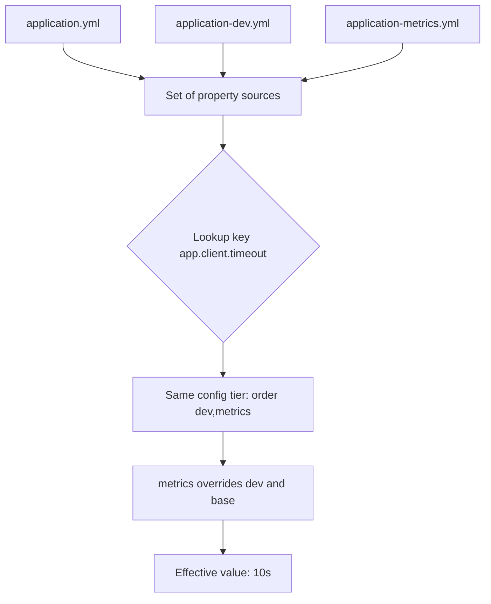
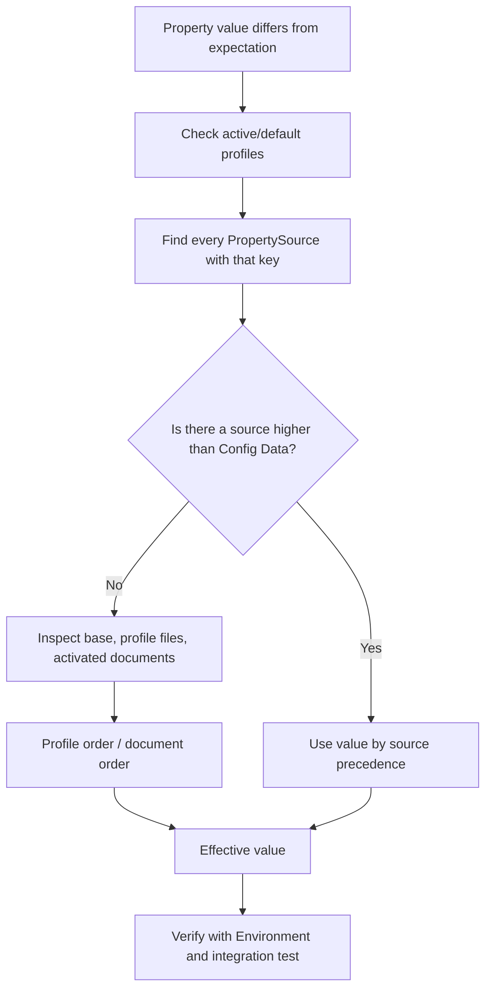

# Activating multiple profiles and handling overlapping values

A Spring Boot application can run with multiple profiles simultaneously. For instance, a development environment might need the `dev` profile to connect to test services, while also needing the `observability` profile to turn on observability settings. Both profiles can contribute configuration properties and bean registration conditions. If they both declare the same property, Spring Boot must decide **which value takes effect**.

For example:

```text
spring.profiles.active=dev,observability
```

Then both `dev` and `observability` are active. However, there are two distinct questions:

1. **Which configurations are activated?** Which profile-specific config files, YAML documents with `spring.config.activate.on-profile`, and beans with `@Profile` are considered?
2. **When values overlap, which value wins?** This depends on profile order and the precedence of configuration sources.

This lesson belongs to the **Profiles** chapter in *Spring Boot Fundamentals*. We will explore how to activate multiple profiles, the "a profile listed later usually wins at the same source level" rule, Config Data overlap mechanics, profile groups, `spring.profiles.include`, coordinating `@Profile` with beans, and verifying effective values.

Examples use Java 21 and Spring Boot 3.x. Some configurations have their own precedence depending on source and version; therefore, conclusions about profile ordering in this article are always framed in the context of profile files **at the same location and same precedence tier**.

## 1. What is a Profile in Spring Boot?

A profile is a logical name used to choose configuration suitable for a runtime context. Commonly seen names:

- `dev`: local development.
- `test`: testing.
- `staging`: pre-production testing close to production.
- `prod`: production.
- `metrics`: enabling observability configuration on demand.
- `cloud`: configuration for cloud environments.

Spring obtains the list of active profiles via `Environment` and uses them to:

- Load `application-{profile}.properties` or `application-{profile}.yml` files.
- Activate profile-conditional configuration document sections.
- Determine whether classes or methods with `@Profile` are registered or skipped.
- Evaluate other conditions that need to know the configuration environment.

A profile **is not** a separate copy of the application context. When enabling `dev` and `metrics`, the application still has a single main context as usual; the profiles jointly contribute configuration and bean definitions to that context.

## 2. Activating multiple profiles with spring.profiles.active

The shortest way is a comma-separated list of profile names:

```properties
spring.profiles.active=dev,metrics
```

Or in `application.yml`:

```yaml
spring:
  profiles:
    active: dev,metrics
```

At startup, `Environment.getActiveProfiles()` can return the activated profile names. Spring Boot loads the corresponding profile configurations.

### 2.1. Activating via command-line arguments

With an application packaged as a JAR:

```bash
java -jar app.jar --spring.profiles.active=dev,metrics
```

With Gradle on macOS/Linux:

```bash
./gradlew bootRun --args='--spring.profiles.active=dev,metrics'
```

With Windows PowerShell:

```powershell
.\gradlew.bat bootRun --args="--spring.profiles.active=dev,metrics"
```

This argument lets you choose profiles at runtime without modifying configuration files packaged inside the application.

### 2.2. Activating via environment variables

Spring Boot maps the `spring.profiles.active` property name to the common environment variable:

```text
SPRING_PROFILES_ACTIVE=dev,metrics
```

Example in PowerShell:

```powershell
$env:SPRING_PROFILES_ACTIVE = "dev,metrics"
.\gradlew.bat bootRun
```

In a Bash shell:

```bash
SPRING_PROFILES_ACTIVE=dev,metrics java -jar app.jar
```

This approach fits containers, pipelines, and deployment environments. Avoid hard-coding the `prod` profile in shared configuration files if the same artifact must be reused across multiple environments.

### 2.3. Setting in a base configuration file

You can set `spring.profiles.active` in a **non-profile-specific configuration document**, such as the base section of `application.yml`.

However, **do not put** `spring.profiles.active` in `application-dev.yml` or in a YAML document that already has `spring.config.activate.on-profile`. Spring Boot 3.x restricts these profile-activation properties to non-profile-specific documents; putting them in the wrong place can cause the application to report a configuration error.

An operationally clean option is leaving the base file without a specified profile and supplying `spring.profiles.active` via launch parameters.

## 3. Complete example: multiple profiles contributing configuration

Suppose a project has three files in `src/main/resources`:

```text
src/main/resources/
├── application.yml
├── application-dev.yml
└── application-metrics.yml
```

`application.yml`:

```yaml
app:
  client:
    base-url: "https://api.example.internal"
    timeout: 5s
    retry-count: 2
  feature:
    detailed-logging: false
logging:
  level:
    com.example.demo: INFO
```

`application-dev.yml`:

```yaml
app:
  client:
    base-url: "http://localhost:9000"
    timeout: 2s
  feature:
    detailed-logging: true
logging:
  level:
    com.example.demo: DEBUG
```

`application-metrics.yml`:

```yaml
app:
  client:
    timeout: 10s
logging:
  level:
    com.example.demo: WARN
```

When running:

```bash
java -jar app.jar --spring.profiles.active=dev,metrics
```

when these files are in **the same configuration location**, the effective values are typically:

| Key | Final value | Reason |
|---|---|---|
| `app.client.base-url` | `http://localhost:9000` | `dev` overrides base value; `metrics` does not declare this key. |
| `app.client.timeout` | `10s` | Both `dev` and `metrics` declare it; `metrics` comes later in the active profiles list. |
| `app.client.retry-count` | `2` | Declared only in the base file. |
| `app.feature.detailed-logging` | `true` | `dev` overrides `false` from the base file. |
| `logging.level.com.example.demo` | `WARN` | `metrics` overrides `DEBUG` from `dev` at the same source tier. |

Notable point: **the `metrics` profile does not wipe out all of `dev`'s configuration**. For simple properties, each key is resolved across the set of configuration sources. Keys that `metrics` does not define can still take their values from `dev` or the base file.

### 3.1. Reversing profile order changes the result

Try:

```bash
java -jar app.jar --spring.profiles.active=metrics,dev
```

This time `dev` comes after `metrics`. When profile files are at the same precedence level, overlapping values usually change:

| Key | `dev,metrics` | `metrics,dev` |
|---|---|---|
| `app.client.base-url` | `http://localhost:9000` | `http://localhost:9000` |
| `app.client.timeout` | `10s` | `2s` |
| `app.client.retry-count` | `2` | `2` |
| `logging.level.com.example.demo` | `WARN` | `DEBUG` |

You can remember the working rule: **at the same Config Data location, if multiple profiles define the same key, a profile activated later can override an earlier one**. However, this is not the entirety of Spring Boot's precedence system.



## 4. Profile order is only one part of property precedence

A common mistake is thinking "the last profile always wins over every value in the application." In reality, Spring Boot has multiple **layers of configuration sources** with different precedence levels.

For instance, the same key `app.client.timeout` can be declared in:

- `application.yml` packaged inside the JAR.
- `application-dev.yml` packaged inside the JAR.
- `application.yml` outside the JAR.
- `application-metrics.yml` outside the JAR.
- Environment variables.
- Java system properties.
- Command-line arguments.

The ordering rule among profile files must be viewed **within the broader precedence order of all PropertySources**.

### 4.1. Packaged Config Data vs. external Config Data

In Spring Boot's common Config Data loading behavior, files outside the JAR can take precedence over files packaged inside the JAR. Profile-specific files usually take precedence over non-profile files within the corresponding location group.

For example:

```text
jar:
  application-dev.yml         app.client.timeout=2s

external ./config/:
  application.yml             app.client.timeout=7s
```

If the application loads both from standard locations, the value from the external file can win even though the file inside the JAR is profile-specific. Do not deduce the outcome from `spring.profiles.active` order alone while ignoring file locations.

### 4.2. Command-line arguments can override both profiles

For example:

```bash
java -jar app.jar --spring.profiles.active=dev,metrics --app.client.timeout=15s
```

In standard Boot configuration, `15s` from the command line has higher precedence than values in Config Data files:

```text
app.client.timeout = 15s
```

Whether `dev` or `metrics` is listed last, the command-line override can still be the value used.

### 4.3. Two principles to apply together

1. Identify **which PropertySources are loaded** and their precedence levels.
2. Among profile files at the same source level, check **profile order** if multiple files define the same key.

When debugging a value, ask "Which source provides the effective value?" before asking "Which profile comes later?".

## 5. Does spring.profiles.active accumulate across multiple sources?

Suppose:

```yaml
# application.yml
spring:
  profiles:
    active: dev
```

and you run:

```bash
java -jar app.jar --spring.profiles.active=prod
```

`spring.profiles.active` is a **property**, so it also follows property-source precedence. A higher-precedence value can replace a lower-precedence value. In this common case, do not expect `dev,prod`; the effective active profiles list chosen by the command-line argument can be `prod`.

If you want to **add** profiles to the list via a Boot-supported mechanism, look at `spring.profiles.include`, profile groups, or the additional profiles API, rather than re-declaring `spring.profiles.active` in multiple sources and assuming Spring automatically concatenates the lists.

## 6. Using spring.profiles.include to add profiles

`spring.profiles.include` adds one or more profiles in addition to those currently being activated.

Example in a base configuration file:

```yaml
spring:
  profiles:
    include:
      - common-logging
      - monitoring
```

When running the application with:

```bash
java -jar app.jar --spring.profiles.active=dev
```

Boot can activate `common-logging`, `monitoring`, and `dev` through the include mechanism. This allows shared configuration groups to be used across multiple environments.

### 6.1. Include differs from active

| Property | Role |
|---|---|
| `spring.profiles.active` | Declares the primary active profiles list based on the effective property value. |
| `spring.profiles.include` | Adds profiles to the set of active profiles. |
| `spring.profiles.default` | Specifies the default profile when there are no active profiles. |

In Spring Boot 3.x, `spring.profiles.include` should only be placed in **non-profile-activated** configuration documents. Do not place it in `application-dev.yml` or in a document that already has `spring.config.activate.on-profile`.

### 6.2. Include is not a tool that resolves every conflict

An included profile can still have its own configuration file and beans. If it writes the same key as another profile, the effective value still depends on Config Data loading and source order.

Do not rely on an unverified assumption that "include always wins" or "active always wins". For overlapping configuration, verify values with `Environment` or a startup test using the exact profile set.

## 7. Profile groups: activating a group with a shared name

A production application might need several sub-profiles such as:

- `prod-db`: production database configuration.
- `prod-queue`: production message broker configuration.
- `monitoring`: observability configuration.

Instead of requiring operators to remember all three names, Spring Boot supports **profile groups**:

```yaml
spring:
  profiles:
    group:
      production:
        - prod-db
        - prod-queue
        - monitoring
```

When running:

```bash
java -jar app.jar --spring.profiles.active=production
```

Boot expands the `production` group and activates its member profiles. If `application-production.yml` exists, the group name `production` can also contribute its own configuration.

### 7.1. A profile group is not a filename whose contents are auto-merged

Declaring a group only describes activation relationships. Concrete files such as:

```text
application-prod-db.yml
application-prod-queue.yml
application-monitoring.yml
```

must still exist in loaded configuration locations if you want to supply the corresponding properties. A group does not generate URLs, passwords, or beans automatically.

### 7.2. Do not declare groups in profile-specific documents

`spring.profiles.group` is also a property controlling profile activation. In Spring Boot 3.x, place group definitions in non-profile-specific configuration documents, just like `active` and `include`.

### 7.3. When to use group vs. include?

| Need | Usually suitable approach |
|---|---|
| Want "production" to represent multiple production configs | `spring.profiles.group.production` |
| Want to add some common profiles from base config | `spring.profiles.include` |
| Want to choose a set of profiles directly at runtime | `spring.profiles.active` |
| Want to add profiles via Java bootstrap | `SpringApplication.setAdditionalProfiles(...)` |

If member order affects overlapping keys, design to avoid unpredictable overrides and verify with tests, especially when combining groups, includes, and sources at different precedence levels.

## 8. Adding profiles via SpringApplication

You can control profiles at startup in code:

```java
package com.example.demo;

import org.springframework.boot.SpringApplication;
import org.springframework.boot.autoconfigure.SpringBootApplication;

@SpringBootApplication
public class DemoApplication {

    public static void main(String[] args) {
        SpringApplication application =
                new SpringApplication(DemoApplication.class);
        application.setAdditionalProfiles("audit");
        application.run(args);
    }
}
```

`setAdditionalProfiles("audit")` adds `audit` to the set of activated profiles for that run. This is useful when framework/bootstrap code needs to add a profile deliberately, though for most deployment environments external configuration is easier to manage.

Avoid scattering environment-selection logic across bootstrap code. If profiles are activated from many places, it becomes hard to tell what the final list is and why a configuration document was loaded.

## 9. Default profile and what happens when nothing is activated?

If there are no explicit active profiles, Spring has the concept of a **default profile**. By default, the name is usually `default`.

For example, with two files:

```text
application.yml
application-default.yml
```

When there is no active profile, `application-default.yml` can be loaded under the default profile. If `dev` is enabled, `default` configuration no longer serves as the fallback profile in the same way.

You can also change the default:

```properties
spring.profiles.default=local
```

When there is no active profile, `local` is used as the default profile. Spring Boot also supports configuring `spring.profiles.default=none` to avoid using a default profile named `default`.

### 9.1. Distinguishing active and default in Environment

```java
import java.util.Arrays;
import org.springframework.core.env.Environment;
import org.springframework.stereotype.Component;

@Component
public class ProfileReporter {

    private final Environment environment;

    public ProfileReporter(Environment environment) {
        this.environment = environment;
    }

    public void printProfiles() {
        System.out.println("Active: "
                + Arrays.toString(environment.getActiveProfiles()));
        System.out.println("Default: "
                + Arrays.toString(environment.getDefaultProfiles()));
    }
}
```

If no active profile has been specified, `getActiveProfiles()` may be an empty array while `getDefaultProfiles()` still contains `default`. Do not conclude that the application has no profile mechanism just because the active array is empty.

## 10. Multi-document YAML and spring.config.activate.on-profile

Besides separate `application-dev.yml` files, Spring Boot lets a single YAML file contain **multiple documents** separated by `---`:

```yaml
app:
  description: common
  client:
    timeout: 5s

---
spring:
  config:
    activate:
      on-profile: dev
app:
  description: development
  client:
    timeout: 2s

---
spring:
  config:
    activate:
      on-profile: metrics
app:
  description: metrics
  client:
    timeout: 10s
```

The first document has no condition and is applied as base configuration. The second document is activated only when profile `dev` matches; the third document when `metrics` matches.

If run with `dev,metrics`, both conditional documents can be loaded. When multiple documents in the same file are activated, **a document appearing later usually overrides overlapping values from an earlier document**. In this example, `app.client.timeout` becomes `10s`.

### 10.1. on-profile does not turn on a profile by itself

This is a common point of confusion:

```yaml
spring:
  config:
    activate:
      on-profile: "dev"
```

does not mean "automatically enable `dev`". It means "this document applies only **if** `dev` already matches". Profiles are enabled via active/include/group/additional profiles or default mechanisms, and then documents are evaluated.

### 10.2. Using profile expressions

`spring.config.activate.on-profile` supports profile expressions:

```yaml
spring:
  config:
    activate:
      on-profile: "dev | staging"
app:
  tracing:
    sample-rate: 1.0
```

The document matches when `dev` **or** `staging` is active.

Example requiring both conditions:

```yaml
spring:
  config:
    activate:
      on-profile: "prod & cloud"
app:
  storage:
    provider: cloud
```

The document applies only when both `prod` and `cloud` match. For expressions with multiple operators, use parentheses and keep intent clear to avoid misinterpretation.

### 10.3. Do not put active/include/group inside an activated document

Example **invalid** for Spring Boot 3.x:

```yaml
spring:
  config:
    activate:
      on-profile: dev
  profiles:
    active: metrics
```

Here `spring.profiles.active` sits inside a document loaded only when `dev` matches; Boot disallows configuring activation control in that circular way.

Place `active`, `include`, and `group` in non-profile-specific documents. Use `on-profile` to **make content conditional**, not to activate additional profiles.

## 11. How does multi-document YAML override order differ from profile order?

Two rules can appear at the same time:

1. **Document order:** within the same multi-document file, an applied document appearing later can override an earlier document.
2. **Profile order:** across multiple `application-{profile}.yml` files at the same location, a profile listed later usually has higher precedence for overlapping keys.

Do not merge the two mechanisms into a global rule like "every file with metrics always wins". Look at:

- Which file does the value reside in?
- Is it a base file or a profile file?
- Which document position is it in the file?
- Is the file inside the JAR or external?
- Is there a higher-precedence property source?

A startup test with the actual files helps verify how Boot loads Config Data in a real project.

## 12. Overlapping values in map and list configurations

Earlier examples used scalar properties like strings, numbers, or booleans. For collections, you must understand how Spring Boot Binder combines data from multiple sources.

### 12.1. Maps can receive keys from multiple sources

Base configuration:

```yaml
app:
  labels:
    owner: platform
    region: global
```

`application-dev.yml` configuration:

```yaml
app:
  labels:
    region: local
    debug: enabled
```

When bound into `Map<String, String>` in `@ConfigurationProperties`, keys can be aggregated across sources: `owner` comes from base, `region` takes the higher-precedence value from dev, and `debug` is added from dev.

### 12.2. Lists are usually replaced, not automatically concatenated

`application.yml`:

```yaml
app:
  allowed-origins:
    - https://portal.example
    - https://admin.example
```

`application-dev.yml`:

```yaml
app:
  allowed-origins:
    - http://localhost:3000
```

With `@ConfigurationProperties` list binding, the list from the higher-precedence source usually **replaces the entire list** from the lower-precedence source. The result for `dev` can be just:

```text
[http://localhost:3000]
```

Do not assume Spring will produce:

```text
[https://portal.example, https://admin.example, http://localhost:3000]
```

This is especially important for allowed origins, endpoint lists, or multiple system URLs.

### 12.3. When you need to combine lists

If you want a shared list and an environment-specific list, consider declaring two distinct properties and merging them deliberately in Java, or defining the full final list per profile. Do not rely on an undesigned list-merging mechanism.

## 13. How do multiple profiles affect @Profile on beans?

Profiles do not just control properties; they can also control **bean registration**.

For example:

```java
package com.example.demo.notifications;

public interface NotificationSender {
    void send(String message);
}
```

Configuration:

```java
package com.example.demo.notifications;

import org.springframework.context.annotation.Bean;
import org.springframework.context.annotation.Configuration;
import org.springframework.context.annotation.Profile;

@Configuration(proxyBeanMethods = false)
public class NotificationConfiguration {

    @Bean
    @Profile("dev")
    NotificationSender consoleSender() {
        return message -> System.out.println("DEV: " + message);
    }

    @Bean
    @Profile("prod")
    NotificationSender remoteSender() {
        return message -> System.out.println("REMOTE: " + message);
    }
}
```

If only `dev` is active, the `consoleSender` bean is registered. If only `prod` is active, the `remoteSender` bean is registered.

However, if **both** `dev,prod` are enabled, both methods can be applied. The application can have **two beans of type `NotificationSender`**. When injecting solely by interface:

```java
public AlertService(NotificationSender sender) {
    this.sender = sender;
}
```

Spring may be unable to pick a unique candidate and throw an ambiguity error unless `@Qualifier`, `@Primary`, or another candidate-resolution rule is present.

**The last-wins rule for properties does not mean beans of the same type are automatically overridden by the later profile.** Property resolution and bean registration are two different mechanisms.

### 13.1. Using mutually exclusive profile conditions

If an application must never have two implementations simultaneously, you can write:

```java
@Bean
@Profile("dev & !prod")
NotificationSender consoleSender() {
    return message -> System.out.println("DEV: " + message);
}

@Bean
@Profile("prod")
NotificationSender remoteSender() {
    return message -> System.out.println("REMOTE: " + message);
}
```

When both `dev` and `prod` are enabled, `dev & !prod` does not match, so only `remoteSender` satisfies the condition in this example pair.

Negated conditions must also be designed carefully: `@Profile("!prod")` can evaluate to true when there are no active profiles and only the default profile is active.

### 13.2. @Profile with multiple names and expressions

Common ways to write:

```java
@Profile({"dev", "staging"})  // dev OR staging
@Profile("prod & cloud")      // prod AND cloud
@Profile("!prod")             // not prod
```

Each line illustrates **an independent annotation option**, not three annotations stacked onto the same class. When placing multiple names in an array, only one profile needs to match.

### 13.3. @Primary does not prevent other beans from being registered

`@Primary` prioritizes one bean when Spring resolves a single-valued dependency. It does not guarantee that the remaining beans are skipped or not instantiated.

If the goal is to **register only one implementation**, use `@Profile` with mutually exclusive conditions or an appropriate conditional configuration mechanism. If multiple implementations genuinely need to coexist, use `@Qualifier` so consumers choose explicitly.

### 13.4. Avoid duplicate bean names

If two profile-based configurations both declare a bean name like `notificationSender` and both are active, this can cause a **bean definition name conflict**, not merely choosing between two candidates of the same type.

Do not treat profile ordering as a bean overriding solution. Name beans clearly, define non-overlapping conditions, or design suitable abstractions.

## 14. Checking active profiles and effective values at runtime

An `ApplicationRunner` can print the profile list and selected non-sensitive values to assist debugging:

```java
package com.example.demo.diagnostics;

import java.util.Arrays;
import org.springframework.boot.ApplicationArguments;
import org.springframework.boot.ApplicationRunner;
import org.springframework.core.env.Environment;
import org.springframework.stereotype.Component;

@Component
public class ProfileDiagnostics implements ApplicationRunner {

    private final Environment environment;

    public ProfileDiagnostics(Environment environment) {
        this.environment = environment;
    }

    @Override
    public void run(ApplicationArguments args) {
        System.out.println("Active profiles: "
                + Arrays.toString(environment.getActiveProfiles()));

        System.out.println("Client timeout: "
                + environment.getProperty("app.client.timeout"));

        System.out.println("Client base URL: "
                + environment.getProperty("app.client.base-url"));
    }
}
```

In the three-file example from Section 3, running with `dev,metrics` yields `10s` and `http://localhost:9000` respectively, provided no higher-precedence source overrides them.

### 14.1. Why reading profile names alone is not enough?

`getActiveProfiles()` tells you **which profiles are active**. It does not directly tell you which source supplied `app.client.timeout`.

Two runs can have the same active profiles yet different results because:

- One run has a configuration file outside the JAR.
- One run has an environment variable.
- One run has a command-line argument.
- One run uses `spring.config.import` to load another configuration source.

When you need to identify the exact source, inspect property sources, Config Data logs, or appropriate diagnostic tools.

### 14.2. Actuator env and configprops

When Spring Boot Actuator is present, `/actuator/env` and `/actuator/configprops` endpoints can help inspect resolved properties and bound configuration objects.

Example declaration in a protected development environment:

```yaml
management:
  endpoints:
    web:
      exposure:
        include: health,env,configprops
```

Actuator has mechanisms to restrict and mask sensitive information depending on configuration. Do not expose `env` or `configprops` publicly in production just to check a property; protect the endpoints and avoid logging secrets.

## 15. Testing precedence with @ActiveProfiles

Spring Test provides `@ActiveProfiles` to enable one or more profiles in the test context.

Suppose the three files `application.yml`, `application-dev.yml`, and `application-metrics.yml` from Section 3 are in the test source resources.

An integration test can be written as:

```java
package com.example.demo;

import static org.assertj.core.api.Assertions.assertThat;

import org.junit.jupiter.api.Test;
import org.springframework.beans.factory.annotation.Autowired;
import org.springframework.boot.test.context.SpringBootTest;
import org.springframework.core.env.Environment;
import org.springframework.test.context.ActiveProfiles;

@SpringBootTest(webEnvironment = SpringBootTest.WebEnvironment.NONE)
@ActiveProfiles({"dev", "metrics"})
class MultiProfileTest {

    @Autowired
    Environment environment;

    @Test
    void laterProfileOverridesOverlappingConfig() {
        assertThat(environment.getProperty("app.client.base-url"))
                .isEqualTo("http://localhost:9000");

        assertThat(environment.getProperty("app.client.timeout"))
                .isEqualTo("10s");

        assertThat(environment.getProperty("app.client.retry-count"))
                .isEqualTo("2");

        assertThat(environment.getProperty("logging.level.com.example.demo"))
                .isEqualTo("WARN");
    }
}
```

Within the scope of the example files from Section 3, the test asserts the effective values when activating `dev` before `metrics`.

To test the reverse direction, create another test context using:

```java
@ActiveProfiles({"metrics", "dev"})
```

and expect `app.client.timeout=2s` and log level `DEBUG`, assuming these files are in the same location and there are no other overrides.

### 15.1. @ActiveProfiles does not verify every configuration source by itself

`@ActiveProfiles` is a Spring Test tool for selecting profiles, while Boot can still load Config Data, test properties, and other sources by precedence. If a test adds `@SpringBootTest(properties = ...)` or an environment variable, the overriding values can change.

Therefore, design tests that isolate the sources you want to verify, especially when asserting profile precedence.

### 15.2. Do not rely on real data in the CI environment

Avoid letting a precedence test depend on `SPRING_PROFILES_ACTIVE` or external secrets on a developer's machine. Use appropriate annotations and test properties so every run can explain why specific profiles and values were used.

## 16. When to use profiles and when to use properties?

Profiles fit when choosing **meaningful groups of configuration**, such as `dev` or `prod` environments, or an integration suite designed as a group.

However, if you want to toggle a small feature like sending email or detailed logging, a boolean property paired with `@ConditionalOnProperty` can be clearer than creating countless profiles:

```yaml
app:
  notifications:
    enabled: false
```

Example conditional default bean:

```java
@Bean
@ConditionalOnProperty(
        prefix = "app.notifications",
        name = "enabled",
        havingValue = "true"
)
NotificationSender notificationSender() {
    return message -> sendToRemoteService(message);
}
```

In this example, `@ConditionalOnProperty` controls bean registration using a configuration value. Profiles can continue providing defaults for the property, while the toggle decision is expressed through a specific property name.

### Profiles can supply defaults for properties

For example:

```yaml
# application.yml
app:
  notifications:
    enabled: false
```

```yaml
# application-prod.yml
app:
  notifications:
    enabled: true
```

Now `prod` contributes the configuration value, while `@ConditionalOnProperty` reads the effective value. This separates environment semantics from the feature-toggle mechanism cleanly.

## 17. Common mistakes when enabling multiple profiles

| Symptom | Common cause | How to investigate |
|---|---|---|
| Activated `dev,metrics` yet timeout is unexpected | A later profile or higher-precedence PropertySource overrides it | Check active profile order and effective configuration sources |
| `spring.profiles.active` in `application-dev.yml` causes error | Profile-controlling property placed in a profile-specific file | Move it to a non-profile-specific configuration document |
| Both implementations are created | Two `@Profile` conditions both match | Design mutually exclusive conditions or use qualifiers |
| Injecting interface reports multiple beans | Multiple beans of the same type, unable to select candidate | Check `@Qualifier`, `@Primary`, and bean scope |
| Duplicate bean names | Two configurations register the same bean name | Fix bean names or profile conditions; avoid relying on overriding |
| Profile is included yet file has no effect | File missing, wrong location, or overridden by another source | Check loaded Config Data and property sources |
| `on-profile` does not activate expected profile | It is a condition, not an active declaration | Enable profile via active/include/group/additional |
| List elements disappear | List in higher-precedence profile replaces base list | Review binder semantics and declare the final list clearly |
| `spring.profiles.active` on command line does not add to file value | Active is a property with precedence, not a concatenated list | Use include/group/additional profiles when adding is needed |
| No active profile yet default config is loaded | Spring uses the default profile | Check `getDefaultProfiles()` |

## 18. Diagnostic process for an overlapping value

When a property has a value different from expectations, inspect in order:

1. **Identify the canonical key name.** For example `app.client.timeout`, rather than relying on the Java field name.
2. **Print active and default profiles.** Know the actual profile set.
3. **Determine how they were activated.** Via `active`, `include`, `group`, additional profiles, or test annotations?
4. **List all places declaring the key.** Base file, profile files, multi-document YAML, external config, environment, command line.
5. **Rank the PropertySources.** See which source has higher precedence.
6. **At the same location, check profile order.** A profile declared later can override overlapping keys.
7. **If it is a collection, check Binder semantics.** Maps and lists do not necessarily combine like scalars.
8. **If it is a bean, switch to checking registration conditions.** `@Profile` and bean names are completely distinct from property value selection.
9. **Write a reproduction test.** Use `@ActiveProfiles` and concrete test resource files.



This investigation sequence is far better than shuffling profile names randomly until the application "seems to work".

## 19. Comprehensive hands-on exercise

Create a Spring Boot application with:

```text
src/main/resources/
  application.yml
  application-dev.yml
  application-ops.yml
  application-prod.yml
```

**Step A — Base configuration.** In `application.yml`, set `app.client.timeout=5s`, `app.client.retry-count=2`, and `app.client.base-url`.

**Step B — Dev configuration.** In `application-dev.yml`, change `timeout` to `2s` and `base-url` to a localhost URL.

**Step C — Ops configuration.** In `application-ops.yml`, set `timeout=10s` and a logging level different from dev.

**Step D — Activate multiple profiles.** Run with `dev,ops` and then `ops,dev`. Print `Environment.getActiveProfiles()` and each value.

**Step E — Command-line override.** Add `--app.client.timeout=15s`. Determine why the timeout from the profile no longer wins.

**Step F — Use include.** Put `spring.profiles.include` in the base configuration document to add `ops`. Observe the active profiles set.

**Step G — Use group.** Create a `production` group containing `prod` and `ops`. Launch with `production` and observe which files are loaded.

**Step H — Multi-document YAML.** Try a document with `spring.config.activate.on-profile: "dev | staging"` and verify that only matching profiles activate it.

**Step I — Check @Profile on beans.** Register two `NotificationSender` beans in `dev` and `prod`. Enable both and observe the number of candidates when injecting by interface.

**Step J — Check list override.** Declare a URL list in base and another list in dev; bind with `@ConfigurationProperties` and inspect the result.

**Step K — Write tests.** Use `@SpringBootTest` and `@ActiveProfiles` to confirm the observed results.

After each step, write down **which profiles are active, which source provides the final value, and whether it is a property override or a bean registration condition**.

## 20. Self-assessment questions

1. Why might a Spring Boot application need multiple profiles at the same time?
2. Which profiles does `spring.profiles.active=dev,ops` activate?
3. When `application-dev.yml` and `application-ops.yml` both declare `app.client.timeout` in the same location, what happens when changing the order from `dev,ops` to `ops,dev`?
4. Why cannot you conclude that the last profile always beats command-line arguments?
5. If the base file has a key that profile files do not declare, is that value still used?
6. Does `spring.profiles.active` across two different sources automatically accumulate?
7. How does `spring.profiles.include` differ from `spring.profiles.active`?
8. What operational problem do profile groups solve?
9. Why must `spring.profiles.active` not be placed inside `application-dev.yml`?
10. Does `spring.config.activate.on-profile` automatically activate the referenced profile?
11. How does multi-document YAML override order differ from profile file order?
12. When binding a list from two sources, does Spring Boot automatically concatenate the elements?
13. If both `dev` and `prod` are activated, can two corresponding `@Profile` methods both register beans?
14. Does `@Primary` eliminate beans coming from another profile?
15. How can you inspect which configuration source a value is coming from?
16. What role does `@ActiveProfiles` play when testing multiple profiles?
17. When there are no active profiles, how is the default profile used?

### Complete sample explanation

> Spring Boot allows activating multiple profiles via a `spring.profiles.active=dev,ops` list, environment variables, command-line arguments, or bootstrap APIs. Each profile can contribute configuration files, conditional YAML documents, and `@Profile`-annotated beans. When multiple profile files in the same location declare a property, a profile listed later usually has higher precedence for overlapping keys; however, the final value is also subject to precedence across packaged files, external files, environment variables, and command-line arguments. `spring.profiles.active` is a property with precedence and does not automatically concatenate values from all sources; `spring.profiles.include` and profile groups help add or expand profiles deliberately. List-type properties are typically replaced when bound from a higher-precedence source, whereas multiple beans whose `@Profile` matches can still coexist and cause ambiguity. Therefore, you must distinguish property overriding from bean registration conditions and verify with `Environment` or integration tests.

When you can predict which value wins in the active profile set, understand why a bean is registered, and verify the result from `Environment`, you have mastered **activating multiple profiles and handling overlapping values** in Spring Boot.
