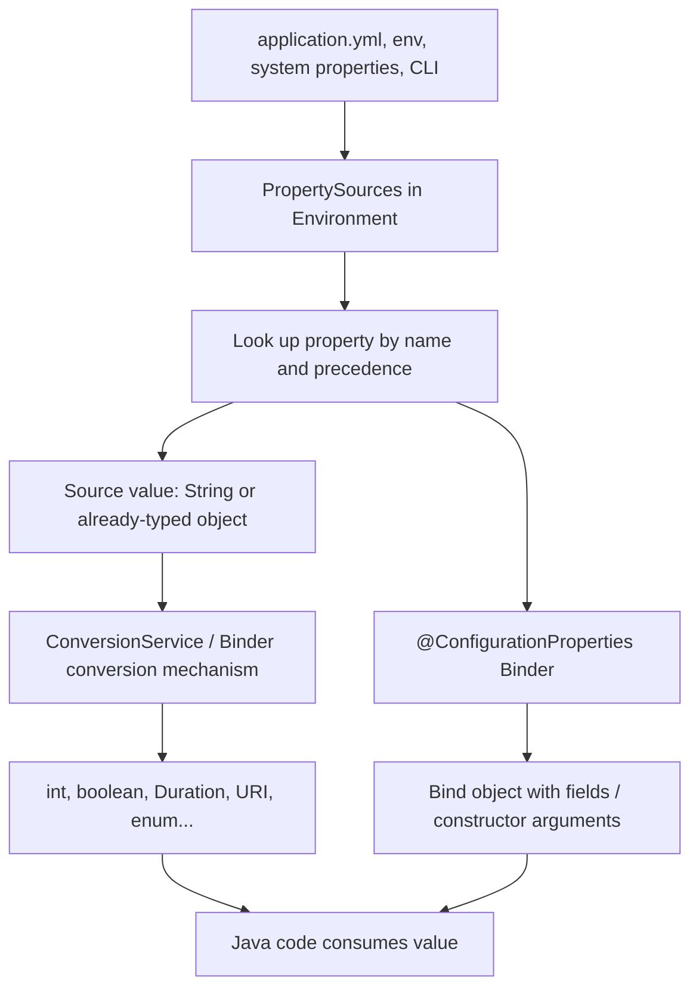

# Environment, ConversionService, and Converting Values to Target Types

> **Spring Boot Fundamentals · Resources and Data**  
> In a Spring Boot application, configuration data often starts as text: `server.port=8080`, `app.retry.delay=2s`, or `app.features.enabled=true`. Yet Java code wants `int`, `Duration`, `boolean`, `URI`, enums, or complex configuration objects. **`Environment` locates values across configuration sources; `ConversionService` converts a value to a target type; the Spring Boot Binder uses binding mechanics to assemble data into `@ConfigurationProperties` objects.** Understanding each role helps you write clean configuration, handle errors in the right place, and extend type conversion when needed.

## 1. The Big Picture: From Config Text to Java Types

Look at an `application.yml` file:

```yaml
app:
  worker:
    enabled: true
    max-jobs: 12
    poll-interval: 750ms
    endpoint: https://jobs.example.test
```

These values are read from YAML and placed into the configuration system. Meanwhile, code might expect:

- `enabled` as `boolean`.
- `maxJobs` as `int`.
- `pollInterval` as `Duration`.
- `endpoint` as `URI`.

Conceptually, the flow looks like this:



We should distinguish three concerns:

1. **Where to look:** which source holds the property and which source takes precedence?
2. **Which type to convert to:** can the retrieved value be converted into `Integer`, `Duration`, or a custom type?
3. **Where to attach it:** is the value returned directly, injected via `@Value`, or bound into a properties object?

These three questions are related, yet distinct.

## 2. What Is `Environment` Responsible For?

In Spring Framework, `Environment` provides access to the application's properties and active profiles. Spring injects it into components that need to read configuration.

Example:

```java
package com.example.jobs;

import org.springframework.core.env.Environment;
import org.springframework.stereotype.Component;

@Component
public class RuntimeSettings {

    private final Environment environment;

    public RuntimeSettings(Environment environment) {
        this.environment = environment;
    }

    public String workerEndpoint() {
        return environment.getProperty("app.worker.endpoint");
    }

    public boolean workerEnabled() {
        return environment.getProperty(
                "app.worker.enabled", Boolean.class, false);
    }

    public int maxJobs() {
        return environment.getProperty(
                "app.worker.max-jobs", Integer.class, 4);
    }
}
```

Here Spring injects `Environment` into the constructor. `getProperty` reads the value and, with the overload accepting `Class<T>`, requests conversion into the corresponding Java type.

### 2.1. Common ways to read properties

| Call | Meaning |
| --- | --- |
| `getProperty("app.name")` | Gets value as `String`; may return `null` |
| `getProperty("app.name", "default")` | Gets String, or uses default if absent |
| `getProperty("app.worker.max-jobs", Integer.class)` | Requests value as `Integer` |
| `getProperty("app.worker.max-jobs", Integer.class, 4)` | Requests `Integer` with default when missing |
| `getRequiredProperty("app.name")` | Requires property to exist; throws if missing |
| `getRequiredProperty("app.worker.max-jobs", Integer.class)` | Requires existence and successful type conversion |

The default value in `getProperty` overloads is not a new PropertySource. It is a fallback when no matching value is found.

### 2.2. PropertySource is the data source of Environment

`Environment` can hold multiple `PropertySource` entries:

- `application.properties` or `application.yml` files.
- Configuration files outside the JAR.
- OS environment variables.
- Java system properties.
- Command-line arguments.
- Test properties.
- Sources added programmatically by libraries or the application.

A `PropertySource` may supply Strings or already-typed objects. For instance, system properties usually store Strings, whereas a programmatic source might supply another object type. Thus "converting from String" is common, not a rule for every source.

### 2.3. Which value wins when multiple sources define the same key?

Suppose:

```yaml
# application.yml
app:
  worker:
    max-jobs: 8
```

Environment has:

```bash
export APP_WORKER_MAXJOBS=16
```

Launch command has:

```bash
java -jar jobs.jar --app.worker.max-jobs=20
```

Under Spring Boot's default precedence, command-line properties override the sources above, so the effective value is `20`. When calling:

```java
Integer value = environment.getProperty(
        "app.worker.max-jobs", Integer.class);
```

Spring first resolves the value across property sources, then converts the result to `Integer` if needed.

**Source precedence does not replace type conversion.** A winning source with invalid data will still cause the conversion step to fail.

### 2.4. Environment also manages profiles

`Environment` also reports active profiles:

```java
String[] profiles = environment.getActiveProfiles();
```

You can check a profile expression via the appropriate API:

```java
boolean production = environment.acceptsProfiles(
        Profiles.of("prod"));
```

Profiles affect loading profile-specific config data or activating `@Profile`. However, profiles are not a type conversion; they are configuration-selection metadata.

## 3. What Is `ConversionService`?

`ConversionService` is a Spring Framework abstraction for converting an object from a **source type** to a **target type**.

The interface exposes representative methods:

```java
<T> T convert(Object source, Class<T> targetType);

boolean canConvert(Class<?> sourceType, Class<?> targetType);
```

Simple example:

```java
ConversionService conversionService =
        new DefaultConversionService();

Integer jobs = conversionService.convert("12", Integer.class);
Boolean enabled = conversionService.convert("true", Boolean.class);
```

`"12"` is a String, and `jobs` is an Integer. `ConversionService` looks up a converter matching the source/target type pair, performs conversion, and returns the result.

### 3.1. Do not reimplement parsing the same type everywhere

Without a shared abstraction, many components end up writing:

```java
int jobs = Integer.parseInt(rawJobs);
boolean enabled = Boolean.parseBoolean(rawEnabled);
Duration delay = Duration.parse(rawDelay);
```

For simple types this can work. Yet when many places need to convert enums, durations, data sizes, or domain types, conversion logic gets duplicated with inconsistent rules.

`ConversionService` provides a centralized registry of shared conversion rules; framework components can leverage that registry in their respective contexts.

### 3.2. `Converter<S, T>`

The fundamental extension unit is:

```java
public interface Converter<S, T> {
    T convert(S source);
}
```

Where:

- `S` is the source type.
- `T` is the target type.
- `convert` defines the transformation.

Illustrative `String → Integer` converter:

```java
class PositiveIntegerConverter
        implements Converter<String, Integer> {

    @Override
    public Integer convert(String source) {
        int value = Integer.parseInt(source.trim());

        if (value <= 0) {
            throw new IllegalArgumentException(
                    "Value must be positive");
        }

        return value;
    }
}
```

This is an illustrative example; **do not register a global String → Integer converter just to validate one specific property**. That would affect other valid Integer conversions, such as a setting allowing `0`. Property-specific validation belongs near the properties model or business logic.

## 4. Spring Framework `DefaultConversionService` and Spring Boot `ApplicationConversionService`

Spring offers several conversion implementations and registries. Two familiar names:

| Component | Role |
| --- | --- |
| `DefaultConversionService` | Provides Spring Framework's common built-in converters |
| `ApplicationConversionService` | Spring Boot's conversion service, adding converters/formatters suited to Boot app config |
| `FormattingConversionService` | Combines conversion with formatting that can depend on formats or annotations |
| `Converter<S,T>` | Converts a single source/target type pair |
| `ConverterFactory<S,R>` | Creates converters for a family of related target types |
| `GenericConverter` | Supports flexible conversion based on metadata and multiple type pairs |

Basic conversion example:

```java
ConversionService springConversion =
        new DefaultConversionService();

Integer count = springConversion.convert("42", Integer.class);
Boolean active = springConversion.convert("true", Boolean.class);
```

With Spring Boot's familiar duration/size formats:

```java
ConversionService bootConversion =
        ApplicationConversionService.getSharedInstance();

Duration interval = bootConversion.convert(
        "750ms", Duration.class);

DataSize buffer = bootConversion.convert(
        "16MB", DataSize.class);
```

The example uses:

- `org.springframework.boot.convert.ApplicationConversionService`.
- `org.springframework.util.unit.DataSize`.
- `java.time.Duration`.

Support for syntaxes like `750ms` or `16MB` comes from Spring Boot's converters/formatters. Do not assume every plain Spring Framework `DefaultConversionService` instance includes those exact extensions.

### 4.1. ConversionService is the common API; the registry decides supported conversions

Two objects implementing `ConversionService` do not necessarily support the same conversions. For example, a newly instantiated conversion service with only a custom converter registered may lack Boot's default converters.

Before relying on a conversion, identify **which `ConversionService` is performing the conversion** and which converters are registered in it.

### 4.2. `canConvert` checks capability

```java
ConversionService service =
        ApplicationConversionService.getSharedInstance();

boolean supported = service.canConvert(
        String.class, Duration.class);
```

`canConvert` checks whether a matching conversion path is registered. It does not prove **every concrete value** is valid. A converter can accept Strings yet still throw an error on invalid content like `"abc-seconds"`.

### 4.3. ConversionService does not pick configuration sources

`ConversionService` takes an object and a target type. It does not decide whether a YAML file property overrides an environment variable. That belongs to `Environment`, `PropertySource`, and Config Data mechanics.

## 5. Resolve-Then-Convert Order When Using Environment

Suppose a configuration file contains:

```properties
app.worker.max-jobs=12
app.worker.enabled=true
app.worker.poll-interval=750ms
```

Code:

```java
Integer maxJobs = environment.getProperty(
        "app.worker.max-jobs", Integer.class);

Boolean enabled = environment.getProperty(
        "app.worker.enabled", Boolean.class);

Duration pollInterval = environment.getProperty(
        "app.worker.poll-interval", Duration.class);
```

In a Spring Boot application with an appropriately configured conversion service on `Environment`:

1. `Environment` looks up the key across property sources.
2. The highest-precedence source with a value wins.
3. If the value already matches the target type, conversion may be skipped.
4. Otherwise, the property resolver uses its configured conversion service.
5. The converted value is returned or a conversion error is raised.

### 5.1. Distinguish "missing" from "unconvertible"

Example:

```java
Integer count = environment.getProperty(
        "app.worker.max-jobs", Integer.class, 4);
```

If the property is **absent**, the default `4` is returned.

If the property **is present** with invalid content such as:

```properties
app.worker.max-jobs=many
```

the fallback `4` must not be expected to swallow a type-conversion failure. Converting `"many"` to `Integer` can throw an exception. Misconfigurations should be surfaced rather than silently running with an unintended value.

### 5.2. Required reads with `getRequiredProperty`

```java
URI endpoint = environment.getRequiredProperty(
        "app.worker.endpoint", URI.class);
```

If the key is missing, the resolver raises an error because a required property is absent. If present but unconvertible to a valid URI per the active converter, conversion fails accordingly.

This still does not replace business validation: a syntactically valid URI is not guaranteed to be a permitted endpoint.

### 5.3. Example error flow

```text
app.worker.max-jobs = "twelve"
        |
        v
Environment finds value
        |
        v
ConversionService attempts to create Integer
        |
        v
Cannot parse "twelve"
        |
        v
Conversion error (not a property-lookup error)
```

When debugging, ask: **was the wrong source selected, was the key missing, or was the right source selected but type conversion failed?** Each situation requires a different fix.

## 6. Converting Common Types

### 6.1. Strings and numbers

```properties
app.worker.max-jobs=12
app.worker.rate=0.75
```

Code:

```java
Integer maxJobs = environment.getProperty(
        "app.worker.max-jobs", Integer.class);

Double rate = environment.getProperty(
        "app.worker.rate", Double.class);
```

`"12"` must convert to an integer. Values like `"twelve"` are invalid. Different parsers handle whitespace or special numeric notations differently; avoid relying on undocumented details in configuration contracts.

If a property has range limits, such as `max-jobs` between 1 and 100, add separate validation.

### 6.2. Boolean

```properties
app.worker.enabled=true
```

```java
Boolean enabled = environment.getProperty(
        "app.worker.enabled", Boolean.class);
```

Spring's boolean converters support common text representations. Still, public configurations should encourage explicit `true` or `false` rather than expecting readers to know every alias a converter might accept.

### 6.3. Duration

```yaml
app:
  worker:
    poll-interval: 750ms
    shutdown-timeout: 5s
```

```java
Duration pollInterval = environment.getProperty(
        "app.worker.poll-interval", Duration.class);

Duration shutdownTimeout = environment.getProperty(
        "app.worker.shutdown-timeout", Duration.class);
```

Syntaxes like `750ms` and `5s` are Spring Boot's familiar duration style. With `@ConfigurationProperties`, Boot supports Duration binding and the `@DurationUnit` annotation to specify a default unit when values omit a suffix.

Example:

```java
@DurationUnit(ChronoUnit.SECONDS)
private Duration shutdownTimeout = Duration.ofSeconds(5);
```

This illustrates a field inside a properties class; import `org.springframework.boot.convert.DurationUnit` and `java.time.temporal.ChronoUnit`. For a suffix-less value like `5`, the unit follows the annotation within supported binding flows. The safest practice in config files is writing explicit units like `5s` or `750ms`.

### 6.4. DataSize

```yaml
app:
  worker:
    buffer-size: 16MB
```

When a `@ConfigurationProperties` class has a `DataSize` field, Boot converts text like `16MB` into `DataSize`. You can use `@DataSizeUnit` to control the default unit when a value is written as a bare number.

Example:

```java
private DataSize bufferSize = DataSize.ofMegabytes(16);
```

`DataSize` represents data sizes, whereas `Duration` represents time spans. Avoid representing either as unitless `long` values if that makes configuration ambiguous for readers.

### 6.5. Enum

```java
public enum ProcessingMode {
    INLINE,
    QUEUED
}
```

And:

```yaml
app:
  worker:
    mode: queued
```

With Boot's Binder, enums can bind from matching text representations. If a user supplies an unknown value like `unknown`, binding fails unless a custom converter handles it.

Enums are helpful when the set of values is fixed and you want compiler checking across business branches.

### 6.6. URI, URL, and other types

```yaml
app:
  worker:
    endpoint: https://jobs.example.test/api
```

```java
URI endpoint = environment.getProperty(
        "app.worker.endpoint", URI.class);
```

URI conversion checks syntactic address structure. It does not verify that the service exists, certificates are valid, DNS resolves, or the domain is permitted. Those checks belong to business validation and connection logic.

## 7. `@ConfigurationProperties`: When You Need Many Typed Values

Reading individual properties from `Environment` is handy for a few keys. When a config group has dozens of settings, use `@ConfigurationProperties`.

### 7.1. Properties object

```java
package com.example.jobs.config;

import java.net.URI;
import java.time.Duration;

import org.springframework.boot.context.properties.ConfigurationProperties;

@ConfigurationProperties(prefix = "app.worker")
public class WorkerProperties {

    private boolean enabled = true;
    private int maxJobs = 4;
    private Duration pollInterval = Duration.ofSeconds(1);
    private URI endpoint;

    public boolean isEnabled() {
        return enabled;
    }

    public void setEnabled(boolean enabled) {
        this.enabled = enabled;
    }

    public int getMaxJobs() {
        return maxJobs;
    }

    public void setMaxJobs(int maxJobs) {
        this.maxJobs = maxJobs;
    }

    public Duration getPollInterval() {
        return pollInterval;
    }

    public void setPollInterval(Duration pollInterval) {
        this.pollInterval = pollInterval;
    }

    public URI getEndpoint() {
        return endpoint;
    }

    public void setEndpoint(URI endpoint) {
        this.endpoint = endpoint;
    }
}
```

Registering the properties bean:

```java
@SpringBootApplication
@ConfigurationPropertiesScan
public class JobsApplication {

    public static void main(String[] args) {
        SpringApplication.run(JobsApplication.class, args);
    }
}
```

Or in a specific configuration class:

```java
@Configuration(proxyBeanMethods = false)
@EnableConfigurationProperties(WorkerProperties.class)
class WorkerConfiguration {
}
```

Both approaches tell Spring Boot to register the configuration object and bind matching keys. Simply annotating a class with `@ConfigurationProperties` does not automatically register it as a bean in the context.

### 7.2. Using it in a service

```java
@Service
public class WorkerService {

    private final WorkerProperties properties;

    public WorkerService(WorkerProperties properties) {
        this.properties = properties;
    }

    public int concurrencyLimit() {
        return properties.getMaxJobs();
    }
}
```

Service code does not care whether properties came from YAML, environment variables, or system properties. It depends on a strongly typed object.

### 7.3. Comparing Environment and Binder

| Approach | Best when | Limitations |
| --- | --- | --- |
| `Environment.getProperty("key")` | Reading a few keys or checking presence | Key strings scattered everywhere, manual reads |
| `Environment.getProperty("key", Type.class)` | Needing a few typed values | Does not group multiple fields into an object |
| `@Value("${key}")` | Injecting a single standalone property | Configuration spreads across many beans |
| `@ConfigurationProperties` | A structured group of settings | Requires a model class and bean registration |
| `Binder` API | Binding programmatically without a properties bean | Requires understanding bind lifecycle, sources, and conversion service |

When designing modules or starters, `@ConfigurationProperties` is usually easier to test, document, and surface via IDE metadata than manually reading dozens of keys.

## 8. How Spring Boot `Binder` Coordinates with ConversionService

`Binder` does more than parse a single standalone value. It also:

1. Accepts multiple prioritized configuration sources.
2. Identifies keys matching a prefix.
3. Maps config names to Java properties via relaxed binding rules.
4. Converts each value to the field or constructor parameter type.
5. Instantiates or populates the target object.
6. Reports bind errors and triggers validation if configured.

YAML example:

```yaml
app:
  worker:
    max-jobs: 12
    poll-interval: 750ms
```

With `WorkerProperties`:

- `max-jobs` maps to `maxJobs`.
- `"12"` converts to `int`.
- `poll-interval` maps to `pollInterval`.
- `"750ms"` converts to `Duration`.

If a configuration contains `List<URI>` or `Map<String, Duration>`, `Binder` also converts elements and manages the data structure.

### 8.1. Do not equate Binder and ConversionService

`ConversionService` handles **converting from type S to type T**. `Binder` handles **mapping multiple configuration keys into fields, lists, maps, and constructor arguments of an object**.

`Binder` uses registered conversion services or converters during binding, while also performing structural work outside the `ConversionService` API.

### 8.2. Relaxed binding

With prefix `app.worker` and field `maxJobs`, Boot's Binder accepts several property-name variants.

Canonical name example:

```properties
app.worker.max-jobs=12
```

Typical environment variable name:

```bash
export APP_WORKER_MAXJOBS=12
```

Converting from canonical property names to env vars generally uppercases characters, replaces dots with underscores, and removes hyphens inside compound words. Do not assume arbitrary character variations work identically across every API. `@ConfigurationProperties` has a well-defined relaxed binding model compared to raw String key lookups in other APIs.

### 8.3. Lists and maps have distinct source-merging rules

When multiple property sources define a list, `Binder` typically uses the list from the higher-precedence source rather than concatenating elements. Maps can merge keys across sources, with higher-precedence sources overriding matching keys.

These are **structural binding rules**, not ordinary `String → T` converters. If list items disappear when switching profiles, inspect property sources and Binder rules before touching `ConversionService`.

## 9. Using `@Value` and Distinguishing Conversion Paths

Another way to inject values is `@Value`:

```java
@Component
public class QueueClient {

    private final int maxJobs;

    public QueueClient(
            @Value("${app.worker.max-jobs:4}") int maxJobs) {
        this.maxJobs = maxJobs;
    }
}
```

Spring resolves the placeholder and converts the value to the constructor parameter type when an appropriate converter exists.

### 9.1. `@Value` is not equivalent to `@ConfigurationProperties` in every aspect

`@ConfigurationProperties` is built for externalized configuration, relaxed binding, nested structures, and Boot-specific conversions.

`@Value` is Spring's general injection mechanism supporting placeholders and SpEL:

```java
@Value("${app.worker.enabled:true}")
private boolean enabled;
```

```java
@Value("#{2 * 4}")
private int calculated;
```

These two expressions use different mechanisms: `${...}` is a property placeholder, while `#{...}` is Spring Expression Language.

Do not assume every relaxed binding feature or every `@ConfigurationPropertiesBinding` converter automatically applies identically to every `@Value` site.

### 9.2. Use canonical names in placeholders

Prefer:

```java
@Value("${app.worker.max-jobs:4}")
private int maxJobs;
```

over hard-to-follow variant spellings. Canonical kebab-case syntax lets Spring Boot work more consistently with property names and Environment aliases.

### 9.3. When is `@Value` enough?

A bean needing one short, standalone property can use `@Value`. When multiple related settings exist—such as timeout, retries, endpoint, credentials, mode, and buffer size—group them into `@ConfigurationProperties` for easier testing, validation, and management.

## 10. Creating Custom Domain-Specific Configuration Types

Sometimes standard Java types do not express domain intent clearly. Suppose an application deploys across three regions:

- `APAC`.
- `EMEA`.
- `AMER`.

We want properties:

```yaml
client:
  region: apac
  connect-timeout: 2s
```

to bind into `RegionCode` instead of an unconstrained String.

### 10.1. Domain type

```java
package com.example.jobs.config;

import java.util.Locale;
import java.util.Set;

public record RegionCode(String value) {

    private static final Set<String> ALLOWED =
            Set.of("APAC", "EMEA", "AMER");

    public static RegionCode parse(String raw) {
        if (raw == null || raw.isBlank()) {
            throw new IllegalArgumentException(
                    "Region must not be blank");
        }

        String normalized = raw.trim()
                .toUpperCase(Locale.ROOT);

        if (!ALLOWED.contains(normalized)) {
            throw new IllegalArgumentException(
                    "Unsupported region: " + raw);
        }

        return new RegionCode(normalized);
    }
}
```

This type enforces an invariant: when created via `parse`, the value always belongs to the allowed region set. In real apps, an enum also works if the fixed set needs no custom domain wrapper.

### 10.2. Converter from String to RegionCode

```java
package com.example.jobs.config;

import org.springframework.core.convert.converter.Converter;

public final class RegionCodeConverter
        implements Converter<String, RegionCode> {

    @Override
    public RegionCode convert(String source) {
        return RegionCode.parse(source);
    }
}
```

The converter does a single job: turning a String into `RegionCode`. It knows nothing about which file holds `client.region` or which profile is active.

### 10.3. Registering a converter for `@ConfigurationProperties`

In Spring Boot, register a property-binding converter with `@ConfigurationPropertiesBinding`:

```java
package com.example.jobs.config;

import org.springframework.boot.context.properties.ConfigurationPropertiesBinding;
import org.springframework.context.annotation.Bean;
import org.springframework.context.annotation.Configuration;
import org.springframework.core.convert.converter.Converter;

@Configuration(proxyBeanMethods = false)
public class RegionConversionConfiguration {

    @Bean
    @ConfigurationPropertiesBinding
    static Converter<String, RegionCode> regionCodeConverter() {
        return new RegionCodeConverter();
    }
}
```

Key takeaways:

- `@Bean` registers the converter as a Spring bean.
- `@ConfigurationPropertiesBinding` marks the converter for Boot's property-binding mechanism.
- `static` lets Spring create the converter bean without prematurely instantiating the configuration class; this is recommended because the Binder may require converters very early.
- The converter applies to the property-binding scope, not automatically as a global rule in every `ConversionService` across every context.

Never inject complex services, databases, or HTTP clients into a converter used for property binding. Binding can happen very early before the full bean graph is ready.

### 10.4. Properties record using the domain type

```java
package com.example.jobs.config;

import java.time.Duration;

import org.springframework.boot.context.properties.ConfigurationProperties;
import org.springframework.boot.context.properties.bind.DefaultValue;

@ConfigurationProperties(prefix = "client")
public record ClientSettings(
        RegionCode region,
        @DefaultValue("3s") Duration connectTimeout
) {
}
```

Registration:

```java
@Configuration(proxyBeanMethods = false)
@EnableConfigurationProperties(ClientSettings.class)
public class ClientConfiguration {
}
```

With `client.region=apac`, the Binder picks the `String → RegionCode` converter and produces `RegionCode("APAC")`. With `client.connect-timeout=2s`, Boot binds the matching Duration.

In a record, if `region` is omitted and there is no additional validation/checking, the value may be null depending on binding mechanics and config. If `region` is required, express that via validation or appropriate constructor invariants.

### 10.5. When conversion fails

If YAML contains:

```yaml
client:
  region: mars
```

`RegionCode.parse("mars")` throws `IllegalArgumentException`. During property binding, Spring Boot wraps the failure in a bind error carrying context about the property and target type. Exact details depend on the Boot version and exception chain.

Failing here is the desired behavior for bad values. Never silently coerce `mars` into `APAC`, as that could run the application against an unintended region.

## 11. Different Converter Registration Strategies

There is no single registration path for converters. Choose based on the **usage context**.

### 11.1. Converter dedicated to `@ConfigurationProperties`

Use `@ConfigurationPropertiesBinding` on a properly registered bean or component. This cleanly adds domain conversions for Boot's Binder without altering every conversion service in the framework.

### 11.2. Converter for Spring MVC or web data binding

In a Spring MVC app, add converters for request parameters, path variables, and form binding via `WebMvcConfigurer`:

```java
@Configuration(proxyBeanMethods = false)
public class WebConversionConfiguration
        implements WebMvcConfigurer {

    @Override
    public void addFormatters(FormatterRegistry registry) {
        registry.addConverter(new RegionCodeConverter());
    }
}
```

This serves conversion/formatting in the web MVC context. It does not register the converter for Boot's `@ConfigurationProperties` Binder.

A controller-parameter converter and an external-configuration converter can reuse the same `RegionCodeConverter` class, yet **registering in one registry does not expose it to every other registry**.

### 11.3. Converter for a standalone ConversionService

```java
DefaultConversionService service =
        new DefaultConversionService();

service.addConverter(new RegionCodeConverter());

RegionCode code = service.convert(
        "emea", RegionCode.class);
```

This is a locally created registry. It does not modify the `Environment` or `ApplicationContext` Binder.

It is useful when an independent data-processing library wants explicit control over its own conversions.

### 11.4. A bean named `conversionService`

Spring Boot allows defining a `ConversionService` bean named `conversionService` to customize certain configuration conversion behaviors. However, this conversion service may be requested **very early** in the lifecycle. Defining it carelessly can:

- Lose default Boot converters/formatters.
- Fail due to unready dependencies.
- Alter type conversion behavior across many properties at once.
- Leak a custom converter's behavior beyond its intended scope.

For a custom domain type in `@ConfigurationProperties`, prefer a converter marked with `@ConfigurationPropertiesBinding`. Only replace the shared conversion service when you have a clear goal and scope.

### 11.5. Do not confuse a Converter bean with its active scope

A `Converter<String, RegionCode>` can exist as a bean in the context without every `ConversionService` in the program automatically picking it up.

Verify how the specific framework subsystem discovers converter beans and how you registered yours. `@ConfigurationPropertiesBinding` targets Boot's Binder; `WebMvcConfigurer.addFormatters` targets MVC.

## 12. Do Formatting and Conversion Differ?

They are related, yet worth distinguishing.

**Conversion**: changing one data type to another, such as `String → Integer` or `String → RegionCode`.

**Formatting**: rendering an object as text or parsing text per formatting rules, sometimes tied to locale, annotations, or patterns—such as dates, currencies, or localized numbers.

In Spring Framework:

- `Converter` suits general type transformations.
- `Formatter<T>` supports parsing/printing with a `Locale`.
- `FormattingConversionService` combines converters and formatters.
- Annotations like `@DateTimeFormat` and `@NumberFormat` participate in formatting in supported framework contexts.

### 12.1. Why avoid Locale-dependent date parsing in configuration?

Suppose config specifies an expiration date:

```properties
app.campaign.end-date=2026-12-31
```

Using an explicit ISO date format is much safer to operate than a locale-dependent format like `31/12/26`. In external configuration, machine-verifiable conventions prevent month/day ambiguity.

If a custom format is truly needed, document it explicitly and add appropriate converters/validation; never assume IDEs or the Binder understand arbitrary user-invented date formats.

## 13. How Does Validation Differ from Conversion?

Conversion answers: "Can this value be converted into the target type?"

Validation answers: "Is the converted value valid under business/system rules?"

Example:

```properties
app.worker.max-jobs=-5
```

`-5` converts cleanly into `Integer`. Yet `-5` is invalid if the maximum job count must be at least 1.

### 13.1. Bean Validation with `@ConfigurationProperties`

```java
package com.example.jobs.config;

import jakarta.validation.constraints.Max;
import jakarta.validation.constraints.Min;

import org.springframework.boot.context.properties.ConfigurationProperties;
import org.springframework.validation.annotation.Validated;

@Validated
@ConfigurationProperties(prefix = "app.worker")
public class WorkerLimits {

    @Min(1)
    @Max(100)
    private int maxJobs = 4;

    public int getMaxJobs() {
        return maxJobs;
    }

    public void setMaxJobs(int maxJobs) {
        this.maxJobs = maxJobs;
    }
}
```

When the project has a compatible Bean Validation implementation and properties are registered/bound via Boot, validation catches `max-jobs=-5`.

Conceptually, the steps occur in order:

1. Resolve property.
2. Convert to `int`.
3. Bind to `maxJobs`.
4. Check `@Min` and `@Max`.

If the value is `"many"`, conversion fails before numeric validation can run. If the value is `-5`, conversion succeeds while validation fails.

### 13.2. Deciding where rules belong

| Rule | Mechanism to consider |
| --- | --- |
| `"12"` to Integer | Built-in converter |
| `"2s"` to Duration | Boot converter/formatter |
| `"apac"` to RegionCode | Custom Converter |
| Integer must be between 1 and 100 | Validation |
| URI must use HTTPS | Validation or business logic |
| Server endpoint present yet credential missing | Cross-field validation or startup check |
| Whether another source overrides a property | Environment/PropertySources, not Converter |

Separating responsibilities makes errors easier to diagnose and reduces coupling.

## 14. Converting Lists, Maps, and Generic Types

`ConversionService.convert(Object, Class<T>)` fits simple target types. For generics like `List<URI>` or `Map<String, Duration>`, passing only `List.class` loses element type information.

Spring provides `TypeDescriptor` and advanced overloads to describe generic source/target types when needed:

```java
List<String> values =
        List.of("1", "2", "3");

TypeDescriptor sourceType = TypeDescriptor
        .collection(List.class, TypeDescriptor.valueOf(String.class));

TypeDescriptor targetType = TypeDescriptor
        .collection(List.class, TypeDescriptor.valueOf(Integer.class));

Object result = conversionService.convert(
        values, sourceType, targetType);
```

This illustrates collection conversion in a conversion service with matching converters. To consume the result as `List<Integer>`, check/cast types appropriately as needed.

For external configuration, `@ConfigurationProperties` Binder is usually better because it reads field types, nested objects, and generic element types straight from the properties class.

### 14.1. Do not call `getProperty("app.items", List.class)` expecting full structural binding

A key may be a YAML list, but how YAML flattens into config property names and how a single-key resolver reads directly do not match how Binder constructs `List<T>` from indexed keys.

Example:

```yaml
app:
  endpoints:
    - https://one.example
    - https://two.example
```

Use a properties class:

```java
@ConfigurationProperties(prefix = "app")
public class AppEndpoints {

    private List<URI> endpoints = new ArrayList<>();

    public List<URI> getEndpoints() {
        return endpoints;
    }

    public void setEndpoints(List<URI> endpoints) {
        this.endpoints = endpoints;
    }
}
```

Binder handles indexed names and converts each element to `URI`. Do not turn a single conversion call into a homemade binder.

### 14.2. Converters focus on a single value; Binder focuses on structure

If you need `String → RegionCode` for each element of `List<RegionCode>`, register the element converter. Binder uses collection type metadata to convert each element through the binding pipeline.

This is why pairing `@ConfigurationProperties` with typed converters is cleaner than manually splitting strings and parsing repeatedly.

## 15. When Should You Use `Environment` Directly?

Reading `Environment` is not wrong. It fits situations such as:

- Framework or infrastructure code needing a few dynamic keys.
- A custom `Condition` checking a property during configuration processing.
- An integration needing fallback keys at startup.
- Debugging which value is being resolved.
- No stable config object exists to define a properties model.

Example inside a condition:

```java
public final class RegionEnabledCondition implements Condition {

    @Override
    public boolean matches(
            ConditionContext context,
            AnnotatedTypeMetadata metadata) {

        return "apac".equalsIgnoreCase(
                context.getEnvironment()
                        .getProperty("app.region"));
    }
}
```

Note: a `Condition` runs early and must not call databases, build HTTP clients, or require beans not yet ready. If you only check a boolean/string property, `@ConditionalOnProperty` is usually clearer than a custom `Condition`.

### 15.1. Downsides of reading Environment directly inside business services

When `Environment.getProperty` spreads across dozens of services:

- Key strings duplicate and become hard to rename consistently.
- Defaults get scattered everywhere.
- Tests must set many individual keys.
- Validation lacks a centralized home.
- IDEs cannot track the config contract as easily as `@ConfigurationProperties`.

When properties form business configuration with a stable schema, grouping them into a properties object is much easier to maintain.

## 16. Inspecting Which ConversionService Is Being Used

A common debugging issue is creating a converter while the app still complains it cannot convert the value.

First trace the data path:

| Where conversion happens | Mechanism to inspect |
| --- | --- |
| `Environment.getProperty(key, Type.class)` | Property resolver and Environment's conversion service |
| `@ConfigurationProperties` | Boot Binder and configuration-properties converters |
| `@Value` | Placeholder resolution and bean factory type conversion |
| Spring MVC `@RequestParam` / `@PathVariable` | Web MVC conversion/formatting registry |
| WebFlux request binding | WebFlux conversion/binding stack |
| Manual `conversionService.convert(...)` | The exact ConversionService instance passed in |

Do not expect registering a converter in MVC to fix Binder errors, or registering one for Binder to automatically affect every `@Value`. Although they share Spring's conversion abstraction, subsystems can maintain separate registries.

### 16.1. Reading failure logs carefully

When startup fails, error messages may show:

- The property name being bound.
- The source value (potentially masked if secret).
- The expected Java type.
- The properties class name.
- Deeper causes like `NumberFormatException` or `IllegalArgumentException`.

Related exceptions can include `ConversionFailedException`, `ConverterNotFoundException`, and Spring Boot's `BindException`, depending on the execution path.

Never rely solely on the top-level exception name. Read the cause chain and context: did the failure occur at property source lookup, conversion, structural binding, or validation?

### 16.2. Never log secrets to inspect sources

Properties like `payment.api-key` or `spring.datasource.password` may come from environment variables or secret managers. Do not print raw values to debug a Converter. When diagnostics are needed, log the property name, general source, and target class while masking sensitive values.

Spring Boot Actuator exposes `env` and `configprops` in environments where Actuator and those endpoints are enabled/exposed, though you must secure access and control how sensitive values are sanitized.

## 17. Testing Type Conversion in Spring Boot

You can unit-test a converter alone and integration-test the binder; they verify two different things.

### 17.1. Unit testing a Converter

```java
import static org.assertj.core.api.Assertions.assertThat;
import static org.assertj.core.api.Assertions.assertThatThrownBy;

import org.junit.jupiter.api.Test;

class RegionCodeConverterTest {

    private final RegionCodeConverter converter =
            new RegionCodeConverter();

    @Test
    void parsesRegionCaseInsensitively() {
        RegionCode result = converter.convert("apac");

        assertThat(result.value()).isEqualTo("APAC");
    }

    @Test
    void rejectsUnsupportedRegion() {
        assertThatThrownBy(() -> converter.convert("mars"))
                .isInstanceOf(IllegalArgumentException.class)
                .hasMessageContaining("Unsupported region");
    }
}
```

This test proves the `String → RegionCode` logic inside the converter class, yet **does not prove** the converter is registered with Spring Boot Binder.

### 17.2. Testing binding with `ApplicationContextRunner`

```java
import static org.assertj.core.api.Assertions.assertThat;

import org.junit.jupiter.api.Test;
import org.springframework.boot.test.context.runner.ApplicationContextRunner;

class ClientSettingsBindingTest {

    private final ApplicationContextRunner runner =
            new ApplicationContextRunner()
                    .withUserConfiguration(
                            RegionConversionConfiguration.class,
                            ClientConfiguration.class);

    @Test
    void bindsCustomRegionAndDuration() {
        runner.withPropertyValues(
                "client.region=apac",
                "client.connect-timeout=2s"
        ).run(context -> {
            assertThat(context).hasNotFailed();

            ClientSettings settings =
                    context.getBean(ClientSettings.class);

            assertThat(settings.region().value()).isEqualTo("APAC");
            assertThat(settings.connectTimeout())
                    .isEqualTo(Duration.ofSeconds(2));
        });
    }
}
```

This test simulates a minimal context with the converter configuration and properties bean. If the converter is not discovered properly, this test catches the integration configuration mistake.

### 17.3. Testing invalid type values

```java
@Test
void failsWhenRegionCannotBeConverted() {
    runner.withPropertyValues(
            "client.region=mars",
            "client.connect-timeout=2s"
    ).run(context -> {
        assertThat(context).hasFailed();
    });
}
```

This verifies the context fails to start when the property is invalid. In a real test suite, check the root cause or binding error at a level that is not overly brittle to wording changes across framework versions.

### 17.4. Testing with overriding sources

Test a properties class receiving values from default config data and test properties:

```java
runner.withPropertyValues(
        "client.region=emea",
        "client.connect-timeout=5s"
)
```

Verify that bound values change with the supplied test context properties. This helps separate precedence bugs from converter bugs.

## 18. Common Issues and How to Handle Them

| Symptom | Possible cause | How to investigate |
| --- | --- | --- |
| `getProperty(key)` returns `null` | Missing key, mismatched name, or source not loaded | Check key and PropertySources |
| `getProperty(key, Integer.class)` throws | Value cannot convert to Integer | Inspect raw value and converter |
| Value converts yet violates business rules | Conversion is not validation | Add explicit validation |
| `Duration` fails to accept `750ms` | Used a ConversionService without Boot converters | Inspect instance/registry and ApplicationConversionService |
| Custom converter works standalone but not in `@ConfigurationProperties` | Converter not registered for Binder | Check `@ConfigurationPropertiesBinding` and lifecycle |
| Converter only works in controllers | Registered in MVC registry, not Binder | Separate scopes cleanly |
| `conversionService` bean causes startup error | Initialized too early or missing built-in converters | Avoid global bean when only one converter is needed |
| `@Value` does not bind like `@ConfigurationProperties` | Two APIs have different semantics | Use Binder for complex config groups |
| `List<URI>` cannot be read via simple `getProperty(..., List.class)` | Resolver does not bind indexed structures like Binder | Use `@ConfigurationProperties` |
| Typed key correctly yet got value from elsewhere | Higher-precedence source is overriding it | Inspect Environment/Actuator |
| Valid String parses as URI yet endpoint fails | Type conversion does not test connectivity | Check endpoint and networking separately |
| Negative number binds into `int` | Type conversion succeeded, missing validation | Add `@Min` or invariant |
| Properties bean missing | `@ConfigurationProperties` class not registered | Check scanning or `@EnableConfigurationProperties` |
| Converter causes dependency cycle | Converter pulls heavy dependencies during early bind | Drop dependencies, use static bean |
| Config property has a default yet still fails | Higher-precedence source sets an invalid value | Inspect property source and conversion error |

### 18.1. Do not mask conversion errors with arbitrary fallbacks

If a property configuring job count is `many`, the app should fail clearly instead of silently running with default `4`. Fallbacks are only reasonable when a property is **absent** and the app defines a valid default.

For critical system settings—endpoints, timeouts, retries, deployment regions, or credentials—failing fast is much safer when values are mistyped.

### 18.2. Keep business logic out of custom converters

A good converter typically:

- Has clear input and output.
- Makes no database or HTTP calls.
- Does not rely on mutable runtime state.
- Does not silently swallow invalid data.
- Is easy to unit-test.
- Produces helpful error messages without exposing secrets.

If cross-field checks are needed, add validation on the properties object. If data must be fetched from external systems, do it in the service layer rather than inside a bootstrap-time converter.

## 19. Practice Exercise: Tracing and Extending Type Conversion

Goal: complete a small application that reads worker config, converts values to proper types, and uses custom `RegionCode`.

### Step 1 — Create source configuration

```yaml
app:
  worker:
    enabled: true
    max-jobs: 8
    poll-interval: 750ms
    endpoint: https://jobs.example.test

client:
  region: apac
  connect-timeout: 2s
```

### Step 2 — Read directly from Environment

Inject `Environment` and read:

```java
Boolean enabled = environment.getProperty(
        "app.worker.enabled", Boolean.class);

Integer maxJobs = environment.getProperty(
        "app.worker.max-jobs", Integer.class);

Duration delay = environment.getProperty(
        "app.worker.poll-interval", Duration.class);
```

Observe the resulting Java types and values.

### Step 3 — Override from command line

Run:

```bash
java -jar jobs.jar \
  --app.worker.max-jobs=16 \
  --app.worker.poll-interval=2s
```

Verify `Environment` returns `16` and `Duration.ofSeconds(2)` when conversion is configured properly.

### Step 4 — Test an unconvertible value

Run with:

```bash
java -jar jobs.jar --app.worker.max-jobs=many
```

Observe the conversion error. Distinguish between an absent property (which can fall back to default) and a present property with an invalid value (conversion failure).

### Step 5 — Group properties into `@ConfigurationProperties`

Create `WorkerProperties` as in section 7. Register with `@ConfigurationPropertiesScan` or `@EnableConfigurationProperties`, then inject into a service.

Compare the number of raw key strings you had to maintain with `Environment` against the properties object.

### Step 6 — Create a domain Converter

Write `RegionCode` and `RegionCodeConverter` as in section 10. Unit-test both `apac` and invalid `mars`.

### Step 7 — Register the converter for Binder

Create a `Converter<String, RegionCode>` bean annotated with `@ConfigurationPropertiesBinding`, using `static @Bean` to avoid unnecessary early initialization.

Write `ClientSettings` with a `RegionCode region` field or record component.

### Step 8 — Test with `ApplicationContextRunner`

Verify:

- `client.region=apac` binds to `RegionCode("APAC")`.
- `client.connect-timeout=2s` binds to a 2-second Duration.
- `client.region=mars` causes binding to fail.
- When a required region is missing and validation is configured, the error is caught.

### Step 9 — Add validation

Constrain `maxJobs` between 1 and 100, then compare:

- `max-jobs=many`: type conversion error.
- `max-jobs=-5`: valid int type, validation error.
- `max-jobs=10`: both conversion and validation succeed.

### Step 10 — Compare converter contexts

Register `RegionCodeConverter` separately in a `DefaultConversionService` and call `convert("apac", RegionCode.class)`. Then observe the Binder converter registered via its own mechanism. Explain why both can reuse the same class without automatically sharing registries.

### Self-check questions

1. Which two prominent responsibilities does `Environment` have beyond reading a properties file?
2. When the same key appears in env and CLI, what determines the winning value?
3. How does `ConversionService` accept inputs and target types?
4. When does `getProperty("key", Integer.class, 4)` return `4`?
5. Why shouldn't `"many"` silently fall back to the default integer?
6. How does `DefaultConversionService` differ from `ApplicationConversionService`?
7. Why can't you assume every `DefaultConversionService` understands `750ms`?
8. What does `@ConfigurationProperties` Binder do beyond converting one String to a target type?
9. Do `@Value` and `@ConfigurationProperties` share identical relaxed-binding semantics?
10. How must a `Converter<String, RegionCode>` bean be registered for Boot's Binder to see it?
11. Why does `@ConfigurationPropertiesBinding` differ in scope from `WebMvcConfigurer.addFormatters`?
12. Why are binding converters instantiated very early?
13. Why avoid injecting HTTP clients or databases into custom Converters?
14. Does `@Min(1)` check data type or business rules?
15. Why is `List.class` insufficient to describe `List<URI>`?
16. If a URI parses cleanly yet the endpoint fails DNS resolution, is that a conversion error or a networking error?
17. If a property exists yet yields an unexpected value, should you check `PropertySources` or converters first?
18. When should you inject `Environment` directly vs creating a properties model?

## 20. Quick Reference Cheat Sheet

| Situation | Appropriate component |
| --- | --- |
| Determining configuration sources and active profiles | `Environment` |
| Managing multiple sources and precedence | `PropertySources` |
| Reading a String from config | `Environment.getProperty(key)` |
| Reading a typed value | `Environment.getProperty(key, Type.class)` |
| Converting an object from source type to target type | `ConversionService` |
| Converting Strings to standard Integer/Boolean | `DefaultConversionService` or appropriate default converters |
| Converting Boot formats like `750ms`, `16MB` | `ApplicationConversionService` / Boot Binder |
| Binding multiple keys into an object with fields/constructors | `@ConfigurationProperties` and Binder |
| Converting values into a domain type | `Converter<String, DomainType>` |
| Converter dedicated to Boot properties binding | `@ConfigurationPropertiesBinding` |
| Converter for Spring MVC request values | `WebMvcConfigurer.addFormatters` |
| Needing locale/format-aware conversion | `FormattingConversionService` or `Formatter` |
| Enforcing numbers fall within valid bounds | Bean Validation / invariants |
| Property overridden by another source | `Environment` and `PropertySource` order |
| Properties bean not created | Check scanning/registration |
| Unit-testing custom converter logic alone | Unit test |
| Testing integrated binding | `ApplicationContextRunner` |

**Bottom line:** `Environment` locates and resolves configuration; `ConversionService` supplies type conversions; Spring Boot's Binder populates converted values into `@ConfigurationProperties` objects. When a value goes wrong, determine whether the fault lies in the **data source**, **conversion rule**, **binding structure**, or **business validation**. Placing each responsibility in the right layer keeps application configuration readable, extensible, and predictable in deployment.
