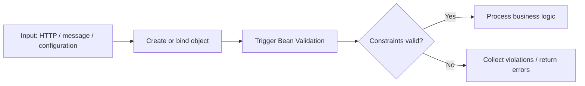

# Bean Validation, Constraint Annotations, and What Should Be Validated

In a Spring Boot application, data can enter the system through HTTP requests, messages, files, configuration properties, or calls between services. Before executing business logic and persisting data, the application needs to confirm that the data **meets minimum rules**: a name is not empty, an email has a valid format, a quantity is greater than 0, an end date does not precede a start date, or every element in a list is valid.

Manually writing repetitive `if` statements in controllers leads to duplicated logic and hard-to-maintain code. **Jakarta Bean Validation** provides a declarative annotation-based model for rules, and Spring Boot integrates this mechanism with request binding, beans, and several other components.

This lesson focuses on three questions:

1. **What should be validated?** DTOs, forms, nested objects, collection elements, service inputs, or application configuration?
2. **What condition does each constraint annotation express?** When to use `@NotNull`, `@NotBlank`, `@Size`, `@Positive`, `@Email`, and other constraints?
3. **When does validation actually execute?** Declaring annotations alone is not enough; there must be an activation point such as `@Valid`, `@Validated`, method validation, or calling `Validator`.

## 1. What Is Bean Validation?

Bean Validation is a Java standard for declaring and enforcing **constraints** on object data. In modern Spring Boot, the API lives under the `jakarta.validation` namespace.

A constraint typically consists of:

- **Annotation:** describes the condition that must hold, e.g., `@NotBlank`.
- **Validator:** executes the validation logic for the constraint.
- **Violation:** details about the violated constraint, property path, and error message.
- **Trigger point:** where validation is instructed to run.

Example:

```java
import jakarta.validation.constraints.Email;
import jakarta.validation.constraints.NotBlank;

public record RegisterUserRequest(
        @NotBlank String username,
        @Email @NotBlank String email
) {
}
```

The annotations declare a contract:

- `username` must not be `null`, empty, or whitespace-only.
- `email` must not be blank and must satisfy the validator's email rule.

However, a Java object constructed manually like `new RegisterUserRequest("", "invalid")` **does not automatically throw an error merely because annotations exist**. Constraints are only evaluated when the system invokes a validator or a Spring integration triggers validation.

### 1.1. Overall architecture



Validation keeps input data valid according to a defined contract. It does not replace authentication, authorization, transactions, database uniqueness checks, or complex business rules requiring external state.

## 2. Adding the Dependency in Spring Boot

For modern Spring Boot projects, the standard dependency is `spring-boot-starter-validation`.

Gradle Groovy DSL:

```groovy
dependencies {
    implementation 'org.springframework.boot:spring-boot-starter-validation'
}
```

Gradle Kotlin DSL:

```kotlin
dependencies {
    implementation("org.springframework.boot:spring-boot-starter-validation")
}
```

Maven:

```xml
<dependency>
    <groupId>org.springframework.boot</groupId>
    <artifactId>spring-boot-starter-validation</artifactId>
</dependency>
```

The starter brings in a Bean Validation implementation compatible with the Spring Boot ecosystem, typically **Hibernate Validator**. Do not confuse Hibernate Validator with Hibernate ORM: Hibernate Validator executes Bean Validation; Hibernate ORM handles entity persistence.

Common imports:

```java
import jakarta.validation.Valid;
import jakarta.validation.constraints.NotBlank;
import jakarta.validation.constraints.NotNull;
import jakarta.validation.constraints.Size;
```

### 2.1. jakarta.validation and javax.validation

Many older resources use `javax.validation.*`. Spring Boot 3 and newer use Jakarta APIs, including `jakarta.validation.*`. When writing code for modern projects, use imports matching the versions and dependencies your project actually uses.

Do not randomly mix both namespaces in one application, as annotations and providers may not recognize each other as expected.

### 2.2. API and provider are distinct

`jakarta.validation` defines contracts like `Validator`, `ConstraintViolation`, and standard annotations. The provider executes those contracts.

Spring Boot typically auto-configures a `Validator` bean when the appropriate dependency is present. If the provider or integration is missing, placing annotations on a DTO may not trigger validation as expected.

## 3. Where Can Constraint Annotations Be Applied?

Constraints can be placed in multiple locations per Bean Validation and provider support:

- Class fields.
- Properties via getters.
- Record components.
- Method or constructor parameters.
- Method return values.
- Generic container elements such as `List<@NotBlank String>`.
- Class level when a rule spans multiple fields.

Bean class example:

```java
public class CreateProductRequest {

    @NotBlank
    private String name;

    @NotNull
    @Positive
    private Integer quantity;

    // Getters/setters for binding where appropriate
}
```

Record example:

```java
public record CreateProductRequest(
        @NotBlank String name,
        @NotNull @Positive Integer quantity
) {
}
```

Records are convenient for immutable DTOs. Traditional JavaBeans work well where binding or frameworks expect constructors and setters under specific conventions.

**Important rule:** constraints must match the target data type. For instance, `@NotBlank` targets `CharSequence` and is not suitable for an `Integer` or `LocalDate`.

## 4. String Constraints

This group of annotations appears constantly when receiving form or JSON inputs.

### 4.1. @NotNull

`@NotNull` only requires that the value is not `null`:

```java
@NotNull
private String displayName;
```

The following values **do not violate** `@NotNull`:

```text
""
"   "
```

Therefore, `@NotNull` alone is not enough to require a name with actual text.

### 4.2. @NotEmpty

`@NotEmpty` requires a value to be non-`null` and non-empty. It applies to supported types like strings, collections, maps, and arrays.

```java
@NotEmpty
private String productCode;
```

For strings, `""` is invalid, yet `"   "` contains characters and thus satisfies `@NotEmpty`.

### 4.3. @NotBlank

`@NotBlank` requires a `CharSequence` to be non-`null` and contain at least one non-whitespace character.

```java
@NotBlank
private String username;
```

Comparison:

| Value | `@NotNull` | `@NotEmpty` | `@NotBlank` |
|---|---|---|---|
| `null` | Invalid | Invalid | Invalid |
| `""` | Valid | Invalid | Invalid |
| `"   "` | Valid | Valid | Invalid |
| `"Alice"` | Valid | Valid | Valid |

In this table, "Valid" means the value satisfies the constraint; "Invalid" means it violates it.

When you require a string with meaningful text rather than just non-null, `@NotBlank` expresses intent far better.

### 4.4. @Size

`@Size` bounds string length or collection/map/array size:

```java
@NotBlank
@Size(min = 3, max = 50)
private String username;
```

For `String`, the limits measure length according to Bean Validation semantics; do not assume it always equals user-perceived grapheme count across complex Unicode text.

Note: `@Size` does not disallow `null`. If a field is required, combine it with `@NotNull` or `@NotBlank`.

### 4.5. @Pattern

`@Pattern` validates a string against a regular expression:

```java
@Pattern(
        regexp = "^[A-Z]{2}-[0-9]{4}$",
        message = "Product code must have the format AB-1234"
)
private String productCode;
```

Valid values in this example: `AB-1234`, `XY-0001`.

Avoid using overly complex regexes to express business logic that belongs in services or domain policies. Also, if the pattern must forbid empty fields, pair it with the appropriate presence constraint because most format constraints allow `null`.

### 4.6. @Email

`@Email` checks email formatting per the provider's implementation:

```java
@NotBlank
@Email
private String email;
```

`@Email` **does not verify that a mailbox exists**, that the user owns the address, or that the domain accepts mail. It is strictly a syntactic check. Confirming ownership requires sending a verification email.

## 5. Number, Date/Time, and Boolean Constraints

### 5.1. @Min and @Max

```java
@NotNull
@Min(1)
@Max(500)
private Integer pageSize;
```

`@Min` and `@Max` fit integer or supported numeric bounds. If a field is nullable, range constraints normally treat `null` as valid.

### 5.2. @Positive, @PositiveOrZero, @Negative

```java
@NotNull
@Positive
private Integer quantity;

@PositiveOrZero
private BigDecimal discountAmount;
```

Read the meanings carefully:

- `@Positive`: strictly greater than 0.
- `@PositiveOrZero`: greater than or equal to 0.
- `@Negative`: strictly less than 0.
- `@NegativeOrZero`: less than or equal to 0.

For required quantities, combine `@NotNull` and `@Positive`. For currency, prefer `BigDecimal` with clear rounding rules in business logic.

### 5.3. @DecimalMin, @DecimalMax, and @Digits

```java
@NotNull
@DecimalMin(value = "0.01")
@DecimalMax(value = "999999.99")
@Digits(integer = 6, fraction = 2)
private BigDecimal unitPrice;
```

`@Digits(integer = 6, fraction = 2)` caps integer and fractional digit counts. It does not guarantee a positive value, so pair it with `@DecimalMin`.

`@DecimalMin` also has an `inclusive` attribute; set `inclusive = false` if the value must be strictly greater than the threshold.

### 5.4. @Past and @Future

```java
@Past
private LocalDate birthDate;

@Future
private LocalDate appointmentDate;

@FutureOrPresent
private LocalDate scheduledDate;
```

Temporal constraints use the clock supplied by the provider/validation context. When testing time-dependent logic around "today", control the clock or pick values far enough away to prevent flaky tests near midnight or across time zones.

### 5.5. @AssertTrue and @AssertFalse

```java
@AssertTrue
private Boolean acceptedTerms;
```

Useful when a flag must be true. However, `null` is considered valid by many standard constraints, so if the user must explicitly send the value, pair it with `@NotNull`.

Example:

```java
@NotNull
@AssertTrue(message = "You must accept the terms")
private Boolean acceptedTerms;
```

Do not overuse `@AssertTrue` for complex multi-field rules; a class-level constraint or business validator may be clearer.

## 6. Constraint Selection Cheat Sheet

| Requirement | Common constraint | Notes |
|---|---|---|
| Field must be present | `@NotNull` | Does not forbid empty strings |
| String must have text | `@NotBlank` | Applies to `CharSequence` |
| Collection must have elements | `@NotEmpty` | Does not validate each element |
| String/collection length limit | `@Size` | Usually allows `null` |
| Valid email syntax | `@Email` | Does not verify mailbox existence |
| Code matching regex | `@Pattern` | Pair with requiredness constraint |
| Integer within range | `@Min`, `@Max` | Does not replace `@NotNull` |
| Value greater than 0 | `@Positive` | Fits quantities, positive amounts |
| Money and decimals | `@DecimalMin`, `@DecimalMax`, `@Digits` | Use `BigDecimal` when appropriate |
| Date in past/future | `@Past`, `@Future` | Watch clock/timezone |
| Flag must be confirmed | `@AssertTrue` | Pair with `@NotNull` if required |
| Child object must be validated | `@Valid` | Enables cascading, does not forbid `null` |

The final item is vital: **`@Valid` is not a format constraint itself; it instructs validation to descend into the associated object.**

## 7. How Does @Valid Trigger Validation on Objects?

In Spring MVC, `@Valid` is typically placed on a controller parameter to validate the object after binding.

Example:

```java
import jakarta.validation.Valid;
import org.springframework.http.HttpStatus;
import org.springframework.web.bind.annotation.*;

@RestController
@RequestMapping("/products")
public class ProductController {

    private final ProductService productService;

    public ProductController(ProductService productService) {
        this.productService = productService;
    }

    @PostMapping
    @ResponseStatus(HttpStatus.CREATED)
    public ProductResponse create(
            @Valid @RequestBody CreateProductRequest request
    ) {
        return productService.create(request);
    }
}
```

DTO:

```java
public record CreateProductRequest(
        @NotBlank String name,
        @NotNull @Positive Integer quantity,
        @NotNull @DecimalMin("0.01") BigDecimal price
) {
}
```

If the client sends:

```json
{
  "name": "",
  "quantity": -2,
  "price": 0
}
```

the corresponding constraints are violated. Spring MVC commonly throws `MethodArgumentNotValidException` for validation errors on an `@RequestBody` argument bound and validated under standard argument-level validation.

**Do not confuse the stages:**

1. JSON is parsed.
2. Spring/Jackson creates the DTO object.
3. Bean Validation checks the object triggered by `@Valid`.
4. If valid, the controller delegates to the service.
5. If invalid, Spring produces an error handled by the web layer.

If JSON is malformed or a value cannot deserialize into the target type, failure happens **before validation** and will not necessarily be `MethodArgumentNotValidException`.

### 7.1. @Valid does not run automatically on arbitrary Java calls

Example:

```java
CreateProductRequest request =
        new CreateProductRequest("", -1, BigDecimal.ZERO);
```

This successfully creates an invalid object. Bean Validation does not intercept arbitrary constructor calls just because fields or record components carry constraints.

Validation requires an integration point or an explicit `Validator` call.

### 7.2. Placing @Valid in the right spot

Controller parameter example:

```java
@PostMapping
public ProductResponse create(
        @Valid @RequestBody CreateProductRequest request
) {
    return service.create(request);
}
```

`@RequestBody` reads HTTP payload into the DTO. `@Valid` requests validation on that DTO. The two annotations serve distinct responsibilities.

## 8. Nested Objects and Cascading Validation

Suppose an order payload contains a shipping address. Constraints inside `ShippingAddress` are only checked if validation cascades into the child object.

DTO:

```java
public record ShippingAddress(
        @NotBlank String street,
        @NotBlank String city,
        @NotBlank String postalCode
) {
}
```

Parent DTO:

```java
public record CreateOrderRequest(
        @NotBlank String customerName,
        @NotNull @Valid ShippingAddress shippingAddress
) {
}
```

Meaning:

- `@NotNull` requires `shippingAddress` to be present.
- `@Valid` cascades validation into `ShippingAddress`'s constraints.

If you write only:

```java
public record CreateOrderRequest(
        @NotBlank String customerName,
        ShippingAddress shippingAddress
) {
}
```

validating `CreateOrderRequest` will not automatically check constraints inside `ShippingAddress`.

### 8.1. Why do you need both @NotNull and @Valid?

`@Valid` cascades when a child object exists; it **does not forbid null**. If the child object is required, combine them:

```java
@NotNull @Valid ShippingAddress shippingAddress
```

If the child object is optional, use `@Valid` alone:

```java
@Valid ShippingAddress shippingAddress
```

When null, cascading is skipped; when non-null, inner constraints are checked.

### 8.2. Multi-level validation

```java
public record OrderRequest(
        @NotNull @Valid CustomerDto customer
) {
}

public record CustomerDto(
        @NotBlank String name,
        @NotNull @Valid AddressDto address
) {
}

public record AddressDto(
        @NotBlank String city
) {
}
```

Validation walks down the path:

```text
OrderRequest
    -> customer
        -> address
            -> city
```

When building error responses, the property path tells callers which field in the nested structure failed.

## 9. Validating Lists, Sets, Maps, and Collection Elements

A collection can carry two distinct kinds of constraints:

1. **Collection-level:** collection is non-null, non-empty, or within size bounds.
2. **Element-level:** each element inside the collection must be valid.

Example:

```java
public record OrderItem(
        @NotBlank String sku,
        @NotNull @Positive Integer quantity
) {
}

public record CreateOrderRequest(
        @NotEmpty
        List<@NotNull @Valid OrderItem> items
) {
}
```

Here:

- `@NotEmpty` requires at least one item in the list.
- `@NotNull` on the generic type argument requires each element to be non-null.
- `@Valid` triggers validation on each `OrderItem`.

Writing only `@NotEmpty List<OrderItem> items` lets a list containing invalid items pass because size checks do not inspect elements.

### 9.1. Collections of scalars

```java
public record NotificationRequest(
        @NotEmpty
        List<@NotBlank @Email String> recipients
) {
}
```

Validation checks each email string in the list in addition to ensuring the list is non-empty.

Violation example:

```json
{
  "recipients": [
    "alice@example.com",
    "",
    "not-an-email"
  ]
}
```

### 9.2. Maps with constraints on keys and values

```java
public record LocalizedLabels(
        @NotEmpty
        Map<@NotBlank String, @NotBlank String> labels
) {
}
```

Constraints apply to both keys and values when the provider supports container element validation.

### 9.3. Optional and null

Container element validation works with Bean Validation-supported containers. Still, an empty `Optional`, a null child object, and a required field are three different concepts.

If an HTTP contract requires an attribute to always be present, do not assume putting `@Valid` on a container or element checks field presence. Place DTO types and constraints at the proper level.

## 10. BindingResult: Handling Errors Inside the Controller

Spring MVC allows declaring `BindingResult` to handle binding/validation errors inside the controller in supported scenarios.

Form example:

```java
@PostMapping("/register")
public String register(
        @Valid @ModelAttribute RegistrationForm form,
        BindingResult bindingResult
) {
    if (bindingResult.hasErrors()) {
        return "registration-form";
    }

    registrationService.register(form);
    return "registration-success";
}
```

**`BindingResult` must immediately follow the validated model/argument** so Spring binds the result properly.

Avoid:

```java
public String register(
        @Valid @ModelAttribute RegistrationForm form,
        HttpServletRequest request,
        BindingResult bindingResult
) {
    // BindingResult position is wrong for this form.
}
```

### 10.1. When to use BindingResult?

It works well when:

- A controller re-renders an HTML form view with error messages.
- An endpoint builds custom response content straight from binding errors.
- You want local method error handling instead of a global exception handler.

In REST APIs, many projects prefer letting Spring throw exceptions and shaping uniform responses in `@RestControllerAdvice`.

### 10.2. Binding errors are not identical to constraint violations

A field can fail because:

- `"abc"` could not convert to `Integer`.
- JSON parsing failed.
- A `@Positive` constraint was violated.
- A required property was missing per custom rules.

Distinguish binding/deserialization failures from Bean Validation failures when designing HTTP error responses.

## 11. How Does @Validated Differ from @Valid?

`@Valid` is the standard Jakarta annotation for cascading and general validation integration. `@Validated` is Spring's annotation supporting **validation groups** and activating method validation via Spring infrastructure.

DTO example:

```java
public interface CreateGroup {
}

public interface UpdateGroup {
}
```

```java
public record UserRequest(
        @Null(groups = CreateGroup.class)
        @NotNull(groups = UpdateGroup.class)
        Long id,

        @NotBlank(groups = {CreateGroup.class, UpdateGroup.class})
        String name
) {
}
```

Controller:

```java
@PostMapping
public void create(
        @Validated(CreateGroup.class) @RequestBody UserRequest request
) {
    // ...
}
```

```java
@PutMapping
public void update(
        @Validated(UpdateGroup.class) @RequestBody UserRequest request
) {
    // ...
}
```

In this example:

- Create group requires ID to be null.
- Update group requires ID to be non-null.
- Name must be non-blank in both groups.

### 11.1. Watch out for the Default group

Constraints without `groups` belong to the `Default` group. When validating with a specific custom group, constraints belonging only to `Default` may **not run**, unless `Default` is explicitly requested or included by design.

Common bug:

```java
@NotBlank
String name
```

while the controller uses `@Validated(UpdateGroup.class)`. Without proper group alignment, the constraint on `name` may be skipped during update validation.

### 11.2. Do not overuse validation groups

When create and update have significantly different contracts, two separate DTOs are often much clearer:

```java
public record CreateUserRequest(
        @NotBlank String name
) {
}

public record UpdateUserRequest(
        @NotNull Long id,
        @NotBlank String name
) {
}
```

Validation groups help when scenarios share most of their structure and constraints. Too many overlapping group interfaces become harder to reason about than dedicated DTOs.

## 12. Validation in Spring MVC: Field vs. Method

When validating an `@RequestBody` DTO, object errors typically surface via `MethodArgumentNotValidException`. Modern Spring MVC also supports **method validation** for constraints directly on controller parameters.

Example:

```java
@GetMapping("/products/{id}")
public ProductResponse findById(
        @PathVariable @Positive Long id
) {
    return service.findById(id);
}
```

The `@Positive` constraint sits directly on the method parameter, not inside a DTO field.

In modern Spring Framework versions, MVC includes built-in method validation and can throw `HandlerMethodValidationException` for method-level failures. In other versions/configurations or when using AOP proxy method validation, the exception type can differ.

**Do not assume every validation failure is `MethodArgumentNotValidException`.** Check the argument type and active validation mechanism.

### 12.1. @Validated on controllers and changes in modern Spring MVC

Older guides often instruct putting `@Validated` at the controller class level to enable method validation via AOP proxy.

In Spring Framework versions with built-in MVC method validation, controller parameter validation works directly without class-level `@Validated`. Keeping class-level `@Validated` can route validation through AOP proxy handling instead in certain setups.

When upgrading frameworks, check the version docs to avoid overlapping two validation mechanisms unexpectedly.

## 13. Uniform Error Handling for REST APIs

In REST APIs, clients usually want to know:

- Which field failed.
- Which rule was violated.
- An appropriate HTTP status code.
- A stable error payload structure for display or logging.

Application-defined response example:

```json
{
  "code": "VALIDATION_FAILED",
  "message": "Invalid data",
  "errors": [
    {
      "field": "name",
      "message": "must not be blank"
    },
    {
      "field": "quantity",
      "message": "must be greater than 0"
    }
  ]
}
```

### 13.1. Controller advice for @RequestBody validation

```java
import java.util.List;

import org.springframework.http.HttpStatus;
import org.springframework.http.ResponseEntity;
import org.springframework.web.bind.MethodArgumentNotValidException;
import org.springframework.web.bind.annotation.ExceptionHandler;
import org.springframework.web.bind.annotation.RestControllerAdvice;

@RestControllerAdvice
public class ValidationExceptionHandler {

    @ExceptionHandler(MethodArgumentNotValidException.class)
    public ResponseEntity<ValidationErrorResponse> handleInvalidArgument(
            MethodArgumentNotValidException exception
    ) {
        List<FieldValidationError> fields =
                exception.getBindingResult()
                        .getFieldErrors()
                        .stream()
                        .map(error -> new FieldValidationError(
                                error.getField(),
                                error.getDefaultMessage()
                        ))
                        .toList();

        ValidationErrorResponse body =
                new ValidationErrorResponse(
                        "VALIDATION_FAILED",
                        "Invalid data",
                        fields
                );

        return ResponseEntity.status(HttpStatus.BAD_REQUEST).body(body);
    }

    public record FieldValidationError(
            String field,
            String message
    ) {
    }

    public record ValidationErrorResponse(
            String code,
            String message,
            List<FieldValidationError> errors
    ) {
    }
}
```

This handler illustrates a single exception type. Real applications should also handle deserialization failures, method-level validation, and other input errors per API contract.

### 13.2. Avoid returning sensitive information

Validation messages should help users fix input. Never include:

- Submitted passwords or tokens.
- Internal stack traces.
- Database table names or unnecessary system internals.
- Rejected secret values.

In logs as well, avoid logging raw request bodies verbatim, especially for personal data or credentials.

### 13.3. Alignment with Problem Details

Spring supports representing HTTP errors using Problem Details in compatible versions. Applications can adopt a custom error contract or integrate Problem Details.

What matters is not the "prettiest" JSON format, but **consistency**, clear field identification, accurate status codes, and zero secret exposure.

## 14. Method Validation in the Service Layer

Not every input enters via an HTTP controller. A service may be invoked by a message listener, scheduler, batch job, or another service.

Example:

```java
import jakarta.validation.constraints.NotBlank;
import jakarta.validation.constraints.Positive;
import org.springframework.stereotype.Service;
import org.springframework.validation.annotation.Validated;

@Service
@Validated
public class TransferService {

    public void transfer(
            @NotBlank String accountId,
            @Positive long amount
    ) {
        // Execute transfer
    }
}
```

With Spring's method validation integration properly configured, parameter constraints are checked when the method is called through the container's proxy.

### 14.1. Self-invocation and proxies

If one method in the same instance calls another constrained method, the internal call may bypass the Spring proxy. Consequently, proxy-based method validation may **not execute**.

Example:

```java
@Service
@Validated
public class TransferService {

    public void runInternalJob() {
        transfer("", -1); // Internal call via this
    }

    public void transfer(
            @NotBlank String accountId,
            @Positive long amount
    ) {
        // ...
    }
}
```

Never rely solely on proxy validation as the only protection for business invariants. For critical rules, enforce checks in the domain layer or explicit service contracts.

### 14.2. Validation differs from business rules

`@Positive` ensures `amount` is greater than 0. It does not confirm:

- The account exists.
- The caller is authorized to transfer from that account.
- The balance is sufficient.
- The transaction stays within time-window limits.
- The transaction commits cleanly.

Those belong to business logic and authorization, typically needing repositories, policies, and transactions.

## 15. Validation for @ConfigurationProperties

Application configuration is input too. Wrong URLs, timeouts, pool sizes, or connection parameters can cause an app to start in a dangerous state.

Example:

```java
import java.time.Duration;

import jakarta.validation.constraints.Min;
import jakarta.validation.constraints.NotBlank;
import jakarta.validation.constraints.NotNull;

import org.springframework.boot.context.properties.ConfigurationProperties;
import org.springframework.validation.annotation.Validated;

@Validated
@ConfigurationProperties(prefix = "app.client")
public class ClientProperties {

    @NotBlank
    private String baseUrl;

    @NotNull
    private Duration timeout = Duration.ofSeconds(3);

    @Min(1)
    private int maxConnections = 20;

    // Getters and setters
}
```

Registration:

```java
@Configuration
@EnableConfigurationProperties(ClientProperties.class)
public class ClientConfiguration {
}
```

YAML configuration:

```yaml
app:
  client:
    base-url: https://api.example.test
    timeout: 5s
    max-connections: 30
```

With appropriate validation integration, Spring Boot validates configuration properties during binding/startup. If a required property is missing or invalid, the app fails fast with diagnostic configuration details.

### 15.1. Validating nested configuration

```java
public class ClientProperties {

    @NotNull
    @Valid
    private Security security = new Security();

    public static class Security {
        @NotBlank
        private String mode;

        // Getters and setters
    }

    // Getters and setters
}
```

`@Valid` cascades validation into the nested configuration object. Depending on design, avoid pre-populating default sub-objects in ways that hide unset required properties or skip constraints.

### 15.2. Do not confuse configuration validation with connectivity checks

`@NotBlank` on a URL only checks that the property has text. It does not prove the host resolves or the target service is up. Connectivity/readiness checks belong in health indicators and retry/timeout policies.

## 16. Validate JPA Entities or DTOs?

A frequent question is whether constraints belong on entities, DTOs, or both.

### 16.1. DTOs protect the input contract

```java
public record CreateCustomerRequest(
        @NotBlank String name,
        @NotBlank @Email String email
) {
}
```

DTOs clarify what input an API accepts. You can maintain separate DTOs for create, update, or partial update.

### 16.2. Entities guard part of the data invariant

```java
@Entity
public class Customer {

    @Id
    @GeneratedValue
    private Long id;

    @NotBlank
    private String name;

    @Column(nullable = false)
    private String email;

    // ...
}
```

Entities can carry constraints reflecting always-true invariants. Still, persistence lifecycle validation and when it fires depend on the provider and configuration.

**Do not treat `@NotNull` and `@Column(nullable = false)` as completely equivalent:**

- `@NotNull` is a Bean Validation constraint.
- `@Column(nullable = false)` is ORM mapping/schema/persistence metadata for the column.
- A database `NOT NULL` constraint enforces integrity at the storage layer.

An application often needs input validation, domain invariants, and database constraints—each protecting a different layer.

### 16.3. Why avoid binding @RequestBody directly into JPA entities?

Binding requests directly into entities lets clients submit internal fields they should never control, such as IDs, approval states, or audit fields.

DTOs keep allowed inputs explicit and map validation errors cleanly to the API contract.

## 17. Partial Updates and the Null Question

In HTTP PATCH, an omitted field may mean "leave unchanged", whereas an explicit `null` may mean "clear value". With a DTO holding plain nullable fields:

```java
public record UpdateProfileRequest(
        String displayName,
        String phoneNumber
) {
}
```

after deserialization it is hard to tell an omitted field apart from an explicit `null` using that object alone.

Do not solve this by dropping all constraints without defining a clear contract. Options include:

- A specialized PATCH DTO with explicit presence tracking.
- JSON Merge Patch or JSON Patch where fitting.
- Command objects carrying which fields were actually supplied.
- PUT APIs requiring complete payloads with strict validation.

When update rules differ from create rules, separate DTOs are usually simpler than complex validation groups.

## 18. Custom Constraint Annotations When Built-In Constraints Are Not Enough

Suppose warehouse codes follow a custom format and certain prefixes are forbidden. If a regex becomes unwieldy or the rule repeats across many DTOs, create a custom constraint.

### 18.1. Define the annotation

```java
package com.example.validation;

import jakarta.validation.Constraint;
import jakarta.validation.Payload;

import java.lang.annotation.ElementType;
import java.lang.annotation.Retention;
import java.lang.annotation.RetentionPolicy;
import java.lang.annotation.Target;

@Target({
        ElementType.FIELD,
        ElementType.PARAMETER,
        ElementType.RECORD_COMPONENT,
        ElementType.ANNOTATION_TYPE
})
@Retention(RetentionPolicy.RUNTIME)
@Constraint(validatedBy = WarehouseCodeValidator.class)
public @interface ValidWarehouseCode {

    String message() default "Invalid warehouse code";

    Class<?>[] groups() default {};

    Class<? extends Payload>[] payload() default {};
}
```

The three attributes `message`, `groups`, and `payload` are part of the standard contract for custom constraint annotations.

### 18.2. Write ConstraintValidator

```java
package com.example.validation;

import jakarta.validation.ConstraintValidator;
import jakarta.validation.ConstraintValidatorContext;

public class WarehouseCodeValidator
        implements ConstraintValidator<ValidWarehouseCode, String> {

    @Override
    public boolean isValid(
            String value,
            ConstraintValidatorContext context
    ) {
        if (value == null) {
            return true; // Let @NotNull/@NotBlank handle requiredness.
        }

        return value.matches("WH-[A-Z]{2}-[0-9]{3}")
                && !value.startsWith("WH-XX-");
    }
}
```

Here the validator treats `null` as valid so presence constraints remain separate. This is standard practice so format constraints and requiredness compose cleanly.

Usage:

```java
public record CreateWarehouseRequest(
        @NotBlank
        @ValidWarehouseCode
        String code
) {
}
```

Valid example: `WH-HN-123`. Invalid examples: `WH-XX-123` or `INVALID`.

### 18.3. Custom validators should not arbitrarily call external services

Technically, a validator can inject Spring services. However, calling a database or remote API during every validation can:

- Increase request latency.
- Make validation non-deterministic over time.
- Complicate testing.
- Create race conditions if used to enforce uniqueness.
- Couple DTOs to the infrastructure layer.

Rules like "email must not already exist in the database" belong in the service layer backed by a database unique constraint, not solely in a repository-calling validator.

## 19. Class-Level Constraints for Multi-Field Relationships

Suppose a scheduling request has `startAt` and `endAt`. Field-level constraints alone cannot express that the end time must follow the start time.

A class-level constraint expresses that relationship:

```java
@ValidDateRange
public record ScheduleRequest(
        @NotNull LocalDateTime startAt,
        @NotNull LocalDateTime endAt
) {
}
```

Annotation:

```java
@Target(ElementType.TYPE)
@Retention(RetentionPolicy.RUNTIME)
@Constraint(validatedBy = DateRangeValidator.class)
public @interface ValidDateRange {
    String message() default "End time must be after start time";
    Class<?>[] groups() default {};
    Class<? extends Payload>[] payload() default {};
}
```

Validator:

```java
public class DateRangeValidator
        implements ConstraintValidator<ValidDateRange, ScheduleRequest> {

    @Override
    public boolean isValid(
            ScheduleRequest value,
            ConstraintValidatorContext context
    ) {
        if (value == null) {
            return true;
        }

        if (value.startAt() == null || value.endAt() == null) {
            return true; // @NotNull reports errors on individual fields.
        }

        return value.endAt().isAfter(value.startAt());
    }
}
```

Class-level constraints fit rules spanning the whole object. You can customize `ConstraintValidatorContext` to attach the violation to a specific property instead of the class level if your API contract reports errors by field.

## 20. Validation Groups: Organization and Limits

Groups allow running a constraint only in specific contexts.

Example:

```java
public interface OnCreate {
}

public interface OnUpdate {
}
```

```java
public record CustomerCommand(
        @Null(groups = OnCreate.class)
        @NotNull(groups = OnUpdate.class)
        Long id,

        @NotBlank(groups = {OnCreate.class, OnUpdate.class})
        String name
) {
}
```

Usage:

```java
@PostMapping
public void create(
        @Validated(OnCreate.class) @RequestBody CustomerCommand command
) {
}
```

```java
@PutMapping
public void update(
        @Validated(OnUpdate.class) @RequestBody CustomerCommand command
) {
}
```

When designing groups, clarify:

- Which constraints belong to which group.
- Whether `Default` also needs to run.
- Whether nested objects share the group or need group conversion.
- Whether group evaluation order matters to business logic.

Bean Validation also provides `@GroupSequence` and `@ConvertGroup` for advanced cases. Still, before introducing layers of groups, consider dedicated DTOs; they are usually simpler and safer.

## 21. Calling Validator Programmatically When No Automatic Integration Applies

Not every entry point is an HTTP controller. A batch job may read CSV rows, construct DTOs, and need validation before processing.

You can inject `jakarta.validation.Validator`:

```java
import jakarta.validation.ConstraintViolation;
import jakarta.validation.Validator;

import java.util.Set;

@Service
public class ImportService {

    private final Validator validator;

    public ImportService(Validator validator) {
        this.validator = validator;
    }

    public void importProduct(CreateProductRequest request) {
        Set<ConstraintViolation<CreateProductRequest>> violations =
                validator.validate(request);

        if (!violations.isEmpty()) {
            throw new IllegalArgumentException(
                    "Invalid product data"
            );
        }

        // Process import
    }
}
```

`validator.validate(request)` returns a set of violations. From each violation you can inspect:

- `getPropertyPath()`: path of the violating field/property.
- `getMessage()`: message.
- `getInvalidValue()`: rejected value — **be careful never to log sensitive values**.
- `getConstraintDescriptor()`: constraint metadata.

If an import API must report row-by-row errors, map violations into a structured import report rather than aborting the entire job on the first row.

### 21.1. Directly testing a DTO with Validator

```java
@Test
void rejectsInvalidProductRequest() {
    CreateProductRequest request =
            new CreateProductRequest(
                    "",
                    -2,
                    BigDecimal.ZERO
            );

    Set<ConstraintViolation<CreateProductRequest>> violations =
            validator.validate(request);

    assertThat(violations).isNotEmpty();
}
```

This test verifies constraints at the DTO level, yet does not prove Spring MVC or a message listener actually invokes validation at its entry point.

## 22. Testing Validation at the HTTP Layer

For REST controllers, testing should cover:

1. Valid requests succeed.
2. Requests with blank fields are rejected.
3. Invalid nested DTOs are rejected.
4. Invalid collection elements are rejected.
5. Error responses match the published API contract.
6. Malformed JSON is handled separately from constraint errors.

MockMvc example:

```java
@WebMvcTest(ProductController.class)
class ProductControllerValidationTests {

    @Autowired
    private MockMvc mockMvc;

    @MockitoBean
    private ProductService productService;

    @Test
    void rejectsInvalidProduct() throws Exception {
        mockMvc.perform(
                post("/products")
                        .contentType(MediaType.APPLICATION_JSON)
                        .content("""
                                {
                                  "name": "",
                                  "quantity": -1,
                                  "price": 0
                                }
                                """)
        )
        .andExpect(status().isBadRequest());
    }
}
```

This example uses `@MockitoBean`, compatible with modern Spring Boot/Spring Framework releases supporting it; older codebases may use an earlier mock bean annotation. Real tests need the corresponding imports and test configuration.

### 22.1. Do not assert only HTTP 400

A 400 response can also come from malformed JSON, endpoint mismatches, or exception handler misconfiguration. Assert the response payload as well:

```java
.andExpect(jsonPath("$.code").value("VALIDATION_FAILED"))
.andExpect(jsonPath("$.errors").isArray());
```

If the API returns Problem Details or another structure, assert against the actual contract rather than forcing an arbitrary JSON shape.

### 22.2. Verify the Bean Validation provider in tests

A test slice needs the validation provider dependency and configuration active. If the test lacks an active validator, invalid requests can slip straight into the controller without rejection.

Before editing the DTO, confirm the validation starter is on the test classpath and Spring MVC argument validation is enabled.

## 23. Validation Does Not Replace Database Constraints

Consider unique email registration:

```java
public record RegisterRequest(
        @NotBlank @Email String email
) {
}
```

Constraints only verify email syntax. They do not guarantee uniqueness.

Suppose two concurrent requests both register `alice@example.com`:

1. Request A checks that the email does not exist yet.
2. Request B also checks that the email does not exist yet.
3. Both attempt to write to the database.

Without a database unique constraint, duplicate records can be persisted despite application pre-checks.

A reliable approach:

- DTO validation for format.
- Business service checks rules and crafts appropriate responses.
- Database unique constraint guarantees integrity under concurrent requests.
- Handle constraint-violation exceptions to return a safe API error.

Similarly, `@Positive` on an input quantity does not replace transactions and invariants when decrementing stock.

## 24. Security and Correctness When Validating

Input validation is one defensive layer, not complete application security.

### 24.1. Authorization is separate from validation

A request with a positive `orderId` does not mean the caller is allowed to view that order.

```java
@GetMapping("/orders/{id}")
public OrderResponse getOrder(@PathVariable @Positive Long id) {
    return orderService.getForCurrentUser(id);
}
```

`@Positive` only checks value shape. Authorization must verify resource access permissions.

### 24.2. Do not assume a valid email/URL is safe

`@Email` does not verify a mailbox. A syntactically valid URL can still point to an internal address the server must never call. When fetching user-provided URLs, enforce SSRF defenses via allowlists and network policies rather than relying on format validation alone.

### 24.3. Bound large data payloads

A list of 100,000 items may satisfy per-element constraints yet overwhelm the system. Use `@Size(max = ...)` at the collection level and payload limits at the web/server tier.

```java
public record BulkRequest(
        @NotEmpty
        @Size(max = 100)
        List<@Valid BulkItem> items
) {
}
```

### 24.4. Do not expose secrets in errors

A `ConstraintViolation` can contain the invalid value. Never serialize raw violation objects directly to API responses or log every received value, especially for passwords, tokens, payment details, or personal data.

## 25. Common Mistakes and Root-Cause Diagnostics

| Symptom | Common cause | Fix |
|---|---|---|
| Constraint annotation has no effect | Validation not triggered or provider missing | Add validation starter and place `@Valid`/`@Validated` properly |
| Whitespace-only String passes | Used `@NotEmpty` instead of `@NotBlank` | Choose the matching constraint |
| `null` field passes `@Size` or `@Email` | Those constraints normally allow `null` | Combine with `@NotNull`/`@NotBlank` |
| Invalid nested DTO passes silently | Missing `@Valid` on child object | Enable cascading validation |
| Non-empty list has invalid elements | Only `@NotEmpty` on collection | Add element constraints or `@Valid` |
| Internal service call skips validation | Self-invocation bypasses method-validation proxy | Call across bean boundary or enforce invariant directly |
| Group enabled yet constraint skipped | Constraint belongs to `Default`, not active group | Realign groups or split DTOs |
| Controller returns 400 yet validation handler skipped | JSON parsing error or different method validation | Inspect actual exception |
| Invalid config URL yet startup succeeds | Properties validation disabled or no constraints | Add `@Validated` and constraints |
| Duplicate records still appear | Format validation does not enforce uniqueness | Database unique constraint and transactions |
| Error response leaks data | Serialized raw violation/exception | Select only safe fields and messages |
| Record DTO fails to bind | Constructor/Jackson/config mismatch | Check framework version and binding mechanism |

## 26. Workflow for Designing Endpoint Validation

When implementing a new requirement, follow these steps:

### Step 1. Identify the boundary

Does data arrive from an HTTP request, message, file, or configuration? Who or what sends it?

### Step 2. Define the input contract

Create a DTO or command object separate from persistence entities. Include only fields callers are permitted to set.

### Step 3. Pick type-appropriate constraints

For example:

- Names: `@NotBlank` and `@Size`.
- Quantities: `@NotNull` and `@Positive`.
- Emails: `@NotBlank` and `@Email`.
- Lists: `@NotEmpty` and `List<@Valid ...>`.
- Dates/ranges: `@Future` or class-level range validation.

### Step 4. Activate validation

- HTTP DTOs: `@Valid @RequestBody` or `@Validated` with groups.
- Method validation: appropriate Spring integration.
- Import/batch: call `Validator` where needed.
- Configuration properties: `@Validated` and property constraints.

### Step 5. Design error responses

Return useful field paths and messages to clients without exposing sensitive data. Distinguish validation failures from parse errors and business errors.

### Step 6. Verify behavior with tests

Write tests for valid, invalid, nested, collection, null, boundary, and method-level cases where applicable. Test the response contract, not just HTTP status codes.

### Step 7. Enforce deeper invariants

For uniqueness, authorization, transactions, and consistency, use business rules and database constraints. Do not offload every responsibility onto DTO annotations.

## 27. Practice Exercises

### Exercise 1. Create a product DTO

Requirements:

- `name` cannot be blank and max 100 characters.
- `sku` matches `AB-1234`.
- `quantity` is required and positive.
- `price` is required, minimum 0.01, max 2 decimal places.

Sample solution:

```java
public record CreateProductRequest(
        @NotBlank @Size(max = 100) String name,
        @NotBlank @Pattern(regexp = "^[A-Z]{2}-[0-9]{4}$")
        String sku,
        @NotNull @Positive Integer quantity,
        @NotNull
        @DecimalMin("0.01")
        @Digits(integer = 8, fraction = 2)
        BigDecimal price
) {
}
```

**Question:** Why should `@DecimalMin` still be paired with `@NotNull`?

**Answer:** Range constraints normally allow `null`, whereas the contract requires a price.

### Exercise 2. Validate nested address

```java
public record Address(
        @NotBlank String street,
        @NotBlank String city
) {
}

public record PlaceOrderRequest(
        @NotNull @Valid Address address
) {
}
```

**Question:** What happens if `@Valid` is removed?

**Answer:** Validating the parent object will not automatically validate constraints inside `Address` just because the field type is `Address`.

### Exercise 3. Item list

```java
public record OrderItem(
        @NotBlank String productCode,
        @Positive int quantity
) {
}

public record PlaceOrderRequest(
        @NotEmpty
        List<@NotNull @Valid OrderItem> items
) {
}
```

**Question:** How does `@NotEmpty`'s role differ from `@Valid`?

**Answer:** `@NotEmpty` checks that the collection has elements; `@Valid` triggers validation for each item object. `@NotNull` on the element forbids null entries.

### Exercise 4. Create and Update groups

An ID field must be null on create and non-null on update.

**Hint:** Use `@Null(groups = OnCreate.class)` and `@NotNull(groups = OnUpdate.class)` or split into two DTOs per endpoint.

### Exercise 5. Concurrency scenario

An application uses a custom validator querying the database to ensure an email does not exist yet.

**Question:** Why does this not fully guarantee uniqueness?

**Answer:** Two concurrent requests can both pass the check before either writes. You need a database unique constraint and proper transaction/exception handling.

### Exercise 6. @Valid vs @Validated

**Question:** When do you use `@Validated(Group.class)` instead of `@Valid`?

**Answer:** When you need to select a validation group in Spring-supported integrations. Without groups, `@Valid` is normally sufficient for object-graph validation.

### Exercise 7. Method validation

A method in a `@Validated` service is called via `this.otherMethod()`.

**Question:** Are method parameter constraints guaranteed to run?

**Answer:** No, if the mechanism relies on Spring proxies and the internal call bypasses the proxy. Enforce invariants at the proper layer and design clear method boundaries.

## 28. Key Takeaways

- Bean Validation is a **declarative constraint** model; validation runs only when an activation trigger invokes it.
- Modern Spring Boot uses `jakarta.validation` and typically integrates via `spring-boot-starter-validation`.
- `@NotNull`, `@NotEmpty`, and `@NotBlank` have distinct semantics; pick based on data type and contract.
- Format/range constraints like `@Size`, `@Email`, and `@Positive` normally do not forbid `null`.
- `@Valid` triggers cascading validation; if a child object is required, combine it with `@NotNull`.
- Collections have **container-level** and **element-level** constraints; validate both.
- `@Validated` supports validation groups and Spring method-validation scenarios.
- `@RequestBody` DTO errors typically surface as `MethodArgumentNotValidException`; direct method constraints and parsing errors can throw different exceptions.
- Validation is also valuable for service methods, configuration properties, and non-HTTP import tasks.
- DTO validation, business rules, authorization, and database constraints are complementary layers, not substitutes for one another.
- Tests should cover boundary cases, nested objects, collections, error responses, and the real integration points that trigger validation.

When designing an API or data ingestion flow, ask: **"Which object holds untrusted data, which constraints express basic rules, what triggers the validator, and which rules must be enforced deeper in business logic or the database?"** Answering those four questions keeps invalid data out at the right layer and keeps input contracts maintainable.
