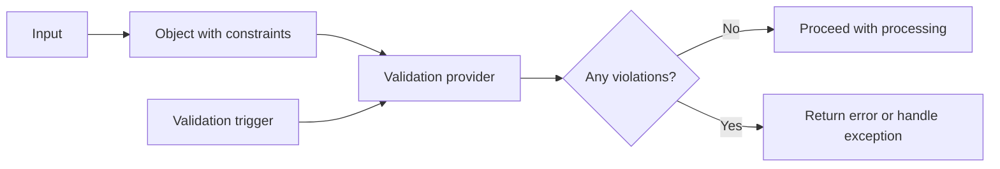
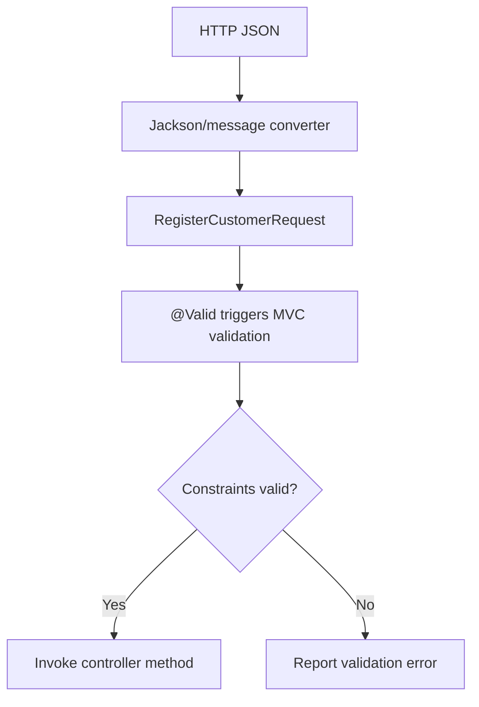
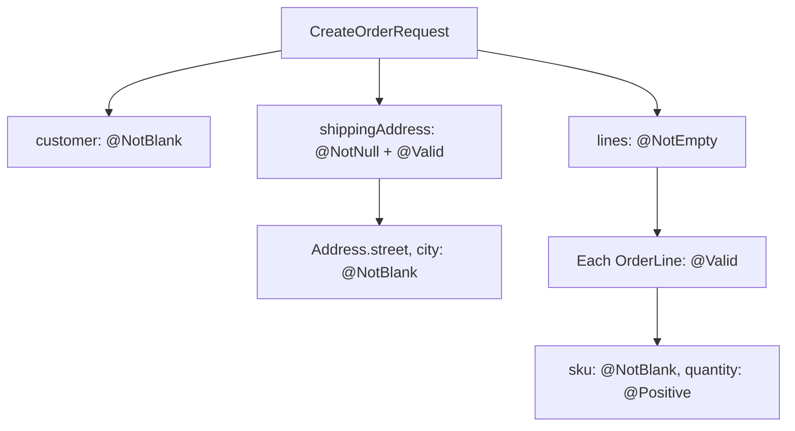
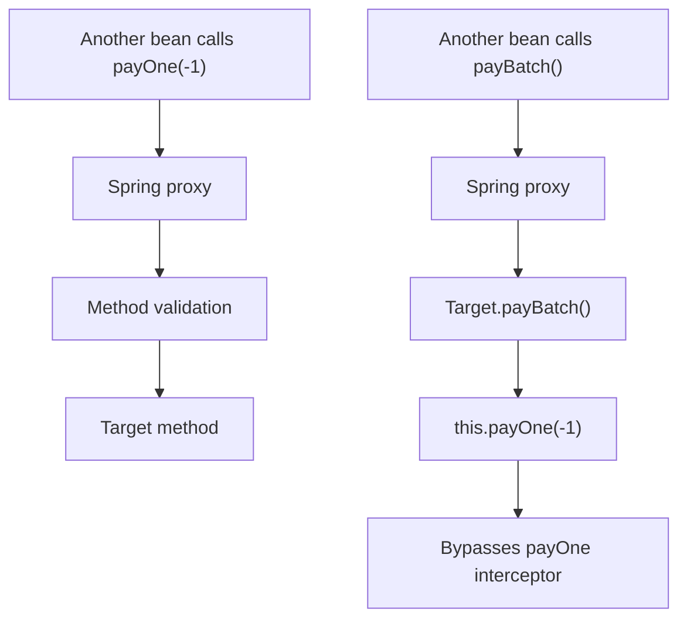
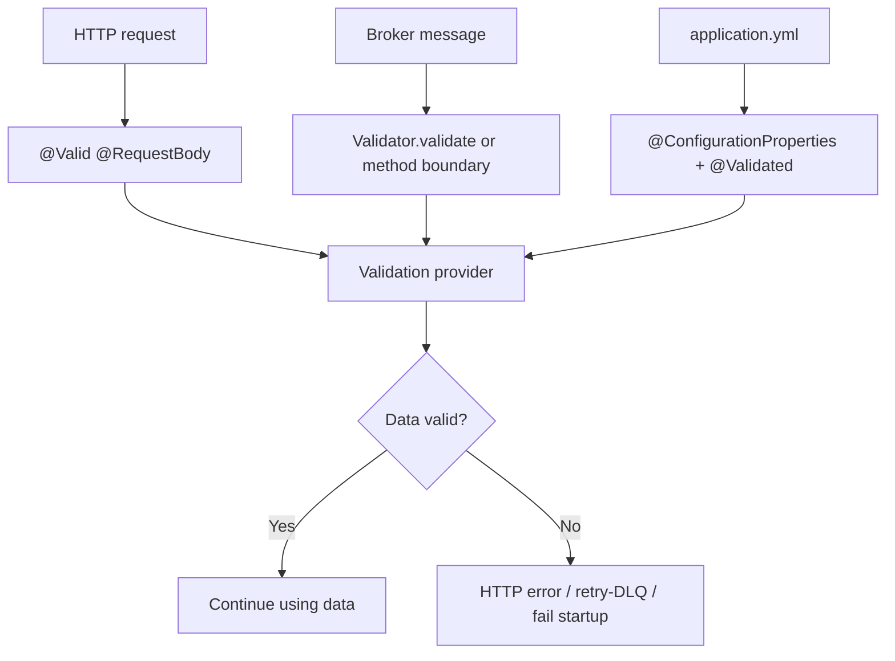

# @Valid, @Validated, and the Conditions for Validation to Execute

A Spring Boot application receives data from many sources: HTTP requests, forms, configuration files, broker messages, or calls between services. Before using that data, the application must verify rules such as non-empty names, positive quantities, properly formatted emails, or required fields in nested objects.

Spring integrates **Jakarta Bean Validation** to express constraints with annotations. Two annotations that appear frequently are `@Valid` and `@Validated`. They are related, not synonymous, and **merely adding annotations to a class is not enough to guarantee validation executes**.

Example:

```java
public record CreateOrderRequest(
        @NotBlank String customerName,
        @Positive int quantity
) {}
```

If you simply write:

```java
CreateOrderRequest request =
        new CreateOrderRequest("", -5);
```

Java still creates the object. Constraint metadata is present, yet no validator was invoked. For validation to actually run, the system needs three conditions: **constraints**, a **validation provider**, and **an activation trigger**.

In this lesson, we distinguish `@Valid` from `@Validated`, explore validation across Spring Boot boundaries, nested object validation, validation groups, service methods, `@ConfigurationProperties`, and common reasons constraints seem to be ignored.

## 1. Three Components That Make Validation Happen

| Component | Role | Example |
|---|---|---|
| Constraint | Declares a validity rule | `@NotBlank`, `@Min`, `@Email` |
| Provider | Executes constraints per Jakarta Validation | Hibernate Validator |
| Trigger | Invokes the validator at a boundary | MVC argument resolver, method-validation proxy, configuration binder, or `Validator.validate(...)` |



Constraints are **metadata**. They are not executable guard code automatically running whenever a setter or constructor runs. They are evaluated by the provider when a valid validation trigger executes.

An object can be constructed via many paths: by Jackson from JSON, by the `@ConfigurationProperties` binder, by JPA, or via plain Java `new`. Depending on how the object is created or passed and which integration is active, validation may or may not run on the exact same class.

## 2. Having the Validation Dependency Is Foundational

In a Spring Boot 3.x application using Spring MVC, Gradle Groovy DSL typically declares:

```groovy
dependencies {
    implementation 'org.springframework.boot:spring-boot-starter-web'
    implementation 'org.springframework.boot:spring-boot-starter-validation'
}
```

With Maven:

```xml
<dependency>
    <groupId>org.springframework.boot</groupId>
    <artifactId>spring-boot-starter-validation</artifactId>
</dependency>
```

The validation starter adds the Jakarta Validation API and Hibernate Validator so Spring integrations have a provider to evaluate constraints.

**Version note:** in modern Spring Boot releases, do not assume the web starter alone includes the validation provider. Check your project's runtime dependencies. For Spring Boot 3.x / Spring Framework 6.x, import annotations from `jakarta.validation`; legacy projects may use `javax.validation` and require namespace upgrades when moving between major framework lines.

Example imports:

```java
import jakarta.validation.Valid;
import jakarta.validation.constraints.Email;
import jakarta.validation.constraints.NotBlank;
import jakarta.validation.constraints.Positive;
```

At the same time, **having the dependency does not create a trigger**. Even after adding the starter, `new CreateOrderRequest("", -5)` still throws nothing. You must attach validation at the right boundary or invoke the Validator API explicitly.

## 3. Core Constraints and Their Practical Meaning

| Annotation | Checks | Key detail |
|---|---|---|
| `@NotNull` | Value is not null | Allows `""` and `"   "` |
| `@NotEmpty` | Not null and non-empty | Useful for strings, collections, maps, and arrays |
| `@NotBlank` | String has at least one non-whitespace character | Common for required names/titles |
| `@Size(min, max)` | Length/size | Not numeric value bounds |
| `@Min` / `@Max` | Numeric thresholds | Null values are normally considered valid by these constraints |
| `@Positive` / `@PositiveOrZero` | Strictly positive / non-negative | For wrapper fields that are required, pair with `@NotNull` |
| `@Email` | Email syntax per provider | Does not prove the address exists or an inbox works |
| `@Pattern` | String matches regular expression | Does not forbid null |
| `@Past` / `@Future` | Date/time in the past or future | Choose matching temporal types and time zones/clocks |
| `@AssertTrue` / `@AssertFalse` | Boolean value satisfies condition | Useful for simple confirmation checks |

DTO example:

```java
import jakarta.validation.constraints.*;

public record RegisterCustomerRequest(
        @NotBlank
        @Size(max = 100)
        String displayName,

        @NotBlank
        @Email
        String email,

        @NotNull
        @Min(18)
        @Max(120)
        Integer age
) {}
```

Common mix-ups:

- `@Email` does not make an email required. Combine with `@NotBlank` if missing email is invalid.
- `@Min(18)` does not reject `null`. For `Integer`, combine with `@NotNull` when required.
- `@NotNull` on a string permits empty or whitespace-only text; use `@NotBlank` to forbid both.
- `@Size` checks collection or string size, not numeric bounds on an integer.
- In JSON inputs, primitive `int` cannot distinguish "field omitted" from `0` after binding in many setups. Use `Integer` when you need to tell absent apart from zero.

Structural constraints never replace business rules such as permissions, account balances, inventory, or order states.

## 4. What Is @Valid?

`@Valid` is a Jakarta Validation annotation:

```java
import jakarta.validation.Valid;
```

It is commonly used in two ways:

1. Placed on a parameter of an integration point such as Spring MVC to validate the object after binding.
2. Placed on a field/property/record component to request **cascade validation**, descending into nested objects when the parent object is validated.

Controller example:

```java
@PostMapping("/customers")
public ResponseEntity<Void> register(
        @Valid @RequestBody RegisterCustomerRequest request) {
    customerService.register(request);
    return ResponseEntity.status(HttpStatus.CREATED).build();
}
```

General flow:



`@Valid` is **not a constraint itself**. If an object has no constraints, validation runs and finds no violations. `@Valid` on a child object also does not require the child object to be non-null; if required, add `@NotNull`.

## 5. How Does @Validated Differ from @Valid?

`@Validated` belongs to Spring Framework:

```java
import org.springframework.validation.annotation.Validated;
```

Spring uses this annotation to select validation groups and activate specific Spring integrations, notably:

- `@Validated(OnCreate.class)` on parameters/controllers to select a group.
- `@Validated` on service classes to mark candidates for **AOP method validation** when configured.
- `@Validated` on `@ConfigurationProperties` classes to request validation during config binding.

| Criterion | `@Valid` | `@Validated` |
|---|---|---|
| Library | Jakarta Validation | Spring |
| Triggers request-body validation in MVC | Yes | Yes |
| Specifies validation groups | No group attribute | Yes |
| Cascades validation into child objects | Yes | Does not replace `@Valid` on child properties |
| Standard marker for service AOP method validation | Not activated by class-level placement alone | Class-level `@Validated` |
| Applied to `@ConfigurationProperties` binding | Used on nested properties | Typically placed on properties class |

For a request body needing only the default group, the common form is:

```java
@Valid @RequestBody RegisterCustomerRequest request
```

When create/update rules differ:

```java
@Validated(OnCreate.class) @RequestBody CustomerPayload request
```

You do not need both annotations on the same parameter. Pick based on intent; if nested fields need validation, put `@Valid` on those nested fields.

## 6. @Valid with @RequestBody in Spring MVC

Let's build a REST endpoint accepting book creation data:

```java
package com.example.books;

import jakarta.validation.constraints.NotBlank;
import jakarta.validation.constraints.Positive;
import jakarta.validation.constraints.Size;

public record CreateBookRequest(
        @NotBlank(message = "Title is required")
        @Size(max = 150)
        String title,

        @NotBlank(message = "Author is required")
        String author,

        @Positive(message = "Page count must be positive")
        int pages
) {}
```

Controller:

```java
package com.example.books;

import jakarta.validation.Valid;
import org.springframework.http.HttpStatus;
import org.springframework.http.ResponseEntity;
import org.springframework.web.bind.annotation.*;

@RestController
@RequestMapping("/books")
public class BookController {

    @PostMapping
    public ResponseEntity<String> create(
            @Valid @RequestBody CreateBookRequest request) {
        return ResponseEntity.status(HttpStatus.CREATED)
                .body("Created: " + request.title());
    }
}
```

Valid JSON:

```json
{
  "title": "Spring Boot Fundamentals",
  "author": "Lan",
  "pages": 240
}
```

Constraint-violating JSON:

```json
{
  "title": " ",
  "author": "",
  "pages": -2
}
```

When the provider and MVC validation are active, the second request is rejected before the controller method body runs. Without a `BindingResult` parameter handling errors locally, Spring MVC typically reports validation errors and returns HTTP 400 via exception-handling infrastructure.

### JSON parse errors differ from constraint errors

If the client sends:

```json
{
  "title": "Java",
  "author": "Lan",
  "pages": "not-a-number"
}
```

JSON cannot convert `pages` into `int`. Failure occurs in the **message conversion** stage before validation, typically throwing `HttpMessageNotReadableException`. Thus not every HTTP 400 comes from `@Valid` finding a constraint violation.

Similarly, missing required HTTP parameters, unsupported media types, and validation failures are separate error classes. Distinguish them when designing API error responses.

## 7. Cascade Validation for Nested Objects

A DTO often contains nested structures:

```java
import jakarta.validation.Valid;
import jakarta.validation.constraints.*;
import java.util.List;

public record Address(
        @NotBlank String street,
        @NotBlank String city
) {}

public record OrderLine(
        @NotBlank String sku,
        @Positive int quantity
) {}

public record CreateOrderRequest(
        @NotBlank String customer,

        @NotNull
        @Valid
        Address shippingAddress,

        @NotEmpty
        List<@Valid OrderLine> lines
) {}
```

When the controller declares:

```java
@PostMapping("/orders")
public void createOrder(
        @Valid @RequestBody CreateOrderRequest request) {
    orderService.place(request);
}
```

The validator checks:



Why are both `@NotNull` and `@Valid` needed?

- `@NotNull` ensures `shippingAddress` is present.
- `@Valid` cascades to validate constraints inside `Address`.
- `@NotEmpty` ensures `lines` is non-empty; it does **not** automatically check `sku` or `quantity` on each item.
- `List<@Valid OrderLine>` instructs validation on each object in the list.

If you omit `@Valid` on a child object, its inner fields are skipped even when the parent is validated. If you place `@Valid` without `@NotNull`, a null child object is not flagged by `@Valid`.

### Constraints on collection elements

Bean Validation also supports constraints directly on elements:

```java
public record TagRequest(
        @NotEmpty List<@NotBlank String> tags
) {}
```

`@NotEmpty` checks that the list is non-empty, while `@NotBlank` validates each tag. This requires a provider supporting Jakarta Validation container-element validation.

## 8. Validation When Binding @ModelAttribute and Forms

Spring MVC can also bind form/query input into an object:

```java
public class ProductSearchForm {
    @NotBlank
    private String keyword;

    @Min(1)
    private int page = 1;

    public String getKeyword() {
        return keyword;
    }

    public void setKeyword(String keyword) {
        this.keyword = keyword;
    }

    public int getPage() {
        return page;
    }

    public void setPage(int page) {
        this.page = page;
    }
}
```

Controller:

```java
@GetMapping("/products/search")
public List<Product> search(
        @Valid @ModelAttribute ProductSearchForm form) {
    return productService.search(form.getKeyword(), form.getPage());
}
```

For HTML forms, handle errors inline with `BindingResult`:

```java
@PostMapping("/products/search")
public String searchForm(
        @Valid @ModelAttribute("form") ProductSearchForm form,
        BindingResult bindingResult,
        Model model) {

    if (bindingResult.hasErrors()) {
        return "product-search";
    }

    model.addAttribute("products",
            productService.search(form.getKeyword(), form.getPage()));
    return "search-results";
}
```

**`BindingResult` must immediately follow the bound/validated parameter** it represents. When accepting it to capture errors, application code must check `hasErrors()` and avoid proceeding with invalid data.

Do not confuse binding errors (e.g., failing to convert text to a number) with constraint errors: both can land in `BindingResult`, yet they occur in different stages.

## 9. Constraints Directly on @RequestParam and @PathVariable

Beyond DTO validation, Spring MVC can evaluate constraints on **method parameters**:

```java
@GetMapping("/books")
public List<Book> findBooks(
        @RequestParam @Min(1) int page,
        @RequestParam @Max(100) int size) {
    return bookService.find(page, size);
}
```

```java
@GetMapping("/books/{id}")
public Book getBook(@PathVariable @Positive long id) {
    return bookService.get(id);
}
```

Here `@Min`, `@Max`, and `@Positive` are the constraints; placing `@Valid` on a `long` does not require it to be positive.

### Spring MVC version differences

- Starting with **Spring Framework 6.1**, Spring MVC supports **built-in method validation** on controller methods when a provider is present. Direct constraints on handler arguments or return values trigger this path.
- In earlier versions/configurations, method validation ran through Spring AOP when class-level `@Validated` and the post-processor were present.
- In Spring MVC 6.1+, to use **MVC's built-in method validation**, you should generally **omit class-level `@Validated` on the controller**. Keeping it may divert validation through an AOP proxy instead of MVC's native pipeline.

Two common failure paths in modern MVC:

| Flow | When it usually triggers | Typical exception |
|---|---|---|
| Argument validation | DTO bound from request with `@Valid` or `@Validated` | `MethodArgumentNotValidException` |
| MVC method validation | Direct constraints on method parameters/return values | `HandlerMethodValidationException` |

Exact categorization depends on method signature, annotations, and Spring version. When method validation triggers, it can also cascade into object parameters; never assume a given handler throws only one exception type.

## 10. Service-Layer Method Validation with @Validated

Services are not called only from HTTP. They may be invoked by schedulers, message consumers, batch jobs, and other services. Sometimes you want checks right at the service boundary.

```java
import jakarta.validation.Valid;
import jakarta.validation.constraints.NotNull;
import jakarta.validation.constraints.Positive;
import org.springframework.stereotype.Service;
import org.springframework.validation.annotation.Validated;

@Service
@Validated
public class ReservationService {

    public Reservation reserve(
            @NotNull @Positive Long productId,
            @Valid @NotNull ReservationCommand command) {

        return new Reservation(productId, command.quantity());
    }
}
```

Types used in the example:

```java
public record ReservationCommand(@Positive int quantity) {}

public record Reservation(Long productId, int quantity) {}
```

When `ReservationService` is Spring-managed and AOP method validation is configured, calls from another bean through the proxy are validated before the method executes.

### Required conditions for AOP method validation to work

1. A Bean Validation provider is on the classpath.
2. Method validation infrastructure is present, typically `MethodValidationPostProcessor` (Boot auto-configures this when conditions are met).
3. The service is registered as a Spring bean, not created with `new`.
4. The class is annotated with `@Validated` so AOP method validation targets it.
5. The method is invoked **through the Spring proxy**, not via an internal call bypassing the proxy.
6. Parameters, return values, or cascaded objects actually carry constraints.

Call from another bean:

```java
@Component
public class ReservationRunner implements ApplicationRunner {
    private final ReservationService service;

    public ReservationRunner(ReservationService service) {
        this.service = service;
    }

    @Override
    public void run(ApplicationArguments args) {
        service.reserve(42L, new ReservationCommand(2));
    }
}
```

Here `ReservationService` is injected from the container and is proxied. Valid inputs execute normally. Changing `42L` to a negative number triggers a constraint violation exception when method validation is active.

### Service exceptions differ from controller errors

AOP method validation commonly throws `ConstraintViolationException` by default. Some configurations adapt failures into Spring validation exceptions.

It is not automatically the same as `MethodArgumentNotValidException` from `@Valid @RequestBody`. If a service exception bubbles up to a REST API, define an explicit HTTP error-mapping strategy.

## 11. The Self-Invocation Trap: Same-Class Calls Can Bypass the Proxy

Example:

```java
@Service
@Validated
public class PaymentService {

    public void payBatch() {
        payOne(-1L);
    }

    public void payOne(@Positive Long paymentId) {
        // Process payment.
    }
}
```

When another bean calls `payOne(-1L)` through the Spring proxy, the validation interceptor blocks invalid arguments. Yet `payBatch()` calls `this.payOne(...)` directly on the target object; this internal call **does not go back through the proxy**, so constraints on `payOne` may not run along this path.



Manual instantiation:

```java
PaymentService service = new PaymentService();
service.payOne(-1L);
```

also has no Spring proxy, so AOP method validation does not run.

When a validation rule must hold even for plain Java or internal calls, invoke `Validator` explicitly or enforce the rule at a clear service boundary. Do not rely on proxies where self-invocation is frequent.

**Proxy limitations:** `private` methods, `final` methods, or dispatch across JDK interface vs. class-based proxies affect interception. Prefer `public` service boundaries and know your project's proxy mode when using AOP method validation.

## 12. Validation Groups with @Validated

Creating and updating data can require different rules:

- When **creating** a customer, `id` must be absent.
- When **updating**, `id` must be provided.
- `name` must be valid in both cases.

Jakarta Validation supports groups via marker interfaces:

```java
public interface OnCreate {}
public interface OnUpdate {}
```

DTO:

```java
import jakarta.validation.constraints.NotBlank;
import jakarta.validation.constraints.NotNull;
import jakarta.validation.constraints.Null;

public record CustomerPayload(
        @Null(groups = OnCreate.class)
        @NotNull(groups = OnUpdate.class)
        Long id,

        @NotBlank(groups = {OnCreate.class, OnUpdate.class})
        String name
) {}
```

Controller:

```java
@RestController
@RequestMapping("/customers")
public class CustomerController {

    @PostMapping
    public void create(
            @Validated(OnCreate.class)
            @RequestBody CustomerPayload payload) {
        // Create customer.
    }

    @PutMapping
    public void update(
            @Validated(OnUpdate.class)
            @RequestBody CustomerPayload payload) {
        // Update customer.
    }
}
```

On POST, Spring validates the `OnCreate` group. On PUT, Spring validates the `OnUpdate` group. This lets one DTO serve both, though if the two contracts diverge heavily, creating two separate request DTOs is simpler.

### Default group is not automatically included with custom groups

Constraints without `groups` belong to the default `Default` group:

```java
@NotBlank
String name;
```

When validating only `OnCreate`, do not assume `Default` constraints also run. To run in all three, declare:

```java
@NotBlank(groups = {Default.class, OnCreate.class, OnUpdate.class})
String name;
```

For complex group setups, Jakarta Validation offers group inheritance and `@GroupSequence`. For ordinary CRUD, separate create/update DTOs are usually clearer than overlapping groups.

**`@Valid` has no group-selection attribute.** It validates the default group at the call site or propagates the parent's active group during cascading. Use `@Validated(Group.class)` when selecting a group through Spring integrations.

## 13. @Validated on @ConfigurationProperties

Configuration data should also be validated before the application relies on it. Mail settings example:

```java
package com.example.config;

import jakarta.validation.Valid;
import jakarta.validation.constraints.Min;
import jakarta.validation.constraints.NotBlank;
import jakarta.validation.constraints.NotNull;
import org.springframework.boot.context.properties.ConfigurationProperties;
import org.springframework.validation.annotation.Validated;

@Validated
@ConfigurationProperties(prefix = "app.mail")
public record MailProperties(
        @NotBlank String host,
        @Min(1) int port,
        @Valid @NotNull Credentials credentials
) {
    public record Credentials(
            @NotBlank String username,
            @NotBlank String password
    ) {}
}
```

Register properties class via scan:

```java
@SpringBootApplication
@ConfigurationPropertiesScan
public class MailApplication {
    public static void main(String[] args) {
        SpringApplication.run(MailApplication.class, args);
    }
}
```

Or register via `@EnableConfigurationProperties(MailProperties.class)` where appropriate. Assumes `MailProperties` is in a scanned package.

`application.yml` file:

```yaml
app:
  mail:
    host: smtp.example.test
    port: 2525
    credentials:
      username: app-user
      password: ${MAIL_PASSWORD}
```

When the Binder constructs the bean and binds values, `@Validated` triggers constraint checks. If `host` is blank, `port` is non-positive, or required `credentials` are missing, startup fails with a binding/validation error instead of running with invalid settings.

**Why both `@NotNull` and `@Valid` on `credentials`?** `@NotNull` requires the object to exist; `@Valid` validates `username` and `password` inside it.

**Security note:** `MAIL_PASSWORD` must be provided by the deployment environment; never commit real secrets in YAML. Avoid printing secret values in logs when handling config errors.

### @ConfigurationProperties alone is not enough

`@ConfigurationProperties` configures binding, not all conditions required for validation. The properties class must also **be registered as a bean**, have a provider on the classpath, and enable validation via `@Validated` or the appropriate mechanism.

Syntactically valid configuration still does not guarantee runtime connectivity. A hostname may be non-blank yet unresolvable; credentials may be non-blank yet rejected by the remote server. Bean Validation does not replace external readiness/connection checks.

## 14. Calling the Validator API Directly

When data arrives from a file or message broker, there is no MVC request binder to invoke validation automatically. You can still validate using the Jakarta API:

```java
import jakarta.validation.ConstraintViolation;
import jakarta.validation.Validation;
import jakarta.validation.Validator;
import java.util.Set;

Validator validator = Validation
        .buildDefaultValidatorFactory()
        .getValidator();

CreateBookRequest input =
        new CreateBookRequest("", "Lan", -1);

Set<ConstraintViolation<CreateBookRequest>> errors =
        validator.validate(input);

for (ConstraintViolation<CreateBookRequest> error : errors) {
    System.out.println(
            error.getPropertyPath() + ": " + error.getMessage());
}
```

This snippet illustrates the API. In a Spring Boot application, prefer injecting the container-managed `jakarta.validation.Validator` bean rather than creating multiple standalone `ValidatorFactory` instances; if you build a factory manually, manage closing it properly.

Example consumer validating messages before processing:

```java
@Component
public class OrderMessageHandler {
    private final jakarta.validation.Validator validator;
    private final OrderProcessor processor;

    public OrderMessageHandler(
            jakarta.validation.Validator validator,
            OrderProcessor processor) {
        this.validator = validator;
        this.processor = processor;
    }

    public void onMessage(CreateOrderRequest message) {
        var violations = validator.validate(message);
        if (!violations.isEmpty()) {
            throw new IllegalArgumentException(
                    "Invalid order: " + violations.size()
                            + " constraint violations");
        }
        processor.process(message);
    }
}
```

The example assumes `OrderProcessor` exists. With a real message broker, coordinate with retry, dead-letter queue, and acknowledgment policies instead of throwing exceptions blindly without understanding redelivery semantics.

The key rule of manual validation: **you must call `validate` and handle the returned violations**. Skipping either means constraint metadata cannot block invalid data.

## 15. HTTP Responses and Validation Exception Types

In REST APIs, failure cases vary:

| Scenario | Typical exception | Layer |
|---|---|---|
| Invalid `@Valid @RequestBody` DTO | `MethodArgumentNotValidException` | MVC argument validation |
| Direct constraints on controller params in Spring MVC 6.1+ | `HandlerMethodValidationException` | MVC method validation |
| `@Validated` service via AOP fails constraint | `ConstraintViolationException` in common setups | AOP method validation |
| JSON fails to parse/convert | `HttpMessageNotReadableException` | Message conversion |
| Form/query binding fails | Exception or `BindingResult` depending on signature | MVC binding |
| Invalid configuration properties | Binding/validation error, usually fails bean creation | Startup configuration |

For consistent API error payloads, use `@RestControllerAdvice`. Spring MVC 6.1+ example:

```java
import java.util.List;
import java.util.Map;
import org.springframework.http.HttpStatus;
import org.springframework.http.ResponseEntity;
import org.springframework.web.bind.MethodArgumentNotValidException;
import org.springframework.web.bind.annotation.ExceptionHandler;
import org.springframework.web.bind.annotation.RestControllerAdvice;
import org.springframework.web.method.annotation.HandlerMethodValidationException;

@RestControllerAdvice
public class ValidationErrorAdvice {

    @ExceptionHandler(MethodArgumentNotValidException.class)
    public ResponseEntity<Map<String, Object>> invalidBody(
            MethodArgumentNotValidException ex) {
        List<String> messages = ex.getBindingResult()
                .getFieldErrors().stream()
                .map(error -> error.getField() + ": "
                        + error.getDefaultMessage())
                .toList();

        return ResponseEntity.status(HttpStatus.BAD_REQUEST)
                .body(Map.of("errors", messages));
    }

    @ExceptionHandler(HandlerMethodValidationException.class)
    public ResponseEntity<Map<String, Object>> invalidMethod(
            HandlerMethodValidationException ex) {
        List<String> messages = ex.getAllValidationResults()
                .stream()
                .flatMap(result -> result.getResolvableErrors().stream())
                .map(error -> error.getDefaultMessage())
                .toList();

        HttpStatus status = ex.isForReturnValue()
                ? HttpStatus.INTERNAL_SERVER_ERROR
                : HttpStatus.BAD_REQUEST;

        return ResponseEntity.status(status)
                .body(Map.of("errors", messages));
    }
}
```

This is an illustrative example, not a complete error contract. Input violations are client errors, whereas **return-value constraint violations** on a controller are server errors. Never map every `HandlerMethodValidationException` to HTTP 400 blindly without checking context.

In production, consider Problem Details or internal error codes. Never echo passwords, tokens, sensitive inputs, or unnecessary exception internals into responses or logs.

## 16. Testing at the Right Boundary

Distinguish three kinds of tests:

- **DTO validation tests:** verify constraint metadata + provider.
- **MVC validation tests:** verify request binding triggers the validator and maps errors to HTTP responses.
- **Service method validation tests:** verify the Spring AOP proxy actually intercepts method invocations.

### Testing DTOs with Jakarta Validator

```java
import static org.assertj.core.api.Assertions.assertThat;

import jakarta.validation.Validation;
import jakarta.validation.Validator;
import org.junit.jupiter.api.Test;

class CreateBookRequestValidationTest {
    private final Validator validator = Validation
            .buildDefaultValidatorFactory()
            .getValidator();

    @Test
    void rejectsInvalidTitleAndPageCount() {
        var request = new CreateBookRequest("", "Lan", -3);

        var violations = validator.validate(request);

        assertThat(violations).hasSize(2);
    }
}
```

This tests constraints and the provider, **without proving the controller or service triggers validation**. In real test suites, reuse a shared factory instead of creating a new factory per test instance.

### Testing MVC with MockMvc

```java
import static org.springframework.test.web.servlet.request.MockMvcRequestBuilders.post;
import static org.springframework.test.web.servlet.result.MockMvcResultMatchers.status;

import org.junit.jupiter.api.Test;
import org.springframework.beans.factory.annotation.Autowired;
import org.springframework.boot.test.autoconfigure.web.servlet.AutoConfigureMockMvc;
import org.springframework.boot.test.context.SpringBootTest;
import org.springframework.http.MediaType;
import org.springframework.test.web.servlet.MockMvc;

@SpringBootTest
@AutoConfigureMockMvc
class BookControllerValidationTest {

    @Autowired
    MockMvc mockMvc;

    @Test
    void rejectsInvalidRequest() throws Exception {
        mockMvc.perform(post("/books")
                        .contentType(MediaType.APPLICATION_JSON)
                        .content("""
                                {
                                  "title": "",
                                  "author": "",
                                  "pages": -1
                                }
                                """))
                .andExpect(status().isBadRequest());
    }
}
```

This snippet uses Java text blocks and imports targeting Spring Boot 3.x. The test requires the test starter and a bootable application context/beans. If the app depends on databases or external services, isolate them with appropriate test slices/configuration.

### Testing a service through a Spring bean

```java
@SpringBootTest
class ReservationServiceValidationTest {

    @Autowired
    ReservationService reservationService;

    @Test
    void invalidArgumentsAreRejectedByProxy() {
        assertThatThrownBy(() ->
                reservationService.reserve(
                        -1L, new ReservationCommand(0)))
                .isInstanceOf(ConstraintViolationException.class);
    }
}
```

This assumes the AOP method validation config throws `ConstraintViolationException`. If your setup adapts exceptions differently, assert against your project's contract.

Replacing the Spring bean with `new ReservationService()` removes the proxy, so manually constructed objects cannot verify AOP method validation.

## 17. Why Might @Valid / @Validated Appear Not to Run?

| Symptom | Possible cause | Approach |
|---|---|---|
| DTO has constraints yet invalid request passes | Controller lacks trigger | Add `@Valid`/`@Validated` on the parameter |
| No validation despite valid annotations | Missing validation provider | Check validation starter and runtime classpath |
| Invalid child object accepted | Missing cascade `@Valid` | Annotate child property and check inner constraints |
| Null nested object passes | `@Valid` does not forbid null | Add `@NotNull` if required |
| Service method does not throw | Missing AOP method validation or class-level `@Validated` | Check bean/proxy/MethodValidationPostProcessor |
| Internal service call skips check | Self-invocation | Call through a proper bean boundary or validate explicitly |
| Manual `new Service()` skips validation | Object is outside Spring container | Inject Spring-managed bean or call Validator API |
| `@Min` allows null | Numeric constraints do not forbid null | Combine with `@NotNull` |
| `@Email` does not make field required | Constraint allows null | Combine with `@NotBlank` |
| Some constraints disappear when using groups | Validating custom group, skipping `Default` | Align groups or split DTOs |
| Configuration properties fail to reject invalid values | Bean not registered, missing `@Validated`/provider | Check scanning, binding, nested `@Valid` |
| Malformed JSON returns unexpected error | Deserialization failed before validation | Handle converter errors separately |
| `BindingResult` misses errors | Placed in wrong parameter position | Place immediately after the validated parameter |
| `@RequestParam` constraint behaves unexpectedly | MVC vs. AOP method-validation version differences | Check provider, class-level `@Validated`, and signature |

Three diagnostic questions to ask:

1. **Are the rules declared?** Does the field have the right constraint, type, and group?
2. **Who invokes the validator?** MVC argument resolver, MVC method validation, AOP proxy, configuration binder, or explicit code?
3. **Does execution flow pass through that trigger?** Was the object bound by Spring MVC or manually created? Was the method invoked through the proxy? Do nested fields cascade?

If you cannot answer the second question, the annotations are probably sitting passively in source code without being executed.

## 18. Validation Does Not Replace Business Rules or Security

Bean Validation excels at structural checks:

- Required strings, valid lengths.
- Positive numbers, value ranges.
- Dates before/after a point in time.
- Nested objects with required fields.
- Patterns or simple cross-field relationships.

Yet many rules depend on system state:

- Username does not already exist in the database.
- Balance is sufficient at commit time.
- User is authorized to modify a specific resource.
- Stock remains available when two concurrent requests order simultaneously.
- Order state permits transitioning to a new status.

Those require service logic, transactions, concurrency controls, or database constraints. Custom validation annotations can help, but you should not force the entire domain model into validators.

Validation also never replaces authentication/authorization, parameterized SQL, output encoding, rate limiting, or payload size caps. Input passing `@Size` can still cause vulnerabilities if concatenated directly into SQL.

## 19. Three Data Sources, Three Activation Paths

Suppose a system has three inputs:

1. HTTP JSON creating an order.
2. Broker message updating status.
3. Mail connection configuration at startup.



All three use Jakarta Validation, yet results must be handled at the proper layer. Invalid HTTP requests return 400. Invalid messages go to a dead-letter queue or controlled retry. Missing required configuration aborts startup. Never force identical exception handling across every boundary.

## 20. Practice Exercises

Work through these steps in a small Spring Boot project:

1. Create `CreateBookRequest` with `@NotBlank` and `@Positive`. Send invalid JSON before adding `@Valid`; compare after enabling validation.
2. Verify the project includes `spring-boot-starter-validation` and an active provider.
3. Change `pages` to `Integer`. Send `null` with `@Positive`, then add `@NotNull`.
4. Add a nested `Publisher` object. Test without and then with `@Valid` on the child property.
5. Add `@RequestParam @Min(1)` and inspect how your Spring MVC version handles method validation.
6. Create an `@Validated` service with `@Positive` on a parameter. Call through the injected bean and compare against manual `new`.
7. Try self-invocation between two methods in the same service and observe AOP proxy behavior.
8. Define groups `OnCreate` and `OnUpdate` and test constraints belonging to `Default`.
9. Create `@ConfigurationProperties` with `@Validated` and nested `@Valid`. Boot with a missing required property.
10. Write a unit test using `Validator` and an HTTP test using `MockMvc`. Explain how the two tests verify different boundaries.

For every case, distinguish three possibilities: failure caught during binding/deserialization, failure caught by Bean Validation, or invalid data slipping past because the validator never ran. That is how you verify real-world validation wiring.

## 21. Summary Reference Table

| What to validate | Trigger/annotation | Main prerequisites |
|---|---|---|
| HTTP JSON body | `@Valid @RequestBody` or `@Validated(Group.class)` | Provider present, binding succeeds, constraints match |
| Nested DTO | `@Valid` on child field/property | Parent object validation is active |
| HTML form/query DTO | `@Valid @ModelAttribute` | MVC binding; `BindingResult` positioned right after if manual |
| Scalar controller parameter | `@Min`, `@Positive`, ... | Version-appropriate MVC method validation / AOP |
| Service method | Class-level `@Validated` and method constraints | Method validation post-processor active, called via proxy |
| Application configuration | `@ConfigurationProperties`, `@Validated`, nested `@Valid` | Bean registered/bound, provider present |
| Plain Java objects, files, messages | `Validator.validate(...)` | Explicit call and violation handling |

**`@Valid` mainly tells integration points to validate an object and cascade into child objects. `@Validated` is Spring's annotation for selecting groups and enabling Spring integrations like AOP method validation or configuration validation.**

A system validates reliably only when all three pieces align: **accurate constraints, an active validation provider, and an actually executed trigger**. Once violations are found, the application must also respond appropriately per source: rejecting an HTTP request, dead-lettering a message, or aborting startup. Understanding those three conditions clarifies where every annotation belongs—and why annotations in source code alone never guarantee data is actually checked.
