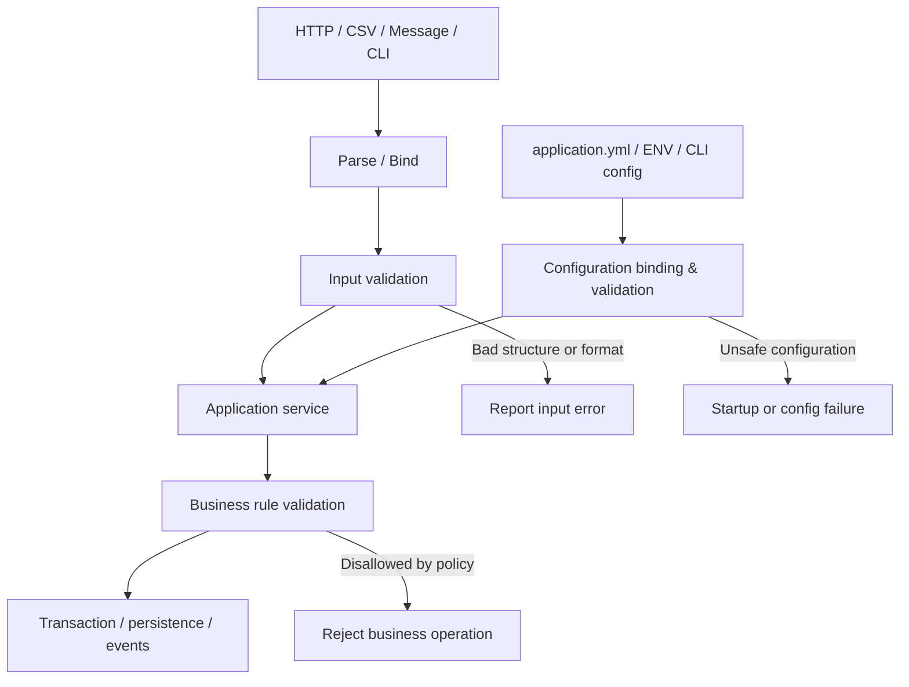
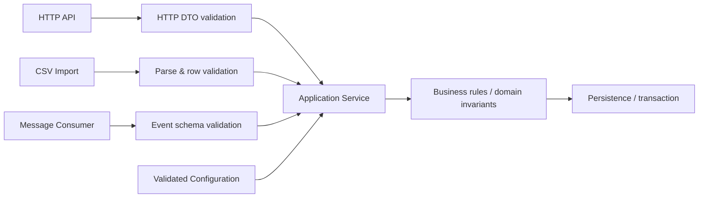

# Distinguishing Input Validation, Configuration Validation, and Business Rule Validation

A Spring Boot application receives data from many sources: HTTP requests, CSV or JSON files, message brokers, environment variables, `application.yml` files, and databases. Before using that data, the application must verify whether it is valid. Yet saying "we need to validate the data" does not answer **what kind of data is being checked, what it protects, or where the validation logic belongs**.

Three common validation categories carry distinct responsibilities:

1. **Input validation:** does incoming external data have the right shape, types, formats, and basic constraints to be processed safely?
2. **Configuration validation:** are the properties controlling application behavior complete, valid, and consistent enough for the system to start and operate safely?
3. **Business rule validation:** is an operation permitted given the current state and policies of the business domain?

For example, an order-creation API may receive a request with `quantity = 3`. That is a positive integer, so it is **structurally valid input**. The app may have read `app.order.max-items=100`, so **configuration is valid**. Yet if only one unit remains in stock, creating an order for three units still **violates a business rule**.

Within the **Resources and Data** chapter of *Spring Boot Fundamentals*, this lesson shows how to identify all three validation tiers, apply Bean Validation and `@ConfigurationProperties` appropriately, structure service/domain validation, classify error responses, and build systems resilient to invalid data from APIs, files, and external sources.

## 1. The Big Picture: Three Tiers, Three Questions

Consider an ordering application with an endpoint:

```http
POST /api/orders
Content-Type: application/json

{
  "productId": "P-100",
  "quantity": 3,
  "customerEmail": "customer@example.com"
}
```

The application has configuration:

```yaml
app:
  order:
    max-quantity-per-line: 20
    reservation-timeout: 30s
```

The service must verify that product `P-100` exists, is in stock, is active for sale, and the customer is permitted to order it.

| Tier | Typical questions | Data inspected | Where it usually lives |
| --- | --- | --- | --- |
| Input | Is `productId` blank? Is `quantity` a positive integer? Does the email match basic syntax? | HTTP JSON, query, path, form, file, message | DTO, parser, controller boundary, import adapter |
| Configuration | Is timeout positive? Are quantity limits valid? Is the partner URL provided? | `application.yml`, environment, CLI, secret sources | `@ConfigurationProperties`, startup validation |
| Business | Is enough stock left? Is the product still for sale? Does the order exceed purchase policy? | Domain state, repositories, actor, time, policies | Application service, domain service, aggregate |

Responsibility diagram:



These layers collaborate rather than replace each other. A DTO passing `@Valid` **is not automatically a valid business command**. An application booting cleanly with valid `@ConfigurationProperties` **does not mean every request will be accepted**. And a domain service enforcing business policies **should not be forced to understand JSON syntax or environment variable names**.

## 2. What Is Input Validation?

Input validation checks data at the **boundary where untrusted external data enters**. Its goal is ensuring data can be safely interpreted per the published contract.

Typical checks:

- Are required fields present?
- Are strings empty or whitespace-only?
- Do values convert to the expected numeric, boolean, or enum types?
- Are quantities within the API contract's bounds?
- Do email/URL strings match basic format rules?
- Is a list too long or a file larger than permitted?
- Are field names, encoding, JSON/CSV structure, or schema valid?

Input validation typically runs **after data is parsed/bound**, though some failures happen before reaching the validator: malformed JSON, unconvertible Java types, missing multipart parts, or unsupported content types.

### 2.1. HTTP API DTO example

Define a dedicated request DTO:

```java
package com.example.orders.api;

import jakarta.validation.constraints.Email;
import jakarta.validation.constraints.Max;
import jakarta.validation.constraints.Min;
import jakarta.validation.constraints.NotBlank;
import jakarta.validation.constraints.NotNull;

public record CreateOrderRequest(
        @NotBlank String productId,
        @NotNull @Min(1) @Max(100) Integer quantity,
        @NotBlank @Email String customerEmail
) {
}
```

Meaning:

- `@NotBlank` requires a non-null string with at least one non-whitespace character.
- `@NotNull` requires the value to be present.
- `@Min(1)` and `@Max(100)` bound quantity per the HTTP contract.
- `@Email` checks email syntax at the Bean Validation level; it **does not prove the email address exists or belongs to the sender**.

Controller:

```java
package com.example.orders.api;

import com.example.orders.application.OrderApplicationService;
import jakarta.validation.Valid;
import org.springframework.http.HttpStatus;
import org.springframework.web.bind.annotation.PostMapping;
import org.springframework.web.bind.annotation.RequestBody;
import org.springframework.web.bind.annotation.RequestMapping;
import org.springframework.web.bind.annotation.ResponseStatus;
import org.springframework.web.bind.annotation.RestController;

@RestController
@RequestMapping("/api/orders")
public class OrderController {

    private final OrderApplicationService orders;

    public OrderController(OrderApplicationService orders) {
        this.orders = orders;
    }

    @PostMapping
    @ResponseStatus(HttpStatus.CREATED)
    public void create(@Valid @RequestBody CreateOrderRequest request) {
        orders.create(
                request.productId(),
                request.quantity(),
                request.customerEmail()
        );
    }
}
```

In Spring MVC, `@RequestBody` reads the HTTP body and maps it to the record. `@Valid` activates validation on the bound object, assuming a Bean Validation provider and integration are present.

In standard Spring Boot projects using Jakarta Bean Validation, declare the starter:

```xml
<dependency>
    <groupId>org.springframework.boot</groupId>
    <artifactId>spring-boot-starter-validation</artifactId>
</dependency>
```

Gradle:

```groovy
implementation 'org.springframework.boot:spring-boot-starter-validation'
```

Examples here use the `jakarta.validation` namespace matching modern Spring Boot releases built on Jakarta EE. Legacy projects on `javax.validation` should align dependency versions before migrating.

### 2.2. @NotNull, @NotEmpty, and @NotBlank are not the same

| Constraint | `null` | `""` | `"   "` |
| --- | --- | --- | --- |
| `@NotNull` | Invalid | Valid | Valid |
| `@NotEmpty` | Invalid | Invalid | Valid |
| `@NotBlank` | Invalid | Invalid | Invalid |

`@NotEmpty` applies to supported types such as strings, collections, maps, and arrays. `@NotBlank` targets `CharSequence`. Choose constraints from the input contract rather than picking randomly.

### 2.3. Primitives vs. wrapper types

If you write:

```java
public record CreateOrderRequest(int quantity) {
}
```

missing fields or ambiguous conversions may be handled during deserialization before Bean Validation runs; primitives cannot hold `null`. When you want to distinguish "field omitted" from "0 supplied", `Integer` paired with `@NotNull` expresses the contract more clearly:

```java
public record CreateOrderRequest(
        @NotNull @Min(1) Integer quantity
) {
}
```

### 2.4. Do not conflate parse errors with validation errors

If the client sends:

```json
{
  "productId": "P-100",
  "quantity": "many",
  "customerEmail": "customer@example.com"
}
```

the failure happens when Jackson tries to deserialize `"many"` into `Integer`. The controller never even receives a DTO to evaluate `@Min`.

Distinguish:

- **Parse/binding:** unable to construct the object or parameter of the target type.
- **Bean Validation:** object was constructed, yet one or more constraints failed.
- **Business validation:** input object is valid, yet the operation is disallowed.

Each error class deserves clear messages and responses instead of collapsing everything into a vague "bad data" message.

## 3. Input Validation Is Not Just for HTTP Requests

The chapter title **Resources and Data** reminds us that apps also ingest data from files, resources, environments, and external systems. Every source must be validated at its entry boundary.

### 3.1. Reading CSV files

Suppose we import a catalog:

```csv
sku,name,price
P-100,Notebook,45000
P-101,Pen,12000
```

A row might be invalid:

```csv
P-102,,not-a-number
```

This is an input error: name is blank and price cannot be parsed. The CSV reader should separate decoding/parsing from mapping into a command/DTO:

```java
public record ImportProductRow(
        @NotBlank String sku,
        @NotBlank String name,
        @NotNull @DecimalMin("0.00") BigDecimal price
) {
}
```

A file adapter parses `price` into `BigDecimal`, then calls `Validator.validate(row)`. If parsing fails, record the line number; if constraints fail, report the failing field and constraint.

Avoid `Double` for monetary values needing exact decimal arithmetic when `BigDecimal` is appropriate.

### 3.2. Content validation and resource limits

File input validation goes beyond Bean Validation:

- Cap maximum file size and line count.
- Verify encoding/charset.
- Validate headers/schema and column count.
- Limit field lengths to prevent excessive memory allocation.
- Handle CSV quoting via a compliant parser instead of `String.split(",")` on non-trivial data.
- Accept only formats matching the contract; never trust file extensions alone.
- Verify paths, permissions, and storage rules.

For uploads, `MultipartFile.getOriginalFilename()` is client-supplied input and **never a safe path for writing files directly**. If deriving a storage filename, sanitize it, generate server-controlled names, and prevent path traversal. A successful upload never proves the file matches an allowed content type.

### 3.3. Message brokers and integration boundaries

A message from Kafka/RabbitMQ or a webhook is also input data. Even from an internal service, it may violate schema or come from a different producer version.

Event example:

```java
public record StockReceivedEvent(
        @NotBlank String sku,
        @NotNull @Min(1) Integer quantity,
        @NotBlank String eventId
) {
}
```

The message adapter must parse, validate schema, authenticate senders where needed, and route invalid messages per retry/dead-letter policies. **A valid message schema does not prove the event was never processed before**; duplicate `eventId` detection is a separate consistency/business or idempotency concern.

### 3.4. Do not blindly trust data just because the source is "internal"

HTTP requests, batch files, legacy database rows, and messages from sibling services can all contain unexpected values. Strictness varies by trust boundary, yet an internal origin is never an excuse to omit guards.

## 4. What Is Configuration Validation?

Configuration validation checks **the data governing application behavior**. Those values typically originate from:

- `application.properties` or `application.yml`.
- Profile-specific `application-{profile}.properties` / YAML files.
- Environment variables.
- Command-line arguments.
- JVM system properties.
- Secret managers or other Config Data sources.

Example:

```yaml
app:
  import:
    max-rows: 5000
    batch-size: 200
    timeout: 30s
    archive-directory: "/var/lib/catalog/archive"
```

Required validity conditions:

- `max-rows` must be positive.
- `batch-size` must be positive and within system bounds.
- `timeout` must exceed 0.
- `archive-directory` must have a non-blank value.

These are **configuration constraints** because they govern how the application operates, not the data of one specific customer order.

### 4.1. Why validate at startup?

Suppose an app runs with `batch-size=0`. Without startup validation, the bug might surface only when the first import runs or trigger an infinite loop.

Configuration validation enables **fail-fast** behavior: catching unsafe operating conditions immediately when building config beans or starting the context.

Benefits:

- Broken deployments are caught immediately.
- The system never silently runs with out-of-range settings.
- Errors pinpoint the exact property name and source to fix.
- Business services avoid repeating guards for static configuration.

### 4.2. Valid configuration is more than valid syntax

`timeout: 30s` parses cleanly into `Duration`, yet `timeout: 0s` still breaks operational requirements. `batch-size: -1` parses as an integer yet makes no operational sense.

Distinguish four checks:

1. **Binding/type conversion:** turning config strings into Java types.
2. **Constraint validation:** enforcing bounds and required fields.
3. **Cross-field validation:** validating relationships across multiple properties.
4. **Runtime dependency verification:** checking whether an external service is reachable if required at startup.

A syntactically valid endpoint URL does not prove the remote service is online. Checking network reachability is a separate runtime readiness/startup check, not something `@NotBlank` can verify.

## 5. Typed Configuration with @ConfigurationProperties

Spring Boot encourages grouping related properties into a strongly typed object.

### 5.1. Configuration in application.yml

```yaml
app:
  import:
    max-rows: 5000
    batch-size: 200
    timeout: 30s
    archive-directory: "/var/lib/catalog/archive"
```

### 5.2. Configuration class with Bean Validation

Record example:

```java
package com.example.catalog.config;

import jakarta.validation.constraints.Min;
import jakarta.validation.constraints.NotBlank;
import jakarta.validation.constraints.NotNull;
import jakarta.validation.constraints.Positive;
import java.time.Duration;
import org.springframework.boot.context.properties.ConfigurationProperties;
import org.springframework.validation.annotation.Validated;

@Validated
@ConfigurationProperties(prefix = "app.import")
public record ImportProperties(
        @Min(1) int maxRows,
        @Min(1) int batchSize,
        @NotNull Duration timeout,
        @NotBlank String archiveDirectory
) {
    public ImportProperties {
        if (timeout != null && (timeout.isZero() || timeout.isNegative())) {
            throw new IllegalArgumentException(
                    "app.import.timeout must be positive"
            );
        }
    }
}
```

Explanation:

- `@ConfigurationProperties` binds the `app.import` group to the record.
- `@Validated` triggers validation on the config bean when an appropriate validator is present.
- `@Min(1)` rejects numbers less than 1.
- `@NotNull` rejects missing `timeout`.
- `@NotBlank` rejects blank/whitespace `archiveDirectory`.
- The compact constructor checks `Duration` positivity.

This example uses Spring Boot constructor binding on a record. In real projects, you can move cross-field checks to custom validators or `@AssertTrue`/class-level constraints if you want all errors reported through Bean Validation uniformly.

### 5.3. Registering configuration properties

In Spring Boot, you can enable scanning:

```java
package com.example.catalog;

import org.springframework.boot.SpringApplication;
import org.springframework.boot.autoconfigure.SpringBootApplication;
import org.springframework.boot.context.properties.ConfigurationPropertiesScan;

@SpringBootApplication
@ConfigurationPropertiesScan
public class CatalogApplication {

    public static void main(String[] args) {
        SpringApplication.run(CatalogApplication.class, args);
    }
}
```

Or register explicitly:

```java
@Configuration(proxyBeanMethods = false)
@EnableConfigurationProperties(ImportProperties.class)
class ImportConfiguration {
}
```

Do not apply multiple registration mechanisms to the same class simultaneously. Follow one consistent project convention.

### 5.4. Using configuration in a service

```java
package com.example.catalog.application;

import com.example.catalog.config.ImportProperties;
import org.springframework.stereotype.Service;

@Service
public class CatalogImportCoordinator {

    private final ImportProperties properties;

    public CatalogImportCoordinator(ImportProperties properties) {
        this.properties = properties;
    }

    public int configuredBatchSize() {
        return properties.batchSize();
    }
}
```

The service injects an already-bound, validated object instead of calling `Environment.getProperty("app.import.batch-size")` everywhere.

### 5.5. Distinguish @Validated on configuration from method validation

`@Validated` appears in different contexts:

- On `@ConfigurationProperties`: validates the configuration object during binding.
- On services supporting method validation: enables argument/return-value constraint checks per method-validation mechanics.

Same annotation, **different timing and validation target**. Never assume putting `@Validated` on a service automatically enforces all business rules.

## 6. Configuration with Multi-Field Relationships

Not all rules can be written as `@Min` or `@NotBlank` on single fields.

Example config:

```yaml
app:
  import:
    batch-size: 500
    max-rows: 200
```

Both numbers are positive, yet **batch size exceeds maximum rows**. That may be an invalid configuration if a batch must never exceed the total row cap.

Expressing this in the class:

```java
@Validated
@ConfigurationProperties(prefix = "app.import")
public record ImportLimits(
        @Min(1) int maxRows,
        @Min(1) int batchSize
) {

    @AssertTrue(message = "batch-size must not exceed max-rows")
    public boolean isBatchSizeWithinLimit() {
        return batchSize <= maxRows;
    }
}
```

This illustrates Bean Validation's `@AssertTrue` on a getter/boolean property method supported by the validator. Import `jakarta.validation.constraints.AssertTrue`. You can also build a custom class-level constraint when logic is complex or errors belong on specific fields.

### 6.1. When to build a custom constraint?

Suppose config defines `minPoolSize`, `maxPoolSize`, `idleTimeout`, and `connectionTimeout`, with combined constraints across them. A class-level validator expresses that much more clearly than stuffing everything into a constructor.

Still, do not invent a mini validation framework for three simple properties. Prefer standard constraints, typed config, and custom validators only when warranted.

### 6.2. Profile-specific configuration

Examples:

```yaml
# application-dev.yml
app:
  import:
    max-rows: 1000
    batch-size: 50
    timeout: 10s
    archive-directory: "./build/local-archive"
```

```yaml
# application-prod.yml
app:
  import:
    max-rows: 100000
    batch-size: 1000
    timeout: 2m
    archive-directory: "/data/catalog/archive"
```

Both profiles must pass the configuration contract's validation. Never skip checks just because `prod` settings come from deployment pipelines.

### 6.3. Secrets and required settings

Passwords, API keys, and tokens usually come from environment variables or secret managers. You might reference:

```yaml
app:
  partner:
    api-key: "${PARTNER_API_KEY}"
```

When a secret is required, startup should fail clearly if a valid value is missing. Never hard-code real secrets in the repository or accidentally print them in exceptions or logs.

`@NotBlank` guards against empty values, yet cannot confirm whether the partner service accepts the key. That remains a separate runtime verification.

## 7. What Is Business Rule Validation?

Business rule validation checks **whether a decision or operation is allowed within the business domain**. It depends on context, current state, and organizational policies, not just data shape.

Order examples:

- The product must exist and be active for sale.
- The customer must be eligible to buy the product.
- Ordered quantity must not exceed available stock.
- An already-paid order cannot be edited through a draft-order endpoint.
- A promo code must still be active at usage time.
- A customer cannot redeem the same promotion beyond its usage limit.

These rules often depend on database state, current time, actor identity/authorization, or multiple aggregates.

### 7.1. Why not put all business rules into DTOs?

DTOs should not inject repositories to check stock levels. Constraints like `@NotBlank` only assert a string has content; they cannot guarantee `productId` is active and in stock.

Example:

```json
{
  "productId": "P-100",
  "quantity": 3,
  "customerEmail": "customer@example.com"
}
```

This request satisfies every constraint on `CreateOrderRequest`. Yet if `P-100` was discontinued, the service must still reject the order on business grounds.

### 7.2. Why not put business rules into application.yml?

Configuration files can hold **policy parameters**, such as `max-quantity-per-line=20`. Yet deciding "may this customer buy 3 units right now?" must run in business code with full domain context.

**Config supplies policy parameters; business services enforce the policy.**

Example:

```yaml
app:
  order:
    max-quantity-per-line: 20
```

```java
@Service
public class OrderPolicy {

    private final OrderProperties properties;

    public OrderPolicy(OrderProperties properties) {
        this.properties = properties;
    }

    public void verifyLineLimit(int quantity) {
        if (quantity > properties.maxQuantityPerLine()) {
            throw new OrderPolicyViolation(
                    "Order quantity exceeds configured line limit"
            );
        }
    }
}
```

Here:

- Ensuring `maxQuantityPerLine` is a positive integer is **configuration validation**.
- Ensuring the request supplies a positive integer `quantity` is **input validation**.
- Rejecting a specific order that exceeds the configured cap is **business rule validation**.

`quantity=25` satisfies the general API contract `1..100`, yet gets rejected by the policy because the current limit is 20.

## 8. Business Example: Ordering Against Inventory

Suppose the domain models products and inventory.

### 8.1. Repository and domain service

Illustrative application service:

```java
package com.example.orders.application;

import com.example.orders.domain.OrderPolicyViolation;
import com.example.orders.domain.Product;
import com.example.orders.domain.ProductRepository;
import com.example.orders.domain.OrderRepository;
import org.springframework.stereotype.Service;
import org.springframework.transaction.annotation.Transactional;

@Service
public class OrderApplicationService {

    private final ProductRepository products;
    private final OrderRepository orders;
    private final OrderPolicy policy;

    public OrderApplicationService(
            ProductRepository products,
            OrderRepository orders,
            OrderPolicy policy
    ) {
        this.products = products;
        this.orders = orders;
        this.policy = policy;
    }

    @Transactional
    public void create(
            String productId,
            int quantity,
            String customerEmail
    ) {
        Product product = products.findById(productId)
                .orElseThrow(() ->
                        new OrderPolicyViolation("Product not found")
                );

        policy.verifyLineLimit(quantity);

        if (!product.isAvailableForSale()) {
            throw new OrderPolicyViolation(
                    "Product is not available for sale"
            );
        }

        product.reserve(quantity);
        orders.saveNewOrder(product, quantity, customerEmail);
    }
}
```

This is an **architectural** example: `ProductRepository`, `OrderRepository`, `Product`, and `OrderPolicyViolation` are illustrative project types. A complete implementation defines these types along with concrete persistence.

The controller handles input validation. The service orchestrates the workflow. Domain entity `Product` protects its own invariants:

```java
public void reserve(int quantity) {
    if (quantity <= 0) {
        throw new IllegalArgumentException(
                "Quantity must be positive"
        );
    }

    if (availableStock < quantity) {
        throw new OrderPolicyViolation(
                "Insufficient stock"
        );
    }

    availableStock -= quantity;
}
```

### 8.2. Domain guards do not replace input validation

Why does `reserve` still verify positive `quantity` even though the controller already checked `@Min(1)`?

Because domain methods can be invoked from elsewhere:

- Scheduled jobs.
- Message consumers.
- Admin CLIs.
- Batch imports.
- Unit tests or other services.

An essential domain invariant should never depend on **every caller arriving through one specific HTTP controller**. DTO validation improves feedback at HTTP boundaries; domain guards protect object integrity along every execution path.

This is intentional defense in depth with **distinct goals**, not mindless duplication.

### 8.3. Concurrency and inventory

Suppose stock has 5 units. Two concurrent requests each order 4 units:

```text
Request A reads stock = 5
Request B reads stock = 5
Request A checks 4 <= 5: true
Request B checks 4 <= 5: true
Request A subtracts 4
Request B subtracts 4
```

Without concurrency control, both succeed and oversell stock even though each individual check "passed".

For invariants over concurrent state, reinforce persistence/transactions with:

- Optimistic locking via version columns.
- Pessimistic locking when appropriate.
- Atomic conditional updates, e.g., decrementing stock only where remaining stock suffices.
- Unique constraints for uniqueness invariants.
- Clear transaction boundaries.

**Read-then-check business validation alone cannot preserve invariants under concurrent requests.** That is a major gap between simple `if` examples and production systems.

## 9. The Line Between Input Constraints and Business Rules Is Not Always Absolute

Some rules appear to straddle both categories. Take `quantity <= 100`:

- If the published API contract declares every request accepts only 1..100 regardless of system state, it is an **input constraint**.
- If the 100 cap depends on business policy by customer tier, promotion, or date, it is a **business rule**.
- If 100 is configured via a property that must be positive, that config value also undergoes **configuration validation**.

Never classify rules solely by `<=` operators or Java annotations. Ask **where the rule comes from, what it protects, and when it can change**.

### 9.1. The "valid email" rule also spans multiple layers

| Check | Tier |
| --- | --- |
| Non-blank string, basic email syntax | Input |
| App has valid mail-sender domain or SMTP config | Configuration |
| Customer verified email before receiving a perk | Business |
| Mail server actually accepts delivery to the address | Runtime/integration verification |

`@Email` does not prove a user controls the mailbox. You usually need a token/link verification flow to satisfy the business rule "verified email".

### 9.2. The "unique SKU" rule

`@NotBlank` verifies SKU presence. A regex checks format like `P-100`. Yet **SKU does not already exist in the catalog** is a business/persistence invariant. To enforce uniqueness under concurrent writes, enforce a database unique constraint and handle conflicts cleanly.

Never rely solely on `repository.existsBySku(...)` believing race conditions cannot occur.

## 10. Distinguishing Validation, Authentication, and Authorization

None of the three validation tiers above replaces security controls.

Request example:

```http
DELETE /api/orders/123
Authorization: Bearer ...
```

Distinct steps occur:

- **Parsing/input validation:** is ID `123` the right type and format?
- **Authentication:** who is making this request?
- **Authorization:** is that actor permitted to delete this order?
- **Business rule:** is the order in a state that permits deletion/cancellation?

A caller may be authenticated and authorized to hit the endpoint yet still be blocked from canceling a shipped order due to business policy. Conversely, a valid request payload never proves the caller is authorized.

Spring Security enforces authentication and authorization at appropriate boundaries; domain/application services still enforce business invariants. Never treat `@Valid` as a general security layer.

### 10.1. Input validation does not replace injection defenses

Non-empty checks and length caps help, yet never replace parameterized SQL queries, output encoding, resource access permissions, and file-path sanitization.

For example, never concatenate raw input into SQL:

```java
// Avoid:
String sql = "SELECT * FROM products WHERE sku = '" + sku + "'";
```

Use parameter-binding APIs in JDBC, JPA, or repositories. Input validation and security controls defend against different threats.

## 11. Distinguishing "Data Exists" from "Data Is Valid"

In the Resources and Data chapter, this distinction appears when reading resources:

```java
Resource resource =
        new ClassPathResource("catalog/default-products.csv");

if (!resource.exists()) {
    throw new IllegalStateException(
            "Required catalog resource is missing"
    );
}
```

This checks only whether the resource exists per Spring's abstraction. It **does not prove the file has valid structure, encoding, or records**.

Consuming a resource safely involves multiple steps:

```text
Resource path
   |
   v
Exists / readable?
   |
   v
Open stream
   |
   v
Parse format
   |
   v
Validate rows/schema
   |
   v
Apply business rules
   |
   v
Persist / process
```

### 11.1. Resource and File are not always identical

A resource like `classpath:catalog/default-products.csv` may live inside an executable JAR. Never assume it can always convert to a `java.io.File` on the filesystem.

Stream reading example:

```java
Resource resource =
        new ClassPathResource("catalog/default-products.csv");

try (InputStream input = resource.getInputStream()) {
    // Read data with a parser suited to the format and encoding.
}
```

This verifies resource readability, separate from row-level validation and business rules. For a required startup resource, failing to open it aborts startup; for a user-uploaded file, it yields an input/request error.

### 11.2. Classify checks by responsibility, not file format

YAML files can appear in multiple roles:

- `application.yml`: application **configuration input**, needing configuration validation.
- A user-uploaded YAML defining a workflow: **input data**, needing structural/schema validation.
- YAML content specifying a policy affecting orders: after parsing and structural validation, **business policy** still executes in the domain.

Never say "YAML is always config validation" or "JSON is always input validation"—file format does not dictate responsibility tier.

## 12. HTTP Error Handling: Responding Appropriately per Failure Kind

APIs should return structured errors telling callers whether to fix request input or address a business condition.

### 12.1. Input validation usually maps to 400

In Spring MVC, an invalid `@Valid @RequestBody` typically triggers `MethodArgumentNotValidException` and HTTP 400 by default unless customized.

Illustrative response:

```json
{
  "type": "https://example.invalid/problems/invalid-input",
  "title": "Invalid request",
  "status": 400,
  "detail": "Request body contains invalid fields"
}
```

Failing field names can be added to dedicated properties. Never return stack traces or secrets to clients.

### 12.2. Business rules have no single fixed HTTP status for all cases

Examples:

- Product does not exist: `404 Not Found` may fit, depending on API semantics.
- Order version changed or state conflicts: `409 Conflict` may fit.
- Syntactically valid value rejected by business policy: some APIs choose `422 Unprocessable Content` per contract.
- Caller lacks permission: `403 Forbidden` per authorization rules.

There is no universal rule saying "every business error returns 422" across all APIs. Consistency with HTTP contract semantics and stable application error codes matter most.

### 12.3. Configuration errors are usually not 400 for clients

If the system cannot instantiate a bean because `app.import.batch-size=-1`, that is a deployment configuration bug caught at startup. Clients cannot fix `application.yml` by changing their request.

When configuration breaks at runtime, the system becomes unready or raises a server error. Log diagnostic details appropriately and fix the configuration source rather than returning API field-validation responses to end users.

## 13. Handling Input Validation with @RestControllerAdvice

Spring MVC can centralize input error formatting in an exception handler.

```java
package com.example.orders.api;

import java.util.List;
import org.springframework.http.HttpStatus;
import org.springframework.http.ProblemDetail;
import org.springframework.web.bind.MethodArgumentNotValidException;
import org.springframework.web.bind.annotation.ExceptionHandler;
import org.springframework.web.bind.annotation.RestControllerAdvice;

@RestControllerAdvice
public class ApiValidationHandler {

    @ExceptionHandler(MethodArgumentNotValidException.class)
    public ProblemDetail handleInvalidBody(
            MethodArgumentNotValidException ex
    ) {
        ProblemDetail problem = ProblemDetail.forStatus(
                HttpStatus.BAD_REQUEST
        );
        problem.setTitle("Invalid request body");
        problem.setDetail(
                "One or more request fields failed validation"
        );

        List<String> fields = ex.getBindingResult()
                .getFieldErrors()
                .stream()
                .map(error -> error.getField())
                .distinct()
                .toList();

        problem.setProperty("invalidFields", fields);
        return problem;
    }
}
```

This is an illustrative handler. In modern Spring MVC, method validation on `@RequestParam`, `@PathVariable`, or method-level constraints can raise other exceptions such as `HandlerMethodValidationException` in supported versions. JSON parse failures can raise `HttpMessageNotReadableException`. Map each relevant failure per your API contract and Spring version.

### 13.1. Never echo sensitive values in messages

When a failing field is a password, token, or sensitive identifier, avoid returning `rejectedValue` or logging the entire DTO. Return the field name, safe error code, and non-sensitive description.

### 13.2. Stable error codes beat free-form text

Clients should never parse exception prose to branch logic. You can design:

```json
{
  "code": "INPUT_INVALID",
  "message": "Request contains invalid fields",
  "fields": [
    {"field": "quantity", "code": "MIN_VALUE"}
  ]
}
```

This is an optional application contract. Human-readable messages can be localized; `code` stays stable for clients.

## 14. Business Rule Exceptions Should Carry Domain Meaning

When a product is discontinued, the service should signal an explicit business condition rather than reusing HTTP's `MethodArgumentNotValidException`.

Example:

```java
package com.example.orders.domain;

public class OrderPolicyViolation extends RuntimeException {

    private final String code;

    public OrderPolicyViolation(String code, String message) {
        super(message);
        this.code = code;
    }

    public String code() {
        return code;
    }
}
```

Service:

```java
if (!product.isAvailableForSale()) {
    throw new OrderPolicyViolation(
            "PRODUCT_NOT_FOR_SALE",
            "Product is not available for sale"
    );
}
```

HTTP adapter maps it cleanly:

```java
@ExceptionHandler(OrderPolicyViolation.class)
ResponseEntity<ProblemDetail> handlePolicy(
        OrderPolicyViolation ex
) {
    ProblemDetail detail =
            ProblemDetail.forStatus(HttpStatus.CONFLICT);
    detail.setTitle("Order cannot be created");
    detail.setDetail(ex.getMessage());
    detail.setProperty("code", ex.code());
    return ResponseEntity.status(HttpStatus.CONFLICT).body(detail);
}
```

Mapping to 409 here illustrates one conflict contract, not that every `OrderPolicyViolation` must be 409. In real applications, `PRODUCT_NOT_FOUND`, `OUT_OF_STOCK`, and `ORDER_ALREADY_PAID` may map to different HTTP statuses.

### 14.1. Domain should not depend directly on HTTP

Avoid throwing `ResponseStatusException` from domain services merely to describe business rules. Domain logic can run from batch jobs, message consumers, or CLIs where no HTTP status exists.

The API adapter translates domain errors into HTTP responses. Message consumers translate the same domain errors into ack, retry, or dead-letter actions. Clean separation keeps business logic reusable.

## 15. What Role Does Method Validation Play in Services?

Spring can apply Bean Validation to bean method parameters and return values in compatible configurations.

Example:

```java
@Service
@Validated
public class PriceCalculator {

    public BigDecimal calculateDiscount(
            @NotNull @DecimalMin("0.00") BigDecimal amount
    ) {
        return amount.multiply(new BigDecimal("0.05"));
    }
}
```

Method validation helps protect technical preconditions and method contracts, especially when a service has multiple callers.

However:

- `@DecimalMin` cannot replace a policy deciding "how much discount does this customer get?".
- Method validation normally relies on interceptor/proxy mechanics; internal `this.method()` calls bypass AOP proxies under standard config.
- If a service is created via `new` outside the Spring context, Spring-managed interceptors will not run.
- Critical business invariants belong where they execute reliably, not solely on a method annotation.

Depending on Spring Framework version and controller type, how method validation activates differs. Distinguish service method validation from controller DTO validation.

## 16. Validating at Multiple Boundaries Without Duplicating Responsibility

An application may expose multiple entry points to the same business service:



Avoid two extremes:

**Extreme 1 — Validating only in controllers.** Batch jobs or message consumers bypassing the controller can feed invalid data straight into the domain.

**Extreme 2 — Stuffing all validation into the domain.** The domain gets polluted with JSON field names, file upload sizes, YAML paths, or CLI syntax, coupling business logic to infrastructure.

Balanced design:

1. Adapters validate source syntax, schema, and input contracts.
2. Config binder validates properties governing application behavior.
3. Application services orchestrate use cases and fetch state.
4. The domain enforces critical invariants.
5. Persistence enforces constraints vulnerable to concurrency or external writes.

### 16.1. DRY does not mean deleting every defensive guard

Simple guards like `quantity > 0` may appear in both the DTO and the domain. The DTO gives callers early API feedback; the domain guards invariants against non-HTTP callers.

What to avoid is **copy-pasting complex business policies across three controllers**. Centralize policies inside a well-defined domain/application service.

### 16.2. Dividing responsibilities by owner

| Rule type | Good owner |
| --- | --- |
| JSON must include `productId` | API contract / DTO |
| CSV must have N columns and expected header | Import adapter |
| Timeout configuration must be positive | Configuration properties |
| Discontinued products cannot be ordered | Domain/application policy |
| SKU must remain unique under concurrent requests | Domain rule + unique constraint |
| Caller is authorized to modify the order | Security authorization + application policy |
| File matches allowed MIME/size and saves safely | Upload boundary / infrastructure |
| Partner system is reachable | Runtime startup/readiness/integration health |

## 17. End-to-End Example: Importing a Catalog via CSV

Consider a realistic scenario: importing products from a CSV file triggered by an administrator.

Requirements:

- CSV must contain three columns `sku,name,price`.
- `sku` and `name` must not be blank.
- `price` must be non-negative.
- Import config requires positive `max-rows` and `batch-size`.
- Importing a SKU locked from sale or updating prices against policy is disallowed.
- New SKUs must not collide with existing SKUs.

### 17.1. Configuration layer

```yaml
app:
  import:
    max-rows: 10000
    batch-size: 250
    timeout: 60s
    archive-directory: "./archive"
```

`ImportProperties` binds and validates these values when the bean initializes.

### 17.2. Input layer

An import-row DTO:

```java
public record ProductImportRow(
        @NotBlank String sku,
        @NotBlank String name,
        @NotNull @DecimalMin("0.00") BigDecimal price
) {
}
```

Adapter:

```java
public class ProductCsvAdapter {

    private final Validator validator;

    public ProductCsvAdapter(Validator validator) {
        this.validator = validator;
    }

    public void validateRow(
            ProductImportRow row,
            int lineNumber
    ) {
        Set<ConstraintViolation<ProductImportRow>> errors =
                validator.validate(row);

        if (!errors.isEmpty()) {
            throw new InvalidImportRowException(
                    lineNumber, errors.size()
            );
        }
    }
}
```

Here `Validator` is `jakarta.validation.Validator`, and `InvalidImportRowException` is an application exception. A real adapter also handles CSV parsing, size limits, line tracking, and safe file handling.

### 17.3. Business layer

Once a row passes schema checks, the service verifies domain state:

```java
@Service
public class CatalogImportService {

    private final ProductRepository products;

    public CatalogImportService(ProductRepository products) {
        this.products = products;
    }

    @Transactional
    public void importProduct(ProductImportRow row) {
        if (products.existsBySku(row.sku())) {
            throw new CatalogPolicyViolation(
                    "SKU_ALREADY_EXISTS"
            );
        }

        products.save(
                Product.create(
                        row.sku(), row.name(), row.price()
                )
        );
    }
}
```

`ProductRepository`, `Product`, and `CatalogPolicyViolation` are illustrative abstractions. Keep a database unique constraint on SKU to stop race conditions; `existsBySku` primarily gives a clear message.

### 17.4. Import error reporting

A multi-row import can categorize errors clearly:

```text
Line 2: INPUT_INVALID
  price: cannot parse "not-a-number"

Line 7: INPUT_INVALID
  name: must not be blank

Line 12: BUSINESS_REJECTED
  sku: SKU_ALREADY_EXISTS

Startup: CONFIGURATION_INVALID
  app.import.batch-size: must be greater than zero
```

Per-row input errors can be collected so the user fixes the file in one pass. Application-wide config errors block the job from starting. Business errors need an explicit policy: skip row, fail whole batch, or roll back transaction.

### 17.5. Atomic import vs. partial success?

That is a business decision, not Bean Validation's job:

- **Atomic import:** any failing row fails the whole batch and rolls back in a transaction.
- **Partial success:** valid rows persist; invalid rows are reported separately.
- **Dry-run:** validate and check policies without committing changes.

Pick the strategy matching business rules and import contracts. Knowing a file is "format-valid" never answers whether partial success or atomicity is desired.

## 18. Invalid Data Can Trigger Different Operational Policies

Not every error carries the same consequence.

### 18.1. Invalid HTTP input

Reject the request with a 4xx status and clear field feedback. Never let an invalid field format return a 500 with a stack trace.

### 18.2. Invalid CSV input

Return a row-by-row report or fail fast on the first invalid line. For multi-million-row files, cap stored error entries to avoid exhausting RAM.

### 18.3. Invalid broker message

Send to a dead-letter queue, record metrics, alert, or reject per broker policy. Endless retries on schema-invalid messages clog queues.

### 18.4. Invalid configuration

When safety or correctness is impacted, fail startup immediately. Never run with dangerous defaults after merely logging a WARNING.

### 18.5. Unsatisfied business rule

Reject cleanly with an explicit business code. Some failures may become retryable after state changes (like temporary out-of-stock); others never become valid (like paying an already-canceled order via an old flow).

**Choose error handling by root nature and recoverability, not blindly by exception class name.**

## 19. Testing the Three Validation Tiers Independently

A strong test suite verifies each tier's specific responsibility.

### 19.1. Testing input DTOs with Validator

```java
import static org.assertj.core.api.Assertions.assertThat;

import jakarta.validation.Validation;
import jakarta.validation.Validator;
import org.junit.jupiter.api.Test;

class CreateOrderRequestValidationTest {

    private final Validator validator =
            Validation.buildDefaultValidatorFactory()
                    .getValidator();

    @Test
    void rejectsInvalidQuantity() {
        CreateOrderRequest request = new CreateOrderRequest(
                "P-100",
                0,
                "customer@example.com"
        );

        assertThat(validator.validate(request)).isNotEmpty();
    }
}
```

In real test suites, manage `ValidatorFactory` lifecycles cleanly rather than creating many factories, or use Spring's provided validator in integration tests.

### 19.2. Testing configuration

Use `ApplicationContextRunner` to spin up a lightweight context with controlled property values. Verify:

- Valid config binds into the bean correctly.
- Missing required properties fail config bean creation.
- Negative values or invalid cross-field relationships are rejected.

Illustrative example:

```java
private final ApplicationContextRunner contextRunner =
        new ApplicationContextRunner()
                .withUserConfiguration(ImportConfiguration.class);

@Test
void rejectsInvalidImportBatchSize() {
    contextRunner
            .withPropertyValues(
                    "app.import.max-rows=100",
                    "app.import.batch-size=0",
                    "app.import.timeout=30s",
                    "app.import.archive-directory=./archive"
            )
            .run(context ->
                    assertThat(context).hasFailed()
            );
}
```

This assumes `ImportConfiguration` registers `ImportProperties` via `@EnableConfigurationProperties` or equivalent and validation dependencies are on the test classpath. It tests **startup binding** without needing HTTP endpoints.

### 19.3. Testing business rules

Write domain/service tests:

```java
@Test
void rejectsReservationWhenStockIsInsufficient() {
    Product product = Product.withAvailableStock("P-100", 2);

    assertThatThrownBy(() -> product.reserve(3))
            .isInstanceOf(OrderPolicyViolation.class);
}
```

`Product.withAvailableStock(...)` is an illustrative domain test factory. This test confirms the stock invariant even without Spring MVC or `@Valid`.

### 19.4. Testing concurrency and database constraints

When business rules cover uniqueness or preventing negative stock under concurrent requests, unit tests checking `if` logic are insufficient. Write integration tests against a real database or production-like environment verifying transaction isolation, optimistic versions, unique constraints, and race handling.

Never claim "double booking is impossible" merely because two sequential unit tests passed.

### 19.5. Testing API response mapping

In Spring MVC, `@WebMvcTest` or integration tests can verify:

- Malformed JSON returns the appropriate client error.
- DTOs violating `@NotBlank`/`@Min` never reach the service.
- Domain exceptions map to the contracted error code and HTTP status.
- Responses never leak stack traces or secrets.

Pick the test slice matching the layer under test; you do not need to boot the full system to test one `@NotBlank` constraint.

## 20. Common Mistakes

| Mistake | Problem | Better approach |
| --- | --- | --- |
| Treating `@Valid` as full business validation | Annotations know nothing of DB state or customer rules | Enforce business rules in services/domain |
| Using `@NotNull` for required non-empty text | `""` and whitespace strings pass through | Use `@NotBlank` when contract requires content |
| Checking inventory inside a DTO validator | DTO couples to repositories, hard to test/reuse | Keep decisions in application/domain services |
| Scattering `Environment` reads across services | Keys duplicate, hard to validate uniformly | Group into `@ConfigurationProperties` |
| Assuming bound config equals safe config | `batch-size=0` binds cleanly as an int | Add constraints and cross-field rules |
| Falling back to weak default secrets when ENV is missing | Misconfigured deployments still start | Fail fast, use secret managers and validation |
| Relying on `existsBy...` alone for uniqueness | Concurrent requests bypass pre-checks | Unique constraints/transactions and conflict handling |
| Mapping every exception to HTTP 400 | Hides business conflicts and server bugs | Map errors per API semantics |
| Assuming an existing file holds valid data | File may have bad schema, encoding, or huge size | Parse, validate, and cap resources |
| Validating only in HTTP controllers | Batch jobs and messages skip controllers | Guard every entry boundary and domain invariant |
| Mixing business exceptions with HTTP exceptions | Domain couples tightly to REST | Separate domain errors from adapter mapping |
| Treating input validation as full security | Does not stop injection or unauthorized access | Use security controls, parameter binding, output encoding |

## 21. Workflow for Deciding Where a Rule Belongs

When handed a new "add validation" task, ask these questions:

**Question 1 — Where does the data originate?**

If it is JSON, CSV, an upload, or a message, define the source's parser/schema and contract first.

**Question 2 — Does the rule check data shape or operation semantics?**

- Shape/format/general bounds: input validation.
- Operational/startup parameters: configuration validation.
- Decisions based on domain state/policy: business validation.

**Question 3 — Does it need database access, caller identity, or current time?**

If yes, it is almost certainly a business rule or runtime integrity check rather than a simple DTO field constraint.

**Question 4 — Must the rule hold across every entry point?**

If yes, enforce the invariant in domain/application services shared by all adapters. Adapters may still validate inputs for early feedback.

**Question 5 — Can concurrent writes break the rule?**

If yes, back it with database constraints, locking, or atomic conditional updates.

**Question 6 — If validation fails, who can fix it?**

- Client fixes the request.
- Operator fixes configuration/deployment.
- User waits for state changes or chooses a different action.
- Developer fixes a bug or integration mismatch.

The answer guides error classification, logging, HTTP responses, and retry policies.

## 22. Practice Exercises

### Exercise 1 — Classify constraints

For an order-creation API, classify each condition:

1. `productId` must not be blank.
2. `quantity` must be an integer between 1 and 100 per API contract.
3. `app.order.max-quantity-per-line` must be positive.
4. A customer cannot exceed purchase limits for their membership tier.
5. Product must have sufficient stock when reserving.
6. Payment gateway endpoint configuration must be a valid URL.
7. Promo code must still be active and under its redemption limit.

For each, name the data subject, validation point, and failure response.

### Exercise 2 — DTO and @Valid

Write `CreateOrderRequest` with `productId`, `quantity`, and `customerEmail`. Apply `@NotBlank`, `@NotNull`, `@Min`, and `@Email` properly. Create a controller accepting `@Valid @RequestBody`.

Test blank input, quantity 0, invalid email, and malformed JSON that fails conversion to the DTO. Compare validation errors with deserialization errors.

### Exercise 3 — @ConfigurationProperties

Create `app.import` with `batch-size`, `max-rows`, `timeout`, and `archive-directory`. Use typed properties, add constraints, and add a cross-field rule preventing `batch-size` from exceeding `max-rows`. Write a test confirming invalid config fails context startup.

### Exercise 4 — Domain invariant

Create `Product` with `availableStock` and `reserve(int quantity)`. Ensure stock can never go negative, even when invoked directly from unit tests outside an HTTP controller.

### Exercise 5 — CSV import

Design an adapter reading `sku,name,price`. For each row, distinguish parse errors, constraint violations, and the business rule "duplicate SKU". Import reports should include line numbers and error codes without printing sensitive data.

### Exercise 6 — Secure configuration

Move `app.partner.api-key` to environment/secret manager injection and fail startup when missing. Distinguish verifying the property is non-blank from verifying the partner accepts the API key.

### Exercise 7 — Concurrency check

Suppose stock is 5. Two concurrent requests each order 4 units. Show why checking `availableStock >= quantity` before writing is insufficient. Propose optimistic locking or atomic conditional updates to preserve the invariant.

### Exercise 8 — HTTP error mapping

Create two failures: request `quantity=0` and a discontinued product. Design JSON responses with stable error codes, matching HTTP statuses, and no stack traces. Explain why the two errors should not be handled identically.

### Exercise 9 — Multiple entry points

Suppose one order-creation service is invoked from a REST API, a message consumer, and an admin CLI. Identify adapter-specific input validation vs. shared business invariants.

### Exercise 10 — Resource validation

Read `classpath:catalog/default-products.csv` from an executable JAR via `Resource.getInputStream()`. Verify existence, readability, header, size bounds, and rows. Explain why `resource.exists()` alone cannot prove the data is valid.

## 23. Summary

In Spring Boot, **input validation**, **configuration validation**, and **business rule validation** all support correctness, yet answer three distinct questions:

- **Input validation:** "Does incoming data match our contract and parse safely?" Typically lives in controllers, DTOs, parsers, or integration adapters; uses Bean Validation, schema checks, and resource limits.
- **Configuration validation:** "Is the system configured completely and safely to operate?" Typically lives in `@ConfigurationProperties` and startup validation; fails fast when critical operational values are invalid.
- **Business rule validation:** "Given current state and policy, is this action allowed?" Typically lives in application/domain services and is reinforced by transactions, locking, or database constraints where needed.

A syntactically valid request can still fail business rules. A parseable config value can still be operationally unsafe. An existing resource file can still contain invalid records. And a business check passing at one instant can still break under concurrent requests.

Good design does not cram every check into one annotation or one layer. Instead, establish clear boundaries: **validate incoming data at boundaries → validate configuration at startup → orchestrate use cases → enforce domain invariants → guarantee consistency in persistence**. Keeping those responsibilities distinct produces Spring Boot applications that are easier to test, return meaningful errors, operate predictably, and stay resilient to unexpected data.
