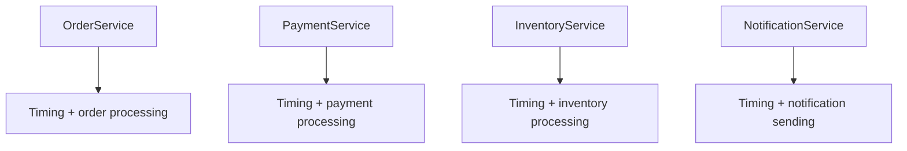
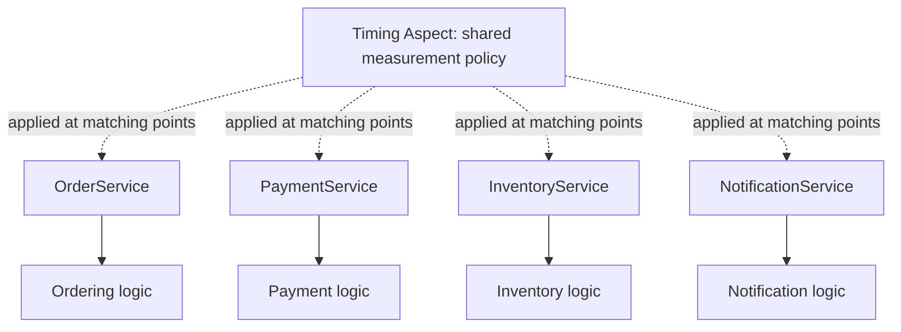
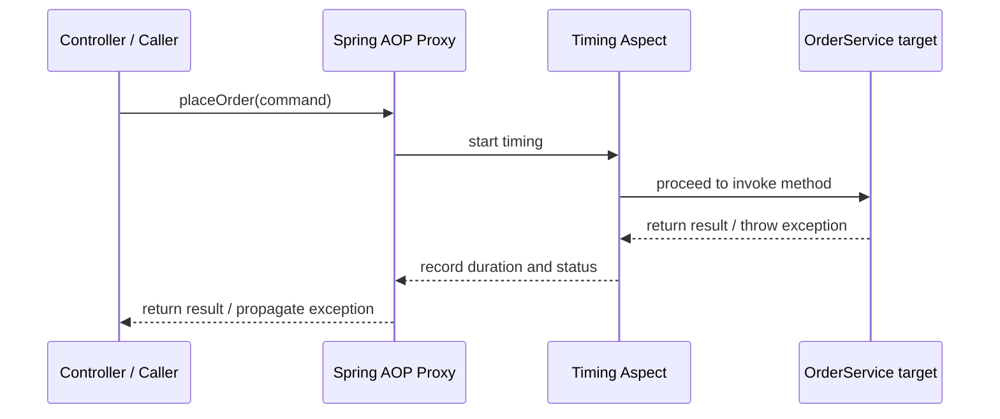
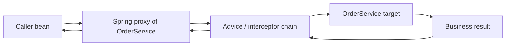
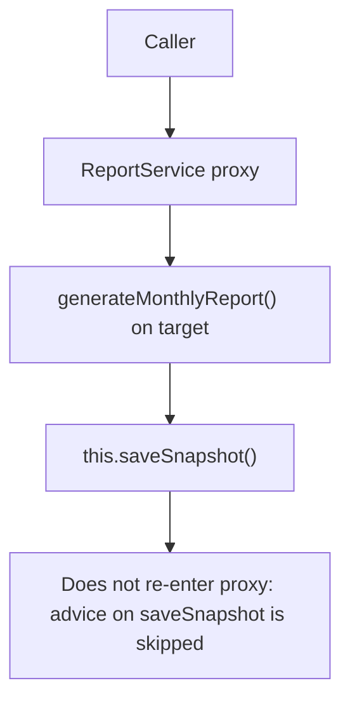
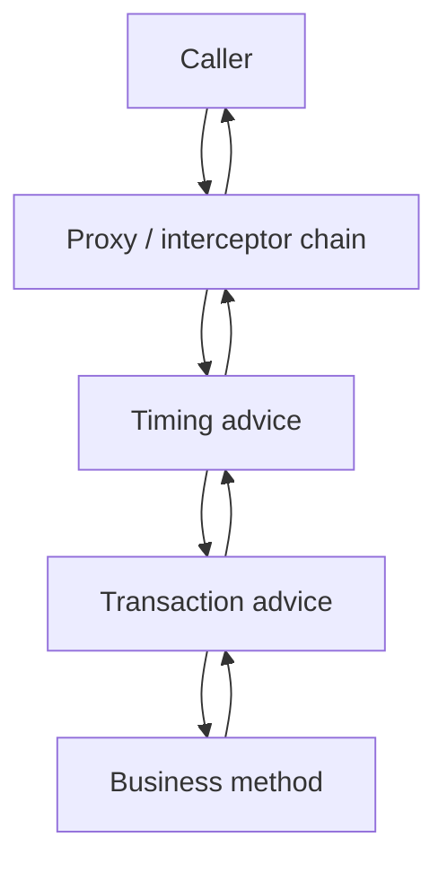

# The Shared Behavior Problem and Why AOP Exists

In a Spring Boot application, many business methods may need the same set of supporting behaviors: logging, measuring execution time, permission checking, opening and closing transactions, writing audit records, or handling caching. Those behaviors are not the core business logic of each individual method, yet they must be applied **in the right places, consistently, and in a maintainable way**.

For example, an order placement method is responsible for validating products, calculating totals, and saving the order. A payment method processes a payment request. Both may need to record execution time, but **measuring time is not the primary responsibility of ordering or payment business logic**.

If you copy timing code into dozens of service methods, business logic becomes mixed with infrastructure code. If you miss one place or update the measurement approach inconsistently, logging/metrics results become inconsistent. **Aspect-Oriented Programming (AOP)** was introduced to separate such shared behaviors from core logic and apply them according to clear rules.

This lesson belongs to the **AOP and Proxies** chapter of *Spring Boot Fundamentals*. The focus is on **the problem that leads to the need for AOP**, not just memorizing annotations. We will examine the problem of duplicated code, the limitations of conventional alternatives, the concept of cross-cutting concerns, how Spring AOP uses proxies, and a Spring Boot example you can practice yourself.

The examples are based on Spring Boot 3.x, Java 17 or higher, and common Spring AOP configuration style. Spring Boot and Spring Framework may change certain implementation details across versions; the principles explained here focus on proxy-based Spring AOP mechanics.

## 1. Starting from a simple business method

Suppose an application has a service that handles order placement:

```java
package com.example.shop.order;

import org.springframework.stereotype.Service;

@Service
public class OrderService {

    private final OrderRepository orderRepository;

    public OrderService(OrderRepository orderRepository) {
        this.orderRepository = orderRepository;
    }

    public OrderReceipt placeOrder(CreateOrderCommand command) {
        validate(command);
        Order order = Order.from(command);
        orderRepository.save(order);
        return new OrderReceipt(order.getId());
    }

    private void validate(CreateOrderCommand command) {
        // Validate business data.
    }
}
```

`OrderRepository`, `CreateOrderCommand`, `Order`, and `OrderReceipt` are illustrative types for the ordering domain; to compile this example, you need to implement them in the project. The key point is that `placeOrder` expresses a clear sequence of business steps.

Now comes a new requirement: **record the processing time of every important business operation**.

A direct approach is to add code into the service:

```java
public OrderReceipt placeOrder(CreateOrderCommand command) {
    long startedAt = System.nanoTime();
    try {
        validate(command);
        Order order = Order.from(command);
        orderRepository.save(order);
        return new OrderReceipt(order.getId());
    } finally {
        long elapsedNanos = System.nanoTime() - startedAt;
        log.info("placeOrder took {} ms",
                TimeUnit.NANOSECONDS.toMillis(elapsedNanos));
    }
}
```

This solution works, but it does not solve **the problem at application-wide scale**.

If you also have `PaymentService.pay()`, `InventoryService.reserve()`, `CustomerService.register()`, and many other methods, you have to add the same `startedAt → try/finally → log` structure in every place.

## 2. First problem: business logic and shared behavior get mixed

To see the duplication, consider three services:

```java
public void reserveInventory(String productCode) {
    long start = System.nanoTime();
    try {
        inventoryRepository.reserve(productCode);
    } finally {
        logDuration("reserveInventory", start);
    }
}

public PaymentResult charge(PaymentRequest request) {
    long start = System.nanoTime();
    try {
        return paymentClient.charge(request);
    } finally {
        logDuration("charge", start);
    }
}

public void sendConfirmation(long orderId) {
    long start = System.nanoTime();
    try {
        notificationClient.sendOrderConfirmation(orderId);
    } finally {
        logDuration("sendConfirmation", start);
    }
}
```

You can extract `logDuration()` into a shared utility. That reduces some duplication, but **every method still has to remember to call the utility and wrap its business logic in try/finally**.

The issue is not just line count:

| Problem | Consequence as the project grows |
|---|---|
| Scattered infrastructure code | Hard to read the primary business flow. |
| Duplicated try/finally blocks | Risk of missing exception branches, missing logs, or logging the wrong operation name. |
| Changing measurement policy | Must edit many services, easy to miss places. |
| Adding a new method | Developers must remember to apply the rule manually. |
| Business unit tests | Can become cluttered with logging, tracing, security, or transaction dependencies. |
| System-wide standards | Hard to ensure all modules use a single consistent way to measure and record results. |

The desired solution is not to "remove logging." We want to **keep logging**, while separating its application from business code.

## 3. What is a cross-cutting concern?

A **concern** is a distinct aspect of software responsibility. Order total calculation logic is a concern. Database connectivity is a concern. Logging execution time is also a concern.

A concern is called **cross-cutting** when the same policy/behavior appears **across many parts of the system**, rather than belonging solely to one business module.

For example:

| Concern | Scope of application | Shared behavior |
|---|---|---|
| Logging/observability | Many service methods | Record operation info, status, and duration. |
| Transaction | Data operations requiring atomicity | Begin, commit, or roll back a transaction. |
| Authorization | Operations requiring permissions | Check whether the principal is allowed to perform the action. |
| Cache | Cacheable read operations | Return from cache or invoke the method and store the result. |
| Auditing | Important data changes | Record actor, action, and outcome according to policy. |
| Retry | Calls with transient failures | Retry according to controlled attempt counts and conditions. |
| Tracing/metrics | Operations to be measured | Create spans, counters, or timers. |

Not every concern used in multiple places should use AOP. For instance, checking a business rule such as "an order must not exceed the credit limit" is a **business rule**. Even if multiple use cases need the same rule, that rule should usually live explicitly in a domain service or validation component, not necessarily hidden behind an aspect.

**Core criterion:** behavior that needs to be applied uniformly around many execution points, yet is not the main intent each individual method wants to express.

## 4. From scattered code to a centralized rule

Let us visualize before and after separating concerns.

**Without separating concerns:**



**When applying a timing aspect:**



Services focus on expressing business logic. The aspect focuses on expressing a shared policy. When changing how measurements work or metric names, we update the place defining the concern rather than editing every service.

This is commonly called **separation of concerns**: separating responsibilities so each part has its own reason to change.

## 5. Why aren't utility methods enough?

A utility such as:

```java
public final class PerformanceUtils {

    public static void measure(String name, Runnable action) {
        long start = System.nanoTime();
        try {
            action.run();
        } finally {
            long millis = TimeUnit.NANOSECONDS.toMillis(
                    System.nanoTime() - start);
            System.out.println(name + " took " + millis + "ms");
        }
    }
}
```

centralizes the timing algorithm. However, the caller still has to actively write:

```java
PerformanceUtils.measure(
        "reserveInventory",
        () -> inventoryRepository.reserve(productCode));
```

For methods with return values, checked exceptions, nested transactions, or async calls, custom-written wrappers become even more complex.

**Key difference:**

- A utility only provides **a function that performs the shared behavior**; the developer must call it.
- AOP lets you declare **a rule for applying the shared behavior** at matching points without manually invoking it from each business method.

This does not mean utilities are wrong. If a behavior is only used in two places or needs to be called explicitly to express business intent, a utility can be simpler and easier to understand than AOP.

## 6. Why do manual decorators or wrappers also have limitations?

Another approach is wrapping an implementation with a decorator:

```java
public interface PaymentService {
    PaymentResult pay(PaymentRequest request);
}

public final class LoggingPaymentService implements PaymentService {

    private final PaymentService delegate;

    public LoggingPaymentService(PaymentService delegate) {
        this.delegate = delegate;
    }

    @Override
    public PaymentResult pay(PaymentRequest request) {
        long start = System.nanoTime();
        try {
            return delegate.pay(request);
        } finally {
            logDuration("pay", start);
        }
    }
}
```

Decorator is a useful design pattern: the consumer receives the wrapper, and the wrapper delegates to the real implementation. This approach has a transparent execution flow and can work without Spring.

However, if every service type needs its own decorator to add the same policy, you end up writing many wrappers and managing them through Dependency Injection. **Spring AOP automates the intersection between proxy/decorator and method-selection rules**, reducing the need to write manual wrappers for every service.

Depending on architectural requirements, manual decorators remain a good choice when you need explicit control over specific interfaces or want to avoid hiding behavior in infrastructure.

## 7. How does AOP solve the problem?

**Aspect-Oriented Programming** organizes shared behavior into separate units, then applies them at matching execution points.

At a conceptual level:

1. You write business methods as usual.
2. You describe **where** the shared behavior should be applied.
3. You write **the behavior that runs before, after, or around** those points.
4. The framework combines the shared behavior with business calls using its AOP mechanism.

Spring AOP typically uses a **proxy object**: the consumer calls the proxy, the proxy executes advice, and only then invokes the real method on the target.



This is the model for an `@Around` advice. With multiple advisors, a call can pass through an interceptor chain before reaching the target method.

### 7.1. Business code does not directly call the aspect

A useful property of AOP:

```java
public OrderReceipt placeOrder(CreateOrderCommand command) {
    validate(command);
    Order order = Order.from(command);
    orderRepository.save(order);
    return new OrderReceipt(order.getId());
}
```

The method still expresses only business logic. You do not have to insert `logDuration(...)` here if the timing policy is already handled by an aspect and the call goes through a proxy.

### 7.2. AOP does not guess every business intent on its own

AOP cannot guess "this method needs auditing, that one does not." The system author must declare application rules, for example:

- Only methods annotated with `@TimedOperation`.
- Public methods in a `service` package.
- Methods matching a specific pointcut expression.

The broader the rule, the higher the risk of unintended application. For operations with side effects, choose precise boundaries and test clearly.

## 8. AOP terminology to know

| Term | Meaning in the Spring AOP context |
|---|---|
| **Aspect** | A module describing a shared concern, such as timing or auditing. |
| **Join point** | A point during execution where advice can participate; Spring AOP primarily supports method execution join points. |
| **Pointcut** | A rule determining which join points are matched. |
| **Advice** | Code that runs at selected join points, e.g., before/after/around a method. |
| **Target object** | The object containing the real business logic. |
| **Proxy** | An intermediary object that receives calls from consumers and allows advisors to intervene. |
| **Advisor** | In Spring, a structure combining advice with a matching pointcut/applicability condition. |
| **Weaving** | The concept of combining aspects with target code; Spring AOP typically does this via runtime proxies, unlike AspectJ bytecode weaving. |

### 8.1. Example mapping the terminology

Suppose:

```java
@TimedOperation("order.place")
public OrderReceipt placeOrder(CreateOrderCommand command) {
    // Business logic
}
```

- **Target:** the `OrderService` instance containing `placeOrder`.
- **Join point:** the execution of the `placeOrder` method via an intercepted call.
- **Pointcut:** the rule selecting methods annotated with `@TimedOperation`.
- **Advice:** the timing code running before and after the call.
- **Aspect:** the class defining the pointcut/advice for timing.
- **Proxy:** the object injected into the caller that coordinates advice around the target.

You do not need to memorize all terminology before coding. However, when reading Spring AOP documentation, map each term to "where to select" and "what to do" to avoid confusion.

## 9. Types of advice and their responsibilities

Spring supports several `@AspectJ`-style advice types:

| Annotation | When it runs | Suitable scenarios |
|---|---|---|
| `@Before` | Before the target method executes | Log start events, simple metadata checks. |
| `@AfterReturning` | After the method returns normally | Record success or observable results. |
| `@AfterThrowing` | When the method exits with a matching exception | Observe or audit failures. |
| `@After` | After the method finishes, whether it succeeded or failed | Cleanup or recording completion info. |
| `@Around` | Wraps the entire invocation | Measure duration, control proceeding with the call, record both success and failure. |

Illustrative method form:

```java
@Before("execution(* com.example.demo.service..*(..))")
public void beforeServiceCall() {
    log.debug("Calling a service method");
}
```

The `execution(* com.example.demo.service..*(..))` part is a pointcut expression matching methods within the specified package area. This is a syntax illustration; in real projects, avoid overly broad logging if methods carry sensitive data or execute at high frequency.

### 9.1. Why does timing usually use @Around?

To measure **the duration from invocation until the method returns or throws an error**, advice must run on both sides of the call. `@Around` lets you start measuring before `proceed()` and finish measuring in `finally`.

```java
@Around("execution(* com.example.demo.service..*(..))")
public Object measure(ProceedingJoinPoint joinPoint) throws Throwable {
    long start = System.nanoTime();
    try {
        return joinPoint.proceed();
    } finally {
        long elapsed = System.nanoTime() - start;
        // Record metric or log safely.
    }
}
```

**`joinPoint.proceed()` is the step that continues the call.** If an Around advice does not call `proceed()`, the business method may never execute. This is a powerful capability, but also a source of bugs when AOP is misused.

## 10. Complete example: measuring duration via a custom annotation

We will build a small AOP mechanism to mark operations that need timing without inserting timing code into each method. The example has four parts:

1. AOP dependency.
2. `@TimedOperation` annotation.
3. Aspect handling the annotation.
4. Service using the annotation and a runner to invoke it from outside the bean.

### 10.1. Add the Spring Boot AOP starter

With Gradle:

```groovy
dependencies {
    implementation 'org.springframework.boot:spring-boot-starter'
    implementation 'org.springframework.boot:spring-boot-starter-aop'
}
```

With Maven, add the corresponding dependency in `pom.xml`:

```xml
<dependency>
    <groupId>org.springframework.boot</groupId>
    <artifactId>spring-boot-starter-aop</artifactId>
</dependency>
```

The examples assume the project already has Spring Boot dependency version management configured. The AOP starter provides the infrastructure needed for Boot-style AOP; in a typical Boot setup, AOP auto-configuration can enable proxy support when the appropriate dependencies are present.

### 10.2. Define the @TimedOperation annotation

```java
package com.example.demo.aop;

import java.lang.annotation.ElementType;
import java.lang.annotation.Retention;
import java.lang.annotation.RetentionPolicy;
import java.lang.annotation.Target;

@Target(ElementType.METHOD)
@Retention(RetentionPolicy.RUNTIME)
public @interface TimedOperation {
    String value();
}
```

This annotation is only metadata. Without an aspect reading it, placing `@TimedOperation` on a method **does not automatically produce logs or metrics**.

### 10.3. Write the timing aspect

```java
package com.example.demo.aop;

import java.util.concurrent.TimeUnit;

import org.aspectj.lang.ProceedingJoinPoint;
import org.aspectj.lang.annotation.Around;
import org.aspectj.lang.annotation.Aspect;
import org.slf4j.Logger;
import org.slf4j.LoggerFactory;
import org.springframework.stereotype.Component;

@Aspect
@Component
public class TimedOperationAspect {

    private static final Logger log =
            LoggerFactory.getLogger(TimedOperationAspect.class);

    @Around("@annotation(timedOperation)")
    public Object measure(
            ProceedingJoinPoint joinPoint,
            TimedOperation timedOperation) throws Throwable {

        long startNanos = System.nanoTime();
        boolean succeeded = false;

        try {
            Object result = joinPoint.proceed();
            succeeded = true;
            return result;
        } finally {
            long elapsedMillis = TimeUnit.NANOSECONDS.toMillis(
                    System.nanoTime() - startNanos);

            log.info(
                    "operation={}, success={}, elapsedMs={}",
                    timedOperation.value(),
                    succeeded,
                    elapsedMillis);
        }
    }
}
```

Explanation:

- `@Aspect` marks the class as containing advice/pointcuts.
- `@Component` lets Spring manage the aspect instance as a bean within component scan scope.
- `@Around("@annotation(timedOperation)")` selects methods annotated with `@TimedOperation` and binds the annotation to the advice parameter.
- `System.nanoTime()` is suitable for measuring elapsed duration, not for displaying wall-clock time.
- `joinPoint.proceed()` passes control to the next step in the advice chain or to the target method.
- `finally` logs the duration even when the method throws an exception.
- `throws Throwable` allows the advice to propagate exceptions from the target method.

The advice does not swallow exceptions: `finally` executes and then the exception continues propagating to the caller. The `succeeded` variable is `true` only if `proceed()` returns normally.

**Security and observability:** this code logs only a fixed operation name and duration, not arguments or return values. In real projects, do not put passwords, access tokens, PII, or very high-cardinality values into metrics/logs just because AOP is available.

### 10.4. Use the annotation on a service

```java
package com.example.demo.order;

import com.example.demo.aop.TimedOperation;
import org.springframework.stereotype.Service;

@Service
public class OrderService {

    @TimedOperation("order.place")
    public String placeOrder(String productCode) {
        // Perform business logic; this is only a minimal example.
        return "Order accepted for " + productCode;
    }
}
```

Business logic does not need to know which Logger `TimedOperationAspect` uses or how elapsed time is measured. It simply marks important operations with the annotation.

### 10.5. Call the service from another bean

```java
package com.example.demo;

import com.example.demo.order.OrderService;
import org.springframework.boot.ApplicationRunner;
import org.springframework.context.annotation.Bean;
import org.springframework.context.annotation.Configuration;

@Configuration(proxyBeanMethods = false)
public class DemoRunnerConfiguration {

    @Bean
    ApplicationRunner demoRunner(OrderService orderService) {
        return args -> {
            String result = orderService.placeOrder("BOOK-123");
            System.out.println(result);
        };
    }
}
```

Here `OrderService` is injected from the container, so calls from the runner normally go through the Spring bean reference. If the service is proxied, the aspect gets a chance to intercept the method.

Illustrative log output might be:

```text
Order accepted for BOOK-123
operation=order.place, success=true, elapsedMs=0
```

The display order between the log and `System.out` may vary due to output streams and logger behavior. The `elapsedMs` value depends on actual execution time; `0` ms simply illustrates a very fast method.

### 10.6. Conditions for the example to take effect

In a real application, ensure that:

- `spring-boot-starter-aop` or the appropriate Spring AOP infrastructure is present.
- `TimedOperationAspect` is registered as a bean.
- `OrderService` is registered as a bean.
- Calls go through the bean proxy exposed by Spring.
- The method matches the pointcut and can be intercepted under the proxy mechanism.

Merely creating the annotation while forgetting the aspect, or instantiating an object directly with `new OrderService()`, will not make AOP work automatically.

## 11. Proxies are the key to Spring AOP

Spring AOP typically works via proxies rather than modifying `OrderService` source code directly.



The container can create the target object and then expose a bean reference that is a proxy. Other components injecting the bean receive an object suitable for advised calls.

### 11.1. JDK dynamic proxy and class-based proxy

Two common proxy mechanisms:

| Mechanism | How it works | Key points to know |
|---|---|---|
| **JDK dynamic proxy** | Creates a proxy for interfaces implemented by the target. | Consumers should generally depend on interfaces. |
| **Class-based proxy (CGLIB)** | Creates a subclass proxy of the target class. | Final classes/final methods cannot be overridden in the normal way. |

In standard Spring Boot configurations, class-based proxies are the default for AOP; this can be adjusted with `spring.aop.proxy-target-class` where supported.

```properties
spring.aop.proxy-target-class=false
```

When switching to interface-based proxies, both the injected types and whether the target has interfaces need consideration. Do not change proxy configuration solely to "make an aspect run" without verifying the call site, pointcut conditions, and bean types.

### 11.2. Proxy does not mean "every method call is intercepted"

Spring AOP relies on calls **passing through the proxy**. If a method inside an object calls another method on that same object, the internal call normally does not pass through the proxy.

This is the single most common source of confusion when learning AOP.

## 12. The self-invocation limitation: internal method calls bypass the proxy

Consider this service:

```java
@Service
public class ReportService {

    public void generateMonthlyReport() {
        saveSnapshot();
    }

    @TimedOperation("report.save-snapshot")
    public void saveSnapshot() {
        // Save report data.
    }
}
```

When a caller outside the bean invokes `reportService.generateMonthlyReport()` through the proxy, advice runs only if `generateMonthlyReport` matches a pointcut. The call to `saveSnapshot()` **inside the same target object** is equivalent to `this.saveSnapshot()` and does not go back through the proxy, so advice on `saveSnapshot` may not execute.

Conversely, if another bean directly calls `reportService.saveSnapshot()` through a Spring-injected reference, the advice can run according to the pointcut.



### 12.1. Reorganizing by responsibility

A good solution is to extract the part needing advice into another Spring bean:

```java
@Service
public class SnapshotService {

    @TimedOperation("report.save-snapshot")
    public void saveSnapshot() {
        // Save data.
    }
}

@Service
public class ReportService {

    private final SnapshotService snapshotService;

    public ReportService(SnapshotService snapshotService) {
        this.snapshotService = snapshotService;
    }

    public void generateMonthlyReport() {
        snapshotService.saveSnapshot();
    }
}
```

Now `ReportService` calls `SnapshotService` through an injected dependency, allowing the call to pass through the snapshot service's proxy if that bean is AOP-proxied.

Extracting a bean should be based on sensible responsibility boundaries, not just to dodge a technical quirk. Approaches like obtaining a self-reference proxy or using `AopContext.currentProxy()` exist, but they couple code tightly to AOP infrastructure and are usually not the first choice.

## 13. Scope and other limitations of proxy-based AOP

Spring AOP is not general-purpose bytecode instrumentation for every Java operation. Some important limitations:

1. **The object must be a Spring-managed bean.** Objects created directly with `new` outside the container do not automatically get a Spring proxy.
2. **The call must go through the proxy.** Self-invocation usually bypasses advice.
3. **Spring AOP focuses on method execution.** It does not directly support all join point kinds like field read/write, constructor execution, or static initialization of AspectJ weaving.
4. **Private methods cannot be advised under normal proxy mechanics.** They are not public/overridable calls intercepted by a proxy.
5. **Final methods or final classes have restrictions with class-based proxies.** Subclass proxies cannot override final methods/classes.
6. **Methods invoked during object initialization require caution.** Do not rely on advice on methods called from a constructor or `@PostConstruct` assuming the proxy is ready across all call paths.
7. **Asynchronous/reactive behavior requires separate understanding.** A timer around a method returning `CompletableFuture` or `Mono` may only measure creating the asynchronous object, not necessarily completion of the entire work.

Example:

```java
OrderService service = new OrderService();
service.placeOrder("BOOK-123");
```

Assuming `OrderService` in this snippet has a no-arg constructor, `new` creates a plain Java object; it is not a Spring bean proxy, so Spring's aspect does not run automatically. For the `OrderService` example in section 10, Java's default constructor applies because no other constructor is declared.

### 13.1. @Transactional can also hit self-invocation

A common scenario:

```java
@Service
public class OrderManagementService {

    public void process() {
        saveInTransaction();
    }

    @Transactional
    public void saveInTransaction() {
        // Database operations.
    }
}
```

If `saveInTransaction()` is only called from `process()` on the same object, it can bypass the transaction proxy interceptor. Thus, having an annotation in source code **does not guarantee the behavior is always applied** if the call path does not go through the proxy.

Remember that `@Transactional` also requires transaction management and an appropriate `PlatformTransactionManager`. It does not create a useful transaction solely by having the annotation.

## 14. Differences between Spring AOP and AspectJ weaving

Spring AOP and AspectJ both relate to AOP, but they have different mechanisms and scopes:

| Criterion | Spring AOP | AspectJ weaving |
|---|---|---|
| Common mechanism | Proxy-based, managed by the Spring container. | Compile-time/post-compile/load-time weaving into bytecode. |
| Primary join points | Method execution on Spring beans. | Can support many more join point types. |
| Objects created outside Spring | Not automatically proxied by Spring AOP. | Depends on weaving mechanism and woven scope. |
| Self-invocation | Usually bypasses proxy advice. | Can intercept if the join point is woven appropriately. |
| Setup complexity | Usually easy to integrate into Spring Boot. | Requires appropriate weaving and build/runtime configuration. |

Using `@Aspect` and AspectJ-style pointcut syntax in Spring AOP **does not mean the application is using AspectJ bytecode weaving**.

For logging, metrics, transactions, caching, and common concerns around Spring bean calls, proxy-based AOP is usually sufficient. Only consider weaving when requirements genuinely go beyond proxy capabilities, after evaluating complexity and operational cost.

## 15. Three familiar examples in Spring Boot

You do not need to write custom aspects for every concern. The Spring ecosystem already provides many features using a similar proxy/interceptor mechanism.

### 15.1. Transaction: @Transactional

```java
@Service
public class TransferService {

    private final AccountRepository repository;

    public TransferService(AccountRepository repository) {
        this.repository = repository;
    }

    @Transactional
    public void transfer(long fromId, long toId, long amount) {
        repository.debit(fromId, amount);
        repository.credit(toId, amount);
    }
}
```

The idea:

- Consumer calls the method through an appropriate bean proxy.
- The transaction interceptor begins or joins a transaction per configuration.
- The business method performs debit/credit.
- The interceptor handles commit or rollback according to policy.

The application avoids inserting manual transaction management code into each business method. However, this does **not** guarantee every error rolls back: default rollback rules and transaction configuration must be understood properly, such as rolling back by default on unchecked exceptions.

### 15.2. Cache: @Cacheable

```java
@Service
public class ProductCatalogService {

    @Cacheable(cacheNames = "products", key = "#productId")
    public ProductView getProduct(long productId) {
        return loadFromDatabase(productId);
    }
}
```

If caching is enabled and a suitable cache manager is present, the proxy/interceptor can check the cache before executing the method and store the result when appropriate. Caching can **skip calling the target method** on a cache hit.

Caching must be enabled via appropriate configuration, typically `@EnableCaching`. Do not assume simply adding `@Cacheable` makes caching active in every project.

### 15.3. Method authorization: @PreAuthorize

```java
@Service
public class AccountAdministrationService {

    @PreAuthorize("hasAuthority('ACCOUNT_ADMIN')")
    public void deactivateAccount(long accountId) {
        // Perform account status change.
    }
}
```

When Spring Security method security is configured and enabled (for example via `@EnableMethodSecurity`), an interceptor can check permissions before allowing the method to execute.

Security is a strong example of a cross-cutting concern, but policies must be designed carefully. Never treat a custom logging AOP aspect as a substitute for reliable Spring Security authorization mechanisms.

### 15.4. Similarities and differences

Transactions, caching, and method security can all rely on interception around method calls. However:

- Each feature has its own infrastructure and dependencies.
- Not every feature is enabled by `spring-boot-starter-aop`.
- Annotations only take effect when configuration, advisors, and call paths match.
- Interceptor ordering can affect semantics, such as whether caching sits outside or inside a transaction.

## 16. When AOP delivers the greatest benefit

AOP is worth considering when the following characteristics hold:

1. **The concern appears in many places.** Not a behavior confined to a single method.
2. **The application rule can be expressed clearly.** Such as an annotation or a package/service boundary.
3. **The behavior belongs to shared infrastructure/policy.** It does not contain critical business decisions that must be directly visible in code.
4. **Consistent application is valuable.** Missing one place hurts logging, auditing, or operational guarantees.
5. **Its effect can be tested.** The team can verify that advice runs when needed and does not run when not needed.

A fitting example is timing critical operations with `@TimedOperation`. The timing policy can be changed centrally without affecting business implementations.

### 16.1. Genuine benefits

| Benefit | Explanation |
|---|---|
| Reduces infrastructure duplication | One advice is reused across many join points. |
| Separates responsibilities | Services focus on business logic, aspects focus on policy. |
| Easy to change shared policy | Edit one aspect or pointcut to change how it applies. |
| Consistent observability | Selected operations share the same format/log/metric policy. |
| Keeps business code simple | No need to wrap every method in repetitive measurement/check code. |
| Ties rules to metadata | Annotations can express which concerns a method needs. |

These benefits exist only when pointcuts are sensible and the team understands the implicit behavior added by proxies.

## 17. When should AOP not be used?

AOP has a trade-off: it makes runtime behavior **not completely visible inside the method body**. Readers need to know which advisors may affect a call.

Do not automatically choose AOP in these situations:

- The shared behavior only exists in a couple of places; calling an explicit utility is simpler.
- It is a **business workflow** that must be read in a clear sequence, such as charging, confirming an order, reserving stock, and publishing an event.
- You need to intercept HTTP requests/responses at the web boundary; `Filter` or `HandlerInterceptor` may fit better.
- You need to handle all API exceptions according to an HTTP contract; `@ControllerAdvice`/`@ExceptionHandler` is usually clearer than an aspect catching everything.
- You need to intercept internal calls, constructors, or field access outside Spring proxy scope; Spring AOP does not directly support this.
- You need to handle sensitive data at a boundary with specific security requirements; use the framework's trusted extension points.
- The concern has too many branches depending on business context, making pointcuts/advice hard to predict.

### 17.1. Comparing tools for each boundary

| Goal | Tool to consider first |
|---|---|
| Timing a group of service methods | AOP or appropriate observability instrumentation. |
| Logging HTTP request metadata | Servlet `Filter`, WebFlux `WebFilter`, or appropriate interceptor. |
| Attaching data to REST responses | Spring MVC `ResponseBodyAdvice` or response layer design. |
| Consistent API error handling | `@ControllerAdvice`. |
| Controlling transaction boundaries | `@Transactional` and transaction infrastructure. |
| Reusing a business formula | Domain service, explicit utility, or strategy. |
| Adding behavior around a specific interface | A decorator may be simpler than AOP. |
| Enforcing method authorization policy | Spring Security method authorization. |

Choose tools by **the boundary where intervention is needed**, not merely by a hunch that "this is shared code so it must need an aspect."

## 18. The problem of overly broad pointcuts

A pointcut like:

```java
@Around("execution(* com.example..*(..))")
```

can match a great many methods in the application. When the scope is too broad:

- Logging can surge and hurt performance.
- Unrelated methods also get intercepted.
- There is a risk of logging sensitive data if advice is not safely designed.
- Infrastructure code can be invoked in nested ways, creating hard-to-read logs.
- When packages or class names change, the matching scope may shift unexpectedly.

An often easier-to-control option is a marker annotation:

```java
@TimedOperation("inventory.reserve")
public void reserve(String productCode) {
    // ...
}
```

Then only methods marked according to policy are measured. Even so, annotation-driven AOP still needs code review and tests to ensure no points needing observation are missed.

### 18.1. Avoid "hiding" business changes inside aspects

Measuring time and recording metrics are observational behaviors. By contrast, an aspect that silently alters a payment amount or skips a transaction based on business logic makes execution paths hard to understand.

`@Around` advice can alter return values, throw exceptions, or skip `proceed()`, but **being able to do something does not mean you should**. For business decision logic, prefer explicit design using services/domain models.

## 19. Advice and exceptions: what must be preserved?

A concern like logging or timing should preserve the semantics of the business method:

```java
@Around("@annotation(timedOperation)")
public Object measure(ProceedingJoinPoint pjp,
                      TimedOperation timedOperation) throws Throwable {
    long start = System.nanoTime();
    try {
        return pjp.proceed();
    } finally {
        logDuration(timedOperation.value(), System.nanoTime() - start);
    }
}
```

When the target returns a result, the advice forwards that result. When the target throws an exception, `finally` logs the duration while the exception still propagates to the caller.

A common mistake is accidentally swallowing exceptions:

```java
try {
    return pjp.proceed();
} catch (Throwable ex) {
    log.warn("Business call failed", ex);
    return null; // Can break the method's contract.
}
```

For a timing aspect whose responsibility is purely observational, returning `null` instead of rethrowing the exception is usually wrong: the caller no longer receives the original error signal, and outer transaction or retry policies can also be affected.

If you genuinely want fallback, retry, or exception translation, treat that as **a separate policy with an explicit contract**, rather than silently adding it into a timing aspect.

## 20. AOP has costs and needs its own observation

Adding proxies and interceptor chains introduces some runtime cost. In many business applications, the direct overhead of a small advice is low compared to network/database I/O; however, the cost of logging, serialization, metric tag cardinality, or overly frequent logging can be significant.

Some principles:

1. **Do not log all arguments by default.** They may contain tokens, personal data, large payloads, or objects with expensive `toString()`.
2. **Choose stable operation names.** Do not use user IDs or order IDs as dynamic metric names.
3. **Do not emit duplicate logs across multiple layers without purpose.** Logging controllers, services, and repositories together can generate huge data volumes.
4. **Do not turn advice into synchronous network calls without timeouts.** Writing audit/metrics can slow down or fail business requests.
5. **Understand async/reactive methods.** When a method returns `Mono`/`CompletableFuture`, that is not necessarily when the task finishes.
6. **Measure at the right boundary.** Measuring every small method does not necessarily explain full-request latency.
7. **Avoid unintended side effects.** Observational concerns should have minimal impact on business execution.

Spring Boot has an ecosystem for observability, metrics, and tracing; for standard instrumentation purposes, consider built-in instrumentation before building a complex custom AOP system.

## 21. Ordering multiple advices and composability

A service may have multiple concerns applied at once:

```java
@TimedOperation("order.place")
@Transactional
public OrderReceipt placeOrder(CreateOrderCommand command) {
    // ...
}
```

A call may pass through an advisor chain:



The diagram illustrates only **one possible order**. The actual order depends on advisor ordering configuration and which infrastructure advisors are present. If timing wraps outside the transaction, the measured time may include transaction setup/completion; if inside, the measured scope may differ.

When ordering matters, `@Order`/`Ordered` can be used on custom aspects, while also considering the order of infrastructure advisors. Do not assume all advisors always run in the order annotations appear in source code.

### 21.1. Why does ordering affect the outcome?

Some questions to answer:

- Should auditing be recorded before or after the transaction commits?
- Should retries wrap a fresh transaction on each attempt?
- Should cache hits count toward the business method's timing?
- Must authorization happen before the method performs side effects?

These are architectural decisions. AOP provides the mechanism to compose multiple concerns, but it cannot automatically define the right policy for every system.

## 22. Testing: verifying that advice actually runs

A unit test that simply creates the target with `new` does not prove Spring AOP is working. To verify calls through a proxy, you need a Spring application context containing the aspect and target bean.

A simple approach is `@SpringBootTest`:

```java
package com.example.demo;

import static org.assertj.core.api.Assertions.assertThat;

import com.example.demo.order.OrderService;
import org.junit.jupiter.api.Test;
import org.springframework.aop.support.AopUtils;
import org.springframework.beans.factory.annotation.Autowired;
import org.springframework.boot.test.context.SpringBootTest;

@SpringBootTest
class AopProxyPresenceTest {

    @Autowired
    OrderService orderService;

    @Test
    void orderServiceIsProxied() {
        assertThat(AopUtils.isAopProxy(orderService)).isTrue();
    }
}
```

This test only confirms the Spring bean reference is an AOP proxy when the aspect and AOP infrastructure are configured properly. It **does not by itself prove the timing log has the right content**.

To test advice behavior, replace or abstract metric/timing recording behind an observable test recorder, then:

1. Call the annotated method via a Spring-injected bean reference.
2. Verify the business method still returns the right result.
3. Verify the recorder captures the right operation name.
4. Test the case where the method throws an exception: the advice still records duration and the exception is still propagated.
5. Test an unannotated method: the recorder does not record unexpected operations.

### 22.1. Checking self-invocation

Create a bean with two methods: `outer()` calls `inner()`, with only `inner()` marked. Call `outer()` from another bean and observe whether the advice on `inner()` runs. Then extract `inner()` into a separate bean to see the difference when the call goes through a proxy.

### 22.2. Checking unannotated methods

If an aspect uses `@annotation(TimedOperation)`, methods without the annotation should not be advised. Such a test guards against overly broad pointcut matching after refactoring.

### 22.3. Do not assert only that a proxy exists

A proxy can exist due to another advisor like transaction or security, even if your timing pointcut does not match. Therefore, to confirm a specific concern, assert specific behavior or appropriate advisor metadata, rather than only calling `AopUtils.isAopProxy`.

## 23. Debugging when @Aspect does not run

When an aspect "has no effect," check in order:

1. **Is the AOP dependency present?** For custom aspect examples, does the project have `spring-boot-starter-aop` or appropriate proxy support configuration?
2. **Is the aspect registered as a Spring bean?** `@Aspect` does not replace `@Component` or `@Bean`.
3. **Is the target a Spring-managed bean?** Is code calling `new` directly?
4. **Does the call go through the proxy?** Is it self-invocation within the same target?
5. **Does the pointcut match?** Does the annotation have runtime retention, and do package/method signatures match?
6. **Can the method be proxied?** Are there private/final or interface/class proxy issues?
7. **Is there nested/async execution?** Does the advice measure a synchronous method or work occurring after the method returns?
8. **Are other advisors interfering?** Do ordering and exception translation produce unexpected outcomes?
9. **Is the test calling a real Spring bean reference?** Tests using `new Target()` usually bypass the Spring proxy.

Some symptoms:

| Symptom | Investigation direction |
|---|---|
| Annotation is on the method but nothing logs | Aspect is not registered, pointcut does not match, or call bypasses proxy. |
| Calling from controller triggers advice, calling from another method in the same service does not | Self-invocation. |
| `new OrderService()` does not trigger aspect | Object is not managed by Spring. |
| Final method on class-based proxy is not intercepted | Subclass proxy limitation. |
| Proxy exists but timing advice does not run | Proxy may come from another advisor; check timing pointcut. |
| Method returning `CompletableFuture` finishes fast, timer is always tiny | Advice measures creating the future, not necessarily completing the future. |
| Method throws exception but logs "success" | Advice records status incorrectly or a catch alters the exception flow. |

## 24. Common misconceptions

### "AOP is only for logging"

False. Logging is an obvious example, but AOP is also useful for transactions, security, caching, auditing, and appropriate shared execution policies.

### "@Aspect on any class means Spring applies it automatically"

Insufficient. The aspect must be discovered/registered by the container, AOP infrastructure must be present, and calls must match the pointcut via a proxy.

### "With an annotation present, every call is intercepted"

No. Spring AOP is proxy-based. Self-invocation, objects created with `new` outside Spring, and unproxiable methods can skip advice.

### "Aspects are better than service helpers in all cases"

No. For business logic or few call sites, explicit code is usually simpler. AOP is helpful when consistency of a concern cutting across many services matters enough to justify the extra abstraction.

### "Spring AOP is AspectJ weaving"

No. Spring uses AspectJ-style annotations and pointcut syntax, but proxy-based Spring AOP has a different scope from AspectJ weaving.

### "@Around only logs and cannot affect results"

No. Around advice can control calling `proceed()`, return values, and exceptions. Because of that power, design carefully so you do not break business contracts.

## 25. Hands-on lab

Create a Spring Boot application with `spring-boot-starter-aop` and perform:

**Step A — Identify duplicated code.** Write two service methods, each measuring elapsed time itself using `System.nanoTime()` and `try/finally`.

**Step B — Extract a utility.** Create `PerformanceUtils.measure` and compare how many places services still have to call the wrapper manually.

**Step C — Create an annotation.** Write `@TimedOperation` with `@Retention(RUNTIME)` and `@Target(METHOD)`.

**Step D — Create an aspect.** Use `@Aspect` and `@Around("@annotation(timedOperation)")`; record the operation name, elapsed time, and success flag.

**Step E — Select methods.** Mark two business methods with the annotation; keep a third method unannotated for comparison.

**Step F — Call through a Spring bean.** Create an `ApplicationRunner` injecting the service and calling the methods. Confirm advice runs only for the marked methods.

**Step G — Test failure.** Have one method throw `IllegalStateException`; observe that the elapsed time log appears while the exception still reaches the caller.

**Step H — Test new.** Create an instance manually and call a method; compare with the Spring-injected bean.

**Step I — Test self-invocation.** Create `outer()` calling `inner()` in the same bean, with only `inner()` marked. Compare with extracting `inner()` into another service.

**Step J — Test @Transactional.** If the project has a database and appropriate transaction manager, add `@Transactional` and see why transactions can also depend on proxy boundaries.

**Step K — Observe the proxy.** In an integration test, use `AopUtils.isAopProxy` to inspect the bean reference, then verify advice behavior with a recorder/test double instead of relying only on manual log inspection.

**Step L — Evaluate trade-offs.** Answer: if a concern is only used on two methods, would you keep a utility, use a decorator, or use an aspect? Why?

After each step, note clearly: **where the shared logic lives, which points are advised, whether calls pass through a proxy, and whether business behavior stays intact**.

## 26. Self-assessment questions

1. What is a cross-cutting concern? Give three examples in Spring Boot.
2. Why is copying timing `try/finally` blocks into many services not a good solution as a system grows?
3. Where does a utility reduce logic duplication, yet what must the caller still do?
4. How do manual decorators and Spring AOP proxies relate?
5. How do aspect, advice, pointcut, and join point differ?
6. What kind of join point does Spring AOP primarily support?
7. Why can a call from a controller to a service be intercepted while a call from `this.outer()` to `this.inner()` is not?
8. Why doesn't `@Aspect` alone guarantee an aspect is used in an application?
9. When should `@Around` call `proceed()`? What can happen if it is omitted?
10. Why should a timing advice rethrow exceptions rather than returning `null`?
11. What limitations do final methods and private methods create for proxies?
12. How does Spring AOP differ from AspectJ bytecode weaving?
13. How do `@Transactional`, `@Cacheable`, and `@PreAuthorize` illustrate cross-cutting concerns?
14. Why can using multiple advisors make transaction/timing order important?
15. Is AOP suitable for implementing business workflow steps like charging, reserving stock, and sending email?
16. Is a test asserting only `AopUtils.isAopProxy` enough to conclude a timing aspect runs properly?
17. When are `Filter` or `@ControllerAdvice` more suitable than service-layer AOP?
18. For a reactive method returning `Mono`, does measuring before and after `proceed()` reliably reflect task completion time?

### Complete sample explanation

> Many methods in a Spring Boot application need the same infrastructure behaviors such as logging, timing, transactions, authorization, or caching. These are cross-cutting concerns because the same policy cuts across different business areas. Copying related code into each service scatters code, risks omissions, and hurts maintainability. Utilities and decorators help reuse code, but still require manual calls or wrapping in many places. AOP solves this by isolating policy into an aspect, using pointcuts to select methods and advice to run behavior before, after, or around methods. Spring AOP primarily uses proxies: callers invoke the bean proxy, advice is applied, and then the target method runs. Thus AOP is especially useful for shared behavior around Spring bean calls, but it has limits: objects created outside Spring, self-invocation, and unproxiable methods may not be advised. AOP also does not replace clear business design; use it only when the concern boundary is meaningful and testable.

When you see repeated behavior across many services, ask three questions: **Is this genuinely a cross-cutting concern? Is there a clear rule for selecting where it applies? Do actual calls go through a Spring proxy?** Answering those three questions means you understand **the shared behavior problem and why AOP exists**.
