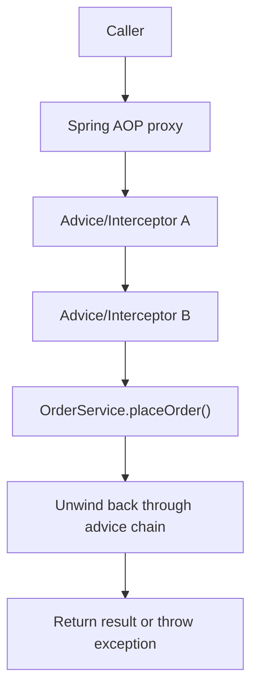
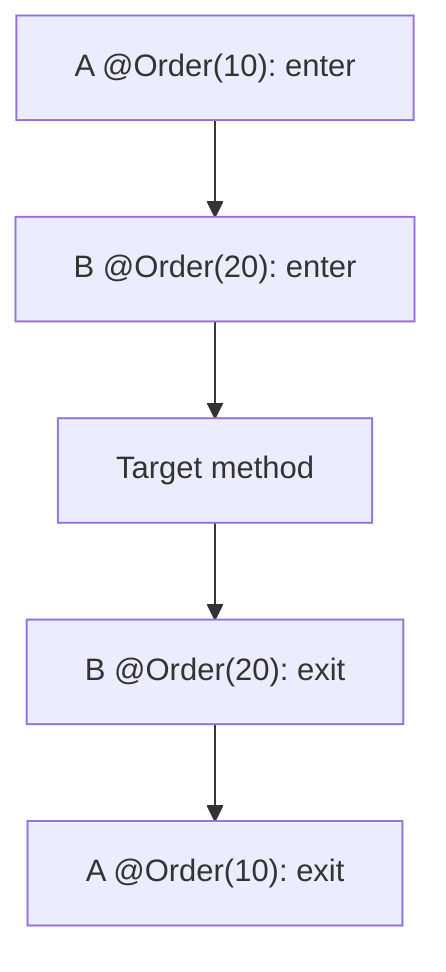

# Advice Ordering and the Limits of Reasoning from Single Annotations

> **Spring Boot Fundamentals · AOP and Proxies**  
> When multiple advices apply to the same method, Spring AOP must decide which advice runs first, which runs later, and which wraps the next invocation. Annotations such as `@Before`, `@AfterReturning`, `@Around`, and `@Order` provide important clues, yet **looking only at annotations on a single method or class is insufficient to determine the entire runtime execution order**. The outcome also depends on whether pointcuts match, whether the bean goes through a proxy, how many advisors are in the chain, precedence rules, and the behavior of infrastructure interceptors such as transactions or caching.

## 1. Context: one call can pass through many advices

Suppose an application has an order-processing service:

```java
@Service
public class OrderService {

    public String placeOrder(String orderId) {
        // Save order and perform business logic.
        return "PLACED:" + orderId;
    }
}
```

The development team wants to:

- Log at the start and end.
- Measure processing duration.
- Record audit checks.
- Manage transactions when mutating data.
- Potentially enforce access control and caching at appropriate call points.

A seemingly simple call:

```java
orderService.placeOrder("O-100");
```

can pass through one or more proxies/interceptors before the real `placeOrder` method body executes.



The question is not only "is `@Around` present?", but also:

1. Does the advice actually apply to this call?
2. Where does the advice sit in the advisor chain?
3. Does it run **before** calling the method, **after returning**, **after throwing**, or **around** the call?
4. Does any advice block the method from running?
5. Are other proxies, transaction advisors, or cache advisors involved?

This lesson separates those factors so you can reason accurately.

## 2. Distinguishing aspect, pointcut, advice, advisor, and proxy

Before examining order, distinguish the concepts.

| Concept | Meaning |
| --- | --- |
| **Join point** | Point where cross-cutting behavior can apply; Spring AOP proxies primarily support **method execution** |
| **Pointcut** | Condition selecting which join points match |
| **Advice** | Behavior executing before/after/around a join point |
| **Aspect** | Group of pointcuts and advices for a concern, e.g. auditing |
| **Advisor** | Combines an advice/interceptor with pointcut metadata so Spring knows where to apply it |
| **Proxy** | Intermediary object receiving calls, running the interceptor chain, and invoking the target |

A class carrying `@Aspect` does not automatically become an active aspect. It must also be managed by Spring as a bean, and AOP infrastructure must be able to detect its advice.

For example, Spring Boot 3.x typically adds the dependency:

```xml
<dependency>
    <groupId>org.springframework.boot</groupId>
    <artifactId>spring-boot-starter-aop</artifactId>
</dependency>
```

When appropriate AOP auto-configuration is active, Spring Boot can configure proxy infrastructure automatically; in a Spring Framework app without such auto-configuration support, `@EnableAspectJAutoProxy` may be needed.

Note: examples in this lesson describe **proxy-based Spring AOP**, not the full capabilities of AspectJ compile-time weaving or load-time weaving.

### 2.1. Having an annotation does not mean calls are intercepted

Example class:

```java
@Aspect
public class LoggingAspect {

    @Before("execution(* com.example.orders.OrderService.placeOrder(..))")
    public void beforeOrder() {
        System.out.println("before order");
    }
}
```

If `LoggingAspect` is not registered as a Spring bean or AOP is not configured, the advice may never run. If calls bypass the proxy or the pointcut does not match, the annotation still sits in source code yet produces no logs.

**To reason about advice order, first verify which advices are actually present in the chain.**

## 3. Five common advice types and when they trigger

Spring AOP supports these annotation-style advices:

| Advice annotation | Timing and meaning |
| --- | --- |
| `@Before` | Before executing the join point, once flow reaches this advice |
| `@AfterReturning` | After the join point completes normally and returns |
| `@AfterThrowing` | When flow unwinds through this advice with a matching exception |
| `@After` | Similar to `finally`: runs when flow exits the advised segment |
| `@Around` | Wraps the next step in the chain; decides whether to call `proceed()` |

Crucial point: "before" and "after" are **relative to the segment of the call that the advice wraps**, not necessarily relative to every operation across the entire system.

### 3.1. `@Before`

```java
@Aspect
@Component
public class TraceAspect {

    @Before("execution(* com.example.orders.OrderService.placeOrder(..))")
    public void beforeOrder() {
        System.out.println("BEFORE: place order");
    }
}
```

This advice runs when the call is handled by the proxy, the pointcut matches, and execution reaches it. It is often useful for logging, lightweight auditing, or pre-call checks.

If `@Before` throws an exception, subsequent steps in the chain and the target may never execute.

### 3.2. `@AfterReturning`

```java
@AfterReturning(
        pointcut = "execution(* com.example.orders.OrderService.placeOrder(..))",
        returning = "result")
public void afterSuccess(Object result) {
    System.out.println("RETURNED: " + result);
}
```

This advice applies only when the wrapped call completes normally. It **does not** run when an exception unwinds through the advisor chain.

Reassigning the `result` variable inside the advice is not a way to replace the target's return value. To alter the value returned to the caller, you normally need `@Around` returning a replacement object.

### 3.3. `@AfterThrowing`

```java
@AfterThrowing(
        pointcut = "execution(* com.example.orders.OrderService.placeOrder(..))",
        throwing = "error")
public void afterFailure(Throwable error) {
    System.out.println("THREW: " + error.getClass().getSimpleName());
}
```

This advice runs when a matching exception propagates through it. If the parameter is declared more specifically, such as `IllegalArgumentException`, it receives only exceptions assignable to that type.

`@AfterThrowing` is suited for recording failures, not for swallowing errors simply because it returns `void`. To handle an exception and return a fallback value, use `@Around` with explicit error-catching code.

### 3.4. `@After`

```java
@After("execution(* com.example.orders.OrderService.placeOrder(..))")
public void afterOrder() {
    System.out.println("AFTER: cleanup");
}
```

`@After` has `finally`-like semantics: it runs when the wrapped call finishes, whether it returned normally or threw an exception.

However, calling it "after every other advice in the application" is inaccurate. Ordering across multiple aspects depends on precedence and nesting structure.

### 3.5. `@Around`

```java
@Around("execution(* com.example.orders.OrderService.placeOrder(..))")
public Object measure(ProceedingJoinPoint joinPoint)
        throws Throwable {

    long started = System.nanoTime();

    try {
        return joinPoint.proceed();
    } finally {
        long elapsed = System.nanoTime() - started;
        System.out.println("Elapsed ns: " + elapsed);
    }
}
```

`@Around` has the strongest control. `proceed()` calls the next step in the interceptor chain, eventually reaching the target if nothing blocks it.

This advice can:

- Call `proceed()` exactly once.
- Skip `proceed()` to prevent the next step from executing.
- Replace the return value.
- Catch or transform exceptions.
- In valid contexts, call `proceed()` multiple times, executing the inner chain multiple times.

Therefore, seeing `@Around` alone does not prove the target will definitely execute once.

## 4. How does `@Order` govern precedence?

When multiple aspects match the same join point, Spring can use `@Order` or the `Ordered` interface to determine **precedence**.

Example:

```java
@Aspect
@Component
@Order(10)
public class SecurityTraceAspect {
    // Advice for selected methods.
}
```

```java
@Aspect
@Component
@Order(20)
public class LatencyTraceAspect {
    // Advice for the same methods.
}
```

Foundational rules:

- **Lower order value means higher precedence.**
- `@Order(10)` has higher precedence than `@Order(20)`.
- Among matching advices in the same chain, higher-precedence advice **runs earlier on the way in**.
- On the way out, higher-precedence advice normally **finishes later**, because it wraps lower-precedence advice.

### 4.1. Entry and exit orders differ

Suppose two `@Around` advices exist:

```text
Order(10)  A: before proceed()
Order(20)  B: before proceed()
           Target method
Order(20)  B: after proceed()
Order(10)  A: after proceed()
```

Representation:



Learners often mistakenly think "lower order runs first" means **every log from that aspect** always appears earlier. In reality it runs first on entry, yet typically runs last on exit.

### 4.2. Why does the reversal occur?

Picture each `@Around` as a wrapper layer:

```text
A(
    B(
        target()
    )
)
```

With nested calls:

1. Enter A.
2. Enter B.
3. Run target.
4. Exit B.
5. Exit A.

This is the nature of an interceptor chain, not a special quirk of `@Order`.

### 4.3. Negative values, 0, and `LOWEST_PRECEDENCE`

`@Order` accepts an integer. Smaller numbers carry higher precedence, including negative numbers:

```java
@Order(-10)
@Aspect
@Component
class CriticalTraceAspect {
}
```

Constant `Ordered.HIGHEST_PRECEDENCE` represents very high precedence; `Ordered.LOWEST_PRECEDENCE` represents very low precedence.

Do not arbitrarily assign `HIGHEST_PRECEDENCE` to every aspect, as that creates ties at the same priority level. Pick meaningful order ranges—such as 100 for outer concerns and 200 for inner concerns—and document that decision.

### 4.4. Equal order values do not guarantee a stable order

If two aspects share `@Order(10)` or both use default precedence, do not deduce order from class names, Java file order, or `@Component` placement.

Registration and sorting details can affect outcomes when precedences tie. If business logic requires a specific order, **assign distinct precedences**, rather than relying on an accidental order observed in one run.

## 5. Complete example: two `@Around` aspects

This example records invocation order using a recorder instead of relying on comparing log timestamps across streams.

### 5.1. Event recorder

```java
package com.example.aop;

import java.util.List;
import java.util.concurrent.CopyOnWriteArrayList;

import org.springframework.stereotype.Component;

@Component
public class TraceRecorder {

    private final List<String> events =
            new CopyOnWriteArrayList<>();

    public void add(String event) {
        events.add(event);
    }

    public List<String> snapshot() {
        return List.copyOf(events);
    }

    public void clear() {
        events.clear();
    }
}
```

`CopyOnWriteArrayList` makes writes from multiple threads safe at the collection level, though it does not turn concurrent thread interleavings into a single semantically ordered sequence. This example uses one synchronous call.

### 5.2. Target service

```java
package com.example.aop;

import org.springframework.stereotype.Service;

@Service
public class DemoService {

    private final TraceRecorder recorder;

    public DemoService(TraceRecorder recorder) {
        this.recorder = recorder;
    }

    public String execute() {
        recorder.add("TARGET");
        return "OK";
    }
}
```

### 5.3. Outer aspect

```java
package com.example.aop;

import org.aspectj.lang.ProceedingJoinPoint;
import org.aspectj.lang.annotation.Around;
import org.aspectj.lang.annotation.Aspect;
import org.springframework.core.annotation.Order;
import org.springframework.stereotype.Component;

@Aspect
@Component
@Order(10)
public class OuterAspect {

    private final TraceRecorder recorder;

    public OuterAspect(TraceRecorder recorder) {
        this.recorder = recorder;
    }

    @Around("execution(* com.example.aop.DemoService.execute(..))")
    public Object around(ProceedingJoinPoint pjp)
            throws Throwable {

        recorder.add("OUTER-IN");

        try {
            return pjp.proceed();
        } finally {
            recorder.add("OUTER-OUT");
        }
    }
}
```

### 5.4. Inner aspect

```java
package com.example.aop;

import org.aspectj.lang.ProceedingJoinPoint;
import org.aspectj.lang.annotation.Around;
import org.aspectj.lang.annotation.Aspect;
import org.springframework.core.annotation.Order;
import org.springframework.stereotype.Component;

@Aspect
@Component
@Order(20)
public class InnerAspect {

    private final TraceRecorder recorder;

    public InnerAspect(TraceRecorder recorder) {
        this.recorder = recorder;
    }

    @Around("execution(* com.example.aop.DemoService.execute(..))")
    public Object around(ProceedingJoinPoint pjp)
            throws Throwable {

        recorder.add("INNER-IN");

        try {
            return pjp.proceed();
        } finally {
            recorder.add("INNER-OUT");
        }
    }
}
```

### 5.5. Expected result

When a caller invokes `demoService.execute()` **through a Spring proxy**, the recorder logs:

```text
OUTER-IN
INNER-IN
TARGET
INNER-OUT
OUTER-OUT
```

This is the outcome of two around advisors with distinct precedences. The order does not depend on source file order, class names, or advice method names.

### 5.6. When the service throws an exception

If `execute()` throws an exception, the `finally` blocks still execute:

```text
OUTER-IN
INNER-IN
TARGET
INNER-OUT
OUTER-OUT
Exception returns to caller
```

Conversely, if the inner aspect skips calling `proceed()`, `TARGET` will not appear. If an around advice catches the error and returns a fallback, the caller can receive a normal result instead of the original exception. Thus an order table alone cannot explain the full execution path without knowing what the advices do inside.

## 6. Order of multiple `@Before` and multiple exit advices

`@Order` is especially straightforward when comparing advices of the same kind in **different aspects**.

Suppose:

```java
@Aspect
@Component
@Order(10)
class AAspect {

    @Before("execution(* com.example.aop.DemoService.execute(..))")
    void beforeA() {
        System.out.println("A-before");
    }
}
```

```java
@Aspect
@Component
@Order(20)
class BAspect {

    @Before("execution(* com.example.aop.DemoService.execute(..))")
    void beforeB() {
        System.out.println("B-before");
    }
}
```

If both advices match the method, on entry you see:

```text
A-before
B-before
Target
```

For advices running on exit, higher precedence normally runs **after** lower precedence. For instance, two `@AfterReturning` advices in different aspects normally yield:

```text
Target returns normally
B-after-returning
A-after-returning
```

Do not memorize a rigid formula like "A always before B." Picture the higher-precedence aspect wrapping the lower-precedence one and trace the direction of travel through the chain.

### 6.1. Do different advice types run at the same moment?

No. `@Before` runs on entry; `@AfterReturning` runs only on normal return; `@AfterThrowing` runs only on a matching exception; `@After` runs with `finally` semantics; `@Around` defines both entry and exit logic.

Therefore, accurate reasoning requires knowing **advice type, precedence, and success/failure paths**.

## 7. Ordering multiple advices inside the same `@Aspect`

This is an important limit of reading annotations.

Example:

```java
@Aspect
@Component
public class AuditAspect {

    @Before("execution(* com.example.aop.DemoService.execute(..))")
    public void validateSomething() {
        // ...
    }

    @Before("execution(* com.example.aop.DemoService.execute(..))")
    public void recordSomething() {
        // ...
    }
}
```

You cannot conclude `validateSomething()` will run before `recordSomething()` **just because it appears higher in the source file**. Java method declaration order is not a contract sorting same-kind advices inside one aspect.

### 7.1. Spring assigns precedence among advice types within the same aspect

In modern Spring Framework versions, advice methods in the same `@Aspect` matching the same join point are assigned precedence by type, from highest to lowest:

1. `@Around`.
2. `@Before`.
3. `@After`.
4. `@AfterReturning`.
5. `@AfterThrowing`.

This is **internal precedence ordering**, not a chronological log list running top to bottom.

One key detail: `@After` has `finally`-like semantics, so on exiting the join point it can **execute after** `@AfterReturning` or `@AfterThrowing` in the same aspect, even though `@After`'s technical precedence ranks above those two.

### 7.2. Why do precedence and log timing differ?

Suppose an aspect contains `@Around`, `@AfterReturning`, and `@After`. `@Around` can wrap the outside. `@After` is a finally advice, so when exiting the join point it can execute after the corresponding after-returning piece.

Consider:

- Which advice wraps which advice.
- Whether code runs before or after `proceed()`.
- Whether the flow exits normally or throws an exception.

Do not turn the internal precedence list into a rigid claim that logs will print `Around → Before → After → AfterReturning → AfterThrowing`. In a normal call, `@AfterThrowing` does not even trigger.

### 7.3. When two advices of the same kind need deterministic ordering

Suppose two tasks must run before the target in order:

1. Normalize context.
2. Record audit start.

Consider:

- **Combine them into a single advice** and call two helpers in explicit order.
- **Split into two `@Aspect` classes** with distinct `@Order` values.
- If the issue is a tight business sequence, **put the logic in a service** rather than using AOP for every step.

Do not rely on the positions of two methods inside one class to represent mandatory ordering dependencies.

### 7.4. Where should `@Order` be placed?

For Spring AOP `@Aspect` classes, the clear practice is placing `@Order` at the **aspect class level**:

```java
@Aspect
@Component
@Order(100)
public class MetricsAspect {
    // ...
}
```

Do not attach `@Order` onto individual advice methods assuming Spring will sort all advices within the same aspect that way. When each concern needs its own order, split concerns into separate aspects or redesign the call boundary.

## 8. Why does `@Around` make annotation-only reasoning fail so often?

Two advices both bearing `@Around` can behave completely differently.

### 8.1. Around calling `proceed()` exactly once

```java
@Around("execution(* com.example.aop.DemoService.execute(..))")
public Object passThrough(ProceedingJoinPoint pjp)
        throws Throwable {
    return pjp.proceed();
}
```

This is the pass-through pattern. If no other advice blocks it, the target executes once.

### 8.2. Around skipping `proceed()`

```java
@Around("execution(* com.example.aop.DemoService.execute(..))")
public Object shortCircuit(ProceedingJoinPoint pjp) {
    return "CACHED";
}
```

The call does not continue through inner chain segments. Inner advices and the target may never execute.

Ensure the returned value matches the target method's return type. If the method returns `void` or a primitive, return-value compatibility rules must be respected.

### 8.3. Around catching exceptions

```java
@Around("execution(* com.example.aop.DemoService.execute(..))")
public Object withFallback(ProceedingJoinPoint pjp)
        throws Throwable {

    try {
        return pjp.proceed();
    } catch (IllegalStateException error) {
        return "FALLBACK";
    }
}
```

When an outer around advice catches an exception, inner advices may still have seen the exception and triggered `@AfterThrowing`. Yet the outer caller receives `FALLBACK`.

Therefore, you cannot spot an `@AfterThrowing` advice and conclude the outer caller will definitely receive the exception.

### 8.4. Around calling `proceed()` multiple times

An around advice can implement retries under appropriate designs. In that case, the inner chain and target can run multiple times.

Conceptual example:

```java
@Around("execution(* com.example.aop.DemoService.execute(..))")
public Object retryOnce(ProceedingJoinPoint pjp)
        throws Throwable {

    try {
        return pjp.proceed();
    } catch (TransientFailure error) {
        return pjp.proceed();
    }
}
```

`TransientFailure` is an illustrative application exception. Such a snippet is not a complete production retry mechanism: you must consider idempotency, transaction boundaries, side effects, backoff, exception classification, and attempt limits.

The lesson point is: given the exact same `@Around` and `@Order`, **how many times the target runs can vary depending on the code inside the advice**.

## 9. Advice order on normal return vs. exception throw

We can trace several scenarios.

### 9.1. Normal completion

Assuming advices match cleanly and none short-circuit:

```text
Around: before proceed()
Before
Target
AfterReturning
After (finally)
Around: after proceed()/finally
Caller receives return value
```

This is a conceptual sequence for a matching chain, **not an automatic guarantee for arbitrary aspect combinations**. When advices belong to multiple aspects with varying precedences, interleaving follows the wrapping structure.

### 9.2. Target throws an exception

```text
Around: before proceed()
Before
Target throws
AfterThrowing (if exception matches)
After (finally)
Around: catch/finally
Caller receives exception, unless around handles it
```

Like the success case, this illustrates the mechanism rather than replacing inspection of the actual advisor chain.

### 9.3. `@Before` throws an exception itself

If `@Before` throws before reaching the target, outer wrapping advices can see the error in their `catch`/`finally` blocks. Inner advices that were never reached will not get a chance to run.

Thus you cannot state "every `@AfterThrowing` runs whenever an exception occurs anywhere" without knowing where in the chain the exception originated.

### 9.4. `@AfterReturning` or `@After` throws an exception itself

An exit advice can also throw an error. In that case, the final outcome can change or the original exception can be masked.

For instance, the target returns successfully, yet `@AfterReturning` throws an exception: the caller may see the advice's exception instead of the target's result.

Hence logging/metrics advice should generally handle errors safely and avoid throwing unexpected exceptions that alter business behavior.

## 10. A method with `@Transactional`: transaction order vs. custom aspects

`@Transactional` is typically implemented by Spring transaction infrastructure via an interceptor/advisor in proxy mode. It does not start a transaction simply because the annotation appears in source code.

Example:

```java
@Service
public class PaymentService {

    @Transactional
    public void processPayment() {
        // Data operations.
    }
}
```

A timing aspect:

```java
@Aspect
@Component
@Order(100)
public class PaymentTimingAspect {

    @Around("execution(* com.example.payment.PaymentService.processPayment(..))")
    public Object measure(ProceedingJoinPoint pjp)
            throws Throwable {
        long start = System.nanoTime();
        try {
            return pjp.proceed();
        } finally {
            System.out.println(
                    "Elapsed: " + (System.nanoTime() - start));
        }
    }
}
```

You **cannot look only at `@Order(100)` and `@Transactional`** and claim `measure` logs before or after transaction begin/commit. You must know the transaction advisor's order and the actual chain order.

### 10.1. The transaction advisor also has an order

With annotation-driven transaction management, `@EnableTransactionManagement` has an `order` attribute setting the precedence of the advisor handling `@Transactional`. It typically defaults to `Ordered.LOWEST_PRECEDENCE`.

If a custom aspect has higher precedence than the transaction advisor and sits in the same chain, the conceptual path can be:

```text
Custom aspect: ENTER
    Transaction interceptor: begin / join transaction
        Target method
    Transaction interceptor: commit / rollback
Custom aspect: EXIT
```

Then the code before `proceed()` in the custom aspect runs **before** the transaction interceptor starts the transaction, and the custom aspect's `finally` runs **after** the interceptor completes synchronous transaction work.

However, if the custom aspect has lower precedence than the transaction advisor, it can sit **inside** the transaction boundary.

### 10.2. Measuring time "inside a transaction" vs. "the full call" differs

If an aspect wraps outside the transaction interceptor, measured duration can include starting/completing the transaction plus the target's work.

If an aspect sits inside the transaction interceptor, measured duration can include only the target and inner advices, excluding outer commit/rollback work.

To be certain what a metric measures, inspect the actual chain. Do not assume any timer with `@Order` measures exact database transaction time.

### 10.3. Do not check transaction state in the wrong place

For thread-bound transactions in imperative apps, you can observe:

```java
boolean active =
        TransactionSynchronizationManager.isActualTransactionActive();
```

If checked in an aspect wrapping outside the transaction interceptor, `active` before `proceed()` may be false; inside the transactional service it can be true if a transaction was created properly.

Conversely, reactive environments use a different context model from thread-local imperative transactions. Do not mechanically apply a thread-local check to infer transactions in a reactive application.

### 10.4. Annotations also require support

A method carrying `@Transactional` is not guaranteed to be intercepted if:

- Transaction management is not properly configured.
- The bean is outside the relevant proxy/bean factory scope.
- Calls bypass the proxy, e.g., self-invocation.
- The method cannot be intercepted under the active proxy mode.
- No suitable transaction manager exists.
- The annotation is placed where actual metadata discovery does not support it as the author expected.

Advisor ordering matters only after the prerequisites for transaction advice to participate have been met.

## 11. `@Cacheable`, `@Async`, and other infrastructure advisors

Spring has many features using AOP proxies or similar interception mechanisms:

- `@Transactional`.
- `@Cacheable` and related cache annotations.
- `@Async`.
- Method security interceptors.
- Retry or custom advisors registered by libraries.

This means a call can involve more interceptors than just the `@Aspect`s you wrote yourself.

### 11.1. Caching can prevent calling the target

Example:

```java
@Cacheable("products")
public Product findProduct(String id) {
    return repository.findById(id).orElseThrow();
}
```

On a cache hit with proper caching configuration, the cache interceptor can return the result without invoking the target method. Depending on where a custom aspect sits in the advisor chain:

- An aspect wrapping outside the cache interceptor can still run.
- An aspect sitting inside the cache interceptor may not run on a cache hit.

Consequently, a metrics aspect on a `@Cacheable` method does not necessarily count repository queries. It may count caller invocations or only a subset of target executions, depending on the chain.

### 11.2. Async changes log timing and execution threads

`@Async` can offload work to an executor thread. Then pre/post logs on the caller thread and logs on the worker thread no longer belong to a simple synchronous call stack.

Two log lines with nearby timestamps do not prove `@Order` ordering. Distinguish:

- When the caller invoked the proxy.
- When the task was submitted.
- When the worker thread started.
- When the target completed.
- When the `Future` or `CompletableFuture` completed.

When features use multiple proxies or async interceptors, observe the actual execution context.

### 11.3. Security and transactions can have different boundaries

A method security interceptor can reject a call before the target runs. Depending on precedence, a transaction might not have started yet or might already be active before authorization is checked.

This is an important performance and safety decision—do not guess from the order of `@PreAuthorize` and `@Transactional` in source code. Check advisor ordering for your framework/version and actual security configuration.

### 11.4. Do not use a single order table for every system layer

Servlet Filters, Spring MVC HandlerInterceptors, ControllerAdvice, Spring AOP Advisors, JPA entity callbacks, and database triggers live at different layers. `@Order` on an aspect does not automatically govern the ordering of all of them.

If a requirement states "the security filter must run before AOP logging" or "transaction commit must finish before emitting an event," examine the lifecycle and mechanism of each individual layer.

## 12. Why is a single annotation insufficient for reasoning?

An annotation provides only one piece of data. To determine whether advice runs and in what order, additional context is needed.

| Looking only at annotation | What is missing |
| --- | --- |
| `@Aspect` | Is the class registered as a Spring bean and is AOP enabled? |
| `@Before` | Does the pointcut match the actual join point? |
| `@Around` | How many times does code call `proceed()`, and does it catch errors? |
| `@AfterReturning` | Does the call actually return normally through this advice? |
| `@AfterThrowing` | Does the exception match the bound parameter type? |
| `@After` | Where does this advice sit in the nested advisor chain? |
| `@Order(10)` | What order do other advisors have, and are there ties? |
| `@Transactional` | Are the transaction advisor/manager active, and does the call cross the proxy? |
| `@Cacheable` | Cache hit or miss, and where is the cache advisor located? |
| `@Async` | Which part runs on the caller thread and which runs on the executor? |
| `@annotation(...)` | Which method does the matcher inspect—on interface or implementation? |
| `@Service` | Is it really a context bean and did the caller obtain the Spring proxy? |

Principle: **annotations are declarative metadata; runtime behavior is the result of metadata plus infrastructure and actual execution flow**.

### 12.1. Order is not decided by annotation placement in source code

Writing:

```java
@Transactional
@Audited
public void process() {
}
```

or:

```java
@Audited
@Transactional
public void process() {
}
```

does not let you conclude that swapping those two lines changes advisor order. `@Transactional` and custom `@Audited` are interpreted by different components. Advisor ordering is what matters.

### 12.2. Method names do not define order

Names like `beforeA`, `auditFirst`, or `logLast` do not directly affect precedence. If ordering is a contract, configure it explicitly and write tests observing it.

### 12.3. Without knowing the pointcut, you do not know whether the aspect participates

An advice:

```java
@Before("execution(* com.example.orders.OrderService.placeOrder(..))")
```

does not automatically apply to `OrderService.cancelOrder()` just because both methods are in the same service.

Even when pointcuts use wildcards, conditions like `within`, `args`, `target`, or `@annotation` can make the matched join point set differ from initial guesses.

## 13. Proxies and self-invocation: right annotations, yet advice does not run

Spring AOP is proxy-based. Callers must invoke through the proxy object for the interceptor chain to run.

### 13.1. External call through proxy

```java
@Service
public class BookingService {

    @Audited
    public void reserve() {
        // ...
    }
}
```

If `bookingService` is injected from Spring and an advisor matches, calling:

```java
bookingService.reserve();
```

can go through the proxy and reach the target.

### 13.2. Self-invocation bypasses the proxy

```java
@Service
public class BookingService {

    public void submit() {
        reserve(); // this.reserve(): internal call
    }

    @Audited
    public void reserve() {
        // ...
    }
}
```

Suppose an external caller invokes `submit()` through the proxy. Inside the target, `reserve()` is called on `this`, not through the outer proxy. Therefore, advice attached solely to `reserve()` may not run for the internal call.

`@Order` does not fix this because **there is no advice chain for `reserve()` to sort** during this self-invocation.

### 13.3. Generally better fix

Extract responsibilities into another Spring bean:

```java
@Service
public class ReservationService {

    @Audited
    public void reserve() {
        // ...
    }
}
```

```java
@Service
public class BookingService {

    private final ReservationService reservations;

    public BookingService(ReservationService reservations) {
        this.reservations = reservations;
    }

    public void submit() {
        reservations.reserve();
    }
}
```

When `reservations` is a Spring-injected proxy bean and the advisor matches, the call passes through the appropriate proxy.

Techniques exist to obtain a self-proxy or use `AopContext.currentProxy()`, yet they couple code tightly to AOP infrastructure and are rarely the right first choice. Separating bean responsibilities is easier to test.

## 14. JDK dynamic proxies and class-based proxies

Spring AOP can use JDK dynamic proxies or subclass-based proxies, commonly called CGLIB.

| Proxy type | Key characteristics |
| --- | --- |
| JDK dynamic proxy | Proxy exposes proxied interfaces; callers usually work through interfaces |
| Class-based proxy (CGLIB) | Creates a subclass of an eligible class to intercept overridable methods |
| Bypasses proxy | Advice is not triggered, even if annotations exist on the method |

### 14.1. `final` and `private`

With class-based proxies, `final` methods cannot be overridden to intercept the way subclass proxies require. `private` methods also cannot be overridden from a subclass.

Consequently, do not treat `@Before` or `@Transactional` on `private`/`final` methods as sufficient to guarantee interception in Spring AOP proxy mode.

In modern Spring Framework versions, certain non-public methods may be supported with class-based proxies under suitable conditions. Do not apply an absolute rule like "AOP only supports public methods" to every version and configuration; verify the actual proxy type and interceptability.

### 14.2. Interface vs. implementation annotations

In JDK proxies, methods exposed through the interface can differ from implementation methods regarding direct reflection metadata. Spring has mechanisms to resolve concrete methods and annotation metadata, yet custom pointcuts or manual reflection inspecting annotations can behave differently depending on which `Method` is examined.

For instance, inside `@Around`:

```java
Method method =
        ((MethodSignature) joinPoint.getSignature()).getMethod();
```

With a JDK proxy, `method` may represent the interface method. If the annotation was placed only on the implementation, manually calling `method.getAnnotation(...)` may not find the annotation as expected.

You can resolve the specific target-class method via Spring's utilities and then inspect annotations using merged/meta-annotation support when needed. Do not assume every way of obtaining a `Method` yields identical results.

### 14.3. Pointcuts must also match proxiable method kinds

A class having many methods does not mean Spring AOP proxies intercept every method. Spring AOP mainly intercepts method executions callable through a proxy. Constructor calls, direct field access, or self-invocation do not automatically become join points advised by Spring AOP proxies.

If interception deeper than proxied method calls is needed, that is a different weaving problem.

## 15. Custom annotations do not create advice automatically

Suppose an annotation is declared:

```java
package com.example.aop;

import java.lang.annotation.ElementType;
import java.lang.annotation.Retention;
import java.lang.annotation.RetentionPolicy;
import java.lang.annotation.Target;

@Target(ElementType.METHOD)
@Retention(RetentionPolicy.RUNTIME)
public @interface Audited {
}
```

Attached to a service:

```java
@Audited
public void reserve() {
    // ...
}
```

That **does not automatically produce logging/auditing behavior**. You need an aspect or interceptor that actually reads the annotation:

```java
@Aspect
@Component
public class AuditAspect {

    @Before("@annotation(com.example.aop.Audited)")
    public void audit(JoinPoint joinPoint) {
        System.out.println(
                "AUDIT " + joinPoint.getSignature().toShortString());
    }
}
```

Only when the pointcut matches and calls go through the proxy does the advice run.

### 15.1. `@annotation` has context limits

The `@annotation(...)` condition checks whether the annotation is present on the matching method according to matching rules. Placing the annotation on an interface, implementation method, class, or meta-annotation can yield different results depending on the expression and how the annotation is defined.

If an annotation is placed on a class, a pointcut using only `@annotation` to look for method-level annotations does not automatically mean "all methods of this class match." You may need `@within`, `@target`, or another expression matching your intent.

Verify exactly where the annotation is placed and where the pointcut checks, rather than guessing from the annotation's name.

### 15.2. `@Order` on business annotations does not auto-sort AOP

An annotation like `@Audited`, `@Monitored`, or `@Retryable` carries meaning for its corresponding framework/implementation. If you add an `order` attribute to a business annotation yourself, Spring AOP will not automatically use it to sort advisors unless your advisor-handling/registration code explicitly reads it.

To manage precedence among normal aspects, configure `@Order` on the aspect or advisor per Spring's contract.

## 16. Inspecting the advisor chain instead of only reading annotations

When behavior is complex, you can inspect the proxy created in the context.

### 16.1. Verify whether the bean is a proxy

```java
Object bean = applicationContext.getBean(OrderService.class);

boolean aopProxy = AopUtils.isAopProxy(bean);
boolean jdkProxy = AopUtils.isJdkDynamicProxy(bean);
boolean classProxy = AopUtils.isCglibProxy(bean);

System.out.println("AOP proxy: " + aopProxy);
System.out.println("JDK proxy: " + jdkProxy);
System.out.println("Class proxy: " + classProxy);
```

`AopUtils` belongs to Spring AOP. If the bean is a JDK proxy, looking up by concrete class like `OrderService.class` may fail when the proxy exposes only an interface; look up by the proxied interface or by bean name.

### 16.2. Inspecting the advisor list

When the proxy implements `Advised`:

```java
Object bean = applicationContext.getBean("orderService");

if (bean instanceof Advised advised) {
    for (Advisor advisor : advised.getAdvisors()) {
        System.out.println(advisor);
    }
}
```

The `Advised` and `Advisor` interfaces belong to Spring AOP infrastructure.

The advisor list reveals which interceptors/advices are installed on the proxy. This is a good diagnostic starting point, though it does not replace checking pointcut matching and `proceed()` flow when analyzing a specific call.

Do not assume every proxy in the system can be cast straight to `Advised`; check the type first.

### 16.3. Logging at the exact points before/after `proceed()`

When confirming execution order, log or record these events:

- Aspect A: before `proceed()`.
- Aspect B: before `proceed()`.
- Target method: start and end.
- Aspect B: after `proceed()` or in `finally`.
- Aspect A: after `proceed()` or in `finally`.

Name events to distinguish "enter", "exit", and "throw" instead of only logging "aspect called." With only one log line per aspect, you can miss the wrapping structure.

### 16.4. Multi-threaded logs need extra context

With `@Async` or concurrent execution, include thread names, trace IDs, or correlation IDs in logs. Line order from different threads in a log aggregator does not necessarily reflect a single call stack.

Do not compare two nearby timestamps and deduce advice order when they come from two different calls or threads.

## 17. Testing advice order via observable behavior

Ordering is a requirement that must be verified when it affects correctness, not just guessed by reading source code.

### 17.1. Testing two around aspects

Use `TraceRecorder`, `DemoService`, `OuterAspect`, and `InnerAspect` from section 5.

To test in a minimal Spring test context, enable proxy infrastructure:

```java
package com.example.aop;

import org.springframework.context.annotation.Configuration;
import org.springframework.context.annotation.EnableAspectJAutoProxy;

@Configuration(proxyBeanMethods = false)
@EnableAspectJAutoProxy(proxyTargetClass = true)
public class DemoAopConfiguration {
}
```

Test with JUnit 5, Spring Test, and AssertJ:

```java
package com.example.aop;

import static org.assertj.core.api.Assertions.assertThat;

import org.junit.jupiter.api.Test;
import org.springframework.beans.factory.annotation.Autowired;
import org.springframework.test.context.junit.jupiter.SpringJUnitConfig;

@SpringJUnitConfig(classes = {
        DemoAopConfiguration.class,
        TraceRecorder.class,
        DemoService.class,
        OuterAspect.class,
        InnerAspect.class
})
class AopAdviceOrderTest {

    @Autowired
    DemoService service;

    @Autowired
    TraceRecorder recorder;

    @Test
    void highPrecedenceAspectWrapsLowerPrecedenceAspect() {
        recorder.clear();

        assertThat(service.execute()).isEqualTo("OK");

        assertThat(recorder.snapshot()).containsExactly(
                "OUTER-IN",
                "INNER-IN",
                "TARGET",
                "INNER-OUT",
                "OUTER-OUT"
        );
    }
}
```

This test verifies the observed sequence in a context where both aspects are registered, both match, and they have distinct orders. `proxyTargetClass = true` enables class-based proxying so the test can inject `DemoService` by concrete class; in real applications you can choose JDK proxies depending on design and configuration.

### 17.2. Testing the exception path

Add a target method that throws an error and update pointcuts to match it, then verify:

- The `...-IN` events occurred.
- The target event recorded the failure.
- `finally` blocks ran in reverse order.
- The caller received the right exception if no around advice handled it.

Do not extrapolate from one successful test to all exception paths automatically.

### 17.3. Testing self-invocation

Create a service where method A calls method B on `this`, with advice matching only method B. Compare:

- Calling B directly from another bean through the proxy.
- Calling A, which calls B internally.

The outcome shows that source annotations on B are insufficient to guarantee both paths trigger advice.

### 17.4. Testing with transactions/caching as needed

If ordering relative to transactions affects logic, write an integration test with a transaction manager recording transaction active state before, during, and after the call. If an aspect interacts with caching, test both cache hits and misses to see target execution counts.

Do not replace testing real mechanics with unit tests calling an aspect's Java method directly—such calls create no proxy or advisor chain.

## 18. Diagnostic workflow when log order differs from expectations

When logs appear in an unexpected order, check step by step:

1. **Which bean was actually called?** Did the caller get the bean from Spring or instantiate it with `new`?
2. **Is the bean proxied?** Check JDK proxy vs. class-based proxy.
3. **Did the call go through the proxy?** Check self-invocation and method visibility.
4. **Is the aspect a Spring bean?** `@Aspect` does not auto-register a bean without proper component registration.
5. **Does the pointcut match?** Check package, method name, argument types, and annotation placement.
6. **Which advisors are in the chain?** Not just custom `@Aspect`s, also transactions, caching, security, async.
7. **What is each aspect/advisor's precedence?** Check `@Order`, `Ordered`, and infrastructure configuration.
8. **Are there tied order values?** If so, do not infer order from source code order.
9. **Does the advice call `proceed()`?** Does it skip, retry, or convert exceptions into results?
10. **Is this the return or exception branch?** `@AfterReturning` and `@AfterThrowing` never both trigger on the same branch.
11. **Are multiple threads or interleaved calls involved?** Use trace IDs or event recorders to separate calls.
12. **Have you verified with an integration test?** Use real contexts/proxies whenever ordering is a core requirement.

### 18.1. Distinguish "no advice" from "advice running in wrong order"

If an advice logs nothing, do not rush to change `@Order`. Check pointcuts and proxy paths first.

Only when both advices run yet their order differs from expectations should you inspect order, advisor types, and wrapping structure.

If the target runs multiple times, inspect retry/around code rather than only looking at precedence values.

### 18.2. Symptom table

| Symptom | Possible cause | Investigation path |
| --- | --- | --- |
| `@Before` does not run | Aspect not registered, pointcut mismatch, or self-invocation | Check bean/proxy/pointcut |
| `@Around` logs enter only, no target | Advice skipped `proceed()` or threw earlier | Inspect advice body |
| Exit logs reverse entry order | Nested interceptor chain | Picture `A(B(target))` structure |
| Two advices with same `@Order` swap order | Tied precedence, no guaranteed contract | Assign distinct orders |
| Two `@Before`s in same aspect run differently from source order | Method declaration order does not guarantee precedence | Split aspects or merge logic |
| `@AfterReturning` does not run on error | Target/inner chain threw exception | Use `@AfterThrowing`/`@After` appropriately |
| `@AfterThrowing` runs yet caller gets a result | Outer around caught error and returned fallback | Inspect chain and catches |
| Metrics log runs even on cache hit | Metrics advisor wraps outside cache interceptor | Inspect advisor ordering |
| Metrics do not run on cache hit | Metrics advisor sits inside cache short-circuit | Inspect chain |
| `@Transactional` present yet no transaction | Bypassed proxy or missing transaction infrastructure | Check transaction advisor/manager |
| `@Async` interleaves logs | Execution switched to another thread | Attach trace/thread context |
| `final` method not advised under CGLIB | Proxy cannot override method | Check method/proxy type |
| Custom annotation present yet advice skips | No advisor handling it or wrong annotation location | Check `@annotation` and metadata placement |
| Concrete bean type lookup fails | JDK proxy exposes interface, not target concrete type | Inject via interface |
| Added `@Order` yet order did not change | Aspect did not match, order placed in wrong scope, or infrastructure order differs | Inspect advisor chain |

## 19. Designing maintainable advice ordering

Not every cross-cutting concern needs its own precedence. When many aspects exist, establish concise team conventions.

### 19.1. An order allocation table can help

Example **internal project convention**, not a built-in Spring rule:

| Order range | Project concern | Intent |
| --- | --- | --- |
| 100–199 | Trace/correlation | Wraps outside internal instrumentation concerns |
| 200–299 | Audit start/finish | Records execution flow |
| 300–399 | Metrics | Measures inner work per team definition |
| 400–499 | Custom adapter advice | Applies right before target per integration needs |

This table governs only **custom aspects owned by the team**. It does not automatically place transaction, cache, or security infrastructure into those same order ranges. For relative guarantees against infrastructure, inspect and configure the corresponding advisors.

### 19.2. Use ordering when order is a genuine requirement

You do not need distinct numbers on every aspect if concerns are independent. Assigning precedence merely to make logs "look pretty" adds needless coupling.

Conversely, when:

- Tracing must wrap outside metrics.
- Metrics must measure the exact scope with/without a transaction.
- A check must happen before side effects.
- Cleanup must happen even if another advice throws.

then advice precedence and semantics must be designed explicitly and tested.

### 19.3. Do not put core business sequences entirely into AOP

If business logic mandates "validate → reserve inventory → charge payment → emit event," that is a business workflow belonging in an application service or orchestration component.

Use AOP for clearly scoped cross-cutting concerns such as logging, metrics, tracing, transaction boundaries, or auditing. Do not scatter critical business sequencing across multiple `@Aspect`s relying on hard-to-trace `@Order` values.

### 19.4. When deterministic ordering is required, merge or separate at clear boundaries

Two helpers running in fixed order before the target can live inside a single `@Before`:

```java
@Before("execution(* com.example.aop.DemoService.execute(..))")
public void before(JoinPoint joinPoint) {
    prepareContext(joinPoint);
    recordAuditStart(joinPoint);
}
```

This is a simple way to express a two-step sequence without relying on sorting multiple same-kind advice methods inside one aspect.

If two concerns must stay independent and apply to different pointcuts, separate aspects with distinct precedences can fit better.

## 20. Practice exercise: proving order and annotation limits

### Step 1 — Create a target service

Create `DemoService` with `execute()` returning `"OK"`. Inside the method, record `"TARGET"` into `TraceRecorder`.

### Step 2 — Create two aspects

Create:

- `OuterAspect` with `@Order(10)` and `@Around`.
- `InnerAspect` with `@Order(20)` and `@Around`.

Each aspect logs events before and after `proceed()`.

### Step 3 — Invoke through a Spring context

Inject the service from Spring and call `execute()`. Record:

```text
OUTER-IN
INNER-IN
TARGET
INNER-OUT
OUTER-OUT
```

Explain why exit order reverses entry order.

### Step 4 — Change precedence

Change `OuterAspect` to `@Order(30)`. Rerun and observe how the aspect previously on the outside moves inside when both still match and no other advisor alters the scenario.

### Step 5 — Try the exception branch

Have the target throw an exception. Move exit logging to `finally` if not already there. Verify exit events still record in reverse order while the caller receives the exception.

### Step 6 — Try short-circuiting

Have an around advice return `"CACHED"` without calling `proceed()`. Verify the target and inner advices may not run. Explain why the same `@Around` annotation produces different outcomes.

### Step 7 — Two `@Before`s in the same aspect

Write two before advices with the same pointcut inside one aspect. Swap their method declaration order in source code and observe, yet **do not treat a single run's observation as a contract**.

When deterministic order is required, split them into two aspects with different `@Order` values or merge into one advice.

### Step 8 — Try self-invocation

In the service, create `start()` calling `execute()` internally. Compare external calls from a caller bean with `this.execute()` inside the target. Explain why annotations/pointcuts on `execute()` do not guarantee interception for internal calls.

### Step 9 — Inspect proxies/advisors

Use `AopUtils.isAopProxy` and, when applicable, `Advised.getAdvisors()`. Record all advisors in the chain instead of only listing `@Aspect` classes.

### Step 10 — Try combining with transactions or caching

If the project has a transaction manager or suitable caching, add `@Transactional` or `@Cacheable` to the target. Write tests observing advice scope; avoid guessing solely from annotation order on the method.

### Self-check questions

1. What is the difference between aspect, advice, pointcut, advisor, and proxy?
2. Is having `@Aspect` on a class without Spring registration enough for advice to run?
3. Why does `@Order(10)` have higher precedence than `@Order(20)`?
4. When two around advices nest, why does exit reverse entry?
5. On which branches do `@AfterReturning` and `@AfterThrowing` trigger?
6. How is `@After` similar to `finally`?
7. Must `@Around` always call `proceed()` exactly once?
8. Are two `@Before`s in the same aspect guaranteed to run in source declaration order?
9. If the order of two steps inside an advice is mandatory, how should you design it?
10. Why isn't the internal precedence table across advice types a sequential log order list?
11. Is looking only at `@Transactional` enough to tell whether the transaction starts before or after a custom aspect?
12. On a cache hit, can a custom aspect run while the target does not?
13. Why does `@Async` make comparing log lines by timestamp harder?
14. How does self-invocation affect calls through a Spring AOP proxy?
15. Can class-based proxies intercept `final` methods via overriding?
16. Does a custom `@Audited` annotation log automatically without an aspect processing it?
17. Do `@annotation` and `@within` mean the same thing?
18. What do `AopUtils` and `Advised` help diagnose?
19. When two advisors share the same order, should you rely on class names to determine ordering?
20. Why shouldn't important business workflows be scattered across multiple advices relying solely on order?

## 21. Quick reference table

| Topic | Key point |
| --- | --- |
| `@Order` | Smaller number → higher precedence |
| Entry path | Higher precedence usually runs earlier |
| Exit path | Higher precedence usually finishes later |
| `@Around` | Wraps chain; controls whether to call `proceed()` |
| `@Before` | Runs before advised step; can block by throwing |
| `@AfterReturning` | Only when normal return path passes through advice |
| `@AfterThrowing` | Only when matching exception passes through advice |
| `@After` | Finally semantics; does not mean "last in the whole system" |
| Multiple advices of same type in one aspect | Do not rely on method declaration order |
| `@Order` on aspect class | Explicit way to manage precedence across aspects |
| Two aspects with equal order | Do not assume deterministic order from source |
| `@Transactional` | Infrastructure advisor with its own order and proxy conditions |
| `@Cacheable` | Cache hit can short-circuit target |
| `@Async` | Must account for thread boundaries and async completion |
| Self-invocation | Internal calls bypass the called method's proxy |
| JDK proxy | Watch exposed interfaces and method metadata |
| CGLIB proxy | Cannot override final/private methods |
| Custom annotation | Requires advisor/pointcut handler to produce behavior |
| Runtime verification | Enter/exit logs, `AopUtils`, `Advised`, and integration tests |

**Key takeaway:** `@Order` is an essential way to declare precedence, yet **precedence is not linear log order**, because advices wrap around each other and have distinct entry/exit paths. An annotation matters only when pointcuts match, a proxy actually handles the call, and the advisor chain reaches that advice. To explain execution order accurately in Spring Boot, combine **advice type + precedence + position in chain + `proceed()` behavior + proxy path + execution branch**, then verify with a real context and tests.
