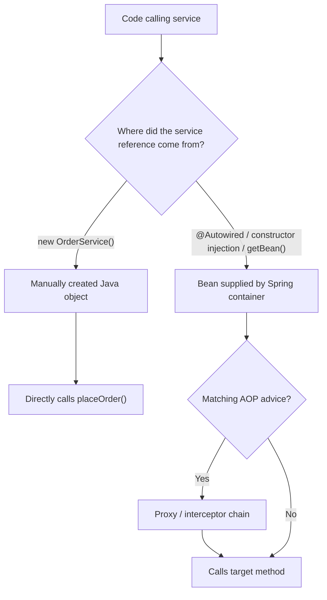
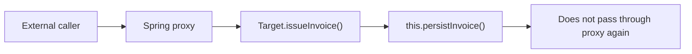

# Verifying Calls Through Real Beans Instead of Manually Created Objects

In Spring Boot, many features such as transactions, caching, asynchronous execution, logging advice, or method validation rely on **Spring AOP proxies**. When a method is invoked through **a bean obtained from the Spring container**, the call can pass through the proxy and its interceptors. When an object is created manually with `new` and called directly, that object is normally **not managed by Spring** and has no container proxy wrapping it.

This is a common cause of situations such as:

- `@Transactional` is on a method, yet calls do not open a transaction.
- `@Cacheable` is declared, yet the method still executes on every call.
- `@Async` fails to offload work to an executor and runs on the current thread.
- An `@Aspect` with logging advice never triggers.
- `@Validated` on a service does not validate method arguments when called on a manually created object.
- Unit tests pass while the real application behaves differently, or vice versa.

This lesson focuses on **verifying the call path**: obtaining the proper bean from `ApplicationContext`, identifying proxies when needed, observing advice effects, distinguishing unit tests from integration tests, and avoiding cases where calls bypass the proxy.

> **Accurate meaning of "real bean":** in this lesson, it refers to **the bean/reference supplied by the Spring container**, not necessarily the inner target instance inside the proxy. In an application using AOP, the container-supplied reference **may itself be the proxy**. That very reference is normally what must be used for calls to pass through advice.

## 1. Understanding the problem via two call paths

Suppose a service has a method annotated with `@Transactional`:

```java
@Service
public class OrderService {

    @Transactional
    public void placeOrder() {
        // Save order and update inventory.
    }
}
```

Two calls look very similar at a glance:

```java
OrderService service = new OrderService();
service.placeOrder();
```

and:

```java
OrderService service = context.getBean(OrderService.class);
service.placeOrder();
```

Yet fundamentally they are very different:

- **`new OrderService()`:** creates a plain Java object. Spring neither puts it through the bean lifecycle nor automatically applies AOP advice.
- **`context.getBean(OrderService.class)`:** retrieves the Spring-managed reference. If transaction infrastructure created a proxy for the bean, calls pass through the transaction interceptor before reaching the target method.

Diagram:



The condition "matching AOP advice" is vital. **Not every Spring bean is a proxy.** Fetching a bean from the context only ensures you hold the framework-managed object; an AOP proxy appears only when a proxy-creation mechanism and matching advisors exist.

## 2. Why does Spring use proxies?

Spring AOP typically applies additional behavior by placing a proxy in front of the target object:

```text
Controller / caller
       |
       v
Spring-managed reference
       |
       v
AOP proxy
       |
       +-- TransactionInterceptor
       +-- CacheInterceptor
       +-- Async interceptor
       +-- Custom @Aspect advice
       |
       v
Target service method
```

This diagram shows possible types of advice; not every bean contains every interceptor.

A proxy can:

1. Run behavior before the call.
2. Invoke the real method on the target.
3. Handle the result or exception after the call.
4. Decide not to call the target in certain cases, e.g., cache hits.
5. Dispatch execution to another executor, e.g., `@Async`.

Objects created with `new` do not automatically pass through this chain. Source-code annotations **are not instructions telling the JVM to automatically inject transactions, caching, or threads**. They are metadata used by Spring infrastructure when processing eligible beans and calls.

### 2.1. Distinguishing proxy and target

- **Target:** the instance executing the service's business logic.
- **Proxy:** the representative object the caller receives from the container when AOP applies.
- **Advice/interceptor:** cross-cutting logic running before, after, or around the target method.
- **Advisor/pointcut:** metadata identifying which methods match an advice.

A bean may be instantiated first as a target object, then processed by a `BeanPostProcessor` and wrapped in a proxy. Consequently, inspecting the bean's actual class can reveal a framework-generated proxy class name.

Do not regard the proxy as a "fake" object and the target as the "real" bean. **To callers, the container-supplied reference is the legitimate entry point for using Spring AOP features.**

## 3. Ways to obtain the right bean from the container

In application code, the preferred approach is usually **constructor injection**:

```java
@RestController
@RequestMapping("/orders")
public class OrderController {

    private final OrderService orderService;

    public OrderController(OrderService orderService) {
        this.orderService = orderService;
    }

    @PostMapping
    public void createOrder() {
        orderService.placeOrder();
    }
}
```

Here `OrderService` is resolved and injected by Spring. If the container creates a proxy for `OrderService`, the controller receives the appropriate proxy.

Other ways:

```java
@Autowired
private OrderService orderService;
```

or in tests / container-integration code:

```java
OrderService orderService =
        applicationContext.getBean(OrderService.class);
```

Or look up by both name and type when needed:

```java
OrderService orderService =
        applicationContext.getBean("orderService", OrderService.class);
```

### 3.1. Prefer constructor injection over manual lookup

In normal business code, avoid keeping `ApplicationContext` as a service locator to fetch each bean. Constructor injection:

- Makes dependencies explicit.
- Makes testing with stubs/mocks straightforward when checking only business logic.
- Avoids hidden coupling to container APIs.
- Ensures callers receive the bean/reference provided by Spring.

`getBean()` is especially handy in tests confirming Spring wired the right object, or in infrastructure code with clear reasons for dynamic lookup.

### 3.2. Do not instantiate objects manually just because a class has @Service

The `@Service` annotation does not alter what `new` does:

```java
OrderService service = new OrderService();
```

This is still a plain manually instantiated Java object. The container neither knows about nor manages this instance.

Likewise, `@Component`, `@Repository`, and `@Controller` have no automatic AOP effect on objects created outside the container.

## 4. The @Bean with new case is an important exception

Do not misunderstand this as "whenever `new` appears, Spring does not manage the object."

Inside a `@Bean` factory method:

```java
@Configuration(proxyBeanMethods = false)
public class OrderConfiguration {

    @Bean
    public OrderService orderService(OrderRepository repository) {
        return new OrderService(repository);
    }
}
```

Even though the method uses `new`, **the returned object is registered as a Spring bean**. The container can:

- Run lifecycle callbacks.
- Apply `BeanPostProcessor`s.
- Wrap the object in an AOP proxy if matching advisors exist.
- Supply the reference via dependency injection or `getBean()`.

Distinguish three cases:

| Case | Does Spring manage the used instance? | Can AOP advice apply? |
|---|---|---|
| `new OrderService(...)` in an arbitrary method and used directly | No | Not via Spring proxy |
| `@Bean OrderService service() { return new OrderService(...); }`; bean fetched from context | Yes | Yes, if AOP is configured and advice matches |
| `@Service` component-scanned; injected into controller | Yes | Yes, if AOP is configured and advice matches |

The core issue is not whether the `new` keyword appears in source code, but **whether the caller uses the reference that went through Spring's management pipeline**.

### 4.1. Avoid using an external local reference after registering a @Bean

If an object is created manually and registered as a bean via another mechanism, the original local reference may still point to the unwrapped target. Do not keep that reference and use it instead of the reference provided by `ApplicationContext`.

For example, when needing a managed service:

```java
OrderService managed = context.getBean(OrderService.class);
managed.placeOrder();
```

This is cleaner than assuming every reference pointing to the same underlying instance shares identical AOP behavior.

## 5. Complete hands-on example: an @Aspect counting calls

We build a clear, verifiable example showing that calls through a Spring bean are handled by advice, while calls on a manually created object bypass advice.

Goal:

- Create `GreetingService` with method `greet(...)`.
- Create a custom aspect recording how many times advice runs.
- Fetch the bean from the Spring container and call it.
- Create a new instance with `new` and call the same method.
- Compare the counter.

### 5.1. Dependencies

With Gradle Kotlin DSL:

```kotlin
dependencies {
    implementation("org.springframework.boot:spring-boot-starter")
    implementation("org.springframework.boot:spring-boot-starter-aop")
    testImplementation("org.springframework.boot:spring-boot-starter-test")
}

tasks.test {
    useJUnitPlatform()
}
```

With Gradle Groovy DSL:

```groovy
dependencies {
    implementation 'org.springframework.boot:spring-boot-starter'
    implementation 'org.springframework.boot:spring-boot-starter-aop'
    testImplementation 'org.springframework.boot:spring-boot-starter-test'
}

tasks.named('test') {
    useJUnitPlatform()
}
```

`spring-boot-starter-aop` supplies the dependencies needed for proxy-based AOP with `@Aspect`. With appropriate Spring Boot auto-configuration, aspect beans are discovered and AOP is enabled automatically; manually adding `@EnableAspectJAutoProxy` is usually unnecessary in standard Boot projects.

### 5.2. Application entry point

```java
package com.example.demo;

import org.springframework.boot.SpringApplication;
import org.springframework.boot.autoconfigure.SpringBootApplication;

@SpringBootApplication
public class DemoApplication {

    public static void main(String[] args) {
        SpringApplication.run(DemoApplication.class, args);
    }
}
```

Keep the example classes below inside `com.example.demo` or subpackages so `@SpringBootApplication` component scanning finds them.

### 5.3. Service to verify

```java
package com.example.demo;

import org.springframework.stereotype.Service;

@Service
public class GreetingService {

    public String greet(String name) {
        return "Hello " + name;
    }
}
```

This method does not touch the counter itself. The counter is incremented solely by advice, allowing the test to distinguish whether the call went through the proxy.

### 5.4. Bean recording advice executions

```java
package com.example.demo;

import java.util.concurrent.atomic.AtomicInteger;
import org.springframework.stereotype.Component;

@Component
public class AdviceCallCounter {

    private final AtomicInteger count = new AtomicInteger();

    public void increment() {
        count.incrementAndGet();
    }

    public int value() {
        return count.get();
    }
}
```

`AtomicInteger` keeps counting thread-safe if the service is called concurrently.

### 5.5. Aspect applying to the method

```java
package com.example.demo;

import org.aspectj.lang.annotation.Aspect;
import org.aspectj.lang.annotation.Before;
import org.springframework.stereotype.Component;

@Aspect
@Component
public class GreetingAspect {

    private final AdviceCallCounter counter;

    public GreetingAspect(AdviceCallCounter counter) {
        this.counter = counter;
    }

    @Before(
        "execution(* com.example.demo.GreetingService.greet(..))"
    )
    public void countInvocation() {
        counter.increment();
    }
}
```

The pointcut selects the `greet(...)` method on `GreetingService`. When a matching call passes through the Spring AOP proxy, `countInvocation()` triggers before the target method.

If `GreetingAspect` exists without being registered as a Spring bean or without AOP infrastructure configured, advice may not run. That is why the test initializes an appropriate Spring context.

## 6. Directly testing the difference between a bean and new

Integration test:

```java
package com.example.demo;

import org.junit.jupiter.api.Test;
import org.springframework.aop.support.AopUtils;
import org.springframework.beans.factory.annotation.Autowired;
import org.springframework.boot.test.context.SpringBootTest;

import static org.assertj.core.api.Assertions.assertThat;

@SpringBootTest
class GreetingAopIntegrationTest {

    @Autowired
    private GreetingService greetingService;

    @Autowired
    private AdviceCallCounter counter;

    @Test
    void springManagedCallPassesThroughAdvice() {
        int before = counter.value();

        String result = greetingService.greet("Lan");

        assertThat(result).isEqualTo("Hello Lan");
        assertThat(counter.value()).isEqualTo(before + 1);
        assertThat(AopUtils.isAopProxy(greetingService)).isTrue();
    }

    @Test
    void manuallyCreatedObjectDoesNotPassThroughAdvice() {
        GreetingService manuallyCreated = new GreetingService();
        int before = counter.value();

        String result = manuallyCreated.greet("Minh");

        assertThat(result).isEqualTo("Hello Minh");
        assertThat(counter.value()).isEqualTo(before);
        assertThat(AopUtils.isAopProxy(manuallyCreated)).isFalse();
    }
}
```

The two tests prove:

1. The business method still returns the right result in both cases.
2. The counter increments only when the call goes through the Spring-managed bean with matching aspect.
3. `AopUtils.isAopProxy(...)` helps inspect the proxy in this example.
4. A method succeeding normally **does not prove advice ran**; you must verify the AOP effect.

### 6.1. Why capture a before value instead of assuming the counter starts at 0?

Spring test contexts can be reused across the same test suite, or other tests may have already interacted with the bean. Asserting an absolute `counter.value() == 1` makes the test order-dependent.

Measuring **the delta before and after** the call:

```java
int before = counter.value();
greetingService.greet("Lan");
assertThat(counter.value()).isEqualTo(before + 1);
```

expresses exactly what must be verified: one invocation through the proxy triggers one additional advice execution.

### 6.2. The "manually created object" test does not prove container config is broken

The manual test passes or fails as expected, yet does not replace checking Spring wiring. Its purpose is demonstrating that **an object outside the container lacks container-applied AOP behavior**.

If the application relies on real advice, primary tests must obtain beans from the context.

## 7. Three levels of verifying calls through a proxy

When analyzing an AOP failure, verify across three levels.

### Level 1: Object comes from the container

Example:

```java
GreetingService service =
        applicationContext.getBean(GreetingService.class);
```

This confirms you received a container-supplied reference instead of creating one yourself.

### Level 2: Is the object a proxy?

```java
boolean proxied = AopUtils.isAopProxy(service);
```

You can inspect the proxy type:

```java
boolean jdkProxy = AopUtils.isJdkDynamicProxy(service);
boolean cglibProxy = AopUtils.isCglibProxy(service);
```

However, **seeing a proxy alone does not prove the right advice applied**. A bean might be proxied by a different advisor, or the pointcut might not match the method you called.

### Level 3: The expected behavior actually happened

For example:

- A transaction is active inside the method.
- A cache hit prevents the target method from running again.
- An async task is dispatched onto an executor.
- An aspect counter/log/audit event appears.
- Method argument violations are thrown per contract.

**Level 3 is the strongest evidence for business requirements.** Use `isAopProxy` for diagnostics, while keeping tests focused on observable advice effects.

## 8. AopUtils and limits when inspecting proxies

Spring provides `AopUtils` in package:

```java
import org.springframework.aop.support.AopUtils;
```

Useful methods:

| API | Meaning |
|---|---|
| `AopUtils.isAopProxy(bean)` | Checks whether the object is a Spring AOP proxy |
| `AopUtils.isJdkDynamicProxy(bean)` | Checks for a JDK dynamic proxy |
| `AopUtils.isCglibProxy(bean)` | Checks for a class-based/CGLIB proxy |
| `AopUtils.getTargetClass(bean)` | Returns the target class Spring can determine |

Example:

```java
Object bean = applicationContext.getBean("greetingService");

System.out.println("Proxy: " + AopUtils.isAopProxy(bean));
System.out.println("JDK: " + AopUtils.isJdkDynamicProxy(bean));
System.out.println("CGLIB: " + AopUtils.isCglibProxy(bean));
System.out.println("Target: " + AopUtils.getTargetClass(bean));
```

Do not write business code relying on proxy class names like `$$SpringCGLIB$$` or implementation-specific suffixes. Class names can vary across framework versions and are not a business contract.

### 8.1. Do not unwrap the target to call methods in AOP tests

Spring test utilities can help access the underlying target behind a proxy to inspect state. Yet if your goal is verifying advice, **do not unwrap the target and call its method directly**. That call bypasses the interceptor chain—the very thing you are trying to observe.

Recommended approach:

```java
serviceFromContext.greet("Lan");
```

Do not turn the check into:

```java
targetObject.greet("Lan"); // Can bypass advice
```

Access target internals only when a test genuinely requires it and you understand the impact on AOP.

## 9. JDK dynamic proxies and CGLIB proxies

Spring AOP typically uses two proxy strategies.

### 9.1. JDK dynamic proxy

JDK proxies are interface-based. Callers can inject an interface:

```java
public interface PaymentService {
    void pay();
}

@Service
public class DefaultPaymentService implements PaymentService {
    @Override
    public void pay() {
        // ...
    }
}
```

If Spring uses a JDK dynamic proxy, the supplied reference implements `PaymentService` yet **is not a subclass of `DefaultPaymentService`**. Therefore, injection or lookup by concrete implementation type can fail under that proxy configuration.

A flexible design depends on the interface:

```java
public class PaymentController {

    private final PaymentService paymentService;

    public PaymentController(PaymentService paymentService) {
        this.paymentService = paymentService;
    }
}
```

### 9.2. CGLIB/class-based proxy

Class-based proxies create a subclass of the target class within JVM constraints. This is helpful for proxying methods on classes without suitable interfaces.

In Spring Boot, proxy type choice depends on configuration and active mechanisms; with Boot's AOP auto-configuration, class-based proxies are the default in many versions.

You may see a related property such as:

```properties
spring.aop.proxy-target-class=true
```

Do not treat this property as a cure-all for AOP failures: changing proxy type neither makes self-invocation intercepted automatically nor turns private methods into overridable ones.

### 9.3. Consequences for tests

Do not write tests assuming:

```java
assertThat(bean.getClass()).isEqualTo(PaymentServiceImpl.class);
```

When AOP is active, the runtime class may be a proxy.

Instead:

```java
assertThat(bean).isInstanceOf(PaymentService.class);
assertThat(AopUtils.isAopProxy(bean)).isTrue();
```

Also remember `isAopProxy` should be asserted true only when the test has configured a valid advisor and the bean is genuinely proxied.

## 10. Self-invocation: the object is a Spring bean yet calls still skip advice

This is the biggest trap right after the `new` mistake.

Suppose:

```java
@Service
public class InvoiceService {

    public void issueInvoice() {
        this.persistInvoice();
    }

    @Transactional
    public void persistInvoice() {
        // Write invoice to database.
    }
}
```

An external caller injects `InvoiceService` and invokes `issueInvoice()` through the proxy. Yet inside the target method:

```java
this.persistInvoice();
```

is a direct call on the target object itself; in the usual Spring AOP proxy model, this call **does not exit and re-enter through the proxy**. Therefore, advice attached to `persistInvoice()` may not execute.

Diagram:



### 10.1. Use another bean for the advice boundary

A clean design extracts the method with a transactional boundary into another bean:

```java
@Service
public class InvoicePersistenceService {

    @Transactional
    public void persistInvoice() {
        // Save invoice.
    }
}
```

```java
@Service
public class InvoiceWorkflowService {

    private final InvoicePersistenceService persistence;

    public InvoiceWorkflowService(InvoicePersistenceService persistence) {
        this.persistence = persistence;
    }

    public void issueInvoice() {
        persistence.persistInvoice();
    }
}
```

`InvoiceWorkflowService` receives a Spring-supplied reference. Calling `persistence.persistInvoice()` can go through the transaction proxy.

### 10.2. Why not inject yourself by default?

Techniques such as self-injection, `AopContext.currentProxy()`, or re-looking up the bean from the context exist. However, they add coupling to proxies and can introduce lifecycle complexity or circular dependencies.

When possible, **separating responsibilities into another bean** is easier to understand, test, and less coupled to framework internals.

### 10.3. Refactor code rather than only moving annotations

If you put `@Transactional` on an internal method and notice transactions do not run, the cause is not necessarily a missing annotation or broken transaction manager. Check **the actual call path**.

Moving the annotation to an externally proxied method, or extracting the method into another service, may be the right fix.

## 11. Private methods, final methods, and proxy limitations

Proxy-based Spring AOP does not intercept every kind of method call.

### 11.1. Private methods

Example:

```java
@Service
public class BillingService {

    @Transactional
    private void savePayment() {
        // ...
    }
}
```

A private method cannot be overridden by a subclass proxy the way class-based Spring AOP requires. Placing `@Transactional` on a private method does not establish a transactional boundary callable via a proxy as you might expect.

### 11.2. Final methods and final classes

Class-based proxies typically rely on subclassing. `final` methods cannot be overridden; `final` classes cannot be subclassed. Thus class-based proxies have limits here.

JDK dynamic proxies operate through interfaces so they carry different constraints, yet still do not allow advice to appear on internal calls within the target.

### 11.3. Constructors and @PostConstruct

Constructors run before the bean finishes bean post-processing; init callbacks such as `@PostConstruct` typically execute before the final AOP proxy is exposed to callers.

Therefore, calls to `@Transactional` or `@Cacheable` methods from a constructor or `@PostConstruct` should not be expected to pass through the proxy under normal mechanics.

### 11.4. Summary table

| Call | Goes through Spring proxy? | Notes |
|---|---|---|
| Bean A injects Bean B and calls matching public method | Possibly yes | If B is proxied and advisor matches |
| `context.getBean(...).method()` | Possibly yes | Reference supplied by context |
| `new Service().method()` | No | Manually created object outside container |
| Target calls `this.otherMethod()` | Usually no | Self-invocation bypasses proxy |
| Target calls private method | Does not go through proxy for that method | Private methods are not proxy-intercepted |
| Class-based proxy calls final method | No override advice on that method | `final` restricts subclass proxies |
| Constructor calls annotated method | Do not expect AOP | Proxy is not finished yet |
| Calling target object unwrapped from proxy | Usually bypasses advice | AOP tests must call the context-supplied reference |

## 12. Verifying @Transactional by behavior, not just annotations

`@Transactional` is a classic example because services appear to run normally even when transaction advice fails to fire—unless code or database behavior reveals a difference.

A small probe can help:

```java
package com.example.demo;

import org.springframework.stereotype.Service;
import org.springframework.transaction.annotation.Transactional;
import org.springframework.transaction.support.TransactionSynchronizationManager;

@Service
public class TransactionProbe {

    @Transactional
    public boolean hasActiveTransaction() {
        return TransactionSynchronizationManager
                .isActualTransactionActive();
    }
}
```

In an application with an appropriately configured transaction manager, calling through a Spring-managed proxy starts a transaction:

```java
@SpringBootTest
class TransactionProbeTest {

    @Autowired
    private TransactionProbe transactionProbe;

    @Test
    void managedCallUsesTransactionInterceptor() {
        assertThat(transactionProbe.hasActiveTransaction()).isTrue();
    }

    @Test
    void manualObjectDoesNotStartTransaction() {
        TransactionProbe manual = new TransactionProbe();

        assertThat(manual.hasActiveTransaction()).isFalse();
    }
}
```

**Prerequisite for the example:** the test must have a `PlatformTransactionManager` and appropriate transaction advice configuration; JDBC/JPA with a test database works. Merely adding `@Transactional` to a service without transaction infrastructure does not ensure the test returns true.

### 12.1. Avoid @Transactional on the test itself when measuring transaction state

If the test method itself carries `@Transactional`, the test runner may already open a transaction before the service call. Then a method invoked directly on a manually created object still sees the active transaction created by the test.

Therefore, when verifying "does the proxy start a transaction?":

- Do not enable transactions at the test method/class level for that measurement.
- Call through a managed bean and through a manual object in isolated contexts.
- Check that the transaction manager and proxy config are actually active.
- Prefer verifying rollback/commit when business contracts require it.

A good test measures **the effect produced by this call**, not state already prepared by another piece of test infrastructure.

### 12.2. Avoid verifying transactions solely by proxy class

`AopUtils.isAopProxy(service)` returning true does not guarantee the transaction interceptor matches a specific method. If the bean is proxied by another logging aspect, a test checking only proxy presence will still pass even if transactions are inactive.

Assert actual transaction behavior.

## 13. Verifying @Cacheable by target execution count

`@Cacheable` nicely illustrates the difference because a cache hit avoids invoking the target method.

Service:

```java
import java.math.BigDecimal;
import java.util.concurrent.atomic.AtomicInteger;

import org.springframework.cache.annotation.Cacheable;
import org.springframework.stereotype.Service;

@Service
public class PriceLookupService {

    private final AtomicInteger databaseCalls =
            new AtomicInteger();

    @Cacheable(cacheNames = "prices", key = "#productId")
    public BigDecimal lookup(String productId) {
        databaseCalls.incrementAndGet();
        return new BigDecimal("125.00");
    }

    public int databaseCalls() {
        return databaseCalls.get();
    }
}
```

Enable caching:

```java
@Configuration(proxyBeanMethods = false)
@EnableCaching
public class CacheConfiguration {

    @Bean
    public CacheManager cacheManager() {
        return new ConcurrentMapCacheManager("prices");
    }
}
```

Test example:

```java
@SpringBootTest
class PriceCacheIntegrationTest {

    @Autowired
    PriceLookupService service;

    @Test
    void managedBeanUsesCacheAdvice() {
        String productId = "unique-product-for-this-test";
        int before = service.databaseCalls();

        BigDecimal first = service.lookup(productId);
        BigDecimal second = service.lookup(productId);

        assertThat(first).isEqualByComparingTo(second);
        assertThat(service.databaseCalls()).isEqualTo(before + 1);
    }
}
```

In a context with an unused cache key, the target method executes once; the second call is served from cache.

### 13.1. What happens with a manually created object?

```java
PriceLookupService manual = new PriceLookupService();

manual.lookup("P-1");
manual.lookup("P-1");

assertThat(manual.databaseCalls()).isEqualTo(2);
```

`@Cacheable` is still in source code, yet calls do not go through Spring's cache interceptor.

### 13.2. Keep cache tests independent

Caches can persist across tests when contexts are reused. To keep tests deterministic, you can:

- Use unique keys per test.
- Clear caches before tests as needed.
- Create isolated contexts when integration isolation is the goal.
- Avoid hardcoding assumptions that caches are always empty if other tests may have populated data.

Assert that the cache interceptor genuinely alters behavior, not merely that `@Cacheable` sits on the method.

## 14. Verifying @Async via executor, thread, and completion

`@Async` typically executes through a proxy. In a simple example:

```java
@Configuration(proxyBeanMethods = false)
@EnableAsync
public class AsyncConfiguration {
}
```

```java
@Service
public class NotificationService {

    @Async
    public CompletableFuture<String> sendAsync() {
        return CompletableFuture.completedFuture(
                Thread.currentThread().getName()
        );
    }
}
```

When called through the managed proxy with a properly configured async executor, the method is submitted to the executor. With a manually created object:

```java
NotificationService manual = new NotificationService();

String threadName = manual.sendAsync().join();
```

the method runs directly on the caller's thread; `@Async` does not spawn a new thread just because the annotation is present.

### 14.1. Do not test async solely by thread name

Thread names depend on the executor. When testing async in real apps, you can verify:

- The task is submitted to the configured executor.
- The method executes off the caller thread when the contract requires it.
- `CompletableFuture` completes with the expected value or reports matching exceptions.
- No shared-state races arise from assuming tasks finish immediately.

Use `CountDownLatch` or `CompletableFuture` to synchronize tests; do not rely on a fixed `Thread.sleep(...)` and assume async ran.

### 14.2. Self-invocation also affects @Async

```java
@Service
public class NotificationService {

    public void createAndSend() {
        sendAsync(); // Internal call within the same target.
    }

    @Async
    public void sendAsync() {
        // ...
    }
}
```

When `sendAsync()` is invoked internally, proxy-based async advice can be bypassed, just like `@Transactional`.

Have the caller invoke a separate async bean through a Spring-injected reference if you need a clear asynchronous boundary.

## 15. Verifying method validation through managed beans

Method argument validation can also rely on proxies if a service uses Spring method validation infrastructure.

Example:

```java
@Service
@Validated
public class CustomerCommandService {

    public void createCustomer(@NotBlank String name) {
        // ...
    }
}
```

When method validation is enabled/configured properly, calling through a managed proxy with blank input can raise a validation exception.

Manually created object:

```java
CustomerCommandService service = new CustomerCommandService();
service.createCustomer("");
```

does not automatically invoke `jakarta.validation.Validator`.

Notes:

- `@Valid` on request DTOs in Spring MVC can be handled by argument resolvers and not necessarily the same service-proxy mechanism.
- Method validation in newer Spring MVC can work via its own built-in mechanism.
- Service method validation through Spring infrastructure typically depends on beans/proxies.
- Therefore, identify **the actual validation trigger point** before writing tests.

Do not use a single `new` comparison to conclude every validation feature in Spring is handled by AOP proxies.

## 16. Plain Java unit tests vs. integration tests verifying AOP

Plain Java unit tests are valuable for verifying business logic:

```java
@Test
void calculatesTotal() {
    OrderCalculator calculator = new OrderCalculator();

    BigDecimal total = calculator.calculate(
            new BigDecimal("100"),
            new BigDecimal("0.10")
    );

    assertThat(total).isEqualByComparingTo("110.00");
}
```

This test needs no Spring context when the logic does not depend on infrastructure.

However, if the requirement is:

- Transactions open.
- Cache blocks duplicate calls.
- Async tasks dispatch.
- Custom aspects run properly.
- Service method validation is enforced by Spring.

then an object created with `new` **is not a suitable test subject** for that integration behavior.

### 16.1. Separating test purposes

| Test type | How objects are created | What is verified |
|---|---|---|
| Business unit test | `new` or test fixtures | Plain Java logic, calculation rules |
| Aspect/advice unit test | Objects/mocks matching advice API | Standalone advice logic, if any |
| Spring wiring test | `ApplicationContext` or context runner | Bean registration, dependency injection |
| Spring AOP test | Beans injected/fetched from context | Advice applied on real calls |
| Transaction/cache/async integration test | Context with relevant infrastructure | Real feature effects |

Not every test needs `@SpringBootTest`. Yet an AOP test must use **a context with an appropriate proxy mechanism** or a proxy explicitly configured in the test.

### 16.2. Use @SpringBootTest when full framework behavior is needed

```java
@SpringBootTest
class PaymentServiceIntegrationTest {

    @Autowired
    PaymentService paymentService;

    @Test
    void usesSpringConfiguredService() {
        paymentService.pay();
        // Assert effects of advice / transaction / cache.
    }
}
```

`@SpringBootTest` builds an application context from application configuration. Even so, it is only a necessary condition for these tests: **the dependencies and annotations enabling AOP features must still be present**.

### 16.3. Test slices may not load all advice

Test slice annotations such as `@WebMvcTest` or `@DataJpaTest` load only part of the context. Consequently:

- Controller slices may use mock services instead of real services.
- Transaction managers or cache infrastructure may differ from the full app.
- Custom aspects may not be imported into the test context.
- A passing slice test does not prove all application AOP behaviors work.

When in doubt, inspect which test context is created and which beans actually exist in it.

## 17. Mocks and spies can mislead tests about call paths

A test can use Mockito to replace a service bean with a mock. That works well for isolating a controller, yet mocks do not necessarily preserve target/advice behavior like a real integrated bean.

Example:

```java
@WebMvcTest(OrderController.class)
class OrderControllerTest {

    @MockitoBean
    OrderService orderService;

    // Verify controller calls service properly.
}
```

In newer Spring Framework/Boot releases supporting `@MockitoBean`, this annotation replaces or supplies a test bean. Older codebases may use `@MockBean` per their version.

This test can verify that the controller passes the right arguments. However, **it does not prove `@Transactional` on `OrderService` works**, because you are calling a mock instead of the real service.

### 17.1. Spies are not the default way to verify AOP

Spies can record invocations, yet you must understand whether the spy wraps the proxy or target and how the test context is wired. If you only count method invocations, the test can still pass even when advice did not match.

To verify AOP:

1. Prefer asserting behavior produced by the advice.
2. Use a real bean from the context when needed.
3. Use spies only for specific reasons with clear understanding of proxy interaction.
4. Do not confuse Mockito orchestration tests with transaction/caching infrastructure tests.

## 18. When multiple beans implement the same interface

If an interface has multiple implementations, constructor injection can be ambiguous:

```java
public interface PaymentGateway {
    void charge();
}
```

```java
@Component("primaryGateway")
public class PrimaryGateway implements PaymentGateway {
    public void charge() {
    }
}
```

```java
@Component("backupGateway")
public class BackupGateway implements PaymentGateway {
    public void charge() {
    }
}
```

The caller must specify the bean:

```java
@Service
public class CheckoutService {

    private final PaymentGateway gateway;

    public CheckoutService(
            @Qualifier("primaryGateway") PaymentGateway gateway
    ) {
        this.gateway = gateway;
    }
}
```

When verifying AOP, ensure the test retrieves **the exact bean** used by the application. An aspect with a pointcut by package, annotation, or method name may match bean A and not bean B.

`@Primary` and `@Qualifier` affect bean selection; they do not automatically enable AOP or route method calls through advice.

## 19. What to check when AopUtils.isAopProxy returns false?

Do not rush to conclude the framework is broken. Ask:

1. Was the object actually obtained from the Spring context?
2. Is the class component-scanned or registered via `@Bean`?
3. Are AOP dependencies added and appropriate mechanisms enabled?
4. Is the `@Aspect` registered as a bean?
5. Does the pointcut match the called class and method?
6. Are `final`/`private` or proxy-type settings blocking it?
7. Is it self-invocation instead of a call from another bean?
8. Did the test replace the real bean with a mock?
9. Was the target object retrieved directly instead of the proxy?
10. Is code running before bean post-processing finishes?

### 19.1. Inspecting pointcuts

Example:

```java
@Before("execution(* com.example.payment..*(..))")
```

A pointcut can fail to match as expected if the expression specifies the wrong package, wrong method visibility, or mismatched signature.

Use a simple, clear pointcut when building small examples; broaden it only once tests guard matching.

### 19.2. Verify advice triggered via its effects

A `true` proxy check confirms only that the object has an AOP proxy. To prove an aspect ran, you can:

- Increment a counter inside the advice.
- Record an event into a test collector.
- Have a fake collaborator receive a call from the advice.
- Check changes in transaction, cache, or async state.

Avoid relying on console logs as primary assertions when clearer state verification is possible.

## 20. Mistake of calling @Bean factory methods manually

An easily confused case:

```java
@Configuration(proxyBeanMethods = false)
public class ClientConfiguration {

    @Bean
    public ExternalClient externalClient() {
        return new ExternalClient();
    }
}
```

If you manually instantiate `ClientConfiguration` with `new` and call `externalClient()`:

```java
ClientConfiguration config = new ClientConfiguration();
ExternalClient client = config.externalClient();
```

that is just a Java call to a factory method on a manually created configuration object; the returned `ExternalClient` is not automatically a managed bean.

In an application, retrieve the client:

```java
ExternalClient client =
        applicationContext.getBean(ExternalClient.class);
```

The container executes the factory method per the bean definition and runs the full lifecycle on the returned object.

### 20.1. proxyBeanMethods does not replace Spring AOP business proxies

`@Configuration(proxyBeanMethods = true/false)` governs how Spring handles calls between `@Bean` methods inside configuration classes. It is **not** a switch toggling Spring AOP for `@Transactional`, `@Cacheable`, or custom aspects on business services.

Do not use `proxyBeanMethods` to fix service methods bypassing advice. Focus on caller references and AOP infrastructure.

## 21. Can you test proxies manually with ProxyFactory?

Spring provides `ProxyFactory` to create advised proxies in tests or infrastructure code:

```java
GreetingService target = new GreetingService();

ProxyFactory factory = new ProxyFactory(target);

factory.addAdvice((MethodInterceptor) invocation -> {
    System.out.println("Before: " + invocation.getMethod().getName());
    return invocation.proceed();
});

GreetingService proxied =
        (GreetingService) factory.getProxy();

proxied.greet("Lan");
```

This shows a proxy can intercept calls to a target. However, a proxy built manually here **does not prove application beans are auto-configured properly by Spring Boot**.

Distinguish:

- **Testing `ProxyFactory`:** tests manually configured proxies/advice.
- **Testing `ApplicationContext`:** tests actual beans built by the app/Boot, advisor registration, and dependency injection.

For this lesson's goal—"calls through real beans"—prefer the second test.

## 22. Verifying paths in Controllers, Schedulers, and Listeners

Not every caller is an HTTP controller. Methods can be called from schedulers, event listeners, message consumers, or runners.

### 22.1. HTTP controller

```java
@RestController
public class PaymentController {

    private final PaymentService paymentService;

    public PaymentController(PaymentService paymentService) {
        this.paymentService = paymentService;
    }

    @PostMapping("/pay")
    public void pay() {
        paymentService.pay();
    }
}
```

Constructor injection ensures the caller uses the container-supplied reference. AOP tests can call `paymentService.pay()` inside a `@SpringBootTest`, without needing HTTP requests when testing only service advice.

### 22.2. Scheduled job

```java
@Component
public class ReportingSchedule {

    private final ReportingService reportingService;

    public ReportingSchedule(ReportingService reportingService) {
        this.reportingService = reportingService;
    }

    @Scheduled(fixedDelay = 60000)
    public void runReport() {
        reportingService.generateReport();
    }
}
```

If `generateReport()` has `@Transactional` or `@Cacheable`, calling via the injected `ReportingService` lets calls pass through the proxy when advice matches.

Do not confuse the scheduling mechanism with a proxy on `generateReport()`: `@Scheduled` is handled by the scheduler's lifecycle and is not evidence that the service method is automatically AOP-intercepted.

### 22.3. ApplicationRunner

```java
@Component
public class InitialDataRunner implements ApplicationRunner {

    private final InitialDataService service;

    public InitialDataRunner(InitialDataService service) {
        this.service = service;
    }

    @Override
    public void run(ApplicationArguments args) {
        service.importInitialData();
    }
}
```

This is also an external bean-to-bean call. Avoid creating `new InitialDataService()` inside the runner if Spring advice is needed.

### 22.4. Methods called from constructors or init callbacks

Even when the caller is a Spring bean, calls inside constructors or initialization callbacks can happen before the bean/proxy reaches its final state. In particular, do not call methods on `this` expecting advice to apply.

If startup work is needed, pick an appropriate lifecycle hook while calling another bean through a Spring-injected reference when transaction/caching/async boundaries are needed.

## 23. Reading proxy logs without over-relying on them

When debugging, you can inspect logs for Spring AOP, transactions, or caching depending on version:

```properties
logging.level.org.springframework.aop=DEBUG
logging.level.org.springframework.transaction=TRACE
logging.level.org.springframework.cache=TRACE
```

Exact log levels and messages depend on framework version. Enable verbose logging in suitable environments since it can generate heavy output or expose internal metadata.

An effective diagnostic workflow:

1. Log bean names and target classes if needed.
2. Check whether the reference is proxied.
3. Check advisors/pointcuts and annotations.
4. Call the method from another bean or test through the context.
5. Observe the expected effect.
6. Compare with a direct call only to reproduce the bypass mechanism.

Do not rely on a debug line containing the word `proxy` and conclude transactions or caching ran properly.

## 24. Common troubleshooting matrix

| Symptom | Common possibilities | How to verify |
|---|---|---|
| `@Transactional` does not open a transaction | Called via `new`, self-invocation, missing transaction infrastructure | Fetch bean from context and test transaction behavior |
| `@Cacheable` still runs method every time | Bypassed cache proxy or caching not enabled | Count target executions via managed bean |
| `@Async` runs on caller thread | Direct call or async infrastructure not enabled | Call via injected bean and inspect executor/completion |
| Custom `@Aspect` does not run | Aspect not a bean, pointcut mismatch | Check context, proxy, and advice effect |
| Method validation skipped | Not called through method validation proxy | Test `@Validated` service through context |
| AopUtils reports false on manual instance | Object created with `new` | Compare with context-managed reference |
| Bean from context still has no proxy | No matching advisor or AOP not enabled | Check annotations and infrastructure |
| Proxy true yet behavior wrong | Another advisor created proxy or wrong pointcut | Assert concrete effect, not just proxy class |
| Unit test passes, runtime fails | Test did not create a Spring context | Add integration tests for wiring/AOP |
| MockMvc passes yet transactions untested | Mock service instead of real service | Use `@SpringBootTest`/service integration tests |
| Calling method via `this` skips advice | Self-invocation | Extract logic into another bean |
| Call in `@PostConstruct` has no transaction | Proxy not finished yet | Coordinate via another bean at a later phase |
| Injecting concrete class fails | Bean uses interface JDK dynamic proxy | Inject interface or review proxy configuration |
| Calling `@Bean` method directly creates fresh object | Called factory method outside container | Fetch bean from `ApplicationContext` |

## 25. Step-by-step verification process in a project

When suspecting an AOP annotation has no effect, follow these steps.

### Step 1: Identify the method and expected effect

For example:

- `@Transactional`: transaction/rollback.
- `@Cacheable`: cache hit.
- `@Async`: execution offloaded to executor.
- Custom aspect: audit/log/counter.
- `@Validated`: rejects invalid arguments.

Do not start by asserting proxy class before understanding which behavior must occur.

### Step 2: Identify where the object is created

Check whether the caller uses:

```java
new SomeService(...)
```

or uses:

```java
@Autowired
SomeService service;
```

or constructor injection / `ApplicationContext.getBean(...)`.

If a manually created object was used instead of the bean, fix the dependency wiring.

### Step 3: Check infrastructure

For example:

- Is `spring-boot-starter-aop` or matching AOP configuration present?
- Are a transaction manager and transaction advice active?
- Are `@EnableCaching` and a `CacheManager` present for `@Cacheable`?
- Are `@EnableAsync` and a suitable executor present for `@Async`?
- Is provider/method validation integration active for `@Validated`?

A bean from the Spring context is only a necessary condition; infrastructure must still be enabled.

### Step 4: Check the invocation boundary

Does an external caller invoke the proxy, or does code call `this.method()` internally? Is the method public and interceptable under the active proxy strategy?

If a method in the same bean needs separate advice, consider extracting it into another bean.

### Step 5: Write a check using a Spring context

```java
@SpringBootTest
class SomeServiceAopTest {

    @Autowired
    SomeService service;

    @Test
    void adviceIsApplied() {
        // Call service through Spring-managed reference.
        // Assert observable result of the advice.
    }
}
```

### Step 6: Assert the effect

Prioritize business and behavioral assertions:

- Transaction active or rollback behaves properly.
- Method does not re-execute on cache hit.
- Audit event/advice counter increments.
- Async task runs per executor contract.
- Validation exception is thrown properly.

`AopUtils.isAopProxy(...)` is a helpful supporting assertion in AOP lessons, yet not a substitute for verifying the effect.

### Step 7: Test the bypass path to understand the cause

Create a manual object in a separate test when reproducing a bug; keep manual objects out of primary tests of Spring behavior.

### Step 8: Keep unit tests for plain Java logic

Do not turn every unit test into `@SpringBootTest`. Pure calculation logic without proxy dependencies should be tested directly for speed and clarity. Use a Spring context only where verifying Spring integration contracts.

## 26. Practice exercise 1: measuring advice through a real bean

**Task:** use `GreetingService` and `GreetingAspect` shown above.

1. Run a test calling `greetingService.greet(...)` via the Spring-injected bean.
2. Assert the advice counter increments once.
3. Create `new GreetingService()` and call the method.
4. Assert the advice counter does not increment.
5. Use `AopUtils.isAopProxy(...)` to inspect both references.

**Question:** Why do both calls return "Hello ..." yet only one runs the aspect?

**Answer:** The business method is regular Java code, so both objects can execute it. Advice applies only when the call passes through the proxy configured by Spring.

## 27. Practice exercise 2: finding a self-invocation bug

Code:

```java
@Service
public class StockService {

    public void reserve() {
        updateStock();
    }

    @Transactional
    public void updateStock() {
        // Update database.
    }
}
```

**Question 1:** If a controller injects `StockService` and calls `reserve()`, does the call to `updateStock()` pass through that method's own transaction advice?

**Answer:** Not under normal proxy-based mechanics, because `reserve()` calls `updateStock()` internally on the target.

**Question 2:** How do you fix it?

**Answer:** Move `updateStock()` to a `StockPersistenceService` bean and inject it into `StockService`; call it through the Spring-supplied dependency. Or design the transaction boundary on an outer public method actually called through the proxy if appropriate.

## 28. Practice exercise 3: verifying caching

Code:

```java
@Service
public class CatalogService {

    private final AtomicInteger calls = new AtomicInteger();

    @Cacheable("catalog")
    public String load(String id) {
        calls.incrementAndGet();
        return "Item-" + id;
    }

    public int calls() {
        return calls.get();
    }
}
```

After enabling cache infrastructure:

**Question:** What differs between calling `load("X")` twice via an injected bean and twice via `new CatalogService()`?

**Answer:** Through the proxy with a cache hit on an initially uncached key, the target may run only once. On the manually created object, the method runs both times because there is no cache interceptor.

**Note:** Tests should use an uncached key and control cache state so they do not depend on other tests.

## 29. Practice exercise 4: classifying test types

Review these requirements:

1. Calculate tax on an order.
2. Verify a controller calls a service with the right ID.
3. Verify `@Transactional` rolls back when a service throws an exception.
4. Verify `@Cacheable` prevents repeated calls.
5. Verify a custom `@Aspect`'s pointcut.
6. Verify `@Async` dispatches tasks to an executor.

**Suggested choices:**

| Requirement | Appropriate test |
|---|---|
| Calculate tax | Plain Java unit test |
| Controller delegation | MVC slice with mock service |
| Transaction rollback | Integration test with Spring transaction infrastructure |
| Cache behavior | Spring context with caching enabled |
| Custom aspect applied | Spring AOP integration test with real bean |
| Async dispatch | Spring context with async enabled and proper test synchronization |

Not every test must boot the full application, yet each must supply the right infrastructure layer for the behavior being verified.

## 30. Self-check questions

**Question 1.** Why doesn't `new PaymentService()` automatically trigger `@Transactional`?

**Answer:** Because the object is not managed by Spring and does not pass through a Spring AOP proxy/transaction interceptor.

**Question 2.** If a `@Bean` factory method returns `new PaymentService()`, can that bean be proxied?

**Answer:** Yes. The container manages the object returned from `@Bean` and can apply post-processing/proxying when infrastructure and pointcuts match.

**Question 3.** Does `AopUtils.isAopProxy(service) == true` prove `@Cacheable` is working?

**Answer:** No. The proxy could have been created by another advisor; you must check cache hits or target execution counts.

**Question 4.** What is self-invocation?

**Answer:** A method in a target calls another method on the same target via `this`. That call normally does not pass through the AOP proxy, so advice on the internally called method may be skipped.

**Question 5.** Why shouldn't you put `@Transactional` on a private method expecting a Spring proxy to intercept it?

**Answer:** Private methods cannot be proxy-intercepted via Spring AOP's normal method-overriding mechanics.

**Question 6.** Does a controller test with a mock service prove the real service's transactions work?

**Answer:** No. Mock services are suitable for testing controller wiring, yet do not execute the real service's logic or advice.

**Question 7.** If a service is injected from Spring yet `@Async` still runs synchronously, what should you check?

**Answer:** Async infrastructure, `@EnableAsync`, executor, proxy/advisor, method eligibility, and self-invocation.

**Question 8.** When should you use `@SpringBootTest`?

**Answer:** When you need to verify real Spring wiring and behavior—such as transactions, caching, async, or aspects—and the required context cannot be simulated faithfully in plain Java unit tests.

## 31. Key takeaways

- **Do not equate an annotation on a class with advice definitely running.** AOP advice applies only when matching infrastructure exists and calls go through a proxy.
- **Container-supplied beans** are the references callers should use. They may be proxies rather than target objects.
- `new Service()` outside the container creates a plain Java object, bypassing interceptors configured by Spring AOP.
- `new` **inside a `@Bean` factory method** can still produce a managed bean that gets proxied afterward.
- Constructor injection is the preferred way for one bean to call another via a Spring-supplied reference.
- `AopUtils.isAopProxy` assists diagnostics; asserting **advice behavior** is what proves the feature works.
- JDK dynamic proxies and CGLIB have different constraints, yet neither fixes self-invocation automatically.
- `this.otherMethod()`, private/final methods, and calls inside constructors/init callbacks easily bypass proxies.
- `@Transactional`, `@Cacheable`, `@Async`, and method validation have distinct infrastructure and interception needs; test their respective effects.
- Mock services in slice tests cannot prove AOP on the real service.
- Use plain Java unit tests for pure logic; use Spring integration tests when the requirement involves Spring behavior.

When an AOP annotation "has no effect," the first question is not **"did I write the annotation right?"** but rather: **"Who created this object, does the caller hold a Spring-supplied reference, and does the actual call go through a matching proxy/advice?"** Verifying that path lets you separate business-logic bugs from wiring, proxy, and lifecycle bugs in Spring Boot.
