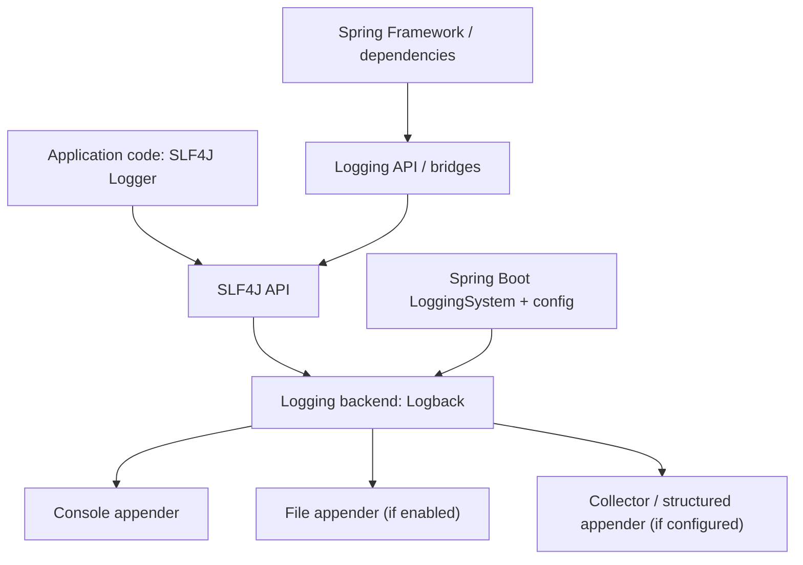

# Logging Starter and Default Configuration by Spring Boot Release Line

When starting a new Spring Boot application, even without writing a single `log.info(...)` line yourself, the terminal usually displays startup details, the application name, Spring Boot version, web server port, active profiles, and errors if the context fails to build. This does not happen because `SpringApplication` prints every message using `System.out.println`, but because Spring Boot has an **early-initialized logging infrastructure** along with default dependencies and configuration.

In the **Logging** chapter of *Spring Boot Fundamentals*, the lesson **"Logging Starter and Default Configuration by Spring Boot Release Line"** focuses on four questions: what the logging starter provides, how Spring Boot selects a logging implementation, what default logging behavior an application has, and what needs to be verified when working across different Spring Boot release lines.

Foundational points to keep in mind from the start:

- **SLF4J is a logging API/facade**, not the component that writes logs to the console or files itself.
- **Logback** is the common default logging backend of typical Spring Boot applications.
- The **logging starter** primarily brings onto the classpath the dependencies that make logging work according to the conventions of the Boot release line in use; it is not a switch you must invoke from Java code.
- **Spring Boot provides default configuration and externalized configuration mechanisms** to adjust log levels, formats, outputs, and behavior by environment.
- **Starter names, library versions, and some formats/properties can change across release lines**. Therefore, verify the dependency graph and reference documentation of the exact Spring Boot release rather than blindly applying every older example.

## 1. What is logging in a Spring Boot application?

Logging is recording important events and states while an application runs: startup, shutdown, requests, connection errors, business state transitions, or operational warnings. Logs typically contain:

- **Timestamp**: when the event was recorded.
- **Level**: severity or detail level.
- **Logger name**: class/package or logical name emitting the event.
- **Thread name**: the thread executing the operation.
- **Message**: description of the event.
- **Exception/stack trace**: error details when needed.
- **Context fields**: request ID, trace ID, or other correlation information if configured.

Illustrative log example, not a byte-for-byte template across all versions:

```text
2026-11-13 09:20:31.420  INFO 12345 --- [main] c.e.catalog.CatalogApplication : Starting CatalogApplication
2026-11-13 09:20:32.105  INFO 12345 --- [main] o.s.b.w.e.tomcat.TomcatWebServer : Tomcat started on port 8080
2026-11-13 09:20:32.209  INFO 12345 --- [main] c.e.catalog.CatalogApplication : Started CatalogApplication
```

A business request might log:

```text
2026-11-13 09:22:01.070  INFO 12345 --- [http-nio-8080-exec-1] c.e.catalog.OrderService : Order created: id=ORD-42
```

**Note:** the illustrative lines here show the meaning of each field. Spring Boot 2.x, 3.x, and 4.x do not necessarily share the exact same layout; newer lines may include the application name, different separators, correlation fields, or different thread formatting.

### 1.1. Logs differ from manual stdout printing

`System.out.println("...")` writes directly to standard output. It lacks comprehensive support for:

- Level control per package/logger.
- Unified filtering.
- Patterns/layouts and exception handling.
- Routing through appenders.
- Managing asynchronous logging when configured.
- Structured integration with log collection systems.

In a Spring Boot application, use a logging API instead of printing operational information everywhere with `System.out.println`.

### 1.2. Logging differs from tracing and metrics

Logs record events; metrics aggregate numbers such as request count and latency; tracing describes a request's journey across multiple services. These three signal types complement one another without replacing one another.

A trace ID can be added to logs when the application is configured with observability/tracing. **Adding a logging starter alone does not automatically give you distributed tracing or trace IDs**.

## 2. Distinguishing API, backend, bridge, and starter

To understand default logging, you must distinguish the layers in the Java ecosystem.

| Component | Role | Example |
| --- | --- | --- |
| Logging API / facade | API called by application code | SLF4J `Logger` and `LoggerFactory` |
| Logging implementation/backend | Determines formatting, filtering, appenders, and output destinations | Logback, Log4j 2 |
| Logging bridge/adapter | Routes logs from another API into the chosen logging pipeline | JUL-to-SLF4J, Log4j-to-SLF4J, Spring JCL bridge |
| Spring Boot logging system | Initializes and configures the backend according to Spring Boot rules | `LoggingSystem` and logging initialization mechanism |
| Starter | Set of dependencies managed by Spring Boot to provide a default combination | Logging starter appropriate for the Boot release line |
| Configuration file | Selects logger levels, appenders, patterns, and policies | `application.yml`, `logback-spring.xml`, `log4j2-spring.xml` |

Typical flow:



The diagram assumes a Logback backend. If Log4j 2 is chosen, the implementation and adapter components will differ. **Having one facade does not guarantee all logging systems are writing to the same backend** if the classpath contains multiple incompatible bindings/providers.

### 2.1. What is SLF4J?

SLF4J (*Simple Logging Facade for Java*) provides a unified API so code does not depend directly on a specific backend.

```java
import org.slf4j.Logger;
import org.slf4j.LoggerFactory;

public class CatalogService {

    private static final Logger log =
            LoggerFactory.getLogger(CatalogService.class);

    public void createCatalog(String catalogId) {
        log.info("Creating catalog {}", catalogId);
    }
}
```

`LoggerFactory.getLogger(CatalogService.class)` creates or retrieves a logger named after the class. Source code does not need to import `ch.qos.logback.classic.Logger` or any backend-specific class.

When switching backends from Logback to Log4j 2, common SLF4J calls in the application typically do not need changes.

### 2.2. What does Logback do?

Logback is a backend capable of:

- Writing to the console, files, and other destinations via appenders.
- Filtering messages by level.
- Formatting content using patterns or encoders.
- Handling rolling file policies.
- Adding structured fields via supported mechanisms.
- Configuring logger hierarchies.

Spring Boot usually provides a default configuration for Logback when that backend is on the classpath. However, log files and special appenders only exist if the application or platform configures them accordingly.

### 2.3. What problem do bridges solve?

Not every Java library calls SLF4J. Some use Java Util Logging (JUL), Log4j API, or Commons Logging. Appropriate bridges route them into a unified backend.

Example of routing direction:

```text
My service (SLF4J) ------------+
                               |
Library using JUL -- bridge --+--> SLF4J --> Logback
                               |
Library using Log4j API ------+
        (via appropriate adapter)
```

If reverse-direction bridges are configured at the same time, they can cause routing loops or runtime errors. Therefore, when changing backends, do not just add new dependencies—also inspect old bridges.

## 3. The logging starter in Spring Boot 2.x and 3.x

In most projects using Spring Boot **2.x** or **3.x**, the default logging starter has the artifact:

```text
org.springframework.boot:spring-boot-starter-logging
```

A common starter like `spring-boot-starter-web` usually depends transitively on `spring-boot-starter`, thereby pulling in the default logging configuration. Thus, not every project needs to declare the logging starter manually.

Gradle example for the corresponding Boot line:

```groovy
dependencies {
    implementation 'org.springframework.boot:spring-boot-starter-web'
}
```

Maven:

```xml
<dependencies>
    <dependency>
        <groupId>org.springframework.boot</groupId>
        <artifactId>spring-boot-starter-web</artifactId>
    </dependency>
</dependencies>
```

When Spring Boot's BOM/dependency management manages versions, the dependency graph usually includes the Logback backend and corresponding adapters. If the project does not actively swap backends, default logging is typically ready right at startup.

### 3.1. Why is it called a starter?

A starter is **a curated set of dependencies chosen by convention**, not a brand-new logging framework written from scratch by Spring Boot.

Role of the logging starter in release lines that use this artifact:

- Provides backend libraries compatible with SLF4J.
- Brings necessary bridges/adapters onto the classpath for centralized logging.
- Integrates with Spring Boot's `LoggingSystem` to apply default configuration.
- Lets Spring Boot manage compatible versions.

A line like `implementation 'org.springframework.boot:spring-boot-starter-logging'` does not by itself tell you which Logback version is running. The version also depends on the Spring Boot line/BOM, build overrides, and dependency resolution.

### 3.2. Can the logging starter be declared directly?

Yes, if the application needs it and the dependency graph does not already provide it. But with standard application starters, declaring it again is usually unnecessary.

If a project uses no starters and instead assembles individual Spring Boot modules manually, inspect the actual dependency graph; do not assume every Spring Boot project automatically includes `spring-boot-starter-logging`.

### 3.3. How to inspect actual dependencies

With Maven:

```bash
./mvnw dependency:tree
```

With Gradle:

```bash
./gradlew dependencies --configuration runtimeClasspath
```

To see why a module appears in Gradle:

```bash
./gradlew dependencyInsight \
    --dependency logback-classic \
    --configuration runtimeClasspath
```

These are reference commands for **learners to run themselves in an appropriate project**, not tasks to execute while authoring this documentation. On Windows, use the corresponding wrappers `mvnw.cmd` or `gradlew.bat`.

Look for dependencies such as `logback-classic`, `slf4j-api`, `log4j-to-slf4j`, and related adapters, though exact names may vary across Boot release lines.

## 4. "By Spring Boot release line" means looking at the whole version family

The Spring Boot ecosystem evolves across major releases. What matters for logging is not just how to write `logging.level.root=INFO`, but also **SLF4J/Logback/Log4j versions, the starter dependency graph, and the Java baseline**.

| Spring Boot line | Key logging characteristics | What to verify when upgrading |
| --- | --- | --- |
| 2.x | Commonly uses SLF4J 1.7 API and Logback 1.2 via the default logging starter | API/bridge differences when moving to SLF4J 2.x; some older file/rolling policy property names |
| 3.x | Moves to the SLF4J 2.x foundation and newer Logback lines; still favors SLF4J in application code | Binding/provider version compatibility, custom Logback configuration, pattern/structured logging changes in minor releases |
| 4.x | Newer Boot line with numerous module/starter organization and dependency management changes; logging must be checked against the specific release | Do not assume all starter names, internal classes, patterns, or exclusion rules carry over from 2.x/3.x; inspect `runtimeClasspath` and release docs in use |

This table describes **main trends across release lines**, not a pin table for every patch version. Some logging, formatting, or structured output improvements appear in minor releases rather than waiting for major releases.

### 4.1. Distinguishing Boot 2 and Boot 3 guidance

An example using SLF4J in a service:

```java
private static final Logger log =
        LoggerFactory.getLogger(OrderService.class);

log.info("Order {} created", orderId);
```

usually works on both Boot 2.x and 3.x with appropriate dependencies. However, backend config and artifacts used to switch providers can differ because SLF4J 1.7 uses the traditional binding mechanism, whereas SLF4J 2.x uses the provider mechanism.

Consequently, copying an older `pom.xml` snippet using artifact `log4j-slf4j-impl` into an SLF4J 2.x project can cause compatibility problems. Boot 3.x with Log4j 2 typically involves an appropriate SLF4J 2 adapter, such as `log4j-slf4j2-impl` selected by dependency management.

### 4.2. Do not infer Spring Boot 4.x from 3.x starters

When working with Boot 4.x or newer releases, inspect the dependency tree of the **exact project**: this Boot line introduces changes in module and starter organization. Do not mechanically copy excluding or adding a logging starter from a Boot 2.x article. The goal is to establish **one unified backend**, supported by the framework and managed by the corresponding Boot line's BOM.

Even if starter names change, the architectural idea remains similar:

```text
Application / libraries
       |
Logging facade(s)
       |
One compatible backend
       |
Spring Boot logging initialization
       |
Console / file / structured destination
```

### 4.3. "Default by release line" does not mean permanent default

Details that can change include:

- Timestamp and timezone of the pattern.
- Placement of application name, PID, thread, logger, and correlation IDs.
- ANSI colors and terminal detection.
- Dependency versions and adapter compatibility.
- New structured logging features or properties.
- How classpath detection selects the backend.
- Rolling policy configuration when file logging is enabled.

If you want to compare logs between two Boot versions, compare **actual outputs in a controlled environment** rather than treating a log snippet in documentation as an immutable specification.

## 5. How does Spring Boot select the logging backend?

Spring Boot initializes logging very early in the `SpringApplication` lifecycle through the framework's logging mechanism. It detects compatible implementations on the classpath and applies configuration settings.

For a typical project with the default logging starter and no active backend replacement, **Logback** is the common choice.

Other options:

- **Log4j 2:** typically chosen when the project configures Log4j 2 starters/dependencies and excludes the unwanted default backend.
- **Java Util Logging (JUL):** can be used in some environments, though typical Spring Boot applications do not prioritize JUL as the primary backend when Logback is present.

Do not place two independent SLF4J providers on the runtime classpath and expect Spring Boot to automatically "merge both" into one unified system.

### 5.1. Why must Boot set up logging early?

Right as the application prepares to create its context, the framework may already need to log errors:

- Reading config data failed.
- Invalid profile/config property.
- A class on the classpath is missing a dependency.
- A startup module failed.

If logging were initialized only after the entire `ApplicationContext` refreshed, those early failures would lack information. Therefore, logging is handled right in the startup sequence, before most application beans are created.

### 5.2. Consequences for @PropertySource

A `@PropertySource` is processed while handling configuration classes and may appear **too late for logging settings read very early**.

Example:

```java
@Configuration
@PropertySource("classpath:late-logging.properties")
class AdditionalConfig {
}
```

Do not rely on `late-logging.properties` to define properties needed during initial logging initialization. Use `application.properties`/YAML, environment variables, command-line args, or an appropriate early configuration mechanism.

### 5.3. Bootstrap messages differ from application logs

Some messages appearing during bootstrapping may use fallbacks, a different format, or go straight to the console before full backend configuration takes effect. This is one reason not to test logging solely by comparing the entire startup output strictly across versions.

## 6. Default behavior: console, INFO, and no automatic file creation

With a standard Spring Boot application and the default backend, the basic expectations are:

1. Logs are written to the **console**.
2. The root logger typically defaults to **INFO**.
3. Logs follow a pattern containing fields such as timestamp, level, thread, logger, and message.
4. No separate log file is created automatically just by adding the starter; file output or an appender must be enabled.

### 6.1. Not all DEBUG logs are printed

Suppose:

```java
log.trace("Trace details");
log.debug("Loading cache");
log.info("Cache warmed");
log.warn("Cache size is high");
log.error("Cache initialization failed");
```

When the root level is `INFO`, `INFO`, `WARN`, and `ERROR` messages are usually allowed to be logged. `DEBUG` and `TRACE` are filtered out unless the logger has a specific level configuration allowing them.

The root level serves as the default for many child loggers, though a package/logger can override it:

```properties
logging.level.root=INFO
logging.level.com.example.catalog=DEBUG
```

Then loggers in `com.example.catalog` can print DEBUG even though root remains INFO.

### 6.2. Why not enable DEBUG across all of production?

DEBUG/TRACE can:

- Generate massive log volume.
- Increase I/O and storage costs.
- Reduce readability due to "noise".
- Expose sensitive information if code logs request headers/payloads.
- Impact performance under high log throughput.

Enable higher verbosity **only for the package or logger under investigation**, and only for the required duration.

### 6.3. How does default console output use stdout and stderr?

Spring Boot/Logback typically uses a console appender; how output is collected also depends on backend configuration and the process/container runtime. Do not equate "ERROR log" with "guaranteed to go to stderr": a console appender can write different levels to the same stream.

When clear stream separation is required, configure the backend/appenders accordingly and test in the deployment environment.

## 7. Logging levels and when to use them

SLF4J and common backends support these levels:

| Level | When to use | Example |
| --- | --- | --- |
| `TRACE` | Extremely detailed trace, usually for deep investigation | Internal steps of an algorithm |
| `DEBUG` | Information useful during development or debugging | Number of records added to a batch |
| `INFO` | Normal operational/application events worth observing | Application ready, batch completed |
| `WARN` | Anomaly that does not necessarily fail the operation | Using fallback because a secondary service is unresponsive |
| `ERROR` | Notable failure requiring action | Unable to complete processing due to an unexpected error |
| `OFF` | Disables logging for a logger under supported configuration | Silencing an overly noisy logger in special situations |

`FATAL` is not a standard level in the SLF4J API; some frameworks have their own level or concept. When using `org.slf4j.Logger`, prefer the levels provided by the interface.

### 7.1. One error does not need to be logged at every layer

For example, a repository throws an exception, the service catches it and adds context, and the controller advice converts it into an HTTP response. If all three layers call `log.error` with a full stack trace, a single event can produce three error entries that are harder to follow.

A good rule of thumb:

- A layer that **can handle the error** may log the recovery at an appropriate level.
- A layer that **decides not to handle it further** can log once with full context.
- Do not repeatedly print stack traces at every layer just because an exception was caught.

### 7.2. Business validation failure is not always ERROR

A client sending an invalid quantity is an expected case under the API contract; it usually does not need an ERROR log with a full stack trace. System failures such as failing to connect to the database during a critical transaction warrant the corresponding level.

The logging level should reflect operational impact, not merely the presence of an exception.

## 8. Configuring logging levels with application.properties

Spring Boot supports these properties:

```properties
# Default level:
logging.level.root=INFO

# Enable DEBUG for application package code:
logging.level.com.example.catalog=DEBUG

# Reduce logs from a specific library:
logging.level.org.hibernate=WARN

# Enable TRACE for one logger while investigating:
logging.level.com.example.catalog.importer=TRACE
```

A logger can be configured by package prefix or full logger name. If a logger is created per class:

```java
private static final Logger log =
        LoggerFactory.getLogger(CatalogImporter.class);
```

its default logger name is typically the fully-qualified class name. Configuring `logging.level.com.example.catalog=DEBUG` applies via the logger hierarchy.

### 8.1. Equivalent YAML syntax

```yaml
logging:
  level:
    root: INFO
    com.example.catalog: DEBUG
    org.hibernate: WARN
```

In YAML, dotted package names can be used as keys. Keep proper indentation so Boot parses them into the expected property names.

### 8.2. Using logging groups

Spring Boot supports **logging groups**, allowing you to configure a group of loggers under one shared name.

Example:

```properties
logging.group.catalog=com.example.catalog.service,com.example.catalog.repository
logging.level.catalog=DEBUG
```

Here, `catalog` is a user-defined group. Setting a level on the group adjusts multiple loggers at once. Built-in groups provided by Spring Boot or their member names may vary across release lines.

When investigating web or SQL, verify the logging groups and logger names supported in your **exact** Spring Boot/Spring Framework/dependency versions rather than using an outdated list for all releases.

### 8.3. Logging levels by profile

Common file:

```yaml
# application.yml
logging:
  level:
    root: INFO
    com.example.catalog: INFO
```

Development file:

```yaml
# application-dev.yml
logging:
  level:
    com.example.catalog: DEBUG
```

Production file:

```yaml
# application-prod.yml
logging:
  level:
    com.example.catalog: INFO
```

Running:

```bash
java -jar catalog-service.jar --spring.profiles.active=dev
```

allows profile-specific properties to override common values under Config Data rules. However, environment variables, system properties, and command-line arguments can have higher precedence.

## 9. --debug and --trace differ from logging.level.root

Spring Boot allows:

```bash
java -jar app.jar --debug
```

or:

```properties
debug=true
```

This is **Spring Boot's debug mode**. It can enable more verbose logging for a set of core loggers chosen by the framework and print the Condition Evaluation Report when appropriate.

Crucially: **`--debug` is not equivalent to `logging.level.root=DEBUG` for all loggers**.

Similarly:

```bash
java -jar app.jar --trace
```

or `trace=true` can enable a group of trace-level diagnostics under Boot's mechanism. It is not a promise that every logger of every library will emit TRACE.

### 9.1. When you want DEBUG for a specific package

Prefer configuring:

```bash
java -jar app.jar --logging.level.com.example.catalog=DEBUG
```

### 9.2. When you want to inspect auto-configuration conditions

Use debug mode and search for:

```text
CONDITIONS EVALUATION REPORT
```

The report explains positive/negative matches of auto-configuration. It is not a list of all bean instances, nor does it replace the stack trace of a `BeanCreationException`.

### 9.3. When you want to log SQL

Identify the actual logging categories of the Hibernate/JDBC version in use. Some Hibernate logger categories changed across major releases, so copying properties from Boot 2/Hibernate 5 to Boot 3/Hibernate 6 may not produce the same output.

Do not enable logging of all SQL bind values in production because it can expose customer data or sharply increase log volume.

## 10. Default logging pattern and why it differs across release lines

A Spring Boot console log entry typically contains:

```text
<timestamp> <level> <pid> --- [<thread>] <logger> : <message>
```

This is a **mental model**, not a fixed format. The actual structure is determined by the backend and Boot version.

### 10.1. Fields that can vary

Different Spring Boot versions may differ in:

- Whether the application name is present in the pattern.
- How the process ID is printed.
- Whether tracing/correlation IDs are included when observability is configured.
- How logger names are abbreviated.
- Padding for level and thread.
- Separators, whitespace, and timezone.
- ANSI colors for levels.

Therefore, if a centralized logging system parses logs based on character positions in the default console template, upgrading Spring Boot can break the parser.

### 10.2. Do not treat console patterns as a stable data API

If a monitoring system needs stable fields such as `timestamp`, `level`, `service`, `traceId`, and `orderId`, consider structured logging or an actively configured and controlled format.

Do not force a log pipeline to depend on "logger name starts at column 65" of the currently running Boot version.

### 10.3. Adjusting basic patterns

Example of a simple Logback pattern supplied via Spring Boot:

```properties
logging.pattern.console=%d{yyyy-MM-dd HH:mm:ss.SSS} %-5level [%thread] %logger{36} - %msg%n
```

Tokens `%d`, `%level`, `%thread`, `%logger`, `%msg`, and `%n` belong to the pattern syntax of the corresponding backend.

This example is for a Logback backend using compatible patterns. When switching to another backend or structured logging format, do not assume every token has the exact same meaning.

### 10.4. ANSI colors in the console

Spring Boot supports configuring ANSI color usage:

```properties
spring.output.ansi.enabled=ALWAYS
```

Options such as `DETECT` and `NEVER` allow adjusting by environment. Color output only affects display and does not change the level, logger name, or business event.

In CI/container environments, ANSI escape sequences sometimes make logs harder to parse. Do not force colors on when output is machine-read.

## 11. File logging does not appear automatically just because a starter is present

The typical default behavior is logging to the console. To save directly to a file, configure:

```properties
logging.file.name=logs/catalog-service.log
```

Or specify a directory:

```properties
logging.file.path=logs
```

When using `logging.file.path`, Spring Boot can create a file with the default name defined by the release line's logging system. If both `logging.file.name` and `logging.file.path` are set, the full file name property typically takes precedence.

### 11.1. When to use console instead of files?

In Docker/Kubernetes, console logging is usually more suitable because the container runtime or log agent can collect stdout/stderr and forward it to a centralized system. If each Pod writes its own local file, that file can be lost when the container is deleted.

In an application running directly on a VM, file logging can be useful if appropriate rotation, retention, permissions, and backup policies are in place.

### 11.2. File logging needs size limits

If writing continuously to a file without a rolling/retention policy, the disk can fill up. Spring Boot with Logback supports rolling policy properties in specific release lines.

Example for Boot lines supporting the `logging.logback.rollingpolicy` group:

```properties
logging.file.name=logs/catalog-service.log
logging.logback.rollingpolicy.max-file-size=10MB
logging.logback.rollingpolicy.max-history=14
logging.logback.rollingpolicy.total-size-cap=1GB
```

**Version note:** some older Boot 2.x versions used different file/rolling policy property names. Do not copy `logging.file.max-size`, `logging.file.name`, or `logging.logback.rollingpolicy.*` across major/minor releases without verifying the docs for the running version.

### 11.3. Log files and long-term storage

A rolling policy only controls local files. It does not replace centralized storage retention policies, encryption, access control, or regulatory deletion requirements.

## 12. LoggingSystem and Spring Boot auto-configuration

Spring Boot provides the `LoggingSystem` abstraction to integrate with the active backend. During startup, it can:

1. Detect the logging implementation on the classpath.
2. Initialize/configure logging early.
3. Apply logger levels from `logging.level.*`.
4. Select patterns, console/file output, and corresponding settings.
5. Allow backend-specific configuration when the application provides a configuration file.

This is part of the application infrastructure, not something business services call each time they log.

### 12.1. When is a dedicated backend config file needed?

Properties `logging.level.*` and `logging.pattern.*` are usually sufficient for basic needs. When you need:

- Multiple appenders with different filter thresholds.
- Custom structured JSON encoders.
- Async appenders.
- Log routing by destination.
- Special rolling policies.
- Complex filters/markers or masking logic.

then a dedicated Logback or Log4j 2 configuration may be necessary.

### 12.2. Keep configuration simple when possible

A hundred-line `logback-spring.xml` for a small application often creates unnecessary maintenance overhead. If you only want DEBUG for one package and INFO for the rest of the application, using `application.yml` is easier to understand.

## 13. How do logback-spring.xml and logback.xml differ?

When the backend is Logback, Spring Boot can use configuration files:

```text
src/main/resources/logback-spring.xml
```

or:

```text
src/main/resources/logback.xml
```

For Spring Boot, **`logback-spring.xml` is usually preferable when using Spring Boot extensions** because Boot can control when the file is loaded and apply integrated tags.

### 13.1. Simple Logback configuration example

```xml
<configuration>
    <appender name="CONSOLE"
              class="ch.qos.logback.core.ConsoleAppender">
        <encoder>
            <pattern>%d{HH:mm:ss.SSS} %-5level %logger{36} - %msg%n</pattern>
        </encoder>
    </appender>

    <root level="INFO">
        <appender-ref ref="CONSOLE"/>
    </root>
</configuration>
```

If this file is loaded as Logback's primary configuration, the root/logger/appender settings inside determine the output. It can override or partially replace the default configuration that Spring Boot otherwise provides.

### 13.2. Using Spring profiles in logback-spring.xml

Spring Boot supports extensions for profile-based configuration:

```xml
<configuration>
    <appender name="CONSOLE"
              class="ch.qos.logback.core.ConsoleAppender">
        <encoder>
            <pattern>%d{HH:mm:ss.SSS} %-5level %logger{36} - %msg%n</pattern>
        </encoder>
    </appender>

    <springProfile name="dev">
        <root level="DEBUG">
            <appender-ref ref="CONSOLE"/>
        </root>
    </springProfile>

    <springProfile name="!dev">
        <root level="INFO">
            <appender-ref ref="CONSOLE"/>
        </root>
    </springProfile>
</configuration>
```

When the `dev` profile is active, the configuration uses root DEBUG; otherwise root INFO. This is a simplified example: in a real system, consider enabling DEBUG on specific packages to avoid excessive logging.

### 13.3. Using springProperty

The `springProperty` extension lets you pull a property from the Spring Environment into Logback configuration in a Boot-supported way.

Example:

```xml
<springProperty scope="context"
                name="applicationName"
                source="spring.application.name"
                defaultValue="catalog-service"/>
```

You can then reference the `applicationName` variable in patterns or appender settings using appropriate Logback syntax.

### 13.4. Be cautious with Logback scan=true

Extensions such as `springProfile` and `springProperty` require Spring Boot's processing mechanism. They are not standard tags that plain Logback always understands.

If Logback's auto-scan/reload is enabled in a way that causes Logback to parse the file directly without Spring Boot's support, those extensions may fail to work and cause errors. When updating logging at runtime is needed, use a Spring Boot-supported solution or control reloading carefully.

### 13.5. logging.config

When pointing to a different configuration file:

```properties
logging.config=classpath:logging/logback-spring.xml
```

You can supply an external file path using supported resource location mechanisms. Since logging initializes early, this property should come from a source available during the bootstrap phase, such as application Config Data, environment variables, or command line.

## 14. Switching from Logback to Log4j 2

Spring Boot supports backends other than Logback, commonly Log4j 2. To switch, you must organize the **correct dependency graph**.

In Boot 2.x/3.x projects using the default logging starter, the general idea is:

1. Exclude `spring-boot-starter-logging` from the starters that pull it in.
2. Add `spring-boot-starter-log4j2` matching the Boot release line.
3. Let dependency management select compatible Log4j 2 versions and SLF4J adapters.
4. Provide `log4j2-spring.xml` configuration if customization is needed.

Gradle example in Boot 2.x/3.x starter style:

```groovy
dependencies {
    implementation('org.springframework.boot:spring-boot-starter-web') {
        exclude group: 'org.springframework.boot',
                module: 'spring-boot-starter-logging'
    }
    implementation 'org.springframework.boot:spring-boot-starter-log4j2'
}
```

Corresponding Maven example:

```xml
<dependency>
    <groupId>org.springframework.boot</groupId>
    <artifactId>spring-boot-starter-web</artifactId>
    <exclusions>
        <exclusion>
            <groupId>org.springframework.boot</groupId>
            <artifactId>spring-boot-starter-logging</artifactId>
        </exclusion>
    </exclusions>
</dependency>

<dependency>
    <groupId>org.springframework.boot</groupId>
    <artifactId>spring-boot-starter-log4j2</artifactId>
</dependency>
```

This is a **version-constrained illustrative pattern**. With Boot 4.x or restructured starters, check the actual module names; exclusions may be needed on multiple dependency paths if other libraries still pull Logback in.

### 14.1. Do not keep two conflicting bindings/providers

A common mistake is still having the Logback backend alongside Log4j 2's SLF4J provider on `runtimeClasspath`. That can result in:

- Multiple SLF4J providers.
- Log messages not going to the intended backend.
- Warnings about bindings/providers.
- Exceptions from circular routing adapters or mismatched backends.

Inspect the dependency tree before editing log patterns.

### 14.2. Log4j API and SLF4J bridges must point in the right direction

In a project using Logback, the **Log4j-to-SLF4J** adapter routes Log4j API calls to SLF4J. When intending to use Log4j 2 as the backend, the system instead uses an adapter in the **SLF4J-to-Log4j 2** direction.

Do not place two opposing bidirectional adapters in the same topology and expect them to run side by side. Choose one target backend and route all other APIs to that target.

### 14.3. When is Log4j 2 actually needed?

Consider it when the application has requirements for appenders, layouts, asynchronous logging, or specialized library integrations where Log4j 2 fits better. Switching solely because "Log4j 2 is faster" without measuring on a real workload is insufficient justification.

Logback already serves many typical Spring Boot applications well. Prioritize stability and compatibility before changing backends.

## 15. Using an SLF4J Logger in a service

Practical example:

```java
package com.example.catalog.application;

import java.util.List;
import org.slf4j.Logger;
import org.slf4j.LoggerFactory;
import org.springframework.stereotype.Service;

@Service
public class CatalogImportService {

    private static final Logger log =
            LoggerFactory.getLogger(CatalogImportService.class);

    public void importProducts(List<String> productIds) {
        log.info("Starting import: count={}", productIds.size());

        int imported = 0;
        for (String productId : productIds) {
            log.debug("Importing product id={}", productId);
            // Perform business processing.
            imported++;
        }

        log.info("Import completed: imported={}", imported);
    }
}
```

At `INFO`, operators see when the import starts and finishes. When investigation is needed, set this package to `DEBUG` to see the product IDs (provided they are not sensitive information).

### 15.1. Use placeholders instead of string concatenation

Prefer:

```java
log.debug("Loaded {} products in {} ms", count, elapsedMs);
```

Over:

```java
log.debug("Loaded " + count + " products in " + elapsedMs + " ms");
```

When DEBUG is disabled, SLF4J can avoid unnecessary message formatting work. However, expressions used to compute arguments are still evaluated by Java before calling the method.

Avoid:

```java
log.debug("Payload={}", expensiveSerializeEntirePayload());
```

If serialization is expensive, guard it:

```java
if (log.isDebugEnabled()) {
    log.debug("Payload={}", expensiveSerializeEntirePayload());
}
```

Do not use guards to justify logging confidential data. Even if DEBUG is disabled by default, it may be enabled someday during operations.

### 15.2. Logging exceptions properly

Example:

```java
try {
    partnerClient.send(request);
} catch (PartnerUnavailableException ex) {
    log.error("Partner request failed: requestId={}", requestId, ex);
    throw ex;
}
```

SLF4J has overloads supporting a trailing `Throwable` so the backend prints the appropriate stack trace. Log the exception object rather than just `ex.getMessage()` when a stack trace is needed for investigation.

Be mindful to avoid re-logging the same stack trace in controller advice and every other layer.

### 15.3. Logger name and package hierarchy

`LoggerFactory.getLogger(CatalogImportService.class)` typically sets the logger name to the fully-qualified class name. When configuring:

```properties
logging.level.com.example.catalog=DEBUG
```

child loggers in that package usually inherit the level via the hierarchy, unless overridden individually.

A logger name does not have to be a Java class; a logical name can be used:

```java
private static final Logger auditLog =
        LoggerFactory.getLogger("audit.catalog");
```

However, maintain consistent conventions so grouping and configuration stay clear.

## 16. Does Lombok @Slf4j replace the logging starter?

Lombok can generate a logger field:

```java
import lombok.extern.slf4j.Slf4j;
import org.springframework.stereotype.Service;

@Slf4j
@Service
public class OrderService {

    public void create(String orderId) {
        log.info("Creating order {}", orderId);
    }
}
```

`@Slf4j` mainly **reduces boilerplate Logger declarations** at compile time. It is not a logging backend and does not replace the need for a compatible SLF4J API/provider on the classpath.

If using Lombok, proper dependencies and annotation processing are required for the build tool/JDK. If you prefer not to add Lombok, plain Java `LoggerFactory.getLogger(...)` is completely valid.

## 17. Logging by profile and deployment environment

A common strategy:

| Environment | Root level | Application package | Output |
| --- | --- | --- | --- |
| Local | INFO | DEBUG for areas under development | Console |
| Test | WARN or INFO | Only loggers needing observation | Console, captured by test runner |
| Staging | INFO | INFO, temporary DEBUG when investigating | Console/collector |
| Production | INFO | INFO/WARN, controlled DEBUG | Console/collector or managed files |

This is a policy example, not mandatory Spring Boot defaults. Logging levels depend on operational characteristics and observability needs.

### 17.1. application-dev.yml file

```yaml
logging:
  level:
    root: INFO
    com.example.catalog: DEBUG
```

### 17.2. application-prod.yml file

```yaml
logging:
  level:
    root: INFO
    com.example.catalog: INFO
    org.springframework.web: WARN
```

Do not let production configuration errors go unnoticed simply because the level is `WARN` or `ERROR`. Logs are an observation tool, not a replacement for exception handling or health checks.

### 17.3. Overriding from the command line

```bash
java -jar app.jar \
  --spring.profiles.active=prod \
  --logging.level.com.example.catalog.inventory=DEBUG
```

This is a way to enable narrow DEBUG without modifying the artifact. In production operations, a process is needed to control log volume and sensitive data.

## 18. Environment variables and logger name limitations

Spring Boot has a mechanism to map environment variables to configuration. Example:

```bash
LOGGING_LEVEL_ROOT=INFO
```

usually corresponds to:

```properties
logging.level.root=INFO
```

For package-level loggers, standard environment variables can map to the appropriate package name form. However, case-sensitive logger names—especially loggers tied to fully-qualified class names—are not always easy to represent accurately via environment-variable relaxed binding.

When needing to set a level for a specific **class logger**:

```properties
logging.level.com.example.catalog.CatalogImportService=DEBUG
```

command-line arguments, application config, or `SPRING_APPLICATION_JSON` may be better suited than trying to convert the full name into an uppercase environment variable.

### 18.1. Referencing SPRING_APPLICATION_JSON

Example in a shell supporting single quotes:

```bash
SPRING_APPLICATION_JSON='{"logging":{"level":{"com.example.catalog.CatalogImportService":"DEBUG"}}}' \
  java -jar app.jar
```

The JSON is added by Spring Boot to the Environment according to the mechanism supported by the release line. Quote properly for your shell and ensure no secrets are printed accidentally.

### 18.2. Do not rely on @Value to change logging levels early

Logging can be configured before a service using `@Value` is created. Reading `@Value("${logging.level.root}")` inside a bean is not an action that "sets" the root logger. Provide logging properties to the Environment at the appropriate configuration stage.

## 19. Structured logging in newer Boot release lines

In systems using log collectors, a single line of text is not ideal when querying by fields is needed. **Structured logging** writes events as objects with fields, commonly in JSON.

Illustrative example:

```json
{
  "timestamp": "2026-11-13T09:32:01Z",
  "level": "INFO",
  "logger": "com.example.catalog.OrderService",
  "service": "catalog-service",
  "message": "Order created",
  "orderId": "ORD-42"
}
```

This is an example JSON payload, not the exact default schema of a Spring Boot version.

### 19.1. Is structured logging the default in every Spring Boot?

No. A standard Boot application usually uses a console text pattern. Newer Boot lines support structured logging more conveniently via built-in properties and formatters, but **verify the specific version** to use the right property names, supported formats, and console/file output behavior.

Some newer Boot 3.x lines support configuration such as:

```properties
logging.structured.format.console=ecs
```

This example only applies when the Spring Boot version in use has structured logging support and the corresponding formatter. Do not add this property to older versions and assume JSON will appear.

### 19.2. Structured fields differ from printing JSON strings

```java
log.info("{\"orderId\":\"{}\"}", orderId);
```

does not turn the entire event into a safe structured log. It merely creates a message string that looks like JSON, while the logger level, timestamp, thread, and exception are still handled separately by the backend.

For reliable structured logging, use an appropriate encoder/formatter and contextual field mechanisms supported by the logging system.

### 19.3. Schema compatibility

If the log pipeline uses ECS/GELF/Logstash or another format, verify:

- Field names and data types.
- Timezone and timestamp format.
- How exception stack traces are represented.
- Trace/correlation IDs.
- Encoder or formatter versions.

Do not change the production log schema solely due to a minor version bump without notifying downstream systems.

## 20. MDC, correlation IDs, and distinguishing them from default logging

**Mapped Diagnostic Context (MDC)** allows attaching key/value pairs for the current processing context, typically tied to the thread. Example:

```java
import org.slf4j.MDC;

public void process(String requestId) {
    try {
        MDC.put("requestId", requestId);
        log.info("Processing request");
    } finally {
        MDC.remove("requestId");
    }
}
```

If the backend pattern includes `%X{requestId}` or a structured encoder is configured to capture MDC, this value can appear in logs.

### 20.1. MDC does not automatically propagate across all threads

When using `@Async`, thread pools, or reactive execution, MDC context is not automatically carried over to other threads/tasks. Appropriate context propagation is required for the framework and application type.

Without cleanup management, a thread pool can reuse a thread and leak a request ID from a previous task into the next task. Use `try/finally` or a supported scope/context propagation mechanism.

### 20.2. The logging starter does not implement tracing on its own

To obtain genuine cross-service trace IDs, you generally need observability/tracing dependencies and propagation configuration. Spring Boot Actuator, Micrometer, and tracing integrations vary across release lines; do not assume "having requestId in logs means full distributed tracing is working".

## 21. Default logging and security

Logs are often retained longer than requests and accessed by many operational tools. A good logging system must avoid exposing data.

### 21.1. Do not log secrets

Avoid:

```java
log.info("Login request password={}", request.password());
log.debug("Authorization header={}", authorizationHeader);
log.info("Partner token={}", apiToken);
```

These values must not appear in logs, even at DEBUG. If authentication diagnostics are needed, log **error codes, request IDs, and redacted outcomes**.

### 21.2. Do not log full requests/responses indiscriminately

JSON payloads can contain emails, addresses, payment details, access tokens, or other personal data. Enabling HTTP body trace logging in production can create risks.

If request logging is required:

- Select safe fields.
- Limit size.
- Mask/redact sensitive data.
- Do not log binary uploads.
- Control log read permissions and retention.

### 21.3. Log injection

User-supplied values can contain newlines or control characters that make text logs misleading. Consider sanitization or structured logging so data cannot break the log record structure.

Do not simply concatenate raw strings from requests into important operational messages without considering how the collector displays the content.

### 21.4. File permissions and retention

If writing files, restrict access permissions, rotation, and retention. If logging to the console in containers, the collection platform also needs proper access control and data limits.

## 22. Logging in tests

Spring Boot tests can initialize the logging backend similarly to the application, though test log levels and profiles may differ.

### 22.1. Log levels for tests

Example `src/test/resources/application-test.yml`:

```yaml
logging:
  level:
    root: WARN
    com.example.catalog: DEBUG
```

If tests run with the `test` profile, these values can be loaded via Config Data. Do not assume it is always active just because the file sits in `src/test/resources`; tests must activate the appropriate profile or configuration.

### 22.2. @ActiveProfiles

```java
@SpringBootTest
@ActiveProfiles("test")
class CatalogApplicationTest {

    @Test
    void contextLoads() {
    }
}
```

`@ActiveProfiles` selects the Spring Test context profile, not an annotation that defines a separate logging backend.

### 22.3. Verifying logs without depending on the default pattern

If you want to assert that an application logs an event, avoid comparing the entire console line including timestamp and thread name: those fields can vary across environments and Boot lines.

Use an appropriate test appender/capture utility or test framework log capture tool; assert on the message/level/logger and key fields rather than snapshotting the entire startup output.

Also, tests should not accidentally depend on log ordering from multiple threads if the application processes asynchronously.

## 23. Common errors and troubleshooting direction

| Symptom | Possible cause | Check/resolution |
| --- | --- | --- |
| Application logs missing | Logger level too high, missing provider, wrong appender, or code didn't run | Check logger name, root level, dependency tree |
| WARN visible but DEBUG missing | Root level defaults to INFO or logger overridden | Configure `logging.level.<package>=DEBUG` |
| One message appears twice | Duplicate additivity/appenders or multiple log routes | Check backend config and appenders |
| Multiple SLF4J providers/bindings | Classpath contains multiple incompatible backends | Clean runtime dependencies and use one provider |
| Log4j 2 not selected | Default backend not excluded or adapter reversed | Inspect starter exclusions, `runtimeClasspath`, matching provider |
| Log file not created | File output not configured, wrong path, or missing permissions | Check `logging.file.name`/`path` and working directory |
| Console pattern differs from docs | Different Boot line/minor or custom backend config | Verify version, pattern, and backend |
| `--debug` enabled but not all DEBUG logs appear | Boot debug mode does not set root DEBUG | Set explicit logger level |
| `logback-spring.xml` doesn't understand `springProfile` | File parsed outside Boot mechanism or incompatible auto-scan | Use Boot-supported naming/loading |
| Logging level not applied from `@PropertySource` | Property loaded after logging bootstrap | Move to Config Data, CLI, or env |
| SQL log category has no effect | Hibernate/JPA version differs from example | Check logger names for the dependency version |
| Logs missing trace ID in async thread | MDC/tracing context not propagated | Use appropriate context propagation |
| Log file too large | Missing rotation/retention | Configure rolling policy and collector |
| Logs contain ANSI escape sequences | Console colors enabled in text-collection environment | Use `spring.output.ansi.enabled=NEVER` |

### 23.1. Step-by-step investigation order

When logging does not work as expected:

1. **Identify the exact Spring Boot version** of the project.
2. **Identify the backend and SLF4J provider** on `runtimeClasspath`.
3. **Check whether a custom config exists** such as `logback-spring.xml` or `log4j2-spring.xml`.
4. **Check the logger name and level** of the missing event.
5. **Inspect profile/config property sources** and command-line overrides.
6. **Verify the output destination**: console, file, collector.
7. **Compare pattern and appender behavior** against the current version/backend.
8. **Check security and log volume** before increasing verbosity in production.

Do not immediately edit business code to use `System.out.println` just because DEBUG logs are missing. First identify whether the issue lies in level, provider, or output destination.

## 24. Scenario: upgrading from Spring Boot 2.x to 3.x

Suppose an older application has:

```text
Spring Boot 2.x
  └── SLF4J 1.7
      └── Logback version managed by Boot
```

After upgrading to Boot 3.x, several dependencies move to SLF4J 2.x and corresponding backends.

### 24.1. Things that can remain unchanged

Application code using:

```java
import org.slf4j.Logger;
import org.slf4j.LoggerFactory;

private static final Logger log =
        LoggerFactory.getLogger(CatalogApplication.class);

log.info("Application started");
```

usually stays unchanged.

Basic properties such as:

```properties
logging.level.root=INFO
logging.level.com.example.catalog=DEBUG
```

remain standard Spring Boot usage, though actual results should be verified.

### 24.2. Things to verify

- Does custom `logback-spring.xml` use old syntax or classes that are no longer compatible?
- Are versions of `slf4j-api`, `logback-classic`, or Log4j adapters hard-coded?
- Does any third-party dependency pull `slf4j-log4j12` or an old binding onto runtime?
- Is the right Log4j 2 provider for SLF4J 2.x used?
- Were any rolling policy config properties renamed?
- Do any log format parsers depend on the old pattern?
- Did logging APIs change in related libraries?

### 24.3. Do not pin versions as a "quick fix"

If you see a mismatch error, do not rush to add very old Logback/SLF4J versions just to bypass an exception. Check which versions the Spring Boot BOM manages and remove unnecessary overrides.

Only override dependency versions when there is a valid reason, you understand the compatibility matrix, and you have tested runtime behavior.

## 25. Scenario: a new Spring Boot application on the 4.x line

In newer Spring Boot release lines, the starter and module ecosystem may be reorganized more specifically. If a Boot 4.x project was just generated from Initializr, the first thing to do is not search for `spring-boot-starter-logging` in a Boot 2.x blog post, but rather:

1. Inspect the starters added by the generator in `pom.xml` or `build.gradle`.
2. Inspect the dependency graph of **`runtimeClasspath`**.
3. Identify which `slf4j-api`, backend/provider, and bridges are present.
4. Confirm the project logs to the console at INFO without custom configuration.
5. Try `logging.level.<package>=DEBUG` to verify level overrides.
6. Only change the backend, encoder, or output destination when there is a specific requirement.

The core point is to **inspect the defaults of the specific Boot line**. The 4.x line should not be treated as a mere relabeling of 3.x; nor should you assume every application must write custom logging config from the outset.

### 25.1. Separating portable config from backend-dependent config

Some high-level Spring Boot configuration, for example:

```properties
logging.level.root=INFO
logging.level.com.example.catalog=DEBUG
```

is highly portable across Boot-supported backends.

Conversely:

```xml
<appender class="ch.qos.logback.core.ConsoleAppender">
    ...
</appender>
```

is Logback-specific configuration. When switching to Log4j 2 or changing major backend versions, custom configuration must be migrated/evaluated.

### 25.2. Do not depend on internal classes

Some older guides directly reference internal classes in `org.springframework.boot.logging` or call non-public initialization APIs to tweak logging. Internal classes and packages can change across major releases.

For typical applications, use the SLF4J API and properties/config files supported by your Boot line, avoiding deep coupling to internals.

## 26. Minimal Spring Boot application example

A project with a web starter matching the Boot release line in use:

```java
package com.example.loggingdemo;

import org.slf4j.Logger;
import org.slf4j.LoggerFactory;
import org.springframework.boot.SpringApplication;
import org.springframework.boot.autoconfigure.SpringBootApplication;
import org.springframework.web.bind.annotation.GetMapping;
import org.springframework.web.bind.annotation.RestController;

@SpringBootApplication
public class LoggingDemoApplication {

    public static void main(String[] args) {
        SpringApplication.run(LoggingDemoApplication.class, args);
    }
}

@RestController
class PingController {

    private static final Logger log =
            LoggerFactory.getLogger(PingController.class);

    @GetMapping("/ping")
    public String ping() {
        log.debug("Received /ping request");
        log.info("Responding to /ping");
        return "pong";
    }
}
```

Assume the application uses the default backend and root level INFO.

### 26.1. First run

```bash
java -jar logging-demo.jar
```

Call:

```bash
curl http://localhost:8080/ping
```

The HTTP response is `pong`. The `INFO` log in the controller normally appears; DEBUG usually does not appear unless enabled.

### 26.2. Second run

```bash
java -jar logging-demo.jar \
    --logging.level.com.example.loggingdemo=DEBUG
```

When calling `/ping`, both DEBUG and INFO can be logged. This demonstrates that logger levels actually affect output.

### 26.3. Third run: saving to a file

```bash
java -jar logging-demo.jar \
    --logging.file.name=logs/logging-demo.log
```

Check the working directory and write permissions. Where the file is created also depends on the working directory and backend configuration; if the path is relative, it is usually resolved relative to the process's working directory.

### 26.4. Fourth run: dev profile

Create:

```yaml
# src/main/resources/application-dev.yml
logging:
  level:
    com.example.loggingdemo: DEBUG
```

Run:

```bash
java -jar logging-demo.jar --spring.profiles.active=dev
```

This is an example connecting logging to Spring Profiles: there is no need to add `if (profile.equals("dev"))` statements manually inside the controller.

## 27. Hands-on exercises

### Exercise 1 — Identify default logging dependencies

Create a new Spring Boot project using the release line you are studying, selecting an appropriate web starter. Inspect the runtime dependency tree and answer:

- Which artifact does SLF4J API come from?
- Which backend is being used?
- Is Logback present?
- Are there bridges routing JUL or Log4j API to the backend?
- Does the logging starter appear directly or transitively?

Record the exact Spring Boot version and backend versions in your report; do not just write "uses starter logging".

### Exercise 2 — Check default console logging

Create a controller that logs TRACE, DEBUG, INFO, WARN, and ERROR on a demo endpoint. Run without any `logging.level.*` overrides. Observe which levels appear and explain why based on effective logger levels.

### Exercise 3 — Package-specific DEBUG

Set `logging.level.root=INFO` and `logging.level.com.example.loggingdemo=DEBUG`. Compare logs from the application package against framework logs.

Then change root to DEBUG in a local environment to see the impact on log volume. Do not perform this experiment in production.

### Exercise 4 — Compare --debug with root DEBUG

Run the application sequentially with:

```bash
java -jar app.jar --debug
java -jar app.jar --logging.level.root=DEBUG
```

Observe the Condition Evaluation Report and package log levels. Explain why the two approaches are not equivalent.

### Exercise 5 — Enable file logging

Set `logging.file.name=logs/app.log`. Run the application, determine where the file is created, and explain why the working directory matters. Add a rolling policy suitable for the Spring Boot version in use.

### Exercise 6 — Create logback-spring.xml

Create a console appender with a custom pattern, root INFO, and application package DEBUG. Try `springProfile name="dev"` to switch levels by profile.

Explain why `logback-spring.xml` is used instead of `logback.xml` when Spring Boot extensions are needed.

### Exercise 7 — Switch backends

In a supported Boot 2.x/3.x test project, replace default logging with Log4j 2 following version-appropriate guidance. Compare the dependency tree before and after, ensuring only the appropriate provider is present.

Explain the causes if multiple SLF4J bindings/providers or circular adapter configurations appear.

### Exercise 8 — Upgrade Boot release line

Pick a demo project on an older Boot line and one on a newer line. Compare:

- Starter names and dependency graph.
- SLF4J/backend versions.
- Default console format.
- Logging level properties.
- Backend config file behavior.

Conclude what can be kept as-is and what must be re-evaluated during an upgrade.

### Exercise 9 — Logging and security

Given a request containing email, password, and token, design an authentication failure log without printing secrets. Use a correlation ID and a safe error code for traceability.

### Exercise 10 — Structured logging

If your Spring Boot version supports structured logging, enable the JSON formatter per that version's documentation. Compare the difference between a JSON record with fields and a text message containing a manually written JSON string.

### Exercise 11 — MDC with a thread pool

Attach a request ID to MDC, invoke a task running on an executor, and observe context on the new thread. Design context propagation and cleanup so the request ID does not leak to another task.

### Exercise 12 — Incident triage

An application has no log file, shows a multiple-providers warning, and `--debug` does not make the business package print DEBUG. Categorize each symptom into output config, dependency graph, or logger level; propose an investigation order.

## 28. Key takeaways

**Spring Boot's logging starter and default logging are a combination of dependencies, framework initialization, and backend configuration.** In Boot 2.x/3.x lines, `spring-boot-starter-logging` is usually pulled in from basic starters, supplying SLF4J along with compatible Logback/bridges. Newer release lines require checking starter names and the runtime dependency graph against the actual release rather than blindly copying rules from an old blog post.

Core principles:

1. **Write application logs through SLF4J** to decouple business code from the backend.
2. **Understand that Logback is the common default backend**, not to be confused with the SLF4J API or starter dependency.
3. **Console logging with root INFO is the baseline expectation** of a typical project; file output must be configured explicitly.
4. **`logging.level.*` adjusts logger levels**, whereas `--debug` only enables diagnostics per Spring Boot rules, not global root DEBUG.
5. **Console patterns and bridges/providers can change across Boot lines**, so verify versions and dependency trees when upgrading.
6. **Use `application.yml`/profile files for simple needs**, and `logback-spring.xml` or `log4j2-spring.xml` when backend customization is required.
7. **Maintain a single consistent logging backend/provider**, avoiding multiple simultaneous bindings or bidirectional bridges causing loops.
8. **Do not assume structured logging, MDC, or distributed tracing are enabled by default** just because a logging starter is present.
9. **Protect sensitive data and control log volume**, especially when enabling DEBUG/TRACE or writing files in production.
10. **Verify against the exact Spring Boot version** rather than relying on output or property syntax from a different release line.

When encountering logging issues, follow the chain **Spring Boot version → starter/dependency graph → logging API and backend → LoggingSystem initialization → effective level → appender/pattern → output destination**. Clearly distinguishing each link keeps logging configuration simple, diagnoses errors accurately, and lets you upgrade Spring Boot without losing system observability.
