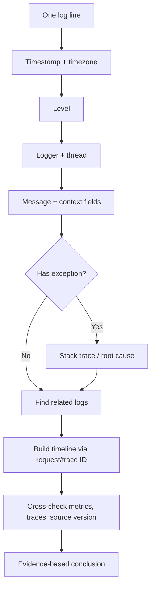

# Reading Timestamp, Level, Logger, Thread, and Message

When a Spring Boot application starts up, handles HTTP requests, runs scheduled jobs, or encounters errors, the console usually displays many log lines. If you only read from left to right like an ordinary sentence, you can easily miss critical information: **when** the error occurred, **how severe** it was, **which component** logged it, **which thread** was executing, and **what happened**.

A log line typically has a structure containing fields such as:

```text
2026-11-13T09:32:04.127+07:00  INFO 18352 --- [shop-service] [           main] c.e.shop.ShopApplication : Starting ShopApplication
```

Depending on the Spring Boot version, Logback configuration, and runtime environment, the formatting may differ. However, being able to read these five core components remains very useful:

1. **Timestamp** — when the event was recorded.
2. **Level** — priority/severity level of the message.
3. **Logger** — source name emitting the message, usually tied to a class or component.
4. **Thread** — the execution thread where the log call was invoked.
5. **Message** — text describing the event, optionally accompanied by an exception and contextual data.

This lesson belongs to the **Logging** chapter of *Spring Boot Fundamentals*. We will learn how to break down each field, read startup and HTTP request logs, understand stack traces, distinguish loggers from threads, determine whether logs came from the same request, configure log levels, and practice diagnostics with concrete examples.

The examples use Java 21 and Spring Boot 3.x with a common text logging configuration. Sample log lines are written to illustrate structure; **they are not a guarantee of the exact default pattern of every Spring Boot version**.

## 1. Start by dividing a log line into regions

Consider the example line:

```text
2026-11-13T09:32:04.127+07:00  INFO 18352 --- [shop-service] [           main] c.e.shop.ShopApplication : Starting ShopApplication
```

It can be divided into:

| Displayed part | Value in example | Question answered |
|---|---|---|
| Timestamp | `2026-11-13T09:32:04.127+07:00` | When was the event logged? |
| Level | `INFO` | How does the framework/log author rate its severity? |
| Process ID (auxiliary) | `18352` | Which JVM process wrote the log? |
| Application name (if present) | `shop-service` | Which application/instance does the log belong to? |
| Thread | `main` | Which thread called the logger? |
| Logger | `c.e.shop.ShopApplication` | Which class/component emitted the log? |
| Message | `Starting ShopApplication` | What is being reported? |

In some other Boot versions or patterns, you might see:

```text
2026-11-13T09:32:04.127+07:00  INFO 18352 --- [           main] c.e.shop.ShopApplication : Starting ShopApplication
```

or a custom-configured pattern:

```text
09:32:04.127 INFO  [main] com.example.shop.ShopApplication - Starting ShopApplication
```

The position and width of each region can vary; you should recognize **each field's meaning** rather than relying solely on column index.

### 1.1. Separators are not business content

Elements like `---`, `[ ... ]`, and the `:` before the message are usually separator characters generated by the logging pattern. They help humans clearly distinguish fields, but they are not part of the logger name or message.

Example:

```text
... [           main] c.e.shop.ShopApplication : Started ShopApplication
```

`main` is the thread, `c.e.shop.ShopApplication` is the logger, and `Started ShopApplication` is the message.

### 1.2. Read a log line as a structured sentence

Express it to yourself as:

> "At 09:32:04.127 on 2026-11-13 in timezone +07:00, JVM process 18352, thread main, the ShopApplication logger recorded an INFO message that the application is beginning to start."

This interpretation is better than jumping to "the application has finished starting", because the message here is `Starting`, not `Started` or a readiness signal.

## 2. Timestamp: when did the event occur?

The timestamp is the first field in many Spring Boot log patterns:

```text
2026-11-13T09:32:04.127+07:00
```

We can read:

| Component | Value | Explanation |
|---|---|---|
| Date | `2026-11-13` | November 13, 2026. |
| `T` separator | `T` | Separates date and time portions per ISO-8601. |
| Time | `09:32:04` | 9 hours, 32 minutes, 4 seconds. |
| Milliseconds | `.127` | 127 milliseconds past the second mark. |
| UTC offset | `+07:00` | Displayed time is 7 hours ahead of UTC. |

The `+07:00` offset does not necessarily describe a "permanent timezone of the entire system"; it tells you the UTC offset **of that timestamp**. If a system is configured for UTC, the timestamp may end with `Z` or `+00:00`.

### 2.1. Comparing two logs in different timezones

Example:

```text
2026-11-13T09:00:00.000+07:00 INFO ... Started application A
2026-11-13T02:00:00.000Z      INFO ... Started application B
```

The two timestamps above denote the exact same point in time:

```text
09:00 at UTC+07:00 = 02:00 UTC
```

If you compare logs from services across multiple regions by looking only at the hour portion, you can reconstruct event ordering incorrectly. Always normalize timestamps to the same timezone when investigating distributed errors.

### 2.2. Displayed precision vs actual accuracy

A timestamp with three digits after the decimal point like `.127` displays down to milliseconds. That **does not guarantee** the OS clock or log collection system has true 1 ms accuracy.

Two lines:

```text
2026-11-13T09:32:04.127+07:00 INFO ... Started operation
2026-11-13T09:32:04.127+07:00 INFO ... Finished operation
```

may occur within the same displayed millisecond. You cannot conclude the processing duration was literally 0 ns.

### 2.3. Using timestamps to estimate elapsed time

Example:

```text
2026-11-13T10:15:00.100+07:00 INFO  ... Started importing file
2026-11-13T10:15:01.850+07:00 INFO  ... Finished importing file
```

The interval between the two marks is roughly **1.75 seconds**. This is only the time between two log writes, and may not cover the exact business operation if the logs are not placed at the right boundaries.

To measure duration for an operation in code, use `System.nanoTime()` or an observability library timer rather than taking `System.currentTimeMillis()` and assuming the wall clock is always monotonic. The system clock can be synchronized or adjusted.

### 2.4. Log timestamp vs business event time

Consider the message:

```text
2026-11-13T10:15:02.000+07:00 INFO ... Processed payment event createdAt=2026-11-13T10:14:50Z
```

The leading timestamp is **when the log was written**, whereas `createdAt` inside the message is **when the payment event was created**. The two timestamps play different roles. Do not automatically treat them as identical.

### 2.5. Line order is not always absolute event order

In multi-threaded applications or with asynchronous logging:

- Threads can generate logs almost simultaneously.
- Buffers and collection systems can deliver logs out of order.
- Processes/hosts can have clock skew.

Therefore, timestamps are essential for building a timeline, but must be combined with thread, request/trace IDs, and other causal relationships.

## 3. Level: message priority

In common Spring Boot logging setups, the standard levels are:

| Level | Practical meaning | Example |
|---|---|---|
| `TRACE` | Very deep detail, usually helpful when investigating internals of a processing flow. | Logging every step of mapping, parsing, or framework calls. |
| `DEBUG` | Diagnostic information intended for developers. | Which branch a method chose, cache hit/miss. |
| `INFO` | Normal operational events worth noting. | Application started, batch finished. |
| `WARN` | Anomaly where the system can still continue. | A dependency is slow, using fallback. |
| `ERROR` | Failure that the logging component considers serious. | Unable to process request or job failed. |

In common order from most detailed to most severe:

```text
TRACE < DEBUG < INFO < WARN < ERROR
```

This is a log filtering order, not an absolute rule for determining business impact.

### 3.1. Level is a decision made by the log author or framework

Example:

```text
WARN ... Retrying payment provider after timeout
ERROR ... Payment provider unavailable after 3 attempts
```

A transient timeout can be logged as `WARN` when a retry mechanism exists. Once retries are exhausted, the component can log `ERROR`. However, each library has its own policy: not every WARN is harmless and not every ERROR stops the whole JVM.

**You cannot conclude an application crashed solely from the word ERROR.** Check the exception, subsequent logs, process status, and health/readiness.

### 3.2. How level affects what gets written

Suppose logger `com.example.shop` is configured at level `INFO`. Typically:

- `TRACE` and `DEBUG` for that logger are filtered out.
- `INFO`, `WARN`, and `ERROR` can be written, unless another filter/appender blocks them.

Example:

```java
log.debug("Preparing orderId={}", orderId);
log.info("Order accepted, orderId={}", orderId);
log.warn("Inventory is low for productCode={}", productCode);
```

With an INFO threshold, the DEBUG line usually does not appear. That **does not prove the `log.debug(...)` code was never reached**; it may simply have been filtered by level.

### 3.3. Configuring log levels with application.yml

```yaml
logging:
  level:
    root: INFO
    com.example.shop: DEBUG
    org.springframework.web: WARN
```

Explanation:

- `root: INFO` is the general threshold for loggers without a more specific setting.
- `com.example.shop: DEBUG` enables DEBUG logs for the application package and child loggers by name hierarchy.
- `org.springframework.web: WARN` reduces Spring Web logs to WARN or higher.

You can also write this in `application.properties`:

```properties
logging.level.root=INFO
logging.level.com.example.shop=DEBUG
logging.level.org.springframework.web=WARN
```

The goal is increasing detail in **the exact scope under investigation** rather than turning on DEBUG/TRACE across the whole system for a long period.

### 3.4. Changing level does not alter already-emitted messages

If the application already emitted a log and you later change the level, past lines are not regenerated. Raising verbosity only affects subsequent log calls according to the logging system's runtime capabilities.

In addition to logger thresholds, appenders and logging backends can add filters. When investigating "why don't I see DEBUG", inspect output configuration as well.

### 3.5. Do not use level as an error code

Example:

```text
ERROR ... Invalid coupon entered by user
```

An invalid coupon entered by a user may be an expected business outcome, not necessarily an operational failure requiring an alert. Choose levels based on meaning and actionability; avoid logging ERROR for every validation failure so alerting systems are not overwhelmed.

## 4. Logger: which component wrote the log?

Logger is **the name of the logging source**, commonly using the fully-qualified class name:

```java
import org.slf4j.Logger;
import org.slf4j.LoggerFactory;

public class PaymentService {

    private static final Logger log =
            LoggerFactory.getLogger(PaymentService.class);
}
```

For class `com.example.shop.payment.PaymentService`, the logger is typically named:

```text
com.example.shop.payment.PaymentService
```

A logger is not necessarily an HTTP endpoint URL, a log file name, or the processing thread.

### 4.1. Logger names can be abbreviated in the console

Example:

```text
c.e.shop.payment.PaymentService
```

This name can be a shortened form of:

```text
com.example.shop.payment.PaymentService
```

A logging pattern may specify a maximum width for the logger, such as `%logger{36}`, causing segments of the package name to be abbreviated.

Do not conclude the actual class name is literally `c.e.shop.payment.PaymentService` just because the console displays it that way. When you need the exact class, check source code, stack traces, the logging pattern, or enable full logger names in a diagnostic environment.

### 4.2. Loggers can have custom names

Sometimes code uses:

```java
private static final Logger auditLogger =
        LoggerFactory.getLogger("audit.payments");
```

In that case, the logger name is `audit.payments`, not a class name. Grouping loggers by function is also valid, provided it is clearly documented so the team knows where messages originate.

### 4.3. Loggers help narrow down code and dependencies

Consider two lines:

```text
2026-11-13T10:22:16.314+07:00 DEBUG 18352 --- [shop-service] [nio-8080-exec-2] c.e.shop.order.OrderService : Loading orderId=125
2026-11-13T10:22:16.328+07:00 WARN  18352 --- [shop-service] [nio-8080-exec-2] o.s.web.servlet.PageNotFound : No mapping for GET /old-endpoint
```

The first logger belongs to application code. The second logger belongs to Spring Web. They might appear in the same request or different requests, yet from the logger name alone we immediately know where to look in source:

- `com.example.shop.order` → business code package.
- `org.springframework.web...` → Spring Web framework.

### 4.4. A logger name is a clue, not a call stack

A logger in `OrderService` only tells you the log statement belongs to that logger. It does not prove which controller directly called the method. To know the exact call path when an error occurs, you need a stack trace or trace/span/correlation ID.

## 5. Thread: which execution thread wrote the log?

The thread field is usually enclosed in square brackets:

```text
[           main]
[nio-8080-exec-2]
[   scheduling-1]
[         task-1]
```

Leading spaces may simply be padding from the console pattern. The actual thread names are `main`, `nio-8080-exec-2`, `scheduling-1`, and `task-1`.

### 5.1. Common thread names

| Example thread name | Commonly indicates |
|---|---|
| `main` | Main thread, typically seen during startup and runners. |
| `restartedMain` | Thread associated with DevTools restarts in development. |
| `http-nio-8080-exec-4` or `nio-8080-exec-4` | Thread handling HTTP requests in a common servlet container configuration. |
| `scheduling-1` | Worker running scheduled tasks. |
| `task-1` | Task executor worker, potentially serving `@Async`. |
| `reactor-http-nio-2` | Event-loop thread in a Reactor Netty-based application. |
| Virtual thread name | Virtual thread if the application/framework is configured to use virtual threads. |

**Thread names can vary** depending on the servlet container, executor, thread name prefix configuration, and dependency versions. They are hints, not rigid standards.

### 5.2. Threads help distinguish startup from request handling

Example:

```text
10:00:00.000 INFO  [main] ShopApplication - Starting ShopApplication
10:00:02.200 INFO  [main] ShopApplication - Started ShopApplication
10:00:06.510 INFO  [http-nio-8080-exec-1] OrderController - Received order request
```

The first two lines on thread `main` usually belong to the startup sequence; the later line on an HTTP worker thread typically relates to request handling. Not every log on `main` is startup, but it is a useful initial inference.

### 5.3. Same thread does not mean same request

Thread pools reuse threads.

```text
10:03:01.100 INFO [http-nio-8080-exec-2] OrderController - Request A received
10:03:01.220 INFO [http-nio-8080-exec-2] OrderController - Request A completed
10:03:04.300 INFO [http-nio-8080-exec-2] OrderController - Request B received
```

Still `http-nio-8080-exec-2`, yet these are **two different requests**. To correlate logs reliably, you need a request ID or trace ID propagated and logged per request.

### 5.4. One request can cross multiple threads

With `@Async`, `CompletableFuture`, message consumers, reactive pipelines, or virtual thread execution, one operation can continue on a different thread:

```text
10:05:00.100 INFO [http-nio-8080-exec-1] OrderController - Accepted orderId=125
10:05:00.150 INFO [task-2] OrderWorker - Sending notification for orderId=125
```

Both lines can belong to the same workflow despite different threads. If you filter logs only by the first thread, you may miss the subsequent processing step.

### 5.5. Thread names do not represent users or requests

Do not infer from `task-2` that this is a user's second task, nor from `nio-8080-exec-3` that this is the third request. Numbers in thread names typically come from worker/executor naming.

## 6. Message: what was recorded?

The message is the content chosen by the application or framework to describe the event:

```text
Order accepted orderId=125
Connection to payment provider timed out
Started ShopApplication in 2.341 seconds
```

A good message helps answer:

- Which operation was being performed?
- Was the outcome success, failure, or retry?
- Which entity was processed? For example `orderId` or `batchId`.
- What did the system do next?
- Which error or limit needs investigation?

Messages have no mandatory structure in text logs. One project may use natural sentences; another uses `key=value` pairs for easier searching.

### 6.1. Writing messages with parameters

In Java, Spring Boot applications typically log through SLF4J:

```java
package com.example.shop.order;

import org.slf4j.Logger;
import org.slf4j.LoggerFactory;
import org.springframework.stereotype.Service;

@Service
public class OrderService {

    private static final Logger log =
            LoggerFactory.getLogger(OrderService.class);

    public void confirm(long orderId) {
        log.info("Confirming orderId={}", orderId);
        // Perform business logic...
        log.info("Order confirmed orderId={}", orderId);
    }
}
```

In the message format, `{}` is replaced by the argument value according to the logging API. Example:

```text
Order confirmed orderId=125
```

Do not confuse SLF4J's `{}` placeholder with `${...}` placeholders used in Spring configuration. The two syntaxes belong to two different mechanisms.

### 6.2. Messages should include a verb and context

Compare:

```text
INFO  ... OrderService : Done
INFO  ... OrderService : Order confirmed orderId=125 status=PAID
```

The second line is much more informative: it states **what was done**, **which entity**, and **the outcome**.

Still, there is no need to put entire objects or payloads into logs. Log only the operational fields required and permitted by security policy.

### 6.3. Log messages differ from log event schemas

In text logs, `orderId=125` is usually just characters inside the message string. In structured JSON logs, `orderId` can be a separate field so search tools can query it directly.

When using log collection tools, parsing free-form messages with regex can be more brittle than using structured fields.

## 7. Common auxiliary fields: PID, application, and correlation IDs

The five core fields are not all that can appear in logs. Spring Boot patterns can also include:

- Process ID (PID).
- Application name/instance identifier.
- Correlation identifiers such as `traceId` and `spanId`.
- Separators/alignment padding.
- ANSI color codes in the console.

Example:

```text
2026-11-13T10:11:12.125+07:00  INFO 18352 --- [shop-service] [http-nio-8080-exec-4] c.e.s.order.OrderController : Received orderId=125
```

`18352` is an example PID. If two application processes run on the same host, PID helps distinguish their logs. When running in containers, however, PIDs can repeat across different namespaces; you also need container/pod/instance identity from the deployment platform.

### 7.1. Application name is not the logger name

`shop-service` may be the application name; `c.e.s.order.OrderController` is the logger name. One application has hundreds of loggers sharing the same application name.

Configuration example:

```yaml
spring:
  application:
    name: shop-service
```

Some logging versions/patterns include the application name on the console. Not every pattern includes this field.

### 7.2. Color codes are not logical data

In the console, `INFO` may appear in a different color than `ERROR`. When logs are written to files or centralized systems, colors may be stripped or represented as escape sequences. Rely on level text and structured fields rather than just visual color.

## 8. Reading Spring Boot startup logs

Illustrative startup log snippet:

```text
2026-11-13T09:32:04.127+07:00  INFO 18352 --- [shop-service] [main] c.e.shop.ShopApplication : Starting ShopApplication using Java 21
2026-11-13T09:32:04.250+07:00  INFO 18352 --- [shop-service] [main] c.e.shop.ShopApplication : The following 1 profile is active: "dev"
2026-11-13T09:32:05.031+07:00  INFO 18352 --- [shop-service] [main] o.s.b.w.e.tomcat.TomcatWebServer : Tomcat initialized with port 8080 (http)
2026-11-13T09:32:05.742+07:00  INFO 18352 --- [shop-service] [main] o.s.b.w.e.tomcat.TomcatWebServer : Tomcat started on port 8080 (http)
2026-11-13T09:32:05.817+07:00  INFO 18352 --- [shop-service] [main] c.e.shop.ShopApplication : Started ShopApplication in 1.94 seconds
```

Let's analyze it:

1. All five lines share PID `18352` and application `shop-service`.
2. Loggers belong to the main class and the framework's Tomcat component.
3. Thread `main` shows the logs occurred during the normal startup sequence.
4. Timestamps increase from `09:32:04` to `09:32:05`.
5. Messages distinguish the `Starting` milestone, web server initialization, web server started, and `Started`.

### 8.1. "Started" does not necessarily mean "Ready"

Spring Boot emits `ApplicationStartedEvent` after context refresh but before `ApplicationRunner` and `CommandLineRunner`. `ApplicationReadyEvent` is published after runners finish. Thus, the `Started ShopApplication` log is an important milestone, yet it does not guarantee every startup runner task has completed or every external dependency is healthy.

If a runner continues loading data and fails, the application might never reach the ready state even though a "Started" line was logged earlier.

### 8.2. Not every log before Started is a failure

An application may log `WARN` when an optional configuration is missing and still start up. To identify a startup failure, look for signs such as:

```text
ERROR ... Application run failed
Caused by: ...
```

and verify whether the context closed, the process exited, or readiness was achieved. Do not decide based on a single WARN line alone.

## 9. Reading HTTP request logs

Suppose the code is:

```java
@RestController
@RequestMapping("/orders")
public class OrderController {

    private static final Logger log =
            LoggerFactory.getLogger(OrderController.class);

    @PostMapping("/{orderId}/confirm")
    public ResponseEntity<Void> confirm(@PathVariable long orderId) {
        log.info("Confirm request orderId={}", orderId);
        // Call service to confirm order...
        log.info("Confirm request accepted orderId={}", orderId);
        return ResponseEntity.accepted().build();
    }
}
```

Example logs:

```text
2026-11-13T10:08:01.100+07:00 INFO 18352 --- [shop-service] [http-nio-8080-exec-3] c.e.s.order.OrderController : Confirm request orderId=125
2026-11-13T10:08:01.115+07:00 INFO 18352 --- [shop-service] [http-nio-8080-exec-3] c.e.s.order.OrderController : Confirm request accepted orderId=125
```

We can infer:

- Same process/application from the log prefix.
- Two messages from the same `OrderController` logger.
- Same thread in the example; likely belonging to the same synchronous request.
- Timestamp interval of around 15 ms.
- Messages indicate the request was received and responded to according to the sample business flow.

**Do not conclude with certainty** that the request fully succeeded just because the message says "accepted". `ResponseEntity.accepted()` represents HTTP 202 Accepted, which does not guarantee background work finished. To know the final status, inspect logs and data from subsequent processing steps.

### 9.1. Multiple concurrent requests

```text
10:08:01.100 INFO [http-nio-8080-exec-3] OrderController - Confirm request orderId=125
10:08:01.102 INFO [http-nio-8080-exec-4] OrderController - Confirm request orderId=126
10:08:01.110 INFO [http-nio-8080-exec-4] OrderController - Confirm request accepted orderId=126
10:08:01.115 INFO [http-nio-8080-exec-3] OrderController - Confirm request accepted orderId=125
```

This is not one request "jumping back and forth" in the controller; two threads are concurrently handling two requests. To build an accurate timeline, group by request ID or trace ID when available.

## 10. Reading logs with exceptions and stack traces

An error log can start with a full five-field line followed by multiple stack trace lines:

```text
2026-11-13T10:12:45.203+07:00 ERROR 18352 --- [shop-service] [http-nio-8080-exec-2] c.e.s.payment.PaymentService : Payment failed orderId=125
java.lang.IllegalStateException: Provider returned an invalid response
    at com.example.shop.payment.PaymentService.charge(PaymentService.java:87)
    at com.example.shop.order.OrderService.confirm(OrderService.java:132)
    at com.example.shop.order.OrderController.confirm(OrderController.java:48)
Caused by: java.net.SocketTimeoutException: Read timed out
    at com.example.shop.payment.ProviderClient.send(ProviderClient.java:61)
```

The first line has timestamp, level `ERROR`, logger `PaymentService`, request-handling thread, and message. The subsequent lines **are not independent log events following the same pattern**, but rather the stack trace printed alongside a single logging event.

### 10.1. Reading exceptions layer by layer

1. **Log event message:** `Payment failed orderId=125`.
2. **Outer exception type:** `IllegalStateException`.
3. **Exception message:** `Provider returned an invalid response`.
4. **Stack frames:** where the exception passed through, with file names and line numbers.
5. **Caused by:** the underlying cause, here `SocketTimeoutException`.

An error can have multiple layers of exception wrappers. When investigating, usually read from the log message down to the **useful root cause**, then trace back through the frames belonging to application code.

### 10.2. What do file names and line numbers tell you?

```text
PaymentService.java:87
```

is a clue to the code location recorded in the stack trace of the running binary. Match it against the commit/version of the actual deployed build; line numbers on your current code branch may not match the deployed build.

### 10.3. ERROR does not automatically include a stack trace

Example:

```java
log.error("Payment failed orderId={}", orderId);
```

produces only an ERROR message. To record the exception, pass the throwable at the end of the call:

```java
log.error("Payment failed orderId={}", orderId, exception);
```

With SLF4J and an appropriate logging backend, the exception is rendered as a stack trace. Logging only `exception.getMessage()` can lose the exception type and cause chain.

### 10.4. Do not treat every stack trace line as a separate request

If you grep or count lines containing `ERROR` in a file, multi-line stack traces can make searching harder. Log aggregation systems should support **multiline grouping** to bundle stack traces into the same event rather than splitting them into disjoint records.

## 11. Logger vs thread: two independent analysis axes

One logger can be called from multiple threads:

```text
10:21:01.100 INFO [http-nio-8080-exec-1] OrderService - Loading orderId=125
10:21:01.101 INFO [http-nio-8080-exec-5] OrderService - Loading orderId=126
```

Conversely, the same thread can sequentially call multiple loggers:

```text
10:21:01.100 INFO [http-nio-8080-exec-1] OrderController - Confirm orderId=125
10:21:01.104 INFO [http-nio-8080-exec-1] OrderService    - Loading orderId=125
10:21:01.115 INFO [http-nio-8080-exec-1] PaymentService  - Charging orderId=125
```

Therefore:

- **Logger** tells you more about the code location or component emitting the log.
- **Thread** tells you about the execution context at the moment of logging.

Neither one, standing alone, is a stable request identifier.

### 11.1. Analyzing by logger and thread pairs

When a request runs synchronously on a servlet worker thread, you can follow the log sequence across multiple loggers on the same thread to picture the processing path. However, with thread pooling, async, or reactive execution, combine timestamps with correlation IDs to avoid mixing up requests.

## 12. MDC and request IDs: reading extra context beyond the five fields

**Mapped Diagnostic Context (MDC)** is a way to attach metadata to the logging context, often used for `requestId`, `traceId`, or another correlation key.

Example of two logs with `requestId` added:

```text
2026-11-13T10:25:05.101+07:00 INFO [http-nio-8080-exec-2] requestId=7f4a OrderController - Confirm orderId=125
2026-11-13T10:25:05.109+07:00 INFO [http-nio-8080-exec-2] requestId=7f4a PaymentService  - Payment initiated orderId=125
```

Here `requestId=7f4a` is an illustrative value. In a real system, request IDs are typically longer and generated using rules ensuring low collision probability.

### 12.1. Why is a request ID needed?

In an application with many concurrent requests:

```text
10:25:05.100 INFO [http-nio-8080-exec-2] requestId=A OrderController - Request A
10:25:05.101 INFO [http-nio-8080-exec-3] requestId=B OrderController - Request B
10:25:05.103 INFO [http-nio-8080-exec-2] requestId=A OrderService    - Step 1 A
10:25:05.108 INFO [task-1]             requestId=A NotificationJob - Step 2 A
```

Request A may appear on a different thread. If the correlation ID is properly propagated to the executor, you can still trace all logs belonging to the same flow.

### 12.2. Example attaching MDC in a servlet filter

A minimal example:

```java
package com.example.shop.logging;

import java.io.IOException;
import java.util.UUID;

import jakarta.servlet.FilterChain;
import jakarta.servlet.ServletException;
import jakarta.servlet.http.HttpServletRequest;
import jakarta.servlet.http.HttpServletResponse;
import org.slf4j.MDC;
import org.springframework.stereotype.Component;
import org.springframework.web.filter.OncePerRequestFilter;

@Component
public class RequestIdFilter extends OncePerRequestFilter {

    @Override
    protected void doFilterInternal(
            HttpServletRequest request,
            HttpServletResponse response,
            FilterChain filterChain)
            throws ServletException, IOException {

        String requestId = UUID.randomUUID().toString();
        response.setHeader("X-Request-ID", requestId);

        try (MDC.MDCCloseable ignored =
                     MDC.putCloseable("requestId", requestId)) {
            filterChain.doFilter(request, response);
        }
    }
}
```

The example generates the request ID server-side to avoid blindly trusting caller-supplied headers. Real projects may need to integrate with tracing systems or reverse proxies that already have their own correlation mechanisms.

### 12.3. MDC must be included in the logging pattern

Simply calling `MDC.put(...)` does not guarantee the request ID automatically appears on every line. The logging backend needs a pattern or encoder that reads MDC.

An illustrative custom Logback console pattern:

```yaml
logging:
  pattern:
    console: "%d{yyyy-MM-dd'T'HH:mm:ss.SSSXXX} %-5level [%thread] requestId=%X{requestId} %logger{40} - %msg%n"
```

This pattern is used to illustrate Logback conversion words. When replacing all of `logging.pattern.console`, you also replace Boot's default console format; before applying in production, review existing logger config, trace correlation, and encoding.

### 12.4. MDC must be cleaned up and propagated across async boundaries

MDC typically has thread-bound semantics in common logging backends. If `requestId` is not cleared after a request, a reused thread can log the previous request's ID by mistake.

Use `try/finally` or `MDC.putCloseable(...)` to clean up within appropriate synchronous scopes. When switching to another thread, MDC context is not automatically propagated reliably across every executor or reactive pipeline. Use framework-supported context propagation or observability mechanisms rather than copying context carelessly.

### 12.5. Trace ID and span ID are not thread IDs

With distributed tracing, logs may include:

```text
traceId=9b4d... spanId=73ac... 
```

- **Trace ID:** usually links steps belonging to a cross-service processing flow.
- **Span ID:** identifies a single unit of work within a trace.
- **Thread name:** shows the execution worker at the time of logging.

One trace can span multiple services, processes, and threads. A thread ID cannot replace a distributed trace ID.

## 13. Why can log ordering be misleading?

Suppose:

```text
10:28:00.101 INFO [http-nio-8080-exec-1] OrderService - Submitting notification
10:28:00.102 INFO [http-nio-8080-exec-1] OrderService - HTTP response accepted
10:28:00.350 ERROR [task-4] NotificationWorker - Notification failed
```

The first two lines on the HTTP thread report the request was accepted; the third line on a worker thread says background notification failed.

There is no contradiction here: the request can return a response before background work finishes. When reading logs, identify **synchronous and asynchronous boundaries**.

### 13.1. A "completed" log may only mean one step finished

`Completed HTTP request` differs from `Payment settled`. Messages must be understood according to the author's semantics and the specific operation.

### 13.2. Log collectors can receive logs late

In multi-container systems, a log with an earlier timestamp can arrive at the dashboard after a log from another container. Distinguish **event timestamp** from **ingestion timestamp** if your observability tool displays both.

## 14. Configuring a pattern to see the five fields clearly

Spring Boot usually uses a logging abstraction alongside a logging backend, commonly Logback when using the default logging starter. You can customize the console pattern.

Example in `application.yml`:

```yaml
logging:
  level:
    root: INFO
    com.example.shop: DEBUG
  pattern:
    console: "%d{yyyy-MM-dd'T'HH:mm:ss.SSSXXX} %-5level [%thread] %logger{40} - %msg%n"
```

In the illustrative pattern:

| Token | Common meaning in Logback |
|---|---|
| `%d{...}` | Timestamp in the requested format. |
| `%-5level` | Log level, left-aligned within a minimum width of 5 characters. |
| `%thread` | Thread name. |
| `%logger{40}` | Logger name, length-abbreviated per backend formatting rules. |
| `%msg` | Formatted message. |
| `%n` | Newline character. |
| `%X{requestId}` | Value of `requestId` in MDC if present. |

Example output:

```text
2026-11-13T10:30:01.234+07:00 INFO  [http-nio-8080-exec-4] com.example.shop.order.OrderService - Order confirmed orderId=125
```

### 14.1. Why doesn't the custom pattern example include PID?

Because a pattern only contains the fields we declare. When replacing the default pattern with a custom pattern, you can **lose** extra fields like PID, application name, or trace correlation unless you explicitly include them.

Therefore, before editing the pattern, check which fields dashboards and collection systems expect. Misconfiguring a pattern can make diagnostics worse than the default.

### 14.2. When advanced configuration is needed

You can use `logback-spring.xml` to customize appenders, encoders, and detailed patterns. This is the right choice when multiple destinations or complex structured logging are required.

Do not customize it merely to tweak a few spaces if Spring Boot's current pattern already provides sufficient information.

## 15. Structured logging: same information, as data

Text logs are convenient for human reading:

```text
2026-11-13T10:33:00.320+07:00 INFO [http-nio-8080-exec-1] OrderService - Order confirmed orderId=125
```

Structured logs can represent the same event as JSON:

```json
{
  "timestamp": "2026-11-13T10:33:00.320+07:00",
  "level": "INFO",
  "logger": "com.example.shop.order.OrderService",
  "thread": "http-nio-8080-exec-1",
  "message": "Order confirmed",
  "orderId": 125
}
```

This is an illustrative schema, not a fixed JSON schema across all Spring Boot configurations.

### 15.1. How do structured logs help?

- Filter `level=ERROR` accurately.
- Search by `logger` or `thread` without parsing column positions.
- Group by `traceId`, `requestId`, or `orderId`.
- Build dashboards/aggregations by field.
- Reduce dependence on a text pattern that might change.

Some Spring Boot versions support structured logging via configuration; other frameworks/backends can also use JSON encoders. Choose the format based on your actual observability stack rather than assuming every project enables JSON with the same property.

### 15.2. One logging event can span multiple lines in text

In text logs, an exception stack trace makes one event span multiple lines. With structured logging, the exception can reside in a `stack_trace` string field or a separate structure. When switching formats, check the ingestion pipeline to avoid fragmenting stack traces.

## 16. Reading logs in development and production environments

### 16.1. Development

In a local environment, you typically want:

- Default log level `INFO`.
- Temporarily enabling `DEBUG` for packages under investigation.
- Timestamps with clear offsets.
- Easily recognizable thread and logger names.
- Full stack traces on errors.

An illustrative `application-dev.yml`:

```yaml
logging:
  level:
    root: INFO
    com.example.shop: DEBUG
    org.springframework.web: INFO
```

### 16.2. Production

In production, keep in mind:

- Do not enable TRACE system-wide unless purposeful and time-boxed.
- Use correlation IDs to follow requests.
- Ensure logs contain no secrets, tokens, passwords, or excessive personal data.
- Limit overly long messages or dumping entire objects.
- Configure log retention and access permissions.
- Synchronize clocks across hosts/containers and standardize timezone display.
- Use structured fields or a consistent format when centralizing logs.

Logs are an operational data source, not an unbounded storage area for business data.

### 16.3. Do not filter only by ERROR

A real failure might have a sequence like:

```text
WARN  PaymentClient - Provider slow, retrying attempt=1
WARN  PaymentClient - Provider slow, retrying attempt=2
ERROR PaymentClient - Provider unavailable orderId=125
```

Viewing only the ERROR line loses retry counts and how the failure unfolded. When investigating, retrieve related WARN/INFO lines by time window, request ID, or logger.

## 17. Distinguishing logs within one run vs across runs

Consider:

```text
09:00:00.000 INFO 18352 --- [main] ShopApplication - Starting ShopApplication
09:00:03.000 INFO 18352 --- [main] ShopApplication - Started ShopApplication
09:15:00.000 INFO 19401 --- [main] ShopApplication - Starting ShopApplication
09:15:02.000 INFO 19401 --- [main] ShopApplication - Started ShopApplication
```

Different PIDs indicate two distinct processes within the same PID scope. In containers, PID alone is insufficient to distinguish two deployments; include instance/pod/container ID, deployment version, and startup timestamp.

This matters when dashboards aggregate logs from multiple instances. Without knowing which release a log belongs to, you could diagnose against the wrong version of source code.

## 18. From log lines to root cause: a concrete scenario

Suppose users report "confirming an order sometimes fails". You see:

```text
2026-11-13T11:02:10.100+07:00 INFO  18352 --- [shop-service] [http-nio-8080-exec-1] c.e.s.order.OrderController : Confirm requested orderId=125 requestId=REQ-8
2026-11-13T11:02:10.105+07:00 DEBUG 18352 --- [shop-service] [http-nio-8080-exec-1] c.e.s.order.OrderService : Loading orderId=125
2026-11-13T11:02:10.140+07:00 WARN  18352 --- [shop-service] [http-nio-8080-exec-1] c.e.s.payment.PaymentClient : Provider timeout, retry=1 orderId=125
2026-11-13T11:02:11.150+07:00 ERROR 18352 --- [shop-service] [http-nio-8080-exec-1] c.e.s.payment.PaymentService : Payment failed orderId=125 requestId=REQ-8
```

Analysis across the five fields:

| Field | Observation | Investigation direction |
|---|---|---|
| Timestamp | From 11:02:10.100 to 11:02:11.150, roughly 1.05 seconds. | Did timeout/retry prolong the request? |
| Level | INFO → DEBUG → WARN → ERROR. | Where did it transition from temporary anomaly to failure? |
| Logger | Controller → OrderService → PaymentClient → PaymentService. | What failed in the payment component? |
| Thread | Same `http-nio-8080-exec-1`. | Likely the same synchronous flow, though correlation is still needed. |
| Message | Consistent orderId and requestId. | Focus on `REQ-8` and order 125; look for an accompanying stack trace. |

**Conclusion you can draw:** there are signs of a timeout at the payment provider, a retry occurred, and payment ultimately failed. **Cannot yet conclude:** whether the timeout was caused by the network, the provider's server, or client configuration — you need the stack trace, metrics, network telemetry, and provider-side data.

### 18.1. Avoid over-inferring beyond what logs state

If a log says "Provider timeout", that reflects how the client perceived the error; it does not prove the provider suffered a total outage. Check multiple requests, error rates, and the status of other dependencies.

### 18.2. Combine multiple loggers, not just one ERROR line

The ERROR line shows where failure was detected. The preceding WARN line can reveal retry policy and initial timing. The controller line provides the request ID to find earlier and later logs.

## 19. How to search logs when you do not know where the bug is

With a text log file on a local machine, start from a stable keyword.

Example on Linux/macOS:

```bash
grep "orderId=125" application.log
grep "ERROR" application.log
grep "PaymentService" application.log
```

With PowerShell:

```powershell
Select-String -Path .\application.log -Pattern "orderId=125"
Select-String -Path .\application.log -Pattern "ERROR"
Select-String -Path .\application.log -Pattern "PaymentService"
```

In practice, a centralized log dashboard enables more effective field-based filtering, especially if logs are JSON.

### 19.1. Narrow down the time range

If order IDs or request IDs repeat across environments, search results may mix multiple records. Narrow by:

- Application/service name.
- Environment.
- Instance/container when needed.
- Time window.
- Request ID/trace ID.
- Logger or exception type.

Simply grepping `ERROR` across a week of logs makes causal relationships harder to spot than inspecting a few-minute window around the incident.

### 19.2. Stack traces must be inspected as part of one event

An `ERROR` line can be followed by many stack trace lines underneath. If you only extract lines containing the word ERROR, you can miss `Caused by`. When investigating, inspect the contiguous text block around the error line or view the complete event in the logging system.

## 20. Checking the active logging configuration

A project might have:

```properties
logging.level.root=INFO
logging.level.com.example.shop.payment=DEBUG
logging.file.name=logs/shop.log
```

Here:

- The general log level is INFO.
- The application's payment package can additionally emit DEBUG.
- Logs are configured to go to `logs/shop.log` under the corresponding logging setup.

In an application with Logback/Actuator and the endpoint enabled, you can inspect or change logger levels via `/actuator/loggers`. This feature requires appropriate configuration and access permissions.

Example strictly for a secured diagnostic environment:

```yaml
management:
  endpoints:
    web:
      exposure:
        include: health,loggers
```

Do not expose Actuator loggers publicly without protection; the ability to change log levels can reveal internal data or create heavy logging load.

### 20.1. Adding @Slf4j does not automatically emit logs

Lombok `@Slf4j` can generate a logger field at compile time if the project has Lombok and annotation processing configured properly. It **does not log automatically**: code still needs to call `log.info(...)`, `log.warn(...)`, etc.

Example:

```java
@Slf4j
@Service
public class InventoryService {

    public void reserve(long orderId) {
        log.info("Reserving inventory for orderId={}", orderId);
    }
}
```

You can use SLF4J directly without Lombok. Either way, the logger name is usually tied to the class containing the logger field.

## 21. Misconceptions when reading the five log fields

| Misconception | Accurate understanding |
|---|---|
| "Same timestamp means two logs occurred at the exact same nanosecond." | Display precision is limited; multiple events can share a millisecond. |
| "ERROR means the application definitely stopped." | ERROR is a logging event level; check process/health status. |
| "No DEBUG seen means the method didn't run." | DEBUG may be filtered by level or appender. |
| "Logger is the thread name." | Logger is the log source; thread is the execution context. |
| "Abbreviated logger is the real class name." | Logging patterns can shorten package names. |
| "Same thread means same request." | Thread pools can reuse workers across different requests. |
| "Different thread means different request." | Async/reactive processing can switch threads within the same workflow. |
| "After the colon is only unstructured text." | Messages can contain `key=value` pairs; exceptions can follow across multiple lines. |
| "A `Caused by` line is a new log event." | It is usually the stack trace continuation of an error event. |
| "Application `Started` means everything is ready." | Startup runners/readiness and external dependencies must also be checked. |
| "Having `requestId` in MDC makes it appear automatically in every log." | Patterns/encoders and context propagation must support it. |
| "Display order in a dashboard is always execution order." | Async collection, multiple threads, and clock skew can alter order. |

## 22. Diagnostic workflow from a log line

When given any log snippet, proceed in order:

1. **Identify the format.** Is this console text, file text, or structured JSON?
2. **Read timestamp with offset.** Normalize timezones if comparing multiple systems.
3. **Read level.** Is this an informational log, a warning, or a failure per the author's policy?
4. **Identify logger.** Is the source application code or a framework/library?
5. **Identify thread.** Startup, HTTP worker, scheduled task, async executor, or event loop?
6. **Read the full message.** Which operation, which entity, which status?
7. **Read continuations.** Are there stack traces, `Caused by`, or suppressed exceptions?
8. **Extract correlation keys.** Is there a relevant requestId, traceId, batchId, or orderId?
9. **Find preceding/following events.** Inspect a short time window and related loggers.
10. **Cross-check with other data.** Health, metrics, traces, database state, and runtime configuration when needed.



The most important point is **do not ignore context**. A single log line may record only a symptom, not the root cause.

## 23. Practice exercises: reading sample log lines

### Exercise 1 — Identify the five fields

```text
2026-11-13T14:07:22.431+07:00 DEBUG 22540 --- [billing-service] [http-nio-8090-exec-6] c.e.b.invoice.InvoiceService : Calculating invoiceId=743
```

Identify the timestamp, level, logger, thread, and message, then answer whether you can conclude the method already succeeded.

**Reference hints:**

- Timestamp: `2026-11-13T14:07:22.431+07:00`.
- Level: `DEBUG`.
- Logger: `c.e.b.invoice.InvoiceService`.
- Thread: `http-nio-8090-exec-6`.
- Message: `Calculating invoiceId=743`.
- There is not yet confirmation that invoice calculation succeeded; the message only reports that the action is in progress.

### Exercise 2 — Why is DEBUG missing?

```properties
logging.level.root=INFO
logging.level.com.example.billing=INFO
```

And code:

```java
log.debug("Calculating invoiceId={}", invoiceId);
```

**Explanation:** the application logger has an INFO threshold, so DEBUG logs are usually filtered out. You can temporarily switch the package logger under investigation to DEBUG rather than turning on DEBUG across all of production.

### Exercise 3 — Same thread but different requests

```text
14:10:00.100 INFO [http-nio-8090-exec-1] RequestLogger - requestId=A start
14:10:00.180 INFO [http-nio-8090-exec-1] RequestLogger - requestId=A end
14:10:00.300 INFO [http-nio-8090-exec-1] RequestLogger - requestId=B start
```

**Explanation:** all three lines share the same worker thread yet belong to two different requests according to `requestId`. The thread pool reused the worker.

### Exercise 4 — Reading an error with a root cause

```text
14:12:10.000 ERROR [http-nio-8090-exec-2] InvoiceService - Failed to create invoiceId=743
org.springframework.dao.DataAccessResourceFailureException: Could not obtain connection
    at com.example.billing.InvoiceService.create(InvoiceService.java:52)
Caused by: java.net.ConnectException: Connection refused
```

**Explanation:** check the datasource/network/DB endpoint because the root cause is a refused connection. However, there is not yet enough data to conclude the database itself is down; it could be a wrong host/port configuration or a network issue.

### Exercise 5 — Do two timestamps represent the same moment?

```text
2026-11-13T16:00:00.000+07:00
2026-11-13T09:00:00.000Z
```

**Explanation:** the two timestamps represent the exact same point in time, since UTC+07:00 is seven hours ahead of UTC.

## 24. Creating a small application to observe logs yourself

You can use a Spring Boot project with `spring-boot-starter-web` and `spring-boot-starter-logging` brought in transitively by the standard starter.

Create a controller:

```java
package com.example.demo;

import java.util.concurrent.atomic.AtomicLong;
import org.slf4j.Logger;
import org.slf4j.LoggerFactory;
import org.springframework.web.bind.annotation.GetMapping;
import org.springframework.web.bind.annotation.RestController;

@RestController
public class DemoLogController {

    private static final Logger log =
            LoggerFactory.getLogger(DemoLogController.class);

    private final AtomicLong sequence = new AtomicLong();

    @GetMapping("/demo-log")
    public String demoLog() {
        long id = sequence.incrementAndGet();

        log.debug("Request {} entering controller", id);
        log.info("Demo request received id={}", id);

        if (id % 3 == 0) {
            log.warn("Demo request triggered warning id={}", id);
        }

        log.info("Demo request completed id={}", id);
        return "Request " + id;
    }
}
```

Declare configuration in `application.yml`:

```yaml
spring:
  application:
    name: logging-demo

logging:
  level:
    root: INFO
    com.example.demo: DEBUG
```

Run the project using your build tool. Then call:

```bash
curl http://localhost:8080/demo-log
curl http://localhost:8080/demo-log
curl http://localhost:8080/demo-log
```

Observe:

1. Do timestamps increase with each request?
2. Does the logger name correspond to `DemoLogController`?
3. How many HTTP worker threads were used? Are they reused?
4. With DEBUG configured for the application package, does the DEBUG line appear?
5. When the third request arrives, does the WARN line appear?
6. If you set `logging.level.com.example.demo=INFO`, does the DEBUG line still appear?

This is a simple example without a real request ID. To explore correlation, you can add the MDC filter from section 12 and display the request ID via a pattern.

## 25. When is more information needed beyond the five fields?

The five fields are the foundation for reading logs, but a distributed system also needs:

| Additional information | When useful |
|---|---|
| `serviceName` | Distinguishing microservices. |
| `environment` | Distinguishing dev/staging/prod. |
| `instanceId`/pod/container | Knowing which instance had an error. |
| `requestId` | Grouping logs of one HTTP request. |
| `traceId` and `spanId` | Following activity across multiple services. |
| `orderId` or `batchId` | Searching by business entity. |
| `deploymentVersion` | Matching stack traces to the exact source version. |
| Error/exception type | Grouping errors with the same cause. |

It is not necessary to cram all fields into every message. Choose data sufficient for diagnostics, with controls over security and cardinality.

### 25.1. Protecting sensitive information

A log line such as:

```text
INFO PaymentService - Calling provider token=secret-value cardNumber=...
```

is an example of **what not to do**. Passwords, bearer tokens, API keys, payment card numbers, session cookies, and sensitive personal data must not be printed to logs. When observation is needed, use non-sensitive reference IDs or mask according to policy.

### 25.2. Logger names and messages should be stable

Naming loggers by class/package supports long-term filtering. Messages with a consistent structure like `Order confirmed orderId={}` are much easier to search than arbitrarily constructed messages.

## 26. Self-assessment questions

1. What are the five most important fields for reading a Spring Boot log line?
2. In timestamp `2026-11-13T09:32:04.127+07:00`, what does `+07:00` indicate?
3. Do two logs sharing the same timestamp to the millisecond necessarily occur at the exact same absolute instant?
4. How do `INFO` and `WARN` differ? Can you conclude every WARN is a critical failure?
5. If a logger level is set to `INFO`, what usually happens to `log.debug(...)` calls?
6. What is the typical logger name in `LoggerFactory.getLogger(PaymentService.class)`?
7. Why can a logger name be abbreviated to `c.e...PaymentService`?
8. How do logger names and thread names differ?
9. Why does sharing `http-nio-8080-exec-2` not guarantee two logs belong to the same request?
10. Can a single request have logs on two different threads? Under what circumstances?
11. Why does `Order accepted` not necessarily mean all asynchronous tasks for the order have finished?
12. Why should `Caused by` lines typically be read together with an ERROR log event?
13. How does `log.error("Failed")` differ from `log.error("Failed", exception)`?
14. How does MDC help correlate logs? Does it propagate automatically across every executor?
15. How does `traceId` differ from a thread name?
16. When wanting to debug one package, why shouldn't you enable TRACE across all of production?
17. Can a custom console pattern omit PID or application name?
18. When logs from two servers have different timezones, what must you do to compare them?
19. Why is an ERROR log only a clue and not always the root cause?
20. Beyond the five fields, what additional data do you need to diagnose issues across microservices?

### Complete sample explanation

> In a Spring Boot log line, the **timestamp** indicates when the event was recorded and must be read together with its timezone/UTC offset; the **level** indicates priority under the logging policy, such as DEBUG, INFO, WARN, or ERROR; the **logger** identifies the log source, typically a class or package name that may be abbreviated by the pattern; the **thread** is the execution thread that called the logger at that moment; and the **message** describes what happened, optionally including contextual fields like orderId, requestId, and an exception. When an error occurs, inspect both the stack trace and the Caused by chain. A thread is not a request ID because thread pools reuse workers and a single workflow can cross multiple threads. In multi-service systems, combine timezone-normalized timestamps, application/instance identity, and trace/request IDs to construct a timeline. Do not conclude the application crashed solely from one ERROR line, or infer a method did not run just because DEBUG logs were filtered.

Once you can look at a log line and answer **when — what level — from where — on which thread — what happened**, you have the foundation to read Spring Boot logs systematically. The next step is linking multiple lines using timestamps and correlation IDs, cross-checking stack traces and metrics to move from symptoms to an evidence-based root cause.
