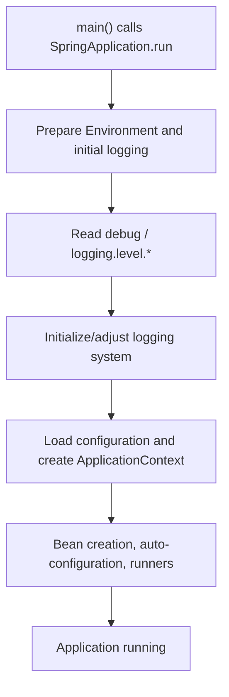
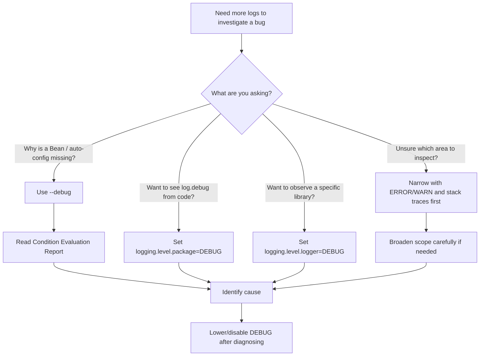

# Distinguishing --debug from Enabling DEBUG Across the Entire Application

When a Spring Boot application fails to start or an unexpected auto-configuration is skipped, we often try:

```bash
java -jar app.jar --debug
```

Meanwhile, when wanting to see our own application's `log.debug(...)` calls, many developers configure:

```properties
logging.level.root=DEBUG
```

These two approaches are **not synonymous**. `--debug` enables **Spring Boot's debug mode**, focusing on selected core loggers chosen by Boot and surfacing startup diagnostic info, especially the **Condition Evaluation Report**. Conversely, setting `logging.level.root=DEBUG` lowers the threshold of the **root logger** in the logging system, potentially allowing DEBUG logs from most of the application and libraries — except loggers with their own overrides or other filters.

This is a key distinction in the Logging chapter: when you want to know *why Boot picked or skipped a configuration*, you need startup diagnostics; when you want to *trace code execution flow*, you need the right logger and log level. Turning on DEBUG everywhere usually floods output without necessarily answering the right question.

## 1. Short answer

| Way to enable | Primary purpose | Effect on application logs |
|---|---|---|
| `--debug` | Spring Boot debug mode; increases info from selected core loggers and enables Condition Evaluation Report | **Does not enable DEBUG for every application package/class by default** |
| `debug=true` | Equivalent request to enable Boot debug mode via property | Same as `--debug` when effective value is `true` |
| `logging.level.root=DEBUG` | Sets the root logger threshold to DEBUG | Enables DEBUG from loggers inheriting root without a stricter blocking threshold |
| `logging.level.com.example=DEBUG` | Enables DEBUG only for package `com.example` and child loggers | Focuses on relevant code with less noise |
| `logging.level.org.springframework.web=DEBUG` | Diagnoses a specific framework area | Avoids opening DEBUG across the entire JVM |

**Rule to remember:** `--debug` is **Boot's diagnostic switch**; `logging.level.*` is **logger level configuration**.

Both can be used together. Passing `--debug --logging.level.com.example.orders=DEBUG` gives you both Spring Boot debug diagnostics and DEBUG logs for the orders package.

## 2. How do log levels and the root logger work?

Spring Boot usually uses SLF4J as the facade for applications. With standard starters, the default backend is usually Logback; projects may also use Log4j2 or another compatible backend.

Common log levels, from most severe to most detailed:

```text
ERROR → WARN → INFO → DEBUG → TRACE
```

If a logger has threshold `INFO`, `INFO`, `WARN`, and `ERROR` messages pass through the logging filter; `DEBUG` and `TRACE` are normally blocked.

If the threshold is `DEBUG`, DEBUG messages pass through, while TRACE remains below the threshold. Whether a log actually appears also depends on backend config, appenders, filters, output destinations, and operational conditions.

### Root logger

Root is the base of the logger tree. In Logback and backends with a logger hierarchy, a logger without its own configured level usually inherits its effective threshold from the nearest ancestor.

Example:

```text
ROOT [INFO]
├── com.example.shop
│   ├── com.example.shop.web.OrderController
│   └── com.example.shop.service.OrderService
└── org.springframework.web.servlet.DispatcherServlet
```

If child loggers have no explicit level, root INFO keeps their DEBUG messages from being emitted.

When setting:

```properties
logging.level.root=DEBUG
```

we shift the effective threshold of loggers **inheriting from root** to DEBUG.

```text
ROOT [DEBUG]
├── com.example.shop.service.OrderService     → can see DEBUG
├── org.springframework.web.servlet...         → can see DEBUG
├── org.hibernate...                           → can see DEBUG
└── com.vendor.thirdparty...                   → can see DEBUG
```

This is why root DEBUG can cause log volume to surge, especially when the application has many dependencies.

### Child loggers with explicit configuration still take precedence

Suppose:

```properties
logging.level.root=DEBUG
logging.level.org.springframework=INFO
logging.level.com.example.shop.service=TRACE
```

Then, at a high level:

- Unconfigured loggers can inherit root DEBUG.
- Loggers under `org.springframework` have effective level INFO if no closer override exists.
- Loggers under `com.example.shop.service` have effective level TRACE if no other override exists.

Thus "enabling DEBUG for the entire application" is shorthand for **changing the root threshold**; it is not a guarantee that every logger regardless of individual config will emit every DEBUG message.

## 3. What does --debug actually do?

When running:

```bash
java -jar app.jar --debug
```

Spring Boot sees the `debug` property enabled in command-line arguments. While preparing logging, Boot raises verbosity on **a selected group of core loggers**. Spring Boot's documentation describes this group as covering areas such as the embedded container, Hibernate, and Spring Boot itself.

This means:

1. You typically receive more details about startup or framework configuration.
2. Boot can output the **Condition Evaluation Report**, showing which auto-configurations/conditions matched or did not match.
3. The root logger is not automatically switched to DEBUG just because `--debug` was passed.
4. Arbitrary application loggers, such as `com.example.shop.OrderService`, are not automatically set to DEBUG by this switch.

The exact names of core loggers adjusted by Boot can change across versions. Do not rely on a fixed internal logger list assuming every `org.springframework.*` package is necessarily set to DEBUG.

### Why doesn't Boot turn on root DEBUG?

If Boot enabled DEBUG for every library by default whenever you used `--debug`, startup logs of a large application would be nearly unreadable. Someone trying to find out why a Bean was configured would have to wade through endless logs from HTTP clients, connection pools, JDBC, third-party libraries, and business code.

Boot debug mode targets relevant diagnostic info, not opening every detailed log in the process.

### --debug and debug=true

You can enable it via property:

```properties
debug=true
```

Or top-level YAML:

```yaml
debug: true
```

Or command line:

```bash
java -jar app.jar --debug
```

The overall meaning is requesting Boot's debug mode. With command-line arguments, Spring Boot normally places command-line properties into the `Environment` with higher precedence than corresponding keys in config files; however, an application can customize how command-line properties are handled.

Do not confuse `debug=true` with:

```properties
logging.level.root=DEBUG
```

Those are two different keys acting on two different mechanisms.

## 4. What is the Condition Evaluation Report?

Spring Boot features auto-configuration: detecting libraries on the classpath and checking conditions to decide whether to register default Beans.

Example conditions:

- `@ConditionalOnClass`: a required class is on the classpath.
- `@ConditionalOnBean`: a matching Bean is already registered.
- `@ConditionalOnMissingBean`: no matching Bean exists yet, so a default Bean can be created.
- `@ConditionalOnProperty`: a property has a matching value.
- `@ConditionalOnWebApplication`: the application has a matching web environment type.

When `--debug` is enabled, the **Condition Evaluation Report** explains why specific auto-configurations were applied or skipped. Illustrative log example (not a fixed verbatim output of one version):

```text
CONDITIONS EVALUATION REPORT

Positive matches:
  ExampleWebAutoConfiguration:
    - Found required class 'ExampleWebServer'

Negative matches:
  ExampleCacheAutoConfiguration:
    - Did not find required class 'ExampleCacheProvider'
```

You see groups of positive matches, negative matches, and other version-dependent details. Exact class names, output formatting, and layout depend on the actual auto-configurations.

### When is this report useful?

Suppose the application lacks a `DataSource` or `ObjectMapper` Bean you expected. Instead of turning on DEBUG everywhere:

1. Run the application with `--debug`.
2. Locate the relevant auto-configuration name.
3. Read why conditions matched or failed to match.
4. Inspect the classpath, properties, existing Beans, and configuration ordering.
5. Only raise deeper loggers if the report does not explain enough.

The report is a **snapshot of configuration decisions**; it does not describe every runtime request or method call.

### Does root DEBUG replace --debug?

No. `logging.level.root=DEBUG` increases log output allowed from the logger hierarchy, yet **is not equivalent to setting Spring Boot's `debug=true` property**. Some output from the condition-report logger may appear if the logging level allows it or when startup fails, depending on integration/version, yet you should not treat root DEBUG as the official switch to request Boot debug mode.

When the goal is investigating auto-configuration, using `--debug` directly expresses your intent cleanly and consistently.

## 5. logging.level.root=DEBUG: scope and impact

When setting:

```properties
logging.level.root=DEBUG
```

Spring Boot configures the logging backend so the root logger has level DEBUG. Loggers without their own level normally inherit this setting, so DEBUG logs from application code and many dependencies can appear.

Suppose the service is:

```java
package com.example.shop.service;

import org.slf4j.Logger;
import org.slf4j.LoggerFactory;
import org.springframework.stereotype.Service;

@Service
public class OrderService {
    private static final Logger log =
            LoggerFactory.getLogger(OrderService.class);

    public void createOrder(long id) {
        log.debug("Begin createOrder: id={}", id);
        log.info("Order creation requested: id={}", id);
        // Business logic.
    }
}
```

With typical root INFO, `log.debug(...)` usually does not appear; `log.info(...)` still does.

With root DEBUG and no package override, you usually see both DEBUG and INFO from `OrderService`.

However, setting root DEBUG for the whole application has side effects:

- Framework, ORM, HTTP stack, connection pool, and dependency logs surge.
- Consumes CPU, buffer memory, disk, network bandwidth, and collection costs.
- Makes important messages harder to spot in massive log output.
- Risks exposing payloads, headers, IDs, or personal data if libraries/apps log details.
- Can make timing or concurrency bugs harder to reproduce due to logging overhead.

**Recommendation:** when diagnosing a single flow, enable DEBUG for the specific package or class rather than the entire root.

## 6. Enabling DEBUG by package or class

Example observing only the application's services:

```properties
logging.level.com.example.shop.service=DEBUG
```

With YAML:

```yaml
logging:
  level:
    com.example.shop.service: DEBUG
```

For a specific class:

```properties
logging.level.com.example.shop.service.OrderService=DEBUG
```

To diagnose Spring MVC:

```properties
logging.level.org.springframework.web=DEBUG
```

To diagnose a JPA/JDBC area, enable relevant loggers as needed. For example, logging SQL from Hibernate:

```properties
logging.level.org.hibernate.SQL=DEBUG
```

However, logging SQL statements does not automatically log bind parameter values; detailed loggers for bind parameters depend on the Hibernate version and can leak data. Enable only when needed, in a controlled environment and time window.

### Combining --debug and a package logger

```bash
java -jar app.jar --debug --logging.level.com.example.shop=DEBUG
```

This requests Boot debug mode while also allowing DEBUG inside package `com.example.shop`. It is a **combined** configuration, not a command that turns `--debug` into root DEBUG.

### Enabling DEBUG temporarily via run command

```bash
java -jar app.jar --logging.level.com.example.shop.service=DEBUG
```

Here `--debug` is absent, so you are only shifting the package logger threshold. This is the right choice if your goal is seeing service debug logs without needing a condition report.

## 7. Minimal example to observe directly

Create a Spring Boot project with a foundational starter and this class:

```java
package com.example.loggingdemo;

import org.slf4j.Logger;
import org.slf4j.LoggerFactory;
import org.springframework.boot.ApplicationRunner;
import org.springframework.boot.SpringApplication;
import org.springframework.boot.autoconfigure.SpringBootApplication;
import org.springframework.context.annotation.Bean;

@SpringBootApplication
public class LoggingDemoApplication {
    private static final Logger log =
            LoggerFactory.getLogger(LoggingDemoApplication.class);

    public static void main(String[] args) {
        SpringApplication.run(LoggingDemoApplication.class, args);
    }

    @Bean
    ApplicationRunner demoRunner() {
        return args -> {
            log.info("ApplicationRunner is executing");
            log.debug("Application-specific DEBUG message");

            Logger gatewayLogger = LoggerFactory.getLogger(
                    "com.example.integration.RemoteGateway");
            gatewayLogger.debug("Gateway DEBUG message");
        };
    }
}
```

Assume the project uses `spring-boot-starter` or another starter bringing Spring Boot and SLF4J onto the classpath.

### Run A — Without debug enabled

```bash
java -jar build/libs/logging-demo.jar
```

With standard default logging configuration, you see `ApplicationRunner is executing` at INFO, yet neither of the example's two DEBUG messages.

### Run B — Only --debug enabled

```bash
java -jar build/libs/logging-demo.jar --debug
```

You typically see extra logs from selected Spring Boot core loggers and Condition Evaluation Report info. However, **both DEBUG messages in the example class may still be absent**, because `com.example.loggingdemo` and `com.example.integration` do not belong by default to the logger group Boot sets to DEBUG.

This is the single most important observation of this lesson.

### Run C — Root DEBUG enabled

```bash
java -jar build/libs/logging-demo.jar --logging.level.root=DEBUG
```

Now both DEBUG logs in the example are normally permitted to emit, alongside numerous DEBUG logs from libraries lacking their own threshold. Log volume can increase noticeably.

### Run D — DEBUG enabled for the exact package

```bash
java -jar build/libs/logging-demo.jar --logging.level.com.example.loggingdemo=DEBUG
```

DEBUG logs from `LoggingDemoApplication` can emit, while logs from logger `com.example.integration.RemoteGateway` still do not appear at DEBUG if it inherits root INFO.

This run shows **package scope** operates independently of Boot debug mode.

### Run E — Combined

```bash
java -jar build/libs/logging-demo.jar --debug --logging.level.com.example.loggingdemo=DEBUG
```

You receive both Boot's startup/condition info and DEBUG logs from package `com.example.loggingdemo`.

The JAR name in these commands is illustrative; replace it with the actual artifact built by your project. You do not need Gradle or a web server to grasp the mechanism: the difference lies between **a Boot switch** and **logger hierarchy levels**.

## 8. Comparison table of expected results

Assuming default root INFO, no other overrides for the two example packages, and a console-writing backend:

| How it is run | Boot core debug diagnostics | `com.example.loggingdemo` DEBUG | `com.example.integration` DEBUG |
|---|---|---|---|
| No configuration | Default level | No | No |
| `--debug` | Increased core info + condition report | Not auto-enabled | Not auto-enabled |
| `logging.level.root=DEBUG` | Many root-inheriting loggers can emit DEBUG | Yes | Yes |
| `logging.level.com.example.loggingdemo=DEBUG` | Default level | Yes | No |
| `--debug` + package DEBUG | Boot debug mode | Yes | No |

This table shows **typical behavior**, not a guarantee that every backend and every custom setup writes the exact same lines. Logs can be dropped by filters/appenders, or child loggers can have their own levels; Condition Evaluation Report formatting also varies by Boot version.

## 9. Does --debug enable TRACE?

No. `DEBUG` and `TRACE` are distinct levels; TRACE is normally more verbose than DEBUG.

Spring Boot also has a switch:

```bash
java -jar app.jar --trace
```

Per Spring Boot docs, trace mode similarly adjusts a group of core loggers to display even more detailed info. It is not a guarantee that the entire application's root is set to TRACE.

To make a package emit TRACE:

```properties
logging.level.com.example.shop=TRACE
```

When deep investigation is required, enable TRACE only on a very narrow area and turn it off once enough data is collected. TRACE can generate enormous logs and even expose sensitive details depending on where log calls sit.

## 10. Why didn't my log.debug print when running --debug?

This is the most common question.

Code:

```java
private static final Logger log =
        LoggerFactory.getLogger(OrderService.class);

public void submitOrder() {
    log.debug("Submitting order");
}
```

Command:

```bash
java -jar app.jar --debug
```

And `Submitting order` does not appear.

This **does not prove Spring annotations or the logging framework are broken**. `--debug` does not turn on DEBUG for logger `OrderService` by default. Configure:

```properties
logging.level.com.example.shop.service.OrderService=DEBUG
```

or:

```bash
java -jar app.jar --debug --logging.level.com.example.shop.service=DEBUG
```

If logs still do not appear, check in sequence:

1. Did the code path actually reach `log.debug(...)`?
2. Does the logger name match the configured package/class?
3. Is a more specific logger level blocking it?
4. Does the logging backend have an appender/filter writing to console/file as expected?
5. Are XML config or bootstrap logging overriding the result?
6. Are you running the right artifact and right profile?

Distinguish **the logger not allowing DEBUG** from **code never executing that branch**; the two cases require different troubleshooting steps.

## 11. Configuration precedence and where flags belong

Spring Boot reads configuration from multiple property sources. These settings can all express the intent to enable Boot debug mode:

```bash
java -jar app.jar --debug
```

```bash
java -jar app.jar --debug=true
```

```properties
# application.properties
debug=true
```

For root DEBUG:

```bash
java -jar app.jar --logging.level.root=DEBUG
```

```properties
logging.level.root=DEBUG
```

Or YAML:

```yaml
logging:
  level:
    root: DEBUG
```

### Distinguishing JVM system properties from application arguments

JVM system properties use syntax placed **before** `-jar`:

```bash
java -Ddebug=true -jar app.jar
```

Application arguments go **after** the JAR name:

```bash
java -jar app.jar --debug
```

Placing an option in the wrong spot or using a flag the program does not parse can prevent the property from taking effect as intended.

### Why does --debug usually override config files?

In default Spring Boot, command-line properties typically take higher precedence than matching keys from application files. For example, `debug=false` in a file while running `--debug` usually enables debug mode for that run.

However, if the application calls `SpringApplication.setAddCommandLineProperties(false)` or customizes Environment/property source handling, ordering and argument parsing can differ. Do not assume every application shares the exact same bootstrap setup.

## 12. Logging is configured very early in startup

Spring Boot prepares logging in the early stages of `SpringApplication.run(...)`. This is necessary because even errors reading config or creating the ApplicationContext must be logged.

A simple flow:



Because logging initializes before most ordinary Beans, using only `@PostConstruct` or an `ApplicationRunner` to change log levels can be **too late** if the goal is inspecting logs during Boot's configuration processing phase.

Example:

```java
@Component
public class LateLoggerSetup {
    @PostConstruct
    void configure() {
        // By this point, many startup and logging setup steps already happened.
    }
}
```

When diagnosing auto-configuration errors, set `--debug` or `logging.level.*` right in the launch command or a property source read early by Boot.

### Not every logging property is read at the same time

Some logging properties are applied in an early bootstrap phase, before application Beans exist. Therefore, do not assume placing `@PropertySource` on a `@Configuration` class is an appropriate way to alter all bootstrap logging; configuration classes can be processed after the logging system has already initialized.

For basic needs, prefer:

- `application.properties` or `application.yml`.
- Command-line options.
- Appropriate system properties or environment variables.
- Dedicated backend config such as `logback-spring.xml` when controlling appenders, encoders, filters, or rolling policies.

When using custom logging configuration, understand the relationship between `logging.level.*`, backend config files, and values applied by Boot to the logging system.

## 13. Scoping logging by package, class, and group

When investigating errors, prefer opening logs from narrowest to broadest:

1. One specific class.
2. One functional package.
3. One meaningful logger group.
4. One framework subsystem.
5. Root DEBUG only if genuinely needed and properly controlled.

Example:

```properties
# One service
logging.level.com.example.shop.service.OrderService=DEBUG

# Entire persistence package of the application
logging.level.com.example.shop.persistence=DEBUG
```

Spring Boot supports **logging groups** to bundle multiple loggers under one configuration name. Example:

```properties
logging.group.payment=\
  com.example.shop.payment,\
  com.example.shop.gateway,\
  com.example.shop.audit

logging.level.payment=DEBUG
```

Then `payment` is an application-defined group name; listed loggers receive DEBUG via the group. This helps when a business flow spans multiple packages and you do not want to enable DEBUG for the entire root.

YAML example:

```yaml
logging:
  group:
    payment:
      - com.example.shop.payment
      - com.example.shop.gateway
      - com.example.shop.audit
  level:
    payment: DEBUG
```

Spring Boot also defines built-in logging groups in some release lines, such as `web` and `sql`. Exact member loggers can vary by version; check your actual Boot version's configuration when using those group names.

### A common pitfall with environment variables

In containers, teams often pass:

```text
LOGGING_LEVEL_ROOT=DEBUG
```

to set the root logger, or:

```text
LOGGING_LEVEL_COM_EXAMPLE_SHOP=DEBUG
```

for the corresponding package in cases compatible with relaxed binding.

However, converting property names via environment variables can **lose uppercase/lowercase distinction** in logger names. For a class-qualified logger like `com.example.shop.OrderService`, setting it accurately via command-line properties or `application.properties` is usually more reliable than trying to express uppercase class names via environment variables.

## 14. Changing log levels while the application is running

An operational question: "The app is running in production and we don't want to restart just to inspect one failing flow — how can we do that?"

Spring Boot Actuator provides the `loggers` endpoint to view and change log levels at runtime in configurations that support it. Example:

```http
GET /actuator/loggers/com.example.shop.service.OrderService
```

The endpoint can return info such as configured level and effective level. Illustrative response example:

```json
{
  "configuredLevel": null,
  "effectiveLevel": "INFO"
}
```

To change the log level at runtime:

```http
POST /actuator/loggers/com.example.shop.service.OrderService
Content-Type: application/json

{
  "configuredLevel": "DEBUG"
}
```

To clear the override set through the endpoint and revert to inheritance:

```json
{
  "configuredLevel": null
}
```

These commands are illustrative; the endpoint requires Actuator, must be enabled/exposed, and needs appropriate access permissions. Such changes are usually **runtime state**, not automatically written back to `application.yml` or preserved across restarts.

**Safety:** never expose the logger control endpoint publicly. Allow access only through authenticated, authorized, and monitored administrative channels. Switching root to DEBUG in production can cause a log explosion and expose data in a very short time.

### Actuator does not replace startup --debug

If the app fails to start up, Actuator HTTP endpoints are not available yet. For startup failures, `--debug` on the launch command and process logs remain the direct tool. Actuator `loggers` fits diagnostics **after the application is already running**.

## 15. Do not confuse --debug with an IDE debugger

Three concepts are easily all referred to as "debug":

| Concept | Mechanism | When to use |
|---|---|---|
| Boot `--debug` | Enables Spring Boot debug mode | Investigating startup and auto-configuration decisions |
| Logger DEBUG | Changes logger threshold by root/package/class | Viewing detailed logs from a section of code |
| IDE / JDWP Debugger | Pauses at breakpoints, inspects variables and stack frames | Stepping through execution line by line |

`--debug` **does not enable JDWP, does not open a JVM debug port, and does not make IDE breakpoints pause**.

Conversely, running an application in Debug mode inside an IDE does not ensure Boot's `debug=true` property is set, nor does it automatically switch the root logger to DEBUG. Many IDEs display a Debug/Run tab while logging output still depends on application configuration.

If you truly need to debug a JVM with an IDE, use the debugger launch/attach options supported by Java and your IDE; that is a separate topic from Spring Boot logging.

## 16. Root DEBUG and security/operational issues

In local environments, enabling root DEBUG briefly to explore the system may be acceptable. In production, the consequences can be serious:

- **Sensitive data:** messages/payloads or SQL parameters may contain emails, phone numbers, credentials, or tokens.
- **Cost:** log volume multiplies, consuming disk, network, and log ingestion budgets.
- **Latency:** formatting and writing logs can increase CPU usage, thread contention, or I/O.
- **Observability:** floods of DEBUG lines can push critical WARN/ERROR messages out of view or exceed storage caps.
- **Noise:** logs from dozens of dependencies make spotting the root cause harder.
- **Config drift:** forgetting to turn off DEBUG leaves the application emitting excessive logs long after the incident ended.

### Safe diagnostic strategy

When investigating a failing request:

1. Identify the most relevant package or class.
2. Enable DEBUG on that scope for a controlled period.
3. Ensure logs contain no secrets, raw authentication headers, or sensitive payloads.
4. Use correlation IDs, request IDs, and safe technical identifiers to join logs in the same flow.
5. Collect enough evidence, then return the logger to INFO or normal operational levels.
6. Escalate to TRACE or root DEBUG only when narrower approaches fail, with risk assessment and a strict time limit.

If current logs lack needed information, adding a couple of structured DEBUG logs at the right boundary is often more effective than turning on thousands of lines of framework logs.

## 17. Real-world scenario: application fails to create a DataSource

Suppose an application needs a database connection yet startup reports no suitable `DataSource`. Two options come to mind:

**Approach A:**

```bash
java -jar app.jar --debug
```

**Approach B:**

```bash
java -jar app.jar --logging.level.root=DEBUG
```

Approach A usually fits the question better: "Why didn't Spring Boot create a DataSource?" You want to inspect the conditions of DataSource/JDBC auto-configuration.

Approach B generates massive detailed logs from every library. It may also contain useful hints, yet it makes focusing on auto-configuration decisions harder and does not carry the same meaning as Boot debug mode.

Recommended workflow:

1. Read the root cause of the stack trace first.
2. Enable `--debug` to read the Condition Evaluation Report.
3. Check whether the JDBC driver is on the classpath, `spring.datasource.*` properties are supplied properly, and whether the app declares its own DataSource.
4. If conditions matched yet connecting still fails, enable a narrow logger for JDBC/connection pool and check error messages.
5. Avoid printing passwords, connection strings with credentials, or secrets in logs.

### When is root DEBUG more helpful?

Sometimes a bug lies not in auto-configuration but in interactions across multiple libraries outside Boot's debug-mode core logger group. When you have not yet identified which package is involved, root DEBUG **in a controlled environment** can help initial exploration. Once you narrow down the subsystem, shrink the log scope to cut noise.

## 18. Real-world scenario: requests return 500 while the application is running

Suppose `POST /orders` returns 500 even though the context started cleanly. Start with the exception stack trace and existing error logs.

If you need to know which branch the service took, instead of:

```bash
java -jar app.jar --debug
```

prefer:

```properties
logging.level.com.example.shop.order=DEBUG
```

And use structured logs:

```java
@Service
public class OrderWorkflow {
    private static final Logger log =
            LoggerFactory.getLogger(OrderWorkflow.class);

    public void process(long orderId) {
        log.debug("Starting order workflow: orderId={}", orderId);

        // Check rules, call repository, call gateway...

        log.debug("Order workflow completed: orderId={}", orderId);
    }
}
```

If code throws an exception between those two DEBUG logs, you have landmarks bounding execution. `--debug` does not generate these business logs.

In multi-request concurrent systems, include trace IDs/correlation IDs and safe context. Never dump entire request objects containing personal info just for debugging convenience.

## 19. Quick selection guide by question

| Question | Start with |
|---|---|
| Why wasn't auto-configuration A applied? | `--debug` and Condition Evaluation Report |
| Why wasn't a default Bean created? | `--debug`, check `@Conditional...` conditions |
| Why aren't `log.debug(...)` calls in my service appearing? | `logging.level.<package>=DEBUG` |
| Which branch did controller/service take? | DEBUG for controller/service package |
| How is the framework handling request mapping? | DEBUG on the relevant Spring Web logger |
| Which SQL is Hibernate running? | Appropriately scoped SQL/Hibernate logger |
| Multiple libraries behaving strangely, area unclear? | Broaden scope temporarily, only with controlled log output |
| Need to temporarily change log levels in a running app? | Actuator `loggers` if enabled and secured |
| Need to pause at breakpoints to inspect Java variables? | IDE/JDWP debugger; not `--debug` |

These tools are not mutually exclusive. Some incidents require the Condition Evaluation Report, package-level DEBUG, and a debugger together. What matters is knowing **which question** each tool answers.

## 20. Common misconceptions

**"`--debug` is equivalent to `logging.level.root=DEBUG`."** False. Boot debug mode adjusts a chosen set of core loggers and aids startup diagnostics; root DEBUG opens the threshold of the logger tree.

**"Enabling `--debug` guarantees seeing every `log.debug(...)` in my code."** False. Application loggers may still inherit INFO.

**"Enabling root DEBUG guarantees every library emits DEBUG."** Not necessarily. Child loggers can have their own INFO/WARN levels; appenders/filters and backend configuration also apply.

**"`--debug` turns on the JVM debugger."** False. It does not enable breakpoints or JDWP.

**"With `debug=true`, you don't need `logging.level.*`."** Incorrect when you need business logs from packages outside the core logger group Boot adjusts.

**"Enabling root DEBUG is the best way to find every bug."** No. It can produce massive logs, burn resources, and leak data. Selecting specific packages/classes is usually more effective.

**"The Condition Evaluation Report is the entire runtime log."** No. It describes auto-configuration condition evaluation results, not every request or method call.

**"Putting `logging.level.root=DEBUG` in any file takes effect equally early."** No. Some sources are processed late; startup logging configuration needs a property source Boot reads early enough.

**"Once DEBUG is enabled, Actuator doesn't need security config."** Two separate concerns. Log-level control endpoints must be secured like any administrative interface.

**"A missing DEBUG line means that code branch didn't run."** Not necessarily. The logger may be blocked, filtered, or routed to a different output. Verify logging configuration before inferring from missing messages.

## 21. Hands-on exercises

Using the `LoggingDemoApplication` app from section 7, try:

1. Run with no debug configuration; record which INFO and DEBUG messages print.
2. Run `--debug`, observe the core loggers and Condition Evaluation Report. Check whether DEBUG logs from your application class appear automatically.
3. Run `--logging.level.root=DEBUG` and compare log volume against `--debug`.
4. Run `--logging.level.com.example.loggingdemo=DEBUG`, check DEBUG from `LoggingDemoApplication` and logger `RemoteGateway`.
5. Combine `--debug` with package DEBUG and observe both kinds of output appearing together.
6. Set root DEBUG while setting `logging.level.com.example.loggingdemo=INFO`; check child override behavior.
7. Change one package's DEBUG to TRACE and compare against Boot's `--trace`.
8. Set `debug=true` in `application.yml` and override it with an appropriate command-line property; observe property source precedence.
9. If Actuator loggers is available in a secured test environment, test changing log levels at runtime and restoring the original level.
10. In an auto-configuration test, remove an optional dependency from the classpath and observe how the condition report explains why configuration did not match.

After each experiment, answer three questions:

- **Which property changed?** `debug` or `logging.level.*`?
- **Which logger group was affected?** Boot core, root, package, or class?
- **What is the goal of the resulting output?** Startup configuration diagnostics or observing code flow?

Being able to answer those three questions means you understand the difference between `--debug` and root DEBUG in Spring Boot.

## 22. Decision flowchart



## 23. Summary

Remember three distinct configuration lines:

```bash
# Spring Boot debug mode: focuses on startup/core diagnostics
java -jar app.jar --debug

# Enables broad DEBUG logs via the root logger
java -jar app.jar --logging.level.root=DEBUG

# Enables DEBUG for the specific code area under investigation
java -jar app.jar --logging.level.com.example.shop=DEBUG
```

`--debug` makes Spring Boot provide additional startup diagnostic information and does not enable DEBUG for every application logger by default. `logging.level.root=DEBUG` widens the root logger threshold, which can spike log volume and create operational risks. `logging.level.<package>=DEBUG` is usually the best choice when you already know which code flow needs observation.

**Choose the mode based on the question you want answered, not because both happen to contain the word "DEBUG".** When investigating startup and auto-configuration, prefer `--debug`. When investigating runtime behavior, enable logging on the exact class or package, gather evidence, and restore log levels to normal.
