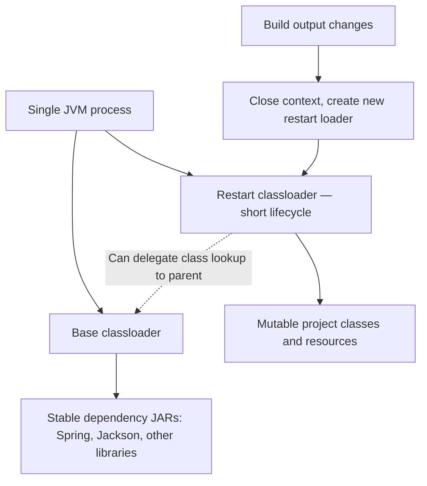
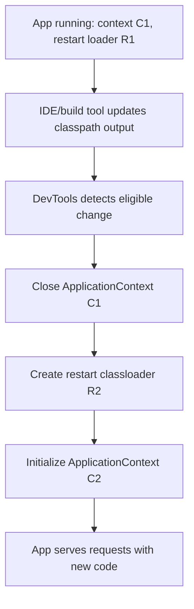
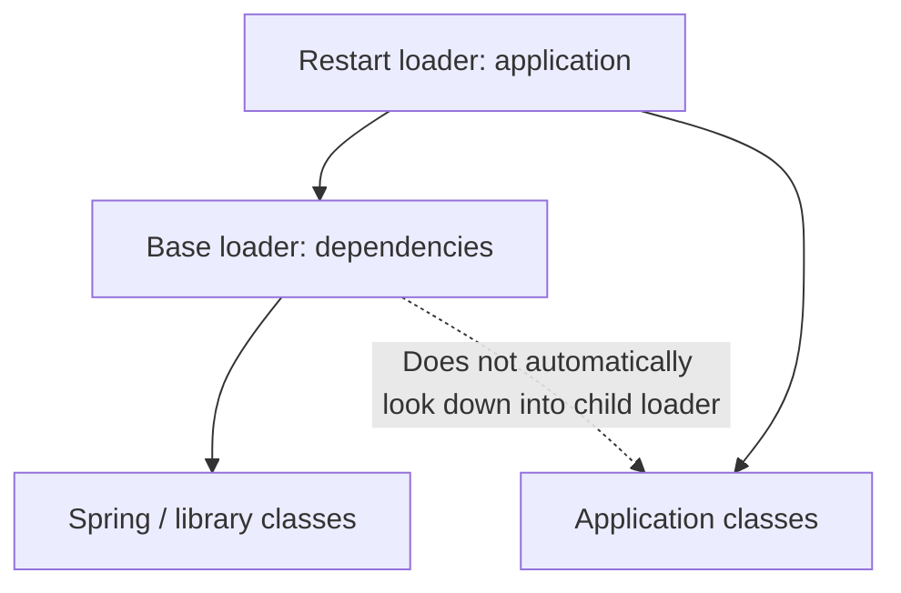

# Restart Classloader, Base Classloader, and Compatibility Issues

> **Spring Boot Fundamentals · Developer Tools**  
> Spring Boot DevTools helps shorten the edit–compile–test cycle through **automatic restart**. Instead of always shutting down and restarting the entire JVM, DevTools splits classes between the **base classloader** and the **restart classloader**. This approach is usually faster than a full cold start, but it also creates puzzling situations: classes with the same name cannot be cast to each other, libraries cannot find application classes, proxies or serializers retain objects from an older restart, or a dependency change does not take effect as expected. This lesson explains the two-classloader model, how to recognize its boundaries, and how to address issues intentionally.

## 1. Why Does Spring Boot DevTools Need Restart?

When developing a Spring Boot application, programmers typically repeat these steps:

1. Edit a Java class or resource file.
2. Compile or sync output onto the classpath.
3. Test the new behavior.
4. Continue fixing bugs.

If every Java edit required stopping the entire JVM, creating a new JVM, reloading all JARs, and reinitializing the Spring ApplicationContext, wait times could become significant—especially in projects with many dependencies.

`spring-boot-devtools` provides a restart mechanism optimized for development environments. The stable portion of the classpath is retained, while classes likely to change frequently are reloaded using a fresh classloader.

### 1.1. Restart vs. restarting the JVM

| Run mode | JVM | Application classloader | Spring ApplicationContext |
| --- | --- | --- | --- |
| Initial startup | New | Created | Created |
| DevTools restart | Usually the same existing JVM | Restart classloader is replaced | Old context is closed, new context is initialized |
| Stop process and run again | New JVM | Classloaders are recreated | New context is created |

DevTools restart does not merely re-invoke an arbitrary Java method. Spring Boot re-establishes the application inside the same process, with a new classloader for the portion of the classpath managed by the restart mechanism.

### 1.2. Restart vs. hot swap

Some IDEs/JVM debuggers support **HotSwap** to replace the bytecode of already-loaded classes within certain limits. DevTools restart is a different mechanism: it recreates the restart classloader and Spring context to pick up newly compiled class definitions.

| Mechanism | Characteristics |
| --- | --- |
| JVM HotSwap via debugger | Modifies bytecode of loaded classes, subject to JVM/IDE capabilities |
| DevTools restart | Reloads classes from the restartable classpath portion, recreates context |
| Full process restart | Stops the JVM and launches another JVM from scratch |
| LiveReload for browser | Prompts the browser to refresh when resources change; not Java class reloading |

Do not use these terms interchangeably. A changed CSS file can trigger LiveReload without restarting the Java context, whereas changing a Java class usually requires a new `.class` output for DevTools to detect.

## 2. What Are DevTools' Two Classloaders?

In Spring Boot DevTools' restart model, the classpath is generally divided into two parts.

The **base classloader** holds classes that rarely change, typically external library dependency JARs. The **restart classloader** loads classes that change frequently during development, typically output directories of projects open in the IDE.



The conceptual diagram above does not mean exactly two classloaders exist across the entire JVM. The JVM, module system, application server, or libraries may still use additional classloaders. The two names `base` and `restart` here describe the **structure DevTools uses to optimize the development cycle**.

### 2.1. Base classloader

The base tier usually contains:

- Dependency JARs considered stable.
- Many Spring Framework and Spring Boot classes.
- Common libraries used by the application.
- Other artifacts explicitly configured to stay in base.

Because the base classloader is reused across DevTools restarts, the JVM does not need to reload all the bytecode of these dependencies in every cycle.

However, **base classloader does not mean "never changes under any circumstances."** When you update a dependency JAR or change the dependency graph, restarting the whole process is usually the reliable way for class definitions from the new artifact to be loaded.

### 2.2. Restart classloader

The restart tier usually contains:

- Compiled classes from the application project.
- Project modules opened/imported and appearing on the classpath as class directories.
- Artifacts explicitly configured to be moved to the restart loader.
- Corresponding resources belonging to the classpath portion managed by the restart loader.

When DevTools detects a change requiring a restart, it closes the running ApplicationContext and creates a new restart classloader to load the current class definitions.

If the application is developed as a multi-module project, **not every module automatically lands in the same loader**. That depends on how the IDE/build tool places modules onto the classpath—direct class directories versus dependency JARs—along with any include/exclude rules.

### 2.3. Dependency JARs and output directories are typically classified differently

One way to visualize it:

```text
Classpath:
  build/classes/java/main/           -> usually in restart
  build/resources/main/              -> usually alongside changing project portion
  target/classes/                    -> usually in restart
  ~/.m2/.../spring-context.jar       -> usually in base
  ~/.m2/.../jackson-databind.jar     -> usually in base
  ~/.m2/.../acme-common.jar          -> usually in base if it is a JAR
```

This is the common pattern in IDEs, **not an immutable contract for every project**. DevTools relies on the actual classpath and restart configuration; thus an `acme-common` module may be in restart when the IDE uses module output directories, yet in base when the application depends on a published JAR.

## 3. What Lifecycle Does a DevTools Restart Follow?

Suppose the application is running in state `R1`. A developer edits `GreetingService.java` and the IDE compiles it into `GreetingService.class`.

Conceptual flow:



The base classloader can continue being retained to serve stable dependencies. Application classes can be loaded by `R2`, replacing the class definitions from `R1`.

### 3.1. DevTools watches classpath output, not simply the Save action

For Java source:

```text
src/main/java/com/example/GreetingService.java
```

merely saving the `.java` file does not necessarily produce a new `.class` on the classpath. DevTools primarily reacts to changes visible in output or watched paths.

In IDEs with incremental compilation, Save sometimes triggers an automatic build. In other environments, you must run build/make project.

For example:

- IntelliJ IDEA has a build project action and an option allowing auto-make while the app is running.
- Eclipse/STS has an automatic build mechanism when sources are saved.
- Maven/Gradle can compile and place outputs onto the classpath when the appropriate command or plugin runs.

If you change code and see no restart, verify **whether the `.class` file was actually updated** before suspecting the classloader.

### 3.2. Restart requires an ApplicationContext that can close properly

A typical Spring Boot application has shutdown hooks to close the context. DevTools needs the old context to close cleanly to avoid:

- Unreleased database connections.
- Executors or schedulers continuing to run.
- Threads holding onto the old classloader.
- Server ports not being released.
- Objects from the previous run remaining retained in memory.

If the application or a library spawns threads/resources without lifecycle management, restarts can expose pre-existing resource leaks.

### 3.3. Restart does not wipe all state in the JVM

Objects belonging to classes reloaded by the restart loader are recreated along with the context. However, singletons or static fields of classes residing in the base loader can still persist.

For example, a library in the base loader stores a static cache:

```java
public final class GlobalRegistry {

    private static final Map<String, Object> ITEMS =
            new ConcurrentHashMap<>();

    public static void register(String key, Object value) {
        ITEMS.put(key, value);
    }

    public static Object find(String key) {
        return ITEMS.get(key);
    }
}
```

If `value` is an application object loaded by restart loader `R1`, the cache in the base loader may keep a reference to that object after restart.

Consequences can include memory leaks, stale data, or a `ClassCastException` when code from `R2` accesses an object from `R1`.

This is a major difference between **restarting inside the same JVM** and **restarting the process**.

## 4. Java Identifies Classes by More Than Just Name

One of the most important compatibility issues is **class identity**.

In the JVM, a class is identified by the pair:

```text
(binary name of the class, classloader that defined that class)
```

Suppose there is a class:

```java
package com.example.shared;

public class MessageEnvelope {
    private final String payload;

    public MessageEnvelope(String payload) {
        this.payload = payload;
    }

    public String payload() {
        return payload;
    }
}
```

If the same class name is defined by two different classloaders, the JVM treats them as **two distinct types**.

### 4.1. Example: same name but not the same type

```text
com.example.shared.MessageEnvelope loaded by R1
com.example.shared.MessageEnvelope loaded by R2
```

Even though both share the exact same fully qualified name and even identical bytecode, they remain two separate types if defined by two different loaders.

You can picture it as:

```java
Class<?> oldType = oldObject.getClass();
Class<?> newType = MessageEnvelope.class;

System.out.println(oldType.getName().equals(newType.getName()));
// May print true.

System.out.println(oldType == newType);
// False if the two Class objects were created by two different defining loaders.
```

Every cast must respect actual class identity, not merely string name equality.

### 4.2. The "X cannot be cast to X" error

A puzzling error message often looks like:

```text
java.lang.ClassCastException:
  class com.example.shared.MessageEnvelope
  cannot be cast to class com.example.shared.MessageEnvelope
  (classes are in unnamed modules of different class loaders)
```

It sounds as though a class cannot be cast to itself, yet in reality one side was defined by classloader A and the other by classloader B.

Common causes include:

- An object from a previous restart remains in a cache/static holder.
- The same API/DTO is loaded by different loaders.
- A library deserializes an object using a loader that does not match the loader expected by the consumer.
- Reflection or service-loading code picks an unsuitable classloader.

Do not fix this with more aggressive casting or by suppressing generic warnings. Trace the **path of the object and the loaders that defined both sides**.

## 5. Inspecting Classloaders in Code

When suspecting a classloader split bug, observe the classes and objects at runtime.

### 5.1. Printing class names and loaders

```java
public final class ClassLoaderDiagnostics {

    private ClassLoaderDiagnostics() {
    }

    public static void printClass(Class<?> type) {
        ClassLoader loader = type.getClassLoader();

        System.out.printf(
                "Class=%s, loader=%s, loaderId=%s%n",
                type.getName(),
                loader,
                loader == null
                        ? "bootstrap"
                        : Integer.toHexString(
                                System.identityHashCode(loader))
        );
    }
}
```

Usage:

```java
ClassLoaderDiagnostics.printClass(OrdersApplication.class);
ClassLoaderDiagnostics.printClass(MessageEnvelope.class);
ClassLoaderDiagnostics.printClass(String.class);
```

Notes:

- `String.class.getClassLoader()` is normally `null`, denoting the bootstrap loader, not an error.
- The name `RestartClassLoader` may appear when DevTools restart is active.
- `System.identityHashCode` helps observe a loader instance; it is not a globally guaranteed unique ID.
- To prove two classes differ, compare `Class<?>` directly with `==` within the same JVM when holding both references.

### 5.2. Printing an object's loader

```java
public static void printObject(Object value) {
    if (value == null) {
        System.out.println("value=null");
        return;
    }

    Class<?> type = value.getClass();

    System.out.println("type = " + type.getName());
    System.out.println("loader = " + type.getClassLoader());
}
```

Do not just print `value.toString()`. A DTO can print valid data while still being type-incompatible with the class used by the consumer.

### 5.3. Recording on every restart

You can create a startup bean:

```java
@Component
public class StartupLoaderReporter implements ApplicationRunner {

    @Override
    public void run(ApplicationArguments args) {
        ClassLoaderDiagnostics.printClass(
                StartupLoaderReporter.class);
        ClassLoaderDiagnostics.printClass(
                OrdersApplication.class);
    }
}
```

Observe across multiple restarts: the loader of application classes can change, while the loader of stable dependencies remains constant.

If the program runs from a packaged JAR in a mode not using DevTools restart, you may not see the described changes. Results depend on **how the application was actually launched**.

## 6. Parent Delegation and Class Visibility Boundaries

In Java, a classloader can delegate class lookups to its parent. The common model is **parent-first delegation**: before defining a class itself, a loader asks its parent whether a matching class already exists.

In the DevTools model:

- The restart loader can usually see classes provided by the base loader.
- The base loader cannot automatically see all classes defined by the child restart loader.
- A class in base may fail to find a type existing only in restart if the library uses the wrong loader to resolve names.



This is a critical difference between **code dependency** relationships and **runtime class visibility** relationships.

### 6.1. Why do base-loader libraries struggle to load application classes?

Suppose a library contains:

```java
Class<?> type = Class.forName(
        "com.example.orders.OrderEvent");
```

`Class.forName(String)` chooses a loader based on the calling class's context. When code runs inside a library loaded from the base loader, it may use a loader that cannot see `OrderEvent`, which resides in the restart loader.

The result can be:

```text
ClassNotFoundException: com.example.orders.OrderEvent
```

Even though `OrderEvent.class` exists in the project, the problem occurs because **the queried loader has no visibility to that class under the current delegation relationship**.

### 6.2. Having a file on the classpath does not mean every loader can load it

Distinguish:

1. `OrderEvent.class` exists in the build directory.
2. Is that directory on DevTools' classpath?
3. Which loader is assigned to load classes from that directory?
4. Which loader is the library using to call `loadClass` or reflection?

A file existing on disk only satisfies the first step; it does not resolve loader visibility by itself.

## 7. Thread Context Classloader (TCCL)

Java provides the **thread context classloader**, read via:

```java
ClassLoader tccl =
        Thread.currentThread().getContextClassLoader();
```

TCCL is a mechanism allowing frameworks/libraries in one loader to use another loader designated by the execution environment. This is helpful in plugin environments, service discovery, or when a framework needs to locate application classes.

### 7.1. Using TCCL to read resources or classes

Example:

```java
ClassLoader tccl =
        Thread.currentThread().getContextClassLoader();

Class<?> eventType = tccl.loadClass(
        "com.example.orders.OrderEvent");
```

If TCCL is properly configured to a loader that can see application classes, code can find classes that the base loader directly cannot.

However, **do not assume TCCL is always the restart loader in every thread**. Libraries can spawn their own threads, schedulers/executors may inherit or alter TCCL, and async tasks can execute on threads with different contexts.

### 7.2. Do not mutate TCCL globally to mask bugs

An uncontrolled workaround:

```java
Thread.currentThread().setContextClassLoader(
        SomeApplicationClass.class.getClassLoader());
```

might help a specific operation, but without restoring the previous loader in a `finally` block, a thread pool reusing that thread could hold onto a loader from an old restart.

If you are forced to set TCCL temporarily:

```java
Thread thread = Thread.currentThread();
ClassLoader previous = thread.getContextClassLoader();

try {
    thread.setContextClassLoader(
            SomeApplicationClass.class.getClassLoader());
    // Perform operation needing this loader.
} finally {
    thread.setContextClassLoader(previous);
}
```

Weigh the cost and limitations of this technique before applying it. A better approach is usually fixing the integration or adjusting the classloader split so the library uses the right loader.

### 7.3. `ServiceLoader` is also involved

`ServiceLoader` discovers providers from `META-INF/services` via an explicitly specified loader or via TCCL depending on the overload.

Example:

```java
ServiceLoader<NotificationProvider> providers =
        ServiceLoader.load(
                NotificationProvider.class,
                Thread.currentThread().getContextClassLoader());
```

If the `NotificationProvider` interface sits in the base loader while the implementation sits in the restart loader, ensure the discovery loader sees the provider and both share the same interface identity.

Also avoid keeping provider instances loaded from an old restart loader forever inside a cache in the base loader.

## 8. Compatibility Issues When Modules Are Split into Multiple Artifacts

Suppose a project has the structure:

```text
commerce/
├── commerce-app/
│   └── build/classes/java/main/...
├── commerce-domain/
│   └── build/classes/java/main/...
└── commerce-sdk/
    └── commerce-sdk-1.0.jar
```

If the IDE puts `commerce-app` and `commerce-domain` on the classpath as output directories, both are likely to be in the restart loader. `commerce-sdk` packaged as a JAR will typically reside in the base loader.

### 8.1. When the SDK needs an application class

Suppose the SDK uses reflection to look up:

```text
com.example.commerce.domain.OrderEvent
```

Because this class is loaded by the restart loader, the base-loader SDK calling `Class.forName` on its own might not find it. Or the SDK might hold a static cache of a class looked up during a previous restart, causing conflicts on the next restart.

Options to consider:

- Adjust the design so the SDK accepts `Class<?>` or a factory from the application instead of looking up by name.
- Use the appropriate classloader in the integration.
- Place artifacts tightly interacting with application classes into the restart loader when sensible.
- Avoid holding application classes/objects in static caches of long-lived dependencies.
- Only as a last resort, consider disabling DevTools restart for that development environment.

### 8.2. Switching from module output directory to JAR can change the loader

This matters when switching from:

```text
IDE: commerce-domain/build/classes/java/main/
```

to:

```text
Maven repository: commerce-domain-1.0.jar
```

The bytecode may be nearly identical, yet DevTools classifies the classpath entry differently. A bug occurring only when run from an IDE and not from a JAR—or vice versa—can stem from this change.

### 8.3. Shared APIs should have stable class identity

If two sides of an integration exchange interfaces, DTOs, or exception classes, decide which types form the **shared contract** and ensure they are resolved consistently.

For instance, the `MessageHandler` interface is defined in a stable library in the base loader, while the application implementation lives in the restart loader. The restart loader can reference the interface in the base loader, so implementing the interface usually works smoothly.

But if you accidentally allow a second copy of `MessageHandler` to be defined in the restart loader alongside one in the base loader, casting or service registration can fail even though the fully qualified names match.

**The goal is not "every class in base" or "every class in restart,"** but ensuring the same contract keeps consistent class identity across the communication boundary.

## 9. Reconfiguring the Classpath Split with `spring-devtools.properties`

When default classpath classification does not fit, Spring Boot DevTools lets you add **restart include/exclude** rules in:

```text
META-INF/spring-devtools.properties
```

This file can live in the project's resources or inside a library JAR. When DevTools starts, it evaluates matching configuration files on the classpath to adjust split rules.

### 9.1. `restart.include`: moving an artifact into the restart loader

Suppose `acme-shared-1.0.jar` contains types interacting tightly with changing code and needs to reload alongside the application.

Example:

```properties
# META-INF/spring-devtools.properties
restart.include.acme-shared=/acme-shared-[^/]+[.]jar
```

Meaning: classpath entries matching the `acme-shared` pattern are placed in the restart loader instead of remaining in base under standard classification.

The pattern is a regular expression applied to the classpath entry. Check the **actual entry path** if it does not match; artifact filenames and locations can differ across IDEs, Maven, and Gradle.

### 9.2. `restart.exclude`: moving an artifact to the base loader

If a module output directory is treated as frequently changing when it is actually a stable library, you can consider moving it to base:

```properties
restart.exclude.acme-generated=/acme-generated/target/classes/
```

This illustrative pattern assumes the classpath entry contains the corresponding path segment. With Gradle, the output path might be `build/classes/java/main`, requiring pattern adjustment.

Be cautious: if you place classes under active development into the base loader, DevTools restart will **not automatically reload those classes** after edits. A full process restart may be needed to pick up changes.

### 9.3. Multiple entries can be declared

```properties
restart.include.shared=/acme-shared-[^/]+[.]jar
restart.include.adapters=/acme-adapters-[^/]+[.]jar
restart.exclude.generated=/acme-generated/target/classes/
```

Each key has a distinct name after the `restart.include.` or `restart.exclude.` prefix. The suffix distinguishes the rule; the value is the regex used to match classpath entries.

Avoid writing overly broad patterns that force all dependency JARs into the restart loader. That reduces restart speed benefits and increases loader churn risk.

### 9.4. This file can be provided by a dependency

A custom starter or internal library can package `META-INF/spring-devtools.properties` to suggest how its artifacts should be split when consumers use DevTools.

This is helpful in multi-module ecosystems, with a caveat: a library can affect the consuming application's classpath split. Therefore, document the pattern, keep scope narrow, and verify in a sample consumer.

### 9.5. Include/exclude may need to be paired with architectural fixes

Changing loader classification is a valid workaround in some cases, yet it should not be the knee-jerk reaction to every reflection/caching bug.

If a library stubbornly stores application objects in an unbounded static cache or spawns unclosed threads, moving the whole library to the restart loader may mask one symptom without fixing an unsafe lifecycle design.

## 10. Distinguishing Loader Include/Exclude from Restart File Exclusions

Spring Boot DevTools has **two easily confused configuration groups**:

1. **`restart.include.*` and `restart.exclude.*`** in `META-INF/spring-devtools.properties`: control **which classpath entries are loaded by the base vs. restart loader**.
2. **`spring.devtools.restart.exclude` and `spring.devtools.restart.additional-exclude`**: control **which resource changes do not trigger an application restart**.

These answer two different questions.

| Goal | Configuration |
| --- | --- |
| Move a dependency JAR from base to restart loader | `restart.include.*` |
| Move a classpath entry from restart to base loader | `restart.exclude.*` |
| Which resource changes do not need a Java context restart | `spring.devtools.restart.exclude` |
| Add exclusions while keeping defaults | `spring.devtools.restart.additional-exclude` |
| Watch an additional directory | `spring.devtools.restart.additional-paths` |
| Use a trigger file to control when restart happens | `spring.devtools.restart.trigger-file` |

### 10.1. Example of resource changes not needing restart

```properties
spring.devtools.restart.additional-exclude=generated-docs/**,reports/**
```

This example instructs DevTools to avoid restarting the application solely for changes in the excluded resource paths, in addition to default exclusions.

DevTools already handles certain static resource groups—such as static assets and templates—specially by default so the context does not restart on every edit. Depending on the integration, LiveReload or a refresh may be triggered instead.

### 10.2. `exclude` and `additional-exclude` are not the same

`spring.devtools.restart.exclude` can replace the default resource exclusion list. If you only want to **append** project paths without losing defaults, use `spring.devtools.restart.additional-exclude`.

Do not put regexes from `restart.include.*` into `spring.devtools.restart.additional-exclude` expecting a dependency to switch classloaders; that is an entirely different configuration group.

### 10.3. Additional paths do not imply reloading by the restart loader

Example:

```properties
spring.devtools.restart.additional-paths=../shared-config
```

This lets DevTools watch changes in the additional path, but **does not automatically turn classes/resources there into restart loader classpath entries**.

It solves file watching; which loader loads which class still depends on the classpath and loader-split rules.

## 11. When Does DevTools Decide to Restart?

DevTools watches classpath changes using an appropriate poll/quiescence mechanism. Upon detecting eligible changes, it can restart the application.

Several scenarios:

| Change | Typical behavior |
| --- | --- |
| Recompiled application class on watched classpath | Can trigger restart |
| Updated watched and non-excluded resource | Can trigger restart |
| Edited static resource in exclusion list | Usually does not restart Java context |
| Only saved `.java` without IDE compiling | May not show classpath output change yet |
| Changed dependency JAR in base loader | Usually requires stopping/restarting the whole process to reliably load the new version |
| Added new dependency in Maven/Gradle | Usually requires classpath reimport and full process restart |
| Edited file outside all watched paths | DevTools may not detect it |

Do not equate saving source with a guaranteed restart. The actual outcome depends on the IDE/compiler, output directory, and watch settings.

### 11.1. Poll interval and quiet period

DevTools lets you adjust polling frequency and the quiet period before concluding a batch of changes is complete:

```properties
spring.devtools.restart.poll-interval=2s
spring.devtools.restart.quiet-period=1s
```

Tuning this helps when a build tool copies many files sequentially or filesystem events arrive slowly. However, increasing polling does not fix classloader identity bugs; it only affects how file changes are detected and batched.

### 11.2. Trigger file

To control when restarts happen while an IDE/build tool updates many files, you can configure:

```properties
spring.devtools.restart.trigger-file=.reloadtrigger
```

The trigger file must exist in an eligible classpath location according to DevTools rules. In this mode, DevTools restarts only when the trigger condition is satisfied rather than immediately on every regular file change.

This is useful in large projects compiling multiple modules; you can touch the trigger file once all outputs are ready.

### 11.3. Restart is not incremental compilation

DevTools does not replace the compiler. If a class has not been compiled, the restart loader will still read old bytecode. Adding `spring-boot-devtools` does not automatically turn every source edit into a build task.

## 12. Issues with Serialization and Deserialization

Serialization can carry class identity across multiple boundaries: storing data in Redis, transferring objects, reading from streams, or deserializing JSON into Java types.

### 12.1. Java native serialization

Suppose a library in the base loader uses `ObjectInputStream` to deserialize an object. By default, `ObjectInputStream` has its own class-resolution rules; in a multi-loader environment, it may choose a loader that cannot see application classes.

The result can be:

```text
ClassNotFoundException: com.example.orders.OrderSnapshot
```

or an object reconstructed with a class identity incompatible with what the consumer casts to.

Spring Boot DevTools supports Spring Framework's `ConfigurableObjectInputStream` for scenarios requiring an explicit loader. Conceptual example:

```java
try (ConfigurableObjectInputStream stream =
             new ConfigurableObjectInputStream(
                     inputStream,
                     Thread.currentThread().getContextClassLoader())) {

    Object restored = stream.readObject();
}
```

This snippet only addresses **choosing the right loader during deserialization** in a controlled context. Never use native Java serialization for untrusted data: deserialization poses severe security risks. For network data exchange, prefer safe serialization formats and libraries with explicit type restrictions.

### 12.2. Jackson and JSON

With JSON, people often assume no classloader issues can happen because wire data is just text. Yet mapping JSON to a DTO still requires a `Class<?>` or type metadata that Jackson resolves.

If an `ObjectMapper` or Jackson module in the base loader retains class/type metadata, caches, or plugins from an old restart loader, post-restart behavior can differ from the initial run.

Mitigations:

- Use an `ObjectMapper` whose lifecycle is properly managed within the ApplicationContext.
- Avoid holding `Class<?>`, object mappers, or configurations from a restart session in static holders inside longer-lived libraries.
- When using polymorphic type mapping or reflection, verify which loader is chosen.
- Test serialization/deserialization after restarts as well if this becomes a real issue.

Not every Jackson error is caused by DevTools. Distinguish JSON field/type mismatches and module settings from classloader identity.

### 12.3. Stable DTOs and boundaries

When exchanging data across subsystems with differing lifespans, prefer one of two strategies:

1. Exchange data in a neutral representation—such as JSON or Maps with clear schemas—then reconstruct DTOs using the current context's loader.
2. Place shared interfaces/DTOs requiring consistent class identity in a stable loader and ensure no duplicate definition with the same name exists.

Never keep objects from a closed restart loader inside a system that outlives that restart.

## 13. JPA, Hibernate, and Reflection

JPA/Hibernate, serializers, mappers, proxy generators, or plugin frameworks may all use reflection and cache metadata.

Example entity:

```java
@Entity
public class PurchaseOrder {

    @Id
    private Long id;

    // ...
}
```

During a DevTools restart, the entity can be reloaded by the new restart classloader. If a framework or custom helper retains `Class<PurchaseOrder>` metadata from an old run inside a static cache in the base loader, subsequent restarts may run into trouble.

### 13.1. Why can JPA be sensitive to classloaders?

An ORM works with:

- Entity classes and fields.
- Proxies/subclasses.
- Mapping metadata.
- Session/EntityManagerFactory.
- Query/result mappings.

These pieces may reference `Class<?>` objects or specific loaders. When persistence infrastructure is cleanly recreated alongside the ApplicationContext, many setups work normally. However, custom caches, static plugins, or third-party integrations may hold stale references.

### 13.2. Investigation plan

If the application only fails after a few DevTools restarts:

1. Try a full JVM restart to check whether the error disappears.
2. Print the loader of the entity class and the loader of the class object used by the mapper/cache.
3. Verify whether the entity manager factory, session factory, and schedulers close when the context shuts down.
4. Search for static caches or `ThreadLocal`s holding entity metadata.
5. Identify which dependency JARs are in base; check if a specific artifact needs moving to the restart loader.
6. Avoid using DevTools restart as an excuse to skip lifecycle cleanup.

If the error still occurs on a fresh full JVM restart, the root cause likely lies in mapping, dependency versions, or business code—not the restart classloader lifecycle.

## 14. Proxies, AOP, and Annotations Do Not Resolve Classloader Identity

Spring AOP creates proxies to intercept methods. It does not erase differences between classloaders.

Consider a scenario:

- Interface `PaymentClient` lives in a stable library in base.
- Implementation `DefaultPaymentClient` belongs to the application and lives in the restart loader.
- Spring creates a proxy for the bean depending on conditions and proxy strategy.

If all sides reference the `PaymentClient` interface defined by base, injection via the interface usually works cleanly.

However, if the same interface name `PaymentClient` is loaded separately by two different loaders, a proxy implementing loader A's interface cannot necessarily be cast to the same-named interface from loader B.

### 14.1. Injection errors can resemble AOP errors

For example:

```text
BeanNotOfRequiredTypeException
ClassCastException
IllegalArgumentException: object is not an instance of declaring class
```

These can arise from type mismatches or reflection invoking a `Method` belonging to a different class identity.

Still, these exceptions have many other causes as well. Never conclude "it's DevTools" from an exception class name alone. Read the full stack trace and print loaders on both sides when in doubt.

### 14.2. Do not use `@Order` to fix loader mismatches

`@Order` only controls ordering/precedence in applicable Spring mechanisms. It does not change which loader defines a class.

If the problem is `MyType cannot be cast to MyType`, tweaking advisor precedence will not solve it. The proper approach is verifying class identity and the lifetime of retained objects.

## 15. Static State, Threads, and Memory Leaks After Multiple Restarts

Restarting inside the same JVM makes long-lived references especially critical.

### 15.1. Static caches in base-loader dependencies

```java
public final class SharedCache {

    private static final List<Object> VALUES =
            new CopyOnWriteArrayList<>();

    public static void add(Object value) {
        VALUES.add(value);
    }
}
```

If the `SharedCache` library resides in the base loader, the static list can continue holding objects loaded by `R1` after `R2` is created. Even a single strong reference from a long-lived object can prevent the old loader from being garbage collected.

After several restarts, heap usage can climb even though old contexts closed.

### 15.2. Manually created threads

Example:

```java
new Thread(() -> {
    while (true) {
        // Background task with no stop mechanism.
    }
}, "custom-worker").start();
```

The thread may keep running after the context closes, holding classes/objects from the old restart loader, TCCL, or ThreadLocals.

Use Spring-managed lifecycles, shut-down executors, or `@PreDestroy`/`DisposableBean` when creating custom resources.

Simple example:

```java
@Component
public class BackgroundWorker implements AutoCloseable {

    private final ExecutorService executor =
            Executors.newSingleThreadExecutor();

    @PostConstruct
    public void start() {
        executor.submit(this::workUntilStopped);
    }

    private void workUntilStopped() {
        // Implement interruption / shutdown checks.
    }

    @PreDestroy
    @Override
    public void close() {
        executor.shutdownNow();
    }
}
```

This is an illustrative skeleton, not a complete production worker; real code needs interruption handling, timeouts, exception handling, and guarantees that tasks actually stop.

### 15.3. ThreadLocal and context classloader

A `ThreadLocal<Class<?>>` or cache holding restart-loader objects can retain references if a thread outlives the context. Executor threads created by a base library can survive restarts, causing their ThreadLocals or TCCL to hold onto the old classloader.

Best practices:

- Clear ThreadLocals when a request/task finishes.
- Shut down executors on context shutdown.
- Restore TCCL after operations that modify it.
- Avoid storing application objects in global singletons outside the Spring lifecycle.

### 15.4. Signs of memory leaks

Some symptoms:

- Early restarts work, subsequent restarts grow sluggish.
- Heap grows steadily across restart cycles.
- `OutOfMemoryError` occurs even under light request load.
- Heap dumps show multiple old `RestartClassLoader` instances still reachable.
- Threads or static collections retain objects from old loaders.

Investigate with a profiler/heap dump when evidence warrants; do not assume every transient heap increase is a leak. The JVM GC might simply not have reclaimed eligible objects yet.

## 16. When Is a Full Process Restart Necessary?

DevTools automatic restart is very helpful for application code edits, yet there are cases where **restarting the JVM from scratch** is the right choice.

### 16.1. Updating dependency JARs

If you change the version of `jackson-databind` or an SDK in the base loader, DevTools restart may keep using the old class definitions already in the JVM.

Instead:

1. Sync the Maven/Gradle dependency graph.
2. Stop the application process.
3. Start a new application process so the JVM loads the new dependency version.

Do not treat DevTools restart as a hot-reload tool for arbitrary dependency JARs.

### 16.2. Changing JVM startup options

Examples include changing:

- `-Xmx` or `-Xms`.
- JVM module access flags.
- `--add-opens`.
- Java agents.
- System properties required before bootstrap.
- Native library loading configurations.

These options belong to JVM startup or early classloading. DevTools restart within the same process generally cannot replace a fresh JVM launch with different flags.

### 16.3. Native libraries and JNI

Native libraries have specific restrictions around loading within a classloader/process. If JNI/native integrations rely on classes or state incompatible with the restart loader, a full JVM restart may be necessary.

Do not assume simply moving a JAR containing JNI into the restart loader makes reloading native binaries multiple times safe.

### 16.4. Incompatible third-party libraries

Some libraries assume:

- Only one application classloader exists.
- Class identity never changes over the JVM's lifetime.
- Static singletons live for the entire life of the application.
- Reflection always uses a fixed loader.
- Threads are created once and run until process termination.

DevTools can expose these assumptions. When an integration cannot be safely adapted, **disabling restart while developing that module** is more sensible than applying brittle workarounds.

## 17. Disabling or Adjusting DevTools Restart

### 17.1. Disabling restart via application properties

```properties
spring.devtools.restart.enabled=false
```

This disables automatic watching/restarting per configuration when the application runs with DevTools. However, depending on DevTools initialization, the restart classloader may still have been set up initially.

If your goal is to **completely disable the restart classloader mechanism**, set the system property before `SpringApplication.run(...)` is called.

### 17.2. Disabling completely very early

```java
@SpringBootApplication
public class OrdersApplication {

    public static void main(String[] args) {
        System.setProperty(
                "spring.devtools.restart.enabled",
                "false");

        SpringApplication.run(OrdersApplication.class, args);
    }
}
```

The difference is that the system property is set **before Spring Boot boots**. This helps when DevTools restart causes classloader errors and you want to verify behavior without changing the dependency graph.

Do not accidentally leave `System.setProperty` in the main codebase just to work around a local issue; manage it via development launch configurations or intentional configuration mechanisms instead.

### 17.3. Removing DevTools from the classpath

A strong verification check is running the same application **without `spring-boot-devtools`** on the runtime classpath.

This separates restart infrastructure issues from bugs that still happen in a production-like application. Check your build tool to confirm whether the dependency was truly excluded from runtime.

### 17.4. Disabling LiveReload does not disable restart

```properties
spring.devtools.livereload.enabled=false
```

This property controls LiveReload integration, not the two-classloader restart mechanism. If you hit a `ClassCastException` caused by the restart loader, turning off LiveReload alone is usually insufficient.

## 18. Adding DevTools Properly in Maven and Gradle

DevTools is meant for development environments. It should not become a dependency required by the production application.

### 18.1. Maven

```xml
<dependency>
    <groupId>org.springframework.boot</groupId>
    <artifactId>spring-boot-devtools</artifactId>
    <optional>true</optional>
</dependency>
```

`optional` reduces the risk of propagating DevTools to consumer modules as a regular transitive dependency.

Spring Boot packaging plugins typically treat DevTools so it is omitted from default executable archives. Still, inspect the actual artifact and build setup; do not rely solely on assumptions about scope to guarantee production excludes DevTools.

### 18.2. Gradle

In projects using the Spring Boot Gradle plugin and the appropriate `developmentOnly` configuration:

```groovy
dependencies {
    developmentOnly 'org.springframework.boot:spring-boot-devtools'
}
```

`developmentOnly` separates development dependencies from regular packaged artifacts and runtime distributions per plugin configuration.

If a build uses custom Gradle conventions, check how configurations wire into `bootRun`, tests, and packaging; do not assume every Java project automatically provides `developmentOnly` without applying a supporting plugin.

### 18.3. Packaged apps and DevTools

DevTools detects runs from fully packaged applications by default and usually disables restart in that case. The primary target of automatic restart is **running from an IDE or exploded classpath in development**, not hot-updating a production JAR.

Therefore, a test run using `java -jar app.jar` might not exhibit DevTools restart even when the dependency appears in the build. Confirm DevTools is actually active before concluding the feature is broken.

## 19. Troubleshooting Practical Errors by Symptom

| Symptom | Possible Cause | Resolution |
| --- | --- | --- |
| Saved Java but app does not restart | Not compiled or output classpath unchanged | Check build output and IDE auto-build |
| Restart ran but old behavior remains | Class in base loader, stale static cache, or output not updated | Print loader, check artifact and classpath |
| `X cannot be cast to X` | Same class name from two defining loaders | Print both sides' loaders, locate stale object |
| `ClassNotFoundException` in dependency | Base-loader library cannot see restart class | Check `Class.forName`, TCCL, classpath split |
| `NoClassDefFoundError` after restart | Missing dependency class or wrong loader used | Inspect root cause and loader |
| Classloader leak after multiple restarts | Static cache, thread, ThreadLocal holding old loader | Heap dump, close resources |
| Serializer works first time, fails second time | Class metadata/cache or resolver retains old loader | Check serializer lifecycle and loader |
| JPA metadata error after restart | ORM/plugin/cache retains old entity class | Check `EntityManagerFactory` lifecycle |
| AOP proxy cast fails | Duplicate interface identity or different proxy type | Inspect target/proxy/interface loaders |
| New SDK has no effect | Dependency JAR is in base loader | Full process restart |
| LiveReload works but Java unchanged | Only resource/browser refresh, class not compiled | Check restart and class output |
| Bug only in IDE, not with JAR | Different loader-splitting modes | Compare exploded classpath and packaged run |
| Bug only after multiple restarts | State outlives context | Find static refs, schedulers, TCCL |
| `restart.include` has no effect | Regex does not match classpath entry | Inspect actual entry paths |
| Every restart becomes very slow | Include pattern too broad or too many classes reloaded | Narrow include, inspect dependency split |
| Disabled `spring.devtools.restart.enabled` yet strange behavior persists | Restart loader still set up early or bug unrelated to restart | Disable via early system property or remove DevTools |

### 19.1. What evidence is needed for a `ClassCastException`?

At minimum collect:

1. Full stack trace.
2. Source and target class names.
3. Loader of the actual object instance.
4. Loader of the `Class<?>` the code attempts to cast to.
5. How many times DevTools restarted before the error appeared.
6. Which dependency/module contains both types.
7. How the app was launched: IDE, `bootRun`, or packaged JAR.

Do not try to fix the error by adding random dependency exclusions or renaming packages before knowing which loader loaded each type.

### 19.2. Verifying results with a full restart

A helpful check:

- Run the application with DevTools restart active.
- Make edits and trigger several restarts.
- Observe the error.
- Stop the process completely and start a fresh JVM with the same code/dependencies.

If the error only occurs after a DevTools restart, you have stronger evidence of stale state or a loader boundary issue. If the error occurs immediately from a fresh startup, broaden the investigation to dependency versions, configuration, or application logic.

## 20. Systematic Approach to Resolving Classloader Conflicts

When encountering compatibility errors, prioritize fixing by concrete root cause.

### Level 1 — Verify application and classpath

- Are you actually running with DevTools restart active?
- Has the source code been compiled?
- Is the active artifact a directory or a JAR?
- Are there duplicate dependency versions or shadow JARs?
- Does the error happen on the first run or only after restart?

### Level 2 — Verify type loaders

- Print the loaders of source and destination classes.
- Inspect loaders of interfaces/DTOs used to exchange data.
- Observe TCCL on the thread throwing the error.
- Identify which library holds references or caches that type.

### Level 3 — Fix integration/lifecycle

- Let Spring manage resource lifecycles.
- Close executors, schedulers, connections, and objects that could hold an old loader.
- Avoid static caches containing application classes/objects.
- Choose explicit loaders during reflection/deserialization.
- Maintain a single consistent definition identity for shared APIs.

### Level 4 — Targeted classloader split tuning

- Use `restart.include.*` for artifacts that must reload alongside the application.
- Use `restart.exclude.*` for artifacts that belong in base when justified.
- Write narrow regexes, verify entry paths, and test across multiple restart cycles.
- Do not pull dozens of dependency JARs into the restart loader just to mask a symptom.

### Level 5 — Full restart or disable restart

When updating stable JARs, changing JVM options, or encountering libraries that do not support dynamic restarts, a full JVM restart is the right solution. For incompatible integrations that are hard to change, disabling DevTools restart in that dev environment is also reasonable.

## 21. Lab Exercise: Proving the Two Classloaders

### Goal

Build a small Spring Boot application with DevTools and observe:

- How the application's classloader differs from stable dependency classloaders.
- How the application's classloader changes across restarts.
- How to place an artifact into the base or restart loader.
- The difference between disabling watching and disabling the restart classloader.
- Why objects from an older restart can cause type mismatches.

### Step 1 — Create the project

Create a Spring Boot application using Java 17+ with a Web or core starter dependency. Add `spring-boot-devtools` as a development dependency.

Gradle example:

```groovy
dependencies {
    implementation 'org.springframework.boot:spring-boot-starter'
    developmentOnly 'org.springframework.boot:spring-boot-devtools'
}
```

Run the application from an IDE or `bootRun` with a configuration allowing DevTools restart to operate.

### Step 2 — Add loader-printing code

```java
@SpringBootApplication
public class LoaderDemoApplication {

    public static void main(String[] args) {
        SpringApplication.run(
                LoaderDemoApplication.class, args);
    }
}
```

```java
@Component
public class LoaderProbe implements ApplicationRunner {

    @Override
    public void run(ApplicationArguments args) {
        ClassLoaderDiagnostics.printClass(
                LoaderDemoApplication.class);
        ClassLoaderDiagnostics.printClass(
                LoaderProbe.class);
        ClassLoaderDiagnostics.printClass(
                org.springframework.context.ApplicationContext.class);
    }
}
```

Observe which loaders belong to application classes and Spring classes.

### Step 3 — Trigger a restart

Edit a log string in `LoaderProbe`, compile, and place the new `.class` onto the classpath. Check:

- Was the ApplicationContext reinitialized?
- Did the loader of `LoaderProbe` change across the restart?
- Did the loader of `ApplicationContext` remain stable?

Do not conclude failure merely because saving source did not trigger a restart; check class output first.

### Step 4 — Create a shared module

Create an `acme-shared` module containing `MessageEnvelope`. Add this module to the application in two ways:

1. As a project/module output directory dependency.
2. As a built/published JAR dependency.

Compare the loader of `MessageEnvelope`. Classification can change based on classpath entry type.

### Step 5 — Try `restart.include`

Add `META-INF/spring-devtools.properties` with a pattern matching only the `acme-shared` JAR. Restart the application from scratch to ensure the new classloader split configuration is applied.

Then verify the loader of `MessageEnvelope` and observe behavior after a DevTools restart.

### Step 6 — Try `restart.exclude`

Create a stable module as an output directory and configure an exclude entry placing it into base. Modify the module's bytecode and test a DevTools restart. Observe why the old class remains in base and why a full process restart is required to see the change.

### Step 7 — Test TCCL

Print:

```java
Thread.currentThread().getContextClassLoader()
```

Submit a task on an executor and print TCCL again. Do not assume both results always match across every thread configuration.

### Step 8 — Test a long-lived cache

Create a static cache inside a library kept in base and intentionally store an object of an application class. After a restart, observe the stale object if the cache persists.

This exercise is **strictly for learning environments**; never retain that cache pattern in real applications. You can use a profiler to see references keeping the old classloader alive.

### Step 9 — Disable restart for comparison

Try:

```properties
spring.devtools.restart.enabled=false
```

and then disable it completely via a system property before `SpringApplication.run` or run without DevTools. Compare the differences in classloaders and behavior.

### Step 10 — Write down conclusions

Record a table:

| Experiment | Classpath entry | Observed loader | After DevTools restart |
| --- | --- | --- | --- |
| Application class | Project output directory | Restart or corresponding loader | Can be reloaded |
| Stable framework dependency | JAR | Base or corresponding loader | Usually retained |
| Shared JAR with include | JAR | Restart if pattern matches | Can be reloaded |
| Module directory with exclude | Directory | Base if pattern matches | Not auto-reloaded on restart |
| Full process restart | All entries | New loader of new JVM | All class definitions reloaded |

Observe actual results instead of hardcoding loader names; results depend on the IDE, build tool, and Spring Boot DevTools version.

### Self-check questions

1. Why does DevTools use two classloaders?
2. Which kinds of dependencies does the base classloader usually hold?
3. Which classes does the restart classloader usually load?
4. Does DevTools restart create a new JVM?
5. Is saving `.java` always enough for DevTools to detect new code?
6. What factors define class identity in Java?
7. Why can `OrderEvent cannot be cast to OrderEvent` happen?
8. Can the base loader automatically find classes defined only by the child restart loader?
9. In what scenarios does TCCL help?
10. Why shouldn't you change TCCL and skip restoring it?
11. How can a static cache in the base loader retain objects from an old restart loader?
12. How do un-shut-down threads affect garbage collection of old restart loaders?
13. How does `restart.include.*` differ from `spring.devtools.restart.additional-exclude`?
14. Why does `spring.devtools.restart.additional-paths` not automatically put classes from that path into the restart loader?
15. Why does changing a dependency JAR usually require a full JVM restart?
16. Why can Java native serialization encounter classloader issues?
17. If an error only happens after the third restart, what should you investigate?
18. Does disabling `spring.devtools.restart.enabled` in a config file always mean no initial restart classloader is created?
19. Why shouldn't a Jackson or JPA bug immediately be blamed on DevTools?
20. What information should you gather before altering the classloader split?

## 22. Quick Reference Table

| Topic | Key Takeaway |
| --- | --- |
| DevTools restart | Reinitializes the app inside the same JVM with a new restart classloader |
| Base classloader | Holds stable dependencies to reduce reload overhead |
| Restart classloader | Loads the classpath portion changing frequently during development |
| Class identity | Class name + defining classloader |
| `X cannot be cast to X` | Can happen when same-named types come from two different loaders |
| Parent delegation | Child can ask parent; parent does not automatically look down into child |
| TCCL | Thread-contextual loader; not guaranteed identical on every thread |
| Multi-module | Directory vs. JAR dependencies may be classified differently |
| `META-INF/spring-devtools.properties` | Defines loader include/exclude patterns |
| `restart.include.*` | Puts matching classpath entries into the restart loader |
| `restart.exclude.*` | Puts matching classpath entries into the base loader |
| `spring.devtools.restart.additional-exclude` | Skips certain resource changes from triggering restarts |
| `spring.devtools.restart.additional-paths` | Watches additional file paths |
| `spring.devtools.restart.trigger-file` | Controls restart timing via a trigger file |
| Newly saved `.java` file | Must be built/copied to output for DevTools to see the change |
| Static caches | Can retain objects/classes from old restart loaders |
| Threads/ThreadLocal | Can hold old loaders if not cleaned up |
| Reflection/serialization | Requires the appropriate loader when resolving classes |
| Dependency JAR change | Usually requires a full process restart |
| Disable restart | Can disable watching, disable via early system property, or omit DevTools |
| Production | Should not rely on DevTools automatic restart |
| Troubleshooting | Log classloaders, check loaders on both sides, and trace object lifetimes |

## 23. Conclusion

Spring Boot DevTools restart is built on a simple optimization idea: **keep stable classpath entries in the base classloader and replace the mutable application portion with a new restart classloader**. This design improves the development experience while exposing boundaries that applications running in a fresh JVM rarely encounter.

When compatibility issues arise, do not look only at the class name or a single method's stack trace. Investigate the **defining classloader**, **object flow**, **how dependencies are placed on the classpath**, **lingering static caches/threads**, and **whether DevTools restart is actually active**. Adjust `restart.include`/`restart.exclude` when needed, but prioritize fixing lifecycles and integration design. For dependency updates, JVM flags, or libraries that do not support safe dynamic reloading, a full process restart remains the right tool.
