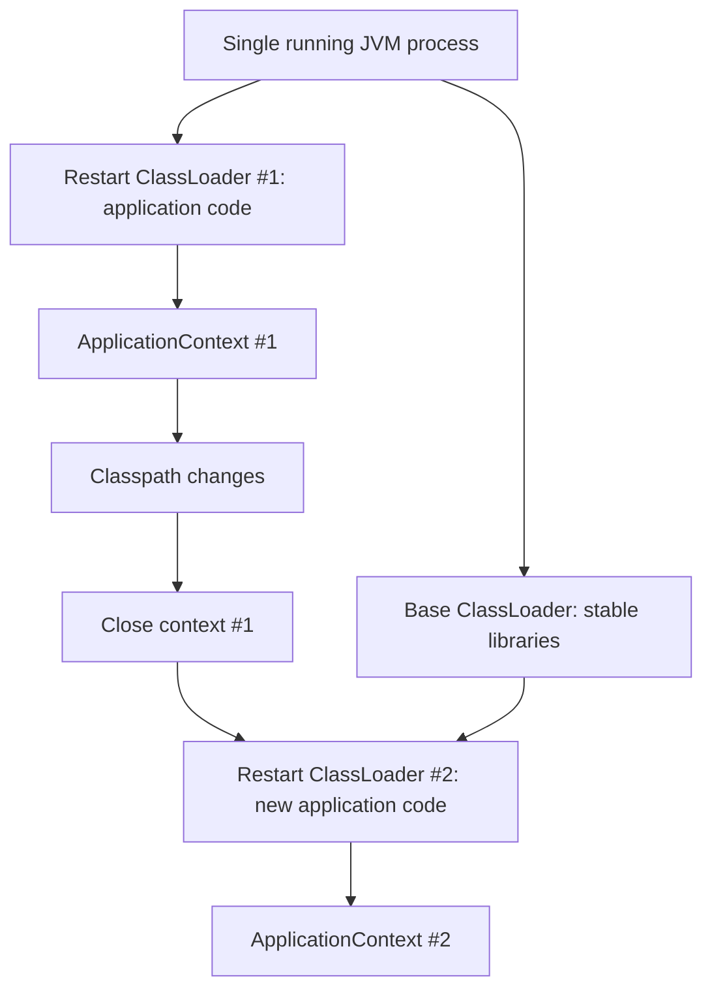
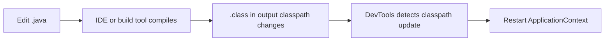
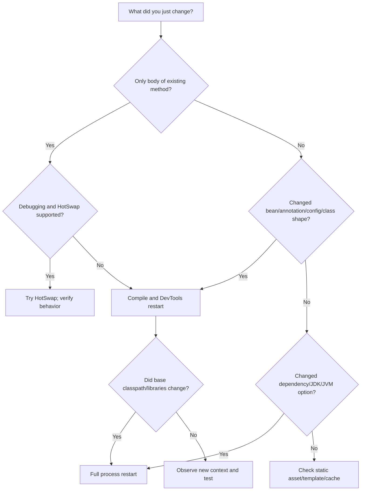

# Distinguishing Application Restart from JVM HotSwap

When developing with Spring Boot, a source code change sometimes takes effect immediately on the next request, yet other times you must wait for the application to "restart," and certain changes force you to stop the Java process entirely and launch it again. Without clearly distinguishing these mechanisms, you can waste time waiting on startups, misread bean state, or mistakenly conclude that new annotations and configurations took effect when they actually did not.

Three mechanisms must be distinguished:

1. **JVM HotSwap / Hot Code Replace (HCR):** the debugger replaces the bytecode of certain already-loaded classes in the JVM, usually without recreating the Spring ApplicationContext.
2. **Spring Boot DevTools restart:** detects changes on the application classpath, closes the old context, and builds a new context—typically **within the same JVM process**—using a development-oriented classloader model.
3. **Full process restart:** stops the running JVM process and launches a new JVM process, reloading both the application and related libraries.

In this document, "application restart" must be understood in context. **DevTools restart is not equivalent to restarting the entire JVM**, and HotSwap is not equivalent to reinitializing the Spring context.

## 1. At a Glance: How Do the Three Mechanisms Differ?

| Aspect | JVM HotSwap | DevTools restart | Full process restart |
|---|---|---|---|
| Who performs it? | Debugger/IDE and JVM class redefinition | Spring Boot DevTools | IDE, terminal, process manager, container/platform |
| Needs a debug session? | Normally yes, for standard HCR | No | No |
| Creates a new JVM? | No | Normally no | Yes |
| Recreates ApplicationContext? | No | Yes | Yes |
| Recreates singleton beans? | Not from HotSwap alone | Yes, when the context is rebuilt | Yes |
| Re-invokes existing bean constructors? | No | Yes, when new beans are created | Yes |
| Re-runs `@PostConstruct` on new beans? | No | Yes, per normal lifecycle | Yes |
| Changing method bodies | Usually supported | Supported after compile and restart | Supported |
| Adding beans, changing `@Bean`, component scan changes | Does not update running context | Usually suitable | Suitable |
| Changing libraries/dependencies in base classloader | Not the primary mechanism | Usually needs a new JVM | Suitable |
| JVM PID | Unchanged | Usually unchanged | Changes |
| Cost | Usually minimal | Often lower than full JVM restart | Usually highest |
| Data in RAM only | Most existing objects remain | Bean/context state recreated; JVM-level state may linger | Old JVM heap disappears |

This table is a guide. Actual outcomes still depend on the JDK, IDE, Spring Boot version, how the app is launched, build tool, and which classloader loads a class.

## 2. Introductory Example: Changing a Greeting

Suppose we have this service:

```java
package com.example.demo;

import org.springframework.stereotype.Service;

@Service
public class GreetingService {

    public String greet(String name) {
        return "Hello, " + name;
    }
}
```

Controller using the service:

```java
package com.example.demo;

import org.springframework.web.bind.annotation.GetMapping;
import org.springframework.web.bind.annotation.RequestParam;
import org.springframework.web.bind.annotation.RestController;

@RestController
public class GreetingController {

    private final GreetingService service;

    public GreetingController(GreetingService service) {
        this.service = service;
    }

    @GetMapping("/greeting")
    public String greeting(
            @RequestParam(defaultValue = "friend") String name
    ) {
        return service.greet(name);
    }
}
```

When calling:

```http
GET /greeting?name=Lan
```

Initial result:

```text
Hello, Lan
```

Now edit the method:

```java
public String greet(String name) {
    return "Welcome back, " + name;
}
```

There are three ways the new code can execute:

- **HotSwap:** the IDE compiles the class, the debugger asks the JVM to redefine the bytecode; the next request can execute the new method body on the **existing bean**.
- **DevTools restart:** the IDE/build tool updates the classpath; DevTools detects the change, closes the context, and creates new beans; the next request runs on the **new context's bean**.
- **Full process restart:** stop the old process, build/run again; an entire new JVM and context are created.

Merely seeing the new string in the response **does not prove which mechanism occurred**. You must also observe lifecycle hooks, classloaders, or process IDs.

## 3. What Is JVM HotSwap / Hot Code Replace?

**HotSwap** in Java development usually refers to the debugger's ability to replace the bytecode of classes already loaded inside a running JVM. In IDEs, it may be called **Hot Code Replace**, **HotSwap classes**, **Reload changed classes**, or a similar name.

Conceptual flow:


Unlike restart, this process **does not require the application to re-register all beans**.

### 3.1. What is preserved when HotSwap succeeds?

In a typical HotSwap scenario:

- The JVM process keeps running.
- The current ApplicationContext remains the old context.
- Existing singleton beans remain the exact object instances in use.
- Fields and runtime state of existing objects are usually preserved.
- Constructors and init callbacks do not re-run automatically.
- Spring configurations already parsed and registered are usually not recomputed just because method bytecode changed.

If `GreetingService` keeps a counter in a field, HotSwapping the `greet()` method does not reset the counter to 0.

### 3.2. Limits of standard HotSwap

Standard JVM/debugger class redefinition primarily serves **replacing method implementations on a compatible class structure**.

The following changes are typically **not supported by standard HotSwap** or will not yield the effects you expect:

- Adding or removing fields.
- Adding or removing methods, changing signatures.
- Changing inheritance hierarchies or implemented interfaces.
- Major structural changes to a class.
- Changing Spring bean definitions, component scanning, handler mappings, or previously processed configuration.
- Adding an AOP annotation and expecting existing advisors/proxies to regenerate automatically.

Certain specialized JVMs, IDEs, or advanced agents support **enhanced class redefinition** beyond standard HotSwap limits. Do not treat such extensions as default behavior across every Java JVM.

### 3.3. Is editing a constructor body the same as recreating the object?

Even when an environment allows changing constructor code, **constructors do not automatically re-run on already-existing instances**.

For example:

```java
public class PriceCalculator {

    private final int rate;

    public PriceCalculator() {
        this.rate = 10;
    }

    public int calculate(int base) {
        return base + rate;
    }
}
```

If an existing bean was already constructed with `rate = 10`, changing the constructor assignment to `20` will not update the field on the live instance.

For the constructor to run again, a new object must be created—such as through a DevTools restart or full restart.

## 4. HotSwap Does Not Make Spring Re-Scan Annotations

Suppose you have a service:

```java
@Service
public class GreetingService {

    public String greet(String name) {
        return "Hello " + name;
    }
}
```

You edit it to:

```java
@Service
public class GreetingService {

    @Transactional
    public String greet(String name) {
        return "Hello " + name;
    }
}
```

This is not merely a business-logic edit. Spring typically constructs transaction proxies/advisors when assembling beans during context initialization. **HotSwap is not an ApplicationContext refresh operation**.

Even if the JVM accepts the bytecode/annotation change, do not expect Spring to re-read metadata and build new proxies/advisors for existing beans.

Changes that usually require recreating the context:

- Adding/removing `@Component`, `@Service`, `@Repository`.
- Adding/removing `@Bean` or changing bean conditions.
- Changing `@ConfigurationProperties` in ways requiring rebinding.
- Adding `@Transactional`, `@Cacheable`, `@Async`.
- Changing `@RequestMapping`, `@GetMapping`, or endpoint paths.
- Changing `@Scheduled` or annotation-based schedules.
- Adding new listeners, filters, security chains, or infrastructure beans.

Even annotations retained in new JVM metadata do not imply any framework has re-inspected them.

## 5. HotSwap Is Not Browser LiveReload

Similar-sounding terms cause confusion:

- **JVM HotSwap:** swaps bytecode of running classes.
- **Spring Boot DevTools restart:** recreates the Spring context when the classpath changes.
- **LiveReload:** notifies the browser to refresh the page when corresponding resources change.

LiveReload can update browser display without JVM HotSwap. Changing CSS, HTML templates, or static assets is not the same as swapping Java method implementations.

Do not use an automatic browser refresh as proof that Spring created new beans or the JVM redefined classes.

## 6. What Is Spring Boot DevTools Restart?

**Spring Boot DevTools** is a developer-support toolkit. Its restart feature watches eligible changes on the application classpath and performs a Spring application-level restart.

At the core of this mechanism is a **two-classloader** model:

1. **Base classloader:** typically loads stable libraries/dependencies.
2. **Restart classloader:** typically loads classes belonging to the project under active development, which are frequently recompiled.

When a restart-worthy change is detected, DevTools can discard the old restart classloader, create a new restart classloader, and rebuild the application while reusing the base classloader.



Conceptual diagram: the base classloader is reused while the context and restart-tier classes are rebuilt. Do not infer that all state across the entire JVM is reset as if launching a brand-new process.

### 6.1. Why can DevTools restart be faster than a full restart?

Large libraries do not need to be reloaded on every application code edit. When the base classloader retains stable dependencies, DevTools reduces the cost of several steps compared to booting a new JVM from scratch.

However, DevTools restart still has plenty of work to do:

- Building a new ApplicationContext.
- Processing bean definitions.
- Instantiating and initializing required beans.
- Configuring web infrastructure, databases, and event listeners.
- Executing applicable startup callbacks.

Therefore, DevTools restart is **not free and not an instant method-body swap like HotSwap**.

### 6.2. DevTools restart does not create a new JVM

When a normal DevTools restart occurs:

- The JVM's PID remains the same.
- The heap and JVM-level components belong to the same process.
- The old ApplicationContext is closed and a new context is created.
- Singleton beans in the new context are typically fresh instances.
- Classes in the restart classloader are reloaded.
- Static fields in reloaded classes can be reinitialized.
- Static fields in classes residing in the base classloader **may still keep their values**.

Saying DevTools "resets all static state" or "creates a new JVM" is inaccurate.

## 7. Installing DevTools in Spring Boot

### 7.1. Gradle Kotlin DSL

```kotlin
dependencies {
    developmentOnly("org.springframework.boot:spring-boot-devtools")
}
```

### 7.2. Gradle Groovy DSL

```groovy
dependencies {
    developmentOnly 'org.springframework.boot:spring-boot-devtools'
}
```

### 7.3. Maven

```xml
<dependency>
    <groupId>org.springframework.boot</groupId>
    <artifactId>spring-boot-devtools</artifactId>
    <scope>runtime</scope>
    <optional>true</optional>
</dependency>
```

`optional` expresses that this dependency serves the development workflow and should not become a mandatory transitive dependency for projects consuming a library. Exact packaging depends on your build setup.

Standard Spring Boot build plugins typically include rules omitting DevTools from production executable artifacts by default or offer options to control this. Configure according to your active version rather than shipping DevTools as a production component.

### 7.4. When does DevTools take effect?

DevTools primarily serves applications **running in a development environment**, such as via an IDE or build tool. Auto-restart may be disabled in packaged archive/production run modes.

Consequently, do not test DevTools by assuming every built `.jar` you run will auto-restart.

## 8. What Actually Triggers a DevTools Restart?

A common misconception: "Pressing Save in the IDE makes Spring Boot restart."

In practice, DevTools restart mainly observes **changes on monitored classpath paths**, not merely `.java` files inside source folders.

Typical flow:



Therefore:

- If the IDE only saves source without compiling, the classpath may remain unchanged.
- If the IDE compiles on save, changes can be detected automatically.
- Some IDEs require pressing **Build Project**, **Make Project**, or enabling automatic build.
- When running via a build tool, the output classpath must be where DevTools watches.

### 8.1. Source files and class files are two different things

Example:

```text
src/main/java/com/example/demo/GreetingService.java
          |
          | compile
          v
build/classes/java/main/com/example/demo/GreetingService.class
```

DevTools typically observes changes in classpath outputs like `build/classes/java/main` or `target/classes`, not uncompiled `.java` contents.

### 8.2. IDEs can combine compilation and HotSwap

While debugging, a single compile action can cause:

1. The IDE attempts to HotSwap bytecode into the JVM.
2. Class files in the output directory are updated.
3. DevTools sees the classpath change and starts a restart.

Thus both mechanisms can **trigger simultaneously** and feel confusing: first HotSwap reports success, and then the app restarts anyway.

To test HotSwap in isolation, manage DevTools restart. To test DevTools restart in isolation, be aware whether the IDE is sending HCR first.

## 9. Observing DevTools Restart Using Lifecycle Callbacks

A practical way to distinguish them is logging when Spring creates and destroys a bean.

Example:

```java
package com.example.demo;

import java.util.concurrent.atomic.AtomicInteger;

import jakarta.annotation.PostConstruct;
import jakarta.annotation.PreDestroy;
import org.springframework.stereotype.Service;

@Service
public class CounterService {

    private final AtomicInteger counter = new AtomicInteger();

    @PostConstruct
    public void init() {
        System.out.println(
                "CounterService initialized: "
                        + System.identityHashCode(this)
        );
    }

    @PreDestroy
    public void destroy() {
        System.out.println(
                "CounterService destroyed: "
                        + System.identityHashCode(this)
        );
    }

    public int next() {
        return counter.incrementAndGet();
    }
}
```

Controller:

```java
@RestController
public class CounterController {

    private final CounterService counterService;

    public CounterController(CounterService counterService) {
        this.counterService = counterService;
    }

    @GetMapping("/counter")
    public int counter() {
        return counterService.next();
    }
}
```

Call the endpoint twice:

```text
GET /counter  -> 1
GET /counter  -> 2
```

### 9.1. If HotSwap of a method body succeeds

Suppose only the implementation of `next()` is modified, and the debugger replaces the bytecode in the JVM without triggering a context restart.

Expected outcome:

- No destroy-then-initialized log pair from this action.
- The existing bean keeps its counter.
- If the logic edit is valid, subsequent calls run the new body.
- Existing state does not reset on its own.

### 9.2. If DevTools restart succeeds

After classpath output changes and DevTools restarts:

- Spring closes the old ApplicationContext.
- `@PreDestroy` gets a chance to run on the old bean.
- A new context is created.
- `@PostConstruct` runs on the new bean.
- The new bean's counter starts from 0.

The next request returns:

```text
GET /counter  -> 1
```

**Caution:** `System.identityHashCode` is only a supporting observation hint; it is not an absolute unique ID across all objects and runs. Lifecycle logs and bean state matter more.

### 9.3. If a full process restart occurs

You also see the bean recreated and the counter reset, while simultaneously:

- The old JVM process terminates.
- A new JVM is launched.
- The PID usually changes.
- Classloaders and the heap from the old JVM are gone.

To distinguish DevTools from a full restart, also inspect the process/PID rather than bean lifecycle alone.

## 10. Printing the PID to Distinguish DevTools Restart from a New JVM

You can print the PID using the Java API:

```java
long pid = ProcessHandle.current().pid();
System.out.println("JVM PID = " + pid);
```

You can print this when the ApplicationContext becomes ready or inside an internal diagnostic endpoint.

With a normal DevTools restart:

```text
JVM PID = 15420
ApplicationContext initialized
...
ApplicationContext destroyed
ApplicationContext initialized
JVM PID = 15420
```

With a full restart:

```text
JVM PID = 15420
... old process stops ...

JVM PID = 16736
... new process starts ...
```

PIDs are examples only. Operating systems can reuse PIDs later, so for rigorous diagnostics combine process start time or process lifecycle observation rather than relying solely on PID collision.

## 11. Change Matrix: HotSwap, DevTools, or Full Restart?

| What you just changed | Standard HotSwap | DevTools restart | Full restart |
|---|---|---|---|
| Edit statements inside a method body | Usually works | Works | Works |
| Change message returned from a service | Usually works | Works | Works |
| Change algorithm keeping class/method shape | Usually works | Works | Works |
| Add new field or method | Usually no | Usually works | Works |
| Change constructor signature | Usually no | Usually works | Works |
| Add `@Service` or `@Component` | Does not update current component scan | Usually works | Works |
| Add `@Bean` or conditional bean | Does not update current context | Usually works | Works |
| Change `@GetMapping` or router mapping | Do not expect existing routes to update | Usually works | Works |
| Change property needing rebind into bean | Not HotSwap's job | Usually works if restart triggered | Works |
| Add `@Scheduled` | Does not auto-register new schedule | Usually works | Works |
| Add `@Transactional` / `@Cacheable` | Does not automatically rebuild proxy | Usually works | Works |
| Change dependency JAR or JVM flags | No | Usually insufficient | Recommended |
| Change JDK version | No | No | Requires launching new JVM |
| Change class in base classloader | Not a reliable solution | May fail to reload that class | Recommended |
| Verify clean app startup from scratch | No | Not fully equivalent | Recommended |

"Works" means the mechanism can bring the change into the application after appropriate building and configuration; it does not mean every change is safe or instant.

## 12. Why Does Adding a Dependency Usually Require a Full Process Restart?

A new dependency can change:

- Classpath structure.
- Discovered auto-configurations.
- Classes and resources loaded into the base classloader.
- Native libraries or JVM-level resources.
- The Spring Boot plugin/runtime classpath supplied by the build tool.

DevTools usually keeps the base classloader stable across restarts. If you add/modify dependencies residing in the base classloader, a context restart does not necessarily produce a classpath and classloader matching the change.

Reliable workflow:

1. Update Gradle/Maven.
2. Sync dependencies and compile.
3. Stop the running process.
4. Start the application again with the new runtime classpath.

Otherwise, you may encounter `ClassNotFoundException`, `NoClassDefFoundError`, or inconsistent behavior because the classloader retains old versions.

## 13. DevTools Trigger File: Restart Only When You Explicitly Allow It

In large projects, you may not want DevTools restarting every time the IDE compiles part of the code. DevTools supports a **trigger file** model: after the classpath changes, a restart is only permitted once the trigger file is updated per the watch mechanism.

Example configuration:

```properties
spring.devtools.restart.trigger-file=.reloadtrigger
```

Create the trigger file somewhere included on the classpath, for example:

```text
src/main/resources/.reloadtrigger
```

Workflow:

1. Edit code.
2. Compile so classpath outputs update.
3. When ready to restart, edit/touch the trigger file.
4. DevTools observes it and performs the appropriate restart.

Exact paths and behavior depend on the build tool's resource/classpath settings. The trigger file must actually exist in a location watched by DevTools, not an arbitrary file outside the classpath.

### 13.1. Trigger files help when combining with HotSwap

You can:

- Use HotSwap for method-body edits within a debug session.
- Defer DevTools restarts until you genuinely need to rebuild the context.
- Touch the trigger file after changing beans/configurations to restart the context.

This coordination reduces the friction of "HotSwap succeeded, yet DevTools restarted immediately afterward."

### 13.2. A trigger file does not expand HotSwap's capabilities

If you add a field or alter class structure, standard debuggers may still reject HotSwap. A trigger file only controls **when DevTools restarts**, not JVM class-redefinition limits.

## 14. Disabling DevTools Restart When Testing HotSwap in Isolation

You can configure:

```properties
spring.devtools.restart.enabled=false
```

When placed in application properties, this setting disables DevTools' corresponding watch/auto-restart mechanism. However, depending on how DevTools initializes, the restart classloader may still participate in bootstrap.

If you need to **completely disable the restart classloader** for a specific test, Spring Boot allows setting a system property **before calling `SpringApplication.run(...)`**:

```java
public static void main(String[] args) {
    System.setProperty("spring.devtools.restart.enabled", "false");
    SpringApplication.run(DemoApplication.class, args);
}
```

This is a debugging example; do not commit a system property disabling tooling for the entire team if the goal is only local verification. You can pass it via VM arguments or IDE run configurations instead of editing main source code.

### 14.1. When restart is disabled, does compiling make new beans appear?

No. Disabling DevTools restart neither enables HotSwap nor makes Spring re-scan bean definitions.

You must still:

- Attach a debugger and perform Hot Code Replace for compatible method-body edits; or
- Explicitly restart the context/process when changes require reprocessing configuration.

## 15. Distinguishing Static Resource Changes from Java Class Changes

Not every edit in a Spring Boot project requires a restart.

For example:

- CSS or JavaScript files served as static resources.
- HTML templates when the template engine disables caching in development.
- Message bundles or resources reloaded through dedicated mechanisms.
- Compiled Java classes.

They have different update mechanisms.

### 15.1. Static assets can update independently

Changing `src/main/resources/static/app.css` typically does not require Java bytecode HotSwap. The browser may need a refresh; LiveReload can help perform that.

### 15.2. Templates and caching

If the template engine has caching enabled, a changed template not showing in the UI can be caused by caching—not because JVM HotSwap failed to work.

Check the caching configuration of the specific template engine and development mode.

### 15.3. Java sources must be compiled

When editing a Java method, what the JVM executes is loaded bytecode, not the `.java` file in the editor. If class output has not been updated, neither DevTools nor the debugger has new bytecode to apply.

## 16. Restart Classloader and Static State

DevTools has a quirk that often surprises developers: **one JVM, yet potentially multiple generations of classloaders across restarts**.

In the JVM, a class is identified not only by its fully qualified name, but also by the classloader that loaded it.

Conceptual example:

```text
com.example.app.Widget loaded by RestartClassLoader#1
com.example.app.Widget loaded by RestartClassLoader#2
```

Two classes can share the same name yet not be the same runtime `Class<?>` if loaded by two different classloaders.

### 16.1. Static state may reset or persist

Case A: application class resides in the restart classloader.

```java
public final class DebugCounter {

    public static int value;
}
```

When this class is reloaded by a new restart classloader, static fields of the new class start from fresh initialization state.

Case B: library class resides in the base classloader.

Static fields of the library class can survive DevTools restarts because the base classloader is retained.

**Do not use static fields to store state that must survive every DevTools restart or be reliably reset.** Design application-level lifecycle/state explicitly.

### 16.2. ClassCastException from classloaders

A classic error:

```text
ClassCastException: com.example.Widget cannot be cast to com.example.Widget
```

The message looks absurd, yet the two `Widget`s may have been loaded by two different classloaders.

Possible causes include:

- A library in the base classloader holds a reference to an application class from an older restart classloader.
- Threads or caches were not cleaned up when the old context closed.
- Serialization/deserialization or proxies went through the wrong classloader.
- A multi-module dependency was loaded in the wrong layer.

When encountering this error, check the classloaders of both classes and consider configuring the restart classloader or performing a full restart.

## 17. Tuning the Classloader for Multi-Module or Special Libraries

DevTools supports include/exclude rules when splitting classes between base and restart classloaders. In multi-module projects, you may need adjustments so a module under active development is also loaded by the restart classloader.

A configuration file can be used:

```text
META-INF/spring-devtools.properties
```

Illustrative example:

```properties
restart.include.my-shared-module=/my-shared-module-[\\w.-]+\\.jar
restart.exclude.stable-lib=/stable-lib-[\\w.-]+\\.jar
```

Exact patterns and classpath URLs must match the real project structure. This is advanced configuration; do not copy example patterns assuming they work for every Gradle/Maven project.

### 17.1. When should you consider it?

- Editing code in a submodule does not reflect changes after DevTools restarts.
- Encountering `ClassCastException` or puzzling classloader errors.
- A project dependency is treated as a stable library even though it is actively developed.
- A framework retains references to classes from an old restart classloader.

### 17.2. When should you avoid it?

If you only changed a line of business logic, do not start with complex classloader configuration. Verify whether the IDE compiled the class and whether DevTools actually restarted first.

Do not use include/exclude rules to mask resource leaks or dependency changes that require a full restart.

## 18. DevTools Restart and Spring Bean Lifecycles

When DevTools restarts the context, Spring gets the chance to run lifecycle steps:

- Stopping `SmartLifecycle` beans.
- Invoking destroy callbacks such as `@PreDestroy` and `@Bean(destroyMethod = "...")` per management rules.
- Closing resources owned by eligible beans.
- Constructing the new context.
- Creating new beans and invoking `@PostConstruct`/init callbacks.

This is a key difference from HotSwap: HotSwapping a method body does not close/open the context.

### 18.1. Why can self-created resources cause issues?

If a bean creates an `ExecutorService` or scheduler manually without closing it when the context is destroyed, worker threads can keep living after a DevTools restart.

When that happens:

- Old threads hold references to classes from the old restart classloader.
- Network/file resources remain held.
- The old classloader may not be garbage collected.
- Repeated restarts can accumulate threads or memory.

Example needing cleanup:

```java
@Service
public class BackgroundWorker {

    private final ExecutorService executor =
            Executors.newSingleThreadExecutor();

    public void submit(Runnable job) {
        executor.submit(job);
    }

    @PreDestroy
    public void shutdown() {
        executor.shutdown();
    }
}
```

This example shows the **cleanup path**, though `shutdown()` does not wait for all tasks to finish. In real applications, include timeouts and `awaitTermination()` or appropriate cancellation mechanisms.

### 18.2. Multiple restarts are a useful lifecycle test

During development, editing code and letting DevTools restart repeatedly can expose:

- Resource leaks.
- Unstopped threads.
- Static caches holding old classloaders.
- Duplicate listener registrations.
- Unreleased ports/sockets.
- Duplicated scheduled tasks.

Even so, do not use DevTools restart to replace standard application shutdown/restart testing.

## 19. DevTools Restart Is Not a Graceful Production Rolling Restart

A difference in purpose:

- **DevTools restart:** optimizes the development loop on a local JVM.
- **Graceful shutdown:** gives in-flight requests/tasks a chance to finish before the context/process stops.
- **Rolling deployment:** deployment systems replace instances gradually to maintain availability.
- **Full production restart:** stops/starts processes or containers according to platform policy.

DevTools restart is not a zero-downtime deployment tool. While the context is closing and rebuilding, the application may temporarily fail to serve requests.

Do not enable DevTools in production expecting the app to auto-update when classfiles are uploaded; that does not replace build, deploy, rollback, and version-control pipelines.

## 20. JVM HotSwap and AOP Proxies: What About New Methods?

Suppose you have:

```java
@Service
public class InvoiceService {

    @Transactional
    public void saveInvoice() {
        // Current logic.
    }
}
```

If you only change code inside `saveInvoice()` and the JVM permits HotSwap, calls through the **existing proxy** can continue passing through the transaction interceptor and running the new body.

However, if you change:

- Where `@Transactional` is placed.
- Method names/signatures matched by pointcuts.
- `@Aspect` expressions.
- Bean registrations or proxy configuration.

you must rebuild the appropriate infrastructure/proxies. DevTools restart or a full restart is safer for verifying those changes.

### 20.1. HotSwap does not fix self-invocation

If a bean calls:

```java
this.saveInvoice();
```

from another method on the same target, the internal call still bypasses the Spring proxy even after the method body is HotSwapped.

HotSwap and AOP are separate mechanisms: replacing method code does not change call routing through proxies.

## 21. Hands-On Example: Distinguishing the Three Mechanisms by Observation

We use an application with an endpoint and lifecycle logging.

### 21.1. Create a stateful service

```java
package com.example.demo;

import java.util.concurrent.atomic.AtomicInteger;
import jakarta.annotation.PostConstruct;
import jakarta.annotation.PreDestroy;
import org.springframework.stereotype.Service;

@Service
public class ProbeService {

    private final AtomicInteger calls = new AtomicInteger();

    @PostConstruct
    public void initialized() {
        System.out.println(
                "PROBE_INIT pid=" + ProcessHandle.current().pid()
                        + " instance=" + System.identityHashCode(this)
        );
    }

    @PreDestroy
    public void destroyed() {
        System.out.println(
                "PROBE_DESTROY instance="
                        + System.identityHashCode(this)
        );
    }

    public String describe() {
        return "v1 / call=" + calls.incrementAndGet();
    }
}
```

Controller:

```java
package com.example.demo;

import org.springframework.web.bind.annotation.GetMapping;
import org.springframework.web.bind.annotation.RestController;

@RestController
public class ProbeController {

    private final ProbeService service;

    public ProbeController(ProbeService service) {
        this.service = service;
    }

    @GetMapping("/probe")
    public String probe() {
        return service.describe();
    }
}
```

### 21.2. Record initial state

Run the application and call:

```text
GET /probe
v1 / call=1

GET /probe
v1 / call=2
```

Note the `PROBE_INIT` log and PID.

### 21.3. Test HotSwap

In a debug session, edit the method body:

```java
public String describe() {
    return "v2 / call=" + calls.incrementAndGet();
}
```

Compile and trigger your IDE's Hot Code Replace feature. During this test, prevent DevTools restart from interfering (for example, temporarily disable restart or use a trigger file).

If HotSwap succeeds, expected output:

```text
GET /probe
v2 / call=3
```

No Spring destroy/init cycle occurred from this operation, and the PID did not change.

### 21.4. Test DevTools restart

Enable DevTools restart, compile code so classpath output changes, and wait for the new context to finish starting. If using a trigger file, touch the trigger after compiling.

Expected output:

```text
PROBE_DESTROY instance=...
PROBE_INIT pid=<old PID> instance=...

GET /probe
v2 / call=1
```

The new bean has a fresh counter, yet the JVM PID remains as before.

### 21.5. Test full restart

Stop the application and start it again from the IDE or terminal.

Expected output:

```text
PROBE_INIT pid=<new PID> instance=...

GET /probe
v2 / call=1
```

Now the process is genuinely new. Application logs after restart are not the sole evidence; verify process lifecycle or PID when needed.

### 21.6. Conclusions from the experiment

| Observation | HotSwap | DevTools | Full restart |
|---|---|---|---|
| Method body effect changes | Possible | Yes | Yes |
| Bean counter resets | No | Yes | Yes |
| `@PreDestroy` and `@PostConstruct` re-run from the action | No | Usually yes | Usually yes on normal stop/start |
| JVM PID changes | No | No | Yes |
| Framework re-parses bean definitions | No | Yes | Yes |

If your results differ from the table, inspect IDE compilation behavior, debug HotSwap, DevTools triggers, and whether lifecycle callbacks actually executed.

## 22. IDE Workflow: What Should You Click After Editing Code?

A practical workflow can be divided by change magnitude.

### 22.1. Editing only a method body

For example, fixing a calculation or message:

1. Save source.
2. Compile the class.
3. If debugging, try HotSwap/HCR.
4. Re-call the endpoint or verify behavior.
5. If HotSwap is rejected or framework state needs refreshing, use DevTools restart.

Benefit: no waiting for Spring to recreate all beans for a simple method code edit.

### 22.2. Adding fields, methods, DTOs, or new classes

1. Compile the code.
2. Use DevTools restart so the new classloader/context handles the class shape.
3. Verify the app started and the endpoint/tests work.
4. If classloader or dependency errors occur, consider a full restart.

Some enhanced HotSwap JVMs handle structural changes, but the DevTools workflow remains more reliable for Spring bean/context changes.

### 22.3. Changing configuration or annotations

For example, changing:

```java
@GetMapping("/old")
```

to:

```java
@GetMapping("/new")
```

This is a mapping change registered by Spring MVC while building the context. Restart the context rather than relying solely on HCR.

### 22.4. Adding dependencies, changing runtime, or upgrading JDK

Sync the build, then stop and restart the JVM. Do not expect the DevTools restart classloader to reconstruct the entire underlying classpath.

## 23. Gradle bootRun, Maven spring-boot:run, and Packaged JARs

How you launch affects auto-update behavior.

### 23.1. Gradle bootRun

Example:

```bash
./gradlew bootRun
```

When run in a development configuration with DevTools and updated classpath output, DevTools can detect compile results.

However, not every IDE/build setup automatically recompiles classes while `bootRun` is running. You may need the IDE's Build/Make action or an appropriate compile workflow.

### 23.2. Maven spring-boot:run

Example:

```bash
./mvnw spring-boot:run
```

Similarly, DevTools depends on classpath output changing. Editing source files without producing new classfiles will not reliably trigger a restart.

### 23.3. Running an executable JAR

Example:

```bash
java -jar build/libs/demo.jar
```

A standard packaged archive is not the typical environment for DevTools to auto-restart on every source edit. Rebuild the artifact and restart the process per deployment workflow.

Do not confuse building a new JAR on disk with the running JVM automatically loading the new JAR into its current classloader.

## 24. Diagnostic Checklist When Code Edits Do Not Change the Response

Scenario: you edited `GreetingService` from `v1` to `v2`, yet the API still returns `v1`.

Check in order:

1. **Is the right project/module running?** The IDE might be running another module or process.
2. **Right port and endpoint?** The request might be hitting a different instance.
3. **Has the source compiled?** Check build output/classpath.
4. **Is a debugger attached?** If expecting HotSwap, an active debug session is needed.
5. **Did the IDE report HCR succeeded or rejected?**
6. **Was DevTools added in the right scope?**
7. **Is DevTools disabled?**
8. **Is there a trigger file or restart exclusion?**
9. **Are there context restart logs?**
10. **Does the class belong to the restart or base classloader?**
11. **Is the response cached at the client/CDN/server?**
12. **Are multiple applications running simultaneously?**

If the output classfile has not changed, do not rush to tweak AOP, caching, bean scopes, or classloaders. Get the new code into the runtime first.

### 24.1. Restart succeeded yet old response remains

Possible reasons:

- The request is going to a different process.
- The new class is not in the output classpath observed by DevTools.
- An upstream cache/layer holds stale data.
- The module containing the class resides in the base classloader.
- The build tool copies resources or compiles to a different directory.
- The application is using a different active profile than you think.

Logging the version/build commit and process PID on startup helps reduce confusion.

## 25. When DevTools Restarts Continuously

Possible causes include:

- The IDE automatically recompiles or copies resources repeatedly.
- The build tool writes to the classpath output continuously.
- A task inside the app writes files into a directory watched by DevTools.
- Multiple tools edit the classpath simultaneously.
- Restart triggers or exclusions are not configured appropriately.

Options:

- Use a trigger file.
- Adjust `spring.devtools.restart.exclude` for resources not needing restarts.
- Consider `spring.devtools.restart.additional-exclude` to append patterns without replacing all exclusions.
- Move runtime files written by the app outside the classpath.
- Inspect IDE automatic build and resource-copy tasks.

Example configuration adding an exclusion:

```properties
spring.devtools.restart.additional-exclude=**/generated-reports/**
```

Patterns must match actual classpath paths. Do not exclude the entire output classpath just to mask a restart loop, as that defeats DevTools' main benefit.

## 26. When Classloader Errors Occur After Restart

Symptoms:

- `ClassCastException` with two identical class names.
- `NoClassDefFoundError` after editing dependencies.
- Old threads still alive after multiple restarts.
- Duplicate listeners/schedulers executing.
- A class failing to reload as expected.

Investigation steps:

1. Print the classloader name of the involved object:
   
   ```java
   System.out.println(
           someObject.getClass().getClassLoader()
   );
   ```

2. Check which modules belong to the base vs. restart classloader.
3. Inspect resource lifecycles and cleanup on context close.
4. If dependencies changed, try a full process restart.
5. Only adjust `spring-devtools.properties` once a classloader layering issue is confirmed.

Full restart is an important control test: if the bug vanishes after a fresh JVM yet returns on DevTools restarts alone, state/classloader/dependency retention across restarts is very likely.

## 27. HotSwap, DevTools, and Database Changes

Key principle: **restarting code does not mean the database resets automatically**.

During HotSwap:

- The Spring context stays alive.
- The database and connection pool usually stay intact.

During DevTools restart:

- The context and pool beans may be recreated.
- External databases still preserve their stored data.
- Migration or initialization logic may run again per configuration, but does not necessarily erase/restore data.

During full process restart:

- A new JVM is created.
- External databases remain independent systems maintaining state by their own mechanisms.
- Some in-memory databases have lifecycles tied to process/connection/configuration; check how they are created and closed.

**Do not use "restarting the app" as a data rollback strategy.** For schema changes, use Flyway/Liquibase or proper migration pipelines.

## 28. Thread, Scheduler, and Connection State During DevTools Restart

An application with background workers can make DevTools restarts unpredictable if cleanup is missing.

Example:

```java
@Component
public class PollingWorker {

    private final ScheduledExecutorService scheduler =
            Executors.newSingleThreadScheduledExecutor();

    @PostConstruct
    public void start() {
        scheduler.scheduleAtFixedRate(
                this::poll,
                0,
                30,
                TimeUnit.SECONDS
        );
    }

    @PreDestroy
    public void stop() {
        scheduler.shutdownNow();
    }

    private void poll() {
        // Perform periodic work.
    }
}
```

During a normal context restart, the bean's destroy callback has a chance to stop the old scheduler before the new bean starts a new scheduler.

Yet `shutdownNow()` is an interrupt request, not a guarantee that an active task stops instantly. Background work needs timeouts and proper interruption handling.

Without cleanup:

- The old scheduler keeps running.
- A new scheduler is created after restart.
- Two schedulers may process work simultaneously.
- The old classloader cannot be freed because the worker thread still holds references.

This also explains why DevTools restarts sometimes trigger leaks when code manually spawns threads instead of using Spring-managed resources.

## 29. What Tests Prove a Real Restart Is Needed?

During development, seeing a change take effect after HotSwap is insufficient to prove application wiring is correct.

For example, changing:

```java
@Service
public class PaymentService {

    @Transactional
    public void pay() {
        // ...
    }
}
```

If you add a new annotation, test a rebuilt context to confirm:

- The bean is scanned.
- A transaction manager exists.
- The proxy/advisor is applied.
- Calls through the Spring-managed bean actually open a transaction.

HotSwapping method bodies only helps quickly test logic inside existing methods; **it does not replace integration tests for new wiring**.

Similarly, when adding controller mappings, filters, security rules, or scheduled tasks, test inside a rebuilt context.

## 30. Quick Decision Model



Rules of thumb:

- **Logic inside an old method:** try HotSwap.
- **Spring context structure or new classes:** DevTools restart.
- **JVM, underlying dependencies, major classpath or environment changes:** full process restart.

Do not try to use a lighter mechanism when it cannot update the runtime layer you changed.

## 31. Common Misconceptions

| Statement | True or false? | Explanation |
|---|---|---|
| HotSwap is restarting Spring Boot | **False** | HotSwap redefines bytecode, usually without closing/opening the context |
| DevTools restart always creates a new JVM | **False** | Usually reuses the JVM and base classloader |
| Full restart only recreates Spring beans, not the JVM | **False** | A process restart launches a new JVM |
| Saving Java source always triggers DevTools | **False** | Output classpath usually must change via compile/copy |
| Every Java edit can be HotSwapped | **False** | Standard HotSwap has class structure limits |
| HotSwap re-runs `@PostConstruct` | **False** | Existing beans are not recreated automatically |
| DevTools restart preserves all singleton beans | **False** | The context and beans are recreated |
| DevTools restart resets all static fields | **False** | Depends on that class's classloader |
| Adding `@Transactional` then HotSwapping auto-updates the proxy | **False** | Spring does not rebuild advisors/proxies from the old context automatically |
| Browser LiveReload is JVM HotSwap | **False** | LiveReload primarily triggers browser refresh |
| Building a new JAR makes the running JVM use it | **False** | Already-loaded runtime classpaths do not update automatically |
| Dependency changes usually only need DevTools | **False** | Usually requires a full JVM restart |
| DevTools restart equals zero-downtime deployment | **False** | Context closes and rebuilds; requests may be interrupted |
| New beans after DevTools restart prove PID changed | **False** | The new context can run inside the same JVM |
| Database wipes data on DevTools restart | **False** | Out-of-process data does not reset automatically |
| Resource cleanup can be skipped because it is only development | **False** | Repeated restarts can expose thread/classloader leaks |

## 32. Self-Check Questions

**Question 1.** You only edited a calculation inside the body of `calculateTotal()`. What should you try first to see the result quickly while debugging?

**Answer:** Compile and try JVM HotSwap/Hot Code Replace if your IDE and JVM support it. There is no need to recreate the entire context just for a compatible method-body edit.

**Question 2.** You added `@GetMapping("/new-endpoint")`. Is HotSwapping the method body enough for Spring MVC to recognize the new route?

**Answer:** No. Handler mappings are constructed from metadata during context configuration; an appropriate context or process restart is needed.

**Question 3.** Why can DevTools restart be faster than a full process restart?

**Answer:** DevTools usually reuses the JVM and the base classloader holding stable libraries, while recreating only the restart classloader and ApplicationContext.

**Question 4.** After a DevTools restart, the PID stays the same while the counter in a singleton service resets to 0. Is this abnormal?

**Answer:** No. The JVM can be the same process while the Spring context and singleton beans were recreated.

**Question 5.** Why does pressing Save on source code not always trigger a restart?

**Answer:** Because DevTools usually watches output classpaths; if the IDE has not compiled into a new `.class`, there may be no runtime change to observe yet.

**Question 6.** You added a new dependency in Gradle. Should you use HotSwap or a full restart?

**Answer:** Usually sync dependencies, build, and do a full process restart to create a fresh runtime classpath/base classloader.

**Question 7.** Why might an old thread survive a DevTools restart?

**Answer:** If the application manually spawns threads/executors without shutting them down when the context is destroyed, threads can live on inside the old JVM and hold references to the old classloader.

**Question 8.** What problem does `spring.devtools.restart.trigger-file` solve?

**Answer:** It allows explicitly choosing when DevTools restarts instead of restarting after every eligible classpath update.

**Question 9.** Changed text in a Java service takes effect, yet `@PostConstruct` did not run again. Which mechanism does this suggest?

**Answer:** Likely a successful JVM HotSwap, because the method body changed on the existing instance without restarting the Spring context.

**Question 10.** Why shouldn't you look only at the API response to conclude which mechanism happened?

**Answer:** HotSwap, DevTools restart, and full process restart can all make the response use new logic. You also need lifecycle logs, PID, and context/bean state to distinguish them.

## 33. Key Takeaways

- **JVM HotSwap** replaces bytecode of running classes, typically preserving the JVM, ApplicationContext, and existing objects.
- **Spring Boot DevTools restart** usually recreates the restart classloader, ApplicationContext, and beans inside **the same JVM**.
- **Full process restart** launches a new JVM process, reloads the runtime classpath, and builds a new context.
- Compatible method-body edits suit HotSwap; bean/annotation/configuration changes should restart the context.
- `.java` sources must be compiled so the classpath/runtime has new bytecode; Save does not always mean restart.
- DevTools uses base and restart classloaders, so static state or classloader leaks can behave differently from a full restart.
- `@PostConstruct`/`@PreDestroy` on Spring beans help observe whether the context was rebuilt.
- PIDs help distinguish a new JVM from a DevTools restart, though combine them with lifecycle logs.
- Adding dependencies, changing JDK/JVM options, or modifying base libraries usually requires a full process restart.
- Browser LiveReload, JVM HotSwap, and DevTools restart are three distinct concepts.
- Tests for AOP, mappings, bean registration, and auto-configuration should run inside a rebuilt context whenever metadata changes.
- Manually created worker threads, schedulers, and connection pools must be cleaned up on context close; otherwise repeated DevTools restarts expose resource leaks.

When updating code during development, ask yourself: **"Did I only change code that existing objects will execute, or did I change structure Spring must re-read when building the context, or did I even change the JVM/classpath environment?"** The answer determines when to HotSwap, when to DevTools restart, and when to launch a fresh JVM.
