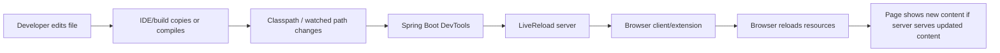
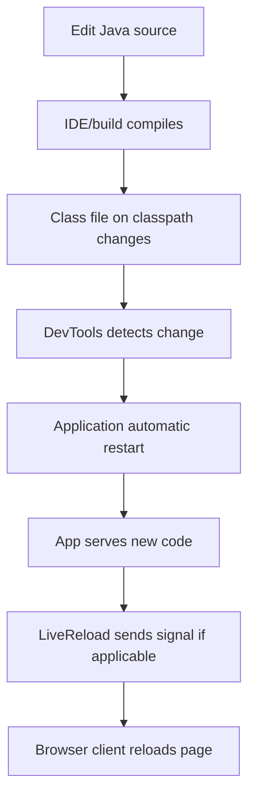
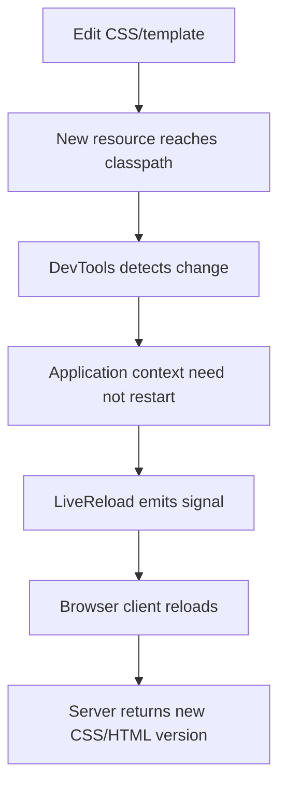

# LiveReload and Conditions for Automatic Browser Refresh

During Spring Boot application development, developers frequently edit HTML, CSS, JavaScript, or Java code and switch back to the browser to check the result. Having to stop the application, re-run the JAR, and manually refresh the page after every edit slows down the development loop. **Spring Boot DevTools** provides utilities to shorten this loop, including **LiveReload**.

However, "having DevTools" **does not mean** "saving any file instantly updates every browser tab." LiveReload is a mechanism for **notifying connected clients that application resources have changed and should be reloaded**. To see an updated UI, a chain of conditions must hold—from source files to the running application, the LiveReload server, the browser client, and finally the served HTTP content.

In the **Developer Tools** chapter of *Spring Boot Fundamentals*, this lesson clarifies:

- What Spring Boot DevTools LiveReload is and how it differs from automatic restart.
- Why **saving a file**, **compiling/copying to the classpath**, **reloading the page**, and **new code taking effect** are distinct steps.
- Conditions required for automatic browser updates, including the role of a compatible browser extension or client.
- Working with Java code, Thymeleaf, static HTML/CSS/JS, frontend build tools, and container environments.
- Related DevTools properties, scenarios where updates fail to appear, and how to investigate systematically.

> **Scope:** This content describes the principles and common properties of Spring Boot DevTools. Exact behavior can depend on the Spring Boot version, IDE/build tool, web server, frontend tooling, and browser client in use. Do not treat speeds or reload timings in examples as guarantees for every environment.

## 1. What Is LiveReload?

**LiveReload** is a protocol and web-development mechanism: a process monitoring application changes can send messages to a browser client, instructing the client to reload the page or related resources.

With Spring Boot DevTools, a LiveReload server can start alongside the application in development mode. When DevTools detects changes in monitored resources, it can emit a reload signal to connected browser clients.

Simple diagram:



Here, **Spring Boot does not directly manipulate the UI of arbitrary browsers**. The server emits a protocol signal; a LiveReload-capable client must receive the signal and trigger the refresh action.

### 1.1. LiveReload is not a browser

The LiveReload server is not a web tab, browser automation tool, or part of an HTML template. It is a connection service for LiveReload clients. A compatible browser extension is typically how an ordinary tab receives reload messages.

### 1.2. LiveReload is not frontend Hot Module Replacement

With frontend tools like Vite or Webpack, **Hot Module Replacement (HMR)** can update a running JavaScript or CSS module without reloading the entire page.

Spring Boot DevTools' LiveReload usually means something different: **telling the browser to reload and fetch content from the server again**. By default, it does not hot-swap an in-memory JavaScript module, preserve SPA state, update React/Vue components in place, or hot-swap arbitrary Java methods.

### 1.3. LiveReload is not Java HotSwap

Java HotSwap is the debugger/JVM's ability to modify certain running classes within specific limits. Spring Boot DevTools **automatic restart**, meanwhile, watches the classpath and restarts the application context using an appropriate classloader system.

These techniques address different needs:

| Technique | Primary target | Behavior |
| --- | --- | --- |
| DevTools LiveReload | Browser/client | Sends a signal to reload the page or resources |
| DevTools automatic restart | Java application | Restarts the application via DevTools when eligible classpath changes occur |
| IDE/JVM HotSwap | Debugged Java classes | Replaces code of some classes in the JVM per debugger capabilities |
| Frontend HMR | Frontend modules in browser | Swaps modules via bundler without necessarily reloading the full page |

A project can use multiple mechanisms together, yet they are **not the same feature**.

## 2. Conditions Required for Automatic Browser Updates

This is the central question of the lesson. A typical auto-reload chain requires the following conditions:

1. **DevTools is properly added to the development application** and LiveReload is not disabled.
2. **The application runs in a mode where DevTools operates**, typically from an IDE or `bootRun`/`spring-boot:run` in development.
3. **The LiveReload server starts successfully**, without port conflicts or disabling configuration.
4. **A compatible browser client/extension is installed and enabled**, and connected to the LiveReload server.
5. **The edited file reaches a location watched by DevTools**, such as the output classpath or a configured additional path.
6. **Change detection actually sees the updated file version**, which may require the IDE to compile/copy resources or run a frontend build.
7. **The server serves updated content** when the browser re-requests the resource.
8. **The browser is not held back by cache, service workers, or intermediaries** in a way that hides the update after reload.

If one link is missing, symptoms can include:

- No reload signal emitted.
- Signal emitted, yet the tab does not reload.
- Tab reloads, yet content does not change.
- Java backend restarted, yet the UI still uses an old JavaScript bundle.
- CSS/HTML changed, yet was not copied from `src/main/resources` to the running classpath.

**Do not merely ask "Is LiveReload working?"** Identify whether the break lies in file detection, server startup, client connection, or content serving.

## 3. Adding spring-boot-devtools to a Project

Spring Boot DevTools is a development utility set. When using common starters, **DevTools is not added automatically just because `spring-boot-starter-web` is present**. You must declare the dependency explicitly.

### 3.1. Maven

Example:

```xml
<dependency>
    <groupId>org.springframework.boot</groupId>
    <artifactId>spring-boot-devtools</artifactId>
    <scope>runtime</scope>
    <optional>true</optional>
</dependency>
```

The `optional=true` attribute helps prevent other modules from unintentionally inheriting DevTools as a regular transitive dependency. This dependency serves development, not required business logic in production.

If the application uses Spring Boot dependency management, you normally do not need to pin a separate DevTools version. Let DevTools match the **Spring Boot line you are running**.

### 3.2. Gradle

Example:

```groovy
dependencies {
    developmentOnly 'org.springframework.boot:spring-boot-devtools'
}
```

In projects using the Spring Boot Gradle plugin, the `developmentOnly` configuration separates development dependencies from production packaged runtimes. Verify exact configuration names and task integration against your build setup and plugin version.

Do not declare DevTools with a different Spring Boot version than your application and expect all restart/LiveReload mechanisms to stay compatible.

### 3.3. Having the dependency alone is not enough

After adding the dependency, run the application in a mode where Spring Boot DevTools is active and can observe the classpath. A fully packaged application launched via `java -jar` usually has DevTools automatically disabled by production detection, even if the dependency happens to be present.

To try LiveReload, start by running from your IDE, `mvn spring-boot:run`, or `gradle bootRun` with a supported development setup.

### 3.4. DevTools is not a feature to expose to the Internet

Development-only features target a trusted developer machine. Never enable them in production just for convenient page reloads. Some DevTools features affect security posture or performance, and the LiveReload port should never be exposed publicly.

## 4. The LiveReload Server and Browser Client Are Two Separate Components

Spring Boot DevTools can start an **embedded LiveReload server**, commonly using default port **35729** for the LiveReload protocol.

Illustrative connection:

```text
Spring Boot HTTP server      http://localhost:8080
Spring Boot LiveReload       localhost:35729
Browser tab                  http://localhost:8080
Browser LiveReload client    connects to the LiveReload server
```

HTTP port 8080 here is an example; the application may use another port. The LiveReload port is a separate endpoint, not `/livereload` on the application's HTTP port by default.

### 4.1. Why do you need a browser extension or LiveReload client?

A browser viewing `http://localhost:8080` does not automatically know a Java or CSS file changed in an IDE. Nor does a regular web page connect to DevTools' LiveReload server on its own.

Therefore, you need a browser extension or client supporting the LiveReload protocol, **enabled and connected** to the running server. "Having the extension installed" and "having the extension active on this tab" can differ depending on the browser/extension.

Upon receiving a signal, the client instructs the browser to reload or update resources according to its implementation. If the client is inactive, the backend may still restart while the browser fails to refresh automatically.

### 4.2. Which browsers are supported?

Support depends on available extensions and browser versions at the time of use. Do not treat old extension lists or store links as permanently accurate. Check whether a client remains compatible with your browser, protocol, and organizational extension policies.

Some browsers, IDEs, or frontend systems provide their own auto-refresh mechanisms that do not necessarily use Spring Boot's LiveReload server. When using another mechanism, distinguish which source emits reload signals.

### 4.3. Port 35729 can be occupied

If another application or tool already uses the same LiveReload port, DevTools may fail to open the LiveReload server as expected.

This happens especially often when developers run **two Spring Boot applications with LiveReload enabled on one machine**. HTTP ports may differ, yet both LiveReload servers try to claim port 35729 by default.

A simple fix is disabling LiveReload on the application that does not need to emit signals:

```properties
spring.devtools.livereload.enabled=false
```

Or configuring a custom LiveReload port when supported by your DevTools version:

```properties
spring.devtools.livereload.port=35730
```

When changing the port, the browser client must also be able to connect to the updated address/port. Do not pick random ports if your extension only checks the default port or cannot be reconfigured.

## 5. Enabling and Disabling LiveReload

Typical property:

```properties
spring.devtools.livereload.enabled=true
```

To disable:

```properties
spring.devtools.livereload.enabled=false
```

Example in YAML for development:

```yaml
spring:
  devtools:
    livereload:
      enabled: true
```

Once LiveReload is enabled and the server can bind, DevTools can emit signals. **Enabling the property does not install a browser extension**, compile Java files, or generate new frontend assets.

### 5.1. Configuring in application-dev.yml

A project might put:

```yaml
# src/main/resources/application-dev.yml
spring:
  devtools:
    livereload:
      enabled: true
```

However, **DevTools is not activated simply because a profile is named `dev`**. Profiles control which configurations load; dependencies and run mode determine whether DevTools operates.

An application running with `spring.profiles.active=dev` without DevTools on the runtime classpath will not magically gain a LiveReload server.

### 5.2. When should you disable it?

- Running multiple apps where only one needs LiveReload.
- A dedicated frontend dev server/HMR already handles UI updates.
- Browser clients do not use LiveReload and the port does not need to open.
- Integration tests or demos where a signal-emitting server is undesirable.
- Isolating automatic restart testing from LiveReload.

Do not enable LiveReload in production or untrusted environments.

## 6. Saving a File Does Not Mean the Classpath Changed

This is the biggest reason learners think "DevTools is broken."

A Spring Boot project typically has two areas:

```text
src/
  main/
    java/                 <- Java source
    resources/
      templates/          <- Thymeleaf / Freemarker / ...
      static/             <- HTML, CSS, JavaScript

target/classes/           <- Maven output classpath
or
build/classes/...         <- Gradle compiled classes
build/resources/main/     <- Gradle copied resources
```

DevTools watches **the classpath and configured locations**, not necessarily every raw source file in the repository directly.

### 6.1. Editing Java

For example, changing:

```java
@GetMapping("/greeting")
public String greeting() {
    return "Hello";
}
```

to:

```java
@GetMapping("/greeting")
public String greeting() {
    return "Hello from DevTools";
}
```

Saving `GreetingController.java` only updates the source file. For DevTools to detect the new code via the classpath, the IDE or build tool must produce a newly compiled `GreetingController.class` in the active output.

If the IDE does not auto-build on save, you may need Build Project/Compile or to enable appropriate automatic builds. Once the output class changes, DevTools can automatically restart.

### 6.2. Editing resources

For `src/main/resources/static/site.css`, the IDE/build tool may need to copy the file into output resources used by the running app.

Some IDEs/dev setups can be configured to serve resources directly from source directories, whereas others require resource copying. Thus there is no universal "Ctrl+S always triggers LiveReload" rule across every project.

### 6.3. How to check if the output file changed

Ask yourself:

- Which classpath is the application running with?
- Was the saved file compiled/copied into that output?
- Did the output timestamp or content actually change?
- Did compiler errors abort the build?
- Is appropriate automatic build enabled in the IDE?

If the output classpath did not change, DevTools has no event to process.

## 7. How Automatic Restart and LiveReload Coordinate

Spring Boot DevTools features **automatic restart** when the classpath changes. Java code edits usually require restarting the app for new classes to take effect. For static resources or templates, many updates can reflect without restarting the entire application context.

### 7.1. When a Java class changes



**Two separate conditions:** new Java code must reach the running app, and the browser must reload content if showing an old page.

A REST API with no browser tab connected to LiveReload still picks up new code after restart. Conversely, a browser reloading before new code is ready may briefly hit errors or stale output.

### 7.2. When CSS or a template changes



The aim is shortening UI turnaround. However, "no restart" only helps when the server/template engine actually serves the new resource; if caches retain old content, reloading the tab may show no change.

### 7.3. Restart does not guarantee browser reload

This can happen:

```text
DevTools restart succeeds
        |
        +--> curl /greeting shows new result
        |
        +--> browser tab still displays old HTML
             because there is no LiveReload client/extension
```

Try hitting refresh manually. If the page displays updated content then, the gap lies in browser auto-refresh or the LiveReload connection, not stale Java code.

### 7.4. Browser reload does not mean backend restart

If only CSS changed, DevTools can emit a reload signal without restarting the application context. That is intended behavior, not proof that DevTools "didn't run."

## 8. Resources That Normally Do Not Trigger a Full Application Restart

Spring Boot DevTools includes default exclusion rules for certain resource paths, especially directories serving templates/static resources, such as:

```text
META-INF/resources/
resources/
static/
public/
templates/
```

Under normal DevTools handling, these paths can be skipped for **automatic restart** so editing a UI file does not restart the entire application context. Nevertheless, changes there can still trigger **LiveReload**.

### 8.1. Excluding from restart does not mean ignoring all changes

Distinguish:

- **Restart exclude:** changes are detected but do not require a Java application restart.
- **LiveReload:** changes in static/template resources can still trigger reload signals.
- **Unwatched:** DevTools does not notice file edits because they sit outside watched classpaths/locations.

Do not conclude `static/site.css` is "completely ignored by DevTools" merely because the context did not restart.

### 8.2. Customizing restart excludes

You can append patterns that should not cause restarts:

```properties
spring.devtools.restart.additional-exclude=docs/**,generated-preview/**
```

To replace default exclusions with a custom list:

```properties
spring.devtools.restart.exclude=static/**,templates/**,public/**
```

**Warning:** `restart.exclude` replaces default exclusions per DevTools configuration; `restart.additional-exclude` appends without replacing the whole list. Replacing defaults can inadvertently make resources that normally skipped restarts start restarting the app.

Pattern values match relatively according to how DevTools organizes classpath resources. Confirm your project's patterns match the actual paths.

## 9. Template Engines: Page Reloads Yet Still Shows Old HTML

In Spring MVC with Thymeleaf, the server renders HTML per request or uses configured caching. If templates are cached, a browser reload alone does not guarantee the new template is read.

Example:

```text
src/main/resources/templates/home.html
```

Controller:

```java
package com.example.demo.web;

import org.springframework.stereotype.Controller;
import org.springframework.ui.Model;
import org.springframework.web.bind.annotation.GetMapping;

@Controller
public class HomeController {

    @GetMapping("/")
    public String home(Model model) {
        model.addAttribute("message", "Hello Spring Boot");
        return "home";
    }
}
```

Template:

```html
<!doctype html>
<html xmlns:th="http://www.thymeleaf.org">
<head>
    <meta charset="UTF-8">
    <title>DevTools demo</title>
</head>
<body>
    <h1 th:text="${message}">Fallback message</h1>
</body>
</html>
```

Here `th:text` receives the model value via the Thymeleaf expression `${message}`; that is a template expression, not a Spring property placeholder.

### 9.1. DevTools normally tunes caching for development

When DevTools is active, it can provide **development-time property defaults** that disable caching for supported template engines and static resources. The goal is letting updated content be served without restarting.

However, if the project sets explicit overrides or customizes the template engine specially, caching can remain active. A common property to understand:

```properties
spring.thymeleaf.cache=false
```

This relates to Thymeleaf template caching, **not directly enabling the LiveReload server**.

### 9.2. Steps to check when editing home.html

1. Has `home.html` in source been saved?
2. Was the new file copied to output resources or read directly by the server?
3. Is Thymeleaf caching the old version?
4. When opening the page and pressing F5 manually, does the new version appear?
5. If F5 shows the new version without auto-reloading, inspect the LiveReload client/connection.

Breaking it down like this avoids changing dozens of DevTools settings when the actual issue is template caching.

## 10. Static CSS/JavaScript and Browser Cache

Suppose the project contains:

```text
src/main/resources/static/
├── index.html
├── css/site.css
└── js/site.js
```

In `index.html`:

```html
<!doctype html>
<html lang="en">
<head>
    <meta charset="UTF-8">
    <title>LiveReload demo</title>
    <link rel="stylesheet" href="/css/site.css">
</head>
<body>
    <h1 id="title">Test Page</h1>
    <script src="/js/site.js"></script>
</body>
</html>
```

CSS:

```css
h1 {
    font-size: 32px;
}
```

JavaScript:

```javascript
document.getElementById("title").dataset.initialized = "true";
```

When CSS is edited and the new file is served from the classpath, the browser can display the update after reload.

### 10.1. Browser cache can retain old content

Even when a tab reloads, the browser is still affected by:

- `Cache-Control` and `ETag`/`Last-Modified` headers.
- Caching policies of reverse proxies/CDNs.
- Service workers.
- Asset fingerprinting and versioned URLs.
- Frontend dev servers or bundlers serving files separately.

If you see stale UI, check the browser DevTools Network tab: did a new request reach the server, did the response return status `200` or `304`, and does the CSS/JS response body contain the new version?

`304 Not Modified` is not automatically an error: it can be valid when the cached resource is still current. Yet if actual content changed while caching responses cause the browser to use an old file, inspect caching metadata or where resources are served from.

### 10.2. Hard reload is for diagnostics only

Hard reload or temporarily disabling cache in browser DevTools helps diagnose caching problems. It is not a long-term solution for production asset delivery.

If the app uses a service worker, inspect its lifecycle and caching strategy. Never clear real users' browser data just to debug a demo project.

### 10.3. Frontend asset versioning

In production, fingerprinted assets like `app.83e4a1.js` help with cache busting. In development, however, if HTML still references an old bundle or the frontend build has not generated a new bundle, LiveReload simply reloads old content.

**Reloading is fetching resources again, not compiling frontend assets.**

## 11. Complete Demo Example: Thymeleaf + DevTools + LiveReload

An illustrative project using Spring MVC and Thymeleaf to distinguish compile/copy steps from browser refresh.

### 11.1. Dependencies

Maven:

```xml
<dependencies>
    <dependency>
        <groupId>org.springframework.boot</groupId>
        <artifactId>spring-boot-starter-web</artifactId>
    </dependency>
    <dependency>
        <groupId>org.springframework.boot</groupId>
        <artifactId>spring-boot-starter-thymeleaf</artifactId>
    </dependency>
    <dependency>
        <groupId>org.springframework.boot</groupId>
        <artifactId>spring-boot-devtools</artifactId>
        <scope>runtime</scope>
        <optional>true</optional>
    </dependency>
</dependencies>
```

In Spring Boot 4.x or restructured starter lines, check the web/MVC starter artifacts matching your Boot line; the demo's structural idea stays the same. No per-starter versions are needed if managed by a BOM.

### 11.2. Main class

```java
package com.example.livereload;

import org.springframework.boot.SpringApplication;
import org.springframework.boot.autoconfigure.SpringBootApplication;

@SpringBootApplication
public class LiveReloadDemoApplication {

    public static void main(String[] args) {
        SpringApplication.run(LiveReloadDemoApplication.class, args);
    }
}
```

### 11.3. Controller

```java
package com.example.livereload;

import org.springframework.stereotype.Controller;
import org.springframework.ui.Model;
import org.springframework.web.bind.annotation.GetMapping;

@Controller
class PreviewController {

    @GetMapping("/")
    String index(Model model) {
        model.addAttribute("message", "Hello from Spring Boot");
        return "index";
    }
}
```

### 11.4. Template

File `src/main/resources/templates/index.html`:

```html
<!doctype html>
<html lang="en" xmlns:th="http://www.thymeleaf.org">
<head>
    <meta charset="UTF-8">
    <title>LiveReload Demo</title>
    <link rel="stylesheet" href="/css/site.css">
</head>
<body>
    <main>
        <h1 th:text="${message}">Default heading</h1>
        <p>Edit HTML or CSS content to observe updates.</p>
    </main>
</body>
</html>
```

### 11.5. CSS

File `src/main/resources/static/css/site.css`:

```css
body {
    font-family: sans-serif;
    margin: 3rem auto;
    max-width: 50rem;
}

main {
    padding: 1rem;
    border: 1px solid #ddd;
}
```

### 11.6. Development configuration

File `src/main/resources/application-dev.yml`:

```yaml
spring:
  devtools:
    livereload:
      enabled: true
  thymeleaf:
    cache: false
```

Note: profile-specific files only apply when `dev` is active. A profile-based configuration does not turn a packaged production JAR into a DevTools environment.

### 11.7. How to test

1. Start from an IDE or a build tool's development run command.
2. Activate the `dev` profile if you want the YAML file above applied.
3. Confirm the LiveReload server started without port conflicts.
4. Install and enable a compatible browser LiveReload client/extension.
5. Open `http://localhost:8080/`.
6. Edit a sentence in `templates/index.html`.
7. Ensure the IDE copied the new resource onto the running classpath.
8. Observe the browser reload automatically when the client receives the signal.
9. Edit `static/css/site.css` and repeat.
10. Try disabling the extension: the file still updates on the server, yet the tab no longer refreshes via LiveReload.

If a single step fails, follow the diagnostic workflow in later sections rather than changing all settings at once.

## 12. Editing a Java Controller: When Is a Restart Needed?

In the demo, change the method:

```java
@GetMapping("/")
String index(Model model) {
    model.addAttribute("message", "Content A");
    return "index";
}
```

to:

```java
@GetMapping("/")
String index(Model model) {
    model.addAttribute("message", "Content B");
    return "index";
}
```

This is a Java code change. DevTools can restart the app once the class file is recompiled. Browser LiveReload can refresh the page afterward, yet it **does not compile source on your behalf**.

### 12.1. When the IDE does not auto-build

Edit source and press Save, yet output classes remain unchanged:

```text
New GreetingController.java   ✓
New GreetingController.class  ✗
Application restart           ✗
Browser reload signal         unlikely
```

Find the compile/build action in your IDE or enable auto-build. If DevTools restarts after a manual compile, the root cause was the build chain rather than the browser extension.

### 12.2. Classloader restart differs from starting a JVM from scratch

DevTools automatic restart normally uses a classloader architecture to reload application code faster. It does not kill and spawn an OS-level JVM process anew.

State held by static fields, libraries, or unmanaged threads can behave differently from a clean restart. Do not treat DevTools restart as a full test of a production deployment.

### 12.3. Do not use LiveReload to verify migrations or startup behavior

When changing transaction configuration, connection pools, bean lifecycles, or database migrations, test an actual full restart in a deployment-like environment. DevTools optimizes coding loops; it does not guarantee every classloader effect matches a packaged application.

## 13. Frontend Bundlers and Spring Boot LiveReload

Many Spring Boot apps build their UI with React, Vue, Angular, or similar tools. Usually two servers exist:

```text
Spring Boot backend     localhost:8080
Frontend dev server     localhost:5173   (example)
LiveReload server       localhost:35729  (if DevTools enabled)
```

If accessing the UI through the frontend dev server, frontend tooling usually provides its own HMR/reload. Spring Boot LiveReload **does not control every asset source of a frontend dev server**.

### 13.1. HMR usually handles frontend changes

With Vite/React/Vue, editing `src/App.jsx` makes Vite update the module in the browser. Backend DevTools does not necessarily detect that file because it lies outside the Spring Boot classpath.

If you edit a Spring Boot Java controller or API, backend DevTools can restart. Yet a frontend open through Vite might not reload the page solely because the backend restarted; behavior depends on proxying, HMR clients, and application code.

### 13.2. Building frontend into static assets

In another model, the frontend is built into static files served by Spring Boot:

```text
frontend/src/...
       |
       v  npm run build
frontend/dist/...
       |
       v  copy
src/main/resources/static/...
       |
       v  copy/build resource
runtime classpath
```

If you only edit `frontend/src/App.jsx` without running the bundler and copying the new output to the classpath, Spring Boot may continue serving the old bundle. LiveReload does not rebuild JavaScript bundles.

### 13.3. Pick one source of truth

During development you can choose:

- Server-rendered UI via Spring Boot directly: DevTools LiveReload is typically helpful.
- Frontend SPA with a dev server/HMR: let frontend tooling manage UI reload, and backend DevTools manage Java restarts.
- Frontend built into `static` for the backend: establish a clear build/copy workflow before expecting LiveReload to update.

Avoid running competing reload clients without knowing which component emits signals.

## 14. Additional Paths: Watching Resources Outside the Classpath

Some projects need to watch directories outside the runtime classpath, such as source assets or outputs created by another tool.

Spring Boot DevTools supports adding watched paths via properties like:

```properties
spring.devtools.restart.additional-paths=../shared-ui/generated
```

This is a relative path example. Exact meaning and path resolution depend on the working directory and dev setup; use existing paths with proper read permissions.

### 14.1. Additional-paths does not transform files automatically

If watching `frontend/src`, DevTools can tell when source files change, yet that does not mean the backend compiles TypeScript, Sass, or JSX. For the browser to receive new assets, a frontend build tool or dev server is still needed.

### 14.2. Additional-paths can trigger unintended restarts

If you pass a directory containing thousands of continuously changing files to the watcher, DevTools can detect bursts of changes and restart/reload too often. Keep watched scopes narrow.

When you want an additional path to cause only reloads rather than restarts, check how `spring.devtools.restart.additional-exclude` and related patterns apply in your active Boot version.

### 14.3. Watching source directly is not serving source directly

A file may sit inside a watched path without being used by the web server to return HTTP responses. LiveReload emits a signal saying "something changed"; the browser reloads the old URL yet the server still returns the old asset if no copy/build step occurred.

**Watched paths and served paths must be connected by an actual update workflow.**

## 15. Restart Trigger File and Workflow Speed

In large projects, classpath changes can happen continuously as the IDE compiles classes sequentially. DevTools may restart too frequently. An option for this scenario is a **trigger file**.

Example:

```properties
spring.devtools.restart.trigger-file=.reloadtrigger
```

Idea: DevTools can wait for a special trigger file to be updated instead of restarting after every classpath output update. The trigger file name and location must match how DevTools locates it on the classpath.

### 15.1. Using a trigger file

Illustrative workflow:

1. Create the trigger file in a classpath location watched by DevTools.
2. Edit multiple Java source files.
3. Compile/copy changed files to output.
4. When ready to update the app, edit/touch the trigger file.
5. DevTools evaluates accumulated changes and performs restart/reload per supported behavior.

### 15.2. Why enabling a trigger file can make learners think LiveReload is broken

If `trigger-file` is set without updating the trigger file, DevTools may **hold off processing changes as expected**. Learners edit CSS, see the browser fail to reload, and blame the extension.

Check trigger-file settings first. Do not enable this feature for small projects unless manual restart control is actually needed.

## 16. Restart Settings Related to LiveReload

Commonly seen DevTools properties:

```properties
# Enable/disable LiveReload server:
spring.devtools.livereload.enabled=true

# Customize LiveReload port if supported and client matches:
spring.devtools.livereload.port=35729

# Control automatic restart:
spring.devtools.restart.enabled=true

# Add watched paths:
spring.devtools.restart.additional-paths=../shared-resources

# Add paths not requiring a full restart:
spring.devtools.restart.additional-exclude=docs/**

# Control trigger file if needed:
spring.devtools.restart.trigger-file=.reloadtrigger
```

These properties are no guarantee that every combination behaves identically across all versions. In particular, `spring.devtools.restart.enabled` controls automatic restart, **not the browser client activation toggle itself**.

### 16.1. Disabling automatic restart

```properties
spring.devtools.restart.enabled=false
```

This configuration can be used when you do not want DevTools restarting the application context on classpath changes. However, whether LiveReload still emits signals on certain edits depends on active watch mechanisms and Boot versions. If you need resource updates without Java restarts, verify behavior in your actual setup rather than assuming "restart false guarantees LiveReload still fully runs" or "restart false guarantees LiveReload completely stops."

### 16.2. Disabling restart completely very early

Some DevTools guides distinguish setting `spring.devtools.restart.enabled=false` in `application.properties` from setting the **system property before calling `SpringApplication.run(...)`**, as the latter suppresses initializing restart infrastructure earlier.

Example:

```java
public static void main(String[] args) {
    System.setProperty("spring.devtools.restart.enabled", "false");
    SpringApplication.run(DemoApplication.class, args);
}
```

This only illustrates early configuration for a test app, not advice to add it to every main class. To disable DevTools in production, the best approach remains **omitting development-only features from the production runtime**.

### 16.3. Do not confuse restart properties with browser settings

Tuning `spring.devtools.restart.*` affects when DevTools observes and processes changes. For the browser to update automatically, you still need a LiveReload server and connected client. No restart property replaces enabling the extension on the tab.

## 17. How Do You Know the LiveReload Server Started?

When running Spring Boot in development, DevTools may log startup lines related to LiveReload. Exact log text and levels vary by version, so do not compare character-for-character against a fixed sample.

Things to verify:

- Is the `spring-boot-devtools` dependency on the development run's runtime classpath?
- Is there a log message showing DevTools is active?
- Is `spring.devtools.livereload.enabled` set to `false` in a higher-precedence configuration source?
- Is there an error stating the LiveReload port is already in use?
- Is a listener open on port 35729 or the custom port?
- Does the browser extension/client report a connected status?

### 17.1. Checking the port in the development environment

On Linux/macOS, socket-inspection tools can be used such as:

```bash
ss -ltn
```

In Windows PowerShell:

```powershell
Get-NetTCPConnection -State Listen |
    Where-Object LocalPort -eq 35729
```

These commands only show **a process listening on the port**; they do not prove that process is the right app's LiveReload server or that the browser client is connected.

### 17.2. Checking WebSockets in browser developer tools

LiveReload clients usually communicate over a WebSocket-based protocol. In the browser's Network panel, an active client typically displays a WebSocket connection linked to the LiveReload server.

If no connection appears:

1. Check whether the extension is enabled on this tab.
2. Check the address and port the client tries to connect to.
3. Check browser permissions or organizational policies.
4. Check firewalls, proxies, or Docker port forwarding when the app runs off-host.

If a connection exists yet receives no messages when editing files, pivot to investigating the classpath watcher.

## 18. LiveReload When the App Runs in Docker

Inside a container, `localhost` means different things on each side:

```text
Container:
  localhost:35729 = inside the container's network namespace

Browser on host:
  localhost:35729 = host machine
```

If Spring Boot's LiveReload server runs inside a container, the host browser cannot reach that port without suitable network routing and port publishing.

### 18.1. Compose example for a development environment

```yaml
services:
  catalog:
    build: .
    ports:
      - "8080:8080"
      - "127.0.0.1:35729:35729"
```

This only illustrates **port publishing**. It does not enable DevTools inside a packaged JAR, mount source code, or launch a compiler/watch process.

In particular:

- If the container runs `java -jar` from a production-packaged executable JAR, DevTools may be disabled.
- If source is not mounted and the classpath does not change, the watcher detects nothing.
- If the LiveReload server binds only to an address Docker cannot forward, the browser still fails to connect.
- If running multiple containers on the host, host port 35729 can collide.

### 18.2. Do not expose the LiveReload port publicly

The example above publishes the port via `127.0.0.1` on the host, purely as a local-dev suggestion. Never publish a LiveReload server on Internet-facing addresses or shared environments. DevTools is a development utility, not a customer-facing service.

### 18.3. Dev containers and remote workspaces

When the app runs inside a VM, SSH session, or cloud development workspace, the local browser must still reach the LiveReload endpoint. You may need port forwarding supported by that environment.

However, port forwarding only resolves **client–server connectivity**; it does not solve uncompiled/uncopied classpath files or a backend serving stale versions.

## 19. LiveReload Across Multiple Apps on the Same Machine

Suppose you have:

```text
catalog-service  http://localhost:8080
order-service    http://localhost:8081

Both include spring-boot-devtools.
```

The default LiveReload port becomes a point of contention. If both try opening the same port on the same host, one server may fail to start LiveReload.

### 19.1. Options

- Enable LiveReload only on the application undergoing UI development.
- Disable LiveReload on backend services not directly serving HTML:

```yaml
spring:
  devtools:
    livereload:
      enabled: false
```

- Use another port if both server and client support configuring it.
- Use a frontend dev server/HMR as the UI refresh source when appropriate.

### 19.2. LiveReload does not automatically distinguish all running apps

A browser client usually connects to one LiveReload server/port. When running multiple apps, know which instance the client actually connects to and which app's URL is open in the tab.

Do not assume seeing one LiveReload server listening means every app on the machine has auto-refresh.

## 20. Do Not Confuse Page Reloaded with Application Ready

When Java code changes, DevTools can automatically restart the application context. During the restart, the server may briefly stop serving requests or have unready dependencies.

If the browser receives a reload request during that window, developers may see:

- Connection refused.
- Temporary HTTP 503/500.
- An error page.
- A failed AJAX request.

This may simply be a brief transitional state during restart rather than a business bug. However, if errors persist, inspect startup logs.

### 20.1. LiveReload does not replace readiness

Readiness is an operational concept: whether the application currently meets conditions to receive traffic. LiveReload is merely a mechanism for browsers to refresh UI during development.

A refreshed page does not prove:

- Database connection succeeded.
- Background jobs finished.
- All dependencies are ready.
- The latest restart had zero errors.

Read startup logs, health endpoints, or real request results when you need to confirm the app is working properly.

## 21. Browser Reloads Yet Content Stays Old: Layer-by-Layer Analysis

Suppose you edit `site.css`, see the tab visibly reload, yet the background color stays the same. What does that prove?

**It only proves the client performed a reload**; it does not prove the new resource reached the browser.

Check layer by layer:

| Layer | Question | Indicator |
| --- | --- | --- |
| Source | Was the file actually saved? | Content on disk changed |
| Output | Is the file on the runtime classpath? | Updated build output/resource |
| Server | Which version does the CSS URL return? | Response body/headers |
| Browser | Was a new request sent? | Network panel |
| Cache | Was an old cached copy used? | 200/304, service worker |
| HTML | Which file does the page reference? | Actual `href`/`src` |
| Frontend build | Was the bundle regenerated? | Updated hash/content |

### 21.1. Example: wrong static asset path

HTML:

```html
<link rel="stylesheet" href="/css/main.css">
```

Yet the developer edited:

```text
src/main/resources/static/css/site.css
```

LiveReload can make the browser reload, yet HTML still requests `main.css`. It looks as though nothing updated. Verify **which file is referenced**, not merely which file you edited.

### 21.2. Example: frontend build did not run

Frontend build output:

```text
static/assets/app.bundle.js
```

The developer edits `frontend/src/App.tsx` without running the bundler. Browser reload still fetches the old `app.bundle.js`.

The fix lies in the frontend build/copy pipeline, not tweaking `spring.devtools.livereload.enabled`.

### 21.3. Example: service worker retains old copy

A PWA app has a service worker caching assets. From the browser's perspective, reload may pull responses from the service worker. Check service worker registrations, caching strategies, and applicable development modes.

Never disable production caching solely because of a local DevTools issue.

## 22. Browser Extension Not Working: What to Check?

Common scenarios:

1. Extension is not installed.
2. Extension is installed yet not enabled for the tab/site.
3. Extension is incompatible with the browser version.
4. Enterprise browser policy blocks extensions or local network access.
5. Extension tries to connect to the wrong port.
6. Firewall/proxy/container networking blocks the connection.
7. LiveReload server is not running because DevTools is disabled.
8. Port 35729 belongs to another process.

### 22.1. Checking with manual reload

A very helpful triage step:

- **F5 shows the new page:** server content likely changed; the problem is probably auto-refresh or the client connection.
- **F5 still shows the old page:** inspect compile/copy, template cache, asset URLs, browser cache, and response origin.

This is a practical triage rule, not an absolute law. Normal F5 is still subject to caching; when suspecting cache, inspect Network and perform a hard reload in a test environment.

### 22.2. Do not treat WebSocket connected as sufficient

A connected WebSocket client only proves the transport channel is open at that moment. If source files do not reach the classpath, DevTools emits no new change. If the server serves an old bundle, browser reload still displays old code.

### 22.3. Security software and network policies

On centrally managed machines, extension permissions or connections to local ports may be restricted. Never instruct users to disable system-wide firewalls or security software to "fix LiveReload." Follow organization-approved development policies, or rely on manual reload / IDE integrations if extensions cannot run.

## 23. Configurations Not to Confuse with LiveReload

| Setting/Mechanism | Primary effect | Replaces LiveReload? |
| --- | --- | --- |
| `spring.devtools.livereload.enabled` | Enables/disables LiveReload server | Does not enable browser client by itself |
| `spring.devtools.livereload.port` | Port of LiveReload server | No; client must connect to matching port |
| `spring.devtools.restart.enabled` | Controls DevTools automatic restart | Does not directly enable extension |
| `spring.devtools.restart.exclude` | Skips restarting app on certain resource changes | Does not imply skipping reload |
| `spring.devtools.restart.additional-paths` | Adds extra watched paths | Does not compile/build contents |
| `spring.devtools.restart.trigger-file` | Controls when restart processes changes | Not an HTML click trigger |
| `spring.thymeleaf.cache=false` | Disables Thymeleaf template cache | Does not send browser reload signals |
| `spring.web.resources.cache.*` | Tunes web resource caching when supported | Not a LiveReload connection |
| `spring.profiles.active=dev` | Activates configuration profile | Does not add DevTools dependency |
| IDE Build Project | Compiles/copies outputs | Does not control browser without a client |
| Frontend HMR | Updates frontend modules | Different mechanism; does not require Boot LiveReload |
| HTTP Ctrl+R/F5 | Manual reload | Does not need a LiveReload server |

No single property fixes every reason "the browser won't update." Identify the exact missing link.

## 24. Comparing Practical Scenarios

| Scenario | App needs restart? | Browser updates automatically? | Explanation |
| --- | --- | --- | --- |
| Edited Java class, compiler updated classpath | Usually DevTools restart | Possibly, if LiveReload server + client active | Java code must take effect and browser needs refresh |
| Edited static CSS, output resource changed | Usually no full context restart | Possibly | Resource is normally excluded from restart yet still triggers reload |
| Edited Thymeleaf template, output changed, cache appropriate | Usually no full context restart | Possibly | Server can render new copy after reload |
| Edited Java, only Saved, not compiled | No matching classpath change yet | Not guaranteed | DevTools does not see new class |
| Edited TypeScript, frontend build not run | Not directly related | Reload may still show old bundle | Browser does not compile TS itself |
| DevTools absent from runtime classpath | No DevTools mechanism | Not via Boot LiveReload | Need dependency/dev run setup |
| LiveReload server running, extension off | Restart/resource update can still occur | Not automatically via extension | Missing browser client |
| Extension enabled, LiveReload port occupied | Depends on port conflict | Unreliable | Client does not connect to right server |
| App running as packaged production JAR | DevTools usually disabled | Do not expect it | DevTools is not a production reload mechanism |
| Frontend running Vite HMR | Backend restarts independently | Can update via Vite | That is frontend HMR, not Boot LiveReload |

### 24.1. "Auto-update" has multiple levels

When asking "does the browser update automatically?", clarify:

- Refresh **the full page**?
- Reload CSS only?
- State-preserving React/Vue component HMR?
- Browser re-fetching an API after backend restart?
- WebSocket client auto-reconnecting?

Spring Boot LiveReload does not automatically perform all of the above. It mainly provides a **reload signal to a browser client**.

## 25. Diagnostic Workflow: From Source to Browser

When LiveReload fails to deliver expected results, check in order:

### Step 1 — Identify what is being edited

Is the file Java source, a template, static CSS/JS, a generated asset, or frontend source outside the Spring project? Each group has a different update path.

### Step 2 — Identify the real runtime

Is the application running via an IDE, `bootRun`, `spring-boot:run`, packaged `java -jar`, Docker, a remote VM, or a cloud workspace? DevTools only works if active in the running runtime.

### Step 3 — Verify output actually changed

For Java, check compiled output. For templates/static resources, check resource copying or direct reading. For SPAs, check the frontend bundler.

### Step 4 — Verify DevTools detected the change

Observe application logs when output classpath changes. For Java restarts, restart cycles appear. For static resource edits, the same logs or restarts do not necessarily appear.

### Step 5 — Verify the LiveReload server

Check `spring.devtools.livereload.enabled`, startup logs, and port 35729 or your custom port.

### Step 6 — Verify the browser client

Check that the extension is installed, enabled for the tab, connected via WebSocket, and not blocked by policies/proxies.

### Step 7 — Verify the server serves the new version

Use manual reload, the browser Network panel, or fetch the resource URL directly during development. If the response is still stale, focus on served paths, template caching, and frontend builds.

### Step 8 — Check caching

Inspect HTTP cache, CDN/reverse proxy if any, service workers, and asset references.

### Step 9 — Check trigger/exclude/additional paths

If you customized the DevTools watcher, verify whether a trigger file blocks processing changes and whether exclude patterns are correct.

### Step 10 — Record the root cause

A helpful note template:

```text
Spring Boot version:
DevTools dependency present:
Run mode (IDE/bootRun/java -jar/container):
Changed source file:
Runtime output file updated:
DevTools change/restart observed:
LiveReload server address/port:
Browser client connected:
Browser reload observed:
Server response contains new content:
Cache/service worker involved:
Root cause:
Corrective action:
```

Avoid changing five things simultaneously, or when reloads begin working you will not know the real root cause.

## 26. Designing an Efficient Development Loop

A good workflow for server-rendered HTML MVC apps:

```text
Developer edits source
         |
         v
IDE auto-compiles/copies resources
         |
         v
DevTools restarts or reloads resources
         |
         v
LiveReload client reloads page
         |
         v
Developer sees the change
```

What needs proactive setup is **IDE/build output** and **browser client**, not merely adding the DevTools dependency.

### 26.1. Keep change scopes small

When editing CSS/HTML, try to avoid triggering full Java restarts. That cuts wait times and prevents losing unnecessary state during development.

### 26.2. Avoid watchers processing excessive files

A directory with continuously changing build outputs can generate event storms. If DevTools restarts continuously, narrow watched paths or use a trigger file when needed.

### 26.3. Do not use LiveReload as a correctness test

Seeing the browser update the UI does not prove code is right. Once a change is complete, still run unit/integration tests, verify behavior, and perform code reviews per your project workflow.

### 26.4. Do not rely on dev mechanisms at deployment

In production, applications are built and deployed via artifact/release pipelines. LiveReload, automatic restart, and editor-linked file watchers are not production rollout mechanisms.

## 27. Safety and Limitations of LiveReload

### 27.1. Should not be enabled in production

DevTools has properties convenient for development but unnecessary for production runtimes. Mechanisms such as the restart classloader, property defaults, or LiveReload connections may conflict with production security/performance requirements.

### 27.2. Does not replace builds and tests

LiveReload only helps visualize changes faster. It does not:

- Verify Java code passes unit tests.
- Guarantee templates render without errors on different data.
- Test full authentication flows.
- Confirm the final packaged JAR contains every required resource.
- Ensure asset caching behaves properly in a production CDN.

### 27.3. Does not auto-sync browser state

When a page reloads, in-memory JS state can be lost. Unsaved forms, SPA positions, or client-side data may reset. Frontend HMR may preserve partial state, whereas LiveReload makes no such promise.

### 27.4. Does not handle reverse proxies/base paths automatically

If the app is proxied under a different base path or host, the browser must still reach the right LiveReload endpoint. An HTTP app working behind a proxy does not mean the extension's WebSocket connection routes properly.

## 28. Common Misconceptions

| Misconception | Accurate understanding |
| --- | --- |
| "Adding DevTools auto-refreshes every tab." | Requires both a LiveReload server and a connected compatible browser client |
| "Editing Java source and hitting Save always gives the JVM new code." | Usually requires the IDE/build to update class files on the runtime classpath |
| "Seeing no Spring Boot restart when editing CSS means LiveReload is broken." | Static resources can reload without restarting the context |
| "Having LiveReload means cache settings don't matter." | Template/browser/service-worker caches still affect what you see |
| "LiveReload is HMR for React/Vue." | Frontend HMR is a separate bundler mechanism |
| "Server runs on 8080 so LiveReload is on 8080 too." | LiveReload is usually a separate server/port, defaulting to 35729 |
| "Changing the LiveReload server port makes the extension know automatically." | The client must connect to the right endpoint; not all extensions are configurable |
| "Enabling the dev profile enables DevTools." | Profiles and DevTools dependencies/run modes are separate conditions |
| "With restart false, all LiveReload types definitely work." | Check watcher mechanisms/versions and test with the specific file type |
| "If the browser reloaded, the server definitely served the new version." | Output, served paths, caches, or frontend builds may still be stale |
| "Docker publishing 35729 means auto-reload always works." | Also requires active DevTools, file changes, compiler, and connected client |
| "With two apps, both get LiveReload by default." | They can contend for the default port |
| "LiveReload can replace CI/CD and production deployment." | LiveReload is a development tool, not a release mechanism |

## 29. Hands-On Exercises

### Exercise 1 — Distinguish restart and reload

Create a Spring Boot MVC project with DevTools, a controller returning HTML, and a CSS file.

1. Edit a line in CSS.
2. Observe whether the application context restarts.
3. Observe browser reload if a client is connected.
4. Edit a line in the Java controller, recompile, and repeat.

Explain why Java and static resources can follow two different update paths.

### Exercise 2 — Prove a browser client is required

Run the LiveReload server in development. Open a tab **without enabling** the browser client, edit a resource, and copy it onto the classpath. Press F5 manually to verify the new content.

Then enable a compatible extension, edit the resource again, and observe auto-refresh. Draw conclusions about the client's role.

### Exercise 3 — Save file without compiling

Edit the response string in a Java controller while IDE automatic build is off. Only Save, do not Build. Observe the result, then compile manually.

Explain the difference between source files and the output classpath.

### Exercise 4 — Thymeleaf caching

Create `templates/index.html`, enable DevTools, and configure `spring.thymeleaf.cache=false` in a development profile. Edit the template, ensure the resource is copied, and observe reload.

Then intentionally misconfigure caching in the demo to observe why the browser reloads while content stays stale.

### Exercise 5 — LiveReload port collision

Run two Spring Boot demo applications with DevTools enabled on one machine. Observe behavior when both try to claim the default LiveReload port. Disable LiveReload on the backend app not serving HTML pages.

Do not use production applications for this experiment.

### Exercise 6 — Frontend bundler

Create a frontend using an HMR-enabled dev server while Spring Boot provides a REST API. Edit JSX/Vue/TypeScript and a Java controller.

Identify which mechanism updates the frontend and which restarts the backend. Explain why Spring Boot LiveReload does not build the frontend itself.

### Exercise 7 — DevTools additional-paths

Add an externally generated resource directory to `spring.devtools.restart.additional-paths`. Determine whether the watcher detects changes and whether the server serves the new version yet.

Propose the missing copy/build step if reloads still show old content.

### Exercise 8 — Browser cache

Edit `site.css` yet see the old page. Use the Network panel to inspect the CSS request, response status, URL, cache headers, and service workers. Explain the cause instead of blindly disabling every cache.

### Exercise 9 — Trigger file

Add `spring.devtools.restart.trigger-file=.reloadtrigger` in a test project. Edit Java code, compile, and observe that change processing waits for the trigger file. After updating the trigger file, record the behavior.

### Exercise 10 — DevTools running in a container

Create a dev container with a JVM and mounted sources, running an app with DevTools. Distinguish these tasks:

- Publishing the HTTP port.
- Publishing the LiveReload port scoped locally.
- Compiling/copying to update the output classpath.
- Connecting the browser client to the right port.

Demonstrate that completing one item does not automatically make the remaining items work.

### Exercise 11 — Triage issues

Examine four scenarios and identify the failing step:

1. Browser does not reload, yet F5 shows the new version.
2. Browser reloads, yet CSS stays old.
3. Java class changed in source, no restart occurs.
4. LiveReload extension exists in browser, yet port 35729 belongs to another app.

For each scenario, write the smallest check to isolate the cause.

### Exercise 12 — Design a team workflow

A team develops a system with a Spring Boot backend and a Vue frontend. Propose a workflow covering Java compilation, frontend HMR, Docker/IDE environments, and production deployment. State where DevTools LiveReload should be used and where it is unnecessary.

## 30. Summary

**LiveReload in Spring Boot DevTools is a mechanism helping browser clients receive refresh signals when the application detects updated resources.** It is part of the development workflow—not a Java compiler, frontend bundler, universal HMR engine, or production deployment method.

For automatic browser updates to work, consider all links together:

1. **DevTools is present in the development runtime** and LiveReload is not disabled.
2. **The LiveReload server has started**, using an appropriate, uncontested port.
3. **A compatible browser client/extension is active and connected** to the right server.
4. **Updated files actually reach the classpath or watched location** via compile/copy/build.
5. **DevTools detects the change** and performs restart/reload appropriate to the resource type.
6. **The server serves the new content version** when the browser reloads the URL.
7. **Browser cache, service workers, or frontend builds** do not obscure the update.

When editing **Java**, compiling the new class and a DevTools automatic restart are usually needed. When editing **static HTML/CSS/JS or templates**, a full application context restart is usually unnecessary, yet updated resources must still reach where the server serves from and the client must be notified to reload. When using **React/Vue/Vite**, frontend HMR is typically a separate mechanism and should coordinate with backend DevTools along clear boundaries.

For a page that "won't auto-update," trace the path **source → compile/copy → runtime classpath → DevTools watcher → LiveReload server → browser client → HTTP response/cache**. Pinpointing the exact missing link speeds up Spring Boot development without guesswork configuration changes.
