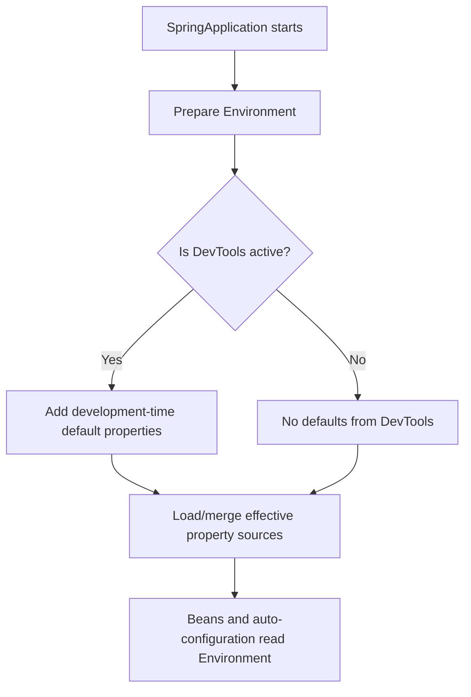
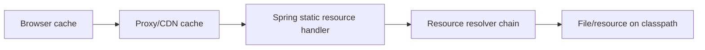
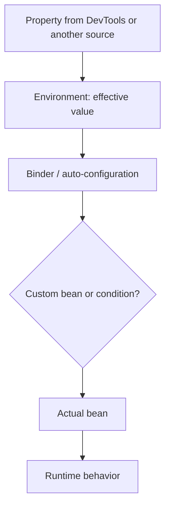
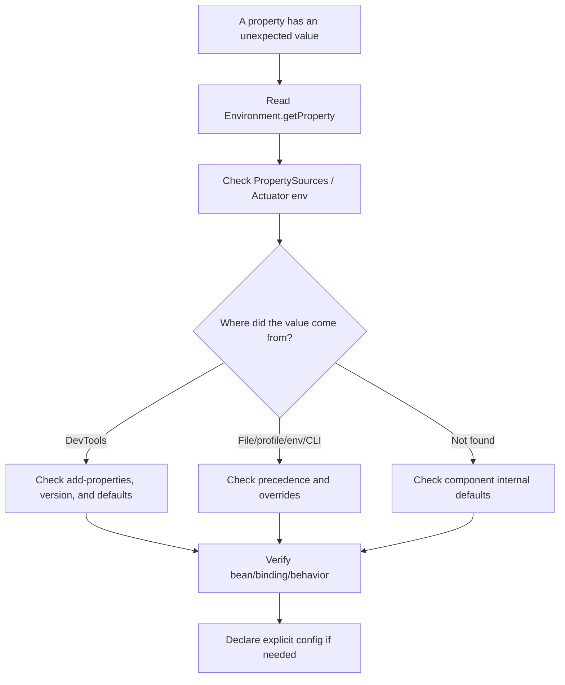

# Development-Time Defaults and How to Inspect Overridden Configuration

When developing with Spring Boot, we want to edit templates and see results immediately, spot errors easily, receive logs detailed enough to diagnose root causes, and avoid repeatedly clearing framework caches. However, certain settings suitable for **production** are inconvenient in **development**. For example, template caching reduces processing overhead in production systems, yet can make developers think an edited HTML file had no effect.

Spring Boot provides the **Spring Boot DevTools** module to support the development loop. Alongside automatic restart and LiveReload, DevTools also includes an easily overlooked feature: **automatically applying a set of default configuration values tailored for development environments**.

The issue is not just knowing which properties DevTools alters. In a real project, the same property can come from multiple places:

- Default values provided by Spring Boot or a library.
- Development-oriented defaults added by DevTools.
- `application.yml` or `application.properties`.
- Profile-specific files such as `application-dev.yml`.
- Environment variables, system properties, or command-line arguments.

To know which configuration an application is actually running with, we must distinguish **default values**, **overridden values**, **property sources**, and **the real behavior of components consuming those properties**.

This lesson belongs to the **Developer Tools** chapter of *Spring Boot Fundamentals*. We will focus on defaults applied by DevTools, how to disable or override them, how to read effective values from `Environment`, how to inspect configuration sources via Actuator, and how to avoid carrying unsafe debug settings into production.

Examples use Java 21, Spring Boot 3.x, and Gradle/Maven. **The list of properties supported by DevTools can vary across Spring Boot versions.** Treat the values listed below as representative examples; when you need an exact conclusion for a running system, verify the actual version and `Environment`.

## 1. What Are "Development-Time Defaults"?

A **development-time property default** is a value injected into the configuration environment by a tool or framework so the application is more convenient when running in development mode.

For example, a template engine has the property:

```properties
spring.thymeleaf.cache=true
```

In production, caching templates is usually beneficial for performance. Yet while editing template files, developers want to see changes without hunting for ways to flush caches. With DevTools active and suitably configured, the development default can be:

```properties
spring.thymeleaf.cache=false
```

DevTools' purpose is making the development experience convenient, not defining production operational policy.

### 1.1. Three kinds of "defaults" not to confuse

| Kind | Example | Role |
|---|---|---|
| Default of an auto-configuration/library | Template engine enables cache if no other config is set | Normal behavior chosen by the framework. |
| Default added by DevTools | `spring.thymeleaf.cache=false` | Prioritizes convenience during development. |
| Value explicitly declared by the application | `spring.thymeleaf.cache=true` in an app config file | Project configuration decision; can override DevTools defaults. |

**DevTools does not force a value over the application's own configuration.** It contributes low-priority defaults so the application can still explicitly configure something else.

### 1.2. A default does not mean the feature always exists

Suppose DevTools supplies a Thymeleaf-related default. If the project **does not have Thymeleaf on the classpath** and lacks the corresponding auto-configuration, that property does not make Thymeleaf appear automatically.

Similarly, a default making the H2 console convenient during development does not mean every project has an H2 database or a working web console. Dependencies, application type, security, and auto-configuration conditions still apply.

## 2. DevTools Is a Development Dependency

In Gradle using Groovy DSL:

```groovy
dependencies {
    implementation 'org.springframework.boot:spring-boot-starter-web'
    developmentOnly 'org.springframework.boot:spring-boot-devtools'
}
```

In Gradle using Kotlin DSL:

```kotlin
dependencies {
    implementation("org.springframework.boot:spring-boot-starter-web")
    developmentOnly("org.springframework.boot:spring-boot-devtools")
}
```

In Maven:

```xml
<dependency>
    <groupId>org.springframework.boot</groupId>
    <artifactId>spring-boot-devtools</artifactId>
    <scope>runtime</scope>
    <optional>true</optional>
</dependency>
```

These examples assume the project already uses appropriate Spring Boot dependency management so individual starter versions do not need to be specified manually.

### 2.1. Why not add DevTools as a regular production dependency?

DevTools is designed for development. Features such as auto-restart, LiveReload, disabling template caching, and exposing detailed error information are not suitable default policies for production.

With Gradle, `developmentOnly` separates development dependencies from packaged dependencies. With Maven, `optional` prevents propagating DevTools as a mandatory dependency to dependent projects.

In standard Spring Boot packaging, DevTools is excluded from the executable archive by default and development-time capabilities are not used as production features. Do not rely on the presence of a JAR in a repository to conclude a production app has DevTools enabled.

### 2.2. Running via IDE, bootRun, and executable JAR can differ

A run from an IDE or `bootRun` in development can include DevTools on the runtime classpath, whereas a packaged executable JAR run in the standard manner may omit or disable DevTools.

Thus the question "why does my machine have this default while the server does not?" must start with **how the application is launched**, which dependencies are actually present, and DevTools' activation state—even before comparing `application.yml`.

### 2.3. DevTools is not a profile named dev

`spring-boot-devtools` is a dependency and set of development-time features. `spring.profiles.active=dev` merely activates a Spring profile named `dev`.

These two mechanisms are independent:

- DevTools active without enabling the `dev` profile: DevTools' development-time defaults can still apply.
- `dev` profile enabled without DevTools: `application-dev.yml` can be loaded, yet DevTools defaults do not appear on their own.

Do not use the word "dev" in a profile name to infer DevTools is active.

## 3. How Does DevTools Add Defaults to the Environment?

Spring Boot manages configuration via `Environment`, containing prioritized `PropertySource`s. DevTools adds a set of development-friendly property values through its Environment-processing infrastructure.

Conceptually:



This diagram illustrates responsibilities, not the exact internal hook order across every version.

### 3.1. PropertySources have precedence order

Suppose the sources provide:

```text
DevTools default: spring.thymeleaf.cache=false
application.yml: spring.thymeleaf.cache=true
```

Because the application's explicit value has higher priority than the DevTools default, the effective value is:

```text
spring.thymeleaf.cache = true
```

This is a key design principle: **DevTools picks convenient values when the application hasn't picked one; it does not override the application configuration's authority**.

### 3.2. "Changing configuration" does not necessarily mean editing a file

DevTools can alter **effective runtime values** without writing a single line to `application.yml`.

You open the file and see:

```yaml
spring:
  application:
    name: catalog-service
```

Yet reading from `Environment` yields `spring.thymeleaf.cache=false`. That may be a default added by DevTools, not an edit someone made to a file.

Therefore, when diagnosing, ask: **Where is this property declared?** and **could this property come from a programmatically registered PropertySource?**

## 4. Common Groups of Development Defaults

DevTools versions may contribute defaults for several feature groups:

| Group | Example property | Common meaning in development |
|---|---|---|
| Templates | `spring.thymeleaf.cache=false` | Reduces template caching for rapid UI edits and checks. |
| Templates | `spring.freemarker.cache=false` | Disables FreeMarker template caching when the engine is present. |
| Templates | `spring.mustache.servlet.cache=false` | Reduces Mustache servlet template caching in matching setups. |
| Static resources | `spring.web.resources.cache.period=0` | Limits HTTP caching duration for static resources. |
| Resource chain | `spring.web.resources.chain.cache=false` | Reduces caching in the resource resolver chain. |
| Error diagnostics | `server.error.include-message=always` | Includes more error details in error responses when applicable. |
| Error diagnostics | `server.error.include-binding-errors=always` | Allows adding binding error details to error attributes. |
| Error diagnostics | `server.error.include-stacktrace=always` | Can include stack traces in web error handling attributes. |
| Development console | `spring.h2.console.enabled=true` | Conveniently enables H2 console if dependencies and conditions match. |
| GraphQL development | `spring.graphql.graphiql.enabled=true` | Conveniently explores GraphQL when supported by config/version. |

**Do not treat this table as exhaustive or immutable.** Property names, supported modules, and default values depend on the Spring Boot version. Verify items you rely on against documentation for your exact version and values in the running context.

### 4.1. Impact on template rendering

When `spring.thymeleaf.cache=false` is effective and the app uses Thymeleaf through standard auto-configuration, the framework can re-read templates instead of serving cached templates.

This is a practical benefit when editing:

```text
src/main/resources/templates/orders/detail.html
```

However, whether edits appear immediately still depends on:

- Whether the IDE/build copied the new resource to the runtime classpath.
- Whether the template resolver actually uses that location.
- Whether a reverse proxy or browser cache sits in front.
- Whether the controller/view path and template name match.

Hence **`cache=false`** is one factor in the workflow, not a guarantee that every file hot-reloads automatically.

### 4.2. Impact on static resources

For example, with:

```text
src/main/resources/static/css/site.css
```

development defaults for `spring.web.resources.cache.period` or `spring.web.resources.chain.cache` help reduce caching interference during experimentation.

Yet caching can exist across multiple layers:



Changing caching in Spring does not automatically clear browser caches, CDNs, or frontend build outputs. When a CSS file does not update, inspect the exact layer holding the old version.

### 4.3. Impact on error pages

DevTools can configure displaying additional messages, binding errors, or stack traces in error attributes for applicable servlet/web applications.

For example, a bad request may receive richer error data during development, helping pinpoint exceptions. **This is sensitive implementation information.** In production, exposing detailed stack traces or exception messages in HTTP responses can leak class names, packages, paths, SQL, or internal structure.

Do not rely on debug defaults as an API contract for clients.

## 5. Example: Same Application Running With and Without DevTools

Suppose an application uses Thymeleaf and has a base configuration file:

```yaml
spring:
  application:
    name: storefront
```

There is no `spring.thymeleaf.cache` line in the file.

We want to compare two runs:

| Run mode | Observable `spring.thymeleaf.cache` value |
|---|---|
| Run with DevTools active | DevTools can add a default of `false`. |
| Run without DevTools | No DevTools default; Thymeleaf auto-configuration falls back to its own default. |
| Run with DevTools while setting `spring.thymeleaf.cache=true` | Explicit value `true` overrides the DevTools default. |

Note an important distinction:

> If `Environment.getProperty("spring.thymeleaf.cache")` returns `null` without DevTools, that **does not necessarily mean template caching is off**. It may simply mean Environment has no explicit property; auto-configuration still uses the component's internal default.

Therefore, distinguish **values present in Environment** from **values bound/applied by auto-configuration to the final bean**.

## 6. Fastest Check: Reading Effective Values via Environment

A Spring bean can inject `Environment` to see what value a property currently has:

```java
package com.example.storefront.diagnostics;

import org.springframework.boot.ApplicationArguments;
import org.springframework.boot.ApplicationRunner;
import org.springframework.core.env.Environment;
import org.springframework.stereotype.Component;

@Component
public class DevToolsPropertyReporter implements ApplicationRunner {

    private final Environment environment;

    public DevToolsPropertyReporter(Environment environment) {
        this.environment = environment;
    }

    @Override
    public void run(ApplicationArguments args) {
        print("spring.thymeleaf.cache");
        print("spring.web.resources.cache.period");
        print("spring.web.resources.chain.cache");
        print("server.error.include-message");
    }

    private void print(String propertyName) {
        System.out.printf(
                "%s = %s%n",
                propertyName,
                environment.getProperty(propertyName, "<not configured>"));
    }
}
```

Run in development mode and watch the console. Illustrative output:

```text
spring.thymeleaf.cache = false
spring.web.resources.cache.period = 0
spring.web.resources.chain.cache = false
server.error.include-message = always
```

This is **the value returned by Environment when the runner executes**, not proof that DevTools supplied each value. An `application.yml` file or command-line argument could produce the exact same output.

### 6.1. Why read from Environment instead of just reading files?

Config files do not reflect the entire runtime context. There may be:

- External files outside the JAR.
- Different active profiles than assumed.
- Config Data imports.
- Environment variables.
- Java system properties.
- Command-line overrides.
- PropertySources added by DevTools or libraries.

`Environment` answers the most practical question: **What value does the application actually see?**

### 6.2. Do not print every property to logs

In the example, we print only four non-sensitive keys related to the topic. Never iterate and log the entire Environment: it may contain database passwords, API keys, access tokens, or internal secrets.

Even in development, logs can be saved, shared, or uploaded to centralized systems. Always pick an allowlist of property names to inspect.

## 7. Checking Which Source Supplied a Property

`Environment.getProperty(...)` tells you the effective value, not which source it came from. To investigate precedence, inspect the `PropertySource` list of `ConfigurableEnvironment`.

### 7.1. Example listing source names containing a property

```java
package com.example.storefront.diagnostics;

import org.springframework.boot.ApplicationArguments;
import org.springframework.boot.ApplicationRunner;
import org.springframework.core.env.ConfigurableEnvironment;
import org.springframework.core.env.PropertySource;
import org.springframework.stereotype.Component;

@Component
public class PropertySourceReporter implements ApplicationRunner {

    private final ConfigurableEnvironment environment;

    public PropertySourceReporter(ConfigurableEnvironment environment) {
        this.environment = environment;
    }

    @Override
    public void run(ApplicationArguments args) {
        String key = "spring.thymeleaf.cache";

        System.out.println("Effective value: "
                + environment.getProperty(key, "<not configured>"));

        int position = 0;
        for (PropertySource<?> source : environment.getPropertySources()) {
            position++;
            if (source.containsProperty(key)) {
                System.out.printf(
                        "Candidate source #%d: %s%n",
                        position,
                        source.getName());
            }
        }
    }
}
```

In a typical `ConfigurableEnvironment`'s `MutablePropertySources`, iteration order reflects precedence: higher-priority sources are checked first. If a key appears in multiple sources, the highest-priority source usually supplies the effective value.

**Technical note:** some property sources are wrappers, composites, or support relaxed name mapping. `containsProperty(key)` is a useful clue, not a full origin-tracking API across every source type and name variant. When you need exact origin details, use Actuator `env` or the framework's origin-tracking tools.

### 7.2. Illustration with DevTools and an explicit override

Suppose `application.yml` sets:

```yaml
spring:
  thymeleaf:
    cache: true
```

Illustrative reporter output might show:

```text
Effective value: true
Candidate source #...: Config resource 'class path resource [application.yml]' ...
Candidate source #...: devtools
```

Exact PropertySource names and `#...` positions vary by version and loaded sources. The takeaway is that **the same key can exist in multiple sources**, while the effective value follows precedence.

### 7.3. Checking source file locations with origin-aware tools

Spring Boot Config Data usually retains metadata identifying which resource supplied a property. Debugging APIs or Actuator endpoints can display origin details such as filename and line number. Do not assume custom PropertySources or every environment variable source provides exact file line numbers.

## 8. Inspecting with Spring Boot Actuator

If the application includes Spring Boot Actuator, the `env` endpoint helps inspect loaded properties and their sources.

Add the Gradle dependency:

```groovy
dependencies {
    implementation 'org.springframework.boot:spring-boot-starter-actuator'
}
```

In Maven:

```xml
<dependency>
    <groupId>org.springframework.boot</groupId>
    <artifactId>spring-boot-starter-actuator</artifactId>
</dependency>
```

For use in a controlled local environment:

```yaml
management:
  endpoints:
    web:
      exposure:
        include: health,env,configprops
```

Once the app starts, you can access:

```text
GET /actuator/env
GET /actuator/env/spring.thymeleaf.cache
GET /actuator/configprops
```

`/actuator/env/spring.thymeleaf.cache` works well for viewing a specific property and related property sources, depending on version and endpoint config. `/actuator/configprops` helps inspect bound `@ConfigurationProperties` objects, checking the component's resulting configuration.

### 8.1. Why not rely solely on /actuator/env?

`env` displays raw configuration data in Environment. Yet a component may:

- Use an internal default when the property is absent.
- Bind to `Duration`, `boolean`, or collections.
- Only be created when auto-configuration conditions match.
- Be replaced by a custom bean.

Hence `env` might show one value while the final component behaves differently due to conditions or customization. Combining `configprops`, `beans`, `conditions`, or inspecting the bean directly completes the picture.

### 8.2. Securing endpoints

Never expose `/actuator/env` and `/actuator/configprops` publicly in production. They can reveal configuration keys, system topology, or sensitive details if access controls and sanitization are misconfigured.

Some values are masked when displayed, depending on Spring Boot/Actuator version and security settings. Do not disable masking just to inspect a non-sensitive property. Locally, bind endpoints to loopback/trusted networks or protect them with proper authentication.

### 8.3. Why is an Actuator value masked?

Actuator may return sanitized values or omit direct display per policy. That does not mean the property is missing from Environment. Recognize this as a data-protection decision, not a binding failure.

## 9. Recognizing Active DevTools Property Defaults in Logs

When DevTools applies its default set, versions typically log a message similar to:

```text
Devtools property defaults active! Set 'spring.devtools.add-properties' to 'false' to disable
```

Exact wording, logger name, and log level vary across versions. This is a diagnostic hint, **not the sole proof**.

If this line is missing, possible reasons include:

- DevTools is not on the runtime classpath.
- The app was launched in a mode that disables DevTools.
- The defaults set was disabled.
- Logging levels filtered out the message.
- Your DevTools version logs or behaves differently.

Combine logs with `Environment` and actual PropertySources instead of drawing conclusions from a single missing log line.

### 9.1. Enabling targeted logs when needed

Locally, you can temporarily raise the log level for the DevTools package:

```properties
logging.level.org.springframework.boot.devtools=DEBUG
```

This can surface additional output from matching loggers, though it does not guarantee a dedicated log line for every changed property. To inspect effective values, the `Environment` API and Actuator are usually more reliable.

### 9.2. --debug is not a list of changed properties

Running the app with:

```bash
java -jar app.jar --debug
```

enables debug logging and the Condition Evaluation Report in applicable Spring Boot contexts. The condition report helps explain **why an auto-configuration was applied or skipped**.

It is not a complete "before DevTools / after DevTools" diff of all properties. To compare configuration values, inspect Environment across two matching runs.

## 10. Overriding a DevTools-Suggested Default Yourself

Suppose you want template caching enabled right in development to reproduce a production bug. You can declare:

```yaml
spring:
  thymeleaf:
    cache: true
```

When DevTools supplies a lower-priority `false` default, the explicit `true` wins.

Or you want to keep error responses minimal:

```yaml
server:
  error:
    include-message: never
    include-binding-errors: never
    include-stacktrace: never
```

This illustrates cases where **even developers want to override "convenient" defaults** for security reasons or to test production-like behavior.

### 10.1. Overriding in separate profiles

`application-dev.yml`:

```yaml
spring:
  thymeleaf:
    cache: false
```

`application-prod.yml`:

```yaml
spring:
  thymeleaf:
    cache: true
server:
  error:
    include-message: never
    include-stacktrace: never
```

Profiles express environment-specific policy independently of whether DevTools is present.

### 10.2. Why explicit declarations pay off

If a behavior matters to the application—especially regarding security, caching, or operational policy—declaring it explicitly in proper configuration prevents the team from accidentally depending on defaults that shift across framework versions.

**DevTools offers convenience, while important project policies should be documented and configured deliberately.**

## 11. Disabling Development-Time Property Defaults Separately

Spring Boot DevTools provides the property:

```properties
spring.devtools.add-properties=false
```

Or in YAML:

```yaml
spring:
  devtools:
    add-properties: false
```

Set this value to **stop applying DevTools' development property defaults**.

### 11.1. Disabling defaults does not disable all of DevTools

These three settings govern different mechanisms:

| Mechanism | Purpose |
|---|---|
| `spring.devtools.add-properties=false` | Disables DevTools from adding development-time property defaults. |
| `spring.devtools.restart.enabled=false` | Controls DevTools' automatic restart mechanism. |
| `spring.devtools.livereload.enabled=false` | Controls LiveReload integration. |

Setting `spring.devtools.add-properties=false` does not automatically turn off restart or LiveReload. Conversely, disabling restart does not remove all default properties.

### 11.2. Why distinguish them?

Suppose you want automatic restarts when editing classes, yet want to test production-like caching and error responses. You can keep DevTools for restarts while either:

- Disabling property defaults with `spring.devtools.add-properties=false`.
- Or overriding specific properties under test with explicit values.

Choose based on your goal:

- **Want to turn off the whole defaults set:** use `add-properties=false`.
- **Only want to change a few defaults:** declare explicit values for those properties.

### 11.3. When defaults are disabled, effective values may disappear from Environment

Example before disabling:

```text
spring.thymeleaf.cache = false
```

After disabling `add-properties`, if no other PropertySource declares the key:

```text
spring.thymeleaf.cache = <not configured>
```

That does not mean Thymeleaf has caching turned off; it may revert to auto-configuration's own default. Verify the bean/`configprops` or template behavior in an actual run.

## 12. Distinguishing Property Defaults from Automatic Restart

DevTools is best known for restarting the app when the classpath changes. However, **restart** and **property defaults** are two separate feature sets.

### 12.1. What problem does restart solve?

When you edit a Java class and the IDE/build updates compiled classes on the classpath, DevTools detects the change and restarts the application context so you do not have to stop/start manually.

This concerns process/context lifecycle, not choosing template cache settings.

### 12.2. What problem do property defaults solve?

They change the effective configuration of certain components during development, such as disabling template caching. In that case, a fresh request can read an updated template without restarting the entire app, **provided the updated file reached the location the runtime uses**.

### 12.3. What problem does LiveReload solve?

LiveReload helps browsers auto-reload during development workflows when appropriate signals fire. It is neither a template engine caching policy nor something that injects properties into Environment.

### 12.4. Comparison table

| Symptom | Potentially involved mechanism |
|---|---|
| Edited Java class yet server still runs old code | Classpath update / DevTools restart / build output. |
| Edited HTML yet page still uses old template | Template cache, resource copy, resolver, browser cache. |
| Edited CSS yet page does not auto-reload | LiveReload, browser cache, or frontend build pipeline. |
| Error response is overly detailed | Error handling properties, potentially DevTools defaults. |
| Config file edited yet runtime reads another value | PropertySource precedence, active profiles, env vars, and defaults. |

Do not reach for a single DevTools property to solve every "hot reload" problem.

## 13. Does the dev Profile Replace DevTools?

No. A `dev` profile and DevTools complement each other.

`application-dev.yml`:

```yaml
app:
  external-service:
    base-url: http://localhost:9000

logging:
  level:
    com.example.storefront: DEBUG

spring:
  thymeleaf:
    cache: false
```

When the `dev` profile is active, these values apply **even if the project does not include DevTools**.

Conversely, if DevTools is active while the active profile is `local` or no profile is explicitly set, DevTools defaults can still be added.

### 13.1. Choosing an intentional management approach

A common strategy:

- Use DevTools to improve the developer workflow.
- Use Spring profiles to separate environment configuration sets.
- Use explicit properties to express critical application decisions.

This avoids production configurations accidentally depending on a development dependency.

### 13.2. What if multiple profiles are active?

For example:

```text
spring.profiles.active=dev,metrics
```

Overlapping properties across profile-specific Config Data files follow precedence rules based on profile order and file location. DevTools defaults still participate within Environment's precedence hierarchy.

A later-listed profile cannot be assumed to "always beat every source," because environment variables, command-line arguments, and Config Data locations can hold different priority levels.

## 14. Testing with a Small Spring Boot Application

To observe changes, create an application needing only the core Spring Boot starter and DevTools. Neither a database nor a web server is required to read Environment.

### 14.1. Declaring dependencies

```groovy
plugins {
    id 'java'
    id 'org.springframework.boot' version '3.3.0'
    id 'io.spring.dependency-management' version '1.1.5'
}

java {
    toolchain {
        languageVersion = JavaLanguageVersion.of(21)
    }
}

dependencies {
    implementation 'org.springframework.boot:spring-boot-starter'
    developmentOnly 'org.springframework.boot:spring-boot-devtools'
}
```

Plugin versions in the example only illustrate a compatible project skeleton; when creating a new project, use Spring Boot/Gradle versions suited to your current codebase. You do not need to copy exact version numbers to understand DevTools functionality.

### 14.2. Creating the main class

```java
package com.example.devtoolslab;

import org.springframework.boot.SpringApplication;
import org.springframework.boot.autoconfigure.SpringBootApplication;

@SpringBootApplication
public class DevToolsLabApplication {

    public static void main(String[] args) {
        SpringApplication.run(DevToolsLabApplication.class, args);
    }
}
```

### 14.3. Creating a runner to inspect configuration

```java
package com.example.devtoolslab;

import java.util.List;
import org.springframework.boot.ApplicationArguments;
import org.springframework.boot.ApplicationRunner;
import org.springframework.core.env.ConfigurableEnvironment;
import org.springframework.core.env.PropertySource;
import org.springframework.stereotype.Component;

@Component
public class DefaultsInspectionRunner implements ApplicationRunner {

    private static final List<String> KEYS = List.of(
            "spring.thymeleaf.cache",
            "spring.web.resources.cache.period",
            "spring.web.resources.chain.cache",
            "server.error.include-message");

    private final ConfigurableEnvironment environment;

    public DefaultsInspectionRunner(ConfigurableEnvironment environment) {
        this.environment = environment;
    }

    @Override
    public void run(ApplicationArguments args) {
        for (String key : KEYS) {
            System.out.println(key + " = "
                    + environment.getProperty(key, "<absent>"));

            for (PropertySource<?> source : environment.getPropertySources()) {
                if (source.containsProperty(key)) {
                    System.out.println("  source: " + source.getName());
                }
            }
        }
    }
}
```

This code provides two observation layers:

1. The effective value of each key.
2. Which PropertySources report containing that key.

For allowlisted properties, this is handy and avoids exposing Actuator endpoints. Source names and results can still differ across runs depending on IDE/classpath, profiles, and versions.

### 14.4. Running locally

```bash
./gradlew bootRun
```

Or on Windows:

```powershell
.\gradlew.bat bootRun
```

Watch the lines printed by `DefaultsInspectionRunner`. Do not assume the environment enabled DevTools merely because the dependency is declared; check the sources and values.

### 14.5. Adding an override

In `src/main/resources/application.yml`:

```yaml
spring:
  thymeleaf:
    cache: true
```

Re-run and inspect the final value of `spring.thymeleaf.cache`. When DevTools defaults are active, this demonstrates how an explicit application value takes priority over the DevTools default.

### 14.6. Disabling defaults

Change the configuration to:

```yaml
spring:
  devtools:
    add-properties: false
```

Re-run and observe the values and source list. If no other source declares the keys from the defaults set, Environment may no longer report them as explicitly set.

This experiment verifies **configuration outcomes**. It is not a template performance test or an inspection of DevTools' internal classloader.

## 15. Distinguishing Value Sources from Bean Behavior

This is one of the most important debugging skills in Spring Boot.

Suppose:

```text
Environment.getProperty("spring.thymeleaf.cache") == null
```

You **cannot** conclude Thymeleaf caching is off. Auto-configuration can use an internal default of `true` when the property is absent.

Conversely:

```text
Environment.getProperty("spring.thymeleaf.cache") == "false"
```

indicates the effective value in Environment is `false`. Yet if the application defines a custom Thymeleaf resolver or engine bean that ignores Boot's property, actual runtime behavior can differ.

### 15.1. Three separate questions

1. **Is the property supplied?** Check `Environment`.
2. **Does auto-configuration consume that property?** Check `@ConfigurationProperties`, conditions, and custom beans.
3. **How does the final bean actually behave?** Verify runtime behavior or write an appropriate integration test.



A single check rarely answers all three questions completely.

## 16. If DevTools Defaults Are Missing, What to Check First?

### 16.1. Is the dependency on the runtime classpath?

Verify whether DevTools participates in the current launch mode. IDE runs, `bootRun`, and packaged JARs do not necessarily use the same classpath.

Do not add `spring.devtools.add-properties=true` to every file trying to "activate" it; first confirm DevTools itself is active.

### 16.2. Was it disabled via spring.devtools.add-properties?

Check the value of:

```text
spring.devtools.add-properties
```

in `application.yml`, environment variables, or command-line arguments. If the effective value is `false`, DevTools' property defaults are not applied.

### 16.3. Did another source override it?

For example:

```text
DevTools default: spring.thymeleaf.cache=false
Command line: --spring.thymeleaf.cache=true
```

The application may still be using DevTools, while the effective value is `true` due to the explicit override.

### 16.4. Are you checking the wrong property name?

Some property names evolve across framework versions; some only matter when the corresponding module/engine is present. Use the canonical key matching your active version rather than guessing from class names.

### 16.5. Are you looking at the wrong app/instance?

When multiple processes run on different ports, you might query Actuator on instance A while editing config for instance B. Cross-check port, PID, application name, and startup time.

### 16.6. Did source changes fail to reach the runtime classpath?

If templates or static files fail to update, check source/build output paths and IDE/Gradle resource copying. DevTools cannot place a file onto the runtime classpath if build tooling has not updated it.

## 17. When Configuration Is Overridden by Environment Variables or Command Line

Suppose `application.yml` contains:

```yaml
spring:
  thymeleaf:
    cache: false
```

The application is launched with:

```bash
java -jar app.jar --spring.thymeleaf.cache=true
```

In Spring Boot's standard precedence order, command-line properties override file-based settings.

Similarly, an environment variable following the mapping rules:

```text
SPRING_THYMELEAF_CACHE=true
```

can override file values. When using DevTools, DevTools defaults participate in precedence without outranking these explicit values.

### 17.1. Do not look only at files in the repository

A container can receive environment variables from Kubernetes, Docker Compose, or a configuration manager. The repository has no `spring.thymeleaf.cache=true` line, yet production gets `true` from the environment.

That is why `Environment` and origin tracking matter during investigations.

### 17.2. Use canonical names

Declare property names in canonical lowercase kebab-case:

```text
spring.thymeleaf.cache
spring.web.resources.cache.period
spring.devtools.add-properties
```

When converting to environment variables, follow Spring Boot's property-name binding rules. Avoid inventing two near-identical names assuming binders always interpret both identically in every context.

## 18. Testing Changes by Comparing Two Runs

A practical technique is recording an **effective-values table** from the same app across two runs:

| Property | DevTools defaults on | `add-properties=false` |
|---|---|---|
| `spring.thymeleaf.cache` | May be `false` via DevTools | May be absent if no other source sets it. |
| `spring.web.resources.cache.period` | May be `0` via DevTools | May be absent if no other source sets it. |
| `server.error.include-message` | May be `always` via DevTools | May be absent if no other source sets it. |

These are **illustrative expected outcomes**, not mandatory measurements for every project. If `application.yml` or a higher-priority source also sets these properties, both runs may observe the exact same values.

### 18.1. Keep everything else constant when comparing

To confirm DevTools is the source of a difference, keep constant:

- Application version.
- Active profiles.
- Configuration files.
- Environment variables and command-line flags.
- Runtime classpath, except the DevTools toggle under test.
- Run mode/IDE where possible.

If you simultaneously switch `dev` to `prod` and change packaging, a differing value does not prove DevTools caused it.

### 18.2. Tests may differ from real development runs

`@SpringBootTest` and `ApplicationContextRunner` have dedicated lifecycles and test classpaths. DevTools may be disabled or excluded in certain test flows. Thus an integration test missing DevTools defaults does not prove DevTools is "broken" in `bootRun`.

If your goal is testing the **final effect of a property** on a business feature, write the test with that property supplied explicitly. If your goal is studying **how DevTools adds defaults in development**, running the real app and inspecting Environment is more direct.

## 19. Example Test for an Explicitly Overridden Property

An integration test can verify that the application explicitly sets `spring.thymeleaf.cache=true`:

```java
package com.example.storefront;

import static org.assertj.core.api.Assertions.assertThat;

import org.junit.jupiter.api.Test;
import org.springframework.beans.factory.annotation.Autowired;
import org.springframework.boot.test.context.SpringBootTest;
import org.springframework.core.env.Environment;

@SpringBootTest(properties = "spring.thymeleaf.cache=true")
class ExplicitPropertyOverrideTest {

    @Autowired
    Environment environment;

    @Test
    void explicitPropertyIsVisibleInEnvironment() {
        assertThat(environment.getProperty(
                "spring.thymeleaf.cache", Boolean.class))
                .isTrue();
    }
}
```

This test confirms the property entered the **test context's** Environment as specified. It does not prove DevTools is present or active inside tests.

### 19.1. Why test critical configurations?

For configurations impacting API contracts or security, an unintended value change can have major consequences. Explicit tests protect project policy against shifting defaults across dependency/framework upgrades.

### 19.2. Do not "test DevTools defaults" instead of business behavior

If the business requirement is never leaking stack traces in production responses, test the actual HTTP error response or security/error handler settings under the production profile. Asserting that "DevTools is off" does not substitute for testing the real policy.

## 20. Common Misconceptions

| Claim | Accurate understanding |
|---|---|
| "Enabling the dev profile enables Spring Boot DevTools." | Profiles and the DevTools dependency are two independent mechanisms. |
| "DevTools always edits application.yml." | DevTools normally adds a PropertySource; it does not edit files. |
| "DevTools defaults always beat file values." | DevTools defaults have low priority; explicit config overrides them. |
| "Property absent from Environment means the component turns the feature off." | The component can use an internal default when the property is absent. |
| "Having a Thymeleaf property means the app definitely uses Thymeleaf." | Appropriate dependencies, auto-configuration, and beans are still required. |
| "Disabling spring.devtools.add-properties removes automatic restart." | These are separate feature groups. |
| "Disabling restart disables all property defaults." | Not necessarily; each DevTools setting must be considered individually. |
| "Missing 'Devtools property defaults active' log means defaults aren't running." | Logs may be filtered or formatted differently across versions. |
| "--debug lists every change made by DevTools." | The condition report is not a diff of all PropertySources. |
| "Environment returns false so custom components definitely use false." | Custom beans may ignore the property altogether. |
| "Templates don't update because DevTools is broken." | Check resource copying, template resolvers, and browser/proxy caches. |
| "DevTools error defaults are safe to enable in production." | Detailed stack traces and error messages can leak internal details. |
| "Actuator env must be public to investigate." | You can use an allowlisted runner/log; Actuator needs access protection. |

## 21. Diagnostic Workflow When a Property Value Is Unexpected

When facing "I didn't configure this property, why is the app using another value?", follow these steps in order:

1. **Identify the exact property.** E.g., `spring.thymeleaf.cache` or `server.error.include-message`.
2. **Verify Spring Boot version and related dependencies.** Is that property supported in that version?
3. **Check how the app was launched.** IDE/`bootRun` or executable JAR? Is DevTools active in this run?
4. **Read the effective value via Environment.** Do not rely on source files alone.
5. **List PropertySources containing the key.** Find which source holds highest precedence.
6. **Check active profiles, external configs, and command-line flags.** Do they override the default?
7. **Check `spring.devtools.add-properties`.** Were defaults disabled?
8. **If the property is absent, check the component's internal default.** Do not guess behavior.
9. **Inspect the actual bean or response.** Distinguish effective property values from actual behavior.
10. **If security-related, lock down explicit policy.** Never rely incidentally on development defaults.



This workflow helps not only with DevTools, but with most Spring Boot configuration investigations.

## 22. A Combined Diagnostic Scenario

**Scenario:** a developer edits `src/main/resources/templates/product.html`, reloads the page, and still sees stale content. Seeing `spring-boot-devtools` in the project, they assume caching must be off.

### Step 1: check the effective value

Read:

```java
environment.getProperty("spring.thymeleaf.cache")
```

Suppose the result is `true`.

### Step 2: identify the overriding source

Inspect PropertySources and discover `application-dev.yml` contains:

```yaml
spring:
  thymeleaf:
    cache: true
```

Here, DevTools' `false` default is not the effective value. This is not a template engine bug; the application explicitly chose `cache: true`.

### Step 3: fix configuration if appropriate

In development, change it to:

```yaml
spring:
  thymeleaf:
    cache: false
```

or remove the override so DevTools applies its default if defaults are active.

### Step 4: if stale content still appears

Check:

- Was the template file actually updated on the runtime classpath?
- Does a custom resolver read from another location?
- Is a browser, proxy, or another HTML caching layer intervening?
- Are you hitting the wrong server/port or an old instance?

### Step 5: confirm the fix via behavior

Re-read Environment, send a fresh request, and verify the returned HTML matches the new version. **Success is not just a changed property; success is the app actually serving the right content.**

## 23. Another Scenario: Error Page Exposes Stack Trace

**Scenario:** during local development, the app returns responses containing detailed exception information. The developer worries those settings might reach production.

### Step 1: check error-related properties

Inspect:

```text
server.error.include-message
server.error.include-binding-errors
server.error.include-stacktrace
```

If values are overly permissive, DevTools defaults or an explicit override may be involved.

### Step 2: understand each environment's goal

In development, error details aid debugging. In production, normal policy restricts internal details in responses; full exceptions belong in secure observability logs rather than client responses.

### Step 3: set explicit policy

Example for production:

```yaml
server:
  error:
    include-message: never
    include-binding-errors: never
    include-stacktrace: never
```

### Step 4: verify in practice

Send a failing request in a production-like test environment and inspect the response body. If the app uses `@ControllerAdvice` or a custom error handler, Boot properties may not govern the entire error response. Test the real **HTTP contract**.

## 24. Hands-On Guide

Create a Spring Boot project with DevTools and follow sequentially:

**Step A — Initial run.** Add `spring-boot-devtools` with a development-only configuration, start via IDE or `bootRun`, and capture startup logs.

**Step B — Read Environment.** Create an `ApplicationRunner` printing `spring.thymeleaf.cache`, `spring.web.resources.cache.period`, and `server.error.include-message`.

**Step C — List sources.** For each non-sensitive key, print the names of `PropertySource`s containing that key. Look for a DevTools-related source if added.

**Step D — Override a property.** Set `spring.thymeleaf.cache=true` in `application.yml` and observe the effective value.

**Step E — Try a profile.** Set another property in `application-dev.yml`, enable the `dev` profile, and inspect precedence.

**Step F — Override via command line.** Pass `--spring.thymeleaf.cache=false` at launch and observe the final value.

**Step G — Disable all defaults.** Set `spring.devtools.add-properties=false` and observe which keys are no longer contributed by DevTools.

**Step H — Distinguish restart.** With DevTools restart enabled, edit a class and verify restart still works even with defaults disabled.

**Step I — Inspect Actuator.** In a safe local environment, call `/actuator/env/spring.thymeleaf.cache` to view the property's source and value.

**Step J — Verify behavior.** If using Thymeleaf, edit a template and check results after reload; if using a web API, verify error responses match your chosen policy.

**Step K — Compare run modes.** Run via a standard packaged executable JAR and observe which defaults vanish; note this compares run modes, not merely profiles.

**Step L — Summarize.** For each change, record three facts: **effective value — supplying source — actual behavior**.

This hands-on practice prevents confusing "DevTools is enabled" with "every dev setting must always have the same value."

## 25. Self-Assessment Questions

1. What developer pain points do DevTools' development-time property defaults address?
2. Do those values directly modify `application.yml`?
3. Why is `spring.thymeleaf.cache=false` useful during UI development?
4. Does a Thymeleaf default property make a project without Thymeleaf start using Thymeleaf?
5. Why can an explicit value in `application.yml` beat a DevTools default?
6. What question does `Environment.getProperty(...)` answer?
7. Why is `Environment.getProperty("spring.thymeleaf.cache")==null` insufficient to conclude template caching is off?
8. How can you tell whether a property came from Config Data, an environment variable, or DevTools?
9. What is the role of `ConfigurableEnvironment.getPropertySources()`?
10. How does `/actuator/env` differ from `/actuator/configprops` from a configuration perspective?
11. Why shouldn't `env` and `configprops` be exposed publicly in production?
12. What does `spring.devtools.add-properties=false` do?
13. Does that property also disable `spring.devtools.restart.enabled`?
14. Are the Spring `dev` profile and the DevTools dependency the same or different?
15. Why can an executable JAR produce different configuration results than running via `bootRun`?
16. What security risks can error-diagnostic properties pose?
17. If template caching is `false` yet the HTML page still does not update, what other layers should you check?
18. Why does `--debug` not replace inspecting values in Environment?
19. When should you explicitly write a policy in the production profile instead of relying on framework defaults?
20. When a PropertySource contains a key yet the component behaves differently, what is the next verification step?

### Complete sample explanation

> Spring Boot DevTools aids development not only through automatic restart and LiveReload, but also by supplying convenient **property defaults**—such as disabling template caches or increasing error diagnostics—depending on the version and active modules. These values enter Environment at default-level priority, so explicit settings from `application.yml`, profiles, environment variables, or command-line arguments can override them. To inspect real configuration, first read effective values via `Environment.getProperty`, then inspect `PropertySource`s containing the key or use Actuator `env` to identify the supplying source. Distinguish a property existing in Environment from a component actually using it: auto-configuration has internal defaults and the app may define custom beans. To stop DevTools from adding defaults, set `spring.devtools.add-properties=false`; this is separate from disabling automatic restart or LiveReload. For production, proactively configure critical policies such as error-detail exposure instead of relying on development defaults.

Once you can answer **"What is the effective value?", "Where did it come from?", and "Did the component actually apply it?"**, you have mastered using **development-time defaults and inspecting overridden configuration** purposefully in Spring Boot.
