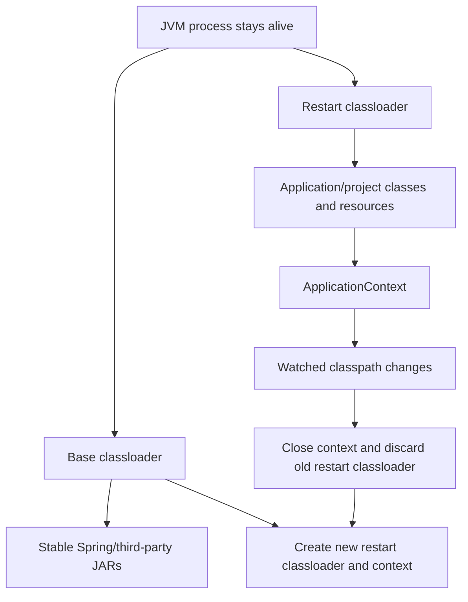
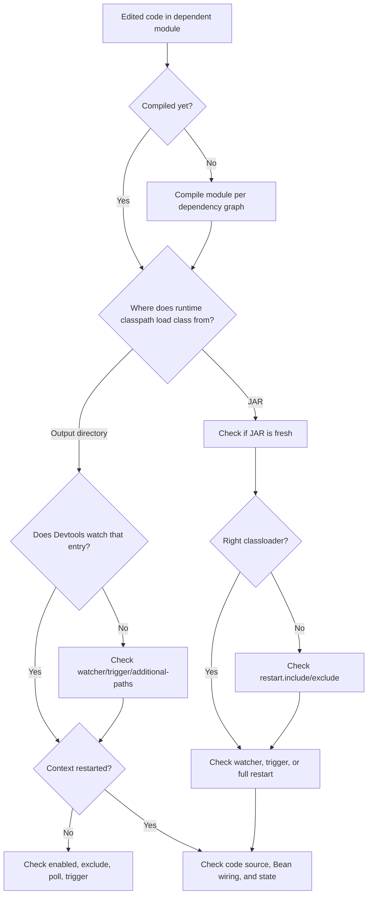

# Devtools in Multi-Module Projects

A Spring Boot application split into multiple modules often looks like this: an `app` module containing `@SpringBootApplication` and REST controllers; a `domain` module containing business logic; and a `shared` module containing shared data types or utility libraries. While coding, you want to edit a class in `domain`, save the file, and see the result in `app` without manually stopping, packaging, and restarting the entire application.

`spring-boot-devtools` supports this development loop via **automatic restart**, **LiveReload**, and convenient development defaults. However, in a multi-module project, Devtools only detects changes when **compiled outputs or updated resources reach eligible locations on the runtime classpath**. It does not automatically turn newly saved `.java` files into fresh classes, nor does it automatically treat every module as part of the actively developed application.

This lesson focuses on integrating Devtools with **Gradle/Maven multi-module builds**, the difference between the **base classloader** and **restart classloader**, placing dependent modules in the right classloader, verifying compiled output paths, and solving the classic "I edited a shared module, yet the app doesn't restart or still runs old code" issue.

## 1. What Devtools Is and What It Is Not

Spring Boot Devtools is a development-environment dependency. Its most-used feature is restarting the application when the contents of part of the runtime classpath change.

A desired loop:

```text
Edit Java file in domain module
        │
        ▼
IDE / build tool compiles new class
        │
        ▼
New class appears in output on runtime classpath
        │
        ▼
Devtools detects change requiring restart
        │
        ▼
Spring ApplicationContext restarts
        │
        ▼
Re-test API with new logic
```

These three operations are **distinct**:

- **Compile:** turns `.java` into `.class` and copies resources to output directories; performed by the IDE or build tool.
- **Restart:** closes the previous context and reinitializes the application using the restart classloader; Devtools handles this when conditions match.
- **Browser reload:** the browser reloads the page after assets change; LiveReload can help, yet does not replace compile or restart.

Devtools is **not general-purpose hot code replacement**. It usually restarts the application context to load updated classes rather than arbitrarily patching changes inside a live JVM like a hotswap-capable debugger or specialized hotswap agents.

## 2. Typical Architecture of a Multi-Module Project

Consider a simple ordering system:

```text
bookstore/
├── settings.gradle
├── build.gradle
├── app/
│   ├── build.gradle
│   └── src/main/java/com/example/bookstore/
│       ├── BookstoreApplication.java
│       ├── api/BookController.java
│       └── config/DomainConfiguration.java
├── domain/
│   ├── build.gradle
│   └── src/main/java/com/example/bookstore/domain/
│       └── PriceCalculator.java
└── shared/
    ├── build.gradle
    └── src/main/java/com/example/bookstore/shared/
        └── Money.java
```

Module roles:

| Module | Responsibility | Needs `@SpringBootApplication`? | Should declare Devtools dependency? |
|---|---|---|---|
| `app` | Entry point, web API, Spring Boot configuration | Has one main entry point | Yes, in development runtime |
| `domain` | Domain models and business logic | No | Usually no |
| `shared` | Shared types, utilities | No | Usually no |

`app` depends on `domain` and `shared`. Normally **only the launching module** needs `spring-boot-devtools` on its development classpath. Putting Devtools into every library does not make edits compile automatically and can clutter dependencies.

### A module dependency does not mean Devtools sees source changes

Declaring:

```groovy
implementation project(':domain')
```

lets `app` use classes from `domain`. Yet when you edit `domain/src/main/java/.../PriceCalculator.java`, distinguish:

1. Was the source saved?
2. Did the IDE/Gradle compile the new `PriceCalculator.class`?
3. Does the `app` process's runtime classpath point to `domain`'s **output directory** or a **JAR**?
4. Is that path within Devtools' watched scope and restart classloader?

This is the most important checklist for Devtools in multi-module setups.

## 3. Adding Devtools to the Right Module in Gradle

In a Gradle multi-project build, the root declares the modules:

**settings.gradle**

```groovy
rootProject.name = 'bookstore'

include 'app', 'domain', 'shared'
```

Assume the root build already configures repositories and the appropriate Spring Boot plugin version. Pure Java modules can use the `java-library` plugin.

**domain/build.gradle**

```groovy
plugins {
    id 'java-library'
}
```

**shared/build.gradle**

```groovy
plugins {
    id 'java-library'
}
```

**app/build.gradle**

```groovy
plugins {
    id 'java'
    id 'org.springframework.boot'
    id 'io.spring.dependency-management'
}

dependencies {
    implementation project(':domain')
    implementation project(':shared')

    implementation 'org.springframework.boot:spring-boot-starter-web'

    developmentOnly 'org.springframework.boot:spring-boot-devtools'

    testImplementation 'org.springframework.boot:spring-boot-starter-test'
}
```

This example assumes `org.springframework.boot` and `io.spring.dependency-management` versions are managed in root/plugin management. If not, declare plugin versions compatible with your Spring Boot line; do not copy a module `plugins` block into an empty project expecting Gradle to infer versions automatically.

The key line is:

```groovy
developmentOnly 'org.springframework.boot:spring-boot-devtools'
```

In Gradle with the Spring Boot plugin, `developmentOnly` is reserved for dependencies needed only during development. It makes Devtools available in dev runs without making it a regular production runtime dependency.

### Why not place it in domain/shared?

Those two modules are libraries. They do not boot `SpringApplication` and do not own the Devtools lifecycle. Automatic restart belongs to the `app` process, because that process manages the ApplicationContext, embedded server, and runtime classpath.

If a monorepo has multiple apps, each module **with its own entry point** can declare Devtools for its development runtime:

```text
monorepo/
├── gateway-app/      ← entry point 1, can use Devtools
├── catalog-app/      ← entry point 2, can use Devtools
└── shared-domain/    ← library, does not need Devtools itself
```

Two apps are two separate processes, each with its own restart cycle. Editing `shared-domain` does not mean every running app updates in lockstep if each process's compiled output/classpath does not reflect the change.

## 4. Running Gradle Multi-Module in Development

Command to launch the application module:

```bash
./gradlew :app:bootRun
```

In Windows PowerShell, you can use:

```powershell
.\gradlew.bat :app:bootRun
```

`bootRun` launches the app using the development classpath. When an eligible Devtools dependency is present and restart is enabled, the app can restart whenever watched classpath entries change.

### Editing Java does not mean the classpath changed

Suppose you are editing:

```text
domain/src/main/java/com/example/bookstore/domain/PriceCalculator.java
```

After editing, if the IDE lacks automatic build enabled and Gradle has not been asked to recompile, `domain/build/classes/java/main/.../PriceCalculator.class` may remain stale.

Devtools watches classpath outputs; **it does not watch every source file like a Java compiler**. You can wait indefinitely with no restart even though source files saved cleanly.

Solutions:

- In the IDE, trigger or enable compile/build project for modified modules.
- Ensure dependent module outputs are updated.
- If using Gradle tasks, run the compile/classes task matching the dependent module and real runtime classpath.
- Determine whether the app uses class outputs or a previously built JAR; those two paths behave differently when updated.

### When is a Gradle project dependency a class directory vs. a JAR?

Do not assume every `implementation project(':domain')` enters runtime as a `build/classes` directory. How an IDE and Gradle resolve project dependencies can differ:

```text
Case A: IDE runs app with module outputs
  app/build/classes/...
  domain/build/classes/...
  shared/build/classes/...

Case B: runtime uses dependent module artifacts
  app/build/classes/...
  domain/build/libs/domain-...jar
  shared/build/libs/shared-...jar
```

Case A usually suits restart detection because output directories change and can land in the restart classloader. Case B can put module JARs in the base classloader without watching them like class directories. Compiling classes into `domain/build/classes` then does not update the JAR the app is using.

Therefore, before tweaking Devtools settings, inspect **the running process's classpath**, not just the Gradle dependency declarations.

## 5. Cross-Module Code Example to Observe Restarts

In the `domain` module, define a plain Java class:

**domain/src/main/java/com/example/bookstore/domain/PriceCalculator.java**

```java
package com.example.bookstore.domain;

import java.math.BigDecimal;

public final class PriceCalculator {

    public BigDecimal total(BigDecimal unitPrice, int quantity) {
        if (quantity <= 0) {
            throw new IllegalArgumentException(
                    "Quantity must be positive");
        }
        return unitPrice.multiply(BigDecimal.valueOf(quantity));
    }
}
```

In `app`, register a Bean for the class from `domain`:

**app/src/main/java/com/example/bookstore/config/DomainConfiguration.java**

```java
package com.example.bookstore.config;

import com.example.bookstore.domain.PriceCalculator;
import org.springframework.context.annotation.Bean;
import org.springframework.context.annotation.Configuration;

@Configuration(proxyBeanMethods = false)
public class DomainConfiguration {

    @Bean
    PriceCalculator priceCalculator() {
        return new PriceCalculator();
    }
}
```

Controller in `app`:

```java
package com.example.bookstore.api;

import com.example.bookstore.domain.PriceCalculator;
import java.math.BigDecimal;
import org.springframework.web.bind.annotation.GetMapping;
import org.springframework.web.bind.annotation.RequestMapping;
import org.springframework.web.bind.annotation.RequestParam;
import org.springframework.web.bind.annotation.RestController;

@RestController
@RequestMapping("/prices")
public class PriceController {

    private final PriceCalculator calculator;

    public PriceController(PriceCalculator calculator) {
        this.calculator = calculator;
    }

    @GetMapping("/total")
    public BigDecimal total(
            @RequestParam BigDecimal unitPrice,
            @RequestParam int quantity) {
        return calculator.total(unitPrice, quantity);
    }
}
```

Main class:

```java
package com.example.bookstore;

import org.springframework.boot.SpringApplication;
import org.springframework.boot.autoconfigure.SpringBootApplication;

@SpringBootApplication
public class BookstoreApplication {
    public static void main(String[] args) {
        SpringApplication.run(BookstoreApplication.class, args);
    }
}
```

Note that the main class's package `com.example.bookstore` covers controllers/configs in subpackages. `PriceCalculator` is a plain Java class registered via `@Bean`; it does not need `@Component`.

Test the request:

```bash
curl "http://localhost:8080/prices/total?unitPrice=12.5&quantity=3"
```

The JSON response contains the numeric total formatted according to the app's `BigDecimal` serialization. Next, try modifying `PriceCalculator.total(...)` with sample logic, recompile `domain`, and observe whether the app restarts and picks up the new class.

If the output does not change, do not immediately conclude Devtools is broken. Check whether the app loads `PriceCalculator` from an output directory or an old JAR.

## 6. Two-Classloader Mechanism: The Foundation of Devtools Restart

Devtools uses a **two-classloader** architecture to cut restart times:

- **Base classloader:** typically contains stable dependency JARs such as the framework and rarely changing libraries.
- **Restart classloader:** typically contains classes and resources from actively developed projects, especially directory-based classpath entries created by the IDE/build.



On restart, Devtools retains unchanged pieces in the base classloader and recreates the restart classloader for active code. Thus restarts are usually faster than killing the whole JVM and launching anew.

However, the boundary between the two classloaders can cause issues in multi-module projects.

### Why might an internal module's JAR end up in base?

If `domain` resolves as a JAR, Devtools may classify it alongside stable dependency libraries. Then:

- `app` is loaded by the restart classloader.
- `domain` may be loaded by the base classloader.
- If the JAR is not updated or not in the watched classpath, edits to `domain` sources will not show up automatically.

This relationship depends on **the actual classpath entry**, not whether the module sits in the same Git repository or the same `settings.gradle` file.

### Class identity and puzzling errors

In the JVM, class identity depends on **both the fully qualified name and the classloader that loaded it**. Two classes with the exact same FQCN loaded by two different classloaders are two distinct types to the JVM.

A symptom seen in systems using proxies, serialization, or static caches:

```text
ClassCastException: com.example.domain.Order
  cannot be cast to com.example.domain.Order
```

Identical class names, different classloaders. This happens when holding references to objects/classes from an old restart classloader, or when a library uses the wrong classloader.

Do not "fix" every `ClassCastException` by turning off Devtools. First determine which loader loaded each class and whether duplicate classes/JARs exist on the classpath.

## 7. Adjusting Base/Restart Classloaders for Internal Modules

When an internal module is supplied as a JAR on the classpath, Devtools may treat that JAR like a stable third-party library. If you continuously edit that module during development, you may need to tell Devtools to **pull that classpath entry into the restart classloader**.

Spring Boot supports the resource:

```text
META-INF/spring-devtools.properties
```

For example, placed in the `app` module:

```text
app/
└── src/
    └── main/
        └── resources/
            └── META-INF/
                └── spring-devtools.properties
```

Illustrative content:

```properties
# Classpath URLs containing domain/shared module names
# that need to be loaded by the restart classloader.
restart.include.bookstore-domain=.*domain.*[.]jar
restart.include.bookstore-shared=.*shared.*[.]jar
```

These two values are **regular expressions matching classpath URLs**, not Gradle project paths. `.*domain.*[.]jar` is merely a simple example and may be too broad if the classpath contains other dependencies with "domain" in their names. In real projects, inspect actual JAR names and paths and write tighter patterns.

The `restart.include.*` and `restart.exclude.*` keys use **distinguishing suffixes**; choose specific suffixes like `bookstore-domain` rather than generic `common` across multiple libraries. Devtools can read these properties resources from multiple classpath entries, so colliding keys yield unpredictable configs.

### What can include do?

`restart.include.*` adjusts the classpath-entry classification boundary: matching entries can move into the **restart classloader** instead of the base classloader.

However, it **does not**:

- Compile the module's Java files automatically.
- Rebuild the modified module's JAR automatically.
- Turn an old JAR into a new JAR automatically.
- Add classpath entries the process is not using.
- Guarantee every JAR is watched by the file watcher like a directory.

Hence, if the app is loading an old `domain-1.0.jar`, adding `restart.include` without updating the artifact used at runtime leaves the app seeing old code.

### When is exclude used?

Conversely, you can keep a classpath entry in the **base classloader**:

```properties
restart.exclude.bookstore-stable=.*stable-client.*[.]jar
```

For example, an internal library that rarely changes, or a classpath portion that should not reload via the restart classloader. Use exclude only with a clear reason, never to mask stale build outputs.

### Verify patterns against the real classpath

A regex only works if it matches the URL observed by Devtools. Paths can contain artifact/version names, path separators, `build/classes` or `target/classes`, a JAR in `build/libs`, or IDE-specific outputs. Never copy a sample pattern assuming it works across every project.

## 8. Identifying Which Module Location Loads a Class

An effective diagnostic technique is printing the **code source** and **classloader** of a class in a dependent module:

```java
import com.example.bookstore.domain.PriceCalculator;
import org.slf4j.Logger;
import org.slf4j.LoggerFactory;
import org.springframework.boot.ApplicationRunner;
import org.springframework.context.annotation.Bean;
import org.springframework.context.annotation.Configuration;

@Configuration(proxyBeanMethods = false)
public class ClasspathDiagnosticConfiguration {
    private static final Logger log =
            LoggerFactory.getLogger(ClasspathDiagnosticConfiguration.class);

    @Bean
    ApplicationRunner showDomainClasspathLocation() {
        return args -> {
            Class<?> type = PriceCalculator.class;
            var protectionDomain = type.getProtectionDomain();
            var codeSource = protectionDomain != null
                    ? protectionDomain.getCodeSource()
                    : null;

            log.info("PriceCalculator code source: {}",
                    codeSource != null
                            ? codeSource.getLocation()
                            : "not available");
            log.info("PriceCalculator classloader: {}",
                    type.getClassLoader());
        };
    }
}
```

This logging is purely for local diagnostics. Code source can be null for certain classloading mechanisms; do not assume every class has an available location.

Two path forms commonly appear:

```text
.../domain/build/classes/java/main/
.../domain/build/libs/domain-0.0.1-SNAPSHOT.jar
```

If it is a class directory, verify a fresh `.class` file appears after compiling. If it is a JAR, verify the JAR was rebuilt and the running process can pick up the new artifact.

Do not confuse the source path `domain/src/main/java/...` with the runtime bytecode path `domain/build/classes/java/main/...`. Devtools primarily observes runtime output.

### Printing the classloader to see the boundary

The classloader can be printed in logs. Do not rely on the exact `toString()` format of a classloader, as implementations/formatting can change across versions. Focus on whether the edited module's class reloads across restart classloader cycles or stays pinned in the base classloader.

## 9. Development Workflow with IntelliJ IDEA and Eclipse

IDEs typically help with two things: recognizing modules as open projects and compiling edited sources.

### IntelliJ IDEA

1. Ensure `app`, `domain`, and `shared` are imported/recognized as modules by the IDE.
2. Run `app`'s main class using a development run configuration with Devtools.
3. Edit a class in `domain`.
4. Trigger **Build Project/Build Module** or enable appropriate auto-build.
5. Confirm the new `.class` file updated on the runtime classpath.
6. Observe whether the app restarts and the new logic appears.

Some IntelliJ setups do not auto-build while the app is running. Setting names and auto-make behavior vary by IDE version. Check build logs or actual output files rather than merely trusting the source file was saved.

### Eclipse / Spring Tools

Eclipse offers **Build Automatically** to compile projects when sources change. With multi-module projects:

- Import all dependent projects cleanly.
- Verify `domain` builds automatically without compiler errors.
- Check whether project references point to workspace outputs or repository JARs.
- Ensure the Spring Boot process uses that workspace's classpath.

### Why do running via IDE and via Gradle differ?

An IDE may build a runtime classpath from **module output directories**, whereas `bootRun` may resolve internal dependencies as **JARs** depending on the build. When that happens:

- Running from IDE: editing a class in `domain` and compiling restarts immediately.
- Running from Gradle: if still loading an old `domain.jar`, compiling the class directory alone is insufficient.

Compare the class's code source before altering Devtools config. The difference is not necessarily an IDE or Gradle bug; it can simply be two different runtime classpaths.

## 10. Development Workflow with Gradle from the Terminal

Terminal 1 runs the application:

```bash
./gradlew :app:bootRun
```

Another terminal can compile the dependent module:

```bash
./gradlew :domain:classes
```

`classes` compiles/copies module outputs. **It only directly affects what Devtools watches if the runtime uses that output on the classpath.** If the process uses a JAR, you may need to rebuild the JAR and restart per your project workflow; running `classes` alone will not update the JAR.

You can consider Gradle continuous build:

```bash
./gradlew :domain:classes --continuous
```

Continuous build watches inputs and re-runs the matching task; it is not Devtools restart. Avoid starting multiple concurrent build processes writing to the same output tree, which creates file contention or redundant restarts.

When changing dependency versions, build scripts, Java agents, or components held in the base classloader, stopping and restarting `:app:bootRun` is clearer and more reliable than forcing Devtools to reload everything.

## 11. Multi-Module with Maven

Same concept with a Maven reactor:

```text
bookstore/
├── pom.xml                 (parent/aggregator)
├── app/pom.xml             (Spring Boot app)
├── domain/pom.xml          (business library)
└── shared/pom.xml          (shared library)
```

Parent contains:

```xml
<modules>
    <module>shared</module>
    <module>domain</module>
    <module>app</module>
</modules>
```

In `app/pom.xml`, declare the internal module dependency matching reactor coordinates:

```xml
<dependency>
    <groupId>com.example.bookstore</groupId>
    <artifactId>domain</artifactId>
    <version>${project.version}</version>
</dependency>
```

And Devtools:

```xml
<dependency>
    <groupId>org.springframework.boot</groupId>
    <artifactId>spring-boot-devtools</artifactId>
    <scope>runtime</scope>
    <optional>true</optional>
</dependency>
```

In Maven, `optional=true` limits Devtools from becoming a transitive dependency of other projects. Running from an IDE with all reactor modules imported usually gives smoother compiled-output updates than running a packaged JAR expecting source edits to auto-detect.

When editing a dependent module, you can tell the reactor to compile related modules:

```bash
mvn -pl app -am compile
```

However, **a successful build does not prove the running process loaded the new artifact**. Still inspect the runtime classpath, build output, and Devtools watcher.

## 12. LiveReload vs. Application Restart

Devtools also supports a LiveReload server so compatible browsers or clients reload the page when assets change.

For example, editing:

```text
app/src/main/resources/static/css/site.css
app/src/main/resources/templates/home.html
```

Certain resource paths do not restart the Spring ApplicationContext by default, such as:

```text
/META-INF/maven
/META-INF/resources
/resources
/static
/public
/templates
```

Changes to these resources can be handled via LiveReload or template/resource development mechanisms without restarting the entire context.

| What changed? | Typical behavior |
|---|---|
| Compiled Java class in watched classpath directory | Usually triggers restart |
| Template/static resource in exclusion group | May LiveReload, not necessarily restart |
| Uncompiled Java source | No classpath change to trigger restart |
| Rebuilt JAR outside the runtime classpath | Running app does not automatically pick up artifact |
| Build script or dependency version changed | Usually requires full build sync and app restart |

**LiveReload is not Java hot reload.** Browser refresh will not run new Java code if the bytecode served by the backend has not changed.

Disable LiveReload if unused:

```properties
spring.devtools.livereload.enabled=false
```

If multiple Devtools apps run on the same machine, their LiveReload servers may contend for the port. One instance failing to start LiveReload does not necessarily stop auto-restart for that app.

## 13. Watching Additional Paths and Exclusion Configuration

When tools generate resources outside the classpath, Devtools can watch additional paths:

```properties
spring.devtools.restart.additional-paths=../generated-assets
```

However:

- `additional-paths` only adds a location to **watch for changes**.
- It **does not add that path to the Java classpath**.
- It does not compile Java or force Java classloaders to load bytecode from that path.

If `domain` compiles classes into a directory not on the runtime classpath, adding `additional-paths` might trigger restarts while the app keeps loading code from an old JAR.

To add paths excluded from restarts:

```properties
spring.devtools.restart.additional-exclude=assets/**,reports/**
```

`additional-exclude` appends paths to the default exclusion set. Meanwhile, `spring.devtools.restart.exclude` sets a replacement exclusion list. To preserve defaults and only append, prefer `additional-exclude`.

**Two configs are not the same:** `spring.devtools.restart.additional-exclude` governs *whether path changes trigger restarts*, whereas `restart.include.*` / `restart.exclude.*` in `spring-devtools.properties` govern *which classloader handles a classpath entry*.

## 14. Trigger Files: Batching Multiple Edits Before Restarting

In large projects, the IDE can update multiple `.class` files at staggered times. If Devtools reacts to every single change, the app may restart before all modules finish compiling or restart several times during one build.

Devtools supports a **trigger file**:

```properties
spring.devtools.restart.trigger-file=.reloadtrigger
```

Create the file in resources:

```text
app/src/main/resources/.reloadtrigger
```

and ensure it appears on the classpath after resource processing, e.g.:

```text
app/build/resources/main/.reloadtrigger
```

When a trigger file is configured, Devtools tracks classpath changes while deferring restarts until the trigger file updates.

Illustrative workflow:

```text
Edit code in domain + shared
            │
            ▼
IDE or Gradle finishes compiling
            │
            ▼
Update .reloadtrigger on runtime classpath
            │
            ▼
Devtools performs one intentional restart
```

In an IDE, you can touch/update the trigger file matching your workflow. If you only edit the source file under `src/main/resources` without the IDE copying it to watched output, the trigger may go unnoticed. So when no restart happens, inspect **the trigger file on the runtime classpath**.

A trigger file cuts unnecessary restarts; **it does not fix stale dependent JARs**. Even an intentional restart cannot load new bytecode if the Java classloader only sees an un-updated artifact.

### Poll interval and quiet period

For dev environments using file watcher polling, Devtools offers settings such as:

```properties
spring.devtools.restart.poll-interval=2s
spring.devtools.restart.quiet-period=1s
```

`poll-interval` sets how often changes are checked; `quiet-period` sets a quiet window to avoid reacting while a batch of files is still being written. Suitable values depend on compile/copy speeds and project size.

Do not tweak these values arbitrarily when the real problem is the runtime using an old JAR. First verify Devtools sees the right entry and files actually changed.

## 15. Troubleshooting: Dependent Module Edited Yet No Restart

This is a common scenario:

```text
Edit domain/PriceCalculator.java
        │
        ▼
Save file
        │
        ▼
Call API again
        │
        ▼
Result still reflects old logic
```

Check in order to avoid guesswork:

### Step 1 — Is Devtools actually on the development classpath?

Check the dependencies of the **running module**, usually `app`. If Devtools was only declared in `domain` and absent from `app`'s runtime classpath, you will not get expected automatic restarts.

With Gradle:

```groovy
developmentOnly 'org.springframework.boot:spring-boot-devtools'
```

There is no need to add this dependency to every module.

### Step 2 — Are you running a development app or a packaged JAR?

By default, Devtools is not used as a production restart mechanism on fully packaged applications. Running from an IDE or `bootRun` usually works with the development classpath; running a repackaged executable JAR may not trigger restarts the way you expect.

If you rebuild a JAR and launch it again, distinguish **restarting the Java process** from **Devtools automatic restart inside the process**.

### Step 3 — Was source compiled into new bytecode?

Editing `.java` does not automatically update `.class`. If compilation fails or auto-build is disabled, Devtools has no new classes to load.

Check:

```text
domain/src/main/java/.../PriceCalculator.java
domain/build/classes/java/main/.../PriceCalculator.class
```

Or the equivalent Maven/IDE output. If compiled classes did not change, fix the build before touching `spring-devtools.properties`.

### Step 4 — Where is the app loading the class from?

Print:

```java
PriceCalculator.class.getProtectionDomain()
        .getCodeSource()
        .getLocation()
```

If the path points to an old JAR, compiling into `build/classes` is not enough. You may need to update the JAR, adjust the runtime classpath, or launch using an IDE configuration pointing to module outputs.

### Step 5 — Which classloader owns the class?

If compiled classes and runtime artifacts updated yet old logic persists, check the classloader and whether the internal module sits in the base or restart classloader. Consider `META-INF/spring-devtools.properties` with `restart.include.*` for the exact entry.

### Step 6 — Are triggers or exclusions configured?

Check:

```properties
spring.devtools.restart.enabled
spring.devtools.restart.trigger-file
spring.devtools.restart.additional-exclude
spring.devtools.restart.exclude
```

A trigger file can make Devtools wait for a signal; exclusions can ignore resource changes from automatic restart.

### Step 7 — Do logs show a real restart?

Watch logs over time. When Devtools restarts, you can see threads or logs indicating the application re-started, though exact log strings are not a stable API. If the application context was not recreated, endpoints continuing to use old beans makes complete sense.

If the context restarted yet classes stayed old, focus on classpath/JARs or classloaders. If the context never restarted, check watching/building/triggers.

## 16. Common Multi-Module Troubleshooting Table

| Symptom | Possible Cause | Resolution |
|---|---|---|
| Edited Java in `app`, no restart | Not compiled, Devtools missing/disabled, packaged runtime | Check dependency and output classpath |
| Edited `domain`, IDE restarts yet `bootRun` does not | Different runtime classpaths | Check `CodeSource`; JAR vs. directory |
| Restart happens yet `domain` logic stays old | Dependent module loaded from stale artifact/base classloader | Build right artifact, check classloader and include |
| Edited `shared` yet request output unchanged | No compile output or test path misses that class | Check build output, code path, and classpath |
| Devtools restarts repeatedly during build | Compile/copy outputs arrive in multiple batches | Trigger file, quiet period, or unified build workflow |
| Edited template, app does not restart | Resource falls under default restart exclusions | Check browser reload/resource output |
| Browser reloads yet server logic unchanged | LiveReload only refreshes the client | Compile class and verify restart |
| ClassCastException with identical class names | Different classloaders or duplicate classpath artifacts | Check base/restart split, static caches, duplicate JARs |
| Bean does not appear after restart | Wrong package scan, condition, or BeanDefinition | Distinguish Spring config errors from Devtools errors |
| Added new dependency yet app misses it | Running JVM classpath does not reflect new dependency | Sync build and perform a full process restart |
| Multiple Devtools processes, LiveReload fails on one | LiveReload port already in use | Disable unneeded LiveReload; restarts work independently |
| Devtools works in IDE, not in production JAR | Devtools targets development and is normally disabled/excluded in packaged apps | Do not use Devtools instead of production deployment/restart |

### Restart occurs yet Bean is not scanned

Suppose the `domain` module contains:

```java
package com.acme.domain;

@Service
public class BillingService {
}
```

While `app`'s main class resides in:

```java
package com.example.bookstore;

@SpringBootApplication
public class BookstoreApplication {
}
```

Without configuring expanded scan/import scope, package `com.acme.domain` sits outside the main class's default package tree. Devtools restarting will not make Spring magically discover beans in that package.

This is a **component scan scope** bug, not a Devtools bug. Adjust package structure, add explicit scan configuration, or use `@Import`/`@Bean`. Do not tweak classloader patterns trying to fix a bean omitted by Spring conditions.

## 17. What Happens to State When Devtools Restarts?

Restarting does more than load fresh Java classes. It usually closes the old ApplicationContext and creates a new one. Consequently, many singleton beans are recreated too.

Some consequences:

- **Fields inside singletons** may return to initial values.
- **In-memory caches** held by beans may be cleared.
- **H2 in-memory databases** may be recreated depending on database/connection/lifecycle settings; do not assume data remains intact.
- **Schedulers, listeners, and connection pools** belonging to the old context are closed and recreated if lifecycles work properly.
- **Files, external databases, and message brokers** live outside the JVM; they do not roll back or reset just because the context restarted.

Do not rely on a single DevTools restart to prove your app handles shutdown as cleanly as production deployments. Conversely, repeated DevTools restarts help uncover beans failing to clean up threads/connections properly.

### Thread leaks and static state

If a module spawns its own threads without managing lifecycles, threads can retain references to the old classloader after restart. This causes memory leaks or hard-to-explain behavior.

Example of poor lifecycle hygiene:

```java
public class BackgroundWorker {
    public void start() {
        new Thread(() -> {
            while (true) {
                // Infinite polling with no stop condition.
            }
        }).start();
    }
}
```

Instead of writing infinite loops manually, manage executors, stop signals, and cleanup with Spring's lifecycle mechanisms. Devtools does not hunt down and terminate every manually spawned thread.

## 18. Disabling Restart When Needed vs. Removing Devtools

To pause automatic restarts temporarily:

```properties
spring.devtools.restart.enabled=false
```

In some cases, setting the property in application configuration **disables restart watching** without necessarily preventing the classloader mechanism from initializing upfront. To **completely disable restart from the very moment SpringApplication begins**, set the system property before calling `run`:

```java
public static void main(String[] args) {
    System.setProperty("spring.devtools.restart.enabled", "false");
    SpringApplication.run(BookstoreApplication.class, args);
}
```

However, hardcoding this line forces Devtools restart off on every run of that main method. For normal development, only use this for clear diagnostic reasons, or control it via external configuration instead of committing a disabled default.

If you are no longer using Devtools, removing the dependency from the development runtime is simpler and cleaner. Disabling restart differs from disabling LiveReload:

```properties
spring.devtools.restart.enabled=false
spring.devtools.livereload.enabled=false
```

These two features should not be treated as a single switch.

## 19. Production Packaging: Devtools Is Not a Deployment Mechanism

Devtools is designed for the development loop, not a production cluster.

With Gradle, the recommended declaration:

```groovy
developmentOnly 'org.springframework.boot:spring-boot-devtools'
```

separates development-runtime dependencies from contents packaged into runtime artifacts. In standard Spring Boot packaging, Devtools is not used as a restart mechanism for release-packaged applications.

With Maven:

```xml
<dependency>
    <groupId>org.springframework.boot</groupId>
    <artifactId>spring-boot-devtools</artifactId>
    <scope>runtime</scope>
    <optional>true</optional>
</dependency>
```

and the Spring Boot Maven plugin enforces packaging rules regarding Devtools. Let dependencies be managed cleanly per environment; never force Devtools into production artifacts hoping code updates IDE-style.

### Do not apply Spring Boot packaging to every library module

In Gradle multi-project builds, the `app` module needs to build an executable Boot artifact. Meanwhile `domain` and `shared` should normally remain standard Java libraries:

```groovy
// domain/build.gradle
plugins {
    id 'java-library'
}
```

Applying the Spring Boot plugin/repackaging to every module unnecessarily gives library artifacts an executable application layout, or causes build tasks to demand a main class when the module has no entry point. This does not help Devtools restart and complicates dependency resolution.

With Maven, the same principle applies: libraries should publish plain JARs used as dependencies; only applications need repackaging/executable artifacts. Avoid consuming a Boot executable-structured JAR as a normal Java library unless classpath tools support that layout.

### Why not enable remote Devtools in production?

Some Spring Boot versions include a remote Devtools feature for specialized development scenarios. It carries its own security surface and is unsuitable for exposing on production networks as a hot-deployment mechanism.

In real operations:

- Build immutable artifacts in CI.
- Run tests and compatibility checks before deployment.
- Deploy new versions via rolling updates, blue-green, or suitable strategies.
- Use graceful shutdown, readiness, and health probes to minimize disruption.
- Use rollbacks to revert to a previous artifact if needed.

A production instance needs traceability of **exactly which code version is running**, rather than silently reloading classes whenever files change on a server.

## 20. Devtools Does Not Replace Testing and Application Configuration

When a Devtools restart succeeds, what you know is **the context can reinitialize with the current classpath**. That does not prove:

- Changes in `domain` did not break an API contract.
- All integration tests still pass.
- Module dependencies have no cycles.
- Beans in dependent packages are properly component-scanned/imported.
- Live data can migrate compatibly.
- New classes are used in the production artifact.

For example, after changing a method in `domain`:

```java
public BigDecimal total(BigDecimal unitPrice, int quantity)
```

if its signature or return type changes, consuming modules may need synchronized recompilation. Devtools restart does not replace building/testing the whole project to catch contract errors.

### When is a full restart needed instead of a Devtools restart?

Some changes are cleaner when you stop the process and start it again:

- Changing Spring Boot version or major dependencies.
- Adding/removing a JAR on the runtime classpath.
- Changing JVM arguments, Java agents, or system properties read before `SpringApplication.run`.
- Changing classpath layout or plugin/build configuration.
- Changing config of components initialized outside ApplicationContext or retaining state in the base classloader.
- Investigating classloader/serialization/cache bugs where you want to eliminate Devtools' influence.

Treat Devtools as an **optimization for the edit–compile–retest loop**, not a guarantee that every kind of change applies without a full process restart.

## 21. Complete Multi-Module Hands-On Exercise

Follow this sequence with the `bookstore` example:

1. Create three Gradle modules: `app`, `domain`, and `shared`. Ensure `app` depends on the other two.
2. Declare `spring-boot-devtools` with `developmentOnly` in `app`, and do not declare it in `domain` or `shared`.
3. Run `:app:bootRun` or launch `BookstoreApplication` from your IDE.
4. Call `GET /prices/total?unitPrice=12.5&quantity=3` and record the result.
5. Edit calculation logic in `domain`. Save only without compiling; observe whether the app changes.
6. Compile `domain` and see if the app restarts; check the endpoint output.
7. Print `PriceCalculator.class.getProtectionDomain().getCodeSource().getLocation()` to determine whether the app uses a class directory or a JAR.
8. If the app uses a JAR and misses the change, inspect the active artifact, adjust compile/build or classpath workflows; consider `restart.include.*` when classloader adjustment is genuinely needed.
9. Edit a static resource in `app` and distinguish browser LiveReload from Java restart.
10. Configure a trigger file, edit multiple classes across two modules, then use the trigger for one intentional restart.
11. Perform a full process restart and compare dependency loading and state against DevTools restart.
12. Build the final artifact and verify Devtools does not act as a code-reload mechanism for release environments.

Record results in a table:

| Change | Source saved? | Compiled output changed? | Runtime entry is folder/JAR? | Context restarted? | New code active? |
|---|---|---|---|---|---|
| Edit class in app | ... | ... | ... | ... | ... |
| Edit class in domain | ... | ... | ... | ... | ... |
| Edit class in shared | ... | ... | ... | ... | ... |
| Edit template/static | ... | ... | ... | ... | ... |
| Change dependency version | ... | ... | ... | ... | ... |

This table helps pinpoint causes based on **observable events**, rather than assuming "Devtools is broken" when results stay stale.

## 22. Quick Decision Diagram When Devtools Misses Changes



Three core questions:

**1. Did new bytecode appear?** Without compiling, Devtools cannot invent new classes.

**2. Where is the process looking for bytecode?** Being in the same repo does not guarantee runtime loads from new outputs; it could still be an old JAR.

**3. Is the classpath entry watched and which classloader loads it?** This is where Devtools can be tuned via watcher settings and `META-INF/spring-devtools.properties`.

## 23. Summary

Devtools in multi-module projects works best when three layers coordinate properly:

```text
BUILD LAYER
  IDE / Gradle / Maven compiles modified modules
        │
        ▼
CLASSPATH LAYER
  App uses the right class directories or fresh artifacts
        │
        ▼
DEVTOOLS LAYER
  Watcher detects changes, restart classloader loads new classes
        │
        ▼
SPRING CONTEXT
  Beans reinitialize, new API/logic ready to test
```

In multi-module projects, what matters is not how many times `spring-boot-devtools` is declared, but **which module launches the application, where classes actually reside on the runtime classpath, and whether compiling updates an entry watched by Devtools**.

When a dependent module sits in the base classloader, `META-INF/spring-devtools.properties` can adjust classpath classification. Yet that setting does not compile sources, rebuild JARs, or replace full restarts when the dependency graph changes. Use LiveReload for browser resources, trigger files to tame large builds, and keep Devtools in development rather than production.

**Remember:** edit source → compile the right module → update runtime classpath → Devtools restart → verify new code. If a single link is missing, the app can keep running old code even with Devtools listed as a dependency.
