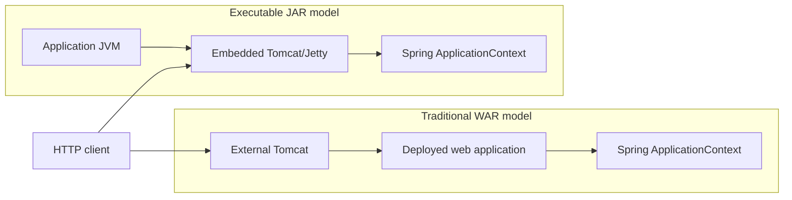
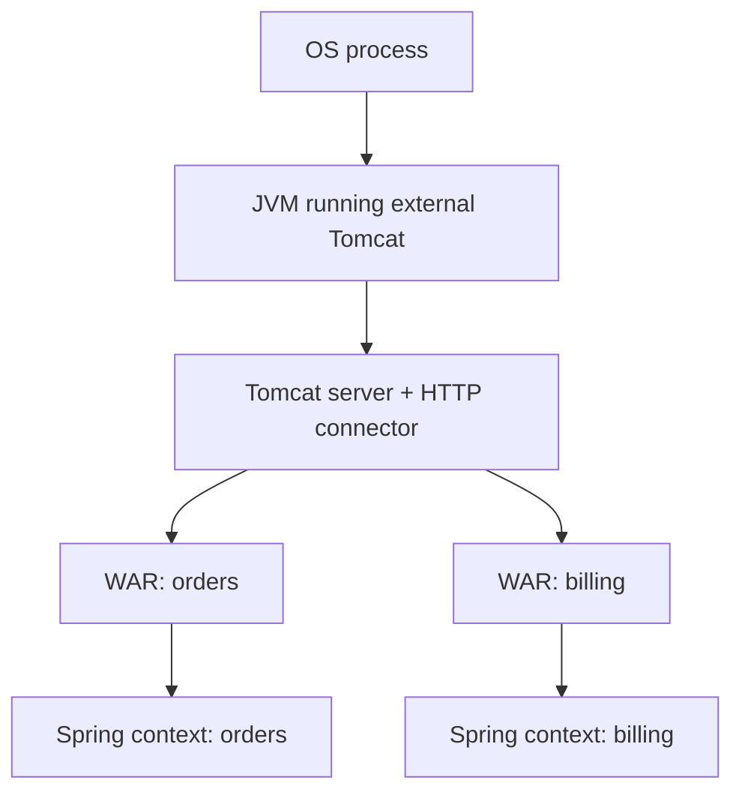

# Traditional WAR vs. Executable JAR: Recognizing Deployment Models

> **Spring Boot Fundamentals · Run and Package**  
> The same Spring Boot application can be deployed under different models. With an **executable JAR**, the application usually carries an embedded web server and starts as a standalone Java process. With a **traditional WAR**, the application is packaged to be loaded and operated by an external Servlet container. In addition, Spring Boot supports an **executable WAR**: a WAR packaged under special conventions so that it can both be deployed to a compatible container and run via `java -jar` under suitable conditions. To choose and operate properly, you must identify **who owns the web server, JVM, classpath, network ports, and application lifecycle**, rather than looking solely at a `.jar` or `.war` file extension.

## 1. The Deployment Problem: Same Code, Different Lifecycle

Suppose an application has a REST API:

```java
package com.example.orders;

import org.springframework.boot.SpringApplication;
import org.springframework.boot.autoconfigure.SpringBootApplication;

@SpringBootApplication
public class OrdersApplication {

    public static void main(String[] args) {
        SpringApplication.run(OrdersApplication.class, args);
    }
}
```

And a controller:

```java
package com.example.orders;

import org.springframework.web.bind.annotation.GetMapping;
import org.springframework.web.bind.annotation.RestController;

@RestController
public class HealthDemoController {

    @GetMapping("/hello")
    public String hello() {
        return "Hello from Orders";
    }
}
```

This is application code—it **does not dictate the deployment model**. If built as an executable JAR, a single command can launch the application alongside an embedded Tomcat. If built as a traditional WAR, an external Tomcat loads the application and dispatches requests to Spring MVC. If built as an executable WAR, how you launch it decides which mode runs.

Example request paths:



The key difference is not in the controller. The difference is **who creates the web server and who manages the web application lifecycle**.

### 1.1. Three Forms to Distinguish

| Form | Artifact | Typical startup method | Who owns the servlet container? |
| --- | --- | --- | --- |
| Executable JAR | `.jar` with Spring Boot launcher and dependencies | `java -jar orders.jar` | Application creates embedded server |
| Traditional WAR | `.war` structured as a Servlet web application | Deployed into Tomcat/compatible container | External Servlet container |
| Executable WAR | `.war` repackaged by Spring Boot | `java -jar orders.war` **or** external deploy, if configured properly | Depends on how it is launched |

A WAR can include a main class and the Spring Boot launcher while still supporting external deployment. Therefore, never assume that "a `.war` extension always requires external Tomcat," nor assume that "every `.war` file can run with `java -jar`."

### 1.2. Identifying via Operational Questions

When taking over an unfamiliar application, ask:

1. Is the actual startup command `java -jar` or a container deployment?
2. Is the web server initialized inside the application's JVM or already running externally?
3. Who determines the HTTP port?
4. Does the artifact have a `BOOT-INF` or `WEB-INF` layout?
5. Do the container and app share one JVM or run in separate processes?
6. When updating the application, does ops replace a JAR and restart the process or redeploy a WAR?
7. Is the server dependency part of the application's runtime or provided by the container?
8. If running in a cloud/container image, does the image run Java directly or run Tomcat with a WAR copied into `webapps`?

Answering those questions is usually far more accurate than guessing the model from the repository name.

## 2. What Is an Executable JAR?

A Spring Boot **executable JAR** is a JAR packaged with the components required to boot the application with a single Java command, typically including:

- Application classes and resources.
- Dependency JARs, nested inside the artifact.
- A Spring Boot launcher matching the plugin version.
- A manifest pointing to the launcher and the application start class.

In a typical Spring MVC web model, an executable JAR carries embedded Tomcat via the `spring-boot-starter-web` dependency. Applications can also swap the embedded server for Jetty or another supported server if configured.

### 2.1. Execution Flow

```bash
java -jar orders-app.jar
```

The Spring Boot launcher constructs the classpath from the archive, invokes the application's entry point, initializes the Spring `ApplicationContext`, creates the embedded servlet container, and starts accepting requests as configured.

Logical model:

```text
OS process
└── java -jar orders-app.jar
    └── JVM
        ├── Spring Boot launcher
        ├── application classes
        ├── dependency JARs
        ├── Spring ApplicationContext
        └── Embedded servlet container
            └── HTTP port, e.g. 8080
```

Ordinarily, stopping the Java process stops both the embedded web server and the application, provided shutdown is handled properly.

### 2.2. Port Configuration Example

```yaml
server:
  port: 8085
  servlet:
    context-path: /orders
```

For a servlet application running on an embedded server, this configuration typically exposes the endpoint at:

```text
http://localhost:8085/orders/hello
```

When running behind a reverse proxy or ingress, the URL users see may differ due to proxy routing. Distinguish between the **application port** and the **external public port**.

### 2.3. Executable JAR Structure

A Spring Boot executable JAR typically follows this conceptual layout:

```text
orders-app.jar
├── META-INF/
│   └── MANIFEST.MF
├── org/springframework/boot/loader/...
└── BOOT-INF/
    ├── classes/
    │   ├── com/example/orders/OrdersApplication.class
    │   └── application.yml
    ├── lib/
    │   ├── spring-context-....jar
    │   ├── spring-webmvc-....jar
    │   └── tomcat-embed-....jar
    └── classpath.idx          # may be present
```

Launcher package names and metadata files vary by Spring Boot generation. The consistent marker across modern versions is **BOOT-INF/classes** for application code and **BOOT-INF/lib** for dependencies.

### 2.4. Executable JAR vs. Plain JAR

Not every JAR can be run with `java -jar`.

A **plain library JAR** normally holds classes and resources in a standard library layout without a startup main class or bundled runtime dependencies.

Example:

```text
acme-client.jar
└── com/acme/client/PartnerClient.class
```

If you run:

```bash
java -jar acme-client.jar
```

you may encounter a message stating `Main-Class` is missing or no valid entry point exists. That does not mean the JAR is "corrupt"; it simply was not built as an executable application archive.

Spring Boot Maven Plugin `repackage` or Gradle `bootJar` is normally used to produce executable JARs following Boot conventions.

## 3. What Is a Traditional WAR?

A **WAR** (Web Application Archive) is a web application packaging format based on the Servlet specification. In the traditional model, a Servlet container such as Tomcat starts first, and the container then loads one or more compatible WARs.

Example operational workflow:

```text
1. Install or start Tomcat.
2. Copy/deploy orders.war into Tomcat's deployment location.
3. Tomcat unpacks or loads the web application.
4. The Servlet startup mechanism initializes the Spring application.
5. Tomcat dispatches HTTP requests to the web application.
```

### 3.1. Who Creates the Server?

With an externally deployed WAR, the **external Servlet container** manages listeners, HTTP connectors, thread pools, server ports, and most of the server lifecycle. Spring Boot initializes the `ApplicationContext` for the web application loaded by the container.



A single container can host multiple webapps. That does not mean every organization should deploy multiple apps inside one JVM: resource isolation, security boundaries, and upgrade procedures are typically more complex.

### 3.2. Typical WAR Structure

```text
orders.war
├── META-INF/
├── WEB-INF/
│   ├── classes/
│   │   ├── com/example/orders/OrdersApplication.class
│   │   └── application.yml
│   ├── lib/
│   │   ├── spring-context-....jar
│   │   └── spring-webmvc-....jar
│   └── web.xml              # application-dependent; optional with modern Servlet
└── ...                     # static resources, if any
```

With Spring Boot on modern Servlet APIs, startup configuration does not require `web.xml`. Java-based servlet initialization can be handled via `SpringBootServletInitializer`.

### 3.3. The Container Is Independent of the Artifact

A WAR file **does not spin up an HTTP listener on its own** merely because you copy it to an arbitrary folder. A container must recognize and deploy it.

For instance, a self-configured Tomcat instance might have directories:

```text
tomcat/
├── bin/
├── conf/
├── lib/
├── logs/
└── webapps/
    └── orders.war
```

Depending on auto-deploy and server configuration, Tomcat can deploy that WAR under the `/orders` context. Production systems may use Tomcat Manager, deployment pipelines, context descriptors, or server orchestration instead of manual copying.

### 3.4. A Servlet Container Is Not Necessarily a Full Java EE Application Server

Apache Tomcat is a Servlet container; not all Java/Jakarta EE services found in a full application server are present. A Spring Boot WAR can run on a suitable servlet container, yet you must not assume all Java enterprise platforms share identical classpaths, module loading, JNDI, or transaction infrastructure.

If an application relies on container-provided services, the deployment contract must list those services explicitly.

## 4. Where Does a Spring Boot WAR App Get Its Entry Point?

For an executable JAR, the familiar entry point is `public static void main(String[] args)`.

For a traditional WAR, the container **does not invoke `main()` the way `java -jar` does**. The container needs a way to initialize the web application through Servlet APIs.

Spring Boot provides `SpringBootServletInitializer` so the application can participate in that startup path.

### 4.1. Startup Class Supporting External WAR

```java
package com.example.orders;

import org.springframework.boot.SpringApplication;
import org.springframework.boot.autoconfigure.SpringBootApplication;
import org.springframework.boot.builder.SpringApplicationBuilder;
import org.springframework.boot.web.servlet.support.SpringBootServletInitializer;

@SpringBootApplication
public class OrdersApplication extends SpringBootServletInitializer {

    @Override
    protected SpringApplicationBuilder configure(
            SpringApplicationBuilder builder) {
        return builder.sources(OrdersApplication.class);
    }

    public static void main(String[] args) {
        SpringApplication.run(OrdersApplication.class, args);
    }
}
```

There are two distinct startup paths:

- When invoking `java -jar` on a properly packaged executable artifact, the Spring Boot launcher invokes the application's main entry point.
- When deploying the WAR to a compatible Servlet container, the servlet startup infrastructure invokes the initializer and Spring Boot creates the context that way.

Keeping `main()` is useful when you want an application capable of both executable runs and external WAR deployment. For a traditional WAR targeting only external containers, `main()` is not the entry point the container calls.

### 4.2. Why Override `configure`?

The `configure(SpringApplicationBuilder)` method specifies which application sources are used when booting through a Servlet container. In the example, `OrdersApplication.class` carries `@SpringBootApplication`, making it the proper source.

If you omit source configuration for a WAR needing external startup, the container may fail to initialize the Spring application properly or fail to locate required configuration.

### 4.3. Do Controllers and Services Need Rewriting?

Normally no. The exact same controller:

```java
@RestController
@RequestMapping("/api/orders")
public class OrderController {

    @GetMapping("/{id}")
    public String find(@PathVariable String id) {
        return "Order " + id;
    }
}
```

can serve both models when dependencies, servlet stack, and application context are configured compatibly.

What typically changes are **packaging**, **startup integration**, **embedded server dependency scope**, **container compatibility**, and **deployment configuration**, not the entire business layer.

## 5. Maven: Building an Executable JAR

Example Maven Spring Boot 3.x project using Java 17 or a compatible Java version. Using the Spring Boot parent/BOM allows centralized dependency version management.

```xml
<project xmlns="http://maven.apache.org/POM/4.0.0"
         xmlns:xsi="http://www.w3.org/2001/XMLSchema-instance"
         xsi:schemaLocation="http://maven.apache.org/POM/4.0.0
                             https://maven.apache.org/xsd/maven-4.0.0.xsd">
    <modelVersion>4.0.0</modelVersion>

    <parent>
        <groupId>org.springframework.boot</groupId>
        <artifactId>spring-boot-starter-parent</artifactId>
        <version>3.5.0</version>
        <relativePath/>
    </parent>

    <groupId>com.example</groupId>
    <artifactId>orders-app</artifactId>
    <version>1.0.0</version>
    <packaging>jar</packaging>

    <properties>
        <java.version>17</java.version>
    </properties>

    <dependencies>
        <dependency>
            <groupId>org.springframework.boot</groupId>
            <artifactId>spring-boot-starter-web</artifactId>
        </dependency>

        <dependency>
            <groupId>org.springframework.boot</groupId>
            <artifactId>spring-boot-starter-test</artifactId>
            <scope>test</scope>
        </dependency>
    </dependencies>

    <build>
        <plugins>
            <plugin>
                <groupId>org.springframework.boot</groupId>
                <artifactId>spring-boot-maven-plugin</artifactId>
            </plugin>
        </plugins>
    </build>
</project>
```

`3.5.0` in the example is merely an illustrative Spring Boot 3 version. Real projects must pick a supported, verified version per organizational dependency policy.

### 5.1. Build and Run

```bash
./mvnw clean package
java -jar target/orders-app-1.0.0.jar
```

With the Spring Boot parent and Maven plugin properly configured, the build lifecycle runs `repackage` to turn the plain JAR into an executable Spring Boot archive.

### 5.2. Role of `repackage`

`spring-boot-maven-plugin` provides the `repackage` goal. It takes the built artifact, adds the loader/metadata, and arranges the classpath following executable archive conventions.

If you only use the Maven JAR Plugin to build a plain JAR, you may end up with an app containing `main()` yet missing runtime dependencies in the archive. As a result, `java -jar` will not necessarily run successfully.

Do not confuse them:

```text
Maven jar packaging    = selects archive type
Spring Boot repackage  = turns archive into executable Boot archive
```

Both participate together in the lifecycle.

### 5.3. When Should You Not Use an Executable JAR?

Some environments mandate deploying into a centrally operated container, or rely on specific servlet container integrations. In those cases, a traditional WAR may fit better.

However, never choose WAR simply because the application "is a web app." Spring Boot web applications run seamlessly with an embedded server inside an executable JAR.

## 6. Maven: Building a WAR for External Container Deployment

To build a WAR, switch packaging and handle the embedded servlet container dependency properly.

### 6.1. Sample POM Configuration

```xml
<project xmlns="http://maven.apache.org/POM/4.0.0"
         xmlns:xsi="http://www.w3.org/2001/XMLSchema-instance"
         xsi:schemaLocation="http://maven.apache.org/POM/4.0.0
                             https://maven.apache.org/xsd/maven-4.0.0.xsd">
    <modelVersion>4.0.0</modelVersion>

    <parent>
        <groupId>org.springframework.boot</groupId>
        <artifactId>spring-boot-starter-parent</artifactId>
        <version>3.5.0</version>
        <relativePath/>
    </parent>

    <groupId>com.example</groupId>
    <artifactId>orders-app</artifactId>
    <version>1.0.0</version>
    <packaging>war</packaging>

    <properties>
        <java.version>17</java.version>
    </properties>

    <dependencies>
        <dependency>
            <groupId>org.springframework.boot</groupId>
            <artifactId>spring-boot-starter-web</artifactId>
        </dependency>

        <dependency>
            <groupId>org.springframework.boot</groupId>
            <artifactId>spring-boot-starter-tomcat</artifactId>
            <scope>provided</scope>
        </dependency>

        <dependency>
            <groupId>org.springframework.boot</groupId>
            <artifactId>spring-boot-starter-test</artifactId>
            <scope>test</scope>
        </dependency>
    </dependencies>

    <build>
        <plugins>
            <plugin>
                <groupId>org.springframework.boot</groupId>
                <artifactId>spring-boot-maven-plugin</artifactId>
            </plugin>
        </plugins>
    </build>
</project>
```

This configuration keeps `spring-boot-starter-web` for Spring MVC while marking the embedded Tomcat starter as `provided`. The resulting WAR can run on an external servlet container when deployed.

### 6.2. What Does `provided` Mean?

Maven's `provided` scope indicates a dependency used during compilation/testing that is expected to be supplied by the runtime environment rather than packaged as an ordinary runtime dependency for consumers.

For a WAR deployed to an external Tomcat:

- The external Tomcat provides the Servlet engine and related APIs.
- The application carries the necessary business and framework dependencies.
- You should avoid bundling an entire embedded server as an ordinary runtime webapp library inside `WEB-INF/lib`.

Accidentally packaging a servlet engine or conflicting Servlet API version inside the WAR can trigger classloading or linkage errors.

### 6.3. Why Declare `spring-boot-starter-tomcat` as `provided` Even Though `starter-web` Pulls Tomcat?

`spring-boot-starter-web` normally brings in the embedded Tomcat starter transitively. Explicitly declaring `spring-boot-starter-tomcat` with scope `provided` adjusts the effective dependency scope appropriately for WAR deployment per Spring Boot guidance.

When building, inspect the **effective dependency graph** rather than only reading individual POM entries—especially if the project introduces another servlet container or custom dependency management.

### 6.4. Building the WAR

```bash
./mvnw clean package
```

The artifact may reside at:

```text
target/orders-app-1.0.0.war
```

However, whether the WAR is **traditional-only** or an **executable WAR** depends on whether `spring-boot-maven-plugin` executes `repackage`. A `.war` repackaged by Spring Boot is not identical in every structural detail to a plain WAR.

## 7. Executable WAR: A Hybrid Option Requiring Separate Identification

Spring Boot allows packaging a WAR so that it can be run with:

```bash
java -jar target/orders-app-1.0.0.war
```

When configured properly, the same artifact can also be deployed into a compatible external Servlet container.

**Key takeaway:** an executable WAR is a WAR carrying the Boot launcher and a dependency layout suited to both execution paths, not a "JAR renamed to `.war`."

### 7.1. Role of `WEB-INF/lib-provided`

A WAR repackaged by Spring Boot to be executable typically looks like this:

```text
orders-app-1.0.0.war
├── META-INF/
│   └── MANIFEST.MF
├── org/springframework/boot/loader/...
└── WEB-INF/
    ├── classes/
    │   └── com/example/orders/...
    ├── lib/
    │   ├── spring-context-....jar
    │   └── spring-webmvc-....jar
    └── lib-provided/
        └── tomcat-embed-....jar
```

In a Spring Boot executable WAR, `provided` dependencies can be placed in `WEB-INF/lib-provided`.

When running `java -jar`, the Boot launcher adds those dependencies to the classpath to start the embedded servlet container. When deploying the WAR into an external Servlet container, `WEB-INF/lib-provided` is ignored as regular webapp dependencies (unlike `WEB-INF/lib`), and the container supplies its own server runtime.

### 7.2. Not Every WAR with `main()` Runs Automatically

To run `java -jar file.war`, the artifact must contain the executable layout and proper manifest. Merely having `main()` in `OrdersApplication` is insufficient if the build produces a plain WAR without the Boot launcher.

Conversely, an executable WAR must be tested in **both modes** if you commit to supporting both. Running smoothly with embedded Tomcat does not guarantee zero Servlet API or classpath issues on an external Tomcat.

### 7.3. Should You Always Use an Executable WAR?

Not necessarily. If production strictly deploys external WARs and organizational policy never runs WARs via `java -jar`, a plain WAR can be a simpler output. If you want one artifact that both runs standalone locally and deploys into an external container, an executable WAR is a practical choice.

Still, verify both startup paths and container compatibility. Do not treat an executable WAR as a better default than an executable JAR for brand-new applications.

## 8. Gradle: Distinguishing `bootJar`, `war`, and `bootWar`

In Gradle, tasks and plugins decide which artifacts are created.

### 8.1. Executable JAR Project

Example Groovy DSL `build.gradle`:

```groovy
plugins {
    id 'java'
    id 'org.springframework.boot' version '3.5.0'
    id 'io.spring.dependency-management' version '1.1.7'
}

group = 'com.example'
version = '1.0.0'

java {
    toolchain {
        languageVersion = JavaLanguageVersion.of(17)
    }
}

dependencies {
    implementation 'org.springframework.boot:spring-boot-starter-web'
    testImplementation 'org.springframework.boot:spring-boot-starter-test'
}

tasks.named('test') {
    useJUnitPlatform()
}
```

Build:

```bash
./gradlew bootJar
```

The artifact typically lands in `build/libs` with an executable JAR layout. The exact filename depends on project name, version, and archive classifier.

### 8.2. Project Supporting WAR

Add the `war` plugin and `providedRuntime` for the container provided in external deployment:

```groovy
plugins {
    id 'java'
    id 'war'
    id 'org.springframework.boot' version '3.5.0'
    id 'io.spring.dependency-management' version '1.1.7'
}

group = 'com.example'
version = '1.0.0'

dependencies {
    implementation 'org.springframework.boot:spring-boot-starter-web'

    providedRuntime 'org.springframework.boot:spring-boot-starter-tomcat'

    testImplementation 'org.springframework.boot:spring-boot-starter-test'
}

tasks.named('test') {
    useJUnitPlatform()
}
```

With the Spring Boot Gradle plugin and compatible `war` plugin, `bootWar` creates an executable WAR; Gradle's `war` task produces a WAR via standard packaging.

```bash
./gradlew bootWar
./gradlew war
```

These two tasks can produce different artifacts, often distinguished by classifier or archive name. Never guess which file gets deployed from the name alone; inspect specific build task outputs and archive contents.

### 8.3. `providedRuntime` vs. `implementation`

`implementation` lets a dependency participate in compilation and runtime of the module per Gradle configuration. `providedRuntime` in a WAR build describes dependencies expected to exist in the external container at runtime.

In `bootWar`, Boot places externally provided dependencies into a dedicated area supporting executable WAR startup; in a plain WAR, those dependencies are excluded from ordinary webapp runtime libraries.

Do not mechanically substitute `compileOnly` for `providedRuntime` in a WAR project: the configurations affect the test runtime, WAR packaging, and dependency graph differently. Follow actual plugin mechanics.

### 8.4. Plugin Versions Are Illustrative

The Gradle plugin versions above are examples from a Spring Boot 3.x release line. In real projects, choose compatible versions of Java, Gradle, Spring Boot, and the dependency-management plugin aligned with your version catalog/BOM.

Do not try to solve packaging errors by randomly swapping plugin versions before reading dependency resolution or task outputs.

## 9. How to Inspect the Manifest and Artifact Structure

The file extension offers a clue, yet **internal contents and the startup command** are strong evidence.

### 9.1. Listing Entries in a JAR/WAR

```bash
jar tf target/orders-app-1.0.0.jar
```

Or:

```bash
jar tf target/orders-app-1.0.0.war
```

When output is lengthy, filter for key paths with appropriate shell tools:

```bash
jar tf target/orders-app-1.0.0.jar | grep -E 'BOOT-INF|META-INF/MANIFEST'
jar tf target/orders-app-1.0.0.war | grep -E 'WEB-INF|META-INF/MANIFEST'
```

`grep` examples apply to Unix-like shells; in PowerShell, use `Select-String`.

### 9.2. Reading the Manifest

```bash
unzip -p target/orders-app-1.0.0.jar META-INF/MANIFEST.MF
```

An executable Spring Boot archive may include entries like:

```text
Main-Class: org.springframework.boot.loader.launch.JarLauncher
Start-Class: com.example.orders.OrdersApplication
```

For an executable WAR, the launcher is typically `WarLauncher` instead of `JarLauncher`. Exact launcher class names have changed across Spring Boot versions, so inspect the actual manifest and match against the plugin version rather than writing automation tied to a single launcher path across all generations.

### 9.3. Do Not Confuse `Main-Class` and `Start-Class`

In an executable Boot archive:

- `Main-Class` usually points to the **Boot launcher**.
- `Start-Class` points to the application class holding the application entry point.

Even if your application class defines `main()`, without the launcher and proper dependency layout inside the archive, `java -jar` may still fail to operate as expected.

### 9.4. Decision Table for Identification

| Observation | Initial conclusion | Further verification needed |
| --- | --- | --- |
| `BOOT-INF/classes` and `BOOT-INF/lib` | Spring Boot executable JAR | Manifest and run command |
| `WEB-INF/classes`, `WEB-INF/lib` | WAR web application | External-only or executable? |
| `WEB-INF/lib-provided` and Boot launcher | Usually an executable WAR | Smoke-test both modes if needed |
| Classes and resources directly at JAR root | Likely a plain JAR | `Main-Class`, classpath, and plugins |
| Currently running `java -jar app.jar` | Executable standalone model | Which embedded server is used? |
| WAR deployed into a context by Tomcat | External servlet deployment | Container version, context path |
| Dockerfile `ENTRYPOINT ["java","-jar",...]` | Image runs the app directly | Artifact and runtime libs |
| Dockerfile copies WAR into `webapps` | Image runs an external container | Base Tomcat image and config |

These signals guide initial investigation rather than replacing startup testing.

## 10. Port and Context Path Configuration: An Easy Source of Confusion

### 10.1. Executable JARs Normally Control the Embedded Port

```yaml
server:
  port: 9090
  servlet:
    context-path: /shop
```

Inside an embedded servlet container, `server.port` typically sets the app's listener port and `server.servlet.context-path` sets the web application's context path.

Example:

```text
http://localhost:9090/shop/hello
```

### 10.2. External WARs Follow the Container's Port

Suppose an external Tomcat listens on port `8080` per `server.xml`, and the WAR is deployed under context `/orders`.

The URL may be:

```text
http://localhost:8080/orders/hello
```

At this point, setting:

```properties
server.port=9090
```

inside the WAR's `application.properties` **does not force external Tomcat to switch its connector from 8080 to 9090**. The external container controls its connectors.

This is a classic configuration mistake when migrating from executable JAR to WAR.

### 10.3. WAR Filename and Context Path

Many default Tomcat setups derive the context path from the WAR filename:

```text
orders.war -> /orders
ROOT.war   -> /
```

However, actual behavior depends on context descriptors, host configuration, deployment method, and Tomcat rules in effect. A system can deploy `orders.war` yet map it to a different context.

Hence **never equate the WAR name with the public URL as an invariant**.

### 10.4. `server.servlet.context-path` in an External WAR

`server.servlet.context-path` is primarily used when Spring Boot configures an embedded servlet container. When deploying a WAR into an external container, the context path is governed by deployment/container configuration.

If you set `server.servlet.context-path` in a WAR and the URL does not change, inspect Tomcat's context configuration rather than assuming a Spring MVC bug.

### 10.5. Reverse Proxies and Ingress Add Another Layer

Example:

```text
https://api.example.com/orders/hello
         |
         v
NGINX / Load balancer / Ingress
         |
         v
http://orders-app:8080/hello
```

Public URLs may not match internal ports or context paths. Reverse proxies can rewrite paths, terminate TLS, and attach forwarded headers.

This applies to **both executable JARs and WARs**. Never deduce deployment packaging purely from the user-facing URL.

## 11. Role of the Servlet API and Compatibility

Traditional WARs impose an explicit constraint: **the external container must support a Servlet API/Jakarta Servlet version compatible with your application and Spring Boot version**.

### 11.1. Transition from `javax.servlet` to `jakarta.servlet`

Applications on Spring Boot 2.x tie into the Servlet API ecosystem under the `javax.servlet` namespace. Spring Boot 3.x builds on Spring Framework 6 and Jakarta EE, using the `jakarta.servlet` namespace.

Example imports in the newer generation:

```java
import jakarta.servlet.Filter;
import jakarta.servlet.ServletException;
```

instead of `javax.servlet.*` imports in older applications.

This deeply impacts external WAR deployments. A WAR built with Spring Boot 3.x cannot simply be dropped into a Tomcat 9.x (which provides `javax.*` Servlet APIs) and expected to work unchanged.

### 11.2. Tomcat 10+ Is Not Just a File Rename

The namespace shift affects:

- Servlet API dependencies.
- Filters and listeners.
- Security libraries.
- Validation, JPA, and other Jakarta APIs.
- Legacy code referencing `javax.servlet.*`.
- Container-specific integrations.

In Spring Boot 3.x, Tomcat 10.1 is an example of a Jakarta-era Servlet container compatible with many Boot 3 releases, yet **always check the compatibility matrix for your exact Boot release**. Never assume every Tomcat 10.x or newer container matches every Boot version.

### 11.3. Java Version Is Also a Runtime Requirement

A WAR compiled for Java 17 cannot run on a JVM supporting only Java 8. Even if a container matches the Servlet API, its JVM may lag behind the required bytecode level.

For example:

```text
UnsupportedClassVersionError
```

indicates application or library bytecode compiled for a newer Java version than the container's runtime.

Compare:

1. Compile-time Java version.
2. Actual Java version running the Tomcat process.
3. Spring Boot and Spring Framework compatibility.
4. Container Servlet/Jakarta API version.
5. Versions of integration dependencies.

### 11.4. Do Not Package Conflicting Servlet APIs

When the external container supplies the Servlet API, bundling incompatible API JARs in `WEB-INF/lib` causes conflicts. Use proper dependency scopes and inspect transitive dependencies and WAR structure.

Never arbitrarily copy container system JARs into the application just to silence compilation errors.

## 12. Process Lifecycle: One Service per Process or Multiple Apps Sharing Tomcat?

### 12.1. Executable JAR

In the common model:

```text
orders service -> one JVM
billing service -> another JVM
inventory service -> another JVM
```

Each service has:

- Its own process memory.
- Its own embedded server.
- Its own JVM flags.
- Its own Java and dependency versions as platform policy allows.
- Independent restart/scaling behavior.

This aligns well with containerized deployments and microservice architectures, at the cost of per-service JVM overhead.

### 12.2. WAR on a Shared External Tomcat

One Tomcat can host:

```text
Tomcat JVM
├── /orders
├── /billing
└── /inventory
```

Benefits include centralized connector management or alignment with existing operations platforms.

In return, watch out for:

- Weaker resource isolation when webapps share a JVM.
- Server misconfigurations impacting multiple applications simultaneously.
- Ports, TLS connectors, shared thread pools, and server upgrades managed by an ops team.
- Dependency/classloader conflicts from improper shared libraries.
- Deploy/redeploy lifecycle management to avoid classloader leaks.

Not all external WAR deployments cram multiple apps into one JVM. You can run a dedicated Tomcat instance per WAR, including inside Docker. **The external WAR model defines who owns the container, not necessarily how many applications sit inside it.**

### 12.3. Scaling Strategies

With an executable JAR, the unit of scaling is typically the application's own process/instance or container.

With a WAR, the unit of scaling might be:

- One Tomcat instance running one WAR.
- One Tomcat instance running multiple WARs.
- Multiple replicas of Tomcat/servers.
- A shared operations platform where each replica hosts corresponding apps.

When planning scale, look at the actual deployment unit rather than only the archive format.

## 13. Docker and Kubernetes Do Not Mandate a Single Artifact Format

You can containerize both executable JARs and external WARs.

### 13.1. Executable JAR-Style Dockerfile

Illustrative example:

```dockerfile
FROM eclipse-temurin:17-jre

WORKDIR /app
COPY target/orders-app-1.0.0.jar app.jar

EXPOSE 8080
ENTRYPOINT ["java", "-jar", "/app/app.jar"]
```

The image contains the Java runtime and executable JAR. The HTTP server is created by the application when Spring Boot starts.

`EXPOSE 8080` is documentation/metadata about the intended port; it does not publish the port or prove the app listens there. When running containers, configure port mappings, Services, or Ingress per platform rules.

### 13.2. External Tomcat + WAR-Style Dockerfile

```dockerfile
FROM tomcat:10.1-jdk17-temurin

COPY target/orders-app-1.0.0.war \
     /usr/local/tomcat/webapps/orders.war

EXPOSE 8080
```

The base Tomcat image already provides the startup command; the WAR is placed into the image's deployment directory per that base image's convention.

Points to check:

- Do the Tomcat and Java versions match the Spring Boot WAR?
- Does the base image enable auto-deploy or require further config?
- Is the `/orders` context path what you want?
- Does the app rely on external files or secrets that must be mounted?

### 13.3. Kubernetes Sees Containers, Not Archive Extensions

In Kubernetes, a Deployment runs container images. A container might execute:

- `java -jar` with an embedded server.
- Tomcat with a WAR copied into `webapps`.
- A platform-specific custom entrypoint.

Kubernetes Services/Ingress route to container ports. Thus a Deployment YAML alone does not tell you the archive format; inspect the Dockerfile, image entrypoint, and artifact.

### 13.4. Choose Format Based on Operations, Not Trends

Executable JARs are convenient for single-Java-process images and independent deployments. WARs fit organizations running external Servlet containers with standardized WAR deployment workflows.

Switching from WAR to JAR alone does not solve scaling, observability, secret management, or networking. Those concerns require explicit design.

## 14. Environment Configuration: Different Places, Same Purpose

Whether JAR or WAR, an application still needs:

- Database URL.
- Credentials/secrets.
- Active profile.
- Downstream service endpoints.
- Timeouts, pool sizes, feature flags.
- Logging, monitoring, and health checks.

The difference is **where configuration comes from and who controls the process**.

### 14.1. With an Executable JAR

```bash
export SPRING_PROFILES_ACTIVE=prod
export DB_URL='jdbc:postgresql://db.example:5432/orders'
java -jar orders-app.jar --server.port=8080
```

Inside the application:

```yaml
spring:
  datasource:
    url: ${DB_URL}
```

Environment variables and command-line arguments are normally injected by the service manager or container orchestrator.

### 14.2. With an External WAR

`SPRING_PROFILES_ACTIVE` or Java system properties on the **Tomcat process** can affect every webapp sharing that JVM.

For example, Tomcat launched with:

```text
-Dspring.profiles.active=prod
```

If multiple apps share that container and read that property, they will all see it. This is a major operational difference from one-JVM-per-service.

If each WAR needs separate configuration, adopt an explicit isolation strategy: separate external config locations, supported servlet context parameters, JNDI, or deliberate configuration management. Never place shared secrets in world-readable container config files.

### 14.3. Watch Working Directory and External Files

`./config/application.yml` resolves against the process's working directory. For an executable JAR managed by systemd, the working directory may be set in the unit file. For a WAR, the working directory belongs to the Tomcat process—not necessarily the folder holding the WAR file.

If external files are not loaded, inspect the process's actual working directory and Config Data locations instead of assuming files beside the archive are loaded automatically.

### 14.4. When Multiple WARs Share One JVM

Process-wide Java system properties and OS environment variables affect multiple webapps simultaneously. If applications share generic keys like `app.mode`, prevent collisions and define precedence clearly.

Never adopt a configuration isolation trick in production before testing it on the real container setup.

## 15. Startup, Shutdown, and Version Upgrades

### 15.1. Executable JAR

Common workflow:

```text
Build artifact
    ↓
Ship artifact or build image
    ↓
Create process/container
    ↓
Readiness/health checks
    ↓
Route traffic
    ↓
Shut down old process per deployment strategy
```

The service manager (systemd, platform runtime, or container orchestrator) manages processes, restart policies, and stop signals. Spring Boot manages the embedded server lifecycle per app configuration.

### 15.2. Traditional WAR

Common workflow:

```text
Build WAR
    ↓
Upload/deploy to external container
    ↓
Container creates web application context
    ↓
Health checks and route traffic
    ↓
Undeploy/redeploy WAR during upgrades
```

Some external containers support hot deployment, yet production upgrades require careful management of lifecycle, session state, and connection draining. Never assume overwriting a live WAR file yields safe zero-downtime deployment.

### 15.3. Rollback

Rolling back an executable JAR usually means starting the previous artifact version or container image.

Rolling back a WAR usually means redeploying the previous WAR version while keeping container/context state healthy.

In both models, database schema and data migrations can make application rollback alone insufficient. Plan backward-compatible migrations whenever schemas evolve.

### 15.4. Graceful Shutdown

Spring Boot supports graceful shutdown with compatible embedded servers; external servlet containers govern their own shutdown/undeploy lifecycles.

Do not assume setting a shutdown property inside `application.yml` replaces external Tomcat connector draining. Verify against actual deployments, especially when long-running requests, schedulers, message consumers, and database transactions are active.

## 16. Testing: Working in One Model Does Not Guarantee the Other

### 16.1. Unit Tests Do Not Validate Packaging

JUnit tests exercising service or controller logic validate code, yet do not prove:

- A Boot executable archive has a valid manifest and classpath.
- A WAR has the right initializer and dependency scopes.
- External Tomcat provides a compatible Servlet API.
- URLs and context paths match deployment.
- Runtime JAR dependencies are all present.

You need archive- and deployment-level smoke tests.

### 16.2. Smoke Testing an Executable JAR

Build the executable JAR:

```bash
./mvnw clean package
java -jar target/orders-app-1.0.0.jar \
  --server.port=18080
```

From another terminal:

```bash
curl -i http://localhost:18080/hello
```

If the API responds as expected and startup logs show the embedded server started cleanly, you have evidence the standalone model works.

### 16.3. Smoke Testing a WAR in an External Container

Steps:

1. Build the WAR.
2. Pick a Tomcat/container matching the Java and Jakarta Servlet requirements.
3. Deploy the WAR to the target context.
4. Inspect container and Spring startup logs.
5. Call the URL including the context path.
6. Undeploy and confirm resources are released.
7. Redeploy the new or same version and call the endpoint again.

With `orders.war` deployed under `/orders`:

```bash
curl -i http://localhost:8080/orders/hello
```

The port and context are illustrative rather than guaranteed across every container.

### 16.4. Smoke Testing a Dual-Mode Executable WAR

If an artifact is advertised as an executable WAR, verify:

```bash
java -jar target/orders-app-1.0.0.war \
  --server.port=18081
```

Then, in a separate deployment test, deploy **that exact same WAR artifact** into a compatible external Tomcat and hit the container URL.

Success in one mode does not guarantee the other. Dependency scoping and servlet compatibility often let one path succeed while breaking the other.

### 16.5. Testing Profiles and External Config

Run the same artifact with `dev` and `prod` profiles, verifying the app loads the right configuration. For WARs, test properties supplied via the Tomcat process because that reflects real operations.

Test secret handling and cleanup, and never commit real credentials into test fixtures.

## 17. Common Errors and Root Causes

| Symptom | Likely cause | First check |
| --- | --- | --- |
| `java -jar app.jar` reports no main manifest attribute | Plain JAR lacking entry point/launcher | Manifest and `repackage`/`bootJar` |
| `java -jar` reports missing classes | Dependencies missing from executable archive or broken classpath | `BOOT-INF/lib`, plugin/task output |
| WAR deploys yet returns 404 | Unexpected context path, app failed to start, or route mismatch | Tomcat logs, deployment name, mappings |
| WAR deploys yet Spring context never starts | Missing or misconfigured `SpringBootServletInitializer`/source config | Initializer and startup logs |
| `server.port` in WAR does not change Tomcat's port | Port belongs to external container connector | Container configuration |
| `javax.servlet`/`jakarta.servlet` conflict | Boot/Framework incompatible with container | Boot release and server Servlet API |
| `UnsupportedClassVersionError` | Java runtime too old for compiled bytecode | Process/container Java version |
| `ClassNotFoundException` in WAR | Missing dependency or wrong scope/loader | `WEB-INF/lib`, container libs, dependency tree |
| Embedded Tomcat wrongly packaged into WAR | Improper dependency scope | `provided`/`providedRuntime` |
| Executable WAR runs externally yet `java -jar` fails | WAR not repackaged or missing runtime libs | Manifest, `WEB-INF/lib-provided` |
| `WEB-INF/lib-provided` is present | Boot executable WAR layout | Distinguish from `WEB-INF/lib` |
| Updated dependency yet app runs old version | Stale artifact/image/server deployment | Build output, deployed version, classpath |
| External `application.yml` not found | Different working directory/config location | Process CWD and Config Data logs |
| Same WAR works locally yet fails in production | Differing external server/JVM/API versions | Compatibility matrix and env |
| Two WARs in one Tomcat interfere | Shared JVM properties/resources/classloader rules | Server config, env, isolation |
| Session behavior breaks when scaling | Sticky sessions or shared session store misconfigured | Load balancer/session setup |
| Container leaves threads alive on undeploy | Scheduler/executor not cleaned up | Lifecycle hooks, thread dump |
| Works only when launched from IDE | IDE classpath differs from packaged artifact | Reproduce with built artifact |
| Docker container starts then exits immediately | Entrypoint failed or app terminated | Container logs, command, exit code |
| Built JAR instead of WAR | Packaging/plugin configured for wrong model | POM packaging, Gradle tasks |

### 17.1. "Port already in use" in an Executable JAR

If embedded Tomcat cannot bind its port, another process is already listening there. Inspect logs and process network bindings. In an external WAR, port-binding errors belong to the Tomcat connector rather than the WAR's `server.port`.

### 17.2. Is "ServletWebServerFactory bean missing" Always a WAR Bug?

You cannot conclude that from the error name alone. A `ServletWebServerFactory` error can appear when an application context attempts to start an embedded servlet server without a matching factory or after the server dependency was wrongly excluded.

For external WARs, the startup path needs the right context type and servlet initializer. Always inspect the full exception chain, startup path, and dependency tree.

### 17.3. "WAR Deployed Successfully" Yet Endpoints Do Not Respond

The container may accept the WAR file while the Spring context fails afterward, or the app runs normally under a different context path, or the controller wasn't component-scanned. Check:

- Container deployment logs.
- Spring startup logs.
- Actual context path.
- HTTP status codes and response bodies.
- Exceptions raised during requests.

Never equate placing a file in `webapps` with a healthy business application.

### 17.4. Errors Caused by Bundling Duplicate Dependencies

External containers use their own classloaders and typically supply Servlet APIs. If the WAR bundles conflicting API/framework JARs, `NoSuchMethodError`, `LinkageError`, or `ClassCastException` can follow.

Identify the offending classloader and class version instead of deleting dependencies at random. A dependency may be needed by the app yet must not clash with server-provided APIs.

## 18. When Should You Choose an Executable JAR?

An executable JAR typically fits well when:

- Building a new standalone-style Spring Boot service.
- You want a self-contained artifact requiring only an appropriate Java runtime.
- Each service is operated as its own process/service.
- Deploying via Docker/Kubernetes or one-app-per-container platforms.
- You want to manage the embedded server version alongside the app dependency graph.
- Services start, upgrade, and roll back largely independently.
- There is no mandate to deploy WARs into external servlet infrastructure.

### 18.1. Practical Advantages

- Simple startup contract: `java -jar` or container entrypoint.
- No separate Tomcat installation needed just to run an application.
- Easy to define deployment flows inside the source repo/image build.
- Embedded server versions stay aligned via the app's dependencies/BOM.
- Easy to smoke-test the exact archive that gets deployed.

### 18.2. What You Still Have to Operate

An executable JAR is **not a "zero-ops" solution**. You still must manage:

- Java runtime and security patches.
- Ports, TLS/reverse proxies, and load balancers.
- Resource limits and JVM memory tuning.
- Observability, log aggregation, and metrics.
- Secrets and environment configuration.
- Shutdown hooks and health/readiness probes.
- Artifact provenance and rollbacks.

An embedded server does not eliminate production operational responsibilities.

## 19. When Should You Choose a Traditional WAR?

An external WAR can be appropriate when:

- Your organization already operates a standardized Servlet container platform.
- Deployment policy requires WAR artifacts and centralized container governance.
- Container-specific integrations cannot easily move to standalone mode.
- You rely on container-managed authentication, JNDI, or shared container resources.
- Legacy applications are being modernized incrementally while keeping the existing deployment model during transition.

### 19.1. Practical Advantages

- Fits into existing container deployment pipelines.
- Container teams can enforce connector, TLS termination, and lifecycle policies centrally.
- Suits legacy environments heavily invested in servlet container operations.
- Can host multiple webapps on one container if done deliberately.

### 19.2. Trade-offs

- Must manage compatibility across Boot, Java, and the Servlet container.
- Ports and context paths belong to the external server, easily confusing teams expecting embedded settings.
- Shared-resource coupling risk across multiple webapps.
- Harder classloading/dependency debugging when containers provide shared libraries.
- Container upgrades can affect many applications at once.
- Deploy/redeploy must handle stale sessions, lingering threads, and resource cleanup.

WAR is not "obsolete tech that is always wrong," yet adopting it requires clear architectural and operational justification.

## 20. Migrating a Project from Executable JAR to WAR

Suppose a Spring Boot Web project runs as an executable JAR and must transition to external Tomcat.

### Step 1 — Verify Runtime Compatibility

Document:

- Spring Boot/Framework version.
- Compile and runtime Java versions.
- Servlet/Jakarta API version.
- Target external Tomcat/container version.
- Any container-specific dependencies.
- Whether embedded-server-only settings are used.

If versions are incompatible, do not switch packaging hoping things will magically work.

### Step 2 — Switch Packaging in the Build

In Maven, update:

```xml
<packaging>war</packaging>
```

In Gradle, apply the `war` plugin and matching tasks. This is only the first step.

### Step 3 — Configure the Servlet Container Dependency

Maven:

```xml
<dependency>
    <groupId>org.springframework.boot</groupId>
    <artifactId>spring-boot-starter-tomcat</artifactId>
    <scope>provided</scope>
</dependency>
```

Gradle WAR:

```groovy
providedRuntime 'org.springframework.boot:spring-boot-starter-tomcat'
```

If using Jetty instead of Tomcat, pick the matching dependencies and container compatibility; do not leave Tomcat dependencies behind simply because sample code showed Tomcat.

### Step 4 — Add `SpringBootServletInitializer`

```java
@SpringBootApplication
public class OrdersApplication extends SpringBootServletInitializer {

    @Override
    protected SpringApplicationBuilder configure(
            SpringApplicationBuilder builder) {
        return builder.sources(OrdersApplication.class);
    }

    public static void main(String[] args) {
        SpringApplication.run(OrdersApplication.class, args);
    }
}
```

### Step 5 — Audit Web Configuration

Review:

- `server.port` and connector settings.
- Context paths and URL mappings.
- Session and cookie settings.
- Access logging and request forwarding.
- Servlet filters and listeners.
- Error handling.
- Resource locations and file upload paths.
- Startup/shutdown resource lifecycles.

Settings targeting the embedded server may no longer govern external Tomcat the same way.

### Step 6 — Build and Inspect the WAR

```bash
./mvnw clean package
jar tf target/orders-app-1.0.0.war
```

Verify `WEB-INF/classes`, `WEB-INF/lib`, launcher entries if using an executable WAR, and `WEB-INF/lib-provided` where applicable.

### Step 7 — Deploy to a Compatible Container

Deploy the WAR and verify:

- Container logs.
- Spring `ApplicationContext` startup.
- Context path.
- Health and business endpoints.
- Database and network connectivity.
- Secrets and active profiles.

### Step 8 — Test Lifecycle Behavior

Undeploy and redeploy several times while inspecting scheduled tasks, background threads, connection pools, sessions, and memory usage. WAR hot redeploys often surface resource leaks hidden when a whole JVM restarts on every upgrade.

### Step 9 — Decide Whether Executable WAR Is Needed

If you also need `java -jar app.war`, configure Boot repackaging/`bootWar` and test that path separately. If only external deployment is needed, stick to a plain WAR per deployment policy.

## 21. Migrating Back from WAR to Executable JAR

If a project wants to move off shared external Tomcat:

1. Ensure the Spring Boot application exposes `main()`.
2. Switch to `jar` packaging or `bootJar`.
3. Restore the embedded servlet server dependency to runtime scope, removing `provided` where no longer applicable.
4. Audit code for reliance on JNDI, shared container resources, or `ServletContext` parameters.
5. Move port and context path settings to the embedded server as needed.
6. Shift TLS/connector management or reverse proxying to the new platform.
7. Build and run the actual executable JAR.
8. Verify health endpoints, sessions, file uploads, logging, and shutdown.
9. Update deployment manifests, service managers, or Dockerfiles.
10. Re-run compatibility and regression suites prior to rollout.

Switching WAR to JAR is more than renaming a file. If the app depends on container-managed datasources, security realms, or shared JNDI bindings, replace them with suitable application/infrastructure configuration.

## 22. Hands-On Exercise: Distinguishing the Three Artifacts

### Objective

Create an `orders-app` application with a `/hello` endpoint, then observe the differences among an executable JAR, a traditional WAR, and an executable WAR. Perform this exercise in a development environment rather than on a production server.

### Part A — Executable JAR

1. Create a Spring Boot Web project with `OrdersApplication.main` and `HealthDemoController`.
2. Build with the Spring Boot Maven Plugin or Gradle `bootJar`.
3. Inspect `BOOT-INF/classes` and `BOOT-INF/lib`.
4. Read the manifest and locate the launcher and start class.
5. Run `java -jar`.
6. Request `http://localhost:8080/hello` or the configured port URL.
7. Record who owns the port and the process.

### Part B — Traditional WAR

1. Switch packaging to WAR.
2. Add `SpringBootServletInitializer`.
3. Put the Tomcat starter into `provided`/`providedRuntime` scope as appropriate.
4. Build the WAR; if targeting traditional-only, use plugin/task options that omit the executable launcher.
5. Inspect `WEB-INF/classes` and `WEB-INF/lib`.
6. Deploy to a compatible Tomcat.
7. Request the URL including the actual context path.
8. Try setting `server.port` in the app's config file and observe that the external connector does not change.
9. Undeploy the WAR and inspect shutdown behavior.

### Part C — Executable WAR

1. Enable Spring Boot WAR repackaging or use Gradle `bootWar`.
2. Inspect the manifest and `WEB-INF/lib-provided`.
3. Run `java -jar orders-app.war` in a test environment.
4. Call the embedded server endpoint.
5. Deploy that same WAR into a compatible external Tomcat.
6. Call the external container endpoint.
7. Explain why the exact same artifact can follow both startup paths.

### Part D — Compare Results

Complete this table based on your observations:

| Criterion | Executable JAR | Traditional WAR | Executable WAR |
| --- | --- | --- | --- |
| File extension | .jar | .war | .war |
| Startup command | ? | ? | ? |
| Role of `main()` | ? | ? | ? |
| Role of `SpringBootServletInitializer` | ? | ? | ? |
| Web server provided by | ? | ? | ? |
| Primary classpath structure | ? | ? | ? |
| Who manages the port | ? | ? | ? |
| Who manages the context path | ? | ? | ? |
| Requires external Servlet API compatibility testing | ? | ? | ? |
| Suited to one-process-per-service | ? | ? | ? |

Do not write identical answers for an executable WAR across both modes: server owner and port owner shift depending on how it is started.

### Self-Check Questions

1. What is the biggest difference between an executable JAR and a traditional WAR?
2. Can a `.war` file be executed via `java -jar`? Under what conditions?
3. How do a plain JAR and a Spring Boot executable JAR differ?
4. `BOOT-INF/classes` typically signals what kind of archive?
5. What role does `WEB-INF/lib-provided` play in an executable WAR?
6. Why doesn't an external Servlet container call `main()` the way `java -jar` does?
7. What information does `SpringBootServletInitializer.configure` supply?
8. Why is `provided` or `providedRuntime` needed for embedded Tomcat when building an external WAR?
9. If a WAR runs on Tomcat port 8080, does setting `server.port=9090` in the app automatically switch the port?
10. Why might a WAR's context path differ from the WAR filename?
11. What must be noted regarding `jakarta.servlet` in Spring Boot 3.x?
12. Why will a Spring Boot 3.x WAR generally fail on Tomcat 9.x?
13. If the Java compile target exceeds the container's JVM version, what error can occur?
14. Does a `@RestController` need changes when migrating from JAR to WAR?
15. Why is inspecting a Docker Deployment YAML alone insufficient to tell whether an app is JAR or WAR?
16. Do two WARs inside one Tomcat share everything? What is shared at the JVM level?
17. If a WAR is built without a launcher in its manifest, will `java -jar` work?
18. What must be tested when an executable WAR claims to support dual deployment?
19. How do WAR rollback and executable JAR rollback differ in deployment unit?
20. When does an organization have sound reasons to keep using traditional WARs?

## 23. Quick Reference Table

| Term | Remember |
| --- | --- |
| Executable JAR | Standalone Spring Boot archive launched with `java -jar` |
| Embedded server | HTTP server created inside the application's own process |
| Traditional WAR | Webapp archive deployed into an external Servlet container |
| Executable WAR | WAR repackaged by Boot supporting both standalone and external deployment |
| `main()` | Entry point for standalone startup |
| `SpringBootServletInitializer` | Bridge initializing a Boot app when deploying a WAR to a Servlet container |
| `<packaging>jar</packaging>` | Maven setting selecting a JAR archive |
| `<packaging>war</packaging>` | Maven setting selecting a WAR archive |
| `spring-boot-maven-plugin` | Provides `repackage` to produce executable Boot archives |
| Gradle `bootJar` | Builds a Boot executable JAR |
| Gradle `war` | Builds a WAR using the WAR plugin |
| Gradle `bootWar` | Builds a Boot executable WAR |
| Maven `provided` | Dependency expected from the external runtime environment |
| Gradle `providedRuntime` | Dependency configuration suited for external WARs |
| `BOOT-INF` | Standard layout for executable Boot JARs |
| `WEB-INF` | Standard Servlet WAR layout |
| `WEB-INF/lib-provided` | Provided dependencies kept separately by Boot for executable WARs |
| Servlet/Jakarta API | Must match the external container |
| `javax.servlet` vs. `jakarta.servlet` | Key compatibility boundary between Boot 2 and Boot 3 ecosystems |
| `server.port` | Configures embedded listeners; does not alter an external Tomcat connector directly |
| WAR context path | Typically determined by external deployment/container configuration |
| Docker/Kubernetes | Can run both JAR and WAR deployments |
| Smoke test | Must test the exact artifact under the production deployment model |
| Choosing a model | Base on server ownership, lifecycle, platform, compatibility, and operations |

## 24. Conclusion

**An executable JAR** lets a Spring Boot application bundle its own embedded servlet server and run as an independent Java process. **A traditional WAR** delegates server creation and deployment management to an external Servlet container, requiring a Servlet initializer and matching dependency scopes. **An executable WAR** is a hybrid choice—not the automatic nature of every WAR—and must be tested along both startup paths whenever supported.

When diagnosing a system, look at **artifact layout, launcher/manifest, startup command, classpath, Servlet API compatibility, port/context path ownership, and deployment lifecycle**. Pick the model aligned with your infrastructure and operational needs rather than deciding by filename extension alone. Most importantly, **build the right artifact, launch it via the right startup path, and test it in a production-like environment**.
