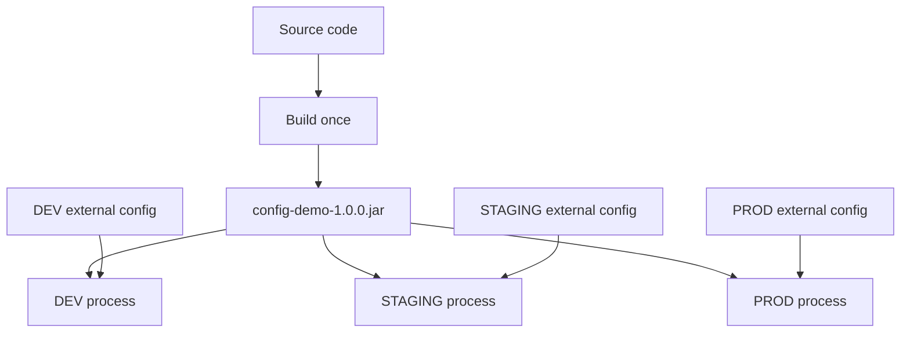
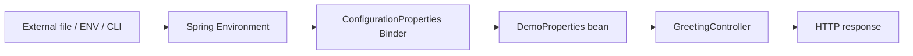
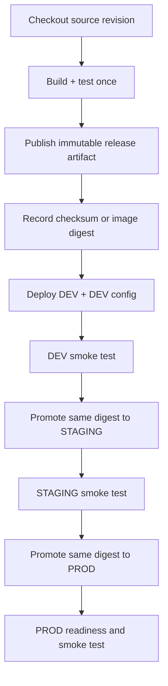

# Verifying the Same Artifact Across Environments with External Configuration

A core principle of packaging and deploying Spring Boot is **build once, deploy many**. DEV, STAGING, and PROD can run the **exact same executable JAR** or the same container image while receiving different ports, timeouts, service URLs, feature flags, and credentials **at runtime**.

What needs to be proven is not merely "the app starts on three machines." A solid verification answers three questions:

1. **Are the artifacts genuinely identical?** Compare the JAR's SHA-256 checksum or the container image digest.
2. **Does the configuration truly come from outside the artifact?** Verify locations, environment variables, CLI flags, and the final property source.
3. **Does the runtime actually use that configuration?** Read bound values and verify actual behavior with a smoke test.

An application can share the exact same JAR checksum across three environments while PROD accidentally reads DEV settings. Conversely, three running apps returning matching responses after separate rebuilds still fail the "same artifact" requirement.

## 1. How Artifacts and Runtime Configuration Differ

An **artifact** is the output of the build process, such as:

- An executable Spring Boot JAR built by Gradle `bootJar`.
- An executable JAR repackaged by the Spring Boot Maven Plugin.
- A container image published to a registry under a specific digest.

**Runtime configuration** consists of the values supplied to the application when deployed/started:

```properties
server.port=18081
demo.environment=dev
demo.message=Hello from DEV
demo.request-timeout=2s
```

Configuration can come from filesystem files, OS environment variables, Java system properties, command-line arguments, secret mounts, or a Spring Boot-compatible config data system.



If you edit `src/main/resources/application-prod.yml` and build a new JAR, you have changed the artifact. Even if application code and version stay unchanged, the binary can differ.

### 1.1. Why Should You Not Build per Environment?

An undesirable workflow:

```text
source + dev resources     -> app-dev.jar
source + staging resources -> app-staging.jar
source + prod resources    -> app-prod.jar
```

Problems:

- The JAR tested in staging is not guaranteed to be the JAR deployed to production.
- Dependencies, compiler flags, or resources can drift between builds.
- Production secrets may accidentally end up inside the archive.
- Rollback becomes error-prone because you cannot tell exactly which file was released.
- Operators easily mistake "same version string" for "identical bytes."

A better model is to **publish an immutable release artifact** and promote that exact artifact across environments alongside separate configuration and secrets.

## 2. Same Name Does Not Mean Same Artifact

| Indicator | What it proves | Limitation |
|---|---|---|
| Same JAR filename | Same name | File may have been overwritten |
| Same version | Same release label | Can be rebuilt under the same version |
| Same Git commit | Same source revision | Build inputs may still differ |
| Same SHA-256 | File bytes match with very high practical confidence | Does not yet prove runtime config |
| Expected HTTP response | Observed behavior | Does not prove the JARs match |
| SHA-256 + smoke test | Artifact identity and per-environment behavior | Still verify the right file/process |

For container images, verify the **image digest**. A tag like `config-demo:1.0.0` can be reassigned to a different image.

## 3. Designing the Hands-On Example

Let us create a small Spring Boot application exposing an endpoint:

```http
GET /greeting
```

It returns three non-sensitive values:

- `environment`: environment name from config.
- `message`: message from config.
- `requestTimeout`: timeout bound as a `Duration`.

Three test environments:

| Environment | Port | Message | Timeout |
|---|---:|---|---|
| DEV | 18081 | Hello from DEV | 2s |
| STAGING | 18082 | Hello from STAGING | 5s |
| Simulated PROD | 18083 | Hello from PROD | 8s |

Distinct ports are used solely to run all three concurrently on one machine; multiple containers on separate hosts can all listen on internal port 8080.

Layout:

```text
config-demo/
├── build.gradle.kts
├── src/main/java/com/example/configdemo/
│   ├── ConfigDemoApplication.java
│   ├── DemoProperties.java
│   └── GreetingController.java
├── src/main/resources/application.yml
├── deploy-config/
│   ├── dev/application.yml
│   ├── staging/application.yml
│   └── prod/application.yml
└── build/libs/config-demo-1.0.0.jar
```

The `deploy-config` directory sits outside `src/main/resources`, so it is not normally packaged inside the JAR. In a real product, production configuration should be managed by the deployment platform outside the source repository.

## 4. Dependencies

In a Spring Boot project with plugin/dependency management configured, the Gradle Kotlin DSL snippet is:

```kotlin
dependencies {
    implementation("org.springframework.boot:spring-boot-starter-web")
    implementation("org.springframework.boot:spring-boot-starter-validation")
    testImplementation("org.springframework.boot:spring-boot-starter-test")
}
```

The example uses Java 17, records, and `jakarta.validation` following the Spring Boot 3.x ecosystem. For a project on another Boot release line, use the imports and APIs matching your actual version.

No database or external API is required for this experiment, since our goal is separating the artifact from configuration and checking property binding.

## 5. Creating Typed `@ConfigurationProperties`

`DemoProperties.java`:

```java
package com.example.configdemo;

import java.time.Duration;

import jakarta.validation.constraints.NotBlank;
import jakarta.validation.constraints.NotNull;

import org.springframework.boot.context.properties.ConfigurationProperties;
import org.springframework.validation.annotation.Validated;

@Validated
@ConfigurationProperties(prefix = "demo")
public record DemoProperties(
        @NotBlank String environment,
        @NotBlank String message,
        @NotNull Duration requestTimeout
) {
}
```

Spring Boot binds:

```properties
demo.environment=dev
demo.message=Hello from DEV
demo.request-timeout=2s
```

into this record. `request-timeout` maps to `requestTimeout` via relaxed binding, and `2s` converts to `Duration`.

`@Validated` helps the app fail fast when required configuration is missing or invalid. `@NotNull` only verifies that `Duration` is present; if business rules require a positive timeout, add a corresponding constraint.

### 5.1. Registering the Properties Bean

`ConfigDemoApplication.java`:

```java
package com.example.configdemo;

import org.springframework.boot.SpringApplication;
import org.springframework.boot.autoconfigure.SpringBootApplication;
import org.springframework.boot.context.properties.EnableConfigurationProperties;

@SpringBootApplication
@EnableConfigurationProperties(DemoProperties.class)
public class ConfigDemoApplication {

    public static void main(String[] args) {
        SpringApplication.run(ConfigDemoApplication.class, args);
    }
}
```

This is an explicit way for Spring to manage `DemoProperties`. In applications with many properties classes, `@ConfigurationPropertiesScan` is also a good option.

## 6. Endpoint to Observe Runtime Values

`GreetingController.java`:

```java
package com.example.configdemo;

import java.util.Map;

import org.springframework.web.bind.annotation.GetMapping;
import org.springframework.web.bind.annotation.RestController;

@RestController
public class GreetingController {

    private final DemoProperties properties;

    public GreetingController(DemoProperties properties) {
        this.properties = properties;
    }

    @GetMapping("/greeting")
    public Map<String, String> greeting() {
        return Map.of(
                "environment", properties.environment(),
                "message", properties.message(),
                "requestTimeout", properties.requestTimeout().toString()
        );
    }
}
```

The endpoint reads from the Spring-bound bean rather than opening files directly. What we need to verify is **the final effective value received at runtime**, because another property source might override an external file.



**Safety boundary:** this is a demo endpoint returning solely non-sensitive fields. Never expose credentials, internal secrets, or tokens in responses when applying this verification pattern in real systems.

## 7. Configuration Packaged Inside the Artifact

`src/main/resources/application.yml` only needs shared settings:

```yaml
spring:
  application:
    name: config-demo
```

We intentionally omit `demo.environment`, `demo.message`, and `demo.request-timeout` so that every runtime must supply them externally.

Safe cross-environment defaults may be placed in the JAR where appropriate, yet avoid placing secrets or mandatory production config under `src/main/resources`.

**Separation:**

- Shared code and resources → artifact.
- Per-environment URLs/timeouts/ports/feature flags → external config.
- API keys/passwords/private keys → controlled secret source.

## 8. Three External Config Sets

`deploy-config/dev/application.yml`:

```yaml
server:
  port: 18081

demo:
  environment: dev
  message: "Hello from DEV"
  request-timeout: 2s
```

`deploy-config/staging/application.yml`:

```yaml
server:
  port: 18082

demo:
  environment: staging
  message: "Hello from STAGING"
  request-timeout: 5s
```

`deploy-config/prod/application.yml`:

```yaml
server:
  port: 18083

demo:
  environment: prod
  message: "Hello from PROD"
  request-timeout: 8s
```

These files intentionally differ. The goal is three processes exhibiting distinct behavior from the exact same release binary.

## 9. Building the JAR Exactly Once

With the Gradle wrapper:

```bash
./gradlew clean bootJar
```

Example artifact:

```text
build/libs/config-demo-1.0.0.jar
```

The exact filename depends on project name and version; use the path generated by the build.

With Maven:

```bash
./mvnw clean package
```

When the Spring Boot Maven Plugin repackages the executable JAR, the artifact normally resides in `target/`.

**After building, do not modify the JAR file and do not re-run the build between DEV, STAGING, and PROD.**

## 10. Verifying the SHA-256 Digest

On Linux/macOS:

```bash
sha256sum build/libs/config-demo-1.0.0.jar
```

On Windows PowerShell:

```powershell
Get-FileHash -Algorithm SHA256 -LiteralPath ".\build\libs\config-demo-1.0.0.jar"
```

Record the actual digest. If the artifact is copied across multiple hosts, compute SHA-256 on each copy and compare:

```bash
sha256sum /releases/dev/config-demo-1.0.0.jar
sha256sum /releases/staging/config-demo-1.0.0.jar
sha256sum /releases/prod/config-demo-1.0.0.jar
```

All three digests must match. Never compare filenames or versions alone.

A release report might record:

```text
artifact: config-demo-1.0.0.jar
sha256: <digest-computed-from-actual-file>
source-revision: <actual-commit>
configuration-revision: <environment-revision>
```

The bracketed values are placeholders, not measured outputs.

## 11. Running DEV from the Same JAR

Open a terminal in the project directory:

```bash
java -jar build/libs/config-demo-1.0.0.jar \
  --spring.config.additional-location=file:./deploy-config/dev/
```

Explanation:

- `--spring.config.additional-location` adds a Config Data location beyond default locations.
- `file:./deploy-config/dev/` is a **directory** on the filesystem.
- The trailing `/` matters for directory locations.
- Relative paths resolve against the **process working directory**, not automatically against the JAR location.

In another terminal:

```bash
curl -s http://localhost:18081/greeting
```

Expected response (JSON key order may vary):

```json
{
  "environment": "dev",
  "message": "Hello from DEV",
  "requestTimeout": "PT2S"
}
```

This serves as the runtime test: Spring loads the DEV file and the controller observes the properly bound bean.

## 12. Running STAGING from That Exact Same JAR

Do not rebuild. Run in another terminal:

```bash
java -jar build/libs/config-demo-1.0.0.jar \
  --spring.config.additional-location=file:./deploy-config/staging/
```

Verify:

```bash
curl -s http://localhost:18082/greeting
```

Expected output:

```json
{
  "environment": "staging",
  "message": "Hello from STAGING",
  "requestTimeout": "PT5S"
}
```

No Java code edits, JAR resources, or staging-specific build flags were needed.

## 13. Running Simulated PROD from That Exact Same JAR

Keep using the exact same JAR:

```bash
java -jar build/libs/config-demo-1.0.0.jar \
  --spring.config.additional-location=file:./deploy-config/prod/
```

Verify:

```bash
curl -s http://localhost:18083/greeting
```

Expected output:

```json
{
  "environment": "prod",
  "message": "Hello from PROD",
  "requestTimeout": "PT8S"
}
```

This only simulates PROD locally using distinct ports and config. In real production, diagnostic endpoints should be removed or properly protected.

### 13.1. Collecting Evidence

| Observation | DEV | STAGING | Simulated PROD |
|---|---|---|---|
| JAR | Same hashed path/copy | Same digest | Same digest |
| External config | `dev/` | `staging/` | `prod/` |
| Port | 18081 | 18082 | 18083 |
| Environment | `dev` | `staging` | `prod` |
| Timeout | `PT2S` | `PT5S` | `PT8S` |
| HTTP smoke test | PASS if response matches | PASS if response matches | PASS if response matches |

Only mark PASS after executing the verification commands in the actual environment. The table above shows expected exercise conditions, not pre-verified results.

## 14. `location` vs. `additional-location`

Two easily confused properties:

| Property | Meaning |
|---|---|
| `spring.config.location` | Replaces default config locations under Config Data rules |
| `spring.config.additional-location` | Appends locations alongside default locations |
| `spring.config.name` | Overrides the base filename searched |
| `spring.config.import` | Imports additional Config Data sources from an already-loaded document |

The demo uses `additional-location` because we want to keep shared defaults inside the JAR and layer runtime config on top.

### 14.1. When to Use `optional:`?

Example:

```text
optional:file:./deploy-config/dev/
```

The `optional:` prefix lets a missing location be skipped without failing startup due to a missing location. That helps for non-mandatory supplemental sources.

If an environment folder holds required configuration, do not attach `optional:` blindly. Missing folders should fail loudly to avoid booting with wrong settings.

### 14.2. Config Locations Are Evaluated Very Early

Properties determining where Spring looks for config must exist early—via CLI, environment variables, or system properties. Do not place `spring.config.additional-location` inside a file Spring has no way to find yet and expect it to load itself.

## 15. Using Environment Variables

Spring Boot supports relaxed binding from environment variables:

| OS environment | Property |
|---|---|
| `SERVER_PORT` | `server.port` |
| `DEMO_ENVIRONMENT` | `demo.environment` |
| `DEMO_MESSAGE` | `demo.message` |
| `DEMO_REQUEST_TIMEOUT` | `demo.request-timeout` |

Linux/macOS:

```bash
SERVER_PORT=18091 \
DEMO_ENVIRONMENT=dev \
DEMO_MESSAGE="Hello from ENV" \
DEMO_REQUEST_TIMEOUT=2s \
java -jar build/libs/config-demo-1.0.0.jar
```

PowerShell:

```powershell
$env:SERVER_PORT = "18092"
$env:DEMO_ENVIRONMENT = "staging"
$env:DEMO_MESSAGE = "Hello from PowerShell"
$env:DEMO_REQUEST_TIMEOUT = "5s"

java -jar ".\build\libs\config-demo-1.0.0.jar"
```

Before the next test, use a fresh terminal or reset the environment variables because values set in a PowerShell session persist for that session.

In containers, instances can all listen on port 8080 internally while mapping to different host ports.

## 16. Command Line and Property Precedence

Even without external files, config can be passed via the CLI:

```bash
java -jar build/libs/config-demo-1.0.0.jar \
  --server.port=18093 \
  --demo.environment=cli \
  --demo.message="From command line" \
  --demo.request-timeout=3s
```

Among property sources commonly used with executable JARs, typical precedence from highest to lowest is:

1. Spring command-line arguments.
2. `SPRING_APPLICATION_JSON`.
3. Java system properties.
4. OS environment variables.
5. Config data such as `application.yml`.
6. Lower-priority default properties.

Spring Boot includes additional sources in test/servlet/DevTools contexts; the list above highlights the primary sources in this example.

Run:

```bash
DEMO_MESSAGE="From ENV" \
java -jar build/libs/config-demo-1.0.0.jar \
  --spring.config.additional-location=file:./deploy-config/dev/ \
  --demo.message="From CLI"
```

Under standard precedence, the message is `From CLI`. Remove the CLI override to see ENV beat the file; also remove ENV to see the DEV value from the external file.

**Visually reading a file is not enough to prove runtime uses that file.** A higher-precedence source can override file values.

## 17. Same Artifact with Spring Profiles

Profile-specific config files can live **outside the JAR**:

```text
/etc/config-demo/
├── application.yml
├── application-dev.yml
├── application-staging.yml
└── application-prod.yml
```

Run:

```bash
java -jar /opt/config-demo/app.jar \
  --spring.config.additional-location=file:/etc/config-demo/ \
  --spring.profiles.active=staging
```

Spring Boot evaluates active profiles when loading Config Data. The same JAR can still run under another profile.

### 17.1. A Profile and a Label Are Not the Same

```text
demo.environment=prod
```

is a custom property in this example—it **does not automatically activate** the `prod` Spring profile.

```text
spring.profiles.active=prod
```

is the property that activates the corresponding profile when supplied from a valid source.

Avoid placing `spring.profiles.active` arbitrarily inside profile-activated documents. Supply active profiles from the CLI, environment, or valid base config to avoid activation loops.

### 17.2. Same Binary Can Have Different Bean Graphs

`@Profile`, `@ConditionalOnProperty`, and auto-configuration can instantiate different beans depending on configuration. "Same artifact" guarantees identical binaries, **not** identical object graphs or runtime state across environments.

## 18. Relative Paths vs. Absolute Paths

If an application starts from a different working directory, `file:./deploy-config/prod/` can point to the wrong place.

For example, JAR at `/opt/app/app.jar`, config at `/etc/app/prod/application.yml`:

```bash
java -jar /opt/app/app.jar \
  --spring.config.additional-location=file:/etc/app/prod/
```

Absolute locations are generally more reliable in systemd and containers.

Checklist:

- Does the file exist?
- Does the process user have read permission?
- Is the path a directory or a file?
- Does a directory location have a trailing `/`?
- Are any environment variables or CLI flags overriding it?
- What is the actual working directory?

## 19. Secrets Should Never Live Inside the Artifact

Each environment can use separate credentials:

```text
SPRING_DATASOURCE_URL
SPRING_DATASOURCE_USERNAME
SPRING_DATASOURCE_PASSWORD
```

Use a secret manager, Kubernetes Secrets, restricted file mounts, or platform secret injection. Never commit production passwords to `src/main/resources/application-prod.yml`.

Spring Boot supports `configtree:` for file-based secrets:

```properties
spring.config.import=optional:configtree:/run/secrets/
```

For example, `/run/secrets/demo.api-key` maps to property `demo.api-key`.

Environment variables are not automatically completely safe either: they can leak into diagnostic dumps or logs. Never dump the full environment, secrets, or request bodies into logs.

**Never let demo endpoints return credentials.** Diagnostic Actuator endpoints like `env` and `configprops`, if enabled, must be secured with proper exposure controls and sanitization.

### 19.1. Does Changing a Config File Trigger Hot Reload?

Not by default. Editing external YAML while the JVM is running **does not guarantee** `@ConfigurationProperties` beans rebind immediately. You typically need a process restart/rollout or an explicitly engineered refresh mechanism.

Likewise, Kubernetes env vars are injected at process start; updating a ConfigMap/Secret does not automatically mutate environment values inside an already-running process.

## 20. Same Docker Image, Different Configuration

Illustrative Dockerfile:

```dockerfile
FROM eclipse-temurin:17-jre
WORKDIR /app
COPY build/libs/config-demo-1.0.0.jar app.jar
ENTRYPOINT ["java", "-jar", "/app/app.jar"]
```

Build the image once:

```bash
docker build -t config-demo:1.0.0 .
```

Run DEV:

```bash
docker run --rm \
  -p 18081:8080 \
  -e SERVER_PORT=8080 \
  -e DEMO_ENVIRONMENT=dev \
  -e DEMO_MESSAGE="Hello DEV container" \
  -e DEMO_REQUEST_TIMEOUT=2s \
  config-demo:1.0.0
```

Run STAGING using **the exact same image**:

```bash
docker run --rm \
  -p 18082:8080 \
  -e SERVER_PORT=8080 \
  -e DEMO_ENVIRONMENT=staging \
  -e DEMO_MESSAGE="Hello STAGING container" \
  -e DEMO_REQUEST_TIMEOUT=5s \
  config-demo:1.0.0
```

The two instances run distinct configurations without rebuilding the image. In real pipelines, compare image digests to prove two deployments run the identical image; tags are mutable.

## 21. Automatable Smoke Tests

After launching three processes with external config:

```bash
curl -fsS http://localhost:18081/greeting
curl -fsS http://localhost:18082/greeting
curl -fsS http://localhost:18083/greeting
```

If `jq` is installed:

```bash
curl -fsS http://localhost:18081/greeting \
  | jq -e '.environment == "dev" and .requestTimeout == "PT2S"'

curl -fsS http://localhost:18082/greeting \
  | jq -e '.environment == "staging" and .requestTimeout == "PT5S"'

curl -fsS http://localhost:18083/greeting \
  | jq -e '.environment == "prod" and .requestTimeout == "PT8S"'
```

`jq -e` exits non-zero when the expression evaluates false, making it handy for CI smoke tests.

### 21.1. Runtime Testing Differs from Artifact Identity

- SHA-256 proves **identical files**.
- Smoke tests prove **expected behavior**.
- Health/readiness checks prove **application readiness** per probes.
- Config revision records **which configuration set was deployed**.

Do not treat one check as a substitute for all four.

## 22. Testing Property Binding in Spring Boot

An integration test for the Binder:

```java
import java.time.Duration;

import org.junit.jupiter.api.Test;
import org.springframework.beans.factory.annotation.Autowired;
import org.springframework.boot.test.context.SpringBootTest;

import static org.assertj.core.api.Assertions.assertThat;

@SpringBootTest(properties = {
        "demo.environment=test",
        "demo.message=Hello TEST",
        "demo.request-timeout=4s"
})
class DemoPropertiesTest {

    @Autowired
    DemoProperties properties;

    @Test
    void bindsRuntimeSettings() {
        assertThat(properties.environment()).isEqualTo("test");
        assertThat(properties.message()).isEqualTo("Hello TEST");
        assertThat(properties.requestTimeout())
                .isEqualTo(Duration.ofSeconds(4));
    }
}
```

This test verifies binding works, yet **does not by itself prove** that identical JARs are deployed across three environments. That requires deployment digests plus runtime smoke tests.

You can add a test omitting `demo.environment` to verify validation/fail-fast, using an isolated context so values from other test properties do not leak in.

## 23. Build Once, Deploy Many CI/CD Workflow



Control checkpoints:

1. Never rebuild between staging and production.
2. Never overwrite a JAR/image under an existing release identity.
3. Never bake secrets into artifacts during build.
4. Record the actual hash/digest at each deployment.
5. Record the config revision or config source.
6. Run smoke tests against the deployed artifact.
7. Maintain rollback procedures covering both the artifact and its corresponding config.

Because the same artifact can behave differently when configuration changes, **config revision** is just as important when reproducing incidents.

## 24. Common Errors

| Symptom | Possible cause | What to check |
|---|---|---|
| Three environments return the same message | External config not loaded or overridden | Inspect locations, CLI, ENV, and response |
| Wrong port | `SERVER_PORT` or CLI outranks config file | Inspect process args/env |
| Same JAR version, different SHA-256 | Rebuilt or modified file | Compare actual file digests |
| Config directory not found | Wrong path/working directory or read permissions | Use absolute paths and check trailing `/` |
| App boots despite missing mandatory config | `optional:` or defaults took over | Enforce explicit fail-fast validation |
| `prod` profile active yet `dev` data used | Precedence override or misconfigured dependency | Verify effective properties and target endpoints |
| ConfigMap updated yet app unchanged | No refresh/restart occurred | Perform rollout or use deliberate refresh |
| Secrets found inside JAR | Resource files packaged into archive | Inspect build and secret management |
| Same Docker tag yet different image | Tag was reassigned | Pin by image digest |
| Test context passes, deployment fails | Differing runtime config/dependencies | Test against real running process |
| HTTP 200 yet datasource unhealthy | Demo endpoint does not check DB | Use dedicated health/readiness probes |

### 24.1. Never Infer Security Isolation from a Profile Name

`demo.environment=dev` or `spring.profiles.active=dev` does not guarantee databases, queues, and object storage are DEV resources. Always verify critical URLs/identities and isolate credentials and networks across environments.

## 25. Hands-On Practice

### Exercise 1. Confirm the Same JAR

Build once, record the SHA-256 digest, and run the JAR with DEV, STAGING, and simulated PROD configs. Record the three responses and recompute SHA-256.

**Passing criteria:** hash stays identical, all three responses reflect their config, and no rebuild happens in between.

### Exercise 2. Property Precedence

In the DEV file declare:

```yaml
demo:
  environment: dev
  message: "From file"
  request-timeout: 2s
```

Run:

```bash
DEMO_MESSAGE="From ENV" \
java -jar build/libs/config-demo-1.0.0.jar \
  --spring.config.additional-location=file:./deploy-config/dev/ \
  --demo.message="From CLI"
```

**Expected:** message is `From CLI`. Drop the CLI override to observe ENV win, then drop ENV to observe the file value.

### Exercise 3. Fail-Fast on Missing Folder

```bash
java -jar build/libs/config-demo-1.0.0.jar \
  --spring.config.additional-location=file:./deploy-config/missing/
```

**Question:** Should runtime fall back to a DEV default by mistake?

**Answer:** No. If the external location is mandatory, let Spring fail with a missing-location/validation error rather than silently running another environment's config.

### Exercise 4. Changing Config Without Rebuilding

Edit message and timeout inside DEV YAML, stop and restart the exact same JAR. The response must change while SHA-256 stays identical. Do not assume a running bean automatically picks up file edits without a refresh mechanism.

### Exercise 5. Same Docker Image

Build the image once, run two containers with different `DEMO_ENVIRONMENT` values, check the responses, and save the image digest.

**Question:** Is having the same tag enough?

**Answer:** No; tags are mutable, so use the digest to prove identical artifacts.

## 26. Self-Check Questions

**1. Do identical filenames and versions guarantee identical JARs?**

No. Verify the digest or file bytes.

**2. Do differing responses between DEV and PROD prove build once, deploy many?**

No. Two distinct binaries can still return expected responses. You need hashes.

**3. How does `spring.config.additional-location` differ from `spring.config.location`?**

`additional-location` appends config search paths; `location` replaces default search locations under Boot rules.

**4. Where is `file:./deploy-config/prod/` resolved from?**

From the process's working directory.

**5. When a property exists in both ENV and CLI, which typically wins?**

CLI in a standard Spring Boot runtime.

**6. Does `demo.environment=prod` automatically activate the `prod` profile?**

No. Active profiles come from `spring.profiles.active` or equivalent profile configuration.

**7. Does editing an external YAML file while the app runs update beans immediately?**

Not by default; an explicit restart or designed refresh flow is required.

**8. Does a matching Docker tag prove two images are identical?**

No. Inspect the actual image digest.

**9. Can the exact same JAR instantiate different beans per profile?**

Yes. The artifact binary is identical while runtime profiles/conditions shape the bean graph.

**10. If SHA-256 matches yet staging fails readiness, should you immediately rebuild?**

Not necessarily. Inspect external config, secrets, dependency health, runtime environment, and logs first.

## 27. Deployment Checklist

- [ ] Artifact is built and published exactly once.
- [ ] Actual JAR SHA-256 or image digest is recorded.
- [ ] DEV/STAGING/PROD use the exact same digest.
- [ ] External config lives outside the artifact at explicit locations.
- [ ] Mandatory properties have validation/fail-fast enabled.
- [ ] Port, message, timeout, or runtime behavior is smoke-tested.
- [ ] Property precedence and profiles are controlled.
- [ ] Credentials never appear in artifacts, logs, or endpoints.
- [ ] Dependency and credential identities match the target environment.
- [ ] Readiness is verified separately.
- [ ] Config revision is recorded alongside the release.
- [ ] Rollback can restore both the exact artifact and matching config.
- [ ] Config updates follow an explicit restart/refresh workflow.

## 28. Takeaways

- **Build once, deploy many:** one artifact, multiple runtime configurations.
- **Checksum/digest:** stronger proof of artifact identity than filename or version.
- **External configuration:** supplied via files, environment variables, system properties, CLI flags, or other Config Data sources.
- **`@ConfigurationProperties`:** provides typed binding and validation to catch missing/invalid settings.
- **`additional-location`:** appends search paths; **`location`:** replaces default locations.
- **Relative paths:** depend on the process working directory.
- **Precedence:** CLI/ENV can override external files; always verify final runtime values.
- **Profiles:** select configurations/beans but do not substitute for security isolation.
- **Secrets:** must be delivered outside the artifact through secure mechanisms.
- **Runtime config changes:** do not mean automatic hot reload.
- **Smoke tests, digests, and readiness:** three distinct layers of verification evidence.
- **Containers:** promote the same image digest rather than rebuilding per environment.
- **Rollback:** track both artifact digest and configuration revision.

Whenever confirming that a release has been verified across environments, ask: **"Are the artifact bytes identical? Did Spring load the right external config? Does the application actually behave properly with that config?"** Only when all three answers are verified do you have trustworthy proof of build once, deploy many.
