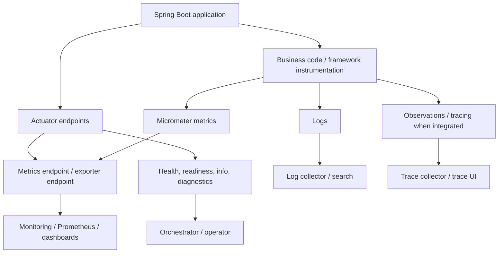
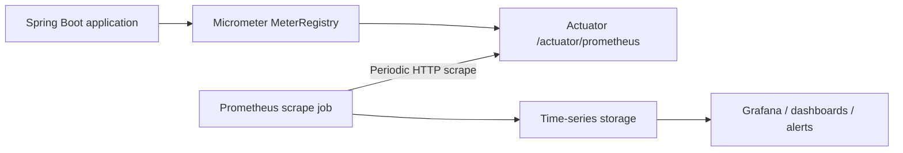
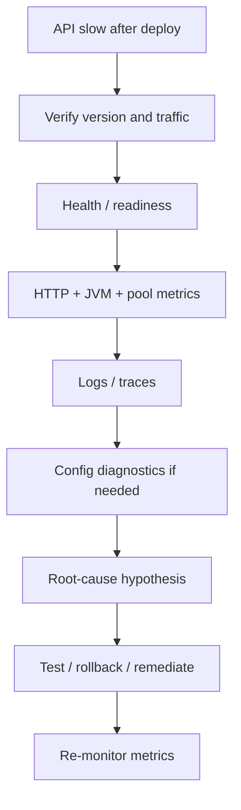

# What Observability Capabilities Does Actuator Add to an Application?

A Spring Boot application can start up successfully, return HTTP 200, and still be experiencing issues: an unstable database, a nearly exhausted thread pool, steadily increasing memory usage, abnormally slow requests, or a failing external dependency. Conversely, when an application returns a 500 error, knowing only that “an error occurred” is not enough to determine which component to inspect first.

In the **Application Observability** chapter of *Spring Boot Fundamentals*, **Spring Boot Actuator** is a key piece that helps an application **expose operational information in a structured way**. It adds endpoints and integrations for management, monitoring, and diagnostics: liveness/readiness status, application information, metrics, logging levels, configuration state, beans, request mappings, and other technical data.

Actuator does not automatically turn every application into a complete observability system. It creates **access points and integration capabilities** so developers and operators can see what is happening inside the application. To have dashboards, alerts, distributed tracing, or historical metrics storage, additional tools and dependencies are usually still needed.

After this lesson, the reader will be able to explain: what problem Actuator solves, which endpoint serves which need, why health differs from readiness, how metrics differ from logs, what else is needed for Prometheus to scrape metrics, and why management endpoints must be protected in real deployments.

## 1. What Does “Application Observability” Mean?

When a system runs in production, we cannot stand next to a debugger to inspect each processing step. We need to observe from the outside through signals emitted by the application.

Three familiar groups of signals:

- **Logs:** discrete events, such as a rejected request, a created order, or a connection failure.
- **Metrics:** measured values and aggregated time-series data, such as request count, latency, heap usage, or active database connections.
- **Traces:** the journey of a transaction/request across multiple components or services, consisting of spans and timing at each stage.

Beyond those three groups, operators also need to know the **instantaneous state and internal structure**: whether the instance is ready to receive traffic, which beans have been created, which routes are registered, which properties are applied, and which loggers are set to DEBUG.

### 1.1. Where Does Actuator Fit in This Picture?



Actuator primarily provides **management endpoints**, state management, and integration with Spring Boot's metrics/observations infrastructure. It is not a single UI that permanently stores all logs, traces, and metrics on its own.

### 1.2. Example Operational Problem

Suppose an order service is experiencing slow requests. Questions might include:

1. **Is the application still alive?** Health/liveness.
2. **Should new requests continue to be sent to this instance?** Readiness.
3. **Is latency increasing system-wide or only on one endpoint?** HTTP metrics and dashboards.
4. **Is the database the bottleneck?** Connection-pool metrics, health, and logs.
5. **Is there a specific exception?** Application logs, exception details, and tracing if configured.
6. **What configuration change just occurred?** Config diagnostics, deployment metadata, and configuration management systems.

Actuator contributes a great deal of information in this investigation chain; the remaining tools help view long-term trends and correlate root causes.

## 2. Without Actuator, What Is an Application Missing?

A Spring Boot application can still:

- Write logs using SLF4J/Logback.
- Serve regular business APIs.
- Have threads, heap, connection pools, and a servlet container.
- Have some system metrics provided by the JVM or OS.

However, without Actuator, it usually **does not automatically provide a set of management endpoints following Spring Boot conventions** to query health, beans, metrics, loggers, mappings, configuration properties, and other technical information.

For example, an API `GET /api/orders` can prove the order-fetching flow is running, but it is not a good way to measure health or retrieve the instance's JVM heap usage.

Actuator creates a **management/observability interface separated from business APIs**, allowing operational tools to access information consistently across many Spring Boot applications.

### 2.1. Actuator Is Not Just a `/health` Endpoint

If you manually write:

```java
@RestController
class PingController {
    @GetMapping("/ping")
    String ping() {
        return "OK";
    }
}
```

then `/ping` only proves that the controller and the web stack are working well enough to return a response. It does not automatically integrate health indicators, status aggregation, metrics, or probes.

Actuator provides an abstraction so multiple components can contribute status and combine into a health result. At the same time, it includes other groups of endpoints beyond health.

### 2.2. Actuator Does Not Replace Business Logic

Actuator does not know whether “orders are created according to policy” or “payment amounts match invoices” merely because the starter is present. Business invariants still belong to domain/application services. If you want to observe a business aspect, you can add a **custom metric**, a **custom health indicator**, or semantically appropriate events/logs.

## 3. Adding Spring Boot Actuator to a Project

In a typical Spring Boot project, we add the starter:

```text
org.springframework.boot:spring-boot-starter-actuator
```

### 3.1. Maven

```xml
<dependency>
    <groupId>org.springframework.boot</groupId>
    <artifactId>spring-boot-starter-actuator</artifactId>
</dependency>
```

If the project already uses the Spring Boot BOM or parent for dependency management, you usually do not need to pin the starter version manually. Library versions should be compatible with the Spring Boot line being run.

### 3.2. Gradle

```groovy
dependencies {
    implementation 'org.springframework.boot:spring-boot-starter-actuator'
}
```

### 3.3. What Happens After Adding the Dependency?

When the application starts, Actuator can auto-configure suitable endpoints based on:

- Present dependencies and web stack.
- Existing beans/infrastructure.
- `management.*` properties.
- Whether an endpoint is enabled or disabled.
- Whether an endpoint is exposed over HTTP/JMX.
- Security configuration.

Not every endpoint has useful content in every application. For example, `/actuator/prometheus` requires the appropriate registry dependency, `/actuator/logfile` depends on file logging being configured, and some endpoints require the corresponding infrastructure/repository.

### 3.4. Trying the Health Endpoint

In a web application with typical default configuration, the endpoint:

```http
GET http://localhost:8080/actuator/health
```

may return:

```json
{
  "status": "UP"
}
```

This is an illustrative output. Registered health components, actual status, and the details display policy can make the response differ.

**An `UP` status does not prove every business use case is correct or every external dependency has been checked.** It only reflects the health indicators Actuator currently has and how they are aggregated.

## 4. What Is an Endpoint in Actuator?

An **Actuator endpoint** is an access point intended for management/observability. An endpoint has an ID, such as `health`, `info`, or `metrics`. It can be exposed over appropriate management technologies, most commonly HTTP and in some setups JMX.

By default, web endpoints usually have the base path:

```text
/actuator
```

Therefore:

```text
health  -> /actuator/health
info    -> /actuator/info
metrics -> /actuator/metrics
loggers -> /actuator/loggers
```

However, **an endpoint existing in the context**, **an endpoint being enabled**, and **an endpoint being exposed over HTTP** are three different concepts.

### 4.1. Endpoint Available but Not Exposed over Web

An application might register the `metrics` endpoint yet deny access to `/actuator/metrics` over HTTP because the web exposure policy only allows `health`.

Therefore, a 404 response does not necessarily mean the Actuator starter is missing. The endpoint might not be exposed, might be disabled, or the URL/base path might be different.

### 4.2. Endpoint Exposed but Still Blocked by Security

Once an endpoint is exposed, Spring Security or network security may still require authentication/authorization. If `GET /actuator/metrics` returns 401/403, the issue may lie in authorization, **not from missing metrics**.

### 4.3. Endpoints Are Not Necessarily Read-Only

Some management endpoints have operations that can mutate runtime state, such as changing logger levels via `loggers` when access permissions and endpoint operations allow it.

Therefore, Actuator cannot be secured on the assumption that “all of Actuator is GET-only and harmless.” In deployment, each endpoint and each operation type must be evaluated.

## 5. Common Endpoint Groups

Some common endpoints:

| Endpoint | What does it help observe? | Notes |
| --- | --- | --- |
| `health` | Aggregated status of the application and health contributors | May have subcomponents/details; requires display policy |
| `info` | Application metadata such as name, version, build, Git when configured | Not all metadata appears automatically |
| `metrics` | List of registered meters and metrics | For viewing metrics; not a long-term time-series storage system |
| `prometheus` | Data format for Prometheus scraping | Requires the corresponding Prometheus registry and exposure |
| `loggers` | Current logger levels; some operations allow changing levels at runtime | Needs very strict access control |
| `env` | Property sources and property values per display policy | Can expose config structure; sensitive information risk |
| `configprops` | Beans bound with `@ConfigurationProperties` | Needs exposure control and sanitization |
| `beans` | List of beans in the Spring context | Exposes internal application structure |
| `mappings` | Registered request mappings | Exposes routes and controller structure |
| `conditions` | Condition evaluation report for auto-configuration | Useful when auto-configuration does not behave as expected |
| `caches` | Information on cache managers and caches | Depends on cache infrastructure |
| `scheduledtasks` | Scheduled tasks managed by Spring | Does not prove every background job across all systems |
| `threaddump` | JVM thread information | Aids investigating blocks/deadlocks; sensitive |
| `heapdump` | JVM heap dump | May contain in-memory data and secrets; extremely sensitive |
| `httpexchanges` | Stored HTTP exchanges if a suitable repository exists | Not every app enables or stores request history |
| `auditevents` | Audit events if suitable infrastructure/repository is configured | Does not replace a full business audit trail |
| `logfile` | Log file contents if the application logs to a file with supported configuration | Does not exist in every setup |
| `startup` | Data about startup steps when startup recording is enabled | Requires appropriate startup recording configuration |

This list represents **common capabilities across Spring Boot lines**; endpoint names and availability conditions may differ across releases. For instance, older Spring Boot 2.x lines had the `httptrace` endpoint, while newer lines use the `httpexchanges` model. When working with a specific project, consult the corresponding version and endpoint catalog.

### 5.1. Do Not Expose Everything Just to Explore

A command or configuration enabling every endpoint can be convenient in an isolated local environment but dangerous in production. Some endpoints expose configuration data, internal details, heap dumps, or permission to alter logging.

Apply the principle: **expose only what is needed, to the right authorized subjects**.

## 6. The Health Endpoint: Is the Application Healthy?

`health` is usually the first endpoint used. It aggregates results from registered **HealthIndicator/HealthContributor** beans.

Some health contributors may relate to:

- `db`: database connectivity/check according to the appropriate indicator.
- `diskSpace`: remaining disk space according to configured rules.
- `ping`: basic health component.
- Message brokers, caches, or other services if an indicator is auto-configured or explicitly declared.

Example result:

```json
{
  "status": "UP"
}
```

If the details display policy allows:

```json
{
  "status": "UP",
  "components": {
    "db": {
      "status": "UP"
    },
    "diskSpace": {
      "status": "UP"
    }
  }
}
```

This is an example; not every application has `db` or the components above. If there is no datasource, you cannot expect a database indicator to be created by default.

### 6.1. Common Health Statuses

Some common statuses:

- `UP`: contributor reports that it is functioning.
- `DOWN`: contributor reports an error/unavailability.
- `OUT_OF_SERVICE`: contributor explicitly reports being out of service.
- `UNKNOWN`: status could not be determined.

An application can add custom statuses if truly needed. Actuator uses a status aggregation mechanism; **do not infer HTTP status from the status name if the project has customized the status-to-HTTP mapping**.

### 6.2. Health Status and HTTP Response Status

In common configurations, health `UP` typically maps to HTTP 200. Statuses such as `DOWN` or `OUT_OF_SERVICE` typically map to HTTP 503, reflecting that the service is unavailable.

However, the health response and HTTP status are two distinct layers:

```http
HTTP/1.1 503 Service Unavailable
Content-Type: application/json

{"status":"DOWN"}
```

This example is only meaningful when a health contributor actually reports `DOWN` and the mapping policy corresponds.

### 6.3. Health Does Not Equal “Business Requests Will Always Succeed”

A database indicator might verify that a connection can be opened, yet not know whether an upcoming order has sufficient inventory. A partner service might report reachable while returning incorrect data in a specific use case.

Health should reflect **essential operational capability at the system level**, not be used to simulate every business transaction.

### 6.4. Do Not Make Health Checks Too Expensive

If every call to `/actuator/health` executes a large query, calls an API with a multi-second timeout, or scans an entire database table, the monitoring system can generate extra load and amplify an outage.

Health checks should be **fast, time-bounded, and return meaningful results**. When deep verification is needed, use a dedicated check/diagnostic mechanism rather than putting all work into a frequently polled endpoint.

## 7. Liveness and Readiness: Two Different Questions

In container/Kubernetes environments, distinguishing liveness from readiness is critical.

**Liveness:** “Is this process still in a state capable of operating or being recovered?”

**Readiness:** “Should this instance currently receive new traffic or work?”

An instance draining requests for a controlled shutdown can still be **alive** yet **not ready**.

| State | Liveness | Readiness | Operational Meaning |
| --- | --- | --- | --- |
| Application running normally | Usually good | Usually good | Can receive traffic |
| Starting up / not finished preparing | May be alive | Not yet ready | Should not route traffic yet |
| Undergoing graceful shutdown | May be alive | Not ready | Stop accepting new work |
| JVM in an unrecoverable state | May fail | May fail | Needs appropriate recovery mechanism |
| Auxiliary downstream temporarily failing | Does not necessarily fail | Depends on function | Requires realistic dependency policy |

### 7.1. Actuator Health Probes

In Spring Boot lines that support probes, the endpoints can be:

```text
/actuator/health/liveness
/actuator/health/readiness
```

Spring Boot integrates **ApplicationAvailability** with the corresponding health groups. In a suitable Kubernetes environment, Boot can enable probes automatically; in other environments they can be enabled via configuration:

```properties
management.endpoint.health.probes.enabled=true
```

Or YAML:

```yaml
management:
  endpoint:
    health:
      probes:
        enabled: true
```

Exact paths and availability should be verified against the Spring Boot version and web exposure/security configuration.

### 7.2. Why Shouldn't You Arbitrarily Put the Database in Liveness?

Suppose the central database suffers a temporary outage. If the liveness of every replica depends on the database, the orchestrator could restart the entire fleet simultaneously. Restarting usually **does not fix a broken database** and can make the situation worse.

Liveness should avoid depending on external systems that restarting the instance cannot resolve. Readiness may consider essential dependencies, but you must also evaluate the risk of pulling all replicas out of traffic at once.

### 7.3. Extending the Readiness Group

In Spring Boot versions that support it, a readiness group can include appropriate health indicators:

```properties
management.endpoint.health.group.readiness.include=readinessState,db
```

This example instructs the group to evaluate the application's readiness state together with the database indicator. It is only appropriate if the application genuinely cannot process requests when the database loses connectivity, and the health check is sufficiently fast and stable.

**Do not copy this configuration to every service:** a cache-reading API or a consumer with retry mechanisms may have different readiness requirements.

### 7.4. Probes on a Separate Management Port

If Actuator runs on a management port separate from the business HTTP port, a passing probe on the management port does not completely prove the main web port is serving requests. Some Spring Boot lines support configuring additional probe paths on the main server port, such as:

```properties
management.endpoint.health.probes.add-additional-paths=true
```

When supported, additional paths like `/livez` and `/readyz` can be registered on the main server. This helps test closer to the traffic-serving path.

Do not assume every Boot release has the same property or paths; check the documentation for the version in use.

## 8. Creating a Custom `HealthIndicator`

Actuator includes many built-in health contributors, but it cannot know every application-specific dependency. If the application relies on an internal resource or subsystem that matters operationally, you can add a `HealthIndicator`.

Example:

```java
package com.example.catalog.observability;

import org.springframework.boot.actuate.health.Health;
import org.springframework.boot.actuate.health.HealthIndicator;
import org.springframework.stereotype.Component;

@Component
public class CatalogIndexHealthIndicator implements HealthIndicator {

    private final CatalogIndexService catalogIndex;

    public CatalogIndexHealthIndicator(CatalogIndexService catalogIndex) {
        this.catalogIndex = catalogIndex;
    }

    @Override
    public Health health() {
        if (catalogIndex.isReady()) {
            return Health.up().build();
        }

        return Health.down()
                .withDetail("reason", "index-not-ready")
                .build();
    }
}
```

`CatalogIndexService` is an illustrative application-defined service. The `isReady()` method should reflect an already-available state or perform a **fast, time-bounded** check—not kick off a re-indexing job whenever an operator queries health.

Spring Boot can register contributors by bean naming conventions, and the health component name may appear with the `HealthIndicator` suffix stripped. Check the actual name in the endpoint rather than relying on guesswork.

### 8.1. When Should You Use a Custom `HealthIndicator`?

Appropriate when the system needs a clear operational condition:

- Essential lookup tables have finished loading.
- A required internal resource is ready.
- A worker has completed minimal initialization.
- An internal queue is not in an unrecoverable broken state.

Not appropriate for returning detailed user business data, running long reports, or placing secrets in the output.

### 8.2. Do Not Expose Sensitive Information Through Details

`withDetail(...)` can contain information operators need for diagnostics, but it should not contain passwords, tokens, connection strings with secrets, or customer data.

Who sees details depends on `management.endpoint.health.show-details` and security. **A sanitization/visibility policy is not a license to put sensitive data into health details.**

### 8.3. Custom Health Can Mark the System “DOWN”

When an indicator reports `DOWN`, the health group containing it can aggregate to `DOWN`. This is necessary behavior if the dependency is truly essential, but it can cause false alarms if the check is overly strict or flaky.

Before adding an indicator to readiness, determine: if the check fails, should the instance really be pulled out of traffic?

## 9. The `info` Endpoint: Application and Deployment Metadata

The `info` endpoint publishes non-sensitive metadata about the application, for example:

- Service name.
- Build version.
- Build timestamp.
- Git commit ID.
- Release or environment information permitted for disclosure.

For example, you can configure:

```properties
info.app.name=catalog-service
info.app.description=Catalog API
info.app.version=1.4.2
management.info.env.enabled=true
```

If web exposure allows it, `GET /actuator/info` may return content such as:

```json
{
  "app": {
    "name": "catalog-service",
    "description": "Catalog API",
    "version": "1.4.2"
  }
}
```

### 9.1. Why Might You Receive `{}`?

An application with Actuator added returning `{}` from `/actuator/info` is not necessarily broken. Specific `InfoContributor` beans may not be activated or there may be no metadata to include in the output. In modern Spring Boot lines, info from `info.*` may require enabling the environment contributor via `management.info.env.enabled=true`.

Adding the starter **does not automatically know the business version the team wants to publish**.

### 9.2. Build/Git Info

Spring Boot can use build or Git information generated via appropriate build plugin mechanisms to contribute metadata to Actuator info.

For example, when a project generates `build-info.properties` through a plugin mechanism, the info endpoint can display the corresponding build metadata if the contributor is enabled. Specific content and whether Git commits are published depend on the build setup and version.

### 9.3. Why Does Metadata Help Operations?

During a rolling deployment, two replicas may share the same service name yet run two different versions. A well-designed info endpoint helps verify which instance is running which build, working alongside deployment labels and logs.

Do not place sensitive information such as access tokens, internal credentials, or personal data in `info.*` simply because the endpoint looks simple.

## 10. The `metrics` Endpoint: How Is the Application Performing?

If health answers “is it running?”, **metrics** answer “how is it performing and what are the trends?”.

Actuator integrates with **Micrometer** to provide and manage meters. Some meters commonly available to measure:

- Heap/non-heap memory.
- JVM garbage collection and thread counts.
- CPU/process utilization.
- HTTP server request count and duration.
- Executor/task metrics.
- Connection pool metrics when suitably integrated.
- Custom counters, timers, and gauges.

Which metrics appear depends on the classpath, instrumentation, runtime, and configuration. Not every meter listed below is guaranteed to exist in every application.

### 10.1. Listing Meters

When the endpoint is exposed:

```http
GET /actuator/metrics
```

Example output:

```json
{
  "names": [
    "jvm.memory.used",
    "jvm.threads.live",
    "process.cpu.usage",
    "http.server.requests"
  ]
}
```

This is an illustrative list, not a fixed list across all versions. If the application does not use a web server or has not generated HTTP observations yet, an HTTP-related meter might not exist.

### 10.2. Viewing a Meter

```http
GET /actuator/metrics/jvm.memory.used
```

The response typically contains the meter name, description, measurements, available tags, or corresponding information. Abbreviated example:

```json
{
  "name": "jvm.memory.used",
  "measurements": [
    {
      "statistic": "VALUE",
      "value": 67108864.0
    }
  ]
}
```

Actual results may include multiple measurements or tags such as heap/nonheap area and memory pool. Do not read the example number as a fixed JVM consumption figure.

### 10.3. Tags Help Filter Metrics

A meter can have multiple tag combinations:

```text
http.server.requests
  method=GET
  uri=/api/products
  status=200
```

When the endpoint allows it, you can query with the `tag` parameter:

```http
GET /actuator/metrics/http.server.requests?tag=method:GET
```

Depending on instrumentation, metrics may have additional tags such as URI template, status, or outcome. Do not assume tag keys and meter names are invariant across all Spring Boot/Spring Framework releases.

### 10.4. Metrics Are Not Per-Request Logs

Suppose an API receives 10,000 requests. A timer/counter metric can represent the count and distribution of processing times, rather than storing the full request body, exception stack trace, or customer ID of every request.

This is an advantage: metrics aggregate efficiently and power dashboards/alerts. However, when investigating **one specific request**, logs and tracing are usually more appropriate.

## 11. What Role Does Micrometer Play?

**Micrometer** is a common abstraction for instrumenting metrics on the JVM and in Spring Boot. It provides concepts such as:

- **Counter:** event count increasing over time.
- **Timer:** measures duration and invocation count.
- **Gauge:** a changing instantaneous value such as queue depth.
- **DistributionSummary:** statistical distribution of measured values not necessarily representing time.
- **MeterRegistry:** where meters are registered and integrated with collection/recording systems.

Actuator provides the endpoints and integration around metrics, while Micrometer provides the instrumentation API and registry.

### 11.1. Why Isn't Adding Actuator Alone Enough for Historical Dashboards?

An `/actuator/metrics` endpoint returns a snapshot from the current registry. It does not maintain a multi-day time-series database, configure scrape schedules, or create alerts on its own.

To have a 7-day chart:

1. The application instruments metrics.
2. A registry/exporter provides the data.
3. A monitoring system pulls or receives metrics over time.
4. Storage retains the samples.
5. Dashboards/alerting query and display them.

Actuator is one link in this chain.

### 11.2. Meter Names and Tags Are an Operational Contract

When dashboards rely on `orders.created` or `http.server.requests`, renaming meters or tag keys can leave charts blank. Application-defined metrics should follow a clear naming convention and avoid arbitrary changes.

Framework metrics can also change across versions or instrumentation configurations; when upgrading Spring Boot, verify that dashboards and alerts remain compatible.

## 12. Creating Custom Business Metrics

An application should not monitor JVM memory alone. Operators often want to know:

- How many orders have been created?
- How long does a catalog import take?
- How many payments were declined?
- How many items are currently in an internal queue?

Micrometer helps instrument those signals.

### 12.1. Counter for Order Count

Example:

```java
package com.example.catalog.observability;

import io.micrometer.core.instrument.Counter;
import io.micrometer.core.instrument.MeterRegistry;
import org.springframework.stereotype.Component;

@Component
public class OrderMetrics {

    private final Counter createdOrders;

    public OrderMetrics(MeterRegistry registry) {
        this.createdOrders = Counter.builder("orders.created")
                .description("Number of successfully created orders")
                .tag("channel", "api")
                .register(registry);
    }

    public void recordOrderCreated() {
        createdOrders.increment();
    }
}
```

The service calls `recordOrderCreated()` **when the order has succeeded according to the business contract**. Do not increment the counter too early only for the transaction to roll back while the metric still records a successful order.

In systems with transactions and asynchronous messaging, define precisely whether “created” means before/after commit or after a specific event. The metric must reflect a consistent business definition.

### 12.2. Timer to Measure Latency

```java
package com.example.catalog.observability;

import io.micrometer.core.instrument.MeterRegistry;
import io.micrometer.core.instrument.Timer;
import java.util.List;
import org.springframework.stereotype.Component;

@Component
public class CatalogImportMetrics {

    private final Timer batchTimer;

    public CatalogImportMetrics(MeterRegistry registry) {
        this.batchTimer = Timer.builder("catalog.import.batch.duration")
                .description("Time to process one catalog import batch")
                .register(registry);
    }

    public void recordBatch(Runnable importBatch) {
        batchTimer.record(importBatch);
    }
}
```

Usage example:

```java
metrics.recordBatch(() -> importService.importNextBatch());
```

`Timer` records the duration of the call. If the code throws an exception, the timer may still record the duration depending on API execution semantics, so you should use a separate outcome/success/failure metric when you want to distinguish results.

### 12.3. Gauge for Queue Depth

If the application holds an internal queue:

```java
Gauge.builder("catalog.queue.depth", queue, Queue::size)
        .description("Items currently waiting in the queue")
        .register(meterRegistry);
```

This example requires `Queue` and `Gauge` from the appropriate packages. A gauge reflects the **value at measurement time**; if the measured object is garbage collected or no suitable reference is retained, the meter may no longer report the expected value.

### 12.4. Do Not Use Unbounded-Cardinality Tags

Example of **what not to do**:

```java
Counter.builder("orders.created")
        .tag("orderId", orderId)
        .register(registry)
        .increment();
```

Each `orderId` is a new value, creating a massive number of time series. This increases memory and storage costs and can overload the monitoring system.

Instead, use tags with **few, bounded values** such as `channel=api|batch`, `result=success|failure`, or `region=...` from a managed set of values.

Specific order IDs belong in logs or spans under appropriate security policies, **not as tags on every metric**.

## 13. The Prometheus Endpoint: Exporting Metrics to a Collection System

Prometheus is a popular monitoring system using a **scrape** model: it periodically calls an HTTP endpoint to pull metrics and stores them in a time-series database.

Actuator can provide the `prometheus` endpoint, but it requires the corresponding Prometheus registry.

### 13.1. Adding the Dependency

Maven:

```xml
<dependency>
    <groupId>io.micrometer</groupId>
    <artifactId>micrometer-registry-prometheus</artifactId>
</dependency>
```

Gradle:

```groovy
implementation 'io.micrometer:micrometer-registry-prometheus'
```

Let the Spring Boot BOM manage compatible versions where appropriate; do not manually mix Micrometer major versions unsupported by your Boot release.

### 13.2. Controlled Endpoint Exposure

Example for a development environment or an environment with suitable network/security controls:

```properties
management.endpoints.web.exposure.include=health,info,metrics,prometheus
```

Then the endpoint can be:

```http
GET /actuator/prometheus
```

It returns data in the exposition format that Prometheus can ingest, not a JSON response like `/actuator/metrics`.

### 13.3. Deployment Diagram



### 13.4. Example Scrape Config

```yaml
scrape_configs:
  - job_name: catalog-service
    metrics_path: /actuator/prometheus
    static_configs:
      - targets: ["localhost:8080"]
```

This is a conceptual example when Prometheus and the application can reach `localhost:8080` from the same network namespace. **In Docker or Kubernetes, Prometheus's `localhost` is likely not the Spring Boot service's localhost.** In real deployments, choose appropriate service discovery, host/port, TLS, and authentication mechanisms.

### 13.5. Adding the Registry Does Not Automatically Provide a Prometheus Server

The `micrometer-registry-prometheus` dependency and endpoint only give the application the ability to export metrics. They do not install Prometheus, create dashboards, or set up alerts.

If `/actuator/prometheus` returns 404, check at least: the registry dependency, endpoint enablement, web exposure, base path, and security configuration. Do not simply conclude “Prometheus is broken.”

## 14. Health and Metrics Do Not Replace Each Other

Suppose the number of active connection pool connections climbs steadily toward the limit:

- **Health:** may still be `UP` if the datasource ping succeeds.
- **Metrics:** show active connections, idle connections, or pending requests depending on instrumentation.
- **Logs:** may show timeouts when the pool is exhausted.
- **Tracing:** if configured, may show which requests are spending time in the database.

Each signal supports a different type of question:

| Signal | Strongest Question | Weakness If Used Alone |
| --- | --- | --- |
| Health | Does the instance currently meet a set of operational conditions? | Does not fully show trends or root causes |
| Metrics | How are numerical values changing over time? | Does not give full details of an individual request |
| Logs | What specific event or error occurred? | Computing numerical trends across millions of logs can be expensive |
| Traces | Which steps did a request pass through and where was it slow? | Requires instrumentation, propagation, sampling, and a collector |
| Config/beans/mappings | What is the runtime structure? | Does not directly prove business correctness |

A dashboard showing `health=UP` does not mean the API has good latency. Good latency metrics do not mean there are no security flaws or business rule bugs.

## 15. Logging and the `loggers` Endpoint

A Spring Boot application already has logging via a backend such as Logback or Log4j 2 depending on dependencies. Actuator adds the ability to **inspect and, in certain configurations, adjust logger levels at runtime** via the `loggers` endpoint.

Example:

```http
GET /actuator/loggers
```

or:

```http
GET /actuator/loggers/com.example.catalog
```

The response can describe the configured level and effective level of the logger.

### 15.1. Configured Level Differs from Effective Level

Suppose:

```properties
logging.level.root=INFO
```

Package `com.example.catalog` has no level override. That package's logger may have:

- **Configured level:** not explicitly set.
- **Effective level:** `INFO` inherited from root/parent logger.

If you set `logging.level.com.example.catalog=DEBUG`, the configured level becomes `DEBUG` and the effective level updates accordingly.

### 15.2. Adjusting Levels at Runtime

In Actuator versions that support the operation and when security permits, you can send a request like:

```http
POST /actuator/loggers/com.example.catalog
Content-Type: application/json

{
  "configuredLevel": "DEBUG"
}
```

This is a **management operation with runtime effect**. It does not necessarily update `application.yml` and may be lost after a restart.

To reset a logger back to inheritance, the API in supported versions can accept `configuredLevel` as `null`.

### 15.3. Risks of Exposing the `loggers` Endpoint

- Enabling DEBUG/TRACE can drastically increase log volume.
- Some applications log sensitive request contents/headers.
- Runtime changes can make output inconsistent across replicas.
- If the endpoint is accessed without authorization, an attacker can disrupt operations or cause information leakage.

Do not expose `loggers` publicly. In multi-instance systems, changing the logger level on one instance does not necessarily change it across all replicas.

### 15.4. Actuator Is Not a Remote Log-Reading System

`loggers` manages levels, not full-text search. `logfile` can read the log file in supported configurations, but it does not replace a log aggregation/search platform.

## 16. Observing Configuration: `env` and `configprops`

When a property has an unexpected value, common questions are:

- Did the value come from `application.yml` or an environment variable?
- Which profile is active?
- Is a command-line argument overriding it?
- Did `@ConfigurationProperties` bind the object properly?

Actuator has relevant diagnostic endpoints.

### 16.1. `env`

The `env` endpoint helps investigate property sources in the Spring Environment and can look up a specific property according to the endpoint mechanism.

Example paths:

```text
/actuator/env
/actuator/env/server.port
```

The response and value visibility depend on endpoint version/security/sanitization policies.

### 16.2. `configprops`

The `configprops` endpoint helps inspect `@ConfigurationProperties` beans managed by Spring and the bound properties, within visibility limits.

Example:

```java
@ConfigurationProperties(prefix = "app.import")
public record ImportProperties(
        int batchSize,
        Duration timeout
) {
}
```

When the `ImportProperties` bean is registered, `configprops` can help investigate the actual bound values.

### 16.3. Do Not Rely Entirely on Raw Values Being Returned

Spring Boot applies **sanitization** policies or only shows property values to authorized principals depending on configuration. Attributes like passwords, tokens, or secrets may be masked, and newer Boot lines mask more values by default.

This is necessary protective behavior, not a bug to “fix” by letting everyone view every secret.

### 16.4. When to Use Them?

These two endpoints are helpful when:

- The wrong profile is selected.
- A timeout receives a value different from the config file.
- An environment variable is overriding a property.
- A bean fails to bind the right prefix.
- A newly deployed application is still picking up old config.

However, they also reveal internal structure and metadata. In production, enable them only for authorized operators when truly needed, with proper network and authorization controls.

## 17. Observing the Spring Context: `beans`, `mappings`, and `conditions`

An application context can contain hundreds or thousands of beans registered by the application and auto-configuration. When a dependency is not working, reading error logs alone is not always enough.

### 17.1. `beans`

The `beans` endpoint lets you view bean definitions/beans in the context along with relevant metadata.

It can help answer questions like:

- Is `PricingService` registered?
- Which datasource-related beans are currently in the application context?
- What components did auto-configuration add?

This is a structural diagnostic tool, not an API to replace dependency injection in code.

### 17.2. `mappings`

The `mappings` endpoint shows the request handler mappings registered by the framework.

For example, suppose an application has:

```java
@RestController
@RequestMapping("/api/products")
class ProductController {

    @GetMapping("/{id}")
    ProductResponse get(@PathVariable String id) {
        // ...
    }
}
```

If `GET /api/products/P-100` returns 404, the mappings endpoint can help determine whether the actual route was registered and whether the HTTP method condition or mapping path is right.

### 17.3. `conditions`

The `conditions` endpoint provides information about auto-configuration condition evaluation results. It is useful when:

- A configuration is inactive due to a missing class.
- A default bean was not created because the application defined another bean.
- A property caused a condition not to match.
- A starter is on the classpath yet the feature is not enabled.

It complements checking the Condition Evaluation Report in startup logs/debug mode.

### 17.4. Do Not Expose Internal Architecture Maps to Every Client

Bean names, request mappings, and configuration conditions can provide a lot of detail about technologies and architecture. These endpoints are generally suited for internal debugging rather than public exposure.

## 18. Observing JVM Resources: `threaddump` and `heapdump`

When an application is slow or memory grows abnormally, operators sometimes need deeper technical data.

### 18.1. Thread Dump

`threaddump` provides a snapshot of JVM thread states at the moment of capture, which can help investigate:

- Blocked threads.
- Deadlocks or suspected lock contention.
- Multiple threads waiting on the same resource.
- Thread pools busy with slow calls.

A thread dump is a **point-in-time snapshot**; multiple captures may be needed to identify a genuinely stuck thread, and results must be analyzed in context.

### 18.2. Heap Dump

`heapdump` allows capturing a heap snapshot when the endpoint is supported and exposed.

This is **highly sensitive** data because memory can contain:

- Access tokens.
- Passwords or connection credentials still residing in objects.
- Personal data.
- Request contents.
- Session or cached business data.

Do not expose heapdump over the Internet. Even internal access should be restricted, with secure storage procedures and timely deletion.

### 18.3. Actuator Is Not a Full Java Profiler

Thread/heap dumps assist investigation, but they do not automatically pinpoint every cause of a CPU spike, memory leak, or latency issue. You may need Java Flight Recorder, a profiler, or specialized heap analysis.

Actuator provides **diagnostic data collection points**; reasoning about root cause and remediation still requires the right tools.

## 19. Startup, Scheduled Tasks, and Specialized Endpoints

Some operational scenarios go beyond HTTP requests.

### 19.1. Observing Startup

When an application starts slowly, you may need to know where context creation is spending time. Spring Boot supports startup recording mechanisms, and the `startup` endpoint can present the data if an appropriate `ApplicationStartup` has been configured.

Illustrative Java example:

```java
import org.springframework.boot.SpringApplication;
import org.springframework.boot.context.metrics.buffering.BufferingApplicationStartup;

public class CatalogApplication {

    public static void main(String[] args) {
        SpringApplication app = new SpringApplication(
                CatalogApplication.class
        );
        app.setApplicationStartup(new BufferingApplicationStartup(2048));
        app.run(args);
    }
}
```

In a real application, `CatalogApplication` also needs appropriate Spring Boot configuration such as `@SpringBootApplication`; the example here only illustrates setting the startup recorder.

When using `BufferingApplicationStartup`, pay attention to buffer size, overhead, and data access permissions. This is not a tool that is always enabled in every application simply because Actuator is added.

### 19.2. `scheduledtasks`

The `scheduledtasks` endpoint helps inspect tasks registered with Spring's scheduling infrastructure, such as `@Scheduled` methods.

It does not replace job execution history, job execution logs, retry counts, or the status of an external batch/queue system.

### 19.3. `caches`

The `caches` endpoint helps view cache managers and caches managed by Spring. However, it does not automatically provide hit/miss metrics or cache contents.

To assess cache effectiveness, appropriate instrumentation and registries are required.

### 19.4. `httpexchanges` and Audit Events

Some endpoints require a specific repository or infrastructure to retain data:

- `httpexchanges` serves to observe recorded HTTP exchanges.
- `auditevents` serves audit events according to the mechanism supported by Spring Boot.

Do not confuse them with full request logging or a business audit system with compliance, data immutability, and clear retention requirements.

## 20. Exposure and Enablement: Why Does an Endpoint Return 404?

Actuator has many endpoints, yet Spring Boot typically applies a restrictive HTTP exposure policy. In standard common setups, **`health` is the web endpoint exposed by default**; to use `info`, `metrics`, or `prometheus` over HTTP, you normally must expose them explicitly.

Example configuration:

```yaml
management:
  endpoints:
    web:
      exposure:
        include: health,info,metrics
```

Then:

```text
GET /actuator/health
GET /actuator/info
GET /actuator/metrics
```

can have corresponding mappings if the endpoints exist, are enabled, and security permits.

### 20.1. Enable Only What You Need

For an application with external monitoring, you might only need:

```properties
management.endpoints.web.exposure.include=health,info,prometheus
```

This is an example for an environment with proper HTTP management endpoint protection, **not an “open to the Internet” configuration**.

### 20.2. Specific Exclusions

If a broad configuration was chosen in a test environment, you can exclude an endpoint:

```properties
management.endpoints.web.exposure.exclude=env,heapdump
```

However, in production, it is better to explicitly list the endpoints to expose rather than opening broadly and trying to block a few dangerous ones.

### 20.3. Endpoints Can Be Disabled

A disabled endpoint will not appear through any exposure technology, even if its name is in the exposure list. Some Spring Boot lines support endpoint-level enablement properties, for example:

```properties
management.endpoint.health.enabled=true
```

Do not arbitrarily toggle all `management.endpoint.*.enabled` properties without knowing which endpoints are genuinely needed.

### 20.4. Base Path Can Be Changed

Example:

```properties
management.endpoints.web.base-path=/manage
```

When this configuration is active:

```text
/actuator/health  -> /manage/health
```

Therefore, if a default path returns 404, check the base path before assuming the endpoint is broken.

## 21. Running Management Endpoints on a Separate Port

An application may want to separate business traffic from management traffic.

Example:

```properties
server.port=8080
management.server.port=9091
management.endpoints.web.exposure.include=health,info,metrics,prometheus
```

When using a web application with supported configuration, business endpoints can run on `8080` while Actuator web endpoints run on `9091`.

Diagram:

```text
Application traffic:
  http://localhost:8080/api/products

Management traffic:
  http://localhost:9091/actuator/health
  http://localhost:9091/actuator/metrics
```

### 21.1. A Separate Port Is Not Complete Security

Separating the port can be convenient for network policies, but if the management port is still exposed publicly, the risk of data leakage remains.

You should combine:

- Network restrictions (private subnet, firewall, security group).
- Authentication and authorization.
- TLS when needed.
- Limiting exposed endpoints.
- Monitoring/auditing of management access.

### 21.2. Why Readiness on a Separate Port Has Limitations

The management server may return a normal health response while the main HTTP port is failing or not accepting requests. Therefore, when using health probes to make traffic routing decisions, verify whether the probe tests the application's actual serving path.

Spring Boot has options to expose health probes on the main port in supported versions; consider those instead of assuming “management health 200 means the app port can definitely serve traffic.”

## 22. Protecting Actuator Endpoints in Production

Some endpoints publish very sensitive technical data. For example:

- `env` and `configprops` reveal configuration structure and property source metadata.
- `beans`, `mappings`, and `conditions` expose runtime structure.
- `heapdump` may contain in-memory data.
- `loggers` can alter logging levels.
- `logfile` can serve operational logs over HTTP.

**Do not expose everything with `management.endpoints.web.exposure.include=*` on a publicly accessible application.**

### 22.1. Automatic Security and Custom Configuration

In some setups with Spring Security, Spring Boot has auto-configuration that protects Actuator endpoints with sensible defaults. However, **when an application defines its own `SecurityFilterChain`, it must actively protect management endpoints**; do not assume security auto-configuration will continue doing everything on your behalf.

For exposed HTTP management endpoints, choose a clear policy:

- Health/liveness/readiness: accessible to the orchestrator from an appropriate network.
- Info: publish only metadata allowed to be disclosed.
- Metrics/Prometheus: only the monitoring service allowed to scrape.
- Loggers/env/configprops/heapdump: restricted to necessary operators/administrators or not exposed at all.

### 22.2. Spring Security Example for a Servlet Application

An illustrative configuration with Spring Boot 3.x and corresponding Spring Security:

```java
package com.example.catalog.security;

import org.springframework.boot.actuate.autoconfigure.security.servlet.EndpointRequest;
import org.springframework.context.annotation.Bean;
import org.springframework.context.annotation.Configuration;
import org.springframework.security.config.annotation.web.builders.HttpSecurity;
import org.springframework.security.web.SecurityFilterChain;

@Configuration(proxyBeanMethods = false)
public class SecurityConfiguration {

    @Bean
    SecurityFilterChain applicationSecurity(HttpSecurity http)
            throws Exception {
        http.authorizeHttpRequests(auth -> auth
                .requestMatchers(EndpointRequest.to("health")).permitAll()
                .requestMatchers(EndpointRequest.toAnyEndpoint())
                    .hasRole("OPS")
                .anyRequest().authenticated()
        );

        http.httpBasic(basic -> {});
        return http.build();
    }
}
```

This example only shows **authorization intent**: health is permitted, while remaining Actuator endpoints require the `OPS` role. In a real application, you must configure the authentication source, TLS/network policies, and appropriate authentication methods. If there is a separate management context/port, multiple filter chains, or a resource server, the configuration must be designed for that topology.

For state-changing operations via POST, understand CSRF protection and policies for non-browser clients; do not disable CSRF globally just so the loggers endpoint accepts requests.

### 22.3. Never Expose Secrets Even When Health Is Public

If everyone is allowed to call `/actuator/health`, keep the public content minimal. For example:

```properties
management.endpoint.health.show-details=never
```

When details are needed for operators:

```properties
management.endpoint.health.show-details=when-authorized
management.endpoint.health.roles=OPS
```

This controls the visibility of health details; **it does not replace authentication/authorization for accessing the endpoint or the management network**.

## 23. Customizing Health Details and Statuses

Actuator has properties related to health display and grouping:

```properties
management.endpoint.health.show-details=when-authorized
management.endpoint.health.roles=OPS
```

Some statuses and groups can have custom mapping policies when the application genuinely needs them. Before changing the default status/HTTP mapping, ask:

- Is the monitoring/orchestrator reading status at the HTTP layer or JSON body?
- Could a custom status trigger false alarms?
- Do external applications depend on the health endpoint?
- Which health group should reflect which dependency?

### 23.1. Do Not Put Everything Into Global Health

If a dependency is not critical to core functionality, placing it in application-wide aggregate health can cause an instance to report `DOWN` and be drained of traffic even while serving most requests normally.

Consider health groups tailored to their consumers:

- Liveness group for JVM/process viability.
- Readiness group for traffic-routing decisions.
- Deep-check group for operators.

Each group answers a specific operational question, not an arbitrary list of existing connections.

### 23.2. Custom Health Needs Timeouts and Stability

Do not call an external partner with an unbounded timeout from `HealthIndicator.health()`. If probes are called frequently, it can increase load on an already-failing partner and delay health responses.

If real-time checks on every call are unnecessary, rely on status observed by a periodically updated worker or use an appropriate cached assessment.

## 24. Actuator and Tracing: Overlapping but Not Identical

Spring Boot has an observation/metrics system and can integrate **Micrometer Tracing** along with suitable tracing bridges/exporters.

Actuator is useful in the observability picture, but merely adding `spring-boot-starter-actuator` **does not guarantee end-to-end distributed tracing**.

To have cross-service traces, you typically need:

1. Instrumentation or observation for key operations.
2. A corresponding tracing bridge/provider.
3. Context propagation across HTTP/message boundaries.
4. A sampling policy.
5. A trace exporter/collector.
6. A trace UI/backend for querying.

### 24.1. Metrics and Traces Both Relate to Request Latency

`http.server.requests` (or the corresponding name for your version/instrumentation) measures request count and processing duration in aggregate.

A trace of a specific request helps show time spent in controller, service, HTTP client, or database spans if instrumented.

When the system responds slowly:

- Use metrics to know **how many requests are affected and the trend**.
- Use traces/logs to find **which request and which step** caused the latency.

### 24.2. Trace IDs in Logs Are Not Default in Every Setup

When tracing is configured, trace/span IDs can appear in the log pattern or MDC via the integration mechanism. If you only have regular logging and Actuator health/metrics, do not assume every log line will have a trace ID.

### 24.3. Observability Needs Sensible Naming and Sampling

Attaching a unique user ID or request ID to metric tags causes excessive cardinality. Specific identifiers should go into tracing/logging contexts under appropriate security and retention policies. Traces may be sampled, so not every request will have a trace stored in the collector.

## 25. Actuator Helps Diagnose Startup and Auto-Configuration

Suppose the application fails due to a missing bean:

```text
No qualifying bean of type ...
```

If the application **fails to start**, that instance's HTTP Actuator endpoints may not be available. You cannot treat `/actuator/beans` as an always-available tool for investigating startup failures.

In that case, you need to:

- Read the exception chain in the startup logs.
- Use debug/condition evaluation reports when appropriate.
- Check the dependency tree, profiles, and bean registrations.
- If the application starts up, use `conditions` and `beans` to verify the runtime structure.

### 25.1. `conditions` Explains “Why” an Auto-Config Was Chosen

For example, a datasource dependency is present, yet auto-configuration does not create a bean because a property or condition did not match. The conditions endpoint can show positive/negative matches.

It does not replace knowledge of `@ConditionalOnClass`, `@ConditionalOnMissingBean`, or `@ConditionalOnProperty`, but it helps inspect evaluation results in the running application context.

### 25.2. Actuator Cannot Rescue a Crashed Process

If the JVM dies from `OutOfMemoryError` or an OS kill, that instance's HTTP Actuator no longer responds. You need external monitoring, container exit reasons, previously collected logs/metrics, and independent storage systems.

Therefore, **exposing an endpoint is not enough for post-incident investigation**. Crucial data must be shipped out to appropriate collectors/storage while the application is still running.

## 26. Practical Example: Adding Actuator to a Catalog API

A demo project structure:

```text
catalog-service/
├── pom.xml
└── src/main/
    ├── java/com/example/catalog/
    │   ├── CatalogApplication.java
    │   ├── ProductController.java
    │   └── OrderMetrics.java
    └── resources/application.yml
```

### 26.1. Dependencies

```xml
<dependencies>
    <dependency>
        <groupId>org.springframework.boot</groupId>
        <artifactId>spring-boot-starter-web</artifactId>
    </dependency>
    <dependency>
        <groupId>org.springframework.boot</groupId>
        <artifactId>spring-boot-starter-actuator</artifactId>
    </dependency>
    <dependency>
        <groupId>io.micrometer</groupId>
        <artifactId>micrometer-registry-prometheus</artifactId>
    </dependency>
</dependencies>
```

The example uses the starter structure common in Spring Boot 3.x. With newer Boot lines that organize starters differently, check the corresponding web/MVC artifact; the goal of the demo is understanding Actuator, not pinning library versions.

### 26.2. Application Class

```java
package com.example.catalog;

import org.springframework.boot.SpringApplication;
import org.springframework.boot.autoconfigure.SpringBootApplication;

@SpringBootApplication
public class CatalogApplication {

    public static void main(String[] args) {
        SpringApplication.run(CatalogApplication.class, args);
    }
}
```

### 26.3. ProductController

```java
package com.example.catalog;

import java.util.List;
import org.springframework.web.bind.annotation.GetMapping;
import org.springframework.web.bind.annotation.RequestMapping;
import org.springframework.web.bind.annotation.RestController;

@RestController
@RequestMapping("/api/products")
public class ProductController {

    @GetMapping
    public List<String> all() {
        return List.of("P-100", "P-101", "P-102");
    }
}
```

### 26.4. Local Demo Configuration

```yaml
management:
  endpoints:
    web:
      exposure:
        include: health,info,metrics,prometheus
  endpoint:
    health:
      probes:
        enabled: true
      show-details: never
  info:
    env:
      enabled: true

info:
  app:
    name: catalog-service
    version: "1.0-demo"
```

**Configuration intended for local demo.** In production, design appropriate authentication, authorization, network restrictions, and exposure levels rather than exposing all endpoints to the Internet by default.

### 26.5. Trying the URLs

Start the project, then use a browser or HTTP tool:

```bash
curl http://localhost:8080/actuator/health
curl http://localhost:8080/actuator/info
curl http://localhost:8080/actuator/metrics
curl http://localhost:8080/api/products
curl http://localhost:8080/actuator/metrics/http.server.requests
curl http://localhost:8080/actuator/prometheus
```

Calling `/api/products` first allows HTTP request data to appear in the relevant meter if web instrumentation is enabled. Meter names, tags, and measurements may vary by version and runtime.

### 26.6. Reading the Results

- `/actuator/health`: aggregated status of the instance.
- `/actuator/info`: declared metadata.
- `/actuator/metrics`: names of available meters.
- `/actuator/metrics/http.server.requests`: HTTP metrics when the corresponding meter exists.
- `/actuator/prometheus`: metrics exposition formatted for Prometheus.

**Understand the essence:** having endpoints does not mean you already have dashboards, history, alerts, or tracing.

## 27. Investigation Scenario: API Slow After Deployment

Suppose there is a report: “The product lookup API has been slower since the new deployment.”

A sensible observation workflow:

### Step 1 — Check Instance and Version

Check deployment status and version metadata from the pipeline or a configured `/actuator/info`. The goal is to confirm which instance is running the new build.

### Step 2 — Check Readiness/Health

Verify the instance is still receiving traffic and check its health status. If health is `DOWN`, check authorized contributors or logs to see which component is failing.

### Step 3 — Check HTTP Metrics

Inspect request latency, count, and errors by endpoint/method/status in the monitoring system. If you only have an Actuator metrics snapshot, you may lack historical data to compare “before and after deployment.”

### Step 4 — Check JVM/Resources

Observe heap, CPU, GC, thread counts, and connection pools if available. Some metrics may point to a nearly exhausted pool or increased GC pressure.

### Step 5 — Inspect Logs and Traces

Look for exceptions or timeouts matching the timeframe of anomalous metrics. If tracing is deployed, inspect spans to determine whether most latency lies in the API, database, or downstream.

### Step 6 — Check Configuration

If latency changed alongside deployment, verify profiles, timeouts, pool sizes, or feature flags in `Environment`/configprops with appropriate operator permissions.

### Step 7 — Decide on Action

You might roll back, adjust resource limits, tune pool size appropriately, fix queries, or address a downstream issue. Actuator does not choose the fix itself: it provides evidence to make decisions.



## 28. Common Misconceptions

| Misconception | Correct Understanding |
| --- | --- |
| “Adding Actuator gives complete monitoring.” | Actuator provides endpoints/integrations; a full monitoring system needs collectors/storage/dashboards/alerts |
| “Health UP means every API is right.” | Health reflects the configured set of indicators, not every business use case |
| “Liveness and readiness are the same.” | Liveness asks if the app can still operate; readiness asks if it should receive new traffic |
| “A database error always makes liveness DOWN.” | External dependencies should not arbitrarily dictate instance restarts |
| “Metrics are aggregated logs.” | Metrics are quantitative figures by meter/tags; logs are discrete events |
| “Having `/actuator/metrics` makes Prometheus scrape automatically.” | Needs the Prometheus registry/export endpoint and scrape configuration |
| “Having Actuator means having distributed tracing.” | Tracing needs a suitable provider/bridge, instrumentation, propagation, and collector |
| “Every endpoint is exposed over HTTP.” | Enablement, exposure, and security are separate layers |
| “Endpoint 404 means the starter is missing.” | Could be base path, exposure, disabled endpoint, or conditional dependency |
| “A separate management port is secure enough.” | Still needs network restrictions, TLS/authentication, and authorization |
| “`loggers` is view-only and cannot change anything.” | Some operations allow changing levels at runtime if enabled and authorized |
| “Having `heapdump` means it should be exposed to all devs.” | Heap dumps can contain secrets and personal data |
| “The info endpoint always has the Git commit.” | Requires build/Git metadata and appropriate contributor/config |
| “The more detailed metric tags are, the better.” | High-cardinality tags can cripple monitoring performance |
| “Metrics inside an instance survive process death.” | Needs an out-of-process collector/storage to retain historical data |

## 29. Limitations of Actuator

Actuator is powerful, but its limits must be understood:

### 29.1. Does Not Understand All Business Logic

Health `UP` does not prove orders are priced accurately. Custom metrics can count successful orders, but correctness still requires domain rules, tests, and business monitoring.

### 29.2. Does Not Provide Long-Term Retention

Many metrics live in the current process's registry. When the process restarts, local counters may reset unless external systems apply appropriate aggregation rules. Historical dashboards need independent storage.

### 29.3. Does Not Guarantee Security by Itself

Adding Actuator is not a license to expose management endpoints. Security depends on exposure policies, security configuration, and network topology.

### 29.4. Does Not Replace Deep Profiling

Thread dumps and metrics are a starting point. A memory leak may require heap analysis; a CPU hotspot may require a profiler or JFR.

### 29.5. Cannot Serve HTTP When the JVM Is Dead

If the process is no longer alive, its own Actuator endpoint stops working as well. External monitoring and platform-level health checks are needed to detect missing instances.

### 29.6. Does Not Define SLAs/SLOs

Metrics help measure latency, errors, and traffic. However, SLIs/SLOs must be defined by the system/business: which requests count as “successful,” acceptable latency thresholds, evaluation windows, and error budgets.

### 29.7. Does Not Replace Testing and Validation

Actuator helps during operations; it does not replace unit tests, integration tests, performance tests, security tests, or deployment verification.

## 30. Hands-On Exercises

### Exercise 1 — Adding Actuator

Create a Spring Boot web application with `/api/ping`. Add `spring-boot-starter-actuator`, run the application, and call `/actuator/health`.

Explain the difference between your custom `/api/ping` response and the health endpoint provided by Actuator.

### Exercise 2 — Enablement, Exposure, and Security

Try calling `/actuator/metrics` before exposing it. Then add `management.endpoints.web.exposure.include=health,info,metrics`.

Determine why an endpoint can return 404, 401, 403, or 200 under different configurations. Do not open sensitive endpoints to public networks.

### Exercise 3 — Info Metadata

Declare `info.app.name` and `info.app.version`, and enable the appropriate environment contributor. Call `/actuator/info`.

Explain why an application can return `{}` when metadata/InfoContributor has not been configured.

### Exercise 4 — Custom Health Indicator

Create a `HealthIndicator` reflecting the initialization state of an in-memory index. Test returning `UP` and `DOWN`. Observe aggregate health and the HTTP response status according to the current policy.

Explain why health checks should be fast and avoid leaking secrets.

### Exercise 5 — Readiness and Liveness

Enable health probes in a demo application. Observe `/actuator/health/liveness` and `/actuator/health/readiness`.

Explain why a temporarily unreachable database **should not always** fail liveness, and when readiness should account for that dependency.

### Exercise 6 — Built-In Metrics

Call `/actuator/metrics` and inspect JVM memory, threads, and HTTP request meters if present. Send additional HTTP requests to `/api/ping` and observe the metrics change.

Identify meter names and tag keys **for the Boot version you are running**, rather than just copying names from examples.

### Exercise 7 — Custom Counter

Add a counter `orders.created` that increments only when an order is created successfully. Call the order creation endpoint multiple times and inspect the meter.

Explain why `orderId` should not be attached as a tag.

### Exercise 8 — Custom Timer

Measure the duration of importing a data batch using a Micrometer `Timer`. Distinguish count, total duration, and single-run latency.

If an import fails, decide whether to add an outcome tag or a failure counter.

### Exercise 9 — Prometheus

Add `micrometer-registry-prometheus` and expose the `prometheus` endpoint in a local environment. Compare `/actuator/metrics` output with `/actuator/prometheus`.

Create a demo scrape job and explain why “Actuator endpoint exists” does not equate to “a Prometheus server is already storing metrics.”

### Exercise 10 — Logger Levels

In an internal test environment, expose `loggers` with appropriate authentication. View the effective level of a package, switch it to DEBUG, and then restore the original level.

Explain why runtime changes do not necessarily persist across restarts or sync across all replicas.

### Exercise 11 — Config Diagnostics

Create `@ConfigurationProperties` with `app.import.batch-size`. Supply one value from `application.yml` and an override from an environment variable/CLI. Use safe diagnostic methods to confirm the property source and bound value.

Explain why sanitization should not be disabled just to view secret values.

### Exercise 12 — Diagnosing 404 and 503

Create a health endpoint that is always `UP` and test a custom indicator returning `DOWN`, then call a URL whose exposure is turned off.

Distinguish:

- 404 because the endpoint is not exposed or the base path is wrong.
- 503 because health reports unavailable according to HTTP mapping.
- 401/403 because security denies access.

### Exercise 13 — Separate Management Port

Run the API on 8080 and management endpoints on 9091 in a local demo. Identify which endpoint goes through which port.

Discuss setting network policies and why management health succeeding on a separate port does not prove every HTTP route on the main port works.

### Exercise 14 — Observing a Slow Application

Create a demo endpoint with artificial latency without overloading the environment. Record HTTP request metrics, log failed requests, and use a test dashboard if available.

Distinguish which information comes from metrics and which requires logs or traces.

### Exercise 15 — Securing Management Endpoints

Design a permission matrix for `health`, `info`, `metrics`, `prometheus`, `loggers`, `env`, and `heapdump`. List which endpoints should not be exposed or should only be used over network/operator channels.

Explain why `management.endpoints.web.exposure.include=*` is unsuitable for a public production service.

## 31. Decision Process for Which Endpoints to Enable

Before enabling an Actuator endpoint in a real environment, answer:

1. **Purpose:** which operational question does this endpoint answer?
2. **Consumer:** orchestrator, monitoring collector, or operator?
3. **Network path:** does the endpoint need Internet access or internal-only access?
4. **Exposed data:** could it contain configuration, secrets, heap, routes, or sensitive metadata?
5. **Mutation capability:** are there any operations that alter runtime state?
6. **System load:** does the endpoint perform expensive health checks or serialization?
7. **History:** does the data need to be scraped or pushed to external storage?
8. **Version:** do names, behaviors, and dependencies match the current Spring Boot release?
9. **Verification:** are there tests confirming endpoint, security, and routing behave as expected?

Example minimal deployment matrix:

| Purpose | Endpoint | Authorized Subject | Principle |
| --- | --- | --- | --- |
| Check if instance is alive | `health/liveness` | Orchestrator | Respond fast, minimal info |
| Decide traffic routing | `health/readiness` | Orchestrator/load balancer | Match service semantics |
| Collect time series | `prometheus` | Monitoring collector | Expose only in collector's network/permissions |
| Verify deployed version | `info` | Operator, or limited public if intentional | Do not include secrets |
| Debug properties/beans | `env`, `configprops`, `beans` | Authorized operator | Only when needed, controlled |
| Deep diagnostics | `threaddump`, `heapdump` | Specially authorized personnel | Strict restrictions, data handling process |

## 32. Summary

**Actuator adds structured runtime observability and management capabilities to a Spring Boot application** through a set of management endpoints and integrations with observability infrastructure. It helps answer many operational questions that business APIs should not be directly responsible for:

- **Health and probes:** is the instance `UP`/`DOWN`, alive, and ready to accept new traffic?
- **Info:** which application, build, or version is running?
- **Metrics/Micrometer:** how are resource usage, request counts, processing times, and business meters changing?
- **Prometheus integration:** how do monitoring tools pull metrics to store history and build dashboards?
- **Loggers:** which logger is at which level, and can logging levels be adjusted at runtime with proper permissions?
- **Env/configprops/beans/mappings/conditions:** what do the application context, configuration, and actual auto-configuration look like?
- **Thread/heap/startup diagnostics:** what technical data is needed when the JVM is slow, memory grows, or startup takes a long time?

Actuator **is not synonymous** with full distributed tracing, log aggregation, a Prometheus server, dashboards, alerting, or self-healing. Achieving complete observability requires combining instrumentation, registries/exporters, collectors/storage, logs, traces, and operational policies.

Finally, **observability must go hand in hand with security**. Expose only necessary endpoints, apply appropriate authorization and network limits, keep public health minimal, avoid leaking configuration/heap/secrets, and verify behavior against the exact Spring Boot version in use.

A practical rule to remember: **Actuator gives the application a standardized “operational window”; Micrometer and integrations supply the figures; monitoring systems store and analyze them; and application/domain code remains responsible for business correctness.** Understanding each part's role helps build Spring Boot services that are easy to operate, secure, and diagnosable when incidents occur.
