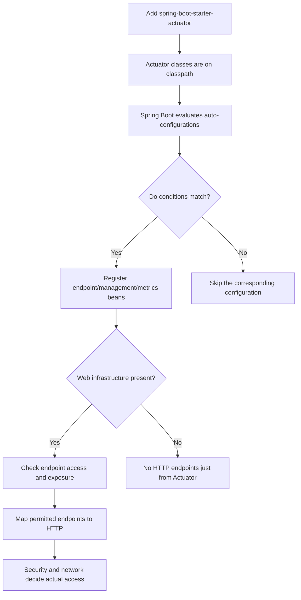
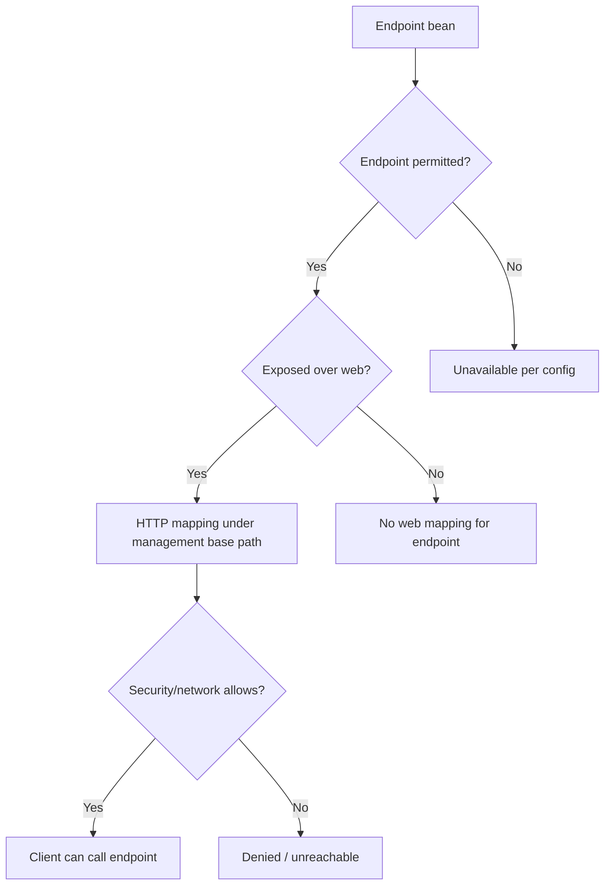
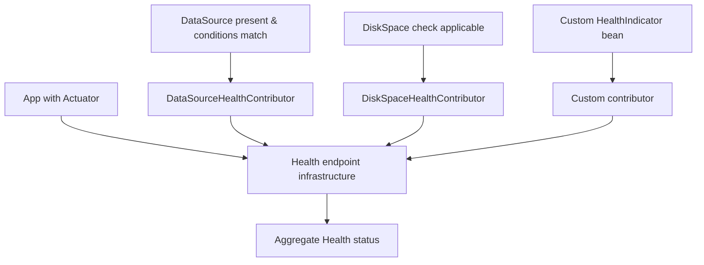

# Actuator Dependencies and Their Relationship with Auto-Configuration

When a Spring Boot application is running, developers and operators often want to know: is the application still healthy, is it ready to receive requests, which beans and configurations are in use, what metrics exist, and why an auto-configuration was enabled or skipped. **Spring Boot Actuator** provides application observability and management capabilities to answer those questions.

Interestingly, in many Spring Boot projects, you only need to add the dependency:

```groovy
implementation 'org.springframework.boot:spring-boot-starter-actuator'
```

Then restart the application, and the `/actuator/health` endpoint can appear **without you writing a single controller**. Why does merely adding a library change runtime behavior?

That is the relationship between **dependencies on the classpath** and Spring Boot's **auto-configuration mechanism**:

1. The Actuator dependency puts the required classes and components onto the classpath.
2. Spring Boot inspects the registered auto-configurations.
3. Conditions such as presence of classes, presence or absence of beans, property values, and application type determine which configurations match.
4. Auto-configuration can register the health endpoint, metric infrastructure, and management components.
5. For web applications, eligible endpoints are mapped to HTTP paths depending on **enablement/access**, **exposure**, and **security** rules.

This lesson belongs to the **Application Observability** chapter in *Spring Boot Fundamentals*. We will connect the concepts of starter dependencies, classpath, conditional auto-configuration, Actuator endpoints, Micrometer, health contributors, endpoint exposure, and tools for inspecting active configuration.

The examples focus on **Spring Boot 3.x with Java 17 or later**. Access/enablement mechanisms, the endpoint set, auto-configuration names, and security defaults can change across versions; check your project's version when applying a property or drawing conclusions about specific conditions.

## 1. The Problem: Observing an Application Without Building Dozens of Custom APIs

Suppose we have a REST API:

```java
package com.example.catalog;

import org.springframework.boot.SpringApplication;
import org.springframework.boot.autoconfigure.SpringBootApplication;

@SpringBootApplication
public class CatalogApplication {

    public static void main(String[] args) {
        SpringApplication.run(CatalogApplication.class, args);
    }
}
```

The application has several business controllers and services. When deployed to a server, operations systems need answers to these questions:

- Is the JVM alive and is the application context functioning?
- Is the database or a critical dependency ready?
- Should a load balancer send requests to this instance?
- How are request counts and response times changing?
- Which configuration properties are in effect?
- Which auto-configurations matched or did not match?
- Which beans exist in the context?

You could manually write a `@RestController` for each question. Doing so leads to considerable repetitive work:

- Designing a custom health response format.
- Manually aggregating statuses across dependencies.
- Building a metric collection layer.
- Creating endpoints to list configurations and beans.
- Handling access permissions, sensitive data, errors, and maintenance.

Actuator provides shared infrastructure to satisfy common observability needs while integrating with Spring Boot's lifecycle and auto-configuration. It **does not completely replace a monitoring system** or business checks, but it reduces the work you have to build yourself.

## 2. What Is Actuator and What Is It Not?

**Spring Boot Actuator** is a set of components supporting production-ready features, especially monitoring and management of a Spring Boot application. It can provide:

| Group | Example | Question Answered |
|---|---|---|
| Health | `health` | What is the status of the application/dependencies? |
| Information | `info` | What metadata does the application publish? |
| Metrics | `metrics` | How are JVM, HTTP, or business metrics being collected? |
| Configuration diagnostics | `env`, `configprops`, `conditions` | Which properties are at runtime, which config beans exist, and which auto-config conditions matched? |
| Container diagnostics | `beans`, `mappings` | Which Spring beans and HTTP mappings exist? |
| Runtime diagnostics | `threaddump`, `heapdump`, `loggers` | What is the state of threads, heap, and loggers? |

These are **example endpoint names**, not a promise that all of them are enabled, exposed, or accessible over HTTP in every project.

### 2.1. Actuator Does Not Automatically Create Dashboards

Adding Actuator does not automatically spawn a long-term metric storage system or full dashboards. Actuator can provide information and integrate with Micrometer; to store metrics over time, you usually need to add a registry/exporter and an external system like Prometheus alongside a suitable visualization tool.

### 2.2. Actuator Does Not Automatically Make External Dependencies Healthy

The health endpoint aggregates registered `HealthIndicator`/`HealthContributor` beans. Actuator returning `UP` only means the checks currently executed yielded that status. It does not guarantee every business flow and every external system is operating correctly.

### 2.3. Actuator Is Not Spring Boot DevTools

The two dependencies serve different goals:

| Dependency | Primary Purpose |
|---|---|
| `spring-boot-starter-actuator` | Observability, health, metrics, and management endpoints for the application. |
| `spring-boot-devtools` | Development loop assistance such as restarts, LiveReload, and development-time properties. |

Actuator is also commonly used in production, though it requires appropriate exposure, authorization, and network boundaries. DevTools primarily serves development environments.

## 3. Adding the Actuator Dependency

### 3.1. Gradle with Groovy DSL

In `build.gradle`:

```groovy
dependencies {
    implementation 'org.springframework.boot:spring-boot-starter-web'
    implementation 'org.springframework.boot:spring-boot-starter-actuator'
}
```

### 3.2. Gradle with Kotlin DSL

In `build.gradle.kts`:

```kotlin
dependencies {
    implementation("org.springframework.boot:spring-boot-starter-web")
    implementation("org.springframework.boot:spring-boot-starter-actuator")
}
```

### 3.3. Maven

In `pom.xml`:

```xml
<dependencies>
    <dependency>
        <groupId>org.springframework.boot</groupId>
        <artifactId>spring-boot-starter-web</artifactId>
    </dependency>
    <dependency>
        <groupId>org.springframework.boot</groupId>
        <artifactId>spring-boot-starter-actuator</artifactId>
    </dependency>
</dependencies>
```

These examples assume the project uses the Spring Boot plugin/parent or BOM for version management; there is no need to declare a separate version for each starter when proper dependency management is in place.

### 3.4. Why Is It Called a Starter?

A **starter** is a convenience dependency that bundles commonly used dependencies for a feature. Instead of manually selecting individual Actuator, Micrometer, and integration modules, you add the starter to get a set of dependencies compatible with your Boot version.

Conceptually:

```text
Spring Boot application
    |
    +-- spring-boot-starter-web       (if servlet HTTP is needed)
    |
    +-- spring-boot-starter-actuator
          |
          +-- Spring Boot Actuator
          +-- Actuator auto-configuration
          +-- Related Micrometer / observation infrastructure
          +-- Required underlying dependencies
```

**The actual list of transitive dependencies is a property of each version.** When you need to know the exact modules brought in, inspect the build's dependency tree rather than guessing from a diagram.

### 3.5. Inspecting the Dependency Tree

With Gradle, a reference command:

```bash
./gradlew dependencies --configuration runtimeClasspath
```

Or search for a specific dependency:

```bash
./gradlew dependencyInsight --dependency spring-boot-actuator --configuration runtimeClasspath
```

With Maven:

```bash
./mvnw dependency:tree
```

These commands inspect dependencies in your project. The output helps distinguish **declared starters** from **modules actually present on `runtimeClasspath`**.

## 4. How Does Adding a Dependency Affect Auto-Configuration?

The annotation commonly seen on the main class is:

```java
@SpringBootApplication
public class CatalogApplication {
    public static void main(String[] args) {
        SpringApplication.run(CatalogApplication.class, args);
    }
}
```

`@SpringBootApplication` includes Spring Boot's auto-configuration enabling mechanism. Boot discovers auto-configuration candidates declared by modules on the classpath, then evaluates conditions to decide whether to register a configuration or skip it.

An auto-configuration can use several types of conditions:

| Condition | General Meaning |
|---|---|
| `@ConditionalOnClass` | Applies only when a related class is on the classpath. |
| `@ConditionalOnBean` | Applies only when a required bean already exists in the context at evaluation time. |
| `@ConditionalOnMissingBean` | Typically “backs off” if the application already provides a corresponding bean. |
| `@ConditionalOnProperty` | Depends on the value of a property. |
| `@ConditionalOnWebApplication` | Applies only to the matching web application type. |
| Endpoint/management conditions | Depend on enablement/access/exposure status and management infrastructure per version. |

**Adding a dependency changes the classpath.** When the classpath changes, some conditions that previously did not match can begin matching. This is a primary reason why Actuator infrastructure beans appear after adding the starter.

### 4.1. Overall Flow



The diagram shows that **a dependency is a necessary condition in many cases, not a sufficient condition** for every endpoint to appear and be publicly accessible.

### 4.2. No Need to Manually Add a Controller for `/actuator/health`

When the proper infrastructure is created, Spring Boot Actuator provides `HealthEndpoint` and the mechanism to map management endpoints to the web. Therefore, you normally do not need to write:

```java
@GetMapping("/actuator/health")
public String health() {
    return "UP";
}
```

In fact, **you should not arbitrarily build a replacement endpoint** if the goal is to use Actuator's health aggregation system and access/security rules. If a custom health check is needed, extend it through an appropriate `HealthIndicator` or `HealthContributor`.

### 4.3. Auto-Configuration Does Not Always “Win” Over Application Config

Many auto-configurations are designed to **back off** when the application already supplies custom beans or configuration. However, not every bean follows identical back-off rules.

Therefore:

- Adding a starter does not guarantee a specific bean will be registered.
- Having a custom bean can stop part of auto-configuration from creating a default bean.
- Two modules can jointly influence conditions.
- Outcomes must be verified in the actual `ApplicationContext`.

## 5. At What Stage Is Actuator Auto-Configuration Brought In?

During `SpringApplication.run(...)`:

1. Boot prepares the `Environment` and creates the `ApplicationContext`.
2. The context is refreshed.
3. Spring processes configuration classes and auto-configuration imports.
4. Matching conditional configurations are processed and register bean definitions.
5. Required infrastructure beans and singletons are created.
6. Management endpoint infrastructure is finalized according to the context lifecycle.
7. For web apps, eligible endpoints can be mapped to HTTP.

This is a **general** description; it does not mean every Actuator bean is created at the exact same moment or all mappers are established in an identical fixed order across versions.

### 5.1. Actuator Classes Do Not Imply Endpoints Are Ready

It is necessary to distinguish:

| State | What It Proves |
|---|---|
| JAR is on runtime classpath | Actuator code can be loaded. |
| Auto-configuration candidate found | Boot can inspect the configuration. |
| Condition matched | Configuration met conditions during that evaluation. |
| Endpoint bean registered | Endpoint exists in context per conditions. |
| Endpoint exposed over HTTP | Web mapping exists for the eligible endpoint. |
| Request returns HTTP 200 | Path, security, and endpoint status allowed that request to succeed. |

These steps do not automatically imply one another. In particular, **“a bean exists” is different from “anyone can call it over HTTP.”**

### 5.2. Does Adding the Starter Change a Non-Web Application?

For example, a batch application using only:

```groovy
implementation 'org.springframework.boot:spring-boot-starter'
implementation 'org.springframework.boot:spring-boot-starter-actuator'
```

may have some management endpoint beans and metric infrastructure; however, without a servlet/reactive web server, adding Actuator **does not create an HTTP server** just to open `/actuator/health`.

HTTP management access requires appropriate web infrastructure; some management capabilities may still be provided via JMX when configuration permits. Do not test for Actuator's presence merely by running `curl` against a non-web batch application.

## 6. What Is an Endpoint? How Do `HealthEndpoint` and Web Mapping Differ?

An **Actuator endpoint** is a component expressing a management/observability capability. It is not necessarily a `@RestController`.

For example:

- `HealthEndpoint` provides the health check operation.
- `InfoEndpoint` provides information from info contributors.
- `MetricsEndpoint` provides querying of available metrics.

Actuator infrastructure discovers endpoint beans and exposes their operations to corresponding technologies such as web or JMX, depending on modules and configuration.

### 6.1. Three Important Boundaries



This is a streamlined model for understanding how an endpoint can exist in code yet not appear on HTTP. Exact property terminology for “access” or “enabled” must be checked against your Boot version.

### 6.2. Endpoint Discovery Page

In a web application with Actuator, the path:

```text
GET /actuator
```

can return a discovery document containing links to exposed web endpoints, if discovery is enabled and the response is not blocked by security.

The presence or content of the discovery page also depends on the management base path, server port, path, and endpoint configuration. If `/actuator` does not return the expected list, it does not mean the starter is definitely missing.

## 7. First Test: `/actuator/health`

Suppose an application uses `spring-boot-starter-web` and `spring-boot-starter-actuator`. When started with a common configuration, you can access:

```bash
curl http://localhost:8080/actuator/health
```

Illustrative response:

```json
{
  "status": "UP"
}
```

This is the case for a test application whose health checks return `UP` and whose endpoint is accessible. If a health contributor reports `DOWN`, the HTTP status and body may differ; do not treat `200/UP` as a fixed answer.

### 7.1. Default HTTP Exposure Is Not “Everything”

In many Spring Boot 3.x versions, only the `health` endpoint is exposed over HTTP by default. Therefore, after adding the dependency:

```text
GET /actuator/health
```

may work while:

```text
GET /actuator/metrics
GET /actuator/env
GET /actuator/beans
```

are not yet exposed.

Do not conclude `metrics` or `env` “are not installed” simply because `curl` receives HTTP 404; first check management exposure, endpoint availability, web mapping, and security.

### 7.2. Health Returns an Aggregated Status

Health can aggregate results from multiple contributors:

```text
health
  +-- diskSpace
  +-- ping
  +-- db (when applicable and configured)
  +-- custom contributor
```

The actual set of contributors depends on present dependencies, beans, and configuration. If an application does not use a database and has no `DataSource`, do not assume a health contributor named `db` always exists.

## 8. Endpoint Enabled/Access, Exposure, and Security: Three Different Issues

This is the most important part when connecting dependencies with runtime experience.

### 8.1. Is the Endpoint Enabled/Permitted at the Management Level?

Spring Boot has mechanisms controlling endpoint availability. In many Boot 3.x versions, you may encounter:

```properties
management.endpoint.health.enabled=true
management.endpoint.info.enabled=true
```

Newer versions may use access-control properties such as `management.endpoint.<id>.access`; exact naming and precedence should be verified by version.

Conceptually, disabling an endpoint or denying access at the management layer can prevent the infrastructure from providing the endpoint as normal, even when the dependency is on the classpath.

### 8.2. Is the Endpoint Exposed over HTTP?

In Spring Boot 3.x, web exposure configuration is typically:

```yaml
management:
  endpoints:
    web:
      exposure:
        include: health,info,metrics
```

When the corresponding endpoints are enabled/permitted, web infrastructure is present, and security does not block them, the URLs can include:

```text
GET /actuator/health
GET /actuator/info
GET /actuator/metrics
```

**`include` cannot make any endpoint appear if the module, bean, or conditions to create that endpoint do not exist.** It only controls exposing an eligible endpoint.

You can also configure exclusions:

```yaml
management:
  endpoints:
    web:
      exposure:
        include: health,info,metrics
        exclude: metrics
```

With this configuration, `metrics` is excluded from the web exposure list even though it was listed in `include`.

### 8.3. Is the Endpoint Protected by Security?

Even if `/actuator/env` is exposed, the application can still use Spring Security to require authentication/authorization or restrict the network.

For example, the request:

```text
GET /actuator/env
```

may return 401/403 instead of 200 due to a security policy. Do not disable security just to “fix an Actuator error.”

With Spring Security, if the application defines its own `SecurityFilterChain`, responsibility for protecting management endpoints must be handled in that chain. Boot's default security auto-configuration does not necessarily continue applying the same way once you provide your own security configuration.

### 8.4. Quick Diagnostic Table

| Symptom | Causes to Check |
|---|---|
| `/actuator/health` returns 404 | No web infrastructure, different base path, endpoint not exposed/enabled, different context path. |
| `/actuator/metrics` returns 404 | Metrics not exposed, endpoint unavailable, or different management server/path. |
| `/actuator/env` returns 401 | Endpoint may be exposed but requires authentication. |
| `/actuator/env` returns 403 | Security policy denies access. |
| `/actuator/health` returns 503 | Health may be `DOWN` or status mapped to HTTP 503. |
| `/actuator/info` returns `{}` | Info endpoint may be working but no contributor is providing metadata. |

You cannot uniquely determine a cause from a single status code; examine paths, logs, security, and configuration.

## 9. Minimal and Safe Exposure Configuration

An illustrative configuration for a local environment:

```yaml
spring:
  application:
    name: catalog-service

management:
  endpoints:
    web:
      exposure:
        include: health,info,metrics
  endpoint:
    health:
      show-details: when_authorized
```

In a controlled test environment, you can additionally open `conditions` to observe why auto-configurations are enabled:

```yaml
management:
  endpoints:
    web:
      exposure:
        include: health,info,metrics,conditions
```

**Do not arbitrarily open `*` for all endpoints in production.** Endpoints such as `env`, `configprops`, `beans`, `heapdump`, `threaddump`, and `loggers` can expose internal information or widen the attack surface. Sanitizing values reduces risk, but it does not replace authentication, authorization, and network restrictions.

### 9.1. Be Careful When Using `include: "*"`

An example often seen in experimental docs:

```yaml
management:
  endpoints:
    web:
      exposure:
        include: "*"
```

This is **not a recommended production configuration**. It can expose more management endpoints than expected. Use it only in isolated environments with a clear understanding of security and which endpoints have been created.

### 9.2. Hiding Sensitive Information in Health Details

In a public application, overall health status may need to be displayed, while details of databases, disks, or dependencies should not be freely exposed externally. `management.endpoint.health.show-details` helps control detail visibility depending on policy/version; if choosing `when_authorized`, design roles and security accordingly.

## 10. How Does Health Auto-Configuration Recognize Dependencies?

An important characteristic of Actuator is that health contributors can be conditionally configured based on existing infrastructure.

For example, an application with only the web starter and Actuator might have general health contributions for disk space or ping. After adding the JDBC starter and configuring a valid `DataSource`, auto-configuration can detect the datasource infrastructure to create a `DataSourceHealthIndicator` when conditions match.

Conceptual diagram:



Actual bean names and contributor types may vary by version or topology, especially with multiple datasources. The key point is that **available dependencies and beans influence which health contributors are automatically registered**.

### 10.1. Why Can Adding the JDBC Starter Change the Health Response?

Previously, Actuator had no datasource bean to check. After adding the dependency and configuring a datasource, the conditions for the database health contributor can match.

Result:

- A new health check participates in aggregation.
- Health status can change from `UP` to `DOWN` if the database is unreachable.
- `/actuator/health` may return a different HTTP status per the status mapping.

Thus, **changing dependencies can alter the behavior of an Actuator endpoint without editing any controller**.

### 10.2. Disabling a Specific Auto-Configured Contributor

Once operational goals are understood, you can look at properties such as:

```properties
management.health.db.enabled=false
```

For Spring Boot 3.x versions supporting this property, it controls the corresponding auto-configured database health contributor. However, disabling the DB health check to “turn the dashboard green” can hide a broken dependency. Only do this when it is clear the DB is not a liveness/readiness condition for the service, or you have a more suitable health policy.

### 10.3. Health Status Does Not Automatically Mean Business Readiness

An application might open a DB connection yet still fail to process requests because:

- Business configuration is invalid.
- A required data cache has not been prepared.
- A critical downstream service is not ready.
- An event consumer has stopped processing.

If that dependency is a requirement for serving traffic, design appropriate health/readiness contributors and health groups. Avoid creating health checks with unbounded network call timeouts or excessive load.

## 11. Writing a Custom `HealthIndicator`

Instead of writing a `/health` endpoint manually, you can provide a `HealthIndicator` bean:

```java
package com.example.catalog.health;

import org.springframework.boot.actuate.health.Health;
import org.springframework.boot.actuate.health.HealthIndicator;
import org.springframework.stereotype.Component;

@Component
public class CatalogIndexHealthIndicator implements HealthIndicator {

    private final CatalogIndexState indexState;

    public CatalogIndexHealthIndicator(CatalogIndexState indexState) {
        this.indexState = indexState;
    }

    @Override
    public Health health() {
        if (indexState.isReady()) {
            return Health.up().build();
        }
        return Health.down()
                .withDetail("reason", "catalog-index-not-ready")
                .build();
    }
}
```

`CatalogIndexState` is an application service you implement, for example managing a flag indicating whether the index has loaded. When the `CatalogIndexHealthIndicator` bean is registered and discovered by the health contribution system under active rules, its result can participate in the health endpoint.

### 11.1. Why Use `HealthIndicator`?

- Reuses Actuator's health aggregation infrastructure.
- Can participate in appropriate health groups.
- Avoids writing HTTP mapping and status codes manually.
- Combines cleanly with default contributors.
- Allows unit testing health logic as a service/bean.

### 11.2. Do Not Put Secrets Into Health Details

`withDetail(...)` can be visible in responses when configuration permits health details. Do not log passwords, connection strings with credentials, API keys, or sensitive stack traces into details.

### 11.3. Liveness and Readiness Should Not Be Mixed Arbitrarily

Liveness generally answers “does the process need a restart?”, while readiness answers “can the instance receive traffic?”. A temporarily failing external dependency does not always mean the process needs to be restarted.

Spring Boot has availability states and health groups to support distinct goals. Enabling and exposing probes depends on environment and configuration; for instance, an app deployed on Kubernetes can have `liveness` and `readiness` health groups under suitable conditions.

Do not automatically add every external dependency to liveness and let the orchestrator needlessly restart instances whenever the network flickers.

## 12. Metrics and Micrometer: Relationship with the Starter

Another major benefit of Actuator is integration with **Micrometer** and Spring Boot's observation system.

In common usage:

1. The Actuator starter brings compatible metrics and observation infrastructure onto the classpath.
2. Metrics auto-configuration evaluates conditions and sets up `MeterRegistry` or related beans when appropriate.
3. Suitable binders/instrumentation can create metrics for JVM, process, HTTP server, or other components.
4. `MetricsEndpoint` can expose available metric information via a management endpoint.
5. To export data to external systems, configure the appropriate registry/exporter.

### 12.1. The Metrics Endpoint Is Not a Dashboard

When `metrics` is exposed, you can try:

```bash
curl http://localhost:8080/actuator/metrics
```

An illustrative response:

```json
{
  "names": [
    "jvm.memory.used",
    "process.cpu.usage",
    "http.server.requests"
  ]
}
```

The actual metric set **is not fixed**: it depends on dependencies, versions, registries, enabled binders, and activity that has occurred. An HTTP metric may not appear yet if no request has been recorded or corresponding instrumentation is inactive.

### 12.2. Querying a Metric

Example:

```bash
curl http://localhost:8080/actuator/metrics/jvm.memory.used
```

Depending on the metric, the response may contain the name, description, measurements, and available tags.

### 12.3. Adding the Prometheus Registry

To export metrics in Prometheus format, with Spring Boot 3.x you can add:

```groovy
dependencies {
    implementation 'org.springframework.boot:spring-boot-starter-actuator'
    runtimeOnly 'io.micrometer:micrometer-registry-prometheus'
}
```

Then, if conditions match, the Prometheus actuator endpoint can be auto-configured. For HTTP clients to access it, expose it:

```yaml
management:
  endpoints:
    web:
      exposure:
        include: health,info,prometheus
```

Test command:

```bash
curl http://localhost:8080/actuator/prometheus
```

If you only add `spring-boot-starter-actuator` **without a Prometheus registry** on the classpath, do not expect `/actuator/prometheus` to always appear. Once again, dependencies affect auto-configuration conditions.

### 12.4. `MeterRegistry` and the Endpoint Are Not Completely Identical

`MeterRegistry` is where metrics are registered and read according to Micrometer's mechanism. `MetricsEndpoint` is one way to query metrics for management. You can use Micrometer in code or export metrics via a registry without necessarily exposing `/actuator/metrics` over HTTP.

Do not treat a 404 web endpoint as proof that the system is not collecting metrics at all.

## 13. Dependency Changes Can Trigger Multiple Auto-Configurations

Consider three development milestones of the same application:

### Phase A — Web Starter Only

```groovy
implementation 'org.springframework.boot:spring-boot-starter-web'
```

The application has REST controllers, an embedded server, and web-related auto-configurations. However, do not assume any Actuator endpoints exist without adding Actuator infrastructure.

### Phase B — Adding the Actuator Starter

```groovy
implementation 'org.springframework.boot:spring-boot-starter-actuator'
```

The classpath gains Actuator/Micrometer infrastructure. Corresponding auto-configurations can conditionally create management endpoint beans, health contributors, and metrics infrastructure.

### Phase C — Adding JDBC or Prometheus Registry

```groovy
implementation 'org.springframework.boot:spring-boot-starter-jdbc'
runtimeOnly 'io.micrometer:micrometer-registry-prometheus'
```

With appropriate datasource configuration and registry:

- JDBC auto-configuration can create a datasource.
- Health auto-configuration can create a DB health contributor.
- Metrics registry auto-configuration can create a Prometheus registry/exporter.
- The Prometheus management endpoint can become available and exposed if configured.

This is the model **dependency → condition → bean/configuration → endpoint/behavior**.

### 13.1. A Dependency Does Not Guarantee Auto-Configuration Succeeds

For example, adding the JDBC starter without a valid datasource URL or embedded DB can cause the application **to fail on startup** due to incomplete datasource configuration. Do not think “adding JDBC lets Actuator connect to a database by itself.”

The underlying component must be validly configured; Actuator only observes or aggregates status via appropriate checks.

## 14. Condition Evaluation Report: Explaining Auto-Configuration

When you suspect a dependency is present yet a bean or endpoint still does not appear, a key tool is the **Condition Evaluation Report**.

In development, run:

```bash
./gradlew bootRun --args='--debug'
```

Or with a JAR:

```bash
java -jar app.jar --debug
```

Depending on configuration and version, Spring Boot can print the Condition Evaluation Report in the logs, showing which auto-configurations matched and why others did not.

### 14.1. An Example of Reasoning from Conditions

Suppose you expect the Prometheus endpoint but do not see it:

```text
Observation 1: spring-boot-starter-actuator is present
Observation 2: micrometer-registry-prometheus is absent
Observation 3: /actuator/prometheus is unavailable
```

A reasonable line of investigation is that **missing Prometheus registry classes** caused the related auto-configuration not to match. After adding the dependency, still check enablement/access, exposure, and security.

### 14.2. Positive Matches and Negative Matches

The condition report typically helps identify:

- **Positive matches:** configurations whose conditions were met.
- **Negative matches:** one or more conditions were not satisfied.
- **Unconditional classes or other sections:** depending on version and report format.

Do not infer that a “positive match” means the endpoint is definitely public. It may only prove that **part of the configuration** met its conditions.

### 14.3. Conditions Are Evaluated Only in the Actual Context

Match results can differ between:

- Local and production apps.
- Web apps and batch apps.
- Presence/absence of a dependency.
- Presence/absence of a custom bean.
- Different active profiles.
- Config properties enabling/disabling features.

Therefore, the report must be gathered from the **exact run** experiencing the issue.

## 15. Using `/actuator/conditions` to Inspect

Actuator has a `conditions` endpoint for inspecting condition evaluation in the running context when available and exposed.

In a protected local environment:

```yaml
management:
  endpoints:
    web:
      exposure:
        include: health,conditions
```

Then try:

```bash
curl http://localhost:8080/actuator/conditions
```

The response can contain sections for positive and negative matches with auto-configuration names and explanatory details.

### 15.1. Why Is `conditions` Useful?

When a bean is automatically created “unexpectedly” or not created at all:

1. Find the related auto-configuration in the report.
2. See which class/bean/property is the condition.
3. Verify the dependency is actually on the classpath.
4. Check `Environment` values.
5. Check whether an application-provided bean caused auto-configuration to back off.

### 15.2. Protecting the `conditions` Endpoint

The report can reveal packages, classes, dependencies, and configuration structure of the application. Do not expose it publicly in production. If investigation on a live instance is required, use a secure connection and appropriate authorization.

## 16. Relationship Between Actuator and Other Auto-Configurations in Boot

Actuator does not operate in isolation. It observes and depends on components created by application auto-configuration.

Examples:

| Application Feature | Related Condition/Infrastructure | Observable Actuator Impact |
|---|---|---|
| JDBC | Valid `DataSource` present | DB health contributor or datasource metrics if conditions match. |
| Servlet MVC | Servlet web server and web mappings present | HTTP server metrics and web endpoint mappings if supported. |
| JVM | Appropriate JVM metrics binders | Heap, GC, thread, or process metrics. |
| Micrometer registry | Registry dependency and matching config | Exports metrics to the corresponding backend. |
| Spring Security | Security filter chains | Determines who has permission to call management endpoints. |
| Custom `HealthIndicator` | Application-declared health contributor bean | Adds a health component in aggregation. |
| Custom `@ConfigurationProperties` bean | Binding and Actuator configprops endpoint | Allows observing bound configuration (subject to security/sanitization). |

Adding another starter can alter Actuator without modifying the Actuator dependency. This is a characteristic of Spring Boot's conditional auto-configuration system.

### 16.1. Auto-Configuration Enables Modular Extension

New modules can declare auto-configurations to integrate with Actuator, such as custom health indicators or metrics binders. This gives the same application a richer observability set as the classpath grows.

### 16.2. Auto-Configuration Also Has Limits

The framework cannot automatically know certain business states:

- Does processing new orders depend on a warmed-up cache?
- Is the system receiving pricing data from an external source?
- Has a background consumer stopped?

Those states require custom health/metrics/observations designed around business requirements.

## 17. Changing Management Base Path and Port

Under common web management configuration, endpoints appear under the base path `/actuator`. You can customize it:

```yaml
management:
  endpoints:
    web:
      base-path: /manage
      exposure:
        include: health,info
```

Then the URLs can be:

```text
GET /manage/health
GET /manage/info
```

If you still try `/actuator/health`, you may get 404 even though Actuator is working.

### 17.1. Separate Management Server Port

In a suitable servlet web application, you can set:

```yaml
server:
  port: 8080

management:
  server:
    port: 8081
  endpoints:
    web:
      exposure:
        include: health,info
```

Management URLs can be served on port 8081 instead of 8080:

```text
http://localhost:8081/actuator/health
```

A separate management server can have its own context and network/security considerations. This is not an automatic security mechanism; you must still control ports, binding addresses, firewalls, reverse proxies, and authentication appropriately.

### 17.2. Context Path and Reverse Proxy

If the application or a proxy adds a path prefix, the URL seen from the client may differ from the internal path. When encountering 404, check the layers:

```text
Client URL -> reverse proxy -> app context path -> management base path
```

Do not conclude “Actuator was not auto-configured” just because an incorrect URL was typed.

## 18. Checking Whether Actuator Beans Exist in the Context

A direct way to learn is to inject `ApplicationContext` and inspect the relevant bean types.

```java
package com.example.catalog.diagnostics;

import java.util.Arrays;
import org.springframework.boot.ApplicationArguments;
import org.springframework.boot.ApplicationRunner;
import org.springframework.boot.actuate.health.HealthEndpoint;
import org.springframework.context.ApplicationContext;
import org.springframework.stereotype.Component;

@Component
public class ActuatorBeanReporter implements ApplicationRunner {

    private final ApplicationContext context;

    public ActuatorBeanReporter(ApplicationContext context) {
        this.context = context;
    }

    @Override
    public void run(ApplicationArguments args) {
        String[] names = context.getBeanNamesForType(HealthEndpoint.class);
        System.out.println("HealthEndpoint beans: "
                + Arrays.toString(names));
    }
}
```

When the endpoint bean is created in this context, the code can print the corresponding bean names. However, if the management context is separate, or the endpoint was not created due to access/enablement conditions, the list in the inspected application context may not match expectations.

### 18.1. Why Should You Not Create Your Own `HealthEndpoint`?

Actuator already has dedicated infrastructure for health aggregation. You should usually contribute a `HealthIndicator` or configure a health group, rather than creating a replacement `HealthEndpoint` just to alter a message.

### 18.2. Bean Presence Does Not Guarantee HTTP Mapping

Even if `getBeanNamesForType(HealthEndpoint.class)` returns a bean name, you still need to verify:

- Web management context.
- Endpoint exposure.
- Base path/management port.
- Security policy.

Bean-level introspection and HTTP-level smoke tests answer two different questions.

## 19. Integration Testing: Confirming the Health Endpoint Is Served

For a test application using `spring-boot-starter-web`, `spring-boot-starter-actuator`, and `spring-boot-starter-test`, you can write an integration test:

```java
package com.example.catalog;

import static org.assertj.core.api.Assertions.assertThat;

import org.junit.jupiter.api.Test;
import org.springframework.beans.factory.annotation.Autowired;
import org.springframework.boot.test.context.SpringBootTest;
import org.springframework.boot.test.web.client.TestRestTemplate;
import org.springframework.http.ResponseEntity;

@SpringBootTest(
        webEnvironment = SpringBootTest.WebEnvironment.RANDOM_PORT,
        properties = "management.endpoints.web.exposure.include=health,info")
class ActuatorHealthSmokeTest {

    @Autowired
    TestRestTemplate http;

    @Test
    void healthEndpointIsReachable() {
        ResponseEntity<String> response =
                http.getForEntity("/actuator/health", String.class);

        assertThat(response.getStatusCode().is2xxSuccessful()).isTrue();
        assertThat(response.getBody()).contains("\"status\"");
    }
}
```

In a demo project with healthy contributors and no blocking security, the test can confirm the health endpoint has been mapped over HTTP. If the project has an unhealthy dependency, status may be `DOWN` and the test should express concrete operational expectations rather than assuming every context is `UP`.

### 19.1. What Does This Test Not Prove?

It **does not** thoroughly test:

- Health indicators of every dependency.
- All Actuator endpoints.
- User permissions in production.
- Behavior of a separate management port/context.
- Exporting metrics to a monitoring backend.

A passing HTTP test only confirms the tested path in that specific test environment.

### 19.2. Testing Configuration Without the Dependency

A meaningful comparison is creating two small application configurations:

- A has `spring-boot-starter-web` without Actuator.
- B adds `spring-boot-starter-actuator`.

Observe the differences in beans/endpoints that appear. Do not assume simply adding the starter always exposes all endpoints.

## 20. When You Add the Starter Yet Do Not See `/actuator/health`

Investigate along the causal chain rather than randomly tweaking properties.

### 20.1. Step 1 — Verify the Dependency Is on the Runtime Classpath

Check the dependency tree. The project might declare the starter under `testImplementation`, `developmentOnly`, or a configuration that does not participate in the expected runtime.

### 20.2. Step 2 — Check the Application Type

If this is a non-web batch application or has `spring.main.web-application-type=none`, do not expect HTTP endpoints without a web server.

### 20.3. Step 3 — Verify the Application Started Successfully

If the application context failed during refresh due to a missing database URL or another bean, the embedded server and Actuator endpoints may not be ready to accept requests.

### 20.4. Step 4 — Check Endpoint Access/Enablement and Exposure

Check:

```text
management.endpoint.health.enabled
management.endpoints.web.exposure.include
management.endpoints.web.exposure.exclude
```

Depending on the Spring Boot version, you may also need to check management endpoint access properties. Check effective values via `Environment`, not just by looking at one configuration file.

### 20.5. Step 5 — Check Paths and Ports

Were `management.endpoints.web.base-path`, `management.server.port`, the app context path, or a proxy prefix changed?

### 20.6. Step 6 — Check Security

If the response is 401/403, this may be a sign that **the endpoint exists but is protected**. Do not make a management endpoint public just to make `curl` convenient.

### 20.7. Step 7 — Inspect the Condition Evaluation Report

If you suspect auto-configuration failed to create an endpoint bean, check `--debug` or a protected `conditions` endpoint to see which condition did not match.

### 20.8. Step 8 — Distinguish Endpoint Presence from Health Status

If `/actuator/health` returns 503 and the body reports `DOWN`, that is completely different from 404. The endpoint may be working properly by reporting that a health contributor is unhealthy.

## 21. If `/actuator/info` Is Empty, Is Auto-Configuration Broken?

Not necessarily. `InfoEndpoint` aggregates data from `InfoContributor` beans. If no suitable contributors exist or contributors are disabled, the response may be an empty object:

```json
{}
```

You can provide application info via mechanisms supported by Boot. For example:

```yaml
management:
  info:
    env:
      enabled: true

info:
  app:
    name: catalog-service
    purpose: product-catalog
```

With matching version and contributor, the info endpoint can display that metadata once exposed. Do not confuse **an endpoint created successfully with no data yet** with **auto-configuration failure**.

### 21.1. Do Not Publish Sensitive Data in `info`

`info` may be queried by monitoring or users depending on security setup. Avoid placing secret environment variables, internal credentials, or sensitive topology in `info.*`.

## 22. Can You Write a Custom Actuator Endpoint?

Yes. However, separate two goals:

- **Custom health:** provide an appropriate `HealthIndicator`.
- **Custom management operation:** consider building a dedicated Actuator endpoint when you need management functionality independent of business REST APIs.

Example of a simple status-reading endpoint:

```java
package com.example.catalog.management;

import java.util.Map;
import org.springframework.boot.actuate.endpoint.annotation.Endpoint;
import org.springframework.boot.actuate.endpoint.annotation.ReadOperation;
import org.springframework.stereotype.Component;

@Component
@Endpoint(id = "catalogstatus")
public class CatalogStatusEndpoint {

    @ReadOperation
    public Map<String, Object> status() {
        return Map.of("catalogLoaded", true);
    }
}
```

In an application with Actuator, this custom endpoint can be discovered as an endpoint bean. **It is not automatically made public over the web** merely because it has `@Endpoint` and `@Component`. You must consider enablement/access, exposure, and security in the exact same way as built-in endpoints.

Local configuration example:

```yaml
management:
  endpoints:
    web:
      exposure:
        include: health,catalogstatus
```

When eligible, the URL can be:

```text
GET /actuator/catalogstatus
```

### 22.1. When to Use `@Endpoint` Instead of `@RestController`?

`@Endpoint` fits a **management/observability capability** that needs to integrate with the Actuator system and obey exposure/access rules. `@RestController` fits business REST APIs intended for clients.

Do not place sensitive business APIs inside Actuator just to leverage the `/actuator` path; management operations have different contracts and consumers.

## 23. Security: Actuator Is Operational Infrastructure, Not a Default Public API

Management endpoints have tremendous diagnostic value, yet can also expose sensitive information.

Examples of risks:

- `env` reveals property names and can display certain values.
- `configprops` shows configuration bound into beans.
- `beans` exposes application context structure.
- `mappings` reveals HTTP mappings.
- `heapdump` can contain sensitive runtime data.
- `loggers` can allow viewing or modifying logging levels depending on configuration.

### 23.1. Rules to Apply

1. Expose only endpoints that are genuinely needed.
2. Protect sensitive management endpoints with authentication and authorization.
3. Restrict network access if using a management port or internal gateway.
4. Do not disable masking/sanitization arbitrarily.
5. Do not expose tokens, passwords, or secrets in health details or info.
6. Test management endpoint security after adding a custom `SecurityFilterChain`.
7. Review exposure when upgrading Spring Boot versions or adding starters.

### 23.2. Is Enabling Spring Security Enough?

This cannot be answered with a blanket “yes” for every project. When Spring Security is present, Boot can auto-configure some default protective behaviors; however, when an application declares its own security configuration, those rules can change.

Every deployment must verify in practice which endpoints:

- Allow anonymous access.
- Require login.
- Require special roles/authorities.
- Are completely blocked from external networks.

**Security must be verified with actual requests against the running configuration**, not solely by the presence of a dependency.

## 24. Distinguishing Auto-Configuration from “Activating All Features”

A common misunderstanding is that Spring Boot auto-configuration means you do not need to care about conditions. On the contrary, auto-configuration is how the framework **describes conditions for each piece of configuration**.

Example:

```text
Add Actuator starter
    |
    +-- HealthEndpoint may be registered
    |
    +-- Metrics infrastructure may be registered
    |
    +-- Prometheus endpoint? Needs registry and matching conditions
    |
    +-- DB health contributor? Needs datasource and matching conditions
    |
    +-- HTTP endpoint? Needs web app, exposure, and security permission
```

Auto-configuration does not mean:

- Skipping the dependency tree.
- Creating every external service automatically.
- Exposing every endpoint publicly.
- Solving authentication automatically.
- Knowing business health policies automatically.

Instead, it enables configuration **to scale according to what is present in the application**.

### 24.1. Why Is Conditional Behavior So Important?

The same codebase can run in multiple environments:

- Local without a real database.
- Tests with an embedded database.
- Production with PostgreSQL.
- One version with a Prometheus registry.
- Another version using a different metrics backend.

Auto-configuration allows the application to assemble matching infrastructure via dependencies and properties, yet you still need to check actual runtime state to avoid misunderstandings.

## 25. A Complete Diagnostic Scenario

**Scenario:** a development team just added `spring-boot-starter-actuator`. `/actuator/health` works, but `/actuator/prometheus` returns 404.

### Step 1 — Read the Dependency Tree

Inspect `runtimeClasspath` and find that the Actuator starter is present, yet `micrometer-registry-prometheus` is missing.

### Step 2 — Understand Auto-Configuration Conditions

The Prometheus endpoint depends on appropriate Prometheus registry infrastructure. When the registry class/bean is missing, the related auto-configuration may not create the endpoint.

### Step 3 — Add the Appropriate Dependency

```groovy
runtimeOnly 'io.micrometer:micrometer-registry-prometheus'
```

### Step 4 — Check Exposure

```yaml
management:
  endpoints:
    web:
      exposure:
        include: health,prometheus
```

### Step 5 — Check Security and Paths

Does the application have a separate management port or base path? Is the endpoint permitted by security for access from the monitoring agent?

### Step 6 — Test the Request

```bash
curl http://localhost:8080/actuator/prometheus
```

If Prometheus-formatted output is returned, web exposure is working in the test conditions. If not, check logs/conditions and registry configuration.

### Takeaway

**Adding a new starter is the step that unlocks integration capability.** The endpoint actually appears when auto-configuration has sufficient dependencies and conditions, and is then exposed over HTTP with an allowed access path.

## 26. Comprehensive Practice Lab

Create a small Spring Boot application with `spring-boot-starter-web`. Follow step by step:

**Step A — Baseline.** Run the application without the Actuator starter. Try `GET /actuator/health` and note the result.

**Step B — Add the dependency.** Declare `spring-boot-starter-actuator`, restart, and try `GET /actuator/health`.

**Step C — Check discovery.** Try `GET /actuator` and observe available links under current web/security conditions.

**Step D — Exposure.** Set `management.endpoints.web.exposure.include=health,info,metrics`; test each URL and distinguish 200/404/401/403.

**Step E — Custom `HealthIndicator`.** Write a `HealthIndicator` based on a test service's state. Toggle the ready flag and observe aggregate health.

**Step F — JDBC.** Add a suitable test dependency and datasource; see which health contributors are added if conditions match.

**Step G — Metrics.** Call a REST endpoint several times, then check `/actuator/metrics` and a built-in JVM/HTTP metric.

**Step H — Prometheus.** Add `micrometer-registry-prometheus`, expose the endpoint, and inspect the output.

**Step I — Conditions.** Enable `--debug` locally; examine positive/negative matches related to Actuator.

**Step J — Disable or exclude from exposure.** Try `management.endpoints.web.exposure.exclude=metrics` to see the endpoint lose its web mapping even while the dependency remains.

**Step K — Base path/port.** Change `management.endpoints.web.base-path` or management port and test the new URL.

**Step L — Security.** If Spring Security is present, verify which endpoints allow anonymous access and which require credentials. Do not expose sensitive endpoints publicly.

**Step M — Non-web.** Run a `WebApplicationType.NONE` application with Actuator and compare bean presence against the absence of an HTTP server.

**Step N — Summary.** For each endpoint, record four details: **required dependency — did the condition match — does the endpoint have web exposure — does security permit access**.

## 27. Self-Assessment Questions

1. Why can merely adding `spring-boot-starter-actuator` cause `/actuator/health` to appear?
2. What is the difference between a starter and a detailed implementation module?
3. How do Actuator and DevTools serve different goals?
4. How does `@SpringBootApplication` relate to auto-configuration?
5. How do `@ConditionalOnClass` and `@ConditionalOnMissingBean` affect bean creation?
6. Why might an auto-configuration candidate on the classpath still fail to register a bean?
7. Does having a `HealthEndpoint` bean mean `GET /actuator/health` is always reachable?
8. How do endpoint enablement/access, HTTP exposure, and Spring Security differ?
9. Why might `/actuator/metrics` return 404 even after adding the Actuator starter?
10. When `/actuator/health` returns 503, how is that different from 404?
11. Why can adding the JDBC starter alter the health response?
12. When should you write a `HealthIndicator` instead of a `/health` REST controller?
13. How do Micrometer `MeterRegistry` and `MetricsEndpoint` differ in role?
14. Why does `/actuator/prometheus` also require a suitable registry dependency?
15. How do `--debug` and the Condition Evaluation Report help diagnose auto-configuration?
16. Should the `conditions` endpoint be exposed publicly on the Internet?
17. Why might a non-web application with Actuator lack an HTTP management URL?
18. When `/actuator/info` returns an empty object, can you infer that auto-configuration is broken?
19. Why can configuring `management.endpoints.web.exposure.include="*"` be dangerous in production?
20. If an application declares its own `SecurityFilterChain`, what must you check regarding management endpoints?
21. How do the management port and base path affect the URL clients access?
22. Why might an endpoint still collect metrics even when not exposed over HTTP?
23. If adding a new dependency introduces an unwanted health check, which condition layers should you inspect?
24. Why are “dependency is on the classpath” and “runtime feature is activated” not the same thing?

### Complete Sample Explanation

> Spring Boot Actuator provides observability and management infrastructure such as health, info, metrics, and diagnostic endpoints. When `spring-boot-starter-actuator` is added, the runtime classpath gains the required modules and classes, causing Spring Boot to evaluate the corresponding conditional auto-configurations. If classpath, bean, property, and application type conditions match, Boot can register endpoint beans, health contributors, or metrics infrastructure. However, the presence of a dependency or endpoint bean **does not mean the endpoint is automatically exposed publicly over HTTP**. You must distinguish endpoint creation conditions, enablement/access, web exposure, management paths, and security. Actuator also reacts to other dependencies: when a valid datasource exists, a DB health contributor can appear; when a Prometheus registry exists, the Prometheus endpoint can be created. To find out why a feature appeared or was skipped, inspect the dependency tree, `Environment`, Condition Evaluation Report, the `conditions` endpoint, and actual requests in a protected environment.

Once you understand the chain **dependency → classpath → conditional auto-configuration → bean/endpoint → exposure → security → actual behavior**, you grasp the **relationship between Actuator dependencies and auto-configuration** in Spring Boot, and know how to diagnose cases where endpoints appear or disappear without guesswork.
