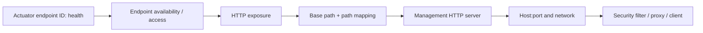
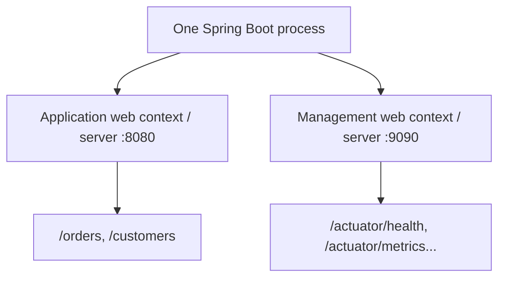
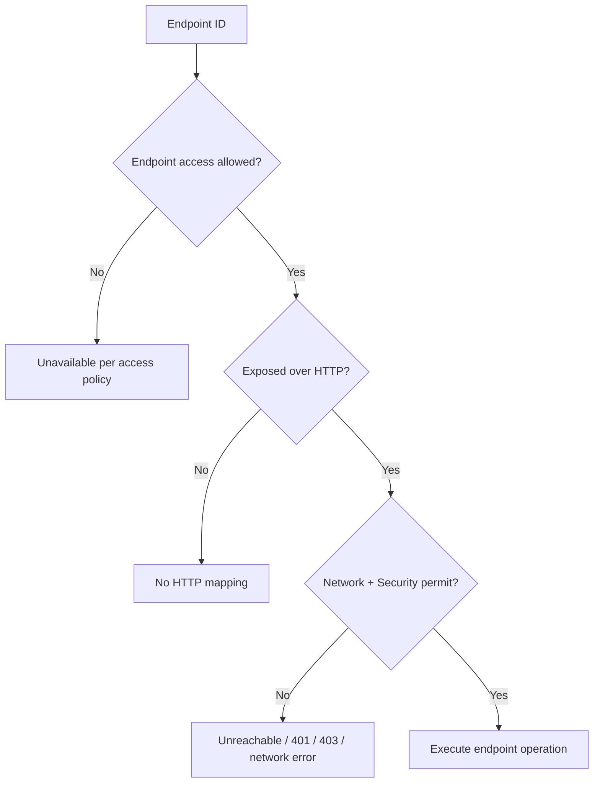
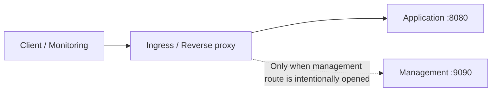
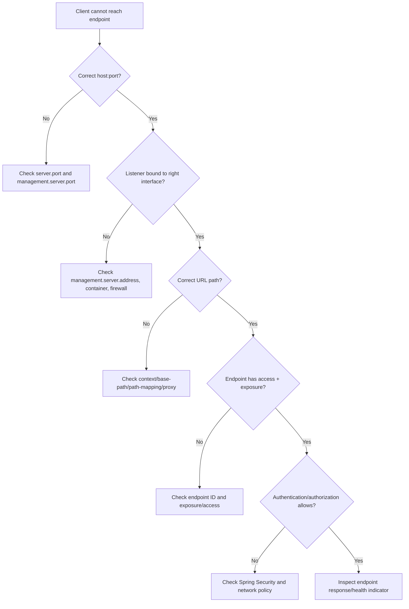
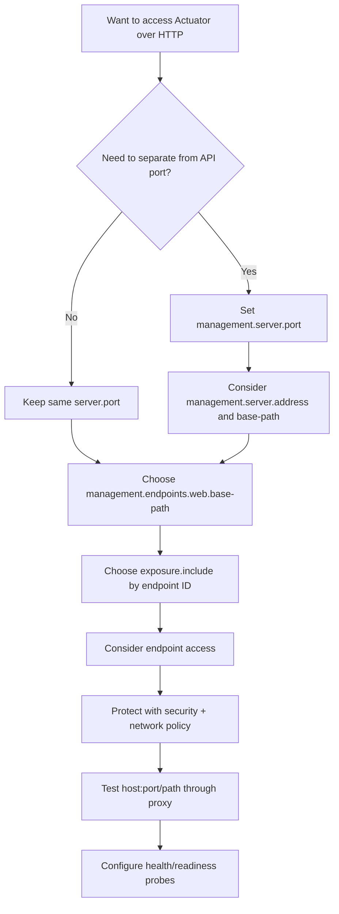

# Management Path, Port, and Basic Configuration Scope

When deploying a Spring Boot application, beyond business APIs such as `/orders` or `/customers`, operations teams also need to know whether the app is healthy, which version is running, which metrics exist, and whether an instance is ready to accept requests. **Spring Boot Actuator** provides endpoints for that observability and management.

For example, after adding Actuator, a familiar endpoint is:

```text
GET http://localhost:8080/actuator/health
```

However, in practice you may need to:

- Change the `/actuator` prefix to `/manage`.
- Move management endpoints to port `9090`, separate from business port `8080`.
- Allow access only from an internal network or `localhost`.
- Choose which endpoints are actually opened over HTTP.
- Keep health/readiness probes checkable without making sensitive endpoints public.
- Determine the final URL when the application has `server.servlet.context-path`, a reverse proxy, or a separate management server.

These requirements map to **different property groups**. Changing the path is not equivalent to changing the port; changing the port does not automatically secure an endpoint; and an endpoint existing in the application does not mean it is exposed over HTTP.

This lesson builds a clear model for management **path**, **port**, **address**, **exposure**, and **access**, illustrates common Spring Boot configurations, and explains sensible choices for local development, internal servers, and container environments.

## 1. What Is an Actuator Endpoint?

Spring Boot Actuator is a set of application observability and management features. When appropriate dependencies and auto-configuration are on the classpath, Boot provides endpoints with distinct **IDs**.

Examples:

| Endpoint ID | Common Purpose |
|---|---|
| `health` | Health status of the application and health indicators |
| `info` | Application metadata configured for publication |
| `metrics` | List and inspect metrics via Micrometer |
| `prometheus` | Metrics in Prometheus format; requires the matching registry dependency |
| `loggers` | View or adjust logger log levels |
| `env` | Inspect `Environment`/property source info per security policy |
| `beans` | Information on beans in the `ApplicationContext` |
| `mappings` | Request mappings of the application |
| `threaddump` | Thread dump for diagnostics |
| `heapdump` | Heap dump; carries risk of exposing in-memory data |

Not every endpoint is always created or available. Some depend on extra libraries, application type, access configuration, and Spring Boot conditions.

For HTTP, default URLs follow the convention:

```text
/{management-base-path}/{endpoint-id}

Example:
/actuator/health
/actuator/info
/actuator/metrics
```

In this notation, `/actuator` is the **base path of web endpoints**, while `health`, `info`, and `metrics` are **endpoint IDs**. Do not equate the ID with the customizable path segment.

### Actuator Is Not HTTP-Only

Spring Boot can also expose endpoints over JMX. HTTP exposure configuration controls only the **HTTP channel** and does not necessarily disable the same endpoint across all other technologies.

Therefore, “does the endpoint exist?” differs from “is the endpoint HTTP-exposed?” and “who is allowed to access the endpoint?”. We will separate those layers in the sections ahead.

## 2. Adding Actuator to an Application

For a Spring Boot project using Gradle Groovy DSL, declare the dependency in the application module:

```groovy
dependencies {
    implementation 'org.springframework.boot:spring-boot-starter-web'
    implementation 'org.springframework.boot:spring-boot-starter-actuator'
}
```

If using Maven:

```xml
<dependency>
    <groupId>org.springframework.boot</groupId>
    <artifactId>spring-boot-starter-actuator</artifactId>
</dependency>
```

Assume the project already has the Spring Boot plugin/dependency management configured. The web starter is just an example for a Servlet REST application; Actuator also supports Spring WebFlux and other integration types.

A minimal application:

```java
package com.example.shop;

import org.springframework.boot.SpringApplication;
import org.springframework.boot.autoconfigure.SpringBootApplication;

@SpringBootApplication
public class ShopApplication {
    public static void main(String[] args) {
        SpringApplication.run(ShopApplication.class, args);
    }
}
```

With the web app running on the default port, try:

```bash
curl -i http://localhost:8080/actuator/health
```

Illustrative result when health is `UP`:

```http
HTTP/1.1 200
Content-Type: application/vnd.spring-boot.actuator.v3+json

{"status":"UP"}
```

Actual headers, media type, and body can vary by Spring Boot version, web libraries, health indicators, and security config. The key point is understanding that the `health` endpoint is bound to default path `/actuator/health`.

**By default in modern Spring Boot, only the `health` endpoint is exposed over HTTP.** To access `info`, `metrics`, or other endpoints, inspect exposure and access settings. Installing Actuator does not mean every `/actuator/{id}` URL is already publicly open.

## 3. Three Configuration Groups: Path, Port, and Exposure

This is the most important classification table in this lesson:

| Property | Controls | Example |
|---|---|---|
| `management.endpoints.web.base-path` | URL path prefix for management endpoints over HTTP | `/manage` |
| `management.endpoints.web.path-mapping.<id>` | Specific path for a single endpoint | `health=healthcheck` |
| `management.server.port` | HTTP port dedicated to management endpoints | `9090` |
| `management.server.address` | Network address the management server binds to; requires a separate port | `127.0.0.1` |
| `management.server.base-path` | Base path of the management server when using a separate port | `/ops` |
| `management.endpoints.web.exposure.include` | Endpoint IDs exposed over HTTP | `health,info,metrics` |
| `management.endpoints.web.exposure.exclude` | Endpoint IDs excluded from HTTP exposure | `env,heapdump` |
| `management.endpoint.<id>.access` | Endpoint access level in Boot lines with the matching access API | `read-only`, `none` |
| `management.endpoint.health.show-details` | Health response detail level | `never`, `when-authorized`, `always` |

The first group governs **how URLs look**. The second group controls **server/network ports**. The third group adjusts **which endpoints can be reached and how much detail they show**.



A valid path does not guarantee the endpoint is exposed. An exposed endpoint does not guarantee the network allows reaching it. And network reachability does not mean the caller is authorized to use the endpoint.

## 4. Changing the Management Base Path on the Same Port

By default, the health endpoint has URL:

```text
http://localhost:8080/actuator/health
```

Changing the prefix to `/manage`:

**application.properties**

```properties
management.endpoints.web.base-path=/manage
```

**application.yml**

```yaml
management:
  endpoints:
    web:
      base-path: /manage
```

After configuration:

```text
GET http://localhost:8080/manage/health
```

and if `info` is permitted and exposed:

```text
GET http://localhost:8080/manage/info
```

This **does not change the endpoint ID**. The ID remains `health` or `info`; only the HTTP path changes.

### Do Not Mistake Path Changes for Security

Changing `/actuator` to a hard-to-guess name is not a security control. Users can discover paths via logs, proxy rules, source/configuration, or other sources. Sensitive endpoints still require authentication, authorization, and network restrictions.

### What Does `base-path=/` Mean?

You may want the health endpoint right at the root:

```properties
management.endpoints.web.base-path=/
```

Then the `health` endpoint can be mapped to `/health` on the corresponding HTTP server if no context path or conflicting mapping exists. Avoid collisions with controllers or resources at the same path. In an app with a business `/health` endpoint, verify mappings before choosing `/` as base path.

## 5. Changing the Path of a Single Endpoint

You do not need to change the base path for every endpoint when you only want to rename the health URL.

Example:

```properties
management.endpoints.web.path-mapping.health=healthcheck
```

If the default base path remains `/actuator`, the health path becomes:

```text
/actuator/healthcheck
```

To place health directly at `/healthcheck`:

```properties
management.endpoints.web.base-path=/
management.endpoints.web.path-mapping.health=healthcheck
```

YAML equivalent:

```yaml
management:
  endpoints:
    web:
      base-path: /
      path-mapping:
        health: healthcheck
```

This only changes the endpoint's **HTTP mapping**. When configuring exposure, access, or other endpoint properties, keep using the endpoint ID `health`:

```properties
management.endpoints.web.exposure.include=health,info
```

Do not change the ID to `healthcheck` inside `exposure.include` just because the URL was remapped. This is a common config mistake when setting up ingress or health probes.

## 6. Setting an Application Context Path and Its Effect on Actuator

A Servlet web application might have:

```properties
server.port=8080
server.servlet.context-path=/shop
```

Business routes then typically receive requests under `/shop`:

```text
http://localhost:8080/shop/orders
```

If management endpoints **share the same web port** and the base path is the default `/actuator`, the health URL is usually:

```text
http://localhost:8080/shop/actuator/health
```

If you also configure:

```properties
management.endpoints.web.base-path=/manage
```

the URL becomes:

```text
http://localhost:8080/shop/manage/health
```

**Key rule:** when management endpoints share **the same HTTP port** in a Servlet application, `management.endpoints.web.base-path` is resolved relative to `server.servlet.context-path`.

For **Spring WebFlux**, Boot documentation uses `spring.webflux.base-path` as the corresponding base in same-port mode, not `server.servlet.context-path`.

### URL Table in Same-Port Mode

| `server.servlet.context-path` | `management.endpoints.web.base-path` | Health URL Path |
|---|---|---|
| Unset | `/actuator` | `/actuator/health` |
| `/shop` | `/actuator` | `/shop/actuator/health` |
| `/shop` | `/manage` | `/shop/manage/health` |
| Unset | `/manage` | `/manage/health` |
| `/shop` | `/` | `/shop/health` |

Examples assume `health` is exposed, not remapped, and no reverse proxy rewrites the path. External client URLs also depend on ingress/gateways.

## 7. Separating the Management Port From the Application Port

When you want business APIs on `8080` while Actuator runs on `9090`:

```properties
server.port=8080
management.server.port=9090
```

Illustrative result:

```text
Application:
  http://localhost:8080/orders

Management:
  http://localhost:9090/actuator/health
```

Separating the port is useful when networks or firewalls can restrict traffic to the management port differently from the business port.

### Two Web Contexts Inside One Process

When the management port differs from the application port, Spring Boot can organize the management web server using a **separate management `ApplicationContext`**. The management context shares lifecycle and configuration ties with the main app, yet the two must not be treated as a single URL namespace.



This is a conceptual diagram. Context structure can differ by version/web stack. The practical takeaway: separating the management port produces a distinct HTTP listener and **changes how management base paths are calculated**.

### Management Path When Using a Separate Port

If the application has:

```properties
server.port=8080
server.servlet.context-path=/shop
management.server.port=9090
management.endpoints.web.base-path=/manage
```

then the expected management URL is:

```text
http://localhost:9090/manage/health
```

**It is not automatically** `/shop/manage/health`, because management endpoints now use a separate server. In this case, `management.endpoints.web.base-path` is resolved relative to `management.server.base-path`, not the application port's `server.servlet.context-path`.

To add a prefix at the management server level:

```properties
management.server.port=9090
management.server.base-path=/ops
management.endpoints.web.base-path=/manage
```

Following separate management server path addition rules, the health URL becomes:

```text
http://localhost:9090/ops/manage/health
```

Do not prepend the business app's `/shop` to management URLs on a different port.

### When Should You Keep the Same Port?

In many cloud environments, deployment and firewall/probe management are simpler when APIs and management endpoints share one port. On some platforms, only a single port is conveniently exposed; opening an extra management port can require separate network rules, services/ingress, or routes.

Separating the port is an architectural choice, not a mandatory default for every application. Decide based on your operational model and access requirements, not habit.

## 8. Restricting the Interface With `management.server.address`

Moving Actuator to a separate port may not be enough: if the management port binds to all network interfaces, other hosts can reach it whenever firewall rules allow.

Example binding the management server only to loopback:

```properties
server.port=8080
management.server.port=9090
management.server.address=127.0.0.1
```

Then, in a typical network model:

- Clients on the same host can call `http://127.0.0.1:9090/actuator/health`.
- Clients from other hosts cannot connect directly to that loopback address over an external network IP.
- Business APIs on `server.port=8080` can still use their own bind address.

**Important condition:** Spring Boot allows configuring `management.server.address` independently in this way **only when the management port differs from the application port**. Do not set `management.server.address=127.0.0.1` while sharing the same port and expect two independent listeners.

### `address` Is Not an Authorization Policy

Binding a network address only restricts where the server listens. It **does not** replace:

- Firewalls/security groups.
- HTTP authentication and authorization.
- Kubernetes `NetworkPolicy`.
- Access protection through proxies or service meshes.
- Policies keeping sensitive endpoints off the Internet.

When running in containers, `127.0.0.1` is the loopback **of that container or network namespace**, not necessarily the host machine's or another container's loopback. If a monitoring agent runs outside the container, it may be unable to reach the management port if the server binds only to loopback.

Do not switch to `0.0.0.0` just “so Prometheus can connect” without controlling network paths. When binding to all interfaces, explicitly design who is permitted to connect.

## 9. Exposure: Which Endpoints Are Opened Over HTTP?

In modern Spring Boot Actuator, **only `health` is exposed over HTTP by default**. Other endpoints do not become publicly reachable on the web just because the library is on the classpath.

To expose `health`, `info`, and `metrics`:

```properties
management.endpoints.web.exposure.include=health,info,metrics
```

Equivalent:

```yaml
management:
  endpoints:
    web:
      exposure:
        include: health,info,metrics
```

When those endpoints exist and are allowed, the default URLs can be:

```text
/actuator/health
/actuator/info
/actuator/metrics
```

If you only change the path:

```properties
management.endpoints.web.base-path=/manage
```

that **does not expose** `info` or `metrics` as well. Exposure remains an independent mechanism.

### Exposure Uses IDs, Not Paths

Suppose:

```properties
management.endpoints.web.base-path=/manage
management.endpoints.web.path-mapping.health=check
management.endpoints.web.exposure.include=health,info
```

Endpoint IDs remain `health` and `info`, while corresponding URLs are:

```text
/manage/check
/manage/info
```

In `exposure.include`, you must write `health`, not `check` or `/manage/check`.

### `exclude` Takes Precedence

You can also exclude endpoints from HTTP exposure:

```properties
management.endpoints.web.exposure.include=health,info,metrics,env
management.endpoints.web.exposure.exclude=env
```

In this configuration, `env` is not exposed over HTTP even though it appears in both include and exclude. **Exclude wins over include.**

### Why Shouldn't You Expose Everything?

For example:

```properties
management.endpoints.web.exposure.include=*
```

can make every available endpoint HTTP-exposed according to its access setting. That increases attack surface and the risk of leaking configuration or runtime data. Endpoints like `env`, `beans`, `heapdump`, `loggers`, `mappings`, or `threaddump` require careful evaluation.

If writing `*` in YAML, wrap it in quotes:

```yaml
management:
  endpoints:
    web:
      exposure:
        include: "*"
```

In YAML, an unquoted asterisk has special syntax meaning and can trigger parse errors. In production, prefer a **narrow allowlist** rather than exposing everything and trying to block a few afterward.

### Disabling HTTP Management Endpoints

One way is excluding all endpoints from web exposure:

```properties
management.endpoints.web.exposure.exclude=*
```

Or disabling the management HTTP port via Boot configuration:

```properties
management.server.port=-1
```

These are two distinct mechanisms. `exposure.exclude=*` prevents Actuator endpoints from being exposed over HTTP; `management.server.port=-1` disables management HTTP endpoints on the management port. Neither **necessarily disables all internal features or non-HTTP management channels like JMX**.

## 10. Distinguishing Endpoint Access, Exposure, and Spring Security

Three control layers are often conflated:

1. **Endpoint access/availability:** is the endpoint permitted or excluded from the context?
2. **HTTP exposure:** is the endpoint mapped over HTTP?
3. **HTTP security/network:** is a request to that endpoint permitted by authentication, authorization, and network policy?



### Access in Newer Spring Boot Lines

Modern Spring Boot offers properties such as:

```properties
management.endpoints.access.default=none
management.endpoint.health.access=read-only
management.endpoint.info.access=read-only
```

The idea: deny endpoint access by default, then open read-only access only for needed endpoints. Values and scope must be checked against your actual Boot line; specifically, do not assume every Boot 2.x release supports new-line access properties.

Another example:

```properties
management.endpoints.access.max-permitted=read-only
```

This property caps maximum access so no endpoint can execute write operations under that access policy. It **does not replace** HTTP authentication/authorization.

**Important difference:** when endpoint access is set to `none` under supported mechanisms, the endpoint can be excluded from the `ApplicationContext`. Conversely, `management.endpoints.web.exposure.exclude=...` only states there is no HTTP exposure for that ID; the endpoint can still exist via other mechanisms.

### Security Defaults Must Be Understood Per Application

If Spring Security is on the classpath and **the application defines no custom `SecurityFilterChain`**, Spring Boot can auto-configure default protection for many Actuator endpoints while health typically remains reachable under default policy.

However, if you define your own `SecurityFilterChain`, Spring Boot normally **yields web security configuration to you**. Do not assume Actuator remains protected identically to an application with no custom security chain.

Therefore:

- Expose only needed endpoints.
- Design HTTP security explicitly.
- Restrict access over the network.
- Test endpoints from both internal networks and Internet/external ingress.
- Never treat changing a path as a security control.

### Do Not Confuse 404, 401, and 403

When calling `/actuator/metrics` fails:

| Symptom | Possible Meaning |
|---|---|
| HTTP 404 | Endpoint unexposed, nonexistent, wrong path, or misrouted |
| HTTP 401 | Security requires authentication |
| HTTP 403 | Reached security layer yet denied permission, or another protection policy |
| Connection refused | No listener on the called host/port, or rejected at connection layer |
| Timeout | Network path, firewall, proxy, or server failed to respond in time |

You cannot pinpoint root cause from a status code alone without knowing the full network/security topology. For instance, HTTP 404 can also happen if ingress routes to the wrong port instead of the management server.

## 11. The `health` Endpoint and Response Scope

`/actuator/health` is usually the endpoint exposed by default so monitoring systems know overall status.

Minimal response:

```json
{
  "status": "UP"
}
```

You can tune detail visibility:

```properties
management.endpoint.health.show-details=never
```

Common values:

| Value | Meaning |
|---|---|
| `never` | Do not show component/health indicator details |
| `when-authorized` | Show details only when the caller satisfies authorization conditions |
| `always` | Allow returning details per health endpoint configuration |

Example:

```properties
management.endpoint.health.show-details=when-authorized
management.endpoint.health.roles=OPS
```

This is an option for applications with suitable security/role mechanisms. Verify how Spring Boot determines an authorized user in your actual version and security stack.

**Warning:** `always` can leak details about databases, caches, external services, or system structure depending on `HealthIndicator` implementations and sanitization. For public probe health endpoints, overall status or minimal information is usually all that is needed.

### Health Status Does Not Always Mean HTTP 200

A `HealthIndicator` can return `UP`, `DOWN`, `OUT_OF_SERVICE`, or a custom status. Spring Boot can map statuses like `DOWN`/`OUT_OF_SERVICE` to HTTP 503 via the status mapper config.

So when testing health endpoints, inspect both HTTP status and JSON body. Do not hardcode an assumption that every health response is HTTP 200 or that an error response necessarily means the endpoint does not exist.

## 12. Liveness, Readiness, and Health Groups

In orchestration environments like Kubernetes, a single overall health check does not suit every operational decision:

- **Liveness:** does the process need to be restarted?
- **Readiness:** is the instance ready to receive new traffic?

Spring Boot Actuator can publish health groups for probes:

```text
/actuator/health/liveness
/actuator/health/readiness
```

To explicitly enable probe support when appropriate:

```properties
management.endpoint.health.probes.enabled=true
```

In Kubernetes, Boot can detect the environment and enable probe config automatically; the explicit property is useful when testing outside Kubernetes.

### Separate Management Port: Beware of False Conclusions

If `management.server.port=9090` and application port is `8080`, health requests on the management port may succeed while part of the main web server fails to accept traffic. Why? Probes run on the **separate management web server**, not necessarily traversing the connectors/paths used by business clients.

To check liveness/readiness **on the main application port** when Boot supports it, use:

```properties
management.endpoint.health.probes.enabled=true
management.endpoint.health.probes.add-additional-paths=true
```

Additional paths typically exposed on the main application port:

```text
/livez
/readyz
```

This puts probes on the main web server path without exposing all management endpoints on that port. Exact final URLs can depend on context path and framework mappings.

In Kubernetes, verify whether readiness/liveness probes actually target the **right port, right path, and right server**. An `/actuator/health/readiness` endpoint existing on the management port does not automatically tell kubelet to call it.

### Do Not Add Every External Dependency to Liveness

If liveness checks an external database or broker and it temporarily goes down, Kubernetes can restart the entire fleet even though the apps could recover once the dependency returns. Keep liveness focused on internal state reflecting ability to continue running.

Readiness can follow different rules because its goal is keeping traffic away from unready instances, though you must still weigh the consequence of dropping all instances when a shared dependency fails. Health group config must reflect architecture and operational goals.

## 13. TLS/SSL for a Separate Management Server

When the application uses HTTPS while Actuator runs on another port, you can configure separate TLS for the management web server.

Conceptual example:

```properties
# Business port using HTTPS
server.port=8443
server.ssl.enabled=true
server.ssl.key-store=classpath:certs/app.p12
server.ssl.key-store-type=PKCS12

# Independent management port
management.server.port=9090
management.server.ssl.enabled=true
management.server.ssl.key-store=classpath:certs/management.p12
management.server.ssl.key-store-type=PKCS12
```

This assumes valid certificates/key-stores and passwords provided securely via secret property sources or a secret manager. **Never put real key-store passwords in documentation or commit them to source.**

With a separate port, you might also pick another model—such as HTTPS on the app port and HTTP on the management port strictly inside a private network protected by a proxy/service mesh. That decision must follow your threat model and topology, never an assumption that an “internal” management port is inherently safe.

### Do Not Infer Management SSL From `server.ssl`

`server.ssl.*` configures TLS for the application web server. When the management server uses a separate port, `management.server.ssl.*` configures TLS independently for the management listener. Do not assume enabling `server.ssl.enabled=true` automatically applies the same TLS to the management port, or vice versa.

Cases to distinguish:

| Application | Management | Example URL |
|---|---|---|
| HTTP port 8080 | Same HTTP port | `http://localhost:8080/actuator/health` |
| HTTPS port 8443 | Same HTTPS port | `https://localhost:8443/actuator/health` |
| HTTPS port 8443 | Separate HTTP port 9090 | `http://localhost:9090/actuator/health` |
| HTTPS port 8443 | Separate HTTPS port 9090 | `https://localhost:9090/actuator/health` |

These URLs assume matching config, reachable listeners, and exposed `health`. With TLS, clients must also verify certificates, hostnames, and trust stores.

## 14. Reverse Proxies and Ingress: Internal URLs Differ From Public URLs

In real deployments, users rarely call the embedded server directly. A reverse proxy, API gateway, or ingress receives requests first:



Suppose internally the app uses:

```text
http://app-container:8080/shop/orders
http://app-container:9090/actuator/health
```

A reverse proxy might publish URLs under different prefixes:

```text
https://api.example.com/orders
https://ops.internal.example.com/health
```

**The URL seen by clients does not necessarily match the URL Spring Boot mapped.** Proxies can strip prefixes, rewrite paths, terminate TLS, and forward requests to different ports.

Therefore, to determine which health endpoint URL to call:

1. Check `server.port` and `management.server.port`.
2. Check Spring Boot's base path, context path, and path mapping.
3. Check reverse-proxy rewrite rules.
4. Check which target port the Service/Ingress/LB points to.
5. Check security, HTTP method, and IP/network access.

Do not “fix” reverse-proxy errors by randomly editing `management.endpoints.web.base-path` until a URL works. Doing so can inadvertently expose Actuator on an unintended path.

### Same Port Does Not Force Opening All Paths Publicly

If the application and Actuator both listen on port 8080, a reverse proxy can still block `/actuator/**` from the Internet and allow only the management network. However, that is a proxy/firewall policy—not Spring Boot protecting itself just from sharing a port.

At the same time, application security must cover Actuator properly: never rely solely on a proxy layer if direct backend paths exist.

### Separate Port Yet Misconfigured Kubernetes Service

Suppose a container listens on:

```text
Application port: 8080
Management port: 9090
```

If the Kubernetes Service only forwards `port: 80 -> targetPort: 8080`, requests targeting 9090 via that Service will not reach the management server. For monitoring to scrape the management port, configure a matching Service/port/rule or monitor the Pod endpoint directly according to topology.

There is no need to expose 9090 through public ingress just for kubelet health probes. Kubelet can probe via Pod IP and port if the management server binds the right address and network policies allow it.

## 15. Configuration Example A — Local Development on One Port

A lightweight setup for coding and API testing:

**application.yml**

```yaml
server:
  port: 8080

management:
  endpoints:
    web:
      base-path: /actuator
      exposure:
        include: health,info,metrics
  endpoint:
    health:
      show-details: always
```

Expected URLs:

```text
http://localhost:8080/actuator/health
http://localhost:8080/actuator/info
http://localhost:8080/actuator/metrics
```

The example uses `show-details: always` **strictly for controlled development environments**, making health indicators easy to inspect. When promoting to shared environments or production, narrow both details and exposure.

If `/actuator/info` returns an empty object, it is not necessarily broken. The info endpoint may simply have no contributor publishing metadata. If `/actuator/metrics` lacks expected metrics, inspect Micrometer instrumentation and dependencies.

## 16. Configuration Example B — Separate Ports for API and Management

**application.yml**

```yaml
server:
  port: 8080
  servlet:
    context-path: /shop

management:
  server:
    port: 9090
    address: 127.0.0.1
    base-path: /ops
  endpoints:
    web:
      base-path: /manage
      exposure:
        include: health,info
  endpoint:
    health:
      show-details: never
```

With the Servlet web stack, expected paths are:

```text
Business:
  http://localhost:8080/shop/orders

Management:
  http://127.0.0.1:9090/ops/manage/health
  http://127.0.0.1:9090/ops/manage/info
```

Key observations:

- Management port is `9090`, not `8080`.
- Management listener binds only `127.0.0.1` in typical networking.
- `/ops` is the separate management server's base path.
- `/manage` is the Actuator HTTP endpoints' base path.
- `/shop` belongs to the application's Servlet context path and is not prepended to management URLs on the separate port.
- Health does not expose details; only `health` and `info` are HTTP-exposed.

If running inside a container, `address: 127.0.0.1` can prevent agents outside the container from reaching the endpoint. That is either intentional security or a reachability bug depending on deployment model.

## 17. Configuration Example C — Scraping Metrics With Prometheus

For Prometheus scraping, you normally need to add the registry dependency:

```groovy
dependencies {
    implementation 'org.springframework.boot:spring-boot-starter-actuator'
    runtimeOnly 'io.micrometer:micrometer-registry-prometheus'
}
```

Then expose the endpoint:

```properties
management.endpoints.web.exposure.include=health,prometheus
```

In default same-port configuration, the expected scrape path is:

```text
GET /actuator/prometheus
```

If you change:

```properties
management.server.port=9090
management.endpoints.web.base-path=/manage
```

then the internal network scrape URL can be:

```text
http://<host>:9090/manage/prometheus
```

Replace `<host>` with a hostname/IP reachable by Prometheus; the placeholder here is illustrative, not Java configuration.

**Important:** merely adding `prometheus` to `exposure.include` does not create the endpoint if the application lacks the required registry/dependency. Additionally, Prometheus may require network permissions and authentication; never turn the scrape endpoint into an unprotected public URL.

## 18. Configuration Example D — Enabling Health Probes on the Application Port

Suppose a container runs APIs on 8080 and Actuator on 9090, yet the orchestrator wants to probe directly on the port receiving business HTTP traffic.

```properties
server.port=8080
management.server.port=9090

management.endpoints.web.exposure.include=health,info
management.endpoint.health.probes.enabled=true
management.endpoint.health.probes.add-additional-paths=true
```

When the framework supports this probe configuration, URLs can be:

```text
API server :8080
  /livez
  /readyz

Management server :9090
  /actuator/health
  /actuator/health/liveness
  /actuator/health/readiness
```

In systems with an application context path or reverse proxy, confirm actual paths before writing health-probe configuration. Do not assume kubelet automatically discovers an endpoint just because Spring Boot created it.

### Why Not Always Probe Through the Management Port?

A management server can remain healthy while the application server fails on its own connector. Probes on the management port may not fully represent the main web server's ability to accept traffic. Additional health paths on the main port test a path closer to business traffic.

Still, probes are operational signals, not replacements for integration tests or external client-perspective checks.

## 19. Property Scope: Main Application vs. Management Context

In an application with a separate management server, distinguish **which properties describe the application server** and **which describe the management server**.

| Group | Example Properties | Primary Effect |
|---|---|---|
| Application server | `server.port`, `server.address` | Port and address receiving business requests |
| Servlet application context | `server.servlet.context-path` | Servlet context prefix when using Servlet server |
| Reactive application base path | `spring.webflux.base-path` | Base path of WebFlux application |
| Management server | `management.server.port`, `management.server.address` | Listener dedicated to Actuator |
| Management server root | `management.server.base-path` | Prefix of the separate management server |
| Actuator HTTP endpoint mapping | `management.endpoints.web.base-path`, `management.endpoints.web.path-mapping.*` | Path to individual endpoints |
| Actuator availability | `management.endpoints.web.exposure.*`, `management.endpoint.<id>.access` | Whether endpoints can be accessed over that channel |

When management uses the same port, components share the same web server and app prefix. When on a separate port, the management server has its own path namespace and listener, yet both still belong to the same Spring Boot process and share lifecycle ties.

### Does a Non-Web App Have Management HTTP Endpoints?

If the application runs without a web stack, for example:

```java
SpringApplication application =
        new SpringApplication(BatchApplication.class);
application.setWebApplicationType(WebApplicationType.NONE);
application.run(args);
```

do not expect an Actuator HTTP listener just because `spring-boot-starter-actuator` was added. Actuator has management mechanisms outside HTTP and its own auto-configuration conditions; HTTP management port configuration is only meaningful when a web environment and required components support it.

For a batch job, you might choose JMX, logs, Micrometer metrics push, or another management mechanism. Do not configure health probe URLs that the application does not actually create.

### Adding a Management Port Does Not Create a New Process

If the main app and management port run in the same JVM, they share the process's fate: if the JVM crashes or the container is killed, both stop. A separate management context is not an independent monitoring daemon that keeps running after the main app dies.

Conversely, the management HTTP server might keep responding while the business server part encounters errors; hence probes and monitoring must target the right measurement layer.

## 20. Profile-Based Configuration and External Sources

Many projects want different Actuator configurations for local and production:

**application.yml — shared configuration**

```yaml
management:
  endpoints:
    web:
      base-path: /actuator
      exposure:
        include: health
  endpoint:
    health:
      show-details: never
```

**application-dev.yml — development environment**

```yaml
management:
  endpoints:
    web:
      exposure:
        include: health,info,metrics
  endpoint:
    health:
      show-details: always
```

**application-prod.yml — deployment environment**

```yaml
management:
  server:
    port: 9090
  endpoints:
    web:
      exposure:
        include: health,prometheus
```

In production, actual exposure also depends on the Prometheus registry and access/security. This example illustrates separating **needed endpoint lists by environment**; it is not a recommendation to open Prometheus by default without authentication or network limits.

### Profiles Are Not Security

Do not rely on `application-prod.yml` as the sole secrecy measure for management ports or credentials. Configuration can be overridden by environment variables, command-line arguments, config imports, or deployment manifests.

When investigating an application running on the wrong port or exposure, check the **final effective value** and which source supplied it. One correct file is not necessarily the highest-precedence source.

### Temporary Command-Line Overrides

Example running locally with management on 9191:

```bash
java -jar app.jar --management.server.port=9191
```

Or changing the base path:

```bash
java -jar app.jar --management.endpoints.web.base-path=/ops
```

These values are properties read by Boot at startup. Do not assume editing a config file or changing an environment variable **after the context is already running** will change the HTTP management port on the fly; restarting the application context/process appropriately is normally required.

## 21. Diagnostic Checklist When Actuator Is Unreachable

When `curl http://localhost:9090/actuator/health` fails, work from the outside layer inward:



### A. Is the Port Right?

```properties
server.port=8080
management.server.port=9090
```

With this setup, calling `http://localhost:8080/actuator/health` may no longer be right; management endpoints live on port 9090. Check startup logs and runtime configuration to confirm the listener bound cleanly.

### B. Is the Address Right?

```properties
management.server.port=9090
management.server.address=127.0.0.1
```

A monitoring agent on another host usually cannot reach a listener bound only to loopback. Inside containers, one container's loopback is not another container's loopback.

### C. Was the Context Path Added Wrongly to the URL Path?

Application:

```properties
server.servlet.context-path=/shop
management.server.port=9090
management.endpoints.web.base-path=/manage
```

When management port differs from application port, **do not** prepend `/shop` to management paths. With that simple config, health is typically at `:9090/manage/health`.

### D. Was the Matching ID Exposed?

If `/actuator/health` works yet `/actuator/metrics` returns 404:

```properties
management.endpoints.web.exposure.include=health,metrics
```

For metrics, matching measurement dependencies/components are also needed. If an endpoint was remapped, call the new URL while keeping the original ID in exposure.

### E. Is Security Blocking It?

If receiving 401/403, inspect Spring Security config, caller credentials, and roles. When an app has a custom `SecurityFilterChain`, verify which filter chain applies to Actuator rather than assuming default security still exists.

### F. Are Ingress/Service Routes and Firewalls Blocking It?

If calling inside the Pod succeeds while external URLs fail, check proxy/ingress/Service target ports, path rewrites, TLS termination, and `NetworkPolicy`. An endpoint working inside the JVM does not mean a route exists from the client.

### G. Where Is the Probe Path Actually Located?

If using `management.endpoint.health.probes.add-additional-paths=true`, check `/livez`/`/readyz` on the main port. Without additional paths, check health groups on the management port or same-port path accordingly.

## 22. Common Misconceptions

**“Adding Actuator gives every endpoint a URL.”** No. Endpoints must be available and exposed over HTTP; by default only `health` is HTTP-exposed in modern Spring Boot.

**“Changing `management.endpoints.web.base-path` changes the port.”** No. Base path only adjusts the path prefix. Ports are set by `management.server.port` or `server.port`.

**“Setting `management.server.port=9090` moves business APIs to 9090.”** No. Business APIs stay on the application server; management Actuator uses the separate management server.

**“Changing the app's context path applies that context path to a separate management port too.”** No. A separate management port calculates its base path from management server configuration.

**“Setting `management.server.address=127.0.0.1` works in same-port mode.”** Independent address binding requires the management server to use a port different from the application port.

**“Just renaming `/actuator` to a hard-to-guess URL makes it safe.”** No. Path obscurity does not replace security.

**“Including `*` in YAML needs no quotes.”** No. Use `include: "*"` if you truly want to include all and have evaluated the risks.

**“Exposing an endpoint means anyone can access it.”** No. Networks, authentication, authorization, and endpoint access can still block callers.

**“`management.endpoints.web.exposure.exclude=*` turns off all management features.”** No. It prevents HTTP exposure of endpoints, not necessarily disabling JMX or all internal components.

**“Management health returning UP guarantees the main API accepts traffic.”** No. Especially with a separate port, health may bypass the main application's connector.

**“Every 404 from Actuator means a missing dependency.”** No. Wrong path, wrong port, missing exposure, or proxy rewrites can also yield 404.

**“Having `prometheus` in include guarantees the Prometheus endpoint exists.”** No. It requires the registry dependency and matching auto-configuration.

**“Endpoint access and HTTP authentication are the same thing.”** No. They are two separate control layers and must be configured appropriately for your Boot line.

## 23. Hands-On Lab With Four Configurations

Create a small Spring Boot REST application with `spring-boot-starter-actuator` and one business endpoint:

```java
@RestController
public class PingController {
    @GetMapping("/ping")
    String ping() {
        return "pong";
    }
}
```

### Exercise 1 — Same Port, Default Path

```properties
server.port=8080
management.endpoints.web.exposure.include=health,info
```

Test:

```bash
curl -i http://localhost:8080/ping
curl -i http://localhost:8080/actuator/health
curl -i http://localhost:8080/actuator/info
```

Record HTTP status and body. If `info` is empty, inspect info contributors rather than assuming the endpoint is broken.

### Exercise 2 — Changing the Base Path

```properties
management.endpoints.web.base-path=/manage
```

Test `/manage/health`, and also call `/actuator/health` again to see the old path is no longer the default mapping.

### Exercise 3 — Separate Port, Servlet Context Path

```properties
server.port=8080
server.servlet.context-path=/shop
management.server.port=9090
management.endpoints.web.base-path=/manage
```

Test:

```bash
curl -i http://localhost:8080/shop/ping
curl -i http://localhost:9090/manage/health
```

Then try the wrong URL `http://localhost:9090/shop/manage/health` and explain why `/shop` does not automatically prefix the separate management port.

### Exercise 4 — Path Mapping and Exposure

```properties
management.endpoints.web.base-path=/
management.endpoints.web.path-mapping.health=healthcheck
management.endpoints.web.exposure.include=health
```

Test:

```bash
curl -i http://localhost:8080/healthcheck
curl -i http://localhost:8080/actuator/health
```

Then add `metrics` to exposure, inspect its path, and recognize why an endpoint ID differs from the path visible in the URL.

### Sample Recording Table

| Run | Application port/path | Management port/path | Exposed Endpoint IDs | Health Result |
|---|---|---|---|---|
| 1 | ... | ... | ... | ... |
| 2 | ... | ... | ... | ... |
| 3 | ... | ... | ... | ... |
| 4 | ... | ... | ... | ... |

Record actual results in the exact environment you ran. If old properties linger in other files or profiles, they can alter outcomes; ensure the final active configuration is clearly confirmed each run.

## 24. Configuration Selection Diagram



## 25. Final Takeaways

You can picture a management URL in Spring Boot with the formula:

```text
Scheme + Host + Port
    + (Application context path or Management server base path)
    + Management endpoints web base path
    + Endpoint path mapping/ID
```

However, **only when the endpoint is permitted access, exposed, and allowed by network/security** is that URL actually usable.

Remember:

- `management.endpoints.web.base-path` changes Actuator's **URL prefix**.
- `management.endpoints.web.path-mapping.<id>` changes a single endpoint's **path** without changing its ID.
- `management.server.port` creates a **separate management HTTP port** when different from the application port.
- `management.server.address` restricts the **listening address** when using a separate management port.
- `management.server.base-path` applies to a **separate management server**, independent of the main application's Servlet context path.
- `management.endpoints.web.exposure.include/exclude` selects **endpoint IDs published over HTTP**.
- Endpoint access, Spring Security, and network policy determine **secure reachability**.
- Health/readiness must be probed on the **exact server and network path** operations expects to measure.

When designing application observability, do not begin with “what should we rename `/actuator` to?”. Start with **who needs to monitor which endpoint, on which port, from which network, and with what permissions**. Only then choose path/port/exposure so operations stays simple, sensitive data stays unexposed, and health signals remain trustworthy.
