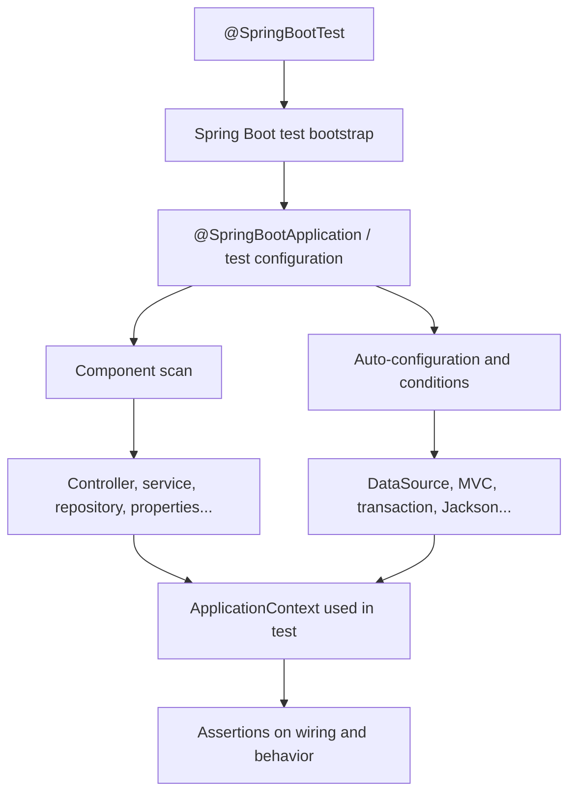
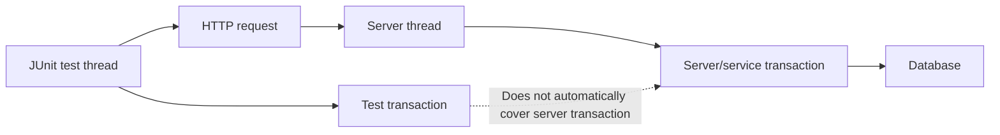

# @SpringBootTest for Testing a Fully Assembled Application

> **Spring Boot Fundamentals · Platform Testing**  
> A service can pass its unit tests and the application can still fail to start because of a missing bean, wrong configuration, a repository unable to connect to the database, transaction advice not being created, or an auto-configuration excluded by a condition. **`@SpringBootTest` tests a broad slice of the system at the Spring ApplicationContext level**: Spring Boot initializes the application using the actual configurations selected for the test, performs component scanning, applies auto-configuration, and wires beans together. It is especially effective at catching integration defects across components that isolated unit tests cannot see.

## 1. Why isn't testing a single class enough?

Suppose an application has the following processing chain:

```text
HTTP request
    ↓
OrderController
    ↓
OrderService
    ↓
OrderRepository
    ↓
DataSource
    ↓
Database
```

A unit test for `OrderService` can mock `OrderRepository` and verify the calculation is correct. Yet when running the real application, failures can still occur:

- `OrderController` lies outside the component scan scope.
- `OrderService` has two implementations, making injection ambiguous.
- There is no `DataSource` because of a missing dependency or URL configuration.
- `@ConfigurationProperties` was not registered as a bean.
- A `@ConditionalOnProperty` does not match the active profile.
- The repository is created, but the schema has not been migrated.
- A security filter blocks the endpoint even though the controller unit test passes completely.
- A circular dependency or bean initialization exception prevents the context from starting.

`@SpringBootTest` lets you test **the initialization and coordination of Spring components**, rather than only testing logic inside an individual class.



Key takeaway: `@SpringBootTest` initializes a **complete application context according to the selected configuration, classpath, profiles, and test overrides**—not that every bean from every profile or every external service in the world is run for real.

## 2. What is `@SpringBootTest`?

`@SpringBootTest` is an annotation from Spring Boot Test, commonly used with JUnit Jupiter to boot an `ApplicationContext` via the Spring Boot mechanism.

Simple example:

```java
package com.example.shop;

import org.junit.jupiter.api.Test;
import org.springframework.boot.test.context.SpringBootTest;

@SpringBootTest
class ShopApplicationTests {

    @Test
    void contextLoads() {
        // Test passes when the Spring context starts successfully.
    }
}
```

If there are no startup errors, the test passes. If a required bean is missing, property binding fails, or auto-configuration cannot complete, the test can fail **during the ApplicationContext creation phase**, before running the body of `contextLoads`.

### 2.1. What does it actually test?

With a typical application configuration, the check can cover:

- Finding the appropriate root configuration.
- Initializing the Spring Boot application via test bootstrap.
- Discovering `@Component`, `@Service`, `@Repository`, and `@Controller` classes within scan scope.
- Processing `@Configuration` classes and `@Bean` methods.
- Applying auto-configurations based on classpath, properties, and conditions.
- Building the dependency graph and injecting beans.
- Binding `@ConfigurationProperties`.
- Setting up infrastructure beans required by dependencies and the environment.
- Executing appropriate bean initialization callbacks.
- Closing the context when evicted from cache or at the end of the test lifecycle.

If the test uses a web environment with a real server, the check can also open an HTTP listener and process requests over the network.

### 2.2. What does it not prove on its own?

A test containing only `contextLoads()` does not automatically prove:

- Every HTTP endpoint returns the right response.
- Every database query is correct.
- Every external integration can connect.
- Transaction or security steps are configured as intended.
- Business rules are implemented properly.
- The packaged production artifact has the right manifest and runtime classpath.
- The production profile has configuration equivalent to the test profile.

It confirms that the context **can start under the test's conditions**. Everything else must be verified with assertions or tests at the appropriate layer.

### 2.3. Required test dependency

In a Maven project using Spring Boot dependency management, the standard dependency is:

```xml
<dependency>
    <groupId>org.springframework.boot</groupId>
    <artifactId>spring-boot-starter-test</artifactId>
    <scope>test</scope>
</dependency>
```

In Gradle:

```groovy
dependencies {
    testImplementation 'org.springframework.boot:spring-boot-starter-test'
}

tasks.named('test') {
    useJUnitPlatform()
}
```

The test starter brings in Spring Test, Spring Boot Test, JUnit Jupiter, AssertJ, Mockito, and version-compatible supporting tools. Do not hardcode versions for individual test libraries without checking the BOM/dependency management.

### 2.4. Is `@ExtendWith(SpringExtension.class)` needed?

With modern Spring Boot Test and JUnit Jupiter, `@SpringBootTest` already integrates the appropriate Spring Test extension mechanism. In typical scenarios, **there is no need to additionally write**:

```java
@ExtendWith(SpringExtension.class)
```

Only add supporting annotations deliberately when the framework or test setup genuinely requires them. Avoid repeating annotations purely from copy-pasting templates.

## 3. How does `@SpringBootTest` locate the application configuration?

When a root configuration is not explicitly specified, the Spring Boot test bootstrap can locate a class annotated with `@SpringBootConfiguration`—usually the class carrying `@SpringBootApplication`—by walking up from the test's package to parent packages.

Example:

```text
com.example.shop
├── ShopApplication.java       @SpringBootApplication
├── web/
│   └── CheckoutController.java
└── test/
    └── CheckoutFlowTest.java
```

If the test class is in `com.example.shop.test` and the root application is in `com.example.shop`, the standard search mechanism can locate the appropriate root.

### 3.1. Specify `classes` when clarity is needed

```java
@SpringBootTest(classes = ShopApplication.class)
class CheckoutFlowTest {

    @Test
    void applicationStarts() {
    }
}
```

This is useful when:

- The project has multiple application root classes.
- The test lives outside the package tree that Boot can search automatically.
- The test module uses a dedicated root configuration.
- You want the test contract to state explicitly which application is being booted.

However, `classes` should not point to a stripped-down `@Configuration` containing only a few mocks if the test's goal is **to verify full application wiring**. Doing so may inadvertently turn the test subject into a narrowed context.

### 3.2. The "Unable to find a @SpringBootConfiguration" error

If you encounter an error like:

```text
Unable to find a @SpringBootConfiguration
```

check:

1. Does the root class have `@SpringBootApplication` or `@SpringBootConfiguration`?
2. Which package is the test located in?
3. Is the test's package inside the root's package hierarchy?
4. Are there multiple roots causing ambiguity?
5. Can `@SpringBootTest(classes = ShopApplication.class)` be used to specify it explicitly?

Do not fix this by scattering extra `@SpringBootApplication` classes just to make tests start, as that can make component scanning and auto-configuration unpredictable.

### 3.3. `@SpringBootApplication` is a key assembly point

`@SpringBootApplication` combines configuration, component scanning, and enabling auto-configuration. Therefore, a test booted from this class generally verifies both application bean discovery and activation of infrastructure appropriate to the dependency graph.

Still watch out for beans excluded by `@Profile`, `@ConditionalOnProperty`, or other conditions: just because a class exists in source does not mean its bean is created in every test context.

## 4. Comparing unit tests, slice tests, and full-context tests

Not every test should use `@SpringBootTest`.

| Test type | Goal | Spring context? | Relative cost |
| --- | --- | --- | --- |
| Pure JUnit/Mockito unit test | Logic of a single class and mocked collaborators | Usually no | Low |
| `@WebMvcTest` | MVC slice: controller, web binding, part of web infrastructure | Yes, selective scope | Usually lower than full context |
| `@DataJpaTest` | JPA/repository slice with appropriate data infrastructure | Yes, selective scope | Depends on database |
| `@SpringBootTest` | Application wiring per selected root configuration | Yes, broad scope | Usually higher |
| Out-of-process end-to-end test | Deployed application alongside related systems | Not necessarily created directly by test | Usually highest |

### 4.1. Why isn't `@WebMvcTest` equivalent to `@SpringBootTest`?

`@WebMvcTest` typically loads components relevant to the MVC slice and does not automatically construct the entire service/repository graph. If the controller requires `OrderService`, the slice test normally supplies a fake/mock service or imports the relevant configuration.

`@SpringBootTest` can build the service, repository, data source, and security infrastructure according to real configuration, catching **cross-layer wiring** problems.

### 4.2. Why not use a full context for every calculation?

If you need to verify:

```java
int total = unitPrice * quantity;
```

a unit test does not need to start the whole application, database, and embedded servlet server. Using a full context for every calculation makes the test suite slow, environment-sensitive, and harder to diagnose.

A generally sound strategy is: **many small unit tests, targeted slice tests, and a selective set of full-context/integration tests to verify critical boundaries**.

## 5. The four `webEnvironment` modes

`@SpringBootTest` has a `webEnvironment` attribute to control how the web environment is handled in tests.

| Mode | Web context/server | Suitable for |
| --- | --- | --- |
| `MOCK` (default) | Creates a mock web environment for servlets when applicable; does not open a real HTTP listener | Testing bean graph, MockMvc, and MVC |
| `RANDOM_PORT` | Starts the embedded web server on a dynamically chosen port | Making real HTTP calls over local network |
| `DEFINED_PORT` | Starts the embedded server on the configured port | Scenarios requiring a fixed port; use carefully |
| `NONE` | Does not start a web application environment | Batch/CLI/service applications not needing web |

The descriptions above apply to Spring Boot environments matching the servlet/web stack. For reactive applications or classpaths without a web stack, context initialization has its own nuances; do not rely solely on the name `MOCK` to assume a `MockServletContext` exists in every application type.

### 5.1. `MOCK`: web context without opening a real port

```java
@SpringBootTest(
        webEnvironment = SpringBootTest.WebEnvironment.MOCK
)
class WebWiringTest {
}
```

This is the default for `@SpringBootTest`. In a Spring MVC servlet application, it lets tests run with a mock servlet environment without binding a TCP port.

A `@SpringBootTest` with `MOCK` webEnvironment **does not automatically create a `MockMvc` bean** for injection in every test; `@AutoConfigureMockMvc` is typically also needed.

### 5.2. `RANDOM_PORT`: real server on an automatically chosen port

```java
@SpringBootTest(
        webEnvironment = SpringBootTest.WebEnvironment.RANDOM_PORT
)
class HttpIntegrationTest {
}
```

Boot tells the embedded server to use a dynamic port suitable for the test environment. Avoid hardcoding the port because it is allocated per runtime context.

### 5.3. `DEFINED_PORT`: real server on the configured port

```java
@SpringBootTest(
        webEnvironment = SpringBootTest.WebEnvironment.DEFINED_PORT,
        properties = "server.port=18080"
)
class FixedPortTest {
}
```

This carries risks:

- Another process occupies the port.
- Two tests running in parallel contend for the port.
- The CI runner already has a service listening on that port.
- Context caching or shutdown leaves the port held longer than expected.

Unless you specifically need to test a fixed port, `RANDOM_PORT` is usually safer.

### 5.4. `NONE`: testing non-web applications

```java
@SpringBootTest(
        webEnvironment = SpringBootTest.WebEnvironment.NONE
)
class SchedulerWiringTest {

    @Autowired
    JobCoordinator coordinator;

    @Test
    void coordinatorExists() {
        assertThat(coordinator).isNotNull();
    }
}
```

Use for batch, CLI, scheduler, or business applications that do not require initializing a servlet/reactive web server. Note: beans conditioned on `@ConditionalOnWebApplication` will not be created in `NONE` mode.

### 5.5. Choose the mode based on the test question

If the question is "are the service and repository wired properly?", use `MOCK` or `NONE` depending on the application. If the question is "do the HTTP connector, encoding, servlet filters, and request handling actually work?", `RANDOM_PORT` provides higher value.

Do not open a real server just to verify basic bean injection.

## 6. Small example application to test full wiring

Let's create a pricing quote API with three layers: controller, service, and infrastructure beans auto-configured by Spring MVC/Jackson.

### 6.1. Application root

```java
package com.example.shop;

import org.springframework.boot.SpringApplication;
import org.springframework.boot.autoconfigure.SpringBootApplication;

@SpringBootApplication
public class ShopApplication {

    public static void main(String[] args) {
        SpringApplication.run(ShopApplication.class, args);
    }
}
```

### 6.2. Pricing service

```java
package com.example.shop.service;

import org.springframework.stereotype.Service;

@Service
public class PriceService {

    public int calculateTotal(int unitPrice, int quantity) {
        if (unitPrice < 0 || quantity < 0) {
            throw new IllegalArgumentException(
                    "Price and quantity must not be negative");
        }

        return Math.multiplyExact(unitPrice, quantity);
    }
}
```

In a real application, `BigDecimal` can be used for currency. The example uses plain integers solely to clarify how beans are wired together.

### 6.3. Controller

```java
package com.example.shop.web;

import com.example.shop.service.PriceService;

import org.springframework.web.bind.annotation.GetMapping;
import org.springframework.web.bind.annotation.RequestMapping;
import org.springframework.web.bind.annotation.RequestParam;
import org.springframework.web.bind.annotation.RestController;

@RestController
@RequestMapping("/api/quotes")
public class QuoteController {

    private final PriceService prices;

    public QuoteController(PriceService prices) {
        this.prices = prices;
    }

    @GetMapping
    public Quote quote(
            @RequestParam int quantity,
            @RequestParam int unitPrice) {

        int total = prices.calculateTotal(
                unitPrice, quantity);

        return new Quote(quantity, unitPrice, total);
    }

    public record Quote(
            int quantity,
            int unitPrice,
            int total) {
    }
}
```

At runtime, Spring needs to:

1. Discover `QuoteController` via component scanning.
2. Discover `PriceService` via `@Service`.
3. Create and inject `PriceService` into the controller.
4. Register the Spring MVC request mapping.
5. Convert query parameters into `int`.
6. Use an HTTP message converter, typically Jackson, to return JSON.

Unit tests of `PriceService` only prove the calculation step. A full-context web test can verify the entire chain above.

## 7. `@SpringBootTest` with `@AutoConfigureMockMvc`

`MockMvc` simulates HTTP requests into Spring MVC **without opening a real network port**. Combined with a full-context test, it verifies the controller and application beans created in the same ApplicationContext.

### 7.1. Testing both request mapping and service injection

```java
package com.example.shop;

import static org.springframework.test.web.servlet.request
        .MockMvcRequestBuilders.get;
import static org.springframework.test.web.servlet.result
        .MockMvcResultMatchers.jsonPath;
import static org.springframework.test.web.servlet.result
        .MockMvcResultMatchers.status;

import org.junit.jupiter.api.Test;
import org.springframework.beans.factory.annotation.Autowired;
import org.springframework.boot.test.autoconfigure.web.servlet
        .AutoConfigureMockMvc;
import org.springframework.boot.test.context.SpringBootTest;
import org.springframework.test.web.servlet.MockMvc;

@SpringBootTest(classes = ShopApplication.class)
@AutoConfigureMockMvc
class QuoteMvcIntegrationTest {

    @Autowired
    MockMvc mockMvc;

    @Test
    void returnsQuoteThroughFullApplicationContext()
            throws Exception {

        mockMvc.perform(
                get("/api/quotes")
                    .param("quantity", "3")
                    .param("unitPrice", "100")
        )
        .andExpect(status().isOk())
        .andExpect(jsonPath("$.quantity").value(3))
        .andExpect(jsonPath("$.total").value(300));
    }
}
```

When this test passes, it confirms:

- Root `ShopApplication` started.
- Controller and service were discovered and injected.
- Spring MVC routing handles the URL properly.
- Query params are converted to their target types.
- The controller calls the service and returns the object.
- HTTP message conversion produces matching JSON.

There is **no real TCP listener** in this `MOCK`/`MockMvc` style test. Therefore, it is not direct proof that socket binding or network stack behavior works.

### 7.2. Is it calling the controller directly?

No. When calling:

```java
mockMvc.perform(get("/api/quotes") ...)
```

the request passes through Spring MVC test infrastructure. This differs from:

```java
QuoteController controller =
        new QuoteController(new PriceService());

controller.quote(3, 100);
```

The second approach bypasses routing, argument binding, filters, and JSON serialization. It has value as a unit test, but does not replace an MVC integration test.

### 7.3. Do security filters participate?

If the application includes Spring Security and `MockMvc` is configured with filters enabled, requests may be rejected due to authentication, authorization, or CSRF policies.

That can be proof that **the full application context is applying security configuration**, not that the controller is wrong.

You can use `spring-security-test` and its annotations/helpers to create authenticated test requests rather than disabling security globally just to make tests pass.

`@AutoConfigureMockMvc(addFilters = false)` can be helpful for an isolated test scenario, though it skips part of the behavior. If the goal is verifying real wiring/security, avoid using this option merely to hide 401/403 errors.

## 8. `RANDOM_PORT`: testing real HTTP through the embedded server

If you want to verify the server opening a port and receiving requests over a socket, use `RANDOM_PORT`.

```java
package com.example.shop;

import static org.assertj.core.api.Assertions.assertThat;

import java.net.URI;
import java.net.http.HttpClient;
import java.net.http.HttpRequest;
import java.net.http.HttpResponse;

import com.fasterxml.jackson.databind.JsonNode;
import com.fasterxml.jackson.databind.ObjectMapper;

import org.junit.jupiter.api.Test;
import org.springframework.beans.factory.annotation.Autowired;
import org.springframework.boot.test.context.SpringBootTest;
import org.springframework.boot.test.web.server.LocalServerPort;

@SpringBootTest(
        classes = ShopApplication.class,
        webEnvironment = SpringBootTest.WebEnvironment.RANDOM_PORT
)
class QuoteHttpIntegrationTest {

    @LocalServerPort
    int port;

    @Autowired
    ObjectMapper objectMapper;

    @Test
    void respondsOverRealHttp() throws Exception {
        URI url = URI.create(
                "http://localhost:" + port
                        + "/api/quotes?quantity=2&unitPrice=75");

        HttpRequest request = HttpRequest.newBuilder(url)
                .GET()
                .build();

        HttpResponse<String> response =
                HttpClient.newHttpClient().send(
                        request,
                        HttpResponse.BodyHandlers.ofString());

        assertThat(response.statusCode()).isEqualTo(200);

        JsonNode json = objectMapper.readTree(response.body());
        assertThat(json.path("quantity").asInt()).isEqualTo(2);
        assertThat(json.path("total").asInt()).isEqualTo(150);
    }
}
```

The example uses `java.net.http.HttpClient` from Java 11+ to avoid depending on the `TestRestTemplate` API. In the Boot 3.x ecosystem, `TestRestTemplate` is also a familiar choice for servlet HTTP integration tests. Choose the client tool fitting your project's version and dependencies.

### 8.1. Where does `@LocalServerPort` get the port?

`@LocalServerPort` (Spring Boot Test) injects the port bound by the embedded web server. With `RANDOM_PORT`, the value is dynamically chosen so you must never assume it is 8080.

Note the import in Boot 3.x:

```java
import org.springframework.boot.test.web.server.LocalServerPort;
```

Do not use an old import from another package if the project is on Boot 3.x.

### 8.2. What parts does this test cover?

Beyond bean wiring and Spring MVC infrastructure, it also tests:

- The embedded web server is actually created.
- The HTTP listener binds to a port.
- A client sends a request over the local TCP stack.
- The server accepts and dispatches the request.
- The controller/service generates a response.
- The response is returned over HTTP.

Still, this is a server **started inside the test process**. It does not automatically test the Docker image, Kubernetes Service, reverse proxy, public TLS, or production network policies.

### 8.3. RANDOM_PORT avoids conflicts but does not eliminate every issue

OS-assigned dynamic ports reduce conflict risk between tests. However, if the application has another hardcoded connector, multiple management ports, or a third-party server opening a fixed port, tests can still hit conflicts.

With external servers or containers, consider all other ports the application uses.

## 9. Testing non-web applications

Not every Spring Boot application is a REST API. A batch application might only have:

```java
@Service
public class InvoiceJob {

    private final InvoiceRepository repository;

    public InvoiceJob(InvoiceRepository repository) {
        this.repository = repository;
    }

    public void generate() {
        // Read data and generate report.
    }
}
```

Wiring test:

```java
@SpringBootTest(
        webEnvironment = SpringBootTest.WebEnvironment.NONE
)
class InvoiceJobWiringTest {

    @Autowired
    InvoiceJob invoiceJob;

    @Test
    void jobBeanCanBeCreated() {
        assertThat(invoiceJob).isNotNull();
    }
}
```

If `InvoiceRepository` is created by real data auto-configuration, the context still requires a database or an appropriate test replacement. `NONE` only omits the web application environment; it **does not mock all other infrastructure automatically**.

### 9.1. Watch out for `CommandLineRunner` and `ApplicationRunner`

When the full application is bootstrapped, application runners may execute as part of Spring Boot startup. If a runner modifies real data, sends messages, or syncs externally, tests can trigger unintended side effects.

For batch applications, keep runners thin and place logic into testable services. Control runners via properties, profiles, or explicit conditions in tests rather than letting every `@SpringBootTest` inadvertently execute the entire batch job.

## 10. Dedicated test configuration with `@ActiveProfiles`

A full-context test does not have to run with production settings. Use profiles deliberately.

Example:

```java
@SpringBootTest(classes = ShopApplication.class)
@ActiveProfiles("test")
class ShopTestProfileIntegrationTest {
}
```

File:

```yaml
# src/test/resources/application-test.yml
app:
  payments:
    provider: fake
  notifications:
    enabled: false

logging:
  level:
    com.example.shop: INFO
```

When the `test` profile is active, Spring Boot loads matching config data. Beans using `@Profile("test")` or `@ConditionalOnProperty` are evaluated under that environment.

### 10.1. The test profile must represent the test's goal

If you need to verify **production wiring**, disabling too much infrastructure in the test profile can make tests less meaningful. Yet for stability and avoiding side effects, using a dedicated test database and test endpoints is essential.

Choose intentionally: a basic bootstrap test can use the `test` profile; a production-like smoke test can use configuration closer to production while still pointing to safe test resources.

### 10.2. Use `properties` to override a few keys

```java
@SpringBootTest(
        classes = ShopApplication.class,
        properties = {
            "app.notifications.enabled=false",
            "app.jobs.auto-start=false"
        }
)
class ShopWithoutBackgroundJobsTest {
}
```

This fits when you only need a few local test overrides without creating an entire profile file just to change one or two values.

Test properties have their own precedence order in Spring Test/Boot, typically higher than standard config data. If a key is set across multiple test annotations, verify which source actually holds higher precedence.

### 10.3. `@TestPropertySource` is another option

```java
@SpringBootTest(classes = ShopApplication.class)
@TestPropertySource(properties = {
    "app.feature.enabled=true"
})
class FeatureEnabledTest {
}
```

`@TestPropertySource` can supply inline properties or load separate property files. For YAML, do not assume every `@TestPropertySource(locations=...)` usage parses YAML the same way Boot config data does; Spring Test has its own property file format rules.

In Spring Boot, `application-test.yml` with `@ActiveProfiles` or `@SpringBootTest(properties=...)` is typically clearer for YAML test configs.

### 10.4. Profiles are not a security mechanism

Do not put production passwords or private keys in `application-test.yml` just because it resides in test resources. Test secrets still need proper management, especially on CI.

## 11. Verifying beans are created and injected properly

A wiring test can assert on important beans.

```java
@SpringBootTest(classes = ShopApplication.class)
class BeanGraphTest {

    @Autowired
    ApplicationContext context;

    @Test
    void essentialBeansExist() {
        assertThat(context.getBean(QuoteController.class))
                .isNotNull();

        assertThat(context.getBean(PriceService.class))
                .isNotNull();
    }
}
```

This test is useful, though only basic. To prove the controller actually uses the service properly, testing through MockMvc or HTTP across varied inputs is usually more meaningful.

### 11.1. Check specific beans rather than "context loads is enough"

Suppose the application requires an implementation:

```java
public interface PaymentGateway {
    PaymentResult charge(PaymentCommand command);
}
```

Two implementations are registered:

```java
@Component
class StripePaymentGateway implements PaymentGateway {
    // ...
}
```

```java
@Component
class SandboxPaymentGateway implements PaymentGateway {
    // ...
}
```

If a service injects `PaymentGateway` without `@Qualifier` or a clear `@Primary` bean, the application context can fail due to ambiguity.

`@SpringBootTest` will catch this when building the graph. Tests should confirm which implementation is actually selected in their profile when that choice is an important requirement.

### 11.2. `@Primary` and `@Qualifier`

These two annotations control bean selection when multiple candidates exist. They are not test-specific features.

If a project fails with "expected single matching bean but found 2", check:

- Are two implementations active at the same time?
- Did a profile/condition accidentally activate both?
- Should selection use a qualifier or a default primary?
- Is there an extra test bean colliding with a production bean?

Do not fix this merely by shrinking component scanning in tests to make the ambiguity disappear; if the ambiguity exists in production too, it is a real bug that must be fixed.

## 12. Mocking an external boundary while preserving the application graph

A full-context test does not have to invoke every real external system. You can **selectively replace** beans that communicate with external services like email, payment providers, or message brokers, while keeping controllers, services, repositories, and most infrastructure intact.

Example service:

```java
@Service
public class CheckoutService {

    private final PaymentGateway payments;
    private final OrderRepository orders;

    public CheckoutService(
            PaymentGateway payments,
            OrderRepository orders) {
        this.payments = payments;
        this.orders = orders;
    }

    public Receipt checkout(OrderCommand command) {
        PaymentResult result = payments.charge(
                new PaymentCommand(command.total()));

        return orders.savePaidOrder(command, result);
    }
}
```

If calling a real payment provider in every test is unsafe or hard to reproduce, tests can use a Mockito mock for the `PaymentGateway` bean.

### 12.1. `@MockitoBean` in newer Spring Framework

With Spring Framework 6.2+ and compatible Spring Boot versions, `@MockitoBean` is available:

```java
import org.springframework.test.context.bean.override.mockito
        .MockitoBean;

@SpringBootTest(classes = ShopApplication.class)
class CheckoutIntegrationTest {

    @MockitoBean
    PaymentGateway paymentGateway;

    @Autowired
    CheckoutService checkoutService;

    @Test
    void usesPaymentGatewayBean() {
        when(paymentGateway.charge(any()))
                .thenReturn(new PaymentResult("approved"));

        // Call checkoutService and assert result/persisted data.
    }
}
```

Here `OrderCommand`, `PaymentCommand`, `PaymentResult`, `Receipt`, and `OrderRepository` are illustrative domain types that would be defined by the real application. The example clarifies how to replace an external boundary with a mock; it is not a standalone module meant to be copied and run without those domain classes.

### 12.2. `@MockBean` in older versions

In older Spring Boot 3.x releases, it was common to use:

```java
@MockBean
PaymentGateway paymentGateway;
```

Spring Boot's `@MockBean` was deprecated as of Spring Boot 3.4 in favor of Spring Framework's bean override mechanism such as `@MockitoBean` where supported.

Therefore, choose the annotation based on **the project's Spring Boot and Spring Framework versions**. Do not change imports blindly from an online example while ignoring dependency versions.

### 12.3. Is a full-context test with mocks still "full"?

It still builds a broad context from the root application, yet **mocked beans do not execute real logic**. Consequently:

- It can test the real controller → service → repository chain.
- It can verify the service injects and calls `PaymentGateway`.
- It **does not** prove real HTTP requests to the payment provider succeed.
- It **does not** test real provider authentication or timeouts.

In test documentation, clearly state which boundaries are real and which are mocked. A wide context does not automatically equal full end-to-end integration.

### 12.4. Mocking too much strips a test of value

If you mock controllers, services, repositories, mappers, and key infrastructure beans, `@SpringBootTest` ends up doing the heavy lifting of booting a context only to run mostly simulated behavior.

When you only want to test a single class with mocks, pure unit tests are faster and clearer. Use full-context tests when you truly want to verify how Spring components assemble together.

## 13. `@TestConfiguration` to add test-specific beans

Some dependencies are better replaced with a fake implementation than a Mockito mock—such as a clock, queue publisher, or simulated remote gateway with inspectable state.

Example:

```java
public interface NotificationGateway {
    void send(String message);
}
```

Fake:

```java
public final class InMemoryNotificationGateway
        implements NotificationGateway {

    private final List<String> sent =
            new CopyOnWriteArrayList<>();

    @Override
    public void send(String message) {
        sent.add(message);
    }

    public List<String> messages() {
        return List.copyOf(sent);
    }

    public void clear() {
        sent.clear();
    }
}
```

Test configuration:

```java
@TestConfiguration(proxyBeanMethods = false)
class NotificationTestConfig {

    @Bean
    @Primary
    InMemoryNotificationGateway notificationGateway() {
        return new InMemoryNotificationGateway();
    }
}
```

Test import:

```java
@SpringBootTest(classes = ShopApplication.class)
@Import(NotificationTestConfig.class)
class NotificationFlowTest {

    @Autowired
    InMemoryNotificationGateway gateway;

    @BeforeEach
    void reset() {
        gateway.clear();
    }

    @Test
    void recordsSentMessages() {
        // Call service using NotificationGateway.
        assertThat(gateway.messages()).isEmpty();
    }
}
```

`@Primary` gives preference to the fake when injecting by interface across multiple candidates; **it does not remove the existing production bean**. If the production bean establishes connections or causes side effects during initialization, merely adding a primary fake may not keep the test safe. You may need profile/property conditions or an appropriate bean replacement mechanism.

### 13.1. Distinguish `@TestConfiguration` from `@Configuration`

`@TestConfiguration` marks configuration intended for tests and is handled differently by the test bootstrap than ordinary `@Configuration`. With nested test configuration, understand how Spring Boot discovers root configurations and additional imports.

If the intent is still to use `ShopApplication` as the root, specify the root explicitly and `@Import` the supplementary `@TestConfiguration` as shown. Avoid letting a small test configuration unintentionally replace the entire application configuration.

### 13.2. Avoid accidentally using test fakes in production

Place test fakes under `src/test/java`, not in production sources, if they are meant strictly for testing. Do not let production component scanning accidentally pick up fake beans.

## 14. Using a real database in tests

A major part of `@SpringBootTest`'s value is creating and verifying data infrastructure:

- `DataSource`.
- Connection pools.
- JPA `EntityManagerFactory`.
- Spring Data repositories.
- Transaction managers.
- SQL migration tools like Flyway or Liquibase if configured.
- Services using repositories.

To keep tests reliable, choose the database and test data intentionally.

### 14.1. In-memory database

Example in a project using JPA and H2:

```yaml
# src/test/resources/application-test.yml
spring:
  datasource:
    url: jdbc:h2:mem:shop-test;DB_CLOSE_DELAY=-1
    driver-class-name: org.h2.Driver
    username: sa
    password: ""
  jpa:
    hibernate:
      ddl-auto: create-drop
```

And the corresponding test-scope dependency:

```xml
<dependency>
    <groupId>com.h2database</groupId>
    <artifactId>h2</artifactId>
    <scope>test</scope>
</dependency>
```

This is an **option when using Hibernate/JPA and wanting test-generated schemas**, not a universal configuration for every system. If production uses Flyway/Liquibase, replacing migrations with `ddl-auto=create-drop` can miss schema migration bugs.

### 14.2. Strengths and limitations of H2

Strengths:

- Fast startup.
- No separate PostgreSQL/MySQL installation required.
- Easy to run in CI.
- Suitable for simple repository tests.

Limitations:

- Different SQL dialect from production.
- Data types, indexes, locking, and transaction behavior may differ.
- Native queries passing on H2 may fail on PostgreSQL or MySQL.
- Migration scripts with database-specific syntax may be incompatible.

If the test aims to prove **wiring against a production-like database**, Testcontainers or a test database from the same engine/version family is generally far more trustworthy.

### 14.3. Never let tests point to the production DB

`@SpringBootTest` can read high-precedence configuration sources like OS environment variables or CI secrets. If a test accidentally resolves a production datasource URL, it can write to or delete live data.

Maintain dedicated test profiles, isolated test databases, least-privilege credentials, and safeguards/isolation checks. Never rely on a class name ending in `Test` to assume Spring automatically creates a safe database.

## 15. Testcontainers: real infrastructure isolated from production

Testcontainers is commonly used to launch databases or supporting services in containers for tests.

Example for a PostgreSQL application with Spring Boot 3.x:

```java
package com.example.shop;

import org.junit.jupiter.api.Test;
import org.springframework.boot.test.context.SpringBootTest;
import org.springframework.test.context.DynamicPropertyRegistry;
import org.springframework.test.context.DynamicPropertySource;

import org.testcontainers.containers.PostgreSQLContainer;
import org.testcontainers.junit.jupiter.Container;
import org.testcontainers.junit.jupiter.Testcontainers;

@Testcontainers
@SpringBootTest(classes = ShopApplication.class)
class PostgresIntegrationTest {

    @Container
    static PostgreSQLContainer<?> postgres =
            new PostgreSQLContainer<>("postgres:16-alpine")
                    .withDatabaseName("shop_test")
                    .withUsername("shop")
                    .withPassword("test-only");

    @DynamicPropertySource
    static void postgresProperties(
            DynamicPropertyRegistry registry) {

        registry.add(
                "spring.datasource.url",
                postgres::getJdbcUrl);

        registry.add(
                "spring.datasource.username",
                postgres::getUsername);

        registry.add(
                "spring.datasource.password",
                postgres::getPassword);
    }

    @Test
    void applicationCanUsePostgres() {
        // Call repository/service and assert data.
    }
}
```

This snippet assumes the project already has Spring Data JDBC/JPA or a data access stack, the PostgreSQL JDBC driver, Testcontainers dependencies, and a compatible container runtime.

### 15.1. What role does `@DynamicPropertySource` play?

Containers are typically assigned **dynamic ports**. Never hardcode `jdbc:postgresql://localhost:5432/...` when Testcontainers may map a different port.

`@DynamicPropertySource` registers suppliers so Spring Test retrieves the JDBC URL, username, and password from the running container.

Because the container is declared `static` and managed by the JUnit/Testcontainers extension, it typically lives for the duration of the test class in this setup. Other test classes defining their own containers may receive different URLs/ports.

### 15.2. `@ServiceConnection` integration in newer Spring Boot

Spring Boot 3.1+ supports `@ServiceConnection` in compatible scenarios and dependencies to infer connection details directly from Testcontainers.

Illustrative example:

```java
@Testcontainers
@SpringBootTest
class PostgresServiceConnectionTest {

    @Container
    @ServiceConnection
    static PostgreSQLContainer<?> postgres =
            new PostgreSQLContainer<>("postgres:16-alpine");

    @Test
    void contextLoads() {
    }
}
```

This requires `spring-boot-testcontainers`, the corresponding Testcontainers module, and a Boot version supporting those connection details.

`@ServiceConnection` is not available in every Boot version or for every container type; do not replace `@DynamicPropertySource` with it without checking support for your integration.

### 15.3. "Full" should be understood relative to chosen boundaries

A test using a real PostgreSQL container while mocking the payment gateway has the scope:

```text
HTTP/MVC → service → repository → PostgreSQL (real)
                            |
                            └── PaymentGateway (mock)
```

This is a strong integration test for persistence and wiring, yet it does not verify connectivity to the external payment API. Documenting boundaries clearly prevents the team from misjudging coverage.

## 16. Test data: seeding, cleanup, and isolation

If tests read/write a database, simply starting the context is not enough. You must control **data state**.

### 16.1. Using `@Sql` for controlled fixtures

```java
@SpringBootTest(classes = ShopApplication.class)
@ActiveProfiles("test")
@Sql(scripts = "/sql/seed-orders.sql")
class OrderRepositoryIntegrationTest {

    @Autowired
    OrderRepository orders;

    @Test
    void findsSeededOrder() {
        // Assert against seeded data.
    }
}
```

Place the script in test resources:

```text
src/test/resources/sql/seed-orders.sql
```

Spring Test's `@Sql` can run scripts at configurable execution phases and transaction modes. Understand whether the test runs in a managed transaction before deciding on the cleanup approach.

### 16.2. Common isolation strategies

| Strategy | Benefit | Caveat |
| --- | --- | --- |
| Test transaction rollback | Convenient for DAO/repository tests within the same transaction scope | Does not automatically roll back server requests running on another thread |
| Delete data in `@AfterEach` | Easy to follow when data is small | Must delete in foreign-key order |
| SQL cleanup script | Expresses target data to clean explicitly | Pay attention to commits and transaction mode |
| Truncate/reset schema | Clean test environment | Slower; dangerous if aimed at the wrong DB |
| Dedicated database/container per test suite | Stronger isolation | Startup and resource cost |
| Fixtures with unique keys per test | Reduces collisions | Still requires cleanup and uniqueness discipline |

### 16.3. Do not use `@DirtiesContext` to replace all forms of cleanup

`@DirtiesContext` tells Spring Test that the current context should no longer be reused because it was mutated in a way that affects other tests. It forces Spring to close and recreate the context, which is expensive.

Mutated database rows do **not by default** require recreating the entire ApplicationContext. In most cases, database cleanup or rollback is the proper layer to handle it.

Only use `@DirtiesContext` when a test truly leaves context state unsafe for reuse—such as mutating singleton configuration or altering infrastructure that cannot be cleanly reset.

## 17. Major pitfall: `@Transactional` and `RANDOM_PORT`

Spring Test can automatically begin a test-managed transaction if the test method or class is annotated with `@Transactional` and suitable transaction infrastructure exists.

Example:

```java
@SpringBootTest
@Transactional
class RepositoryFlowTest {

    @Autowired
    OrderRepository orders;

    @Test
    void writesAndRollsBack() {
        // In many direct same-thread repository tests,
        // the test transaction can roll back when the test finishes.
    }
}
```

However, distinguish this from HTTP tests using a real server.

### 17.1. MOCK/MockMvc and test transactions

With `MockMvc`, requests typically run on the same test thread. If a test transaction is active, persistence operations joining that transaction can be rolled back by Spring Test when the test finishes, provided propagation and lifecycle rules match.

Even so, do not assume async tasks or `REQUIRES_NEW` transactions automatically participate in the test transaction.

### 17.2. RANDOM_PORT runs requests on a different thread

With `@SpringBootTest(webEnvironment=RANDOM_PORT)`:

- Test client code executes on the test thread.
- The embedded server processes HTTP requests on a server thread.
- The test thread's transaction does not automatically propagate to the server thread under thread-local imperative transactions.

Therefore, if the test method has `@Transactional`, that transaction **does not automatically roll back changes committed by the server request**.



This is why an HTTP integration test can leave rows behind in the database even when the test class carries `@Transactional`.

### 17.3. How to handle it

For `RANDOM_PORT` tests that write data:

- Use a dedicated test database.
- Seed and clean up in appropriate transactions.
- Use unique identifiers per scenario.
- Clean up data via repositories or SQL at the right lifecycle phase.
- Use an isolated container or schema if strong independence is required.
- Do not rely solely on `@Transactional` on the JUnit test method to roll back HTTP side effects.

When using reactive transactions, context propagation also differs from imperative thread-local transactions and should be verified separately.

## 18. HTTP tests can observe different behavior than direct bean calls

A service method annotated with `@Transactional` or `@Validated` may be wrapped by a Spring proxy. Calling the bean injected from the context goes through the proxy; calling an object created via `new` does not.

Similarly, an HTTP request through Spring MVC can traverse:

- Security filters.
- Servlet filters.
- Handler mappings.
- Argument resolvers.
- Bean Validation.
- Controller advice and exception handlers.
- Message converters.
- Service proxies.
- Repository and database infrastructure.

Thus, a `@SpringBootTest` with `MockMvc` or `RANDOM_PORT` can catch defects at boundaries invisible to tests calling controller methods directly.

### 18.1. Verify transactions actually work

Example service:

```java
@Service
public class InventoryService {

    private final InventoryRepository inventory;

    public InventoryService(InventoryRepository inventory) {
        this.inventory = inventory;
    }

    @Transactional
    public void reserve(String productId, int quantity) {
        inventory.decreaseAvailable(productId, quantity);
        inventory.insertReservation(productId, quantity);
    }
}
```

Tests should verify actual persistence outcomes and rollback under failure scenarios, not merely assert that `@Transactional` is present on the method.

If `reserve` is invoked internally from the same bean (`this.reserve(...)`), Spring AOP proxy mode may fail to intercept that call. A full-context test exercising the real call path helps expose this bug.

### 18.2. MockMvc tests do not prove TLS/socket behavior

If the goal is checking HTTP headers, JSON mapping, or status codes, `MockMvc` is highly effective. If the goal is verifying server ports, redirects, compression, or network-level behavior, choose an HTTP server test or suitable deployed environment.

The annotation `@SpringBootTest` alone does not dictate network depth.

## 19. ApplicationContext caching and test suite speed

Spring Test Framework includes **ApplicationContext caching** to avoid restarting identical contexts across every test class.

If two test classes have compatible configurations, profiles, and context customizations, the framework can reuse the already-created context.

### 19.1. Factors that produce different context cache keys

Common factors include:

- Root configuration classes.
- Context initializers.
- Active profiles.
- Test properties.
- Context customizers, such as bean overrides.
- Parent context if present.
- Resource base path for web contexts.
- Other test bootstrap settings.

If every test class declares a different list of properties or mocks, the number of distinct contexts can grow rapidly, slowing down the whole suite.

### 19.2. Do not overuse `@DirtiesContext`

```java
@DirtiesContext
@SpringBootTest
class ContextMutationTest {
}
```

`@DirtiesContext` forces Spring to evict the context from the cache and rebuild it next time it is needed. Use it when genuinely required; do not place it on every full-context test "just in case."

### 19.3. Sharing a context does not mean sharing arbitrary test data

Context caching reuses singleton beans and connection pools. If a singleton holds mutable state that a test modifies, subsequent tests can be affected.

Proper practices:

- Prefer stateless components.
- Reset fake/mock state as needed.
- Clean up test data.
- Do not rely on test execution order.
- Use `@DirtiesContext` only when context state is genuinely mutated in a non-resettable way.

### 19.4. Parallel test suites require extra discipline

Parallel tests may hit the same HTTP server, database, or singleton test fake concurrently. Shared seed data and non-thread-safe mutable state will cause flaky tests.

Use unique test data, isolate databases/schemas, or tune concurrency policies. Never rely on an unprotected global counter assuming tests run sequentially.

## 20. Differences between test startup and production startup

A full-context test is very valuable, yet still does not guarantee production deployment is identical.

| Component | Test | Production |
| --- | --- | --- |
| Active profiles | Could be `test` | Usually `prod` or another profile |
| Database | H2/Testcontainers/test DB | Managed production database |
| HTTP server | MOCK or embedded random port | Embedded server/deployed container |
| External services | May be mocked/faked | Real remote services |
| Credentials | Test-only secrets | Secret manager |
| Message broker | May be stubbed/containerized | Production broker |
| Config precedence | Test properties often have high priority | OS env, config data, CLI |
| JVM/container | Developer/CI JVM | Runtime image/platform |
| Data volume | Small, controlled | Potentially very large |

### 20.1. Test profiles can hide production configuration errors

Example bean:

```java
@Configuration(proxyBeanMethods = false)
@Profile("prod")
class ProductionGatewayConfiguration {

    @Bean
    PaymentGateway paymentGateway() {
        // Initialize real provider.
    }
}
```

A `@SpringBootTest` running under the `test` profile does not create this bean. Therefore, passing tests do not prove the production gateway is configured properly.

If deployment risk involves `prod` wiring, add a bootstrap test or smoke test tailored to production-like configuration, using safe test secrets and endpoints.

### 20.2. You do not need to call production services just to test production-like wiring

You can design boundaries to validate production configuration without executing live side effects. For example, validate required properties and instantiate clients without auto-connecting; perform actual connectivity checks separately against sandboxes or test endpoints.

Never use production credentials or send real payments/emails just to make `contextLoads` feel "more realistic."

## 21. Common startup errors when using `@SpringBootTest`

### 21.1. `NoSuchBeanDefinitionException` / `UnsatisfiedDependencyException`

Symptom: a constructor requires a bean that cannot be found.

Possible causes:

- Component scanning does not cover the implementation's package.
- The bean was excluded by `@Profile` or a condition.
- A dependency needed for auto-configuration is missing from the classpath.
- The implementation was not annotated or registered as a bean.
- Test configuration altered the bean graph.

Investigate from the constructor injection point, bean type/name, active profiles, and condition report. Do not immediately mock the bean if the same defect could exist in the real application.

### 21.2. `NoUniqueBeanDefinitionException`

Multiple candidate beans match the type. Check `@Primary`, `@Qualifier`, conditions, and test bean overrides.

If a test profile registers an extra fake implementation without disabling the production bean, ambiguity can appear immediately at startup.

### 21.3. `BeanCreationException`

A bean failed during instantiation: e.g., a constructor read invalid config, static initialization threw an error, an HTTP client required an endpoint property that was missing, or a repository could not be built.

Always read the **deepest root cause** in the stack trace. The top-level exception usually names only the affected bean, not the root cause.

### 21.4. `BindException` and type mismatches in configuration

Example:

```yaml
app:
  worker:
    max-jobs: lots
```

If `maxJobs` is an `int` in `@ConfigurationProperties`, the binder cannot convert the string into an integer. Full-context startup will fail when creating the bean.

This error is caught effectively by `@SpringBootTest`, whereas a service unit test may never test binding from externalized configuration.

### 21.5. Database connection failures

Possible causes:

- Wrong URL, host, or port.
- Test database has not started.
- Invalid credentials.
- JDBC driver missing from runtime classpath.
- Schema migration error.
- Test pointed to an unavailable external database.

Do not fix this by excluding all data auto-configuration if the test is meant to verify persistence wiring. Supply an appropriate test dependency such as H2 or Testcontainers.

### 21.6. Port conflicts

With `DEFINED_PORT`, another process or parallel test may occupy the port. Use `RANDOM_PORT` unless a fixed port is strictly required.

If `RANDOM_PORT` still hits a port error, check other listeners with hardcoded ports, the management server, or external services.

### 21.7. Tests pass individually but fail across the full suite

Common causes:

- Test data was not cleaned up.
- Singleton fakes or shared caches hold state.
- Context cache reuse combined with mutable settings.
- Tests modify global system properties without restoring them.
- Parallel tests contend for the same port or resource.
- Container lifetimes do not align with context caching.

Distinguish application wiring defects from **test isolation** bugs. Do not fix them by randomly reordering test methods.

## 22. Debugging the condition report and bean graph

If an auto-configuration is skipped or a bean does not appear, the condition evaluation report reveals why conditions matched or failed.

Enable debug logging for a test:

```java
@SpringBootTest(properties = "debug=true")
class DebugContextTest {
}
```

Or adjust logging for the relevant package via test config:

```properties
logging.level.org.springframework.boot.autoconfigure=DEBUG
```

Debug output can be large. Read the conditions tied to the missing bean rather than looking only at the end of the log.

### 22.1. Inspecting Environment

```java
@SpringBootTest
class PropertyWiringTest {

    @Autowired
    Environment environment;

    @Test
    void usesTestProfile() {
        assertThat(
                environment.getProperty(
                        "spring.profiles.active")
        ).isNotNull();
    }
}
```

This snippet merely illustrates accessing `Environment`; do not treat asserting `spring.profiles.active` non-null as a universal rule, because profiles activated via Spring Test annotations may not always appear as a property source in the way you assume.

To check active profiles more accurately:

```java
assertThat(environment.getActiveProfiles())
        .contains("test");
```

when the test actually has `@ActiveProfiles("test")`.

### 22.2. Tracing property sources and conditions

When a value differs from expectations, inspect:

- `@SpringBootTest(properties=...)`.
- `@TestPropertySource`.
- `@DynamicPropertySource`.
- Active profile config data.
- OS environment variables.
- Java system properties.
- Command-line arguments if supplied by the test bootstrap.
- Custom `PropertySources`.

Do not conclude "`application-test.yml` was not loaded" simply because a value differs; a higher-precedence source may be overriding it.

## 23. Costs and risks of full-context tests

### 23.1. Slow tests

To build a full ApplicationContext, Spring may need to:

- Scan many packages.
- Create numerous beans and proxies.
- Initialize connection pools.
- Run SQL migrations.
- Start message clients/schedulers.
- Boot an embedded web server.
- Bind large sets of properties.

If every test class creates a distinct context, startup time compounds repeatedly.

Ways to manage this:

- Use unit tests for pure business logic.
- Use slice tests for individual subsystems.
- Group full-context tests sharing the same configuration to leverage context caching.
- Avoid `@DirtiesContext` unless needed.
- Avoid creating numerous distinct property or mock combinations unnecessarily.

### 23.2. Tests depending on external environments

If bean initialization calls a remote HTTP service, CI tests may fail when the network is unavailable. Full-context tests do not mean using production networks.

Design clients to avoid side effects in constructors; use sandboxes, Testcontainers, or fake boundaries where appropriate. Real connectivity belongs in dedicated scenarios.

### 23.3. Hard-to-understand tests

If a single class contains:

```java
@SpringBootTest
class BigIntegrationTest {
    // 80 unrelated test methods.
}
```

the suite becomes difficult to diagnose. Split tests by behavior or integration boundary with clear naming, while still keeping caching in mind and avoiding pointless context variants.

### 23.4. Do not dismiss full-context tests just because they are slower

Some wiring errors only surface when the whole application is assembled: circular dependencies, profile/condition combinations, transaction advice, datasource configuration, actuator integration, and security chains.

The goal is **having enough full-context tests to safeguard critical integration paths**, not eliminating them entirely in pursuit of raw speed.

## 24. Practical test scenarios you should have

### 24.1. Verifying application startup under the test profile

```java
@SpringBootTest(classes = ShopApplication.class)
@ActiveProfiles("test")
class ShopContextSmokeTest {

    @Test
    void contextLoads() {
    }
}
```

Used to catch broken bean graphs or property binding errors early.

### 24.2. Testing a REST endpoint with MockMvc

```java
@SpringBootTest(classes = ShopApplication.class)
@AutoConfigureMockMvc
class QuoteEndpointTest {

    @Autowired
    MockMvc mvc;

    @Test
    void mapsRequestAndSerializesResponse() throws Exception {
        mvc.perform(
                get("/api/quotes")
                    .param("quantity", "2")
                    .param("unitPrice", "40")
        )
        .andExpect(status().isOk())
        .andExpect(jsonPath("$.total").value(80));
    }
}
```

Used when verifying Controller/Service/Jackson/Filter wiring without opening a real port.

### 24.3. Testing a real HTTP server

```java
@SpringBootTest(
        classes = ShopApplication.class,
        webEnvironment = SpringBootTest.WebEnvironment.RANDOM_PORT
)
class HttpSmokeTest {
    // Make HTTP call to port provided by @LocalServerPort.
}
```

Used for startup plus request/response through the embedded server.

### 24.4. Testing persistence integration

```java
@SpringBootTest(classes = ShopApplication.class)
@ActiveProfiles("test")
class OrderPersistenceTest {

    @Autowired
    OrderRepository repository;

    @Test
    void persistsOrder() {
        // Seed, save, load, and clean up test data.
    }
}
```

Pair with an appropriate database engine. When using Testcontainers, supply dynamic connection properties or service connections matching your Boot version.

### 24.5. Testing conditional beans

```java
@SpringBootTest(
        classes = ShopApplication.class,
        properties = "app.notification.enabled=false"
)
class NotificationDisabledTest {

    @Autowired
    ApplicationContext context;

    @Test
    void doesNotCreateSender() {
        assertThat(
                context.getBeansOfType(
                        ExternalNotificationSender.class)
        ).isEmpty();
    }
}
```

The example assumes `ExternalNotificationSender` is genuinely controlled by a condition on that property. If the bean lacks a matching condition, the assertion will not reflect the intended behavior.

For isolated auto-configuration conditions, `ApplicationContextRunner` can be lighter and better suited than a full-context test. Choose based on whether you are testing a single configuration or full application wiring.

## 25. Hands-on exercise: building a test suite for application assembly

### Step 1 — Build a multi-layered application

Build `ShopApplication` with:

- `QuoteController`.
- `PriceService`.
- An `OrderRepository` backed by an appropriate DataSource.
- `@ConfigurationProperties(prefix="shop")`.
- A `PaymentGateway` interface for external integration.
- A `@Configuration` creating a bean based on a property.

The goal is having at least one dependency chain that requires Spring to wire.

### Step 2 — Test startup

Write:

```java
@SpringBootTest(classes = ShopApplication.class)
@ActiveProfiles("test")
class ShopBootstrapTest {

    @Test
    void contextLoads() {
    }
}
```

Intentionally remove a service registration and observe the test fail when the dependency can no longer be satisfied.

### Step 3 — Test the controller with MockMvc

Add `@AutoConfigureMockMvc`, call `/api/quotes`, and inspect the JSON. Compare with a direct unit test of `PriceService`.

### Step 4 — Test HTTP via RANDOM_PORT

Create another test class using `RANDOM_PORT` and `@LocalServerPort`, calling the endpoint via Java's `HttpClient`. Note the differences between MockMvc and HTTP tests.

### Step 5 — Experiment with profiles and conditions

Add a `shop.notifications.enabled` property. Use `@ActiveProfiles("test")` and `@SpringBootTest(properties=...)` to vary the value, then assert whether the conditional bean is present or absent.

### Step 6 — Experiment with a database

Use H2 or PostgreSQL Testcontainers against a dedicated test database. Test a write/read operation and clean up afterward.

Do not use a production database for exercises.

### Step 7 — Experiment with mocking an external gateway

Replace `PaymentGateway` with `@MockitoBean` on compatible Spring Framework versions or `@MockBean` in older Boot 3.x. Assert the service uses the gateway per contract, then document which integration parts remain untested for real.

### Step 8 — Experiment with transaction rollback

Create a `@Transactional` test calling the repository directly and observe rollback. Then run an HTTP test with `RANDOM_PORT` and compare database impact. Explain why the server transaction is not inside the test thread's transaction.

### Step 9 — Observe context caching

Run two test classes with the same root, profile, and properties; observe speed and context startup logs. Change properties or bean overrides and watch how a new cache entry is created.

Do not add `@DirtiesContext` just to force a test to run slowly.

### Step 10 — Simulate real failures

Try each of the following in turn:

- Set an integer property to a non-numeric string.
- Remove `@Service` from a required implementation.
- Create two implementations of an interface without `@Qualifier`/`@Primary`.
- Point the test database to an invalid host.
- Point a test using `MockMvc` at a context lacking a web stack.
- Change `DEFINED_PORT` to an occupied port.

Record the error type and stage where it occurred: bootstrap, bean creation, binding, HTTP request, or assertion.

### Self-check questions

1. What does `@SpringBootTest` check that single-class unit tests miss?
2. Why does a passing `contextLoads()` not prove an entire business flow is right?
3. How does Spring Boot find the default root configuration?
4. When should you declare `@SpringBootTest(classes = ...)`?
5. How does `@WebMvcTest` differ from `@SpringBootTest` in bean scope?
6. Does `webEnvironment=MOCK` open a real TCP port?
7. Why is `@AutoConfigureMockMvc` commonly paired with `@SpringBootTest` when injecting `MockMvc`?
8. When should you choose `RANDOM_PORT` over `MOCK`?
9. What is the purpose of `@LocalServerPort`?
10. Why can `DEFINED_PORT` cause flaky tests in CI?
11. Does `NONE` automatically mock `DataSource` and repositories?
12. Does `@ActiveProfiles("test")` mean the production profile has been tested?
13. What is the difference between `@SpringBootTest(properties=...)` and `@DynamicPropertySource`?
14. Does mocking `PaymentGateway` in a full-context test still allow testing the real service and repository?
15. When do you choose `@MockitoBean` versus encountering `@MockBean`?
16. Do `@TestConfiguration` and `@Primary` automatically prevent the production bean from initializing?
17. What trade-offs exist between H2 and PostgreSQL Testcontainers when testing persistence?
18. Why doesn't `@Transactional` on a test roll back data written by a server thread under `RANDOM_PORT`?
19. When should `@DirtiesContext` be used?
20. Which configuration differences affect context caching?
21. Why can a full-context test start unintended background jobs?
22. What should you do when encountering `NoSuchBeanDefinitionException` in a test?
23. Why might a test pass in isolation yet fail when running the whole suite?
24. Why shouldn't a "full" context test be confused with an end-to-end production system?
25. Which integration boundaries in your application need at least one `@SpringBootTest`?

## 26. Quick reference table

| Goal | Typically suitable option |
| --- | --- |
| Test a business calculation | JUnit unit test |
| Test controller/MVC slice | `@WebMvcTest` |
| Test JPA/repository slice | `@DataJpaTest` |
| Test full Spring application wiring | `@SpringBootTest` |
| Verify the context starts | `@SpringBootTest` + `contextLoads()` |
| Test MVC via mock requests | `@SpringBootTest` + `@AutoConfigureMockMvc` |
| Test a real HTTP server | `@SpringBootTest(webEnvironment=RANDOM_PORT)` |
| Test a non-web application | `webEnvironment=NONE` |
| Obtain the dynamically chosen port | `@LocalServerPort` |
| Use a dedicated profile | `@ActiveProfiles("test")` |
| Override a few properties | `@SpringBootTest(properties=...)` |
| Provide properties from a dynamic container | `@DynamicPropertySource` |
| Infer service connections automatically when supported | `@ServiceConnection` |
| Replace external bean with Mockito | `@MockitoBean` or `@MockBean` by version |
| Add fake/test beans | `@TestConfiguration` / `@Import` |
| Test production-like persistence | Suitable database Testcontainers |
| Prepare SQL test data | `@Sql` and test fixtures |
| Reset database between tests | Appropriate rollback or cleanup |
| Test transactions not covering HTTP threads | Dedicated cleanup/isolation |
| Context genuinely dirtied | `@DirtiesContext` when necessary |
| Reduce suite runtime | Context cache, unit/slice tests |
| Diagnose auto-configuration failures | Condition report and root cause |
| Verify final deployment | Smoke/E2E tests on built artifact |

## 27. Conclusion

`@SpringBootTest` is a foundational tool for verifying that a Spring Boot application **is assembled properly under the chosen configuration**. It tests the Spring container, bean graph, dependency injection, auto-configuration, and enabled integrations within the test environment. Paired with `@AutoConfigureMockMvc`, it tests request handling without opening a port; with `RANDOM_PORT`, it tests the embedded HTTP server as well; with Testcontainers, it verifies repository and database integration under more production-like conditions.

Use this tool deliberately: **define the application root, profiles, test properties, which dependencies are real, and which boundaries are mocked clearly; manage data and lifecycle; do not assume test transactions roll back server threads; leverage context caching while keeping tests independent**. A solid test suite does not use `@SpringBootTest` for everything—it uses it where you need a reliable answer to the question: *do the application's components actually initialize and work together properly when Spring Boot runs?*
