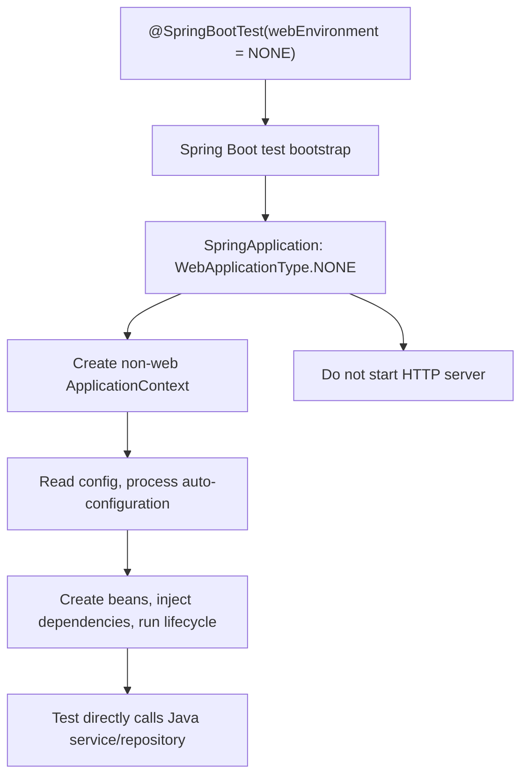
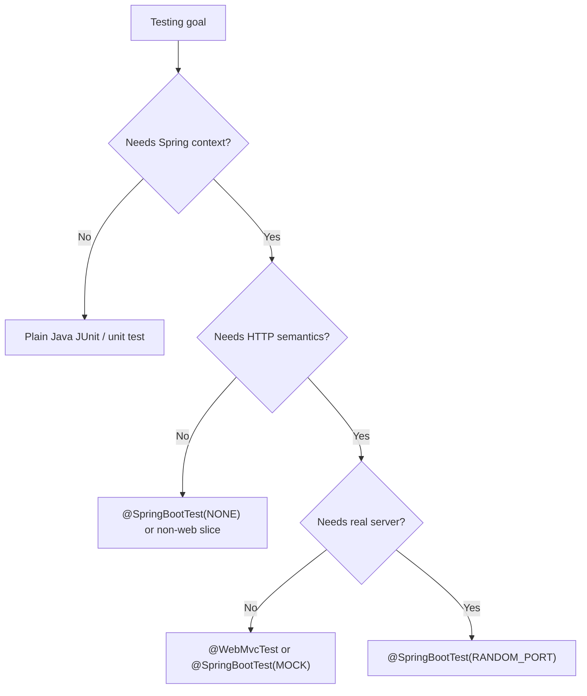

# WebEnvironment.NONE for Applications Not Requiring a Web Environment

A Spring Boot application does not always serve HTTP requests. Many programs are built to run **batch jobs**, process data, consume messages, execute scheduled business tasks, synchronize systems, or expose services meant to be tested directly via a Java API. When writing integration tests for these cases, starting a servlet container or reactive web server is usually unnecessary.

Spring Boot Test provides a dedicated option:

```java
@SpringBootTest(webEnvironment = SpringBootTest.WebEnvironment.NONE)
```

The `WebEnvironment.NONE` option tells the test to bootstrap Spring Boot with a **non-web application type**. Spring still builds the `ApplicationContext`, performs dependency injection, and applies relevant auto-configurations; what is omitted is the **web environment** the test does not need. As a result, you can test business beans, configuration, repositories, or processing flows inside a Spring Boot context without opening an HTTP port.

This lesson belongs to the **Platform Testing** chapter of *Spring Boot Fundamentals*. We examine how `NONE` affects context creation, when to choose it over `MOCK` or `RANDOM_PORT`, which kinds of beans may still be loaded, how to write runnable integration tests, and common misconceptions about its limits.

The examples use Java 21, JUnit Jupiter, and Spring Boot 3.x. The core APIs are `@SpringBootTest` and the `SpringBootTest.WebEnvironment` enum. Auto-configuration details may vary depending on your Spring Boot version and actual project dependencies.

## 1. Problem: Testing business logic does not equal testing HTTP

Suppose we have an invoice billing application. The business logic must solve:

```text
Input: pre-tax amount and tax rate
Output: post-tax total, rounded according to rules
```

We want to verify that the service calculates the right result and receives configuration from Spring. There is no need to:

- Open an HTTP port.
- Start embedded Tomcat, Jetty, or Reactor Netty.
- Route requests through a controller.
- Perform JSON serialization.
- Inspect HTTP status codes or response headers.

When the test target is a service and related beans in a Spring context, dragging in a web environment can increase startup time or couple the test to components unrelated to what needs to be verified.

An appropriate test might look like:

```java
@SpringBootTest(webEnvironment = SpringBootTest.WebEnvironment.NONE)
class InvoiceCalculatorIntegrationTest {
    // Inject service from Spring context and call it directly.
}
```

**Core mindset:** before choosing a test annotation, ask **am I testing Java business behavior, integration between beans, or HTTP behavior?** The answer determines whether a web environment is needed.

## 2. What does @SpringBootTest do?

`@SpringBootTest` is a Spring Boot Test annotation used to create a **Spring Boot application context** during testing. Unlike pure Java unit tests, this test can use:

- Dependency injection with `@Autowired`.
- Configuration classes and component scanning.
- `@ConfigurationProperties` and property sources.
- Conditional auto-configuration.
- Bean lifecycle callbacks and relevant bean post-processors.
- Repositories, transaction managers, or integration beans when dependencies and configurations are present.
- Profile-conditioned beans.

Example:

```java
@SpringBootTest
class ServiceIntegrationTest {

    @Autowired
    SomeService service;

    @Test
    void worksWithSpringDependencies() {
        // Call service created by Spring.
    }
}
```

However, `@SpringBootTest` offers several web environment options. If omitted, the default enum value on the annotation is **`MOCK`**, not `NONE`.

### 2.1. What does NONE change?

When you write:

```java
@SpringBootTest(webEnvironment = SpringBootTest.WebEnvironment.NONE)
```

the Spring Boot test bootstrap uses `WebApplicationType.NONE` to build a non-web context. It is still a Spring application context, but it does not start a servlet or reactive web server to serve HTTP.



The diagram highlights key milestones for the web environment choice rather than replacing the full detailed order of `SpringApplication.run`.

### 2.2. NONE does not mean "no Spring"

Do not confuse `NONE` with a plain Java test without a container.

| Test style | Spring context? | HTTP server? | Typical scope |
|---|---|---|---|
| Plain Java JUnit, manual instantiation | No, unless set up manually. | No. | Isolated logic unit tests. |
| `@SpringBootTest(webEnvironment = NONE)` | Yes. | No. | Non-web bean and configuration integration tests. |
| `@SpringBootTest(webEnvironment = MOCK)` | Yes. | No real server started in MOCK mode. | Testing with a web-aware mock context when appropriate. |
| `@SpringBootTest(webEnvironment = RANDOM_PORT)` | Yes. | Yes, for eligible web applications. | HTTP integration tests on a random port. |

`NONE` is a **non-web full Spring Boot context**, not a way to disable all auto-configuration or shrink the context down to a single bean.

## 3. The four WebEnvironment options

The `SpringBootTest.WebEnvironment` enum has four common options:

| Value | Idea | Real web server? | When to use |
|---|---|---|---|
| `MOCK` | Creates a mock web environment if suitable web libraries are present. | No. | Testing controllers/filters through mock infrastructure. |
| `RANDOM_PORT` | Starts the web server on an automatically chosen port. | Yes, if app has an eligible web server. | In-JVM end-to-end HTTP integration tests. |
| `DEFINED_PORT` | Starts the web server on the application's configured port. | Yes, if app has an eligible web server. | Intentional cases needing a fixed port. |
| `NONE` | Starts the application context as non-web. | No. | Batch, services, repositories, property binding without HTTP. |

### 3.1. MOCK is not NONE

`MOCK` is the default when using `@SpringBootTest` without specifying `webEnvironment`. If servlet APIs and Spring MVC are on the classpath, it can supply a mock servlet web application context without opening a real port.

By contrast, `NONE` requests **not using a web application context**. Capabilities depending on a mock servlet context—such as the Spring MVC request-mapping infrastructure backing `MockMvc`—are not the target of this mode.

If you are testing a `@RestController` with simulated requests, consider `@WebMvcTest` or `@SpringBootTest(webEnvironment = MOCK)` with `@AutoConfigureMockMvc` as appropriate—**do not pick `NONE` simply hoping tests run faster**.

### 3.2. RANDOM_PORT differs from NONE

Example:

```java
@SpringBootTest(webEnvironment = SpringBootTest.WebEnvironment.RANDOM_PORT)
class HttpEndpointTest {
    // Test endpoint over HTTP.
}
```

With an eligible servlet web app, a real server runs on a random port to avoid colliding with local services. In the test you can obtain the actual port via `@LocalServerPort` and use an appropriate HTTP client.

`NONE` has no assigned server port. Therefore, do not attempt:

```java
@LocalServerPort
int port;
```

inside a `NONE` test expecting an open port.

### 3.3. DEFINED_PORT differs from NONE

`DEFINED_PORT` uses the configured `server.port`. Because multiple test processes may run concurrently, fixed ports collide easily and hinder parallel test execution.

When HTTP verification is unnecessary, using `NONE` eliminates port selection and reservation issues altogether.

## 4. WebApplicationType.NONE at the runtime layer

`SpringApplication` has the concept of `WebApplicationType`:

```java
import org.springframework.boot.WebApplicationType;
```

Main types:

- `NONE`: non-web application.
- `SERVLET`: web application based on the servlet stack.
- `REACTIVE`: web application based on the reactive stack.

During normal startup, Spring Boot infers the web application type from available libraries. The test annotation `@SpringBootTest(webEnvironment = NONE)` instructs the test bootstrap to use `WebApplicationType.NONE`, even when web dependencies exist in the project.

### 4.1. Example of a batch application explicitly choosing NONE

In runtime application code, you can explicitly select non-web:

```java
package com.example.batch;

import org.springframework.boot.SpringApplication;
import org.springframework.boot.WebApplicationType;
import org.springframework.boot.autoconfigure.SpringBootApplication;

@SpringBootApplication
public class BatchApplication {

    public static void main(String[] args) {
        SpringApplication app = new SpringApplication(BatchApplication.class);
        app.setWebApplicationType(WebApplicationType.NONE);
        app.run(args);
    }
}
```

That configures **the application when running for real**. Meanwhile, `webEnvironment = NONE` inside `@SpringBootTest` configures the **test context**.

### 4.2. Does choosing NONE in a test modify application.yml?

No. The annotation controls the test's bootstrap process and does not write configuration files. When starting the main application through another mechanism, the application type is determined by that run's runtime configuration.

### 4.3. The spring.main.web-application-type property

Spring Boot also provides the property:

```properties
spring.main.web-application-type=none
```

This property configures the web application type when starting Spring Boot. However, in tests it is best to use the annotation `webEnvironment = NONE` so the requirement is stated directly on the test rather than relying on a profile or external property that could be overridden.

## 5. A minimal project for practice

Let's create an invoice calculation app to directly test beans and property binding. This application **does not need a web starter**.

Suggested structure:

```text
billing-demo/
├── build.gradle
└── src/
    ├── main/java/com/example/billing/
    │   ├── BillingApplication.java
    │   ├── BillingProperties.java
    │   └── InvoiceCalculator.java
    └── test/java/com/example/billing/
        └── InvoiceCalculatorBootTest.java
```

### 5.1. Declaring Gradle dependencies

In a project already configured with the Spring Boot Gradle plugin and dependency management, dependencies can be:

```groovy
dependencies {
    implementation 'org.springframework.boot:spring-boot-starter'
    testImplementation 'org.springframework.boot:spring-boot-starter-test'
}
```

`spring-boot-starter` provides core Spring Boot components. `spring-boot-starter-test` provides test infrastructure aligned with the Boot version, including JUnit Jupiter and common assertion libraries.

There is no need to declare `spring-boot-starter-web` just so Spring Boot can run a `@SpringBootTest`.

### 5.2. Main application class

```java
package com.example.billing;

import org.springframework.boot.autoconfigure.SpringBootApplication;
import org.springframework.boot.context.properties.ConfigurationPropertiesScan;

@SpringBootApplication
@ConfigurationPropertiesScan
public class BillingApplication {
}
```

We do not need a `main` method in this illustrative class to run `@SpringBootTest`. If you want to run the app as an executable Java program, you can add `main` calling `SpringApplication.run(...)` as usual.

`@ConfigurationPropertiesScan` helps Spring Boot discover configuration properties classes within the scanned packages.

### 5.3. ConfigurationProperties for tax rate

```java
package com.example.billing;

import java.math.BigDecimal;
import org.springframework.boot.context.properties.ConfigurationProperties;

@ConfigurationProperties(prefix = "billing")
public record BillingProperties(BigDecimal taxRate) {
}
```

This record receives `billing.tax-rate`. When Spring Boot creates the bean from configuration properties, the Binder converts the property string into a `BigDecimal`.

### 5.4. Business service

```java
package com.example.billing;

import java.math.BigDecimal;
import java.math.RoundingMode;
import org.springframework.stereotype.Service;

@Service
public class InvoiceCalculator {

    private final BillingProperties properties;

    public InvoiceCalculator(BillingProperties properties) {
        this.properties = properties;
    }

    public BigDecimal total(BigDecimal beforeTax) {
        BigDecimal tax = beforeTax.multiply(properties.taxRate());
        return beforeTax.add(tax).setScale(2, RoundingMode.HALF_UP);
    }
}
```

The service focuses on billing calculations. It receives `BillingProperties` from the Spring container and knows nothing about HTTP controllers, servlet requests, or web servers.

### 5.5. Test with WebEnvironment.NONE

```java
package com.example.billing;

import static org.assertj.core.api.Assertions.assertThat;

import java.math.BigDecimal;
import org.junit.jupiter.api.Test;
import org.springframework.beans.factory.annotation.Autowired;
import org.springframework.boot.test.context.SpringBootTest;
import org.springframework.core.env.Environment;

@SpringBootTest(
        classes = BillingApplication.class,
        webEnvironment = SpringBootTest.WebEnvironment.NONE,
        properties = "billing.tax-rate=0.10")
class InvoiceCalculatorBootTest {

    @Autowired
    InvoiceCalculator calculator;

    @Autowired
    BillingProperties properties;

    @Autowired
    Environment environment;

    @Test
    void calculatesTotalUsingSpringConfiguration() {
        BigDecimal result = calculator.total(new BigDecimal("100.00"));

        assertThat(result).isEqualByComparingTo("110.00");
        assertThat(properties.taxRate())
                .isEqualByComparingTo("0.10");
        assertThat(environment.getProperty("billing.tax-rate"))
                .isEqualTo("0.10");
    }
}
```

When the test runs:

1. Spring Boot builds a non-web `ApplicationContext`.
2. Configuration properties scanning registers `BillingProperties`.
3. The value `billing.tax-rate=0.10` is supplied from test properties.
4. Spring creates `InvoiceCalculator` with the bound dependency.
5. JUnit directly invokes `total(...)` on the Spring bean.
6. Assertions verify the result and property.

**No step needs to call an HTTP endpoint.** This test verifies that Spring binding and dependency injection work together properly with business logic inside a non-web application context.

## 6. Why is the example above an integration test?

We did not manually instantiate:

```java
new InvoiceCalculator(new BillingProperties(...));
```

Instead, Spring Boot loads configuration, creates beans, and injects dependencies. Thus the test verifies the coordination of multiple parts:

- Component scanning.
- `@ConfigurationPropertiesScan`.
- Binder and property sources.
- Constructor dependency injection.
- Business method execution.

However, the test **does not** check HTTP routing, JSON serialization, security filters, or the embedded servlet container. That is the essence of choosing the right test boundary.

### 6.1. Pure Java unit tests are still useful

For the same service, you can also write:

```java
import static org.assertj.core.api.Assertions.assertThat;

import java.math.BigDecimal;
import org.junit.jupiter.api.Test;

class InvoiceCalculatorUnitTest {

    @Test
    void computesTotalWithoutSpring() {
        InvoiceCalculator calculator =
                new InvoiceCalculator(
                        new BillingProperties(new BigDecimal("0.10")));

        assertThat(calculator.total(new BigDecimal("100.00")))
                .isEqualByComparingTo("110.00");
    }
}
```

Unit tests are lighter and verify the pure formula. `@SpringBootTest(NONE)` adds value when you specifically need to verify **Spring wiring and configuration**.

**Choosing NONE is not a reason to turn every unit test into @SpringBootTest.**

## 7. Verifying the non-web application context

In a project with Spring Web on the classpath, you can verify the context type when using `NONE`.

Example:

```java
package com.example.billing;

import static org.assertj.core.api.Assertions.assertThat;

import org.junit.jupiter.api.Test;
import org.springframework.beans.factory.annotation.Autowired;
import org.springframework.boot.test.context.SpringBootTest;
import org.springframework.context.ApplicationContext;
import org.springframework.web.context.WebApplicationContext;

@SpringBootTest(
        classes = BillingApplication.class,
        webEnvironment = SpringBootTest.WebEnvironment.NONE,
        properties = "billing.tax-rate=0.10")
class NonWebContextTypeTest {

    @Autowired
    ApplicationContext context;

    @Test
    void applicationContextIsNotServletWebApplicationContext() {
        assertThat(context)
                .isNotInstanceOf(WebApplicationContext.class);
    }
}
```

This test assumes the project has `spring-web` to import `WebApplicationContext`; if you only use the base starter without Spring Web, **there is no need to add a web dependency solely to perform this assertion**. In that case, simply verify that the context and needed beans are created while the test requires no HTTP port.

### 7.1. NONE still uses ApplicationContext

`ApplicationContext` still supports:

```java
context.getBean(InvoiceCalculator.class)
context.getEnvironment()
context.getBeanDefinitionNames()
```

Depending on configuration, non-web lifecycle callbacks and auto-configurations still operate. Not all beans disappear simply because the context is non-web.

### 7.2. Do not depend on concrete ApplicationContext class names

The implementation class name of the context may change across bootstraps or framework versions. Tests should assert meaningful behavior—such as required business beans existing without an HTTP server—rather than asserting an exact implementation class name unless specifically required.

## 8. NONE still runs non-web auto-configurations

This is crucial for understanding the limits of `NONE`.

Suppose the application has:

```groovy
dependencies {
    implementation 'org.springframework.boot:spring-boot-starter'
    implementation 'org.springframework.boot:spring-boot-starter-data-jpa'
    runtimeOnly 'com.h2database:h2'
    testImplementation 'org.springframework.boot:spring-boot-starter-test'
}
```

With matching datasource and JPA configuration, `@SpringBootTest(webEnvironment = NONE)` **can still**:

- Initialize `DataSource`.
- Create `EntityManagerFactory`.
- Register repository beans.
- Create a transaction manager.
- Run configured schema management or initialization steps.

Because those beans are **not a servlet web server**, `NONE` does not disable them.

### 8.1. NONE does not mean "load only the injected bean"

`@SpringBootTest` is still a full-context test. If the application has eagerly initialized integration beans, they can still participate at startup.

This means the test can fail because:

- Datasource URL is missing or wrong.
- Schema migration fails.
- A `@PostConstruct` throws an exception.
- A required bean is missing a dependency.
- An `ApplicationRunner` executes and fails.
- An external integration attempts to reach an unavailable system.

This is **not proof that NONE is broken**; those failures stem from the non-web portion of the application context.

### 8.2. Why can a NONE test still start slowly?

Skipping the HTTP server avoids part of the work, yet Spring still processes configuration classes, bean creation, proxies, databases, and other integrations.

Therefore `NONE` does not guarantee every test runs faster than some threshold. Speed depends on context size and the dependencies actually loaded.

## 9. NONE does not completely eliminate HTTP-related beans

If a project includes `spring-boot-starter-web`, web classes remain on the classpath. Component scanning can still see a class annotated with `@RestController` as an ordinary Spring bean.

What `NONE` removes is the **web application environment** needed to serve requests, not every class on the classpath carrying web annotations.

Distinguish clearly between:

- **The controller class exists on the classpath.**
- **The controller bean may be registered by component scanning.**
- **Whether Spring MVC infrastructure is auto-configured.**
- **Whether a web server listens for HTTP requests.**

Without a server, there is no real HTTP path to test over the network in that context, even though some controller beans may exist.

### 9.1. Auto-configuration conditions based on web application

Spring Boot has conditions such as:

```java
@ConditionalOnWebApplication
```

or:

```java
@ConditionalOnNotWebApplication
```

These conditions determine which auto-configurations or beans match the context type. With `WebEnvironment.NONE`, conditions requiring a servlet or reactive web application are not satisfied in the usual way.

Thus, `NONE` does not merely "turn off the port." It also changes **which runtime conditions evaluate to true** during auto-configuration.

## 10. NONE and MockMvc do not substitute for one another

`MockMvc` simulates calls into the Spring MVC request-processing infrastructure without opening an HTTP port. That still requires an appropriate **web-aware test context**.

A controller test should pick something like:

```java
import org.junit.jupiter.api.Test;
import org.springframework.beans.factory.annotation.Autowired;
import org.springframework.boot.test.autoconfigure.web.servlet.AutoConfigureMockMvc;
import org.springframework.boot.test.context.SpringBootTest;
import org.springframework.test.web.servlet.MockMvc;

import static org.springframework.test.web.servlet.request.MockMvcRequestBuilders.get;
import static org.springframework.test.web.servlet.result.MockMvcResultMatchers.status;

@SpringBootTest(webEnvironment = SpringBootTest.WebEnvironment.MOCK)
@AutoConfigureMockMvc
class CatalogHttpContractTest {

    @Autowired
    MockMvc mockMvc;

    @Test
    void returnsProducts() throws Exception {
        mockMvc.perform(get("/products"))
                .andExpect(status().isOk());
    }
}
```

The example assumes the real application has a controller handling `GET /products` and returning 200. Its purpose is demonstrating the right **web test style**, not providing a full controller in this lesson.

### 10.1. Why not combine NONE + AutoConfigureMockMvc?

With `NONE`, the context is not created as a servlet web application context; therefore combining:

```java
@SpringBootTest(webEnvironment = SpringBootTest.WebEnvironment.NONE)
@AutoConfigureMockMvc
```

is the wrong choice when you need to simulate Spring MVC HTTP requests. The beans or mock servlet infrastructure `MockMvc` expects may not exist.

Choose `MOCK` for request-level MVC integration, or `@WebMvcTest` if you only want a small web slice.

### 10.2. Why does WebMvcTest exist?

`@WebMvcTest` typically initializes only MVC-related components via slice auto-configuration, shrinking the context relative to a full `@SpringBootTest`. It fits when the target is controller mapping, validation, status codes, serialization, or web-layer security.

Conversely, `@SpringBootTest(NONE)` fits when the target is non-web services or configurations while still using a real Spring Boot context.

## 11. NONE and TestRestTemplate, WebTestClient

`TestRestTemplate` typically appears in tests with an embedded web server, such as:

```java
@SpringBootTest(webEnvironment = SpringBootTest.WebEnvironment.RANDOM_PORT)
```

Without an HTTP server, `TestRestTemplate` has no newly started application port to call. Similarly, a `WebTestClient` bound to a live server requires a matching server; modes binding to a mock context or reactive handler have their own requirements.

### 11.1. Testing a method instead of HTTP

With `NONE`:

```java
@Autowired
InvoiceCalculator calculator;

@Test
void calculatesInvoice() {
    assertThat(calculator.total(new BigDecimal("50.00")))
            .isEqualByComparingTo("55.00");
}
```

This is a direct Java call on a Spring-managed bean. You do not need to construct a request body, send HTTP, parse JSON responses, or verify ports.

### 11.2. When is real HTTP testing needed?

If the requirements involve:

- Controller mappings.
- JSON serialization/deserialization.
- HTTP headers.
- Security filter chains.
- CORS.
- HTTP status and error contracts.
- Embedded server integration.

then `NONE` does not test the right boundary; choose `MOCK`, a web slice, or `RANDOM_PORT` depending on the goal.

## 12. NONE for batch applications

A batch program often only needs to start Spring, locate a job/service, and execute work.

Example:

```java
package com.example.batch;

import java.time.LocalDate;
import org.springframework.stereotype.Service;

@Service
public class DailyReportService {

    private final ReportRepository repository;

    public DailyReportService(ReportRepository repository) {
        this.repository = repository;
    }

    public int createReport(LocalDate date) {
        return repository.buildFor(date);
    }
}
```

Here `ReportRepository` is an abstraction defined by the application. We can write an integration test:

```java
@SpringBootTest(
        webEnvironment = SpringBootTest.WebEnvironment.NONE,
        properties = "reports.mode=test")
class DailyReportServiceTest {

    @Autowired
    DailyReportService reports;

    @Test
    void createsDailyReport() {
        int count = reports.createReport(LocalDate.of(2026, 11, 13));
        assertThat(count).isGreaterThanOrEqualTo(0);
    }
}
```

The test assumes the repository and test data are set up to generate the report. In a real project, assertions should verify concrete business outcomes rather than only a non-negative record count.

### 12.1. Batch does not need HTTP, but may need a database

`NONE` fits because the test opens no web server. However, if business logic uses `JdbcTemplate`, JPA, or transactions, you still need a properly configured datasource or test database.

### 12.2. Distinguishing batch logic from startup runners

A batch application may trigger jobs through `CommandLineRunner` or `ApplicationRunner`. When a test starts a full Spring Boot application context, those runners **may also be invoked** during bootstrapping.

Do not assume `NONE` stops runners from running—they are not a web feature.

## 13. Important pitfall: ApplicationRunner and CommandLineRunner still run

Example:

```java
@Component
public class StartupImportRunner implements ApplicationRunner {

    private final ExternalImportService service;

    public StartupImportRunner(ExternalImportService service) {
        this.service = service;
    }

    @Override
    public void run(ApplicationArguments args) {
        service.importFromPartner();
    }
}
```

A `@SpringBootTest(webEnvironment = NONE)` test starts the context following the Spring Boot lifecycle. This runner can execute even without a web server. If it calls an external partner over the network, the test can easily fail or cause unwanted side effects.

### 13.1. Solution 1: separate behavior from the trigger

Design the runner as a thin adapter:

```java
@Component
@ConditionalOnProperty(
        name = "app.startup-import.enabled",
        havingValue = "true",
        matchIfMissing = true)
public class StartupImportRunner implements ApplicationRunner {

    private final ExternalImportService service;

    public StartupImportRunner(ExternalImportService service) {
        this.service = service;
    }

    @Override
    public void run(ApplicationArguments args) {
        service.importFromPartner();
    }
}
```

In the test:

```java
@SpringBootTest(
        webEnvironment = SpringBootTest.WebEnvironment.NONE,
        properties = "app.startup-import.enabled=false")
```

When the property is disabled, the runner bean is not registered per the condition. Tests can still inject the service and invoke operations in a controlled way.

### 13.2. Solution 2: profile for tests

Some startup integrations can use:

```java
@Profile("!test")
```

to avoid registering the runner when the `test` profile is active. This should match the project's environment policy; a runner that itself needs testing in other tests must still have its own test path.

### 13.3. Solution 3: isolate external integrations

When tests need the real flow without calling production services, use a fake/test double or a controlled integration test environment. Do not disable all startup mechanisms solely to turn the context green; stay clear on which behavior the test targets.

## 14. NONE does not disable scheduled jobs or background threads

Like runners, other non-web components can still operate:

```java
@Scheduled(fixedDelay = 60_000)
public void synchronizeData() {
    // Periodic task execution.
}
```

If the application enables scheduling via `@EnableScheduling` and appropriate beans, the scheduler can initialize inside a `NONE` test context. A task might run while another test executes or create unexpected data.

### 14.1. Design tests with control

Example using a condition on scheduler configuration:

```java
@Configuration(proxyBeanMethods = false)
@ConditionalOnProperty(
        name = "app.scheduling.enabled",
        havingValue = "true",
        matchIfMissing = true)
@EnableScheduling
public class SchedulingConfiguration {
}
```

In tests not needing the scheduler:

```java
@SpringBootTest(
        webEnvironment = SpringBootTest.WebEnvironment.NONE,
        properties = "app.scheduling.enabled=false")
```

This assumes the project enables scheduling only through the conditioned configuration above; if `@EnableScheduling` appears elsewhere, check the actual setup.

### 14.2. Do not infer solely from thread names

Seeing logs on `scheduling-1` or another executor thread during tests can indicate background components are still active. `NONE` does not mean the application runs exclusively on the test thread.

## 15. Using test properties with NONE

`@SpringBootTest` allows providing properties directly on the annotation:

```java
@SpringBootTest(
        webEnvironment = SpringBootTest.WebEnvironment.NONE,
        properties = {
            "billing.tax-rate=0.10",
            "billing.rounding-mode=HALF_UP",
            "app.startup-import.enabled=false"
        })
```

These properties enter the test `Environment` and can override application config values according to Spring Boot Test precedence.

### 15.1. Using @ActiveProfiles with a test profile file

`src/test/resources/application-test.yml`:

```yaml
billing:
  tax-rate: 0.10

app:
  startup-import:
    enabled: false
```

Test:

```java
@SpringBootTest(webEnvironment = SpringBootTest.WebEnvironment.NONE)
@ActiveProfiles("test")
class BillingConfigurationTest {
    // Test uses configuration for the test profile.
}
```

`@ActiveProfiles("test")` selects the profile, while `NONE` selects the application context type. These are **two independent configuration axes**.

### 15.2. NONE does not automatically enable the test profile

Writing:

```java
@SpringBootTest(webEnvironment = SpringBootTest.WebEnvironment.NONE)
```

does not cause Spring to automatically pick the `test` profile. To load `application-test.yml`, activate that profile via `@ActiveProfiles` or another valid mechanism.

### 15.3. Do not use production config for external integrations

If the tested service needs a database or message broker, supply explicit test configuration. Never pick `NONE` and assume all external connections are isolated.

## 16. NONE and @ConfigurationProperties

`@ConfigurationProperties` operates on binding and `Environment`; it does not require an HTTP server.

Example:

```yaml
mail:
  digest:
    enabled: true
    recipients:
      - ops@example.test
      - dev@example.test
```

Record:

```java
import java.util.List;
import org.springframework.boot.context.properties.ConfigurationProperties;

@ConfigurationProperties(prefix = "mail.digest")
public record DigestProperties(
        boolean enabled,
        List<String> recipients) {
}
```

If this record is registered via `@ConfigurationPropertiesScan` or `@EnableConfigurationProperties`, a `NONE` test can inject it and verify binding.

```java
@SpringBootTest(webEnvironment = SpringBootTest.WebEnvironment.NONE)
@ActiveProfiles("test")
class DigestPropertiesTest {

    @Autowired
    DigestProperties properties;

    @Test
    void bindsDigestSettings() {
        assertThat(properties.enabled()).isTrue();
        assertThat(properties.recipients())
                .containsExactly("ops@example.test", "dev@example.test");
    }
}
```

Just ensure the YAML above is present in the test's property sources, such as a profile file loaded from `src/test/resources/application-test.yml`. Neither `MockMvc` nor `TestRestTemplate` is needed to verify binding.

## 17. NONE and repository/transaction tests

Many non-web integration tests need repositories or transactions:

```java
@SpringBootTest(webEnvironment = SpringBootTest.WebEnvironment.NONE)
@Transactional
class AccountRepositoryIntegrationTest {

    @Autowired
    AccountRepository repository;

    @Test
    void persistsAccount() {
        Account saved = repository.save(new Account("demo"));
        assertThat(saved.getId()).isNotNull();
    }
}
```

The example assumes the project already has a valid JPA entity/repository, datasource, and transaction manager.

### 17.1. What does @Transactional on a test mean?

With Spring Test transaction management and a suitable `PlatformTransactionManager`, `@Transactional` on a test method/class runs the test in a transaction and rolls back by default afterward. This is useful for keeping test data isolated across synchronous repository tests.

However, note that code running on another thread or systems outside the database transaction may **not** be part of the same test transaction.

### 17.2. When is @DataJpaTest better?

If the target is strictly JPA repositories, `@DataJpaTest` loads a small **slice** focused on persistence and appropriate test conveniences.

Choose:

- `@DataJpaTest` when testing repositories/JPA with a narrow context scope.
- `@SpringBootTest(NONE)` when verifying full coordination across services, repositories, configuration, and other non-web beans.

You do not need a full application context for every simple CRUD operation.

## 18. NONE and @MockBean / test doubles

For a service needing an external API client, a full-context test may still want to swap a bean for a fake or mock.

Example dependency:

```java
@Service
public class BillingSyncService {

    private final PaymentGateway gateway;

    public BillingSyncService(PaymentGateway gateway) {
        this.gateway = gateway;
    }

    public boolean synchronize(String invoiceId) {
        return gateway.confirm(invoiceId);
    }
}
```

In compatible framework/test library versions, you can use test bean overrides such as the mocking annotation supported by that Spring Boot/Spring Framework release.

Annotation names like `@MockBean` (traditional Boot Test) and `@MockitoBean` (newer Spring Framework releases) should be chosen according to **the project's specific version**. The idea stays the same:

1. Load a non-web application context.
2. Replace the real `PaymentGateway` with a test double.
3. Call `BillingSyncService` directly.
4. Verify the outcome without calling the external production gateway.

### 18.1. NONE does not automatically create mocks for external services

If you do not override beans or configure test endpoints, services can still use real dependencies. Web environment `NONE` only omits web server infrastructure; it **does not** automatically replace networking, database, or message broker beans with mocks.

### 18.2. Alternative without Mockito

You can use `@TestConfiguration` to register a fake implementation with appropriate conditions or bean overrides. Keep test double logic simple and avoid mixing test implementations into production configuration.

## 19. Context caching and test lifecycle

Spring Test uses **context caching** to reuse an `ApplicationContext` across tests with compatible configurations. This reduces initialization time, though it is also a common source of confusion.

Suppose two test classes both use:

```java
@SpringBootTest(
        webEnvironment = SpringBootTest.WebEnvironment.NONE,
        properties = "billing.tax-rate=0.10")
```

If context characteristics match Spring Test's cache key, the context can be reused rather than restarted from scratch for each class.

### 19.1. Do not assume runners execute before every @Test

`ApplicationRunner` and `CommandLineRunner` belong to the startup lifecycle. When a context is cached, runners are not invoked again just because JUnit runs another test method.

**Context startup** and **individual test method lifecycle** are two distinct concepts.

### 19.2. State inside singletons can cause cross-test interference

If a bean is a singleton holding mutable state:

```java
@Component
public class InMemoryCounter {

    private int count;

    public void increment() {
        count++;
    }

    public int value() {
        return count;
    }
}
```

Two tests sharing a context can observe state left over from the earlier test. `NONE` does not alter bean scope and does not reset singletons between tests.

Keep tests independent via explicit setup/cleanup, deliberate state resets, or services with minimal mutable state. `@DirtiesContext` can force context recreation when necessary, at the cost of slower test runs.

### 19.3. When should @DirtiesContext be used?

If a test genuinely mutates context configuration or bean state in a way that cannot be safely reset, `@DirtiesContext` tells Spring Test to discard the used context after or before the test depending on configuration.

Do not apply it everywhere just to "avoid strange errors." It is better to understand which state is shared and isolate it at the right place.

## 20. What happens if the application context fails to build?

If a test has:

```java
@SpringBootTest(webEnvironment = SpringBootTest.WebEnvironment.NONE)
class ApplicationStartupTest {
    @Test
    void starts() {
    }
}
```

the test method does nothing, yet loading the context itself is an important check. If a required bean cannot be constructed, context initialization fails before the test method is even invoked.

This is a useful **context smoke test** for non-web applications.

### 20.1. Datasource errors

Messages may relate to missing JDBC URLs, drivers, or authentication. `NONE` does not disable datasource auto-configuration. Configure a test datasource or narrow the context scope appropriately.

### 20.2. Runner errors

If an `ApplicationRunner` calls an external API and throws an exception, the context can fail during Boot startup. Isolate the trigger via properties/profiles, use fakes, or provide a suitable integration test environment.

### 20.3. Servlet bean errors

An application bean may depend directly on `HttpServletRequest`, the servlet context, or web-scoped beans. In a `NONE` context, web-specific dependencies may be absent, causing bean creation to fail.

This does not mean `NONE` has a "bug." The test is trying to load a bean that only operates when a web context is present.

## 21. When an application has both web and non-web modules

A monolith might contain:

- REST controllers.
- Business services.
- Scheduled jobs.
- Data repositories.
- Message consumers.
- External clients.

You may want to test the business layer without web to avoid starting a server, yet full component scanning can still register controllers and other beans.

### 21.1. NONE may still fail to load the entire application

If certain singletons are designed strictly for web environments and require servlet-scoped dependencies at initialization time, a `NONE` test can fail. In that case you have several options:

1. Separate web adapters from business/application services cleanly.
2. Use conditions so web-specific beans register only in web applications.
3. Build a test configuration containing only the necessary beans.
4. If the target is the web layer, use a web-aware test instead of forcing `NONE`.

### 21.2. Do not use NONE to dodge an important web bug

If production runs a web server, a passing `NONE` test **does not prove** HTTP endpoints, security, and controller mappings work properly. You still need web-layer tests at the appropriate level.

A well-organized test suite typically includes:

```text
Unit tests -> pure Java service/domain logic
Non-web integration tests -> Spring beans + config + persistence
Web slice tests -> controller/filter/validation
HTTP integration tests -> server + routing + serialization
```

Each layer has its own value; `NONE` is simply a tool for picking the right boundary for the non-web integration layer.

## 22. How "fast" is NONE, and what are the trade-offs?

Obvious benefits of `NONE`:

- No HTTP port needs to be opened.
- No embedded web server needs to start.
- No dependence on the request/response pipeline.
- Tests focus on dependency injection and business integrations.
- Fewer port collisions when running many tests.

Yet costs can still be high if:

- The application has many auto-configurations.
- There are hundreds of singleton beans.
- `DataSource`/JPA needs to boot.
- Migrations or schema initialization run.
- Message listeners/external clients start up.
- Runners or schedulers trigger side effects.

**Do not treat NONE as a "go fast" button replacing proper test scope design.** If you only need a plain Java class, unit tests are still simpler and faster.

## 23. A second example: non-web service in an app with the web starter

Suppose the main project is a REST API using `spring-boot-starter-web`. We can still choose `NONE` for a test that needs Spring configuration without HTTP.

```java
package com.example.store;

import static org.assertj.core.api.Assertions.assertThat;

import org.junit.jupiter.api.Test;
import org.springframework.beans.factory.annotation.Autowired;
import org.springframework.boot.test.context.SpringBootTest;

@SpringBootTest(
        classes = StoreApplication.class,
        webEnvironment = SpringBootTest.WebEnvironment.NONE,
        properties = {
            "inventory.min-stock=5",
            "app.startup-sync.enabled=false"
        })
class InventoryPolicyTest {

    @Autowired
    InventoryPolicy policy;

    @Test
    void flagsLowStock() {
        assertThat(policy.isLowStock(3)).isTrue();
        assertThat(policy.isLowStock(12)).isFalse();
    }
}
```

The example assumes `StoreApplication`, `InventoryPolicy`, and the startup-sync control property are defined by the application. It illustrates **testing a policy bean via Spring DI**, without testing a controller.

### 23.1. Why use NONE even with web dependencies present?

Web dependencies merely indicate servlet/MVC classes exist on the classpath. `WebEnvironment.NONE` is an explicit directive for **this test run** that Spring Boot does not need to create a web application context or HTTP server.

### 23.2. When is this approach unsuitable?

If `InventoryPolicy` depends directly on request scope, HTTP sessions, or beans existing only in a web context, running it under `NONE` can fail. That may be a design signal that the business policy is too tightly coupled to the web layer.

## 24. Distinguishing NONE from the default webEnvironment

This is one of the most common learning and usage mistakes:

```java
@SpringBootTest
class MyTest {
}
```

versus:

```java
@SpringBootTest(webEnvironment = SpringBootTest.WebEnvironment.NONE)
class MyTest {
}
```

**They are not strictly equivalent.** The first uses `MOCK` per the annotation default; the second forces a non-web application type.

### 24.1. What if the application has no web dependencies?

With the default `MOCK`, Spring Boot can fall back to a non-web context if the classpath lacks the necessary web libraries. However, specifying `NONE` still expresses clear intent: the test does not need a web environment, even if the project later adds a web starter.

### 24.2. Why does expressing intent matter?

A project currently has only `spring-boot-starter`. Months later, the team adds `spring-boot-starter-web` to expose an admin API. Tests that omitted `NONE` may start booting a mock web environment simply because the classpath changed.

If a test's goal is always non-web integration, specifying `NONE` reduces sensitivity to unintended web dependency changes.

## 25. @SpringBootTest(classes = ...) and configuration scope

`@SpringBootTest` needs to know the root configuration class. When the package structure aligns, Spring Boot Test finds the class annotated with `@SpringBootConfiguration` or `@SpringBootApplication`.

However, when a project has multiple root configurations or tests live outside standard packages, declare it explicitly:

```java
@SpringBootTest(
        classes = BillingApplication.class,
        webEnvironment = SpringBootTest.WebEnvironment.NONE)
```

This lets readers immediately see the intended root configuration.

### 25.1. NONE is not a slice annotation

Even when specifying `classes = BillingApplication.class`, if that class uses `@SpringBootApplication` with component scanning and auto-configuration, the context can still be very large.

If you want to load **only a few configuration classes**, design a suitably scoped test configuration; do not expect `NONE` to shrink down to a single service automatically.

### 25.2. Narrow context example with @SpringBootConfiguration

For a scenario needing Spring Boot bootstrap with only a minimal set of beans:

```java
import org.springframework.boot.SpringBootConfiguration;
import org.springframework.context.annotation.Bean;

@SpringBootConfiguration
class MinimalBillingTestConfiguration {

    @Bean
    BillingProperties billingProperties() {
        return new BillingProperties(new BigDecimal("0.10"));
    }

    @Bean
    InvoiceCalculator invoiceCalculator(BillingProperties properties) {
        return new InvoiceCalculator(properties);
    }
}
```

Test:

```java
@SpringBootTest(
        classes = MinimalBillingTestConfiguration.class,
        webEnvironment = SpringBootTest.WebEnvironment.NONE)
class MinimalBillingContextTest {
    // Context contains only the appropriately configured components.
}
```

This is a deliberate choice for a small context. At this point, however, you are **no longer testing the production app's full auto-configuration/component scan**; understand the trade-off when narrowing the root configuration.

## 26. Integration with @ActiveProfiles, @TestPropertySource, @DynamicPropertySource

In integration tests, besides `properties` on `@SpringBootTest`, you may encounter:

- `@ActiveProfiles`: selects profiles for the test context.
- `@TestPropertySource`: supplies property files or inline test properties.
- `@DynamicPropertySource`: registers dynamic properties, often for resources started during test setup.

### 26.1. @TestPropertySource

```java
@SpringBootTest(webEnvironment = SpringBootTest.WebEnvironment.NONE)
@TestPropertySource(properties = {
    "billing.tax-rate=0.08",
    "app.startup-import.enabled=false"
})
class BillingWithTestPropertySourceTest {
}
```

It remains a non-web test. `@TestPropertySource` only affects configuration sources; it does not start an HTTP server.

### 26.2. @DynamicPropertySource for dynamic resources

When an integration test uses a database container with a dynamically assigned port, register properties via:

```java
@DynamicPropertySource
static void registerDatasource(DynamicPropertyRegistry registry) {
    registry.add("spring.datasource.url", database::getJdbcUrl);
    registry.add("spring.datasource.username", database::getUsername);
    registry.add("spring.datasource.password", database::getPassword);
}
```

This illustrative snippet assumes `database` is a test container created and managed with an appropriate lifecycle. It shows that **NONE is completely compatible with testing database integration**, because a database is not the application's web server.

### 26.3. Test property precedence

When a property appears across multiple sources, Spring Test and Spring Boot apply their precedence order. Do not read only `application.yml` and assume the bean receives that value; verify `Environment` or the `@ConfigurationProperties` object inside the test context.

## 27. Does NONE affect Actuator?

If the application adds `spring-boot-starter-actuator`, non-web health/metrics beans may still be registered if conditions match. Yet in a `NONE` test:

- There is no HTTP server to serve `GET /actuator/health`.
- Auto-configuration conditions dedicated to web management endpoints may not match.
- Non-web beans/metrics may still exist depending on dependencies and configuration.

Therefore, a `NONE` test is unsuitable for proving that the HTTP `/actuator/health` route is exposed. If that is the goal, use a web environment with a server or a mock web test as required.

### 27.1. HealthIndicator does not need HTTP for its logic

To test a custom `HealthIndicator`, you can inject the bean and invoke `health()` directly in a `NONE` context. That verifies the health contributor's logic, not Actuator's HTTP mapping.

## 28. NONE and Spring Security

In an application with Spring Security, non-web security beans may still exist. However, web filter chains and HTTP authorization behavior built on servlet/reactive web infrastructure usually require a web-aware context.

`NONE` can be suitable for testing:

- A service using method security under appropriate configuration.
- Business policies independent of HTTP.
- Configuration and bean injection not needing a request.

`NONE` is **unsuitable** if you want to verify:

- A filter blocking a request.
- How a token is extracted from an HTTP header.
- CSRF/CORS on web endpoints.
- HTTP 401/403 statuses from `SecurityFilterChain`.

For those requirements, choose a web slice/MockMvc or an HTTP integration test.

## 29. Common mistakes when choosing NONE

| Symptom | Common cause | Resolution |
|---|---|---|
| Test requires `MockMvc` but bean is missing | `NONE` does not supply a matching mock servlet web environment | Use `MOCK` + `@AutoConfigureMockMvc` or `@WebMvcTest`. |
| `@LocalServerPort` has no useful port | `NONE` does not start an embedded HTTP server | Use `RANDOM_PORT` if actually testing HTTP. |
| Test context fails due to DB | Datasource/JPA is still auto-configured | Supply a test datasource or use an appropriate slice/test context. |
| Startup runner calls external API | `NONE` does not disable runners | Conditionally disable the runner, inject a fake, or use a test environment. |
| Scheduled job interferes with tests | Scheduling still runs in the context if enabled | Configure the scheduler off in tests when appropriate. |
| Test passes yet controller fails at runtime | `NONE` does not test the web layer | Add web-specific tests. |
| REST controller bean exists without HTTP server | Classpath/bean scanning differs from web application type | Distinguish bean registration from server/web mappings. |
| Context is too big, tests are slow | `@SpringBootTest` is still a full context | Consider unit tests or slice tests. |
| Property value differs from expectation | Profiles/test properties/Config Data have precedence | Inspect `Environment` and config sources. |
| Second test is affected by state from first test | Context caching and mutable singleton state | Reset state intentionally or use proper isolation. |
| Test fails due to missing servlet request scope | Application bean depends on web context | Use a web-aware test or decouple the module design. |

## 30. Workflow for choosing WebEnvironment for a test requirement

Start from **what the test needs to observe**, rather than starting from a familiar annotation.



### 30.1. Questions to ask yourself

1. Does the test need real dependency injection or auto-configuration?
2. Does it need a servlet context, HTTP headers, or JSON conversion?
3. Does it need to open an HTTP port?
4. Will external dependencies start up with the context?
5. Will runners or schedulers produce side effects?
6. Could a unit test or smaller slice replace the full context?

If the answer is **needs Spring wiring, but does not need web**, `NONE` is a very natural fit.

## 31. Comprehensive practice exercise

Create a Spring Boot project using `spring-boot-starter` and `spring-boot-starter-test`; when ready to expand comparisons, you can add the web starter.

**Step A — Pure business service.** Create `InvoiceCalculator` accepting `BillingProperties` and computing totals.

**Step B — NONE test.** Write `@SpringBootTest(webEnvironment = NONE)`, inject the service, and verify the result.

**Step C — Property binding.** Supply `billing.tax-rate=0.10` via `properties` in the annotation and verify the record binds properly.

**Step D — Profile.** Create `application-test.yml` with a different tax rate, enable `@ActiveProfiles("test")`, and inspect `Environment`.

**Step E — Context smoke test.** Write a test without business assertions that simply verifies the context loads cleanly. Explain why this is still a valuable check.

**Step F — Add a runner.** Create an `ApplicationRunner` that logs a startup event and observe it still running during a `NONE` test.

**Step G — Isolate the runner.** Add a property controlling the runner and disable external integration triggers in tests.

**Step H — Add web starter.** Keep `webEnvironment = NONE`; compare the context with a `MOCK` test. No HTTP port needs to open in the `NONE` test.

**Step I — Try MockMvc.** Create a separate MVC test using `@WebMvcTest` or `MOCK` + `@AutoConfigureMockMvc`. Confirm its scope differs from `NONE`.

**Step J — Try RANDOM_PORT.** Launch a real server in a separate HTTP test and use an HTTP client to check the response.

**Step K — Persistence.** If the project uses JPA, write a repository test with `@DataJpaTest`, then a service integration test with `NONE` to compare context scopes.

**Step L — Context caching.** Create two test classes with matching configuration; try using a mutable singleton to understand why tests must not depend on execution order.

**Step M — Summary.** Build a comparison table of unit tests, `NONE`, `MOCK`, and `RANDOM_PORT` by goal, dependencies, HTTP behavior, and startup cost.

After each step, identify **which beans were created, which web parts were unneeded, what side effects could still happen, and what the test actually proved**.

## 32. Self-assessment questions

1. What does `WebEnvironment.NONE` in `@SpringBootTest` mean?
2. Does `NONE` mean no Spring application context is created?
3. What `WebEnvironment` value does `@SpringBootTest` use by default?
4. What is the difference between `MOCK` and `NONE`?
5. Why does `NONE` not need an HTTP port?
6. Why can a `NONE` test still use `@Autowired`?
7. Does `@ConfigurationProperties` work without a servlet web server?
8. When a project includes `spring-boot-starter-web`, is `NONE` still useful?
9. Why can a `@RestController` bean exist without an HTTP server serving requests?
10. How does `@ConditionalOnWebApplication` affect auto-configuration under `NONE`?
11. Why is `@AutoConfigureMockMvc` not a natural pairing with `NONE`?
12. When should you pick `RANDOM_PORT` instead of `NONE`?
13. Why does adding `@Transactional` to a repository test not depend on an HTTP server?
14. How does `@DataJpaTest` differ from `@SpringBootTest(NONE)` in context scope?
15. Can an `ApplicationRunner` execute when a `NONE` test starts?
16. Are scheduled tasks and message listeners guaranteed to be off when choosing `NONE`?
17. Why must you pay attention to external dependencies in `NONE` tests?
18. Which two different aspects do `@ActiveProfiles("test")` and `WebEnvironment.NONE` control?
19. How can context caching cause cross-test interference?
20. If a `NONE` test passes, can you conclude production HTTP endpoints work properly?
21. When is a plain JUnit unit test enough instead of a full Spring context?
22. When a `NONE` test fails to inject a servlet-scoped bean, what should you review?
23. Why might a property value in `@SpringBootTest(properties=...)` differ from `application.yml`?
24. Why does removing the web server not necessarily eliminate all context startup time?

### Complete model explanation

> `@SpringBootTest(webEnvironment = SpringBootTest.WebEnvironment.NONE)` instructs Spring Boot to create a non-web application context for integration testing. The test still uses dependency injection, configuration properties, conditional auto-configuration, and relevant beans, while omitting the servlet/reactive web server for serving HTTP. It is a strong choice for batch applications, business services, property binding, or repository/service integrations when request/response verification is unnecessary. `NONE` differs from `MOCK`—which can create a mock web environment when web libraries are present—and from `RANDOM_PORT`/`DEFINED_PORT`, which serve HTTP integration over a real server for eligible web applications. `NONE` is not a slice test: datasources, schedulers, runners, and non-web integration beans can still initialize or produce side effects. You must therefore select test configurations and isolate external dependencies intentionally. If the goal is controllers, security filters, or HTTP response contracts, use a web-aware test; if testing pure Java logic, unit tests are usually simpler.

When you can clearly explain **why a test needs a Spring context without needing a web environment**, distinguish `NONE` from `MOCK`/`RANDOM_PORT`, and recognize which non-web beans will still run, you have mastered using **WebEnvironment.NONE for applications not requiring a web environment** in Spring Boot.
