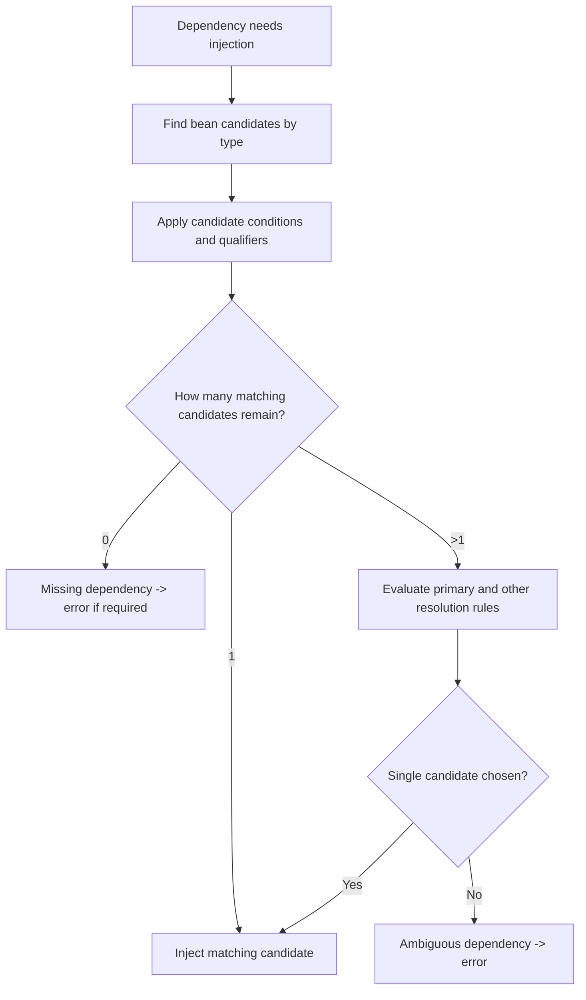

# Testing @Bean, @Qualifier, @Primary, and Missing-Candidate Configurations

A Spring Boot application may contain hundreds of Spring beans, and they are not always wired together as intended. Two implementations may exist for the same interface; a service may accidentally receive an implementation meant for testing; a `@Bean` factory method may require a dependency that does not exist; or application startup may fail because multiple candidates exist and Spring does not know which one to choose.

These failures belong to **bean wiring**: verifying bean registration and dependency resolution inside the Spring IoC container. They differ from testing a pure Java business algorithm. A service might calculate correctly when instantiated manually, yet the application still fails to run because Spring cannot create or locate the right bean.

In the **Platform Testing** chapter of *Spring Boot Fundamentals*, the lesson **"Testing @Bean, @Qualifier, @Primary, and Missing-Candidate Configurations"** focuses on building targeted tests to verify that:

- A `@Bean` method actually registers a bean in the application context.
- The bean has the expected name, type, scope, or required dependencies.
- `@Primary` selects the default candidate when multiple beans share the same type.
- `@Qualifier` selects the exact candidate, even when another bean is marked `@Primary`.
- A missing candidate, or multiple unresolved candidates, causes startup to fail as expected.
- `@ConditionalOnMissingBean` and intentional fallbacks are tested properly.
- You know when to use `ApplicationContextRunner`, a context test, or `@SpringBootTest`.

The goal is not merely writing a passing "context loads" test, but **explicitly verifying the wiring contract in both success states and missing/ambiguous-candidate states**.

## 1. Why test wiring?

Consider a notification application with the interface:

```java
public interface MessageSender {
    String channel();
    void send(String message);
}
```

Two implementations:

```java
public final class EmailMessageSender implements MessageSender {

    @Override
    public String channel() {
        return "email";
    }

    @Override
    public void send(String message) {
        // Send email per system configuration.
    }
}
```

```java
public final class SmsMessageSender implements MessageSender {

    @Override
    public String channel() {
        return "sms";
    }

    @Override
    public void send(String message) {
        // Send SMS per system configuration.
    }
}
```

A service using one sender:

```java
public final class NotificationService {

    private final MessageSender sender;

    public NotificationService(MessageSender sender) {
        this.sender = sender;
    }

    public String selectedChannel() {
        return sender.channel();
    }
}
```

If there is only one `MessageSender` bean, Spring can normally resolve the dependency by type. If there are two beans of the same type, explicit selection rules are required. If there are none, a required dependency cannot be satisfied.

Questions to test:

| Configuration scenario | Expectation |
| --- | --- |
| Exactly one `MessageSender` | `NotificationService` receives that bean |
| Email and SMS exist, email is `@Primary` | Unqualified single-value injection picks email |
| Email is `@Primary`, service uses `@Qualifier("smsSender")` | Service picks SMS |
| Email and SMS exist, no resolution rule | Context must report non-uniqueness error |
| No `MessageSender`, service requires it | Context must report missing dependency |
| Service requests qualifier matching no bean | Context must report no matching candidate |
| Conditional fallback exists when sender is missing | Fallback is created only when no suitable sender exists per condition |

Do not check only the bean count. A context containing both senders where `NotificationService` receives the wrong sender is still a wiring bug.

## 2. Set the right scope: test the Spring context, not just Java objects

A plain Java unit test:

```java
@Test
void delegatesToEmailSender() {
    NotificationService service =
            new NotificationService(new EmailMessageSender());

    assertThat(service.selectedChannel()).isEqualTo("email");
}
```

This test verifies constructor and object behavior, but **does not** test `@Bean`, `@Primary`, `@Qualifier`, or Spring's dependency selection mechanism.

In a wiring test, we need to create a Spring `ApplicationContext` and then query it or let Spring construct the service:

```text
Java configuration / annotations
             |
             v
  Spring bean definitions
             |
             v
  Bean candidate resolution
             |
             v
  Dependency injection
             |
             v
  Bean under test
```

A good wiring test verifies **the container's output**, not only the output of a manually invoked constructor.

### 2.1. Not every wiring test needs a web server

To verify `MessageSender` selection, you do not need to open an HTTP port, spin up a real database, or load the entire application. A small context containing just a few configuration classes is faster and yields clearer error messages.

Common options:

| Tool | Scope | When appropriate |
| --- | --- | --- |
| Plain Java test | No Spring container | Testing object logic with manually passed dependencies |
| `AnnotationConfigApplicationContext` | Small Spring context without Boot test runner | Trying `@Configuration`, `@Bean`, and simple injection |
| `ApplicationContextRunner` | Small context created/closed per callback; convenient for inspecting startup failures | Testing bean wiring, auto-configuration, and bean conditions |
| `@SpringBootTest` | Broader Spring Boot application context | Testing real integration of configurations across the app |
| Test slices such as `@WebMvcTest` | Partial context by functional layer | Testing controller/web integration; does not load all services/configs by default |

For this lesson, **`ApplicationContextRunner` is the primary tool**, because it lets you verify both successful contexts and failing contexts without halting the entire test suite during bootstrap.

## 3. Basic @Bean configuration and the contract to test

Spring lets a method annotated with `@Bean` register the object it returns:

```java
package com.example.notification.config;

import com.example.notification.EmailMessageSender;
import com.example.notification.MessageSender;
import org.springframework.context.annotation.Bean;
import org.springframework.context.annotation.Configuration;

@Configuration(proxyBeanMethods = false)
public class NotificationConfiguration {

    @Bean
    MessageSender emailSender() {
        return new EmailMessageSender();
    }
}
```

In a context using this configuration, the default bean typically has:

- **Name** `emailSender`, derived from the method name.
- **Declared type** `MessageSender` and runtime instance `EmailMessageSender`.
- **Singleton scope** unless another scope is specified.
- **Spring management** for creation, dependency injection, and appropriate lifecycle callbacks.

### 3.1. Writing a test for presence and type

```java
import org.junit.jupiter.api.Test;
import org.springframework.boot.test.context.runner.ApplicationContextRunner;

import static org.assertj.core.api.Assertions.assertThat;

class NotificationConfigurationTest {

    private final ApplicationContextRunner contextRunner =
            new ApplicationContextRunner()
                    .withUserConfiguration(NotificationConfiguration.class);

    @Test
    void registersOneMessageSender() {
        contextRunner.run(context -> {
            assertThat(context).hasNotFailed();
            assertThat(context).hasSingleBean(MessageSender.class);
            assertThat(context).hasBean("emailSender");

            MessageSender sender = context.getBean(MessageSender.class);
            assertThat(sender).isInstanceOf(EmailMessageSender.class);
        });
    }
}
```

With `ApplicationContextRunner`, the callback receives a context that either started or holds startup failure details. The runner-managed context is closed after the callback finishes.

Here the test checks **registration**, **candidate count by type**, and **actual implementation**. It does not need to send any real email.

### 3.2. Bean names can be set explicitly

```java
@Bean("transactionalEmailSender")
MessageSender emailSender() {
    return new EmailMessageSender();
}
```

The bean name is `transactionalEmailSender`, no longer defaulting to `emailSender`. If tests or injections rely on the old bean name, renaming the bean affects wiring.

Aliases can also be declared:

```java
@Bean(name = {"transactionalEmailSender", "emailSender"})
MessageSender emailSender() {
    return new EmailMessageSender();
}
```

Both names resolve to the same bean. These are aliases, not two separate sender instances.

### 3.3. Singleton tests must distinguish identity from behavior

```java
@Test
void returnsSameSingletonThroughAliases() {
    new ApplicationContextRunner()
            .withUserConfiguration(SenderAliasConfiguration.class)
            .run(context -> {
                Object a = context.getBean("transactionalEmailSender");
                Object b = context.getBean("emailSender");
                assertThat(a).isSameAs(b);
            });
}
```

This assumes `SenderAliasConfiguration` contains `@Bean(name = {...})` as above. Checking `isSameAs` is right when verifying singleton aliases. If a bean uses `@Scope("prototype")`, do not apply the same identity expectation.

## 4. Why do @Bean methods with dependencies also need testing?

A `@Bean` method can receive dependencies through its parameters:

```java
@Configuration(proxyBeanMethods = false)
class NotificationServiceConfiguration {

    @Bean
    NotificationService notificationService(MessageSender sender) {
        return new NotificationService(sender);
    }
}
```

Spring must find a bean assignable to `MessageSender` and pass it to the method. If there is no candidate or multiple unresolved candidates, **creating `NotificationService` will fail**.

That means wiring errors can occur not only at:

```java
public NotificationService(MessageSender sender) { ... }
```

but also at:

```java
@Bean
NotificationService notificationService(MessageSender sender) { ... }
```

### 4.1. Do not call @Bean factory methods manually to test wiring

A common mistake:

```java
NotificationConfiguration config = new NotificationConfiguration();
MessageSender sender = config.emailSender();
```

This call merely invokes an ordinary Java method. It **does not verify that Spring registered a bean with the right name, applied scoping, or resolved dependencies through the container**.

With `@Configuration(proxyBeanMethods = false)`, direct calls to `@Bean` methods are also not intercepted by Spring CGLIB proxies to reuse singletons as in full proxy-bean-methods mode.

Therefore, when testing the container's contract, build a context and call `context.getBean(...)` or let Spring inject the dependency.

### 4.2. Use method parameters instead of calling another @Bean method

Avoid writing code like this when expecting the Spring-managed dependency:

```java
@Configuration(proxyBeanMethods = false)
class ManualCallConfiguration {

    @Bean
    MessageSender emailSender() {
        return new EmailMessageSender();
    }

    @Bean
    NotificationService notificationService() {
        return new NotificationService(emailSender());
    }
}
```

When `proxyBeanMethods = false`, calling `emailSender()` inside another method is a direct Java call and can create **a new object**, rather than retrieving the container-managed `emailSender` singleton.

Replace it with:

```java
@Configuration(proxyBeanMethods = false)
class ManagedDependencyConfiguration {

    @Bean
    MessageSender emailSender() {
        return new EmailMessageSender();
    }

    @Bean
    NotificationService notificationService(MessageSender sender) {
        return new NotificationService(sender);
    }
}
```

This lets Spring resolve the candidate itself. Wiring tests should be written following that same pattern.

## 5. When multiple beans share a type: the non-uniqueness problem

Suppose the configuration is:

```java
@Configuration(proxyBeanMethods = false)
class TwoSendersConfiguration {

    @Bean("emailSender")
    MessageSender emailSender() {
        return new EmailMessageSender();
    }

    @Bean("smsSender")
    MessageSender smsSender() {
        return new SmsMessageSender();
    }

    @Bean
    NotificationService notificationService(MessageSender sender) {
        return new NotificationService(sender);
    }
}
```

Two beans are assignable to `MessageSender`. If the injection point has no qualifier, primary marker, or other resolution rule, Spring cannot arbitrarily choose one.

We want a test verifying that the context **fails explicitly**, rather than accidentally selecting an indeterminate implementation.

### 5.1. The NoUniqueBeanDefinitionException error

In many cases, the root cause is:

```text
NoUniqueBeanDefinitionException:
  expected single matching bean but found 2:
  emailSender,smsSender
```

The exception may be wrapped in `UnsatisfiedDependencyException` or a bean creation exception, depending on the injection point and context initialization phase.

**Do not write tests that compare error messages verbatim.** Messages can change across Spring Framework versions; tests should focus on the exception type and meaningful root cause.

### 5.2. Testing an intentional startup failure

```java
@Test
void failsWhenTwoCandidatesHaveNoSelectionRule() {
    new ApplicationContextRunner()
            .withUserConfiguration(TwoSendersConfiguration.class)
            .run(context -> {
                assertThat(context).hasFailed();
                assertThat(context.getStartupFailure())
                        .hasRootCauseInstanceOf(
                                NoUniqueBeanDefinitionException.class
                        );
            });
}
```

The example requires importing `org.springframework.beans.factory.NoUniqueBeanDefinitionException` and the corresponding AssertJ assertions.

This test verifies a **negative condition**: if two candidates are unresolved, the context must not start successfully. That protects the application against subtle configuration mistakes when new implementations are added.

### 5.3. Do not check only that two beans exist

A test doing:

```java
assertThat(context.getBeansOfType(MessageSender.class)).hasSize(2);
```

does not prove injection into `NotificationService` succeeded. In fact, if the service is created eagerly and injection fails, the test callback will receive a failed context.

Verify **both the candidate set and the injection outcome**.

## 6. @Primary: marking the default candidate

`@Primary` gives Spring a preference hint when **a single-value dependency** must choose among multiple type-compatible candidates.

Example:

```java
@Configuration(proxyBeanMethods = false)
class PrimarySenderConfiguration {

    @Bean("emailSender")
    @Primary
    MessageSender emailSender() {
        return new EmailMessageSender();
    }

    @Bean("smsSender")
    MessageSender smsSender() {
        return new SmsMessageSender();
    }

    @Bean
    NotificationService notificationService(MessageSender sender) {
        return new NotificationService(sender);
    }
}
```

For the injection point `MessageSender sender`, the `emailSender` candidate carries `@Primary` and is normally selected.

### 6.1. Test @Primary via the consuming bean's behavior

```java
@Test
void choosesPrimarySenderForUnqualifiedDependency() {
    new ApplicationContextRunner()
            .withUserConfiguration(PrimarySenderConfiguration.class)
            .run(context -> {
                assertThat(context).hasNotFailed();
                assertThat(context).hasSingleBean(NotificationService.class);

                NotificationService service =
                        context.getBean(NotificationService.class);

                assertThat(service.selectedChannel()).isEqualTo("email");
            });
}
```

This test is far more effective than checking bean annotations via reflection: it verifies Spring **actually resolves the dependency using primary** inside the context.

### 6.2. @Primary does not remove other beans

`smsSender` still exists:

```java
assertThat(context.getBeansOfType(MessageSender.class))
        .containsKeys("emailSender", "smsSender");
```

`@Primary` only influences **preference at eligible injection points**; it does not disable other implementations.

### 6.3. @Primary does not apply the same way to collection injection

Example:

```java
@Bean
SenderCatalog senderCatalog(List<MessageSender> senders) {
    return new SenderCatalog(senders);
}
```

When injecting `List<MessageSender>`, Spring typically supplies **all eligible candidates of that type**, rather than filtering the list down to only the `@Primary` bean.

Similarly:

```java
@Bean
SenderRegistry senderRegistry(Map<String, MessageSender> senders) {
    return new SenderRegistry(senders);
}
```

The map contains the senders keyed by bean names. If you want a single sender, use single-value injection with an appropriate selection rule.

### 6.4. Two primary beans do not make the problem go away

If both email and SMS are marked `@Primary` within the remaining candidate set, Spring still cannot resolve unambiguously:

```java
@Bean("emailSender")
@Primary
MessageSender emailSender() { ... }

@Bean("smsSender")
@Primary
MessageSender smsSender() { ... }
```

Do not expect "the first primary wins." Design so that only one eligible primary exists, or use qualifiers or explicit selection logic.

### 6.5. @Primary does not override lookup by name

If you call:

```java
MessageSender sms =
        context.getBean("smsSender", MessageSender.class);
```

you are requesting a bean by explicit name. `@Primary` on email does not redirect a by-name lookup for `smsSender` to email.

## 7. @Qualifier: requesting the exact candidate

`@Qualifier` narrows the candidate set for a dependency. It is especially helpful when multiple implementations exist and **each consumer needs a specific implementation**.

Example:

```java
@Configuration(proxyBeanMethods = false)
class QualifiedSenderConfiguration {

    @Bean("emailSender")
    @Primary
    MessageSender emailSender() {
        return new EmailMessageSender();
    }

    @Bean("smsSender")
    MessageSender smsSender() {
        return new SmsMessageSender();
    }

    @Bean
    NotificationService notificationService(
            @Qualifier("smsSender") MessageSender sender
    ) {
        return new NotificationService(sender);
    }
}
```

Even though email is `@Primary`, the injection point asks for `smsSender` and therefore receives SMS.

### 7.1. Testing @Qualifier overriding @Primary

```java
@Test
void qualifierSelectsSmsEvenWhenEmailIsPrimary() {
    new ApplicationContextRunner()
            .withUserConfiguration(QualifiedSenderConfiguration.class)
            .run(context -> {
                assertThat(context).hasNotFailed();
                assertThat(context.getBean(NotificationService.class)
                        .selectedChannel())
                        .isEqualTo("sms");
            });
}
```

This is a scenario especially worth testing: **the qualifier at the injection point must be honored** rather than overridden by another candidate's primary marker.

### 7.2. @Qualifier can be placed on constructor parameters

For beans registered via component scanning:

```java
@Service
public class SmsNotificationService {

    private final MessageSender sender;

    public SmsNotificationService(
            @Qualifier("smsSender") MessageSender sender
    ) {
        this.sender = sender;
    }
}
```

Not just `@Bean` method parameters; constructor, field, and method injection can all use qualifiers. Constructor injection usually keeps dependencies explicit and easy to test.

### 7.3. Bean names can participate in qualifier matching

If a bean is named `smsSender`, an injection point with `@Qualifier("smsSender")` can match that bean. However, `@Qualifier` is not simply equivalent to "getBean by name" in every case: Spring also supports qualifier metadata and custom qualifiers.

Understand it accurately as:

> `@Qualifier` is a filter applied to the type-matched candidate set. A bean name can satisfy it, yet at its core it remains a candidate-selection mechanism.

### 7.4. Custom qualifiers do not have to be bean names

Example:

```java
@Bean("fastSmsSender")
@Qualifier("urgent")
MessageSender fastSmsSender() {
    return new SmsMessageSender();
}
```

Consumer:

```java
@Bean
NotificationService urgentNotification(
        @Qualifier("urgent") MessageSender sender
) {
    return new NotificationService(sender);
}
```

`urgent` is explicit qualifier metadata, not necessarily the bean name.

### 7.5. A qualifier can match multiple beans

Suppose both email and SMS carry `@Qualifier("outbound")`:

```java
@Bean("emailSender")
@Qualifier("outbound")
MessageSender emailSender() { ... }

@Bean("smsSender")
@Qualifier("outbound")
MessageSender smsSender() { ... }
```

When injecting a single `MessageSender` with `@Qualifier("outbound")`, **two candidates** can still remain. A qualifier does not guarantee uniqueness on its own. You may need a primary within the narrowed set, a more specific qualifier, or a dependency redesign.

Conversely, if the injection point is a `List<...>` or uses suitable collection filtering mechanisms, a qualifier can group candidates serving a capability. Test according to the exact injection style and conditions in use.

## 8. Conceptual order when Spring selects a dependency

Conceptually, you can picture it as:



This is a **learning conceptual diagram**, not an exact replica of `DefaultListableBeanFactory`'s full internal algorithm. Spring also applies rules involving priority, fallback/default candidates, parameter/field names, or framework hints depending on version and injection point type.

### 8.1. Why should tests be explicit about selection rules?

If a test has two beans and an injection point parameter named `emailSender`, certain versions or compiler settings may use the parameter name to disambiguate. In that case, a test expecting "two beans with no primary must fail" might unexpectedly pass.

When testing **ambiguity**, use a dependency parameter name that matches no bean name—such as `MessageSender sender`—and ensure no `@Primary`, qualifier, priority, or other candidate rule accidentally selects one.

When testing **intentional selection**, use `@Qualifier` or `@Primary` and assert the concrete implementation rather than relying on parameter names.

### 8.2. Do not lump all selection errors into "missing bean"

Two distinct problems:

- **No valid candidate:** `NoSuchBeanDefinitionException` is the common cause.
- **Multiple unresolved candidates:** `NoUniqueBeanDefinitionException` is the common cause.

They call for different fixes. One requires registering or supplying a dependency; the other requires resolving ambiguity.

## 9. Missing candidate: no bean satisfies the dependency

Suppose:

```java
@Configuration(proxyBeanMethods = false)
class MissingSenderConfiguration {

    @Bean
    NotificationService notificationService(MessageSender sender) {
        return new NotificationService(sender);
    }
}
```

No `MessageSender` bean is registered. When Spring attempts to create the `NotificationService` singleton, it cannot satisfy the `sender` parameter.

### 9.1. How might the error appear?

Logs typically show a cause chain like:

```text
UnsatisfiedDependencyException:
  Error creating bean with name 'notificationService'
  ...
Caused by: NoSuchBeanDefinitionException:
  No qualifying bean of type '...MessageSender' available
```

`UnsatisfiedDependencyException` indicates a bean could not receive its required dependencies. `NoSuchBeanDefinitionException` is the specific cause: no qualifying candidate was found.

### 9.2. Testing context failure due to a missing bean

```java
@Test
void failsWhenRequiredSenderIsMissing() {
    new ApplicationContextRunner()
            .withUserConfiguration(MissingSenderConfiguration.class)
            .run(context -> {
                assertThat(context).hasFailed();
                assertThat(context.getStartupFailure())
                        .hasRootCauseInstanceOf(
                                NoSuchBeanDefinitionException.class
                        );
            });
}
```

Do not intentionally leave a bean missing in a `@SpringBootTest` and try to assert an exception inside `@Test`: if the context fails to boot, JUnit/Spring Test fails **before the test method runs**. `ApplicationContextRunner` lets you observe startup failures directly inside its callback.

### 9.3. Common causes of missing beans

- Missing `@Bean` or `@Component` on the implementation.
- Configuration lies outside component scan scope or was not `@Import`ed.
- Bean was excluded by `@Profile` or `@ConditionalOnProperty`.
- A test slice does not load the application bean the service needs.
- A bean was wrongly mocked, replaced, or omitted in test configuration.
- Injection point qualifier matches no candidate.
- Bean type is declared too narrowly/broadly or auto-configuration condition did not match.
- A property prevented an auto-configuration from creating the expected bean.

Do not fix this by enabling component scanning across the entire repository in every test. Identify which configuration is responsible for supplying the dependency.

## 10. A non-matching qualifier is also a missing candidate

Suppose only email exists:

```java
@Configuration(proxyBeanMethods = false)
class UnknownQualifierConfiguration {

    @Bean("emailSender")
    MessageSender emailSender() {
        return new EmailMessageSender();
    }

    @Bean
    NotificationService notificationService(
            @Qualifier("pushSender") MessageSender sender
    ) {
        return new NotificationService(sender);
    }
}
```

Spring has a bean of type `MessageSender`, yet **no candidate satisfies the `pushSender` qualifier**.

### 10.1. Testing a mismatched qualifier

```java
@Test
void failsWhenQualifierDoesNotMatchAnySender() {
    new ApplicationContextRunner()
            .withUserConfiguration(UnknownQualifierConfiguration.class)
            .run(context -> {
                assertThat(context).hasFailed();
                assertThat(context.getStartupFailure())
                        .hasRootCauseInstanceOf(
                                NoSuchBeanDefinitionException.class
                        );
            });
}
```

This differs from testing a completely absent `MessageSender`. Here a bean exists, but the filter at the injection point matches nothing.

### 10.2. Cannot "fix" with an unrelated @Primary

If email is `@Primary` while the consumer still asks for `@Qualifier("pushSender")`, making email primary does not make email match the wrong qualifier.

Never use `@Primary` to bypass the contract of a consumer requesting a specific implementation.

### 10.3. When should qualifier names be tested?

Testing is especially worthwhile when:

- Renaming a `@Bean` method or bean name.
- Switching from bean names to custom qualifiers.
- Adding a new implementation.
- Splitting configurations across modules.
- Switching between local and production profiles.

Changes like these easily keep compiling while causing context startup failures or wrong sender selection.

## 11. Testing multiple @Primary candidates at once

Suppose the configuration is:

```java
@Configuration(proxyBeanMethods = false)
class TwoPrimaryConfiguration {

    @Bean("emailSender")
    @Primary
    MessageSender emailSender() {
        return new EmailMessageSender();
    }

    @Bean("smsSender")
    @Primary
    MessageSender smsSender() {
        return new SmsMessageSender();
    }

    @Bean
    NotificationService notificationService(MessageSender sender) {
        return new NotificationService(sender);
    }
}
```

With two primary candidates, a single-value dependency fails because no unique selection can be determined.

```java
@Test
void failsWhenTwoPrimaryCandidatesRemain() {
    new ApplicationContextRunner()
            .withUserConfiguration(TwoPrimaryConfiguration.class)
            .run(context -> {
                assertThat(context).hasFailed();
                assertThat(context.getStartupFailure())
                        .hasRootCauseInstanceOf(
                                NoUniqueBeanDefinitionException.class
                        );
            });
}
```

Do not rely on `@Bean` declaration order as a selection rule. If the design permits only one default sender, write a test guarding that contract.

## 12. Complete single-file example with ApplicationContextRunner

To see how these individual tests fit together, below is a **self-contained** example in `src/test/java/com/example/wiring/BeanSelectionTests.java`. It does not start a web server or call a database.

### 12.1. Test dependencies

In a Spring Boot project with dependency management, typically add:

Maven:

```xml
<dependency>
    <groupId>org.springframework.boot</groupId>
    <artifactId>spring-boot-starter-test</artifactId>
    <scope>test</scope>
</dependency>
```

Gradle:

```groovy
dependencies {
    testImplementation 'org.springframework.boot:spring-boot-starter-test'
}
```

The test starter in modern Spring Boot versions typically includes JUnit Jupiter, AssertJ, and necessary testing libraries, though exact module names and contents vary across releases. Use managed dependencies compatible with the Boot version you are using.

### 12.2. Standalone test file

```java
package com.example.wiring;

import org.junit.jupiter.api.Test;
import org.springframework.beans.factory.NoSuchBeanDefinitionException;
import org.springframework.beans.factory.NoUniqueBeanDefinitionException;
import org.springframework.beans.factory.annotation.Qualifier;
import org.springframework.boot.test.context.runner.ApplicationContextRunner;
import org.springframework.context.annotation.Bean;
import org.springframework.context.annotation.Configuration;
import org.springframework.context.annotation.Primary;

import static org.assertj.core.api.Assertions.assertThat;

class BeanSelectionTests {

    interface Channel {
        String name();
    }

    static final class EmailChannel implements Channel {
        @Override
        public String name() {
            return "email";
        }
    }

    static final class SmsChannel implements Channel {
        @Override
        public String name() {
            return "sms";
        }
    }

    static final class DeliveryService {
        private final Channel channel;

        DeliveryService(Channel channel) {
            this.channel = channel;
        }

        String chosenChannel() {
            return channel.name();
        }
    }

    @Configuration(proxyBeanMethods = false)
    static class SingleChannelConfig {

        @Bean("email")
        Channel email() {
            return new EmailChannel();
        }

        @Bean
        DeliveryService deliveryService(Channel channel) {
            return new DeliveryService(channel);
        }
    }

    @Configuration(proxyBeanMethods = false)
    static class PrimaryChannelConfig {

        @Bean("email")
        @Primary
        Channel email() {
            return new EmailChannel();
        }

        @Bean("sms")
        Channel sms() {
            return new SmsChannel();
        }

        @Bean
        DeliveryService deliveryService(Channel channel) {
            return new DeliveryService(channel);
        }
    }

    @Configuration(proxyBeanMethods = false)
    static class QualifiedChannelConfig {

        @Bean("email")
        @Primary
        Channel email() {
            return new EmailChannel();
        }

        @Bean("sms")
        Channel sms() {
            return new SmsChannel();
        }

        @Bean
        DeliveryService deliveryService(
                @Qualifier("sms") Channel channel
        ) {
            return new DeliveryService(channel);
        }
    }

    @Configuration(proxyBeanMethods = false)
    static class MissingChannelConfig {

        @Bean
        DeliveryService deliveryService(Channel channel) {
            return new DeliveryService(channel);
        }
    }

    @Configuration(proxyBeanMethods = false)
    static class AmbiguousChannelConfig {

        @Bean("email")
        Channel email() {
            return new EmailChannel();
        }

        @Bean("sms")
        Channel sms() {
            return new SmsChannel();
        }

        @Bean
        DeliveryService deliveryService(Channel channel) {
            return new DeliveryService(channel);
        }
    }

    @Configuration(proxyBeanMethods = false)
    static class MissingQualifierConfig {

        @Bean("email")
        Channel email() {
            return new EmailChannel();
        }

        @Bean
        DeliveryService deliveryService(
                @Qualifier("push") Channel channel
        ) {
            return new DeliveryService(channel);
        }
    }

    @Test
    void oneCandidateIsInjected() {
        new ApplicationContextRunner()
                .withUserConfiguration(SingleChannelConfig.class)
                .run(context -> {
                    assertThat(context).hasNotFailed();
                    assertThat(context).hasSingleBean(Channel.class);
                    assertThat(context.getBean(DeliveryService.class)
                            .chosenChannel()).isEqualTo("email");
                });
    }

    @Test
    void primaryWinsAmongUnqualifiedCandidates() {
        new ApplicationContextRunner()
                .withUserConfiguration(PrimaryChannelConfig.class)
                .run(context -> {
                    assertThat(context).hasNotFailed();
                    assertThat(context.getBeansOfType(Channel.class))
                            .containsKeys("email", "sms");
                    assertThat(context.getBean(DeliveryService.class)
                            .chosenChannel()).isEqualTo("email");
                });
    }

    @Test
    void qualifierSelectsSmsInsteadOfPrimaryEmail() {
        new ApplicationContextRunner()
                .withUserConfiguration(QualifiedChannelConfig.class)
                .run(context -> {
                    assertThat(context).hasNotFailed();
                    assertThat(context.getBean(DeliveryService.class)
                            .chosenChannel()).isEqualTo("sms");
                });
    }

    @Test
    void missingRequiredCandidateFailsStartup() {
        new ApplicationContextRunner()
                .withUserConfiguration(MissingChannelConfig.class)
                .run(context -> {
                    assertThat(context).hasFailed();
                    assertThat(context.getStartupFailure())
                            .hasRootCauseInstanceOf(
                                    NoSuchBeanDefinitionException.class
                            );
                });
    }

    @Test
    void twoUnqualifiedCandidatesFailStartup() {
        new ApplicationContextRunner()
                .withUserConfiguration(AmbiguousChannelConfig.class)
                .run(context -> {
                    assertThat(context).hasFailed();
                    assertThat(context.getStartupFailure())
                            .hasRootCauseInstanceOf(
                                    NoUniqueBeanDefinitionException.class
                            );
                });
    }

    @Test
    void missingQualifierFailsEvenThoughSomeChannelExists() {
        new ApplicationContextRunner()
                .withUserConfiguration(MissingQualifierConfig.class)
                .run(context -> {
                    assertThat(context).hasFailed();
                    assertThat(context.getStartupFailure())
                            .hasRootCauseInstanceOf(
                                    NoSuchBeanDefinitionException.class
                            );
                });
    }
}
```

Each nested `@Configuration` here is loaded into its **own isolated context**. Tests use `withUserConfiguration(...)` to avoid accidentally scanning other configurations, so each test controls its candidate set precisely.

Note: when testing startup errors, AssertJ checks the **root cause** because Spring can wrap dependency selection errors inside bean creation exceptions. These tests do not rely on matching verbatim exception messages.

## 13. Why is ApplicationContextRunner well suited for "negative testing"?

`@SpringBootTest` is designed to boot a context for tests. If the context fails to build, the test method may never execute; asserting "this context must fail" in a standard way is difficult.

`ApplicationContextRunner` builds the context inside a callback:

```java
runner.run(context -> {
    // Can inspect whether context succeeded or failed.
});
```

In a failure test:

```java
assertThat(context).hasFailed();
Throwable failure = context.getStartupFailure();
```

This supports designing **expected failure as success**: the test passes when an invalid configuration is rejected by the container as expected.

### 13.1. Is testing only the success case enough?

Not always. For example, a fallback configuration might:

- Work when the bean is missing.
- Yet still create an extra bean when the user has already declared one.

If you only test the missing-bean scenario, you miss the override bug. Always test both states.

### 13.2. Context runner does not auto-scan the entire application

`ApplicationContextRunner` restricts which configurations are loaded. That is both an advantage and a limitation:

- **Advantage:** fast tests, minimal external dependencies, isolated failures.
- **Limitation:** omitting an important configuration means the test does not reflect full application startup.

For small wiring tests, controlling the context is intentional. For integration smoke tests, pair with an appropriate `@SpringBootTest`.

### 13.3. The context closes after the callback

Do not keep bean references to use after the `run(...)` callback completes, especially for beans managing resources. Once the context closes, lifecycle destroy callbacks may release dependencies.

Perform all assertions inside the callback.

## 14. Testing @ConditionalOnMissingBean: conditional fallback

Spring Boot auto-configurations frequently follow the pattern **"create a default bean if the application has not supplied its own implementation."** The typical mechanism is `@ConditionalOnMissingBean`.

Suppose an application wants a fallback sender:

```java
import org.springframework.boot.autoconfigure.AutoConfiguration;
import org.springframework.boot.autoconfigure.condition.ConditionalOnMissingBean;
import org.springframework.context.annotation.Bean;

@AutoConfiguration
public class NotificationAutoConfiguration {

    @Bean
    @ConditionalOnMissingBean(MessageSender.class)
    MessageSender fallbackMessageSender() {
        return new EmailMessageSender();
    }
}
```

Intent:

- If no qualifying `MessageSender` bean exists, add the email fallback.
- If the application defines its own `MessageSender`, do not create a competing fallback.

### 14.1. Test without a user bean

```java
import org.springframework.boot.autoconfigure.AutoConfigurations;
import org.springframework.boot.test.context.runner.ApplicationContextRunner;

@Test
void createsFallbackWhenNoSenderExists() {
    new ApplicationContextRunner()
            .withConfiguration(
                    AutoConfigurations.of(NotificationAutoConfiguration.class)
            )
            .run(context -> {
                assertThat(context).hasNotFailed();
                assertThat(context).hasSingleBean(MessageSender.class);
                assertThat(context).hasBean("fallbackMessageSender");
            });
}
```

### 14.2. Test with a user bean

User configuration:

```java
@Configuration(proxyBeanMethods = false)
class CustomSenderConfiguration {

    @Bean
    MessageSender customSender() {
        return new SmsMessageSender();
    }
}
```

Test:

```java
@Test
void backsOffWhenUserProvidedSenderExists() {
    new ApplicationContextRunner()
            .withUserConfiguration(CustomSenderConfiguration.class)
            .withConfiguration(
                    AutoConfigurations.of(NotificationAutoConfiguration.class)
            )
            .run(context -> {
                assertThat(context).hasNotFailed();
                assertThat(context).hasSingleBean(MessageSender.class);
                assertThat(context).doesNotHaveBean("fallbackMessageSender");
                assertThat(context.getBean(MessageSender.class))
                        .isInstanceOf(SmsMessageSender.class);
            });
}
```

These are the two contracts of a fallback auto-configuration. Testing only "created when missing" is insufficient; you must verify **back-off** when the user provides a bean.

### 14.3. Why use AutoConfigurations.of?

`@ConditionalOnMissingBean` evaluates bean definitions **already processed up to the point the condition is checked**. In Boot auto-configuration, regular user configurations are processed before auto-configurations, allowing fallbacks to observe user-defined beans.

Therefore, in tests use `withUserConfiguration(...)` for user configs and `withConfiguration(AutoConfigurations.of(...))` for auto-configs to match Spring Boot's intended processing model.

Avoid sprinkling `@ConditionalOnMissingBean` arbitrarily onto ordinary `@Configuration` classes assuming evaluation order will always match auto-configuration.

### 14.4. Missing-bean condition is not optional injection

`@ConditionalOnMissingBean` decides **whether a bean definition gets registered**. It differs from:

```java
Optional<MessageSender> sender
```

which expresses that a dependency may be absent at **an injection point**.

One controls context structure; the other controls how a consumer reacts when no candidate exists.

## 15. Should you test @ConditionalOnBean and other conditions?

Sometimes a bean is created only when a dependency exists:

```java
@Bean
@ConditionalOnBean(MessageSender.class)
NotificationService notificationService(MessageSender sender) {
    return new NotificationService(sender);
}
```

This case should test:

1. **Sender present:** the service is created properly.
2. **Sender absent:** the service is not created, and the context can still start cleanly if no other bean requires that service.

Do not confuse "service omitted by condition" with "context failed due to missing dependency." Those are two different designs.

`@ConditionalOnProperty`, `@ConditionalOnClass`, and `@Profile` also alter the candidate set. For environment-dependent configurations, build an appropriate test matrix.

### 15.1. Testing @ConditionalOnProperty with property values

```java
new ApplicationContextRunner()
        .withUserConfiguration(SmsFeatureConfiguration.class)
        .withPropertyValues("feature.sms.enabled=true")
        .run(context -> {
            assertThat(context).hasBean("smsSender");
        });
```

This assumes `SmsFeatureConfiguration` uses an appropriate `@ConditionalOnProperty` to create `smsSender`. With `enabled=false`, you can assert the bean is absent.

### 15.2. Profiles change the candidate count

If the email bean has `@Profile("dev")` and the SMS bean has `@Profile("prod")`, tests should check:

- Only `dev` active.
- Only `prod` active.
- No profile active.
- Both `dev` and `prod` active if the application allows combining them.

When both implementations are created, a single-value injection becomes ambiguous without a selection rule.

## 16. Testing @Bean in @SpringBootTest

`ApplicationContextRunner` is great for small configurations, yet sometimes you need to confirm **the application's real configuration** is loaded properly by Spring Boot alongside other dependencies.

Example:

```java
package com.example.notification;

import org.junit.jupiter.api.Test;
import org.springframework.beans.factory.annotation.Autowired;
import org.springframework.boot.test.context.SpringBootTest;

import static org.assertj.core.api.Assertions.assertThat;

@SpringBootTest
class NotificationIntegrationTest {

    @Autowired
    NotificationService notificationService;

    @Test
    void productionWiringResolvesAnExpectedSender() {
        assertThat(notificationService.selectedChannel())
                .isEqualTo("email");
    }
}
```

This test only makes sense if the application configuration and active test profile **genuinely guarantee** email is the chosen sender. If production uses SMS or another profile, align expectations with the project's contract.

### 16.1. Where does @SpringBootTest shine?

It checks many pieces at once:

- `@SpringBootApplication` and component scanning.
- Related `@Configuration` classes.
- Dependency/property-driven auto-configuration.
- Conditional beans.
- Constructor injection across real services.
- Integration issues appearing when modules assemble together.

In exchange:

- The context is larger and tests may run more slowly.
- It can touch databases, brokers, or remote clients if configuration is not isolated.
- Unrelated broken beans can fail the test.
- It is awkward for asserting intentional startup failures.

### 16.2. Separate unit, wiring, and integration tests

A balanced strategy:

1. Plain Java tests for business logic inside `NotificationService`.
2. `ApplicationContextRunner` for selection rules and fallbacks.
3. A few `@SpringBootTest` tests to verify the application context genuinely starts under chosen profiles/configs.

There is no need to boot all of Spring Boot for every small permutation of `@Qualifier` and `@Primary`.

### 16.3. Do not add @SpringBootTest(classes=...) indiscriminately

`@SpringBootTest(classes = SomeConfiguration.class)` specifies the configuration source used to initialize the test context. If `SomeConfiguration` does not import all required beans, the test may miss beans that exist in the real runtime application.

Conversely, pointing at the `@SpringBootApplication` class can trigger component scanning that loads many unnecessary configurations.

Decide explicitly whether a test checks **an isolated configuration** or **the application's integrated context**.

## 17. How to use @TestConfiguration and @Import properly

Spring Boot supports `@TestConfiguration` for declaring test-specific beans. When injecting a fake implementation into the context, you can write:

```java
@TestConfiguration(proxyBeanMethods = false)
class FakeSenderTestConfiguration {

    @Bean("fakeSender")
    MessageSender fakeSender() {
        return new MessageSender() {
            @Override
            public String channel() {
                return "fake";
            }

            @Override
            public void send(String message) {
                // Do not call external systems.
            }
        };
    }
}
```

In a test, you can import this configuration via `@Import(FakeSenderTestConfiguration.class)` to include it in the context.

### 17.1. A fake bean does not automatically replace another bean

If the application already has `emailSender` and `smsSender`, adding `fakeSender` creates a **third candidate**. It does not automatically replace the original two.

This is a frequent mistake: a test adds a fake, and the context fails for non-uniqueness, or the service still injects another `@Primary` bean.

Right options depending on intent:

- Import only the minimal configuration needed, omitting the production bean to replace.
- Apply an explicit qualifier for the consumer in tests.
- Use a bean override/mock mechanism supported by your Spring/Spring Boot version.
- Use `@ConditionalOnMissingBean` or `@Profile` in the configuration design.

Do not enable bean-definition overriding globally just to mask name collisions.

### 17.2. @TestConfiguration is not another name for @Configuration

`@TestConfiguration` is a test-specific variant of configuration with scanning and inclusion rules meant to prevent test beans from leaking into the real application. How it gets imported into a test context depends on class placement and annotations.

For tightly controlled wiring tests, using `ApplicationContextRunner.withUserConfiguration(...)` with a small test-only `@Configuration` is usually simpler.

### 17.3. Mock replacement differs from adding a mock as a new bean

In older Spring Boot releases, `@MockBean` was commonly used to create/replace a bean with a Mockito mock. In newer Spring Framework/Boot releases, `@MockitoBean` was introduced and `@MockBean` was deprecated in some versions.

Because override APIs and capabilities evolve across versions, consult documentation for your exact Spring Boot/Spring Framework release. Semantically, the key point is:

> **Replacing an existing bean** and **registering an additional bean implementing the same interface** are not the same operation.

When a test uses a mock, still verify that the service under test is wired to the intended mock, especially when primaries or qualifiers are present.

## 18. Missing bean: fail fast or allow optional dependencies?

Not every absent candidate is an error. Some dependencies are genuinely optional, such as an extra event publisher or diagnostic listener.

Spring supports injection styles that express optionality.

### 18.1. Optional<T>

```java
public final class AuditService {

    private final Optional<MessageSender> optionalSender;

    public AuditService(Optional<MessageSender> optionalSender) {
        this.optionalSender = optionalSender;
    }

    public boolean canSend() {
        return optionalSender.isPresent();
    }
}
```

When no candidate exists, Spring supplies `Optional.empty()` instead of throwing a required-dependency error.

**However, if multiple unresolved candidates exist**, `Optional<MessageSender>` does not turn them into a list or pick randomly. A proper selection rule is still needed.

### 18.2. ObjectProvider<T>

```java
@Bean
AuditService auditService(ObjectProvider<MessageSender> provider) {
    return new AuditService(provider.getIfAvailable());
}
```

This assumes `AuditService` accepts a nullable `MessageSender` or is designed for an absent value. The important distinction is what `ObjectProvider` methods mean:

- `getIfAvailable()` returns `null` when no candidate exists, yet can fail if multiple unresolved candidates exist.
- `getIfUnique()` returns the object only when a single unique candidate can be resolved; otherwise it returns `null` per contract.
- `getObject()` requires a candidate and throws an exception if none or multiple exist.

Pick the API matching your needs; do not call `getIfAvailable()` assuming it silently ignores all ambiguity.

### 18.3. @Autowired(required=false)

Spring also supports optional injection in forms like `@Autowired(required=false)`, though you should understand its limits. For important dependencies, constructor injection with `Optional<T>` or an explicit abstraction/fallback is generally easier to test and express.

### 18.4. @Lazy does not make a missing bean valid

`@Lazy` defers when a dependency is created or resolved; it does not mean a missing candidate was provided. An application might start cleanly and fail only when code first touches the lazy dependency.

When testing missing candidates, **decide when you want errors detected**. If fast failure at startup is required, do not let a lazy proxy postpone the failure until an incoming request.

## 19. Testing optional dependencies explicitly

Suppose an audit module has an optional dependency:

```java
@Configuration(proxyBeanMethods = false)
class OptionalAuditConfiguration {

    @Bean
    AuditReporter auditReporter(Optional<MessageSender> sender) {
        return new AuditReporter(sender.orElse(null));
    }
}
```

`AuditReporter` is an assumed class capable of working without a sender. In production code, keeping `Optional` internal or using a Null Object / Fallback implementation is often cleaner than passing `null` around.

Test:

```java
@Test
void startsWithoutOptionalSender() {
    new ApplicationContextRunner()
            .withUserConfiguration(OptionalAuditConfiguration.class)
            .run(context -> {
                assertThat(context).hasNotFailed();
                assertThat(context).hasSingleBean(AuditReporter.class);
            });
}
```

Then add another test when a sender is present to ensure the reporter uses it. When an optional dependency is an important part of the contract, **test both absent and present states**.

### 19.1. Do not abuse Optional to hide configuration errors

A payment service strictly requires a payment gateway. Switching the dependency to `Optional<PaymentGateway>` solely to make the context start lets the system accept requests and fail at runtime.

When a dependency's presence is mandatory for operation, **let the context fail fast** and fix the configuration. `Optional` fits only when an absent bean is an **intentionally designed state**.

## 20. Precedence: primary, qualifier, priority, and names

In real projects, Spring has additional annotations and metadata influencing candidate resolution, with specifics varying by Spring Framework version.

For this lesson, keep these principles in mind:

- `@Qualifier` at an injection point narrows candidates matching a specific requirement.
- `@Primary` prioritizes one candidate when multiple valid candidates match by type.
- Bean names and parameter names can participate in resolution in appropriate cases.
- `@Order` typically sorts collections or processing order; it is **not equivalent** to marking a bean primary for single-value injection.
- Certain Spring versions add priority or fallback/default candidate metadata; verify when testing advanced behavior.

### 20.1. Do not use @Order to fix NoUniqueBeanDefinitionException

Example:

```java
@Bean
@Order(1)
MessageSender emailSender() { ... }

@Bean
@Order(2)
MessageSender smsSender() { ... }
```

Do not assume the bean with `@Order(1)` will automatically be injected into a single `MessageSender` parameter in every scenario. `@Order` governs collection ordering, whereas single-value resolution requires appropriate selection rules.

If you just want a default implementation, `@Primary` expresses that clearly. If different consumers need different implementations, use `@Qualifier`.

### 20.2. Testing parameter renaming

If code relies on parameter names to disambiguate candidates, renaming a variable during refactoring can alter wiring depending on runtime metadata and version.

Tests built on explicit `@Qualifier` are far more stable and understandable than tests depending on whether the build retains parameter names.

## 21. Testing bean aliases and qualifier names

Sometimes an interface has multiple beans and code wants lookup/injection by name:

```java
@Bean(name = {"emailSender", "primaryEmail"})
MessageSender emailSender() {
    return new EmailMessageSender();
}
```

Test:

```java
@Test
void aliasResolvesToSameBean() {
    new ApplicationContextRunner()
            .withUserConfiguration(AliasConfiguration.class)
            .run(context -> {
                assertThat(context).hasNotFailed();

                MessageSender a = context.getBean(
                        "emailSender", MessageSender.class
                );
                MessageSender b = context.getBean(
                        "primaryEmail", MessageSender.class
                );

                assertThat(a).isSameAs(b);
            });
}
```

`AliasConfiguration` is a demo config containing the method above. This test protects the **alias** contract, not `@Primary`.

### 21.1. Bean names and qualifier annotations can differ

Example:

```java
@Bean("providerA")
@Qualifier("fast")
MessageSender emailSender() {
    return new EmailMessageSender();
}
```

A consumer can use `@Qualifier("fast")` to match the metadata, while `getBean("providerA")` accesses by name. If the bean name changes one day while keeping the qualifier metadata, consumers using the qualifier continue working, whereas by-name lookups must be updated.

### 21.2. Test the public contract of the configuration

If the system only guarantees that `NotificationService` uses email, you do not need to assert internal bean names in every test. If a bean name is part of an inter-module contract, testing aliases/names is worthwhile.

Test implementation details only when they carry contractual meaning; otherwise tests become fragile during refactoring.

## 22. Testing collection injection when @Primary exists

Suppose a registry needs all senders:

```java
public final class SenderRegistry {

    private final Map<String, MessageSender> senders;

    public SenderRegistry(Map<String, MessageSender> senders) {
        this.senders = Map.copyOf(senders);
    }

    public Set<String> names() {
        return senders.keySet();
    }
}
```

Configuration:

```java
@Bean
SenderRegistry senderRegistry(Map<String, MessageSender> senders) {
    return new SenderRegistry(senders);
}
```

With email (primary) and SMS beans, the registry should still receive both unless qualifiers or conditions exclude one.

```java
@Test
void primaryDoesNotRemoveOtherBeansFromCollection() {
    new ApplicationContextRunner()
            .withUserConfiguration(SenderRegistryConfiguration.class)
            .run(context -> {
                assertThat(context).hasNotFailed();

                SenderRegistry registry =
                        context.getBean(SenderRegistry.class);

                assertThat(registry.names())
                        .contains("emailSender", "smsSender");
            });
}
```

`SenderRegistryConfiguration` here is a config containing the two senders and the registry bean described above.

### 22.1. Collection ordering needs its own test

When injecting `List<MessageSender>`, list order can depend on `@Order` or `Ordered`. If order is an important contract in a chain (e.g., validators or filters), test that ordering explicitly.

Never use `@Primary` to express list ordering.

### 22.2. Map keys are bean names

For a `Map<String, MessageSender>` injected by the container, keys are typically bean names. This is convenient for registries or strategy lookups, though if accepting user-supplied strings from outside, validate and whitelist allowed names/strategies instead of exposing the entire bean factory directly.

## 23. Profiles change the candidate set: what to test?

A common example:

```java
@Configuration(proxyBeanMethods = false)
class ProfileBasedSenders {

    @Bean
    @Profile("dev")
    MessageSender devSender() {
        return new EmailMessageSender();
    }

    @Bean
    @Profile("prod")
    MessageSender prodSender() {
        return new SmsMessageSender();
    }

    @Bean
    NotificationService notificationService(MessageSender sender) {
        return new NotificationService(sender);
    }
}
```

Scenarios to test:

| Active profiles | Expected candidate | Risk |
| --- | --- | --- |
| `dev` | `devSender` | Dev behavior |
| `prod` | `prodSender` | Production behavior |
| Neither `dev` nor `prod` | No sender from this config | Missing dependency |
| Both `dev` and `prod` | Two senders | Ambiguous without selection rule |

### 23.1. Using environment with ApplicationContextRunner

```java
new ApplicationContextRunner()
        .withUserConfiguration(ProfileBasedSenders.class)
        .withInitializer(context ->
                context.getEnvironment().setActiveProfiles("dev")
        )
        .run(context -> {
            assertThat(context).hasNotFailed();
            assertThat(context.getBean(NotificationService.class)
                    .selectedChannel()).isEqualTo("email");
        });
```

In this example, the profile is set before context refresh. For integration tests using Spring Test, `@ActiveProfiles("dev")` is normally appropriate.

### 23.2. Do not use a test profile to hide missing production beans

If tests always run under `dev` with a fake sender, while production runs under `prod` missing its bean, `dev` tests still pass.

Include at least one wiring check covering key profiles the application actually supports, or ensure CI runs a smoke test for safely isolated production-like configuration.

### 23.3. @ActiveProfiles does not fix a configuration class missing @Bean

`@ActiveProfiles("prod")` only sets the context's active profile. If `prodSender` is not registered, lies outside scan scope, or is excluded by another condition, activating the profile still will not create the bean.

## 24. Test slices can produce "false" missing-bean errors

A controller tested with:

```java
@WebMvcTest(NotificationController.class)
class NotificationControllerTest {
    // ...
}
```

`@WebMvcTest` typically loads only web-slice components and matching auto-configurations, **not all application services and repositories**.

If `NotificationController` constructor-injects `NotificationService` while the test slice lacks the service bean, the context reports a missing bean. That does not prove the production application lacks `NotificationService`.

### 24.1. How to handle slice tests properly

If the goal is testing controller behavior, you can:

- Provide a mock/fake `NotificationService` using your test framework's override mechanism.
- Import a narrowly scoped service configuration if you explicitly want to test more wiring.
- Use `@SpringBootTest` if the goal is verifying broad integration.

Do not change production code to appease a test slice that intentionally omits service beans.

### 24.2. When to use ApplicationContextRunner instead of @WebMvcTest?

If the main question is "does `@Primary` select email?", a web slice is irrelevant. `ApplicationContextRunner` is sufficient, faster, and clearer.

If the main question is "does the controller return HTTP 400 on bad requests?", `@WebMvcTest` makes more sense. Match the tool to the contract under test.

## 25. Missing-candidate configurations in auto-configuration

When a custom starter creates beans, a common pattern is:

```java
@AutoConfiguration
public class TransportAutoConfiguration {

    @Bean
    @ConditionalOnMissingBean(TransportClient.class)
    TransportClient transportClient(TransportProperties properties) {
        return new DefaultTransportClient(properties);
    }
}
```

There are **two conditions** here:

1. If no `TransportClient` exists, auto-config tries to create a default client.
2. To construct that client, a valid `TransportProperties` bean must exist.

If `TransportProperties` is missing, `@ConditionalOnMissingBean` cannot save it; the context will still fail because the factory method's dependency is missing.

### 25.1. Tests should cover @Bean method dependencies too

Matrix:

| User client | Properties bean | Expectation |
| --- | --- | --- |
| Absent | Present and valid | Creates default client |
| Present | Present | Backs off, uses user client |
| Absent | Absent | Fails startup or follows explicit fallback design per contract |
| Present | Absent | No default created; user client may still work if it doesn't need properties |

These tests catch bugs invisible when looking only at `@ConditionalOnMissingBean`.

### 25.2. Do not let an overly aggressive fallback swallow error signals

For instance, if the system strictly requires a real payment gateway in production, an always-on auto-configured `NoOpPaymentGateway` fallback could let the context start while payments never actually occur.

Fallbacks should exist only when that state is valid by contract. In production, missing required dependencies should usually fail fast.

### 25.3. Testing auto-configuration by classpath

Some auto-configurations depend on `@ConditionalOnClass`. `ApplicationContextRunner` combined with `FilteredClassLoader` or compatible test classloader utilities can simulate missing classpath dependencies to verify the bean is omitted.

However, that is more advanced auto-configuration testing. For the foundation of this lesson, prioritize mastering `@Bean`, `@Qualifier`, `@Primary`, and candidate failures first.

## 26. Exceptions to distinguish in wiring tests

| Exception / concept | Common meaning | Test expectation |
| --- | --- | --- |
| `NoSuchBeanDefinitionException` | No bean/candidate matches the request | Check missing candidate or wrong qualifier |
| `NoUniqueBeanDefinitionException` | Multiple matching beans exist without a single choice | Check ambiguity |
| `UnsatisfiedDependencyException` | Bean could not be created due to unsatisfied dependency | Inspect inner cause |
| `BeanCreationException` | Error occurred while instantiating/initializing bean | May wrap various underlying causes |
| `BeanDefinitionOverrideException` | Duplicate bean definition name when overriding is disallowed | Distinct from multiple candidates of the same type |
| `ApplicationContextException` | Context could not complete lifecycle/startup for broader reasons | Read cause chain for root issue |

### 26.1. Duplicate names differ from duplicate types

Duplicate types:

```java
@Bean("emailSender")
MessageSender email() { ... }

@Bean("smsSender")
MessageSender sms() { ... }
```

Two distinct bean names sharing the `MessageSender` type. This is **valid** unless an unresolved single-value dependency requires one. It is not by itself a duplicate bean definition error.

Duplicate names:

```java
@Bean("sender")
MessageSender email() { ... }

@Bean("sender")
MessageSender sms() { ... }
```

This is a bean-name registration/override issue. Behavior depends on overriding settings and how definitions are registered.

Distinguish these two error categories when writing tests.

### 26.2. Do not assert only on exact English messages

Avoid:

```java
assertThat(failure.getMessage())
        .isEqualTo("No qualifying bean of type ... available");
```

Messages include bean names, stack trace details, and formatting that can vary across Spring Framework versions.

Check the cause by exception type, and assert only stable fragments if you truly need to confirm the bean or qualifier name involved.

## 27. How to read Spring Boot startup errors

Spring Boot provides failure analysis explaining several injection issues. For instance, on a missing dependency:

```text
Description:

Parameter 0 of method notificationService in ... required a bean
of type '...MessageSender' that could not be found.

Action:

Consider defining a bean of type '...MessageSender' ...
```

This is an illustrative log format, not guaranteed output across every release.

### 27.1. Read starting from the injection point

Identify:

- **Which bean** was being created?
- **Which parameter** needed the dependency?
- **Type** of the dependency?
- Was a **qualifier** requested?
- Which candidates were actually registered?
- Was any bean excluded by `@Profile` or `@Conditional...`?

Never look only at the last line and blindly slap on `@Primary`. If zero beans exist, `@Primary` creates nothing.

### 27.2. Read the candidate list when non-unique

If the error lists `emailSender` and `smsSender`, determine which service needs a default versus an explicit requirement:

- One module-wide default implementation: `@Primary` may fit.
- One consumer requiring SMS regardless of default: `@Qualifier("smsSender")`.
- Consumer wanting both: collection injection.
- Both should not coexist in that profile: fix conditions/profiles.

### 27.3. Condition evaluation report

When an auto-configured bean is missing, inspect Spring Boot's condition evaluation report (e.g., enabling debug mode in a suitable test setup) or the Actuator `conditions` endpoint when the application starts and the endpoint is safely exposed/secured.

However, when context startup fails, HTTP Actuator endpoints are not necessarily running; reading the cause chain and writing focused config tests is usually faster.

## 28. Test the contract rather than inspecting annotations

A simplistic test might use reflection:

```java
assertThat(MyConfiguration.class
        .getDeclaredMethod("emailSender")
        .isAnnotationPresent(Primary.class))
        .isTrue();
```

This test only inspects **source annotation metadata**. It does not prove:

- Spring loaded the configuration.
- The bean passed profile conditions.
- The bean registered under the expected name.
- The bean was selected for the service.
- No competing `@Primary` exists.
- Dependency injection actually succeeded.

For wiring behavior, prefer:

```java
assertThat(context.getBean(NotificationService.class)
        .selectedChannel())
        .isEqualTo("email");
```

That keeps tests anchored to the contract users care about: the service receives the right implementation.

### 28.1. Inspect internals only when genuinely needed

If a library publishes a bean named `notificationClient` as a public API for other modules, asserting that bean name has real value. If the bean name is an internal detail, asserting behavior makes refactoring easier.

### 28.2. Do not mix multiple failure causes in a single test

Avoid a configuration combining:

- Two primaries.
- A wrong qualifier.
- A factory method throwing an exception.
- A missing property.

When the context fails, it becomes hard to tell which failure you are testing. A good negative test introduces **a single intentional fault** while keeping everything else valid.

## 29. Organizing a test matrix for a multi-implementation module

A notification module might support email, SMS, push, and a no-op fallback.

Example matrix:

| Case | Beans placed in context | Injection point | Outcome |
| --- | --- | --- | --- |
| A | Email | `MessageSender` | Selects email |
| B | Email + SMS, email primary | `MessageSender` | Selects email |
| C | Email primary + SMS | `@Qualifier("smsSender") MessageSender` | Selects SMS |
| D | Email + SMS, no primary | `MessageSender sender` | Non-uniqueness error |
| E | No sender | `MessageSender sender` | Missing candidate error |
| F | Email | `@Qualifier("pushSender") MessageSender` | Qualifier mismatch error |
| G | No sender, fallback auto-config | `MessageSender` | Fallback created |
| H | User SMS + fallback auto-config | `MessageSender` | Only SMS, fallback backs off |
| I | Email + SMS, both primary | `MessageSender sender` | Non-uniqueness error |
| J | Email primary + SMS | `List<MessageSender>` | Receives both |
| K | No sender | `Optional<MessageSender>` | Empty if designed optional |

These cases concisely cover the core rules. Do not assert only one happy-path case and assume every conditional permutation is safe.

### 29.1. Use helpers to reduce repetition while preserving readability

Inside a test class you can define:

```java
private ApplicationContextRunner withConfig(Class<?> configuration) {
    return new ApplicationContextRunner()
            .withUserConfiguration(configuration);
}
```

However, do not hide the expected outcome behind an overly clever helper. When a test fails, readers should immediately see which configuration was tested and which outcome was expected.

### 29.2. Keep test configurations in test sources

Configs created purely to simulate candidate sets belong in `src/test/java` or nested test classes. Never place fake senders or intentionally broken configs in production component scan paths.

### 29.3. Name tests after behavior

Good examples:

```text
selectsPrimarySenderWhenTwoCandidatesExist
qualifierOverridesPrimaryForSpecificConsumer
failsWhenRequiredBeanIsMissing
failsWhenTwoCandidatesAreAmbiguous
backsOffFallbackWhenCustomBeanExists
```

Names stating the condition and outcome make test reports readable without opening code immediately.

## 30. When a test fails unexpectedly

### 30.1. Expected failure, yet the context passed

Possible causes:

- A candidate has `@Primary` that the test overlooked.
- The parameter name matched a bean name and Spring used it to resolve.
- A qualifier or custom resolver matched.
- The dependent bean is marked `@Lazy` and was not instantiated yet.
- The factory method was not loaded because the test imported the wrong configuration.
- A condition filtered the candidates down to one.

Inspect the actual bean definitions and instantiated beans in the test.

### 30.2. Expected pass, yet the context failed for missing bean

Possible causes:

- The configuration providing the bean was not imported.
- The class sits outside scan scope.
- The required profile is not active.
- A `@Bean` method requires an extra dependency.
- A test slice excluded application beans.
- A condition filtered out the bean.

Do not add unnecessary production beans just to force the context green. Fix the test scope or real configuration according to the goal.

### 30.3. Expected @Qualifier to choose SMS, yet email was chosen

Check:

- Is the qualifier actually on the injection point Spring processes?
- Was `NotificationService` created by Spring or via `new`?
- Is the test inspecting the right service bean or another bean?
- Are there multiple `NotificationService` beans and the test looked up the wrong name?
- Does the qualifier metadata actually match the candidate?

If you instantiate `new NotificationService(new EmailMessageSender())` manually, annotations elsewhere have no effect on that object.

### 30.4. @Primary appears not to work

The primary bean may have been excluded from the candidate set by type, qualifier, or condition. Or the dependency is being requested by a different name, or multiple primaries exist among the remaining candidates.

Never assume an annotation was ignored before inspecting **the candidate set after filtering**.

## 31. Common mistakes when testing bean wiring

| Mistake | Consequence | Improvement |
| --- | --- | --- |
| Testing only with `new` | Does not verify Spring injection | Build an appropriate context |
| Calling `@Bean` methods directly | Bypasses container registration/scope | Query `getBean` or inject dependencies |
| Loading the entire app for every small case | Slow tests and hard-to-isolate failures | Use `ApplicationContextRunner` |
| Using `@SpringBootTest` to assert startup failure inside a test method | Test may fail before the method runs | Use runner and `getStartupFailure()` |
| Checking only bean count | Does not verify which bean the service got | Assert behavior/injected implementation |
| Thinking `@Primary` removes other beans | Misunderstands candidate registry | Test collections and bean names separately |
| Thinking `@Qualifier` is always unique | Can still match multiple candidates | Test candidate filtering |
| Treating missing bean and multiple beans as the same error | Misdiagnosis | Distinguish `NoSuch...` from `NoUnique...` |
| Enabling bean overriding to silence errors | Hides registration conflicts | Fix names, conditions, or test scope |
| Adding a fake bean without removing the production bean | Introduces an extra candidate and ambiguity | Use intentional overrides or selective imports |
| Relying on unguaranteed parameter names | Refactoring or build metadata alters outcomes | Use explicit qualifiers/primaries |
| Testing only the `dev` profile | Production may miss beans | Test key profiles |
| Using `Optional` for mandatory dependencies | Defers startup errors to runtime | Fail fast on mandatory requirements |
| Asserting verbatim stack traces | Tests break across Spring versions | Assert exception/root cause types |
| Leaving beans lazy in negative startup tests | Context passes and fails later | Design checks for the phase errors should appear |

## 32. Hands-on exercises

### Exercise 1 — Testing a simple @Bean

Create a `CurrencyConverter` interface with a `FixedRateConverter` implementation. Register it via `@Bean` and use `ApplicationContextRunner` to verify:

1. The context does not fail.
2. Exactly one `CurrencyConverter` bean exists.
3. The bean has the expected name.
4. The returned implementation is right.

Then rename the bean with `@Bean("converterA")` and update the test to reflect the contract.

### Exercise 2 — @Primary between two implementations

Create `EmailMessageSender` and `SmsMessageSender`, marking email as primary. Create `NotificationService` accepting `MessageSender` via constructor.

Write a test proving the service chooses email while both senders remain present in the context.

### Exercise 3 — @Qualifier beats primary

Keep email as primary. Add an `SmsAlertService` with constructor parameter `@Qualifier("smsSender") MessageSender sender`.

Write a test proving `SmsAlertService` receives SMS rather than email.

### Exercise 4 — Ambiguous candidates

Remove `@Primary` and `@Qualifier` from the two-sender configuration. Pick an injection parameter name that does not match either bean name. Write a failure test and assert the `NoUniqueBeanDefinitionException` cause.

### Exercise 5 — Missing required bean

Register only `NotificationService` without any `MessageSender`. Verify the context fails due to missing candidate.

Then add a sender bean to see the same service initialize normally.

### Exercise 6 — Wrong qualifier

Register `emailSender`, while the consumer asks for `@Qualifier("pushSender")`. Write a negative test. Then update the qualifier or supply the matching bean and verify a positive test.

### Exercise 7 — Two @Primary beans

Put `@Primary` on both email and SMS. Verify the context fails when a consumer requests a single `MessageSender`. Explain why declaration order is not a solution.

### Exercise 8 — Collection injection

With email marked primary, inject `List<MessageSender>` into `SenderRegistry`. Test that the list contains both email and SMS. Add `@Order` if testing list order, without using `@Primary` for ordering.

### Exercise 9 — Bean aliases

Register `@Bean(name={"emailSender","primaryEmail"})`. Verify `getBean` with both names returns the same singleton instance.

### Exercise 10 — Fallback auto-configuration

Create an auto-configuration with `@ConditionalOnMissingBean(MessageSender.class)`. Use `ApplicationContextRunner` to test:

- When no user sender exists, the fallback is created.
- When a user sender exists, the fallback is not created.

Explain why both tests are necessary.

### Exercise 11 — Profiles and missing candidates

Create a `@Profile("dev")` sender and a `@Profile("prod")` sender. Test four states: dev only, prod only, no profile, and both profiles.

For each state, predict the candidate set and single-value injection outcome.

### Exercise 12 — Optional dependency

Create `AuditReporter` taking `Optional<MessageSender>`. Test with no sender and with one sender.

Next try two senders without primary; explain why `Optional` does not turn ambiguity into a list.

### Exercise 13 — Test slice

Write a controller requiring `NotificationService` and create a `@WebMvcTest`. Observe the error when the test lacks a service bean. Supply a mock/fake according to your Spring Boot version, then verify the controller test passes.

Explain why an error inside the test slice does not prove the production app is missing the service.

### Exercise 14 — @Bean depending on another bean

Create a `TransportClient` bean provided by a `@Bean` method requiring `TransportProperties`. Write a positive test when properties exist and a negative test when missing.

Distinguish a factory-method dependency error from missing a top-level bean type.

### Exercise 15 — Design a test matrix

An application has three payment providers and rules:

- Local uses a fake provider.
- Production defaults to provider A.
- A refund feature must use provider B.
- If no payment provider exists in production, startup must fail.

Design a test suite for `@Bean`, `@Profile`, `@Primary`, `@Qualifier`, and missing candidates. There is no need to connect to a real payment API.

## 33. Self-check questions

**Question 1.** Do two beans implementing the same interface always cause a startup error?

No. Problems arise only when the container must resolve a dependency and cannot select an appropriate candidate (or another registration/condition error occurs). If only injecting a collection, two beans can be completely valid.

**Question 2.** When `@Primary` is present, do other beans still exist?

Yes. Primary is a selection preference rule, not a mechanism that deletes or disables remaining beans.

**Question 3.** Can `@Qualifier("smsSender")` pick SMS even when email is primary?

Yes, provided `smsSender` is an eligible candidate at the injection point.

**Question 4.** What happens if no bean matches `@Qualifier("pushSender")`?

For a required dependency, Spring reports no matching candidate, typically with a `NoSuchBeanDefinitionException` cause.

**Question 5.** What if both email and SMS are primary?

For a single-value dependency where both remain candidates, a non-uniqueness error occurs, typically involving `NoUniqueBeanDefinitionException`.

**Question 6.** Why is `ApplicationContextRunner` more convenient than `@SpringBootTest` for expected startup failures?

Because the runner lets you inspect the failure inside its callback via `getStartupFailure()`, whereas `@SpringBootTest` may fail before the test method ever runs.

**Question 7.** If a custom bean exists, is `@ConditionalOnMissingBean` always skipped?

It depends on type/qualifier/search scope, configuration processing order, and specific conditions. In a properly designed fallback auto-configuration, a matching user bean causes the fallback to back off. Test real cases instead of guessing from the annotation name.

**Question 8.** When a test returns the right business result via `new Service(fake)`, has wiring been proven?

No. That tests object logic, not whether the Spring container creates and injects the right beans.

## 34. Summary

Testing `@Bean`, `@Qualifier`, `@Primary`, and missing-candidate configurations means **testing the Spring IoC container's bean selection and wiring contract**. It is a core part of Spring Boot fundamentals because an application can compile cleanly yet fail at startup or run the wrong implementation due to misconfiguration.

Principles to remember:

1. **Test container behavior**, not just annotations via reflection or calling `@Bean` factory methods directly.
2. **`@Bean` registers objects into the context**; test names, types, and the actually injected bean whenever they form important contracts.
3. **`@Primary` selects a default candidate** for single-value dependencies, without removing other beans from the context.
4. **`@Qualifier` narrows the candidate set** per consumer requirements; qualifiers do not guarantee uniqueness by themselves and must not be overridden by unrelated primaries.
5. **Missing candidate** and **non-unique candidate** are distinct errors. For required injection, causes usually involve `NoSuchBeanDefinitionException` or `NoUniqueBeanDefinitionException`.
6. **`ApplicationContextRunner` excels for small context tests**, especially when asserting expected startup failures or auto-configuration back-off.
7. **`@SpringBootTest` verifies real integrated contexts**, but should not be used for every minor bean-wiring permutation.
8. **Fallbacks must be intentional.** `@ConditionalOnMissingBean` should be tested both when a user bean is absent and when one is present.
9. **Optional injection cannot mask all ambiguity**, and should not be used to let an application start silently when a mandatory business dependency is missing.
10. **Profiles, conditions, and test slices alter the candidate set**; always know which context is under test before concluding production wiring is wrong.

The most useful mental model for every test in this group is: **"Which candidate beans exist in this context, what does the injection point request, which candidate will Spring pick, and how must the context fail if none can be chosen?"** Once you write clear checks for each question, you can adjust configurations, add implementations, or upgrade Spring Boot with confidence that dependency wiring honors your application's contract.
